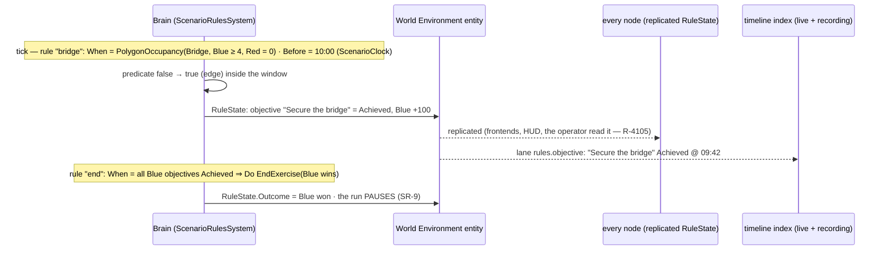
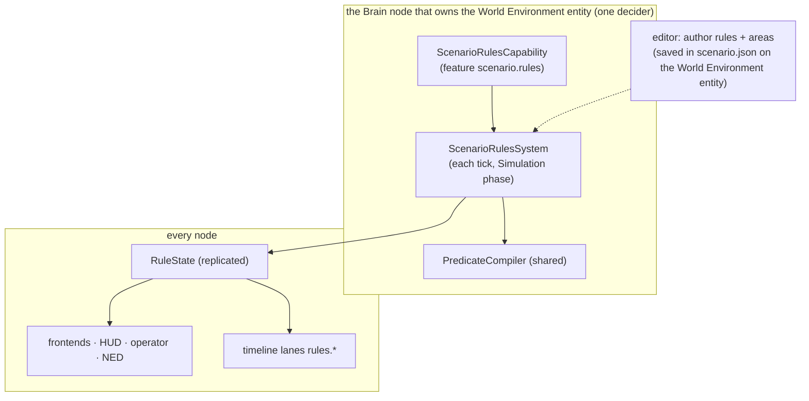

<!--STATUS
state: LIVE
build-state: DESIGN — rev 2 (2026-10-31): the user's answers folded in (§0); SR-2/SR-10/SR-11/SR-12 revised; examples §6
updated: 2026-10-31 (first version — coordinator)
current-answer: §2 the claim table · §3 the diagrams · §4 decisions SR-1…SR-12 · §5 slices
stale-below: nothing
known-rot: none
known-conflict: none
related-designs:
  - docs/PLAN_Training_And_Gameplay_Engine.md — P-1 (the user's top item); R-4105 (data over NED), R-4108 (every element a feature)
  - docs/Predicate-Infrastructure-Capabilities.md — OWNS the ONE condition model (SearchPredicateDto, PredicateCompiler; R-4077) every rule condition is
  - docs/DESIGN_Scenario_Regression.md — §3 OWNS the checks grammar (anchors, do, expect windows, never, atEnd) the rules grammar shares
  - docs/DESIGN_Director_Timeline_Editor.md — §9c–§9e OWN the registered timeline lanes; rule outcomes become a lane
  - docs/designs/weather/DESIGN_Weather_And_Time.md — W-0 / C-3 OWN the World Environment entity (8810) and ScenarioClock the rules live on
  - docs/blueprints/Blueprint_Subsystem_Runtime_Detailed_Design.md — OWNS the world-singleton Blueprint path (S3's escape hatch)
  - docs/DESIGN_Node_Features.md — every rule element is a feature (R-4108)
  - docs/DESIGN_Player_Join.md — spawn areas (D-11) and score (D-15) the rule actions reuse
-->

# DESIGN — **scenario rules** *(objectives, triggers, timers, end of exercise — for training and for games)*

> 🔒 **User, `2026-10-31`:** *"The point number one seems to have the most value for me."* · *"Let's please dive into the point number one, which I
> think is the most important for now."* — P-1: objectives, end conditions, triggers at SCENARIO scope (training: *"secure the bridge by 10:00"*,
> phase lines, evaluation; game: capture points, time limit, tickets, win / lose).

## 0. ✅ The user's answers (`2026-10-31`)

> 🔒 *"The scenario rules and objectives are a perfect use case for some kind of scenario-wide blueprint, first real one. But please keep on mind that
> blueprint is just one way of creating some decision logic. That the decision logic needs to be authorable also using C# hard-coded methods …
> something like the behavior action or something which already unifies the approach across different implementing strategies. And yes, best if
> the rules are data … it is still a reusable condition that we can use also in the B3s and HSM guards"* · *"we should have one [evaluator], and it
> will be used by filming director as well as a scenario and mission objectives and rules"* · lean 5 accepted · pause at the end = a switchable
> feature · *"we should broadcast the event that the mission has finished, and we should be able to provide all the data … But it's not our task to
> build a nice UI for that, maybe just a debugging one … nothing that pops up automatically"* · *"we would also need to define what station is the
> IOS or the instructor"*.

**The idea in one line:** a scenario carries **rules** — *when this condition holds (in this window), do these actions* — whose conditions are the
engine's ONE predicate model (R-4077), evaluated LIVE on the node that owns the scenario's World Environment entity; every outcome is replicated
state, a NED fact (R-4105) and a timeline lane, so a frontend, an evaluation (P-4) and a replay all read the same truth.

## 1. INVENTORY *(`2026-10-31` — an Explore pass over code and docs; `search_graph` Class `.*(Mission|Objective|Trigger|Rule|Check|Cue|Anchor|Area|Zone|Blueprint.*Host|Condition).*` + grep; spot-verified)*

| what exists | where | for rules |
|---|---|---|
| **the ONE condition model** — `SearchPredicateDto` + `PredicateCompiler`; runs LIVE every tick today (`DataBreakpointSystem`); edge detection left to the caller | `Fdp.Toolkits/ReplayBrowser/Search/`; `Predicate-Infrastructure-Capabilities.md` §1, §3.3, §7; **R-4077** | ⭐ every rule CONDITION is a predicate — no second language |
| the checks grammar — anchors, `do` (set a component), `expect` with after / before windows, `never`, `atEnd`, any / all / atLeast; 103 `checks.json` | `Hrot.Editor/Director/ScenarioChecks.cs` 15-235; Regression §3 | ⭐ the rules grammar's shape; ⚠ its evaluator (`ConditionBook`) is EDITOR-only (reads `DebugApiService` JSON) |
| the cue evaluators `AnchorBook.HoldsFor` / `HoldsOnLaneEntry` (near, task, side, health, embark, gesture; shot, hit, blast) | `Hrot.Presentation/Map3D/Director/AnchorBook.cs` 311-383 | pure comparisons — lowered onto predicates, not called from the server (it is the UI library) |
| a scenario-level host: the **World Environment entity** (TKB 8810: no position, one per scenario, owned by the Brain that loaded it) carrying `ScenarioClock`, `WeatherConditions` | `TkbEntityTypes.cs:120`; `ScenarioClock.cs:20`; Weather W-0 / C-3 | ⭐ where rules, objective states and the outcome live (saved, loaded, replicated by the existing machinery) |
| world-scope Blueprints: `TickWorldSingletons` (`self = Entity.Null`), `RegisterWorldSingleton` / `AddWorldSingleton`, `IsWorldSingleton` in the IR | `BlueprintTickSystem.cs:80, :169`; `BlueprintRegistry.cs:84, :244` | ✅ runtime exists — ⛔ **no production caller** (measured): S3 wires it |
| areas: `EditablePolyline` + its own TKB type per kind; live tests `PointInPolygon`, `PolygonMath.Contains`, EQS `EntitiesOfForceInArea` | `EntitiesInAreaGenerator.cs` 40-110; `PolygonMath.cs:29` | ⭐ an objective area = a new area type; "N of side X inside" exists as a query |
| timeline lanes registered as DATA (`IndexedLaneDefinition` + predicate + projection) | Timeline §9c-§9e | ⭐ `rules.objective` / `rules.outcome` lanes for free |
| missions: `MissionTask` PLANNED / ACTIVE / DONE / FAILED; commands JUMP / APPEND / INSERT / REPLACE / ABORT; `/missions` routes | `MissionDescriptors.cs`, `MissionMessages.cs` | ⭐ the "order side / unit to do X" action |
| ⛔ missing | — | live server evaluator · "unit killed" and "enters polygon" predicates · actions: message, spawn, end exercise, award points · any `end exercise` command |

## 2. Claim table

| claim | code — how it IS | design — how it was MEANT to be |
|---|---|---|
| conditions must be the shared predicate model | ✅ `PredicateCompiler`, live in `DataBreakpointSystem` | ✅ R-4077 *"one condition model"* |
| the predicate model can run live every tick | ✅ `DataBreakpointSystem` | ✅ Predicate doc §3.3 |
| polygon entry is not a predicate yet | ✅ only a box | ✅ Predicate doc §6 TE-3 (planned) |
| the World Environment entity is scenario-level and Brain-owned | ✅ `TkbEntityTypes.cs:120` | ✅ Weather W-0 / C-3 |
| world-scope Blueprints are built but unused | ✅ no caller of `RegisterWorldSingleton` | ✅ Runtime DD (designed) |
| the checks evaluator cannot run on a server | ✅ `ConditionBook` reads `DebugApiService` | ✅ Regression §0 (*"the cluster is not judged"*) |

## 3. Diagrams

```mermaid
classDiagram
    direction LR
    class ScenarioRulesCapability { <<new, composed on the Brain>> declares the scenario.rules features · registers the system }
    class ScenarioRulesSystem { <<new, Brain>> each tick: evaluate the active rules' predicates (edge-detected) · run their actions · write the states }
    class RuleSet { <<new component on the World Environment entity, authored + saved>> Rules · Objectives · Areas by id }
    class Rule { <<new>> Id · When: predicate (R-4077) · Window after / before · Once or Repeat · Do: actions · Feature id }
    class Objective { <<new>> Id · Side · Title · State: Pending / Active / Achieved / Failed · Points }
    class RuleState { <<new component, replicated>> objective states · fired rules · the outcome per side · points per side }
    class RuleAction { <<new, one class per kind>> Message · SetObjective · EndExercise · AwardPoints · SpawnGroup · MissionCommand · SetSkillAmplifier }
    class PredicateCompiler { <<existing, grows>> + PolygonOccupancy (TE-3) · + UnitKilled · + ScenarioTime }
    class ObjectiveArea { <<new area type, the WeatherRegion pattern>> EditablePolyline + Side }
    class TimelineLaneCatalog { <<existing>> + rules.objective · rules.outcome lanes }
    class WorldEnvironment { <<existing entity 8810>> ScenarioClock · WeatherConditions · + RuleSet · + RuleState }
    ScenarioRulesCapability *-- ScenarioRulesSystem
    WorldEnvironment *-- RuleSet
    WorldEnvironment *-- RuleState
    RuleSet *-- Rule
    RuleSet *-- Objective
    Rule ..> PredicateCompiler : When
    Rule *-- RuleAction : Do
    ScenarioRulesSystem ..> RuleSet : reads
    ScenarioRulesSystem ..> RuleState : writes
    PredicateCompiler ..> ObjectiveArea
    TimelineLaneCatalog ..> RuleState : projects
```



*What the picture shows that prose hid:* the rules add ONE system and two components on an entity that already exists, saves and replicates —
the conditions are the existing predicate compiler (three new predicate kinds), so a rule cannot disagree with a data breakpoint, a film cue or a
replay search.





*Caption:* the system is reached only on a node that composes the capability AND owns the World Environment entity — one decider, as the
deploy server; ⚠ the silent-dead edge is a cluster whose Brain does not compose the capability: the rules are then inert, so the master
refuses to start a scenario that HAS rules when no node advertises `scenario.rules` (the run would otherwise silently have no objectives).

## 4. Decisions (⭐ leans for the user)

| # | decision | ⭐ lean |
|---|---|---|
| **SR-1** | what a rule is | **When** a predicate becomes true (edge-detected) — optionally within a **window** (after / before a scenario time or another rule) — **Do** a list of actions; **Once** or **Repeat** |
| **SR-2** | the condition language | ⭐ **rev 2:** a rule names a **condition primitive** — ONE registry of named, parameterised conditions, each implemented by ONE of three strategies: a **data predicate** (`SearchPredicateDto`, R-4077 — also searchable in a recording), a **C# method** (the existing `[SharedAiCondition]` — 104 of them, `Fbt.Kernel/SharedAiAttributes.cs:14` — so the SAME condition is a BTree condition, an HSM guard and a rule condition), or a **Blueprint** hosted as a condition (`AiPrimitiveHosting.BTreeCondition` / `HsmGuard`, + a new `RuleCondition` hosting). Scope: a rule runs with `self` = the World Environment entity; a per-unit condition is quantified (`any` / `all` / `atLeast n` over the units a filter selects — the checks grammar's quantifiers) |
| **SR-3** | new predicate kinds | `PolygonOccupancy(area, side, count op n)` (the planned TE-3), `UnitKilled(unit / class / side)`, `ScenarioTime(op t)`, `ObjectiveState(id, state)` — each also usable by data breakpoints and replay search |
| **SR-4** | objectives | first-class: id, side, title, state, points — so a frontend can list them and an evaluation can score them without parsing rules |
| **SR-5** | v1 actions | `Message` (to a side / all), `SetObjective`, `AwardPoints`, `EndExercise(outcome per side)`; S2: `SpawnGroup` (the deploy's spawn areas), `MissionCommand` (JUMP / ABORT … the existing routes), `SetSkillAmplifier` (P-5) |
| **SR-6** | where it runs | a `ScenarioRulesSystem` from the capability `scenario.rules`, on the Brain that owns the World Environment entity — one decider; composed by default on a Brain node (rules are military training too) and switchable (R-4108) |
| **SR-7** | where rules live | a `RuleSet` component on the World Environment entity, saved in `scenario.json` by the existing save path; objective areas are their own area type (the `WeatherRegion` pattern) |
| **SR-8** | the output | a replicated `RuleState` (objective states, outcome, points per side) — the NED fact a frontend reads (R-4105) — and timeline lanes `rules.objective` / `rules.outcome` (replay, AAR, P-4) |
| **SR-9** | the end of the exercise | ⭐ **rev 2:** `EndExercise` sets the outcome and BROADCASTS **`ExerciseEnded`** carrying the full result — every objective with its state, details, times and points, the outcome per side, the performance indicators (P-4) — as a NED fact (R-4105). Pausing is the feature `scenario.rules.pause-on-end` (lean ON). ⛔ never an automatic unload. The result UI is a frontend's (R-4105); the engine ships only a **debug panel** (feature `ui.rules-debug-panel`): a dockable panel listing objectives, rules fired and the result — it **never pops up by itself** |
| **SR-10** | authoring v1 | **data, not code**: a rules section in the editor (a list: condition · window · actions), the JSON grammar shaped like `checks.json` (anchors, windows, any / all / atLeast) |
| **SR-11** | ONE evaluator (rev 2: ✅ the user) | ⭐ the SAME evaluator serves the **film director's cues, the scenario rules, the mission objectives and the regression checks** — `AnchorBook`'s cue kinds become condition primitives; | ⭐ the checks and the rules share the grammar AND the evaluator: a regression `expect` becomes a rule whose action is "record pass / fail" — ⛔ `ConditionBook`'s editor-only path then retires (R-4077, ruling 9: no two implementations) |
| **SR-12** | custom logic | ⭐ rev 2: a new condition or action is authored as C# (`[SharedAiCondition]` / a shared action in the `Hrot.AI.Behaviors` module) OR as a Blueprint — and is then a NAMED primitive the data rules call. The scenario-wide **world-singleton Blueprint** (*"first real one"*) is the host for logic data rules cannot express: S2, not S3 — on the World Environment entity (the runtime exists, `RegisterWorldSingleton` gets its first caller at load) with event nodes for `ObjectiveChanged` / `RuleFired` and action nodes for SR-5's actions |

**Rejected — one line each:**
- *Blueprints only* — every objective would need a visual script; data rules cover the common cases and stay replayable and editable by a non-programmer.
- *A rules-only condition language* — R-4077.
- *Rules evaluated on the master / orchestrator* — no ECS world there (R-4102).
- *Missions as the rules system* — a mission is ONE unit's task sequence, not the scenario's objectives; missions stay the action target.
- *Ending a run by unloading* — the instructor loses the moment to review.

| **SR-13** | the instructor station (IOS) | ⭐ the node where the instructor works is a COMPOSITION choice like the Player: the server's full UI is it by default (R-4107, Zeus); the feature `ui.rules-debug-panel` is ON there and OFF elsewhere; any other node may switch it on |
| **SR-14** | first-class objectives | ⭐ an objective is a NAMED, STATEFUL RECORD the scenario declares — not a side effect of a rule: id · side · title · brief · required or optional · visible to (sides) · success condition · fail condition · time limit · points · state (Pending / Active / Achieved / Failed) · progress (e.g. 2 of 3) · when it changed and why. A frontend lists them, an evaluation scores them, a rule reacts to them (`ObjectiveState`), a unit's MISSION may carry its own (§6b) — all without reading any rule |

## 5. Slices

| slice | builds | done when |
|---|---|---|
| **S1** | `RuleSet` / `RuleState` / `Objective`, `ScenarioRulesSystem`, the predicates `PolygonOccupancy` + `UnitKilled` + `ScenarioTime` + `ObjectiveState`, actions `Message` · `SetObjective` · `AwardPoints` · `EndExercise`, the objective area type, the `rules.*` lanes, the refusal when no node advertises `scenario.rules` | a scenario "hold the bridge until 10:00 / kill the 3 technicals" plays to Blue won and Red lost on a live cluster; the outcome is on the timeline of its recording; a rail per predicate and action |
| **S2** | `SpawnGroup`, `MissionCommand`, `SetSkillAmplifier`; the editor's rules section | a wave spawns when an objective falls; an author builds S1's scenario in the editor without JSON |
| **S3** | SR-11 (checks run on the rules evaluator) · SR-12 (world-singleton Blueprints) | the 103 `checks.json` pass through the rules evaluator; `ConditionBook` retired |

## 6. Examples *(illustrative — the names of conditions and actions are registry entries, not final)*

### 6a. A scenario's rules and objectives (`scenario.json`, on the World Environment entity)

```json
"ScenarioRules": {
  "objectives": [
    { "id": "bridge", "side": "Blue", "title": "Secure the bridge by 10:00", "required": true, "visibleTo": ["Blue"], "points": 100,
      "success": { "cond": "AreaControlled", "args": { "area": "obj-bridge", "side": "Blue", "minUnits": 4, "maxEnemy": 0, "forSeconds": 60 } },
      "fail":    { "cond": "ScenarioTime",   "args": { "after": "10:00" } } },
    { "id": "technicals", "side": "Blue", "title": "Destroy the three technicals", "required": true, "points": 50,
      "success": { "cond": "UnitsDestroyed", "args": { "match": "*Technical", "count": 3 } } },
    { "id": "no-civilians", "side": "Blue", "title": "No civilian casualties", "kind": "constraint", "points": -50,
      "fail":    { "cond": "CiviliansHarmed", "args": { "by": "Blue", "atLeast": 1 } } }
  ],
  "rules": [
    { "id": "counter-attack", "once": true,
      "when": { "cond": "ObjectiveState", "args": { "id": "bridge", "is": "Achieved" } },
      "do": [ { "act": "SpawnGroup", "args": { "group": "red-counterattack", "area": "red-spawn-east" } },
              { "act": "Message",    "args": { "to": "Blue", "text": "Enemy armour approaching from the east!" } } ] },
    { "id": "end", "once": true,
      "when": { "any": [ { "cond": "AllObjectives", "args": { "side": "Blue", "required": true, "is": "Achieved" } },
                         { "cond": "ScenarioTime",  "args": { "after": "10:30" } } ] },
      "do": [ { "act": "EndExercise", "args": { "outcome": "byObjectives" } } ] }
  ]
}
```

`AreaControlled`, `UnitsDestroyed`, `CiviliansHarmed` — each ONE registry entry, implemented once (a predicate, a `[SharedAiCondition]` C# method
or a Blueprint) and equally usable in a BTree, an HSM guard, a film cue or a check.

### 6b. A mission objective (a unit's / squad's mission task, `MissionPlan`)

```json
{ "task": "ClearBuilding", "params": { "building": "B4" },
  "objective": { "title": "Clear building B4", "points": 30,
                 "success": { "cond": "AreaClear", "args": { "area": "bld-B4", "enemy": "Red" } },
                 "fail":    { "cond": "SquadCombatIneffective", "args": { "below": 0.5 } } } }
```

The task ends DONE / FAILED by the same evaluator, and its objective appears in the result beside the scenario's.

### 6c. What `ExerciseEnded` carries (the NED fact, R-4105)

```json
{ "outcome": { "Blue": "Won", "Red": "Lost" }, "endedAt": "10:12:31", "reason": "rule end: all required Blue objectives achieved",
  "objectives": [ { "id": "bridge", "state": "Achieved", "at": "09:42:10", "points": 100, "details": "held 60 s, 5 Blue / 0 Red" },
                  { "id": "technicals", "state": "Achieved", "at": "10:12:31", "points": 50, "progress": "3 / 3" },
                  { "id": "no-civilians", "state": "Failed", "at": "09:55:02", "points": -50, "details": "civilian 1043 wounded by Blue Rifleman 2" } ],
  "points": { "Blue": 100 }, "indicators": "→ P-4 performance evaluation" }
```
