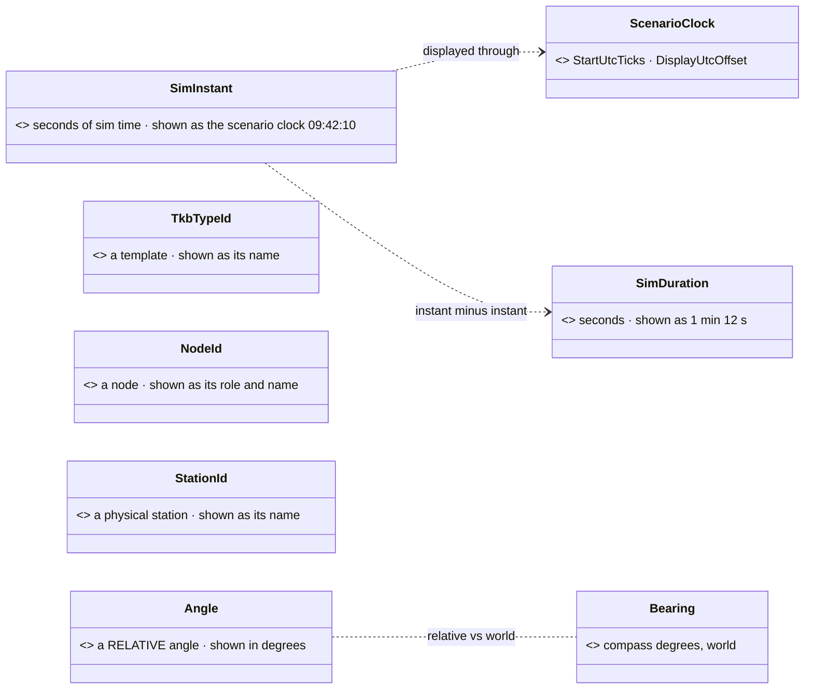

<!--STATUS
state: LIVE
build-state: DESIGN — ✅ ACCEPTED 2026-11-01 (user: "Okay, accepting your suggestions.") · SV-2 + SV-3 BUILT 2026-11-02 (CE-4200, §2.1 as-built) · tracker: SV-1 CE-4201 · SV-2 + SV-3 bundled into CE-4200 · SV-4 CE-4202 · SV-5 CE-4203 · SV-6 CE-4204
updated: 2026-11-02 (SV-2 / SV-3 as-built folded in — backend)
current-answer: §2 the candidates, ranked, with leans · §3 the shared pattern
stale-below: nothing yet
known-rot: none
known-conflict: none
related-designs:
  - docs/UX/DESIGN_Details_Forms.md — E2: a form row's type picks its editor and unit
  - docs/UX/DESIGN_Editing_UX.md — §0a: the editing-UX review counts on these types to give every field its editor and display by type (user, 2026-11-06)
  - docs/DESIGN_Scenario_Rules.md — §9.8.0 / §9.8.9 / §9.8.10 OWN the first semantic types (WorldPoint, WorldRotation, Bearing, EntityLink / PointLink / AreaLink); this document applies the same pattern elsewhere
  - docs/blueprints/DESIGN_Entity_Reference.md — D5 "the TYPE makes a field pickable" — the rule every type here follows
  - docs/blueprints/DESIGN_Map_Picking_Unification.md — P5, the same rule for locations
  - docs/blueprints/Architect_Question_107_NED_Wire_Frame_And_Names.md — E (one id width) and I (SI units on the wire) — the precedent for unifying widths and units
  - docs/blueprints/Blueprint_Issues_Tracker.md — CE-4200 (entity ids 32-bit) — a TkbTypeId type keeps the two id kinds apart after it
-->

# DESIGN — **semantic value types** *(a specific type where a generic one hides the meaning)*

> 🔒 **User, `2026-11-01`:** *"Please try to find other opportunity where in the engine we can use specific data type instead of a generic one to
> provide more semantical information."*

## 1. INVENTORY *(`2026-11-01`; grep over `Fdp.Core`, `Fdp.Toolkits`, `Hrot.Core`, `Hrot.AI.Behaviors`, `Hrot.Network.NED` public fields; graph
`^(SimTime|SimInstant|Duration|Seconds|Metres|Meters|Speed|TkbTypeId|NodeId|StationId|Probability|Ratio|Percent)$` — ⛔ no such type exists; ⚠ coverage unchecked)*

| generic today | count | what is hidden | evidence |
|---|---|---|---|
| time as `float` / `double` | **303** fields | an INSTANT (a moment of sim time) vs a DURATION (seconds) — and their precision: **29 instants are `float`**, 111 are `double` | `SquadReport.ObservedAt` is `float` beside `SentAt` `double` (`SquadReportMessages.cs:50-52`); `ReceivedAt`, `LastSitrepAt`, `StartedAt`, `RiotAt` … `float` |
| template ids `long` / `int` `*Tkb*` | **54** sites | a TKB TEMPLATE id, not an entity id — and after CE-4200 they differ in width | `TkbIdentity`, `EntityMaster.TkbType` |
| node ids `int` / `long` | **43** fields: **26 `int`, 17 `long`** | the same concept in two widths (the AQ107 E disease, for nodes) | `OriginNodeId`, `AppInstanceId`, `OwnerNode` … |
| angles `float` | 14 unsuffixed (`Yaw`, `Elevation`, `Azimuth`, `Pitch`, `SteerAngle` …) + 8 `*Deg` + 4 `*Rad` | the UNIT (degrees or radians) lives in a name suffix, or nowhere | grep |
| `Guid` | 49 fields | what it identifies: `RequestId` ×28 (correlation), `TransactionId` ×4, `ExerciseId` ×4, `EpisodeId` ×3, `SessionId` ×2 | grep |
| speeds / distances `float` | 131 / 169 | ⭐ nothing — SI metres and m/s by one convention, no measured confusion | grep |
| ratios / scores `float` | 19 | a 0..1 range | grep |
| station id `int` | new (SR-76a) | which physical station | `DESIGN_Scenario_Rules.md` SR-76a |

## 2. The candidates, ranked *(leans for the user)*

*What the picture shows that prose hid:* each type is the generic value plus the ONE thing a tool needs to show it meaningfully — a clock, a
name, a unit — and the instant / duration pair has the arithmetic built in (an instant minus an instant is a duration).

| # | type | ⭐ lean | why | cost |
|---|---|---|---|---|
| **SV-1** | **`SimInstant`** (`double` seconds) + **`SimDuration`** (`float` seconds) | ⭐⭐ **YES, first** | 303 time fields with two meanings; ⚠ 29 instants are `float` — at 10 h of sim time a `float` resolves only ~4 ms and it compares against `double`s elsewhere (a precision defect class, not just a label). Tools show an instant as **scenario clock time** (`ScenarioClock`, `ScenarioTime.Utc`) and *"12 s ago"*, a duration as `1 min 12 s`; `instant − instant = duration`, `instant + duration = instant` — the type refuses `instant + instant` | mostly a type change; the 29 `float` instants widen (recordings change layout) |
| **SV-2** | **`TkbTypeId`** (`long`) | ⭐⭐ **YES, with CE-4200** | once entity ids are `int32` and templates stay `int64`, a type keeps the two from being swapped; tools show the TEMPLATE NAME (`BMP-2`) instead of a number | 54 sites, a type change |
| **SV-3** | **`NodeId`** (`int`) | ⭐⭐ **YES** — and ONE width | 26 `int` / 17 `long` for one concept is exactly what AQ107 E fixed for entities; tools show the node's role and name (*"Brain #1"*) | 43 fields; a wire break for the `long` ones (fold into CE-4200's break) |
| **SV-4** | **`Angle`** (`float`, radians, SI — AQ107 I) for RELATIVE angles | ⭐ **YES, small** | the unit is in a suffix or nowhere (`Yaw`, `Elevation`, `Azimuth`); tools show degrees; ⭐ `Bearing` (SR-143) stays the WORLD compass type — the pair says relative vs world | ~26 fields |
| **SV-5** | **`StationId`** (`int`) | ⭐ **YES — from birth** | SR-76a's new station key; a type costs nothing on a new field; tools show the station's name | none (new) |
| **SV-6** | typed `Guid` ids — **`ExerciseId`**, **`EpisodeId`** | ⭐ **only these two** | a tool can OPEN them (the exercise inventory, the recording); `RequestId` / `TransactionId` / `SessionId` are correlation tokens nobody navigates to — ⛔ leave them `Guid` | 7 fields |

### 2.1 ⭐ AS-BUILT — SV-2 `TkbTypeId` and SV-3 `NodeId` *(CE-4200, `2026-11-02`)*

| | `TkbTypeId` (SV-2) | `NodeId` (SV-3) |
|---|---|---|
| type | `Fdp.Core/World/TkbTypeId.cs` — over `long`, 8 B | `Fdp.Core/World/NodeId.cs` — over `int`, 4 B |
| JSON · schema | a plain number · `{type: integer, format: tkbTypeId}` | a plain number · `{type: integer, format: nodeId}` |
| conversions | implicit OUT to `long`; explicit IN from `long`; ⛔ none from `int` (an entity id never becomes a template id) | implicit OUT to `int`; explicit IN from `int` |
| seams | `SemanticValueTypes`, `DtoJsonSchemaExtractor`, `StaticTypeRegistry` (unmanaged 8 B) | the same three (unmanaged 4 B) |
| rail | `S0IdTypesRailTests.S0_EveryTemplateIdMember_IsATkbTypeId` (saved components + params DTOs; allow-list empty) | `S0IdTypesRailTests.S0_EveryNodeIdMember_IsANodeId` (every public non-wire type; `NotANodeId` holds 4 graph-node entries) |

⭐ **CE-4209 rail for the STRING side** (the netstandard2.0 compiler / pin editors cannot see `Fdp.Core`, so they name these types by string): `SemanticValueTypesTests.EveryFdpCoreNameLiteral_*` / `EverySemanticNameLiteral_*` / `TheStaticTypeRegistry_HasAKeyForEverySemanticType` read `Stage2_Validate.cs`, `StaticTypeRegistry.cs` and `PinDefaultValueEditorRegistry.cs` and resolve every `"Fdp.Core.X"` literal against the real assembly.

⚠ **Where the build DEVIATES from §2's lean — the prior statement is SUPERSEDED:**
- ⛔ **No compiler coercion rung** for either type: `Stage3_NormalizationTests.CoercionTable_ContainsOnlyLosslessWidenings` pins the table to C#'s own widenings, and item 6's `WorldPoint` added none either. A graph crosses explicitly.
- **Constructor parameters and locals stay `int` / `long`**; only fields, properties and record components carry the type. A `(NodeId)` / `(TkbTypeId)` cast sits at the assignment. ⭐ Reason: the typed fields are what a tool reads and what the rail scans; typing every parameter was ~400 more edits for no extra safety.
- **The DDS wire stays plain primitives** (the IDL has no wrapper): the type stops at the topic boundary. `long` node ids on the wire (`SourceNodeId`, `OriginNodeId`, `StationNodeId`) became `int` — the width fix SV-3 asked for.
- ⛔ **Not a template id, left `long`:** wire types and wire-derived interfaces (`INetworkMaster`, `IDerEntity`), the `(long, int)` loadout tuples, TKB catalogue constants.
- ⛔ **Not a cluster node id, left `int`:** nav-graph `TargetNodeId` (`NavigationIntent`, `FollowRoadGraphParams`), road-graph `Start/EndNodeId`, `const int` node ids (a const cannot be a struct).
- ⚠ **Name clashes:** `NodeEditor.Primitives.NodeId` (a `Guid`, `ExtDeps`) and `Hrot.NED.Common.NodeId` (a DDS struct) share the name. 14 files that import two of them take a `using NodeId = …` alias. ⭐ A future rename of `Fdp.Core.NodeId` would remove the aliases; none was needed for correctness.

| ⛔ | speeds, distances | **NO** | one SI convention, no measured confusion — 300 fields of churn for nothing a tool needs | — |
| ⛔ | ratios / scores 0..1 | **NO** | 19 fields, range is documentation-level; the evaluation `Score` (SR-75) is one field | — |

## 3. The shared pattern *(the one every accepted type follows — `WorldPoint` is the model, `DESIGN_Scenario_Rules.md` §9.8.9)*

| ⭐ rule | |
|---|---|
| **identical memory + JSON** to the generic value | recordings, blobs and files do not change (except where a WIDTH is fixed on purpose: SV-1's `float` instants, SV-3's `long` nodes) |
| **implicit conversions** where arithmetic is natural; ⛔ none where mixing is the bug (`SimInstant + SimInstant` does not compile) | call sites mostly compile unchanged |
| **the TYPE drives the tools** — `ToString`, `[DebuggerDisplay]`, the JSON schema hint (`DtoJsonSchemaExtractor`), the inspector / watch / debug API render it meaningfully | the D5 / P5 rule: the type says it, so no attribute |
| **a rail per type** | fails on a new generic field whose name says it should be the type (`*At` / `*Since` `float`, `*NodeId` `long`, `*Tkb*` `long`) unless allow-listed |

**Rejected — one line each:**
- *Attributes on generic fields (`[Seconds]`, `[NodeId]`)* — ruled against twice (D5, P5); an attribute cannot refuse `instant + instant`.
- *A full units library (metres, m/s, kg)* — the engine is SI by convention with no measured unit confusion outside angles and time.
- *Typing every `Guid`* — correlation ids are never shown to a person or opened by a tool.
