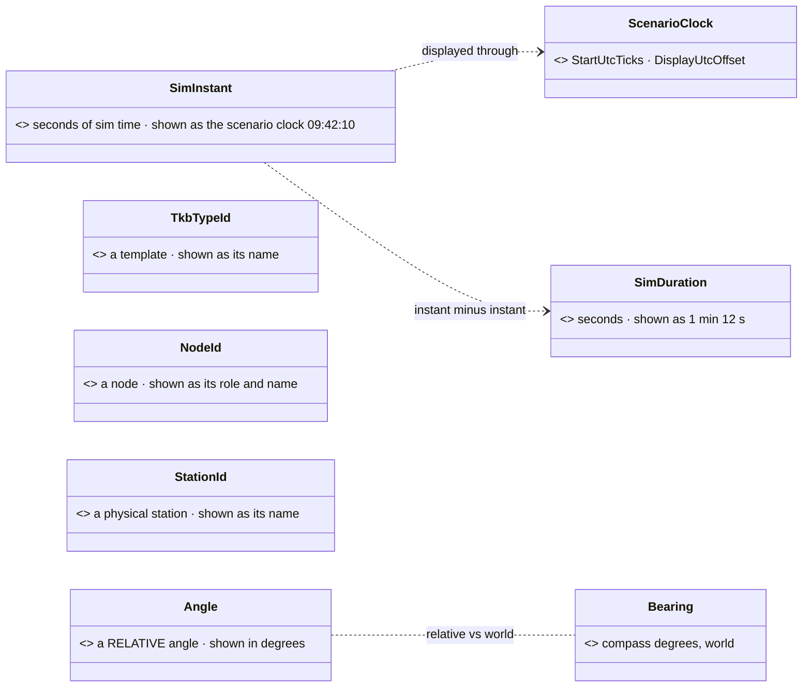

<!--STATUS
state: LIVE
build-state: DESIGN — ✅ ACCEPTED 2026-11-01 (user: "Okay, accepting your suggestions.") · SV-2 + SV-3 BUILT 2026-11-02 (CE-4200, §2.1 as-built) · tracker: SV-1 CE-4201 · SV-2 + SV-3 bundled into CE-4200 · SV-4 CE-4202 · SV-5 CE-4203 · SV-6 CE-4204
updated: 2026-11-02 (SV-2 / SV-3 as-built folded in — backend)
current-answer: §2 the candidates, ranked, with leans · §3 the shared pattern
stale-below: nothing yet
known-rot: none
known-conflict: none
related-designs:
  - docs/UX/DESIGN_Show_On_Map.md — a map preview (the ⌖) is one more tool the type drives: MapPreviews.For(type)
  - docs/UX/DESIGN_Details_Forms.md — E2: a form row's type picks its editor and unit
  - docs/UX/DESIGN_Editing_UX.md — §0a: the editing-UX review counts on these types to give every field its editor and display by type (user, 2026-11-06)
  - docs/DESIGN_Scenario_Rules.md — §9.8.0 / §9.8.9 / §9.8.10 OWN the first semantic types (WorldPoint, WorldRotation, Bearing, EntityLink / PointLink / AreaLink); this document applies the same pattern elsewhere
  - docs/blueprints/DESIGN_Entity_Reference.md — D5 "the TYPE makes a field pickable" — the rule every type here follows
  - docs/blueprints/DESIGN_Map_Picking_Unification.md — P5, the same rule for locations
  - docs/blueprints/Architect_Question_107_NED_Wire_Frame_And_Names.md — E (one id width) and I (SI units on the wire) — the precedent for unifying widths and units
  - docs/blueprints/Blueprint_Issues_Tracker.md — CE-4200 (entity ids 32-bit) — a TkbTypeId type keeps the two id kinds apart after it
-->

# DESIGN — **semantic value types** *(a specific type where a generic one hides the meaning)*

> 🔒 **User, `2026-11-01`:** *"Please try to find other opportunity where in the engine we can use specific data type instead of a generic one to
> provide more semantical information."*

## 1. INVENTORY *(`2026-11-01`; grep over `Fdp.Core`, `Fdp.Toolkits`, `Hrot.Core`, `Hrot.AI.Behaviors`, `Hrot.Network.NED` public fields; graph
`^(SimTime|SimInstant|Duration|Seconds|Metres|Meters|Speed|TkbTypeId|NodeId|StationId|Probability|Ratio|Percent)$` — ⛔ no such type exists; ⚠ coverage unchecked)*

| generic today | count | what is hidden | evidence |
|---|---|---|---|
| time as `float` / `double` | **303** fields | an INSTANT (a moment of sim time) vs a DURATION (seconds) — and their precision: **29 instants are `float`**, 111 are `double` | `SquadReport.ObservedAt` is `float` beside `SentAt` `double` (`SquadReportMessages.cs:50-52`); `ReceivedAt`, `LastSitrepAt`, `StartedAt`, `RiotAt` … `float` |
| template ids `long` / `int` `*Tkb*` | **54** sites | a TKB TEMPLATE id, not an entity id — and after CE-4200 they differ in width | `TkbIdentity`, `EntityMaster.TkbType` |
| node ids `int` / `long` | **43** fields: **26 `int`, 17 `long`** | the same concept in two widths (the AQ107 E disease, for nodes) | `OriginNodeId`, `AppInstanceId`, `OwnerNode` … |
| angles `float` | 14 unsuffixed (`Yaw`, `Elevation`, `Azimuth`, `Pitch`, `SteerAngle` …) + 8 `*Deg` + 4 `*Rad` | the UNIT (degrees or radians) lives in a name suffix, or nowhere | grep |
| `Guid` | 49 fields | what it identifies: `RequestId` ×28 (correlation), `TransactionId` ×4, `ExerciseId` ×4, `EpisodeId` ×3, `SessionId` ×2 | grep |
| speeds / distances `float` | 131 / 169 | ⭐ nothing — SI metres and m/s by one convention, no measured confusion | grep |
| ratios / scores `float` | 19 | a 0..1 range | grep |
| station id `int` | new (SR-76a) | which physical station | `DESIGN_Scenario_Rules.md` SR-76a |

## 2. The candidates, ranked *(leans for the user)*

*What the picture shows that prose hid:* each type is the generic value plus the ONE thing a tool needs to show it meaningfully — a clock, a
name, a unit — and the instant / duration pair has the arithmetic built in (an instant minus an instant is a duration).

| # | type | ⭐ lean | why | cost |
|---|---|---|---|---|
| **SV-1** | **`SimInstant`** (`double` seconds) + **`SimDuration`** (`float` seconds) | ⭐⭐ **YES, first** | 303 time fields with two meanings; ⚠ 29 instants are `float` — at 10 h of sim time a `float` resolves only ~4 ms and it compares against `double`s elsewhere (a precision defect class, not just a label). Tools show an instant as **scenario clock time** (`ScenarioClock`, `ScenarioTime.Utc`) and *"12 s ago"*, a duration as `1 min 12 s`; `instant − instant = duration`, `instant + duration = instant` — the type refuses `instant + instant` | mostly a type change; the 29 `float` instants widen (recordings change layout) |
| **SV-2** | **`TkbTypeId`** (`long`) | ⭐⭐ **YES, with CE-4200** | once entity ids are `int32` and templates stay `int64`, a type keeps the two from being swapped; tools show the TEMPLATE NAME (`BMP-2`) instead of a number | 54 sites, a type change |
| **SV-3** | **`NodeId`** (`int`) | ⭐⭐ **YES** — and ONE width | 26 `int` / 17 `long` for one concept is exactly what AQ107 E fixed for entities; tools show the node's role and name (*"Brain #1"*) | 43 fields; a wire break for the `long` ones (fold into CE-4200's break) |
| **SV-4** | **`Angle`** (`float`, radians, SI — AQ107 I) for RELATIVE angles | ⭐ **YES, small** | the unit is in a suffix or nowhere (`Yaw`, `Elevation`, `Azimuth`); tools show degrees; ⭐ `Bearing` (SR-143) stays the WORLD compass type — the pair says relative vs world | ~26 fields |
| **SV-5** | **`StationId`** (`int`) | ⭐ **YES — from birth** | SR-76a's new station key; a type costs nothing on a new field; tools show the station's name | none (new) |
| **SV-6** | typed `Guid` ids — **`ExerciseId`**, **`EpisodeId`** | ⭐ **only these two** | a tool can OPEN them (the exercise inventory, the recording); `RequestId` / `TransactionId` / `SessionId` are correlation tokens nobody navigates to — ⛔ leave them `Guid` | 7 fields |

### 2.1 ⭐ AS-BUILT — SV-2 `TkbTypeId` and SV-3 `NodeId` *(CE-4200, `2026-11-02`)*

| | `TkbTypeId` (SV-2) | `NodeId` (SV-3) |
|---|---|---|
| type | `Fdp.Core/World/TkbTypeId.cs` — over `long`, 8 B | `Fdp.Core/World/NodeId.cs` — over `int`, 4 B |
| JSON · schema | a plain number · `{type: integer, format: tkbTypeId}` | a plain number · `{type: integer, format: nodeId}` |
| conversions | implicit OUT to `long`; explicit IN from `long`; ⛔ none from `int` (an entity id never becomes a template id) | implicit OUT to `int`; explicit IN from `int` |
| seams | `SemanticValueTypes`, `DtoJsonSchemaExtractor`, `StaticTypeRegistry` (unmanaged 8 B) | the same three (unmanaged 4 B) |
| rail | `S0IdTypesRailTests.S0_EveryTemplateIdMember_IsATkbTypeId` (saved components + params DTOs; allow-list empty) | `S0IdTypesRailTests.S0_EveryNodeIdMember_IsANodeId` (every public non-wire type; `NotANodeId` holds 4 graph-node entries) |

⭐ **CE-4209 rail for the STRING side** (the netstandard2.0 compiler / pin editors cannot see `Fdp.Core`, so they name these types by string): `SemanticValueTypesTests.EveryFdpCoreNameLiteral_*` / `EverySemanticNameLiteral_*` / `TheStaticTypeRegistry_HasAKeyForEverySemanticType` read `Stage2_Validate.cs`, `StaticTypeRegistry.cs` and `PinDefaultValueEditorRegistry.cs` and resolve every `"Fdp.Core.X"` literal against the real assembly.

⚠ **Where the build DEVIATES from §2's lean — the prior statement is SUPERSEDED:**
- ⛔ **No compiler coercion rung** for either type: `Stage3_NormalizationTests.CoercionTable_ContainsOnlyLosslessWidenings` pins the table to C#'s own widenings, and item 6's `WorldPoint` added none either. A graph crosses explicitly.
- **Constructor parameters and locals stay `int` / `long`**; only fields, properties and record components carry the type. A `(NodeId)` / `(TkbTypeId)` cast sits at the assignment. ⭐ Reason: the typed fields are what a tool reads and what the rail scans; typing every parameter was ~400 more edits for no extra safety.
- **The DDS wire stays plain primitives** (the IDL has no wrapper): the type stops at the topic boundary. `long` node ids on the wire (`SourceNodeId`, `OriginNodeId`, `StationNodeId`) became `int` — the width fix SV-3 asked for.
- ⛔ **Not a template id, left `long`:** wire types and wire-derived interfaces (`INetworkMaster`, `IDerEntity`), the `(long, int)` loadout tuples, TKB catalogue constants.
- ⛔ **Not a cluster node id, left `int`:** nav-graph `TargetNodeId` (`NavigationIntent`, `FollowRoadGraphParams`), road-graph `Start/EndNodeId`, `const int` node ids (a const cannot be a struct).
- ⚠ **Name clashes:** `NodeEditor.Primitives.NodeId` (a `Guid`, `ExtDeps`) and `Hrot.NED.Common.NodeId` (a DDS struct) share the name. 14 files that import two of them take a `using NodeId = …` alias. ⭐ A future rename of `Fdp.Core.NodeId` would remove the aliases; none was needed for correctness.

| ⛔ | speeds, distances | **NO** | one SI convention, no measured confusion — 300 fields of churn for nothing a tool needs | — |
| ⛔ | ratios / scores 0..1 | **NO** | 19 fields, range is documentation-level; the evaluation `Score` (SR-75) is one field | — |

### 2.2 ⭐ AS-BUILT — SV-6 `ExerciseId` and `EpisodeId` *(CE-4204, `2026-11-06`)*

| | `ExerciseId` | `EpisodeId` |
|---|---|---|
| type | `Fdp.Core/World/ExerciseId.cs` — over `Guid`, 16 B | `Fdp.Core/World/EpisodeId.cs` — over `Guid`, 16 B |
| JSON · schema | a plain GUID string · `{type: string, format: exerciseId}` | a plain GUID string · `{type: string, format: episodeId}` |
| conversions | implicit OUT to `Guid`; explicit IN from `Guid`; `==` / `!=` also mixed with a raw `Guid`; `Empty`, `NewId()` | the same |
| seams | `SemanticValueTypes`, `DtoJsonSchemaExtractor`, `StaticTypeRegistry` (unmanaged 16 B) | the same three |
| typed members | `RecordingConfiguration` / `RecordingModule` / `ReplayModule.RecordedExerciseId` / `ClusterView` / `ClusterOpIntents` ×2 / `ClusterCqrsEvents` ×2 + `ExerciseInventoryItem` / `ReplaySession` / `NodeOpPayloads` ×3 / handler payloads / `FederatedReplayManager` / `RecordingGroup` / `RecordingBranch` / `RecordingMetadata` ×2 (recorded, JSON identical) / `ExerciseBranch.Of` / `LoadPhaseContext` / `RecordingLedgerEntry` / `ClusterMaster.ActiveExerciseId` / `ClusterUiCache.ActiveExerciseId` | `EpisodeTag` (recorded, 16 B) / `EpisodeReplayTag` / `ManageEpisodeIntent` / `EpisodeHandlerPayload` / `EpisodeConsensusAggregator` |
| rail | `S0IdTypesRailTests.S0_EveryExerciseOrEpisodeIdMember_IsTyped` (every public non-wire type of the four assemblies; allow-list `NotAnExerciseOrEpisodeId` empty) + `ExerciseId_And_EpisodeId_AreAGuidsMemory_…` (size, JSON round-trip of `RecordingMetadata`) | same rail |

⚠ **Where the build DEVIATES from §2 — the prior statement is SUPERSEDED:**
- **Constructor parameters, locals and private fields stay `Guid`** (a `(ExerciseId)` cast sits at the assignment), as §2.1.
- **The DDS wire stays plain `Guid`**: `OrchestrationMessages` topic structs, and the JSON payload DTOs that ride them (`OrchestrationPayloadDtos`) — the type stops at that boundary, the cast sits in the translators (`ClusterOpMasterTranslator`, `NodeOpSlaveTranslator`, `ClusterFactsIngress`, `EcsRecordReplayController`).
- **Left `Guid`, outside the rail's four assemblies:** `RecordingName.ExerciseId` (Hrot.Presentation), `IRunModeHost.ActiveExercise` / `ClusterTimeTransportAdapter.ActiveExercise` (no `Id` suffix), `RunModeChoice.LastExercise`.
- ⛔ **Not done here:** "render them as links" — a clickable link in an inspector / the debug API is UI work; the type, `ToString` and the schema `format` are what a tool now keys on.

### 2.3 ⭐ AS-BUILT — SV-4 `Angle` *(CE-4202, `2026-11-07`)*

| | `Angle` |
|---|---|
| type | `Fdp.Core/World/Angle.cs` — over `float`, 4 B, **radians** |
| JSON · schema | a plain number (radians) · `{type: number, format: angle}` |
| conversions | implicit OUT to `float`; explicit IN from `float`; `Angle ± Angle`, `−Angle` stay an `Angle`; `FromDegrees`, `Degrees`; `ToString` = degrees (`12.5°`) |
| seams | `SemanticValueTypes` (storage `float`), `DtoJsonSchemaExtractor`, `StaticTypeRegistry` (unmanaged 4 B); ⛔ no compiler coercion rung (as §2.1) |
| rail | `S0IdTypesRailTests.S0_EveryRelativeAngleMember_IsAnAngle` (a bare `float` named `Yaw` / `Pitch` / `Elevation` / `Azimuth` / `Roll`, or ending `Angle` / `Rad`, outside the wire types; skips a last word `Deg` / `Degrees` / `Sec` and any `Rate`) |

⭐ **Typed (measured radians AND relative):** `TurretPose.Azimuth` / `Elevation` · `LookState.HeadYaw` · `AirFollower.Pitch` / `Roll` · `VehicleState.SteerAngle` · `VehicleParams.MaxSteerAngle` · `FormationParams.WedgeAngleRad` · `FormationSlot.HeadingOffset` (relative to the leader) · `StationSeat.TraverseMin` / `Max` / `ElevationMin` / `Max` · `BodyBox.FaceYaw` · `RestingPose.Pitch` / `Roll`. Layout is unchanged (4 B each).

⚠ **Left, and why (the rail's `NotARelativeAngle` names each):**
- **world direction, radians** — `ManualDrive.Yaw`, `OperatorInput.Yaw`, `OperatorControlFrameEvent.Yaw` (an ABSOLUTE yaw), `AirFollower.OrbitAngle` (polar angle in the world frame), `DangerAreaDescriptor.AngleRad` (the footprint's world yaw). They want a world-direction-in-radians type, not decided here.
- **a unit of its own** — every `*Deg` / `*Degrees` field (`TurnRateDeg`, `MaxBankDeg`, `MinElevationDeg`, `FieldOfViewDegrees`, `DiveAngleDeg` …) and `FireSolution.Solution.Elevation` (degrees); rates (`MaxSteerRate`, `*DegPerSec`).
- **world compass** — `LookNodes.LookParams.Bearing` is compass DEGREES (its doc says so): a `Bearing`, not converted here. `EngagementArea.LeftBearing` / `RightBearing` / `WatchBearing` and `WorldSurveyModel.Bearing` carry no unit in code or doc — left untouched, to be measured when `Bearing` is applied to them.
- **generated** — `VehicleKit.RestElevation` is filled with float literals by the generated `VehicleBody.WeaponKits.g.cs`; it moves with its generator.
- `WorldSurveyModel.HalfArc` (a radians half-width on a view model, not a component or DTO) and `SoundDto.PitchJitter` (a pitch ratio, not an angle).
- **the DDS wire stays `float`** (`SimDescriptors` Azimuth / Elevation / HeadYaw / Steer / Yaw, `DangerAreaDdsTopics.AngleRad`, the interaction messages): the cast sits in the translators.

### 2.4 ⭐ AS-BUILT — SV-1 first slice: `SimInstant` + `SimDuration` and the `float` instants *(CE-4201, `2026-11-07`)*

| | `SimInstant` | `SimDuration` |
|---|---|---|
| type | `Fdp.Core/World/SimTime.cs` — over `double`, 8 B, seconds of sim time | same file — over `float`, 4 B, seconds |
| JSON · schema | a plain number · `{type: number, format: simInstant}`; ⭐ a NON-FINITE value as a marker string `"-inf"` / `"+inf"` / `"nan"` (CE-3441) | same (CE-3441) |
| conversions | implicit OUT to `double`; **explicit IN** from `double` (a raw number becomes an instant only on purpose) | implicit both ways with `float` |
| arithmetic | `instant − instant = SimDuration`; `instant ± SimDuration = SimInstant`; ⛔ `instant + instant` is declared **`[Obsolete(error)]`** | `±`, unary `−` stay a `SimDuration` |
| seams | `SemanticValueTypes` (storage `double` / `float`), `DtoJsonSchemaExtractor`, `StaticTypeRegistry` (unmanaged 8 B / 4 B), `RingEntryScanner.CompileKey` (a key field of a semantic type keys as its storage number — found by the replay-browser rails) | same |
| rail | `S0IdTypesRailTests.S0_EveryAtSinceUntilMember_IsNotABareFloat` (a bare `float` whose last word is `At` / `Since` / `Until`, outside the wire types; allow-list `NotAnInstant` with a reason each) + `SimInstant_AndSimDuration_AreTheirPrimitivesMemoryAndJson_WithTheRightArithmetic` | same |

⭐ **Non-finite values (CE-3441, `2026-11-14`).** "Never" is written as `(SimInstant)double.NegativeInfinity` (`SquadUnitSense.AskedAt`) — JSON has no
number for it, so every golden snapshot and `GET /entities` (CE-1471) failed on such a row. Both converters now write `"-inf"` / `"+inf"` / `"nan"`
(raw bytes: the default encoder escapes `+`) and read them back; a finite value stays a plain number, so no file moves. ⛔ A `double`/`float`
field with a non-finite value is still the dump options' own converters' job, not this one's. Rails: `SimTimeJsonTests` (round-trip, red-proved),
`DebugApiNonFiniteTimeTests`.

⚠ **Why `instant + instant` needed the `[Obsolete(error)]` operator:** with the implicit conversion to `double`, `a + b` quietly binds to the predefined `double + double`. A declared `+(SimInstant, SimInstant)` wins overload resolution and is an error; making the conversion TO `SimInstant` explicit alone would not have stopped it.

**Classified (30 bare-`float` `*At` / `*Since` / `*Until` members the rail found):**
- ⭐ **17 instants → `SimInstant`** (widened to 8 B; recordings change layout, accepted): `BrainJournalEntry.At` (entry 32 → 40 B) · `CommandOrderEntry.At` · `CommandReportEntry.At` · `CommandReport.ObservedAt` · `ReportedElement.ObservedAt` / `ReceivedAt` · `PendingRequest.ReceivedAt` · `QueuedReport.DueAt` · `RelayedElement.SentAt` · `ReportOutbox.LastSitrepAt` / `LaunchSentAt` / `MutedUntil` / `SpotSentAt` · `SubordinateRow.LastReportAt` / `LastSitrepAt` / `OrderedAt` · `ConvoyPlan.PhaseAt`. Beside them, outside the rail's name pattern: `ReportOutbox.SupportAskedTime` / `ReinforceAskedTime`.
- ⭐ **5 play-relative offsets → `SimDuration`** (seconds since the PLAY started, not absolute sim time): `MarchMemory.LeadProgressAt` / `HaltSince` / `HaltsAllowedAt` / `LeadArrivedAt`, `SquadAirborneExitParams.LastJumpAt`.
- ⛔ **8 not time (allow-list):** `TerrainOpening.At` (metres along a wall) · `CivilianParams.AlarmAt` / `PanicAt` / `RiotAt` and their `CivilianParamsJsonDto` twins (stress / attitude LEVELS) · `Vars.StartedAt` of the generated `SubordinateForEachDemo` blueprint (a blueprint scalar variable).
- **Wire:** `SquadReport.ObservedAt` (DDS) widened `float` → `double`; the translators cast at the boundary. Display copies (`BrainChange.At`, `BrainHistoryRow.At`, `RuleJournalEntry.At`, the Reports window and debug-API `now`) are `double`.
- `CommandPictureOps.Now` returns a `SimInstant` (it was a `float` cast of `GlobalTime.TotalTime`); every `float now` in the squad command stack is a `SimInstant`.

**Left for the rest of SV-1:** the ~270 other time fields — the `double` instants (`SentAt`, `EndedAt`, `PlayAt` …) and the bare-`float` durations (`*Seconds`, `*Timeout`, `Cooldown` …) — and the private UI clocks in `Hrot.Presentation` (`PossessionStation._hoSince` …, `FallScreen.Since`, outside the rail's public-member scan). Tools do not yet show a `SimInstant` as scenario-clock time (the schema `format` is what a tool keys on).

#### SV-1 remainder — inventory *(B-18 S-a, `2026-11-07`)*

**Queries run.** The rail's own scan — a throwaway reflection pass over every public type of the four rail assemblies (`Fdp.Core`, `Fdp.Toolkits`, `Hrot.Core`, `Hrot.AI.Behaviors`; the DDS wire types in `Hrot.Network.NED` are outside it) listing every `double` member whose last word is `At` / `Since` / `Until` / `Time` / `Timestamp` and every `float` member whose last word is `Seconds` / `Timeout` / `Cooldown` / `Delay` / `Interval` / `Duration` / `Time` — **plus** `scripts/cbm.sh search_graph {name_pattern:".*(Since|Until|At)$", label:Field}` (378 fields of all types; it shows no field TYPE, so it cannot count doubles) and grep over non-test source: `double …(At|Since|Until)` **148** declarations, `float …(Seconds|Timeout|Cooldown|Delay|Interval|Duration)` **400** (both include private fields, locals and `Stride/`, hence more than the public-member scan). ⚠ `search_code` returned 0 for these regexes (its pattern dialect; not coverage-checked — `check_index_coverage` is not in the CLI). `Stride/` compiles outside `HROT.sln` for its Windows app and holds no component or params field of these shapes.

| assembly | → `SimInstant` | float instant → `SimInstant` | → `SimDuration` | double duration | authored DTO (S-d) | not time (allow-list) |
|---|---|---|---|---|---|---|
| `Fdp.Core` | 0 | 0 | 1 | 0 | 0 | 19 |
| `Fdp.Toolkits` | 75 | 5 | 50 | 1 | 24 | 40 |
| `Hrot.Core` | 1 | 0 | 8 | 0 | 41 | 1 |
| `Hrot.AI.Behaviors` | 85 | 1 | 63 | 0 | 1 | 0 |
| **total** | **161** | **6** | **122** | **1** | **66** | **60** |

**double → `SimInstant` (S-b) — 161:** `ActionStatusRow` (At); `AdvanceState` (RetriedAt, IssuedAt); `AirArmedSearchState` (QuietSince); `AirAttackState` (WarnedAt, EvadeUntil, StartedAt); `AreaEffectCloud` (BornAtSimSeconds, LastStepSimSeconds); `BatonChargeState` (Since, NextStrikeAt); `BatteryFireParams` (ImpactAt); `BehaviorFaultNotification` (SimTime); `BehaviorState` (RunSince); `Block` (DownSince, EdgeAt, WaitUntil, CooldownUntil); `CalloutState` (LastAt); `CivilianState` (LastFrightAt, HeardAt, HostileActAt, EffectFrightUntil, ForceSeenUntil); `ClearAreaParams` (AskedAt); `ClearBuildingParams` (AskedAt); `ClearRoomParams` (AskedAt); `CoverClaim` (Until); `Crowd` (FormedAt); `Custody` (SearchUntil); `Decoy` (Until, FiredAt); `DefencePosts` (StageSince, HuntSince, RoundAt, RoundSince); `Descent` (PhaseSince); `DetonateChargeState` (Since); `DetonationTrace` (Time); `EditOutcome` (At); `EffectFlight` (FiredAt); `EffectState` (StunnedUntil, IrritatedUntil, KnockedDownUntil); `EndExerciseState` (StartedAt); `EngageAircraftState` (StartedAt, LastAirAt, RetryFireAt); `EvadeGrenadeState` (BurstAt, AskedAt, ThrownAt, StepUntil, GoneAt); `ExerciseEndedEvent` (EndedAt); `ExerciseResult` (EndedAt); `FightFromCoverState` (EscalatedAt); `FireAtPointNodeParams` (FireAt); `FireAtPointParams` (FireAt); `FiringPositionMemory` (PhaseAt, PhaseUntil); `HeardTrace` (Time); `HoldTheLineState` (NextStrikeAt); `HostileAct` (SinceSimTime); `HullDownAttackParams` (GoAt); `InsertMacroState` (AskedAt); `Lifespan` (BornAtSimSeconds); `LookState` (GlanceSince, RestUntil); `MemberOrder` (FireAt); `MissileWarning` (At); `MissionCommandState` (IssuedAt); `NavigationHandleMark` (At); `ObjectiveStatus` (ChangedAt, ExpectedAt); `ObserveFireParams` (CalledAt); `OperatorOrderOutcome` (FinishedAt); `Order` (IssuedAt); `OrderState` (IssuedAt); `PanicState` (Since, HideUntil); `PeekAndFireState` (PhaseUntil, ExposedAt, LastSeenAt, WaitingSince, ReactingSince, LeanAt, BlindAt); `PendingUnitCommand` (AskedAt); `PlatoonAttackPlan` (AskedAt); `PlatoonDefencePlan` (AskedAt); `PlayerMessageEvent` (SentAt); `ProtestState` (NextMillAt, NextGestureAt); `PushThroughState` (Since); `ReactToContactState` (StageSince, DecidedAt); `RecentBurst` (Time); `ReplicaSighting` (FirstAt, StillSince); `Restless` (StillSince, NextAt, GestureUntil, NextGestureAt, GestureCheckAt); `RiotState` (NextLookAt, NextStrikeAt, NextThrowAt, BendUntil); `RoomDrillState` (BreachSince, EnterSince, ClearSince, StepSince, BangAt, QuietSince, ContactSince); `RoutineState` (PauseUntil); `RunTokenMark` (At); `ShelterFromAirState` (StartedAt, LastAirAt, RetryFireAt); `ShotRecord` (RaisedAt, FiredAt); `ShotTrace` (Time); `SoundEmission` (Time); `SoundTimeline` (At); `SpotForFireParams` (RestUntil); `SquadDangerCrossingParams` (PhaseSince); `SquadDrillState` (PhaseSince); `SquadDrillTrace` (PhaseSince); `SquadLeadership` (SilentUntil); `SquadPlayState` (StartedAt, IssuedAt, LastTickAt); `SquadReportLogEntry` (SeenAt); `SquadReportNotification` (SentAt); `SquadUnitSense` (AskedAt); `StationWeaponState` (Since); `Step` (At); `Stress` (LastStimulusAt, LastStepAt, CalmSince); `SurrenderState` (CoveredAt, Since); `TriggerIedState` (Since); `UnderFire` (LastTime); `UnderFireMove` (DownSince, SubSince, UpSince, ReactedFireAt, CoveredUntil, PinnedSince); `Utterance` (Until); `VehicleFightFromCoverParams` (HoldUntil); `VehicleFightFromCoverState` (PhaseUntil, ExposedAt, SeenSince, WaitingSince); `WarningLog` (ShowUntil); `WeaponFireIntent` (RaisedAt); `WeaponFireNotification` (FiredAt); `WeaponSystemState` (Until)

**float instant → `SimInstant` (S-b, widened) — 6:** `BlueprintLatentCursor` (WaitUntilTime); `DangerAreaCognitiveBuffer` (LastUpdateTimeSeconds); `DangerAreaSensor` (LastRefreshSimTime); `EqsCognitiveBuffer` (LastUpdateTimeSeconds); `HillAttackMutableState` (EqsRequestTime); `WorldSurveyStatus` (LastUpdateTimeSeconds)

**float → `SimDuration` (S-c) — 122:** `AdvanceParams` (CooldownSeconds); `AimAndFireParams` (CooldownSeconds); `AirArmedSearchOrder` (QuietSeconds); `AirArmedSearchParams` (QuietSeconds); `AirStop` (HoldSeconds); `AreaEffectCloud` (IrritantSeconds, Seconds); `AssembleAfterDropParams` (TimeoutSeconds); `BTreeTraceRecord` (Duration); `BallisticProjectile` (BurnSeconds); `BatonChargeParams` (Seconds); `Block` (ForSeconds, HoldSeconds, CaptureSeconds, AssistSeconds, Delay, Cooldown); `BoundingOverwatchParams` (BoundTimeoutSeconds); `BreakContactParams` (BoundTimeoutSeconds); `CasualtyCareParams` (CoveringSeconds, PhaseTimeoutSeconds); `CivilianParams` (PauseMinSeconds, PauseMaxSeconds, HideMinSeconds, HideMaxSeconds); `ConvoyPlan` (ClearSeconds); `DamageAssessedEvent` (EffectSeconds); `DangerAreaSensor` (RefreshIntervalSeconds); `DangerAreaSettings` (RefreshSeconds); `DangerSensorParams` (RefreshSeconds); `DetonateChargeParams` (Seconds); `ElementReportedParams` (FreshSeconds); `EngageAircraftParams` (ClearSeconds); `EngageParams` (CooldownSeconds); `EqsTacticsParams` (FireCooldownSeconds); `EvadeGrenadeParams` (FuzeSeconds); `FightFromCoverParams` (QuietSeconds, FlankAfterSeconds); `FireAndMovementParams` (CoveringSeconds, RushTimeoutSeconds); `FireAtPointNodeParams` (CooldownSeconds); `FireAtPointParams` (CooldownSeconds); `FireAtTargetParams` (CooldownSeconds); `FlightParams` (EnduranceSeconds); `FrustrationTicks` (NoProgressSeconds, WallHeldSeconds); `GameplaySettings` (RespawnDelaySeconds); `HeatRules` (CoolHalfLifeSeconds); `HeldFuze` (BurnSeconds); `Lifespan` (Seconds); `LookParams` (StepSeconds); `MessageParams` (Seconds); `MissionPlanQueue` (PhaseElapsedSeconds); `MoveLegParams` (SitrepEverySeconds); `NavRouteWaypoint` (HoldSeconds); `ObjectiveCommon` (DeadlineSeconds); `ObjectiveCommonBlock` (DeadlineSeconds); `ObjectiveStatus` (Delay, Cooldown); `PeekAndFireParams` (ExposeSeconds, GraceSeconds, SuppressedSeconds, FireCooldownSeconds, CoolHalfLifeSeconds, NoCoverSeconds); `PickUpGrantEvent` (FuzeSeconds, BurnSeconds); `PlayerMessageEvent` (Seconds); `PushThroughParams` (TimeoutSeconds); `ReportingRequirements` (SitrepEverySeconds); `Roe` (ReturnFireWindowSeconds); `RouteWaypoint` (HoldSeconds); `SavedRoe` (ReturnFireWindowSeconds); `SetReportingEvent` (SitrepEverySeconds); `SetRoeEvent` (ReturnFireWindowSeconds); `SetSubordinateReportingParams` (SitrepEverySeconds); `ShelterFromAirParams` (ClearSeconds, FindSeconds); `ShotRecord` (CaughtUpSeconds); `SopContactParams` (LingerSeconds); `SopSenseParams` (Seconds); `SpotForFireOrder` (RestSeconds); `SpotForFireParams` (RestSeconds); `SquadAirborneExitParams` (IntervalSeconds, TimeoutSeconds); `SquadDangerCrossingParams` (PhaseTimeoutSeconds); `SquadDismountParams` (TimeoutSeconds); `SquadEmbarkParams` (TimeoutSeconds); `SquadFastRopeParams` (TimeoutSeconds); `SquadHoldParams` (DurationSeconds); `StanceIntent` (BlendTime); `StationWeaponParams` (Seconds); `SubordinateFreshParams` (WithinSeconds); `SupportCommandParams` (AirDefenceFreshSeconds); `SuppressAndManeuverParams` (PhaseTimeoutSeconds); `SuppressContactParams` (CooldownSeconds); `SurrenderParams` (Seconds); `TkbCompositionDef` (CommandDisruptionSeconds); `TkbCompositionDefBuilder` (CommandDisruptionSeconds); `TrafficDemand` (StepSeconds); `TriggerIedParams` (TimeoutSeconds); `UnderFireMove` (SubSeconds); `UnitEntity` (CommandDisruptionSeconds); `VehicleFightFromCoverParams` (ExposeSeconds, WatchSeconds, FireCooldownSeconds, NoCoverSeconds); `VisualEffectState` (Duration, ElapsedTime); `WeaponFireIntent` (FuzeSeconds, BurnSeconds); `WeaponMount` (AimSeconds, ReloadSeconds); `WeaponPosture` (IdleSeconds); `WeaponState` (ReloadSeconds, PendingSeconds, RefusalHoldSeconds); `WeaponSystemParams` (DeploySeconds, PackSeconds); `WeaponTask` (CooldownSeconds); `WorldSurveyRead` (AgeSeconds); `WorldSurveyRequest` (RefreshSeconds)

**double duration — 1:** `NetworkAckPeerSet` (TimeoutSeconds)

**authored DTO (S-d) — 66:** `AdvanceToParamsJsonDto` (CooldownSeconds); `AssembleAfterDropParamsJsonDto` (TimeoutSeconds); `BatonChargeParamsJsonDto` (Seconds); `BehaviorProfileDto` (DefaultRoeReturnFireWindowSeconds); `BoundingOverwatchParamsJsonDto` (BoundTimeoutSeconds); `BreakContactParamsJsonDto` (BoundTimeoutSeconds); `CivilianParamsJsonDto` (PauseMinSeconds, PauseMaxSeconds, HideMinSeconds, HideMaxSeconds); `ClearAreaObjectiveParamsJsonDto` (ForSeconds); `CombatPostureAdvanceJsonDto` (CooldownSeconds); `CountParamsJsonDto` (AssistSeconds); `DetonateChargeParamsJsonDto` (Seconds); `EffectVisualDto` (Duration, FadeSeconds); `EvadeGrenadeParamsJsonDto` (FuzeSeconds); `ExpendableDto` (LifeSeconds); `FightFromCoverParamsJsonDto` (QuietSeconds); `FireAndMovementParamsJsonDto` (RushTimeoutSeconds); `FireAtPointParamsJsonDto` (CooldownSeconds, FireAt); `FireAtTargetParamsJsonDto` (CooldownSeconds); `FlightParamsDto` (EnduranceSeconds); `HandItemDto` (LiesSeconds); `HoldAreaParamsJsonDto` (HoldSeconds, CaptureSeconds); `InjuryDefDto` (BleedOutSeconds); `MissileDto` (MaxFlightSeconds); `MontageDefDto` (DefaultBlendInTime, DefaultBlendOutTime, DurationSeconds); `MontageNotifyRefDto` (TimeSeconds); `ParachuteDto` (OpenSeconds, LandingSeconds); `PlatoonBoundParamsJsonDto` (SitrepEverySeconds); `PlatoonConvoyParamsJsonDto` (ClearSeconds); `PlatoonHoldParamsJsonDto` (FreshSeconds); `PushThroughParamsJsonDto` (TimeoutSeconds); `ReactToContactParamsJsonDto` (DecideAfterSeconds, PhaseTimeoutSeconds); `ScenarioTimePredicateDto` (FromSeconds, ToSeconds); `SquadAirborneExitParamsJsonDto` (IntervalSeconds, TimeoutSeconds); `SquadDangerCrossingParamsJsonDto` (PhaseTimeoutSeconds); `SquadDismountParamsJsonDto` (TimeoutSeconds); `SquadEmbarkParamsJsonDto` (TimeoutSeconds); `SquadFastRopeParamsJsonDto` (TimeoutSeconds); `SquadHoldParamsJsonDto` (DurationSeconds); `StanceTransitionDto` (DefaultBlendTime); `StationWeaponParamsJsonDto` (Seconds); `SupportCommandParamsJsonDto` (AirDefenceFreshSeconds); `SuppressAndManeuverParamsJsonDto` (PhaseTimeoutSeconds); `SuppressParamsJsonDto` (CooldownSeconds); `SurrenderParamsJsonDto` (Seconds); `TriggerIedParamsJsonDto` (TimeoutSeconds); `TriggerParamsJsonDto` (Delay, Cooldown); `WarheadDto` (EffectSeconds, CloudSeconds); `WeaponMountDto` (AimSeconds, ReloadSeconds, BarrelCoolSeconds); `WeaponSystemDto` (DeploySeconds, PackSeconds)

**not time / clock / config (allow-list) — 60, each with its reason:**

- the SOURCE clock / a recording or clock-control value: stays double; a SimInstant is taken FROM it: `GlobalTime.TotalTime`, `GlobalTime.UnscaledTotalTime`, `FrameOuterHeader.SimTime`, `FrameMetadata.SimTime`, `CheckpointMark.TotalTime`, `CheckpointMark.UnscaledTotalTime`, `ClusterTimeObservation.ResumeSimTime`, `ClusterTimeObservation.SnapshotSimTime`, `ISimClock.TotalTime`, `WorldSimClock.TotalTime`, `AdvanceFrameIntent.TargetSimTime`, `JumpTimeIntent.TotalTime`
- an angular RATE (degrees per second), not a length of time: `MissileDto.TurnRateDegPerSec`, `TurretDto.TraverseRateDegPerSec`, `TurretDto.ElevationRateDegPerSec`, `GuidedRound.TurnRateDegPerSec`
- the replay UI model (wall seconds): `ReplaySession.LivePointSeconds`, `ReplaySession.LoopFromSeconds`, `ReplaySession.LoopToSeconds`
- the per-frame dt — the clock itself: `GlobalTime.DeltaTime`, `GlobalTime.UnscaledDeltaTime`
- the type's own storage: `SimInstant.Seconds`, `SimDuration.Seconds`
- CONFIG: `RunnerOptions.FixedDeltaSeconds`, `SubsystemConfig.FixedDeltaSeconds`
- a step of an authored TEST SCRIPT (JSON), not runtime state: `TestStep.Time`, `TestStep.Interval`
- an export OPTION (a recorded-time window): `JsonExportOptions.StartTimeSec`, `JsonExportOptions.EndTimeSec`
- recording configuration (a keyframe cadence): `RecorderTickSystem.CheckpointingSeconds`, `RecordingConfiguration.CheckpointingSeconds`
- replay-loop control (wall / recorded axis): `SetReplayLoopIntent.FromSeconds`, `SetReplayLoopIntent.ToSeconds`
- replay-loop control (recorded axis): `SetReplayLoopIntent.FromSimSeconds`, `SetReplayLoopIntent.ToSimSeconds`
- the repository's float clock accessor (the clock itself): `EntityRepository.SimulationTime`
- the clock's own clamp: `TimeSystem.MaxDeltaTime`
- a replay-control service read by the UI (recorded axis), not state: `IRecordReplayController.CurrentReplaySimSeconds`
- a replay-control service read by the UI (wall / recorded axis), not state: `IRecordReplayController.ActiveReplayDurationSeconds`
- recording-file configuration (a keyframe cadence): `RecordingMetadata.CheckpointingSeconds`
- recording review metadata (the recorded axis): `ReviewMark.AtSimSeconds`
- the view's float clock accessor (the clock itself): `ISimulationView.Time`
- a replay timeline point (the recorded axis): `Point.SimSeconds`
- a replay timeline stretch (the recorded axis): `Stretch.SimSeconds`
- a clock-control intent (a frame step): `StepTimeIntent.DeltaSeconds`
- CONFIG (a command-line / options value set by reflection): `TimeConfig.FixedDeltaSeconds`
- CONFIG (a command-line option set by reflection): `RunnerConfiguration.FixedDeltaSeconds`
- WALL-clock duration of a test run: `TestReport.DurationSeconds`
- an authored TEST SCRIPT (JSON), not runtime state: `TestScript.Duration`
- WIRE stamp: the replicated sample's sim time, copied from the DDS double by the translator: `NetworkTransform.SimStamp`
- recording configuration carried by a control intent: `TransitionStateIntent.CheckpointingSeconds`
- a replay control intent on the RECORDED axis (clock-control, like the clocks): `TransitionStateIntent.TargetSimSeconds`
- a replay control intent on the RECORDED axis: `SeekReplayIntent.TargetSimSeconds`
- the replay UI model (wall seconds after the zero): `ReplaySession.LengthSeconds`
- the replay UI model (recorded axis): `ReplaySession.LivePointSimSeconds`
- recording configuration carried by a load payload: `EditLoadHandlerPayload.CheckpointingSeconds`
- a replay handler's display of the recorded frame's sim time: `ReferenceReplayLoadHandler.ReplaySimSeconds`
- a replay-prepare RESULT (recording length): `ReplayPrepareResult.DurationSeconds`
- the per-frame dt handed to a behaviour: `BehaviorRunContext.DeltaTime`
- recording configuration carried by a load context: `LoadPhaseContext.CheckpointingSeconds`

**Outside the public-member scan (named, not counted):** the private UI clocks of `Hrot.Presentation` (`PossessionStation._hoSince` …, `FallScreen.Since`) and the many method locals; they are view state, not saved or replicated, and stay primitive. **Not found by the name patterns but time:** `Lifespan.BornAtSimSeconds`, `AreaEffectCloud.BornAtSimSeconds` / `LastStepSimSeconds` (doubles, → `SimInstant`), `NetworkAckPeerSet.TimeoutSeconds` (a `double` duration: `SimDuration` is a float, so it stays a double — allow-listed in S-c), the `float` instants `DangerAreaCognitiveBuffer` / `EqsCognitiveBuffer` / `WorldSurveyStatus.LastUpdateTimeSeconds`, `DangerAreaSensor.LastRefreshSimTime`, `BlueprintLatentCursor.WaitUntilTime`, `HillAttackMutableState.EqsRequestTime` (widened to `SimInstant`, recordings change layout like the first slice's).

#### ⭐ AS-BUILT — SV-1 S-b: the instants *(B-18, `2026-11-07`)*

**163 fields → `SimInstant`** (`Fdp.Toolkits` 76 · `Hrot.AI.Behaviors` 86 · `Hrot.Core` 1; 90 behaviour-state structs, 55 components, 11 params, 7 event / record classes): the 156 `double` members memory- and JSON-identical (8 B, a plain number — saves, recordings and scenario files do not move); the **float instants widened** to 8 B, like the first slice's — `DangerAreaSensor.LastRefreshSimTime` and `HillAttackMutableState.EqsRequestTime` (recordings of those two components change layout). **~560 call sites** changed, all by the compiler's own list: an explicit `(SimInstant)` where a raw `double` becomes an instant (assignments from `ctx.Now` / `GlobalTime` / `view.Time` — there is no `SimInstant`-returning clock yet, so the clocks stay `double` and the cast is the one deliberate seam), `.Seconds` where a `JsonNode` / `ToString("F")` / `Assert.Equal(int, …)` wants the number. Reading is free (implicit out to `double`), so `now - state.Since`, comparisons and `Math.Max` against the clocks compile unchanged.

**Rail:** `S0IdTypesRailTests.S0_EveryAtSinceUntilTimeMember_IsNotABareDouble` (the double twin of the float rail: a public `double` whose last word is `At` / `Since` / `Until` / `Time` outside the wire types fails unless `NotAnInstant` says why; the stale-entry rail covers both). Red-proof: `Utterance.Until` turned back into a `double` ⇒ the rail names it. It caught one miss of the converter itself (a second `SurrenderState` nested in `SurrenderBehavior`).

**Allow-listed (15), each with its reason** — the 12 SOURCE clocks / recording and clock-control values (`GlobalTime.TotalTime` / `UnscaledTotalTime`, `ISimClock.TotalTime`, `WorldSimClock.TotalTime`, `ClusterTimeObservation.ResumeSimTime` / `SnapshotSimTime`, `CheckpointMark.TotalTime` / `UnscaledTotalTime`, `FrameOuterHeader.SimTime`, `FrameMetadata.SimTime`, `AdvanceFrameIntent.TargetSimTime`, `JumpTimeIntent.TotalTime`: stay `double`, a `SimInstant` is taken FROM them) · `NetworkTransform.SimStamp` (the replicated sample's DDS stamp) · `TestStep.Time` (authored test script) · `FireAtPointParamsJsonDto.FireAt` (an authored JSON DTO — S-d).

⛔ **Stopped, not converted (R-106 — the premise failed on a blueprint-facing field): 4 float instants** — `BlueprintLatentCursor.WaitUntilTime` (the blueprint COMPILER emits `Cursor.WaitUntilTime = __tN` from a float IR temp in every compiled blueprint) and `DangerAreaCognitiveBuffer` / `EqsCognitiveBuffer` / `WorldSurveyStatus.LastUpdateTimeSeconds` (`BecomesStale` emits `float age = time - buffer.LastUpdateTimeSeconds`; the sensor decls baked into the shipped `.bp.json` name the field's type and `SensorKindBaker` finds it by reflection). Widening them reddened 7 blueprint rails (`CE3072_Q4_BecomesStale…`, `CE3078_Bake_…`, `CE3078_EveryShippedSensorDecl_…`, `EqsResult_BecomesStale…`, `CE3072_B0_Sizes`, a Roslyn compile of a generated blueprint, …) and was reverted; it is **a blueprint-lane item** (the compiler's type map + a re-bake). They stay `float` and are not in the float rail's name pattern.

**Gates** — built `HROT.sln` (0 errors after a `dotnet restore`; a stale restore had produced phantom `DdsTopicName` / `PlayerSubsystem` errors); every touched suite run, the reds compared with the same tests at `569867345` (a clean worktree): `Fdp.Toolkits.Tests` 4636 pass / 1 red *(pre-existing: `WeaponPosture.Point`)* · `Hrot.SimHost.Tests` 2480 / 5 *(4 pre-existing — `StrictNetworkSeparation`, `TheDescriptorMapIsWired`, `BehaviourHostingSnapshot`, `WeatherRegionsDemo` — and `LoadPhaseChain…CE3345`, green alone: an order flake)* · `Hrot.Blueprints.Tests` 4237 / 4 *(all four pre-existing)* · `Hrot.Editor.Tests` 820 / 2 and `AiShared.Tests` 2208 / 1 *(pre-existing)* · `Core` 345 · `Common` 59 · `Presentation` 1462 · `NED` 195 · `Orchestrator` 427 · `BTree.Editor` 679 · `Hsm.Editor` 674 · `Persistence` 162 all green · `ReplayBrowser.Tests` 74 / 4 and `ClusterRunner.Tests` 399 / 5 — window / catalogue / system-state-inventory drift, none about time (not compared at the base).

#### ⭐ AS-BUILT — SV-1 S-c: the durations *(B-18, `2026-11-07`)*

**110 `float` fields → `SimDuration`** (a `*Seconds` / `*Timeout` / `*Cooldown` / `Delay` / `Hold…` member of a component, behaviour state, params or event; 4 B and a plain JSON number — recordings, saves and scenario files do not move). **Field ORDER is preserved** (the converter first split `float A, Seconds;` into two lines with the duration first — which reordered a sequential struct and showed up as `ShippedTreesAreCSharpTests HullDownAttackRun`; fixed in 6 declarations, ⚠ a multi-declarator split must keep the original order). `SimDuration` gained `IFormattable` (and `SimInstant`) so `{x:F1}` / `{x:R}` interpolations keep printing a plain number (the NED directive JSON writers depend on it). Call sites: only where the compiler listed them — `.Seconds` / `(float)` at `Assert.Equal(float, SimDuration)` (DateTime-overload ambiguity), `JsonNode` / `ToString("F2")` sites in the debug API and the mission-plan renderer.

**Rail:** `S0IdTypesRailTests.S0_EverySecondsTimeoutCooldownMember_IsNotABareFloat` (a public `float` whose last word is `Seconds` / `Timeout` / `Cooldown`… outside the wire types fails unless `NotADuration` gives a reason; `S0_EveryNotADurationEntry_StillNamesAMember` keeps the list honest). Red-proof: `AimAndFireParams.CooldownSeconds` turned back into a `float` ⇒ the rail names it.

**Allow-listed, each with its reason** (`NotADuration`, 75 entries): **blueprint-facing** fields the blueprint compiler / baked sensor decls name by type (e.g. `DangerAreaSettings.RefreshSeconds` — the decl baked into `.bp.json` says `System.Single`; a blueprint-lane item) · **wire twins** whose DDS struct mirrors the field by type (`TrafficDemand.StepSeconds`, the `EntityTrafficDemandWireTests` field-by-field rail) · **authored DTOs / config** read from JSON (S-d) · **results and statistics** that are not a point on the timeline · values that are not a length of time (a rate, a half-life constant read by a blueprint).

**Gates** — `HROT.sln` 0 errors; touched suites vs the S-b baseline: `Fdp.Toolkits.Tests` 4639 / 1 red (pre-existing `S0ComponentTypesRail`; a `WeaponMountTests.CE2410` flake, green alone) · `Hrot.SimHost.Tests` 2480 / 5 (the 4 pre-existing + `LoadPhaseChain…CE3345`, the known order flake) · `Hrot.Blueprints.Tests` 4237 / 4 (pre-existing) · `Hrot.Editor.Tests` 820 / 2 · `Hrot.Editor.AiShared.Tests` 2208 / 1 · `Hrot.Core.Tests` 345 / 0 · `Hrot.Network.NED.Tests` 195 / 0 · `Hrot.Presentation.Tests` 1462 / 0 — the reds are exactly the S-b set.

#### ⭐ AS-BUILT — SV-1 S-d: the authored DTOs *(B-18, `2026-11-07`)* — ⛔ STOPPED, left primitive (R-106)

The DTO families (`Hrot.Core` `*ParamsJsonDto` ~41 `float` duration fields + `FireAtPointParamsJsonDto.FireAt`; `Fdp.Toolkits` TKB `*Dto` ~24; `Hrot.AI.Behaviors` 1) were **not converted**. Premise that failed: the JSON itself does round-trip (`SimDurationJsonConverter` / `SimInstantJsonConverter` read and write a plain number), but the rule asks it be PROVEN by an existing per-family TKB / scenario load rail, and (a) the `*ParamsJsonDto` fields are also read by the debug API's parameter advertising and the editor's schema extraction, whose rail (`ABehaviourAdvertisesItsRealParametersTests`) is already red at the base and so cannot gate the change, and (b) no per-DTO-family load rail was found for the TKB DTOs. Each DTO field stays in the `NotADuration` / `NotAnInstant` allow-list with the reason *"the authored form of <Component>.<Field>"*; converting them is a follow-up that first adds the per-family round-trip rail.

## 3. The shared pattern *(the one every accepted type follows — `WorldPoint` is the model, `DESIGN_Scenario_Rules.md` §9.8.9)*

| ⭐ rule | |
|---|---|
| **identical memory + JSON** to the generic value | recordings, blobs and files do not change (except where a WIDTH is fixed on purpose: SV-1's `float` instants, SV-3's `long` nodes) |
| **implicit conversions** where arithmetic is natural; ⛔ none where mixing is the bug (`SimInstant + SimInstant` does not compile) | call sites mostly compile unchanged |
| **the TYPE drives the tools** — `ToString`, `[DebuggerDisplay]`, the JSON schema hint (`DtoJsonSchemaExtractor`), the inspector / watch / debug API render it meaningfully | the D5 / P5 rule: the type says it, so no attribute |
| **a rail per type** | fails on a new generic field whose name says it should be the type (`*At` / `*Since` `float`, `*NodeId` `long`, `*Tkb*` `long`) unless allow-listed |

**Rejected — one line each:**
- *Attributes on generic fields (`[Seconds]`, `[NodeId]`)* — ruled against twice (D5, P5); an attribute cannot refuse `instant + instant`.
- *A full units library (metres, m/s, kg)* — the engine is SI by convention with no measured unit confusion outside angles and time.
- *Typing every `Guid`* — correlation ids are never shown to a person or opened by a tool.
