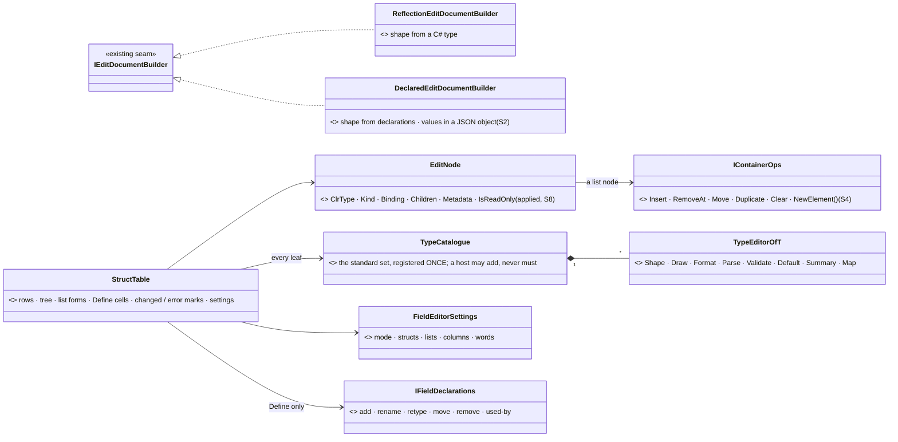
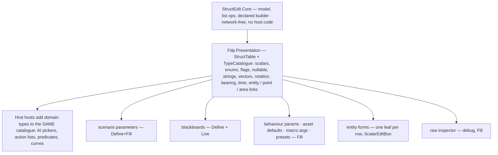
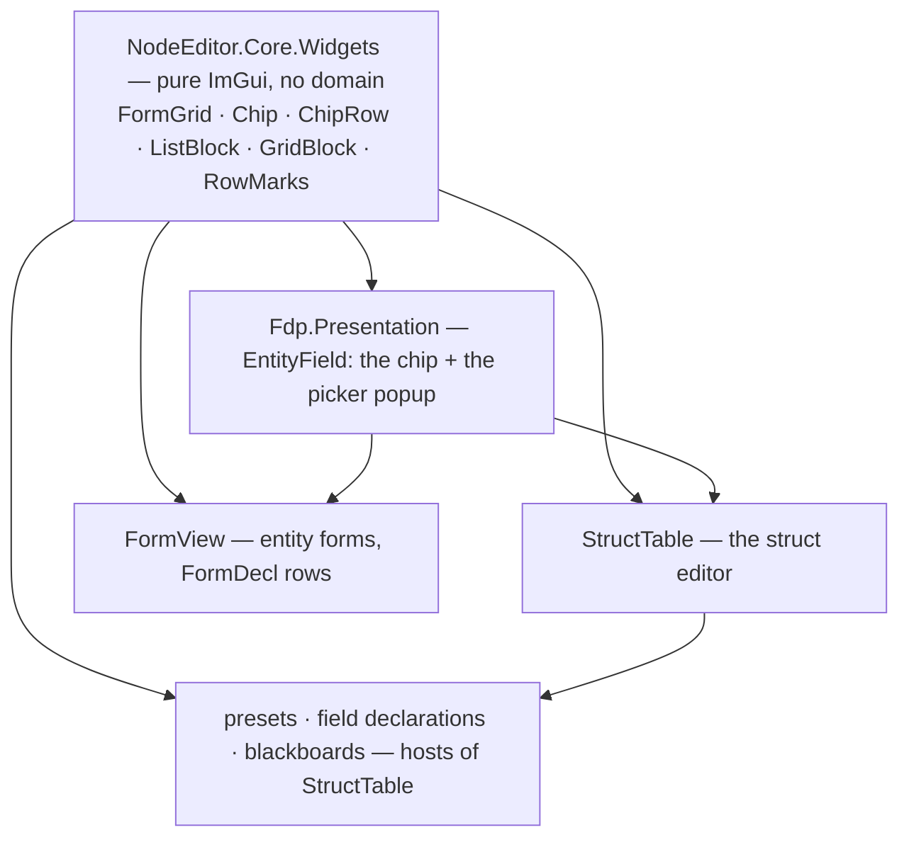

<!--STATUS
state: LIVE
build-state: DESIGN (2026-11-07, backend — decisions S1–S12 carry leans, awaiting the user)
updated: 2026-11-07
current-answer: the whole file — §1 what exists (measured) · §2 the library (UML) · §3 the type registration · §4 the list forms · §5 entities
  and places · §6 the decisions · §7 the build order · §8 ONE widget kit for every form (K1–K6)
stale-below: nothing
known-rot: none
known-conflict: DESIGN_UI_Conventions.md C4 (move the 2-column tables onto FormGrid) — S11 reconciles: the struct editor's table IS FormGrid's label
  column, one rule · DESIGN_Field_Declaration_Editor.md §6 / §6.0 — folded HERE (Define mode is this library); that doc keeps the declaration seam
related-designs:
  - docs/DESIGN_Field_Declaration_Editor.md — §6 Define mode, the host settings and field-editor-visual.svg; §6.0 D0 (merge into StructEdit) is decided HERE
  - docs/UX/DESIGN_Scenario_Presets.md — the first host: scenario parameters, Define+Fill (§5a, §5d, §5e)
  - docs/UX/DESIGN_Details_Forms.md — entity FORMS stay FormDecl / FormView (Q1, R-4120: the raw inspector is a debug tool); each form row's VALUE is this library's leaf (ScalarEditBox)
  - docs/UX/DESIGN_Condition_Editor.md — §8 X1–X4 (R-4149): names from attributes + one humanizer, NumberInput, Add <element>, the EntityLink chip — the redesign this continues
  - docs/blueprints/DESIGN_Map_Picking_Unification.md — §6 F1: ONE drawer per reference type (ReferenceLeafDrawers) — the semantic leaves here
  - docs/UX/DESIGN_Show_On_Map.md — the ⌖ (MapPreviews.For(type)) every semantic leaf carries
  - docs/UX/DESIGN_UI_Conventions.md — FormGrid (label-first), the chevron · icon · label rule, slate headers
  - docs/UX/DESIGN_Edit_Framework.md — §2.5: StructEdit stays network-free; the FieldMark hook
  - docs/blueprints/Architect_Question_21_Action_DTO_Fixed_Lists.md — fixed lists through a view provider kept host-side; StructEdit references no host code
  - FDP/ExtDeps/StructEdit/docs/DESIGN.md — the library's own design (model, builders, buffers)
-->

# DESIGN — **the struct editor**: one library that DEFINES and FILLS structures, for every type

> 🔒 User, `2026-11-07`: *"please measure the struct edit capabilities and Let's try to merge this into one highly capable and nicely looking
> structure editor."* · *"the current structure editor is somewhat weak in editing our custom data types, like for example entities. For some
> custom data types, we are already having custom serializers or custom formatters or custom renderers. But because now we are talking about
> editing the fields, we would also need to have some custom deserializers and validators. So that might be a new category."* · *"design
> everything as a shared one single nice looking and feature rich reusable library … it must be supporting all variety of the data types,
> including various array fields … Struct edit has already some solution for that, but I'm not really sure if it's practical in all cases."*
> Earlier the same day: *"shouldn't we actually extend the struct edit or somehow unify and merge both so we have just one solution which allows
> editing structures from both point of views, like defining and filling?"*

🖼 **[`docs/UX/struct-editor-visual.svg`](UX/struct-editor-visual.svg)** (Fill: every kind, the list forms, the entity picker, the row menu,
the type registration) · **[`docs/UX/field-editor-visual.svg`](UX/field-editor-visual.svg)** (Define: the same table with Name / Type cells,
the hosts' settings). 📷 Today's look, rendered `2026-11-07` (a scratch frame, not committed): index rows `[0] [1]`, *"Add single"* (a C# type
name), an EntityRef as a bare `0`, a PointLink's form switch overflowing its cell, a nullable as an empty row, no units, no "changed".

## 1. What exists — measured `2026-11-07`

**INVENTORY.** Graph: `search_graph .*FieldDrawer.* Class` → **12**, `.*FieldEditor.* Class` → **15**; grep `: IImGuiFieldDrawer` → **16**
production classes, `: ICustomFieldEditor` → **13**. Three read-only sweeps (StructEdit core · the ImGui layer · the design corpus, `docs/`
then `.dev/`). ⚠ coverage unchecked (`check_index_coverage` is not in the CLI).

| area | today | file:line |
|---|---|---|
| model | `EditDocument` → immutable `EditNode` tree (`ClrType`, `Kind` of **17**, `Binding`, `Metadata`); a session commits a boxed value | `StructEdit.Core/EditNode.cs:10-18`, `EditNodeKind.cs:9-37` |
| shape from | ⛔ a C# TYPE only — one builder, `ReflectionEditDocumentBuilder`; values live in a CLR object or native memory, never JSON | `IEditDocumentBuilder.cs:5`, `ComponentEditService.cs:58-73` |
| lists | `IContainerBinding` = `Count · CanResize · GetElementBinding · Resize` — ⛔ no insert, remove-at, move, duplicate; new reference elements are **null** | `IContainerBinding.cs:5-8`, `DynamicArrayBinding.cs:63` |
| types | ✅ scalars, bool, string, enum, struct/class/record, `T[]`/`List<T>`, fixed / inline arrays (native only), polymorphic by `[JsonDerivedType]` combo · ⚠ flags: drawn as checkboxes, JSON writes null for a combination · ⛔ `Nullable<T>` (an empty Struct row), dictionaries · ⚠ `long` parsed as `int` | `ReflectionEditDocumentBuilder.cs:343-373`, `ComponentEditDrawer.cs:543-549, 613-664` |
| custom types | ⛔ **TWO registries**: StructEdit `ICustomFieldEditor` (makes the node a leaf) + the ImGui `IImGuiFieldDrawer` dictionary EACH HOST passes — most hosts pass none ⇒ Quaternion, Guid, Type draw as grey `ToString()` outside two hosts | `ComponentEditServices.cs:17-39`, `ComponentEditDrawer.cs:484, 666-668` |
| text ⇄ value | ⛔ no parser / formatter category — ad-hoc `TryParse` per drawer; invalid text is IGNORED silently | `ComponentEditDrawer.cs:545-557`, `GuidFieldDrawer.cs:21` |
| validation | ⛔ whole-component only, on Commit; one red line under the window; nothing per field | `Validation.cs:6-20`, `ComponentEditWindow.cs:173-179` |
| changed / default / read-only | ⛔ not in the drawer — each host adds its own (`*` + Reset, `BeginDisabled`); `[EditReadOnly]` exists and is never applied | `ParamsDefaultsForm.cs:140-160`, `EditAttributes.cs:38` |
| entities | EntityLink: a chip *"Kind: Name"* + ▾ (map · list · key · clear) ✅ · EntityRef: a raw network-id box ⛔ · gone entity → `#id`, no stale mark ⛔ | `ReferenceLeafDrawers.cs:426-443, 541-626`, `LiveRefScope.cs:212-217` |
| map | ⌖ for WorldPoint, PointLink, EntityRef, EntityLink, AreaLink (`MapPreviews.Has`); pick entity / location / area edit | `MapPreview.cs:25-26`, `ReferenceLeafDrawers.cs:223-303, 507-525` |
| look | names from `[EditDisplayName]` / the humanizer, units from `[EditUnit]` / the name, `NumberInput %g`, *Add <element>* + one-x trash, `EditSummaries` (only one registered) — the R-4149 redesign | `ComponentEditDrawer.cs:713-736, 756`, `NumberInput.cs:85-88` |
| define fields | ⛔ not in StructEdit — `VariablesPanelControl` (its own table, a StructEdit session per default cell) | `VariablesPanelControl.cs:483` |
| hosts | ~20 draw sites: the raw inspector (debug), BehaviorParamsForm (AI section, mission panel, orders, rules), ParamsDefaultsForm, ParamArgsTable, VariableEditModal, node properties, ReplaySearch, the action list | the sweep, §6 of its report |

⇒ **The engine is sound** (one tree, one leaf per type, the R-4149 look); **what is missing is a TYPE contract, list operations, per-field
errors, the default/changed state, and the Define half.** None needs a second editor.

## 2. The library — one model, one table, one registration per type

*What the picture shows that prose hid: there is ONE place a type is taught to the editor (`TypeEditor<T>` in one catalogue) and ONE table —
Define is the same table drawing a document whose shape came from declarations. Today's two registries and the declaration table both disappear.*

*What it shows: every host reaches the catalogue through the table — none passes a drawer dictionary, so none can forget one.*

## 3. The type registration — `TypeEditor<T>` (the user's "new category")

| part | does | today's pieces it absorbs |
|---|---|---|
| **Shape** | leaf / structure / list (what `ICustomFieldEditor` decides now) | `ICustomFieldEditor` |
| **Draw** | the ImGui cell | `IImGuiFieldDrawer`, `ReferenceLeafDrawers` |
| **Format** | value → text: the cell, a collapsed summary, Copy | `CopyText`, `ChipLabel`, `EditSummaries`, `RotationReadout` |
| **Parse** | text → value, for typing and Paste; a refusal is a MESSAGE | the ad-hoc `TryParse`s, the network-id box |
| **Validate** | value → problems, per field, live (a key that resolves to nothing, a range) | `KeyProblem`, `RefKeyProblem`, `[EditRange]` (never enforced) |
| **Default** | a new list element's value (never null) | `Activator.CreateInstance` / null |
| **Map** | ⌖ show · ⊕ pick for a semantic type | `MapPreviews.For(type)`, the pick context |

⭐ Every part is optional: a plain `float` registers nothing and gets the built-ins; an `EntityLink` registers all seven. ⭐ The readable-JSON
form (`[JsonText]`, CE-4295) is the FILE's text, not the cell's — Parse/Format may reuse it where they agree, never require it.

## 4. The list forms — the form follows the element (mockup B1–B6)

| # | element | form | why |
|---|---|---|---|
| **B1** | a few words / numbers / enums | **inline chips on one row**, ✕ per chip, ⊕ at the end, drag to reorder | ⛔ today one row per word, `[0]` labels |
| **B2** | structures | **one SUMMARY row per item** (⋮⋮ handle · number · kind glyph · the type's Format summary · ⋮ menu); ▸ opens its fields indented | today every item expands into all fields, no summary |
| **B3** | small flat structures (≤ 4 plain fields) | a **grid** — columns = fields; ⇄ rows by a per-type setting | waypoints, wind levels read as a table |
| **B4** | fixed size (inline / fixed buffers) | **slots** — no add / remove, *"4 / 4 — fixed size"* | the native-only kinds keep working |
| **B5** | polymorphic | **Add ▾** lists the kinds with their glyphs; the item row shows its kind | today a combo on an empty item |
| **B6** | long (> 50) | starts closed, **filter + pages** of 50 | ⛔ today all rows drawn every frame |
| all | — | ⋮ / right-click: Insert above / below · Duplicate · Move up / down (Alt+↑↓) · Copy / Paste value · Reset · Delete | ⛔ today: append + trash only |

## 5. Entities and places — one chip, one picker

| | lean |
|---|---|
| **EntityRef AND EntityLink** draw the SAME chip: kind glyph · name · side colour · ▾ | ⛔ today EntityRef is a raw network-id box |
| **gone** entity | a RED chip *"gone · #42"* and a line *"the entity no longer exists — pick another or Clear"* (Validate) |
| **the picker** (▾) | type-ahead over names · side · kind · distance from the selection; then *Pick on the map · By key (@name) · Clear*; `[MapPickableEntity]` narrows it |
| **places** | WorldPoint = ONE field *"x · y · z"* (Parse accepts the same text) + ⌖ ⊕; PointLink = a chip (*@RallyA · 668 · 427 m*) whose ▾ switches coordinates / entity / key — ⛔ no radio buttons in the cell |

## 6. Decisions — each with a lean; the user approves

| # | question | ⭐ lean | rejected |
|---|---|---|---|
| **S1** | one editor or two | ⭐ ONE library: StructEdit (model) + its table (Fdp.Presentation); Define = §6 of the field-declaration design, folded here — **D0 = merge** | ⛔ keep both (two looks) · ⛔ a table wrapping StructEdit (two row owners) |
| **S2** | a shape with no C# type | ⭐ `DeclaredEditDocumentBuilder`: nodes typed by `ParamTypes`, values in a `JsonObject` binding | ⛔ generating C# types at edit time |
| **S3** | how a custom type is taught | ⭐ `TypeEditor<T>` (§3), ONE catalogue, registered once; a host may ADD types, never must | ⛔ today's two registries |
| **S4** | list operations | ⭐ `IContainerOps` in StructEdit.Core (insert · remove-at · move · duplicate · clear · new element from Default) | ⛔ Resize-only |
| **S5** | list look | ⭐ §4 B1–B6, chosen by the element type (and a per-type setting for grid) | ⛔ one form for all |
| **S6** | errors | ⭐ per field, on the row (a red line), live; a refused parse KEEPS the typed text and the old value | ⛔ silent ignore · one line under the window |
| **S7** | default / changed | ⭐ in the table: grey = default, amber bar + ↺ = changed (needs a "default value" per node — the host's Fill source) | ⛔ per-host `*` columns |
| **S8** | read-only | ⭐ `[EditReadOnly]` applied by the builder; the host's read-only = the whole table grey (R-4150), ⌖ still works | ⛔ `BeginDisabled` per host |
| **S9** | nullable / flags / long | ⭐ nullable = a *set* box + the value; flags = toggle chips, JSON writes the names joined; `long` parsed as `long` | bugs today |
| **S10** | entity forms | ⭐ stay FormDecl / FormView (R-4120) — each row's value is this library's leaf | ⛔ forms as StructEdit documents (Details Forms Q1 rejected it) |
| **S11** | layout | ⭐ the table IS FormGrid's label-first column (one label width, the slate headers, chevron · icon · label) | reconciles UI Conventions C4 |
| **S12** | where the code lives | ⭐ model + list ops + declared builder in **StructEdit.Core** (generic, network-free); table + catalogue in **Fdp.Presentation**; domain types (AI pickers, action lists, predicates) registered from Hrot | AQ21 D-p, R-4127: StructEdit references no host code |

## 7. The build order — each step keeps its hosts' frame rails green

| step | what | proves it |
|---|---|---|
| **1** | `TypeEditor<T>` + the catalogue; move the 16 drawers + 13 field editors into it; hosts stop passing dictionaries | every host draws Quaternion / Guid / Type (a rail over all hosts) |
| **2** | `IContainerOps` + the list forms B1–B6 + the row menu | a rail per form; insert / move / duplicate round-trip |
| **3** | Parse / Validate per field, the error row; nullable, flags, long | typed garbage → the row says why, the value stays |
| **4** | default / changed + read-only in the table | the presets mockup's look, measured (R-4138) |
| **5** | the entity chip for EntityRef, the stale mark, the picker's type-ahead | a gone entity reads red |
| **6** | `DeclaredEditDocumentBuilder` + Define cells — scenario parameters move onto it (the presets editor) | presets §5a built on it |
| **7** | blackboards, `ParamArgsTable`, `ParamsDefaultsForm` → hosts of the table; `VariablesPanelControl`'s table deleted | their frame rails unchanged |

⚠ **Measure first:** a `JsonObject`-backed `IValueBinding` with no owning C# object (step 6); whether `IContainerOps` can keep element bindings
valid across a move without a full rebuild (step 2; today a resize needs a rebuild).

## 8. ⭐⭐ ONE WIDGET KIT for every form — the struct editor, entity forms, presets *(user, `2026-11-07`)*

> 🔒 User: *"They are used some badges that have oval shape draggable etc. I'm not sure how much IMGUI can support that … it might need quite a
> lot of IMGUI magic to make it happen. It would pay off if we actually use it for almost any kind of form editing which we have designed as part
> of this UX design. For example, all the forms for the entity parameters. Please think how to make it reusable here, so we do not duplicate stuff.
> And render most of the form-like things using shared code instead of duplicating, while considering the IMGUI capabilities."*

**Measured `2026-11-07`:**

| fact | where |
|---|---|
| ⭐ a widget kit EXISTS — `FormGrid` (label · value · status), `GlyphWidgets`, `SectionHeader`, `TreeRow`, `RowPaint`, `Icons` | `FDP/ExtDeps/NodeEdit/src/NodeEditor.Core/Widgets/` |
| ⭐ the CHIP exists, in plain ImGui — `InvisibleButton` + a `DrawList` rect with the style's `FrameRounding` + glyph + clipped text + ▾; the EntityLink leaf and the condition editor's blanks draw it | `ReferenceLeafDrawers.cs:641` (*"The ONE chip (U-8)"*) |
| ⭐ drag-and-drop is ImGui's own (`BeginDragDropSource/Target`) and used in 3 places | `VariablesPanelControl.cs`, `SharedOrbatPanel.cs`, `MyBlueprintDragSource.cs` |
| ⛔ **the entity forms DUPLICATE it** — `FormView` draws its own list (a *Remove* `SmallButton`, *Add* + *List…* buttons), its own entity field (a name button + *List…* + *Clear*, NOT the chip) and its own red error text | `FDP/Engine/Fdp.Presentation/ImGui/Forms/FormView.cs:121-160, 349-351` |

🖼 Mockup panel **E** (an entity form with the same widgets) and **F** (the kit and its ImGui cost) in `struct-editor-visual.svg`.

*What it shows: the struct editor and the entity forms stop being two UIs — they are two ROW SOURCES (a type's fields; a form's declared rows)
over one kit. A widget is improved once and every form gets it.*

| widget | does | ImGui it needs — ⭐ cost | used by |
|---|---|---|---|
| **FormGrid** | label · value · status columns, one label width | exists (C1) | every form |
| **Chip** | glyph · text · ▾ (a picker) / ✕ (removable) / on-off (a toggle) | exists — one function, three ends | entity / place values, flags, B1 words, preset combo items |
| **ChipRow** | B1: chips that WRAP, ⊕ at the end, drag to reorder | cursor maths with `CalcTextSize` + the drag-drop API — ⭐ low | tags, numbers, flags |
| **ListBlock** | B2 / B5 / B6: one summary row per item (⋮⋮ · number · glyph · summary · ⋮), ▸ opens the item, *Add ▾* with kinds, filter + pages | `Selectable` rows + `BeginPopupContextItem` + drag-drop on the handle — ⭐ low | struct lists, FormView's lists (*Knows about*, routes, cloud layers) |
| **GridBlock** | B3: columns = fields | `BeginTable` — ⭐ low | waypoints, wind levels |
| **RowMarks** | amber changed bar + ↺ · the error line under a row · the *set* box of an optional | one `DrawList` rect + one text row — ⭐ trivial | every form |
| **EntityField** | the chip + the picker popup (type-ahead, side, kind, distance; map · key · clear) | `InputText` + filtered `Selectable`s in a popup — ⭐ low | EntityRef / EntityLink leaves, FormView's entity rows |

| # | ⭐ decision — lean | why / rejected |
|---|---|---|
| **K1** | ⭐ the kit lives in `NodeEditor.Core.Widgets` (pure ImGui, no domain); `EntityField` in `Fdp.Presentation` (it needs the reference scope) | the kit's existing home; StructEdit stays model-only (S12) |
| **K2** | ⭐ `FormView` draws its lists, entity rows and errors through the kit — its declared rows stay (R-4120, S10) | ⛔ the measured duplicate (`FormView.cs:121-160, 349-351`) |
| **K3** | ⭐ the chip keeps the style's `FrameRounding` (a rounded rectangle) — the mockups' full-round pill is approximate | ⛔ a true pill needs no magic either (`AddRectFilled` with rounding = height/2) but would differ from every other frame |
| **K4** | ⭐ drag is a BONUS on top: the ⋮ menu and Alt+↑/↓ ALWAYS move an item | ⛔ drag as the only way — hard to discover, and harder to test |
| **K5** | ⭐ one frame rail per widget, the widget alone, rendered next to its mockup (R-4146); hosts' rails keep passing | ⭐ the kit is proven once, not per host |
| **K6** | ⭐ type NAMES (in Define mode) stay plain coloured text — chips are for VALUES | the user, earlier the same day: *"plain colored text will do"* |

⇒ **Build order gains a step 0:** move the chip into the kit and add `ChipRow`, `ListBlock`, `GridBlock`, `RowMarks`, `EntityField` with their
rails; then §7's steps use them, and `FormView` moves onto them (with its frame rails, e.g. `TheUnitFormDrawsTests`, unchanged in content).
