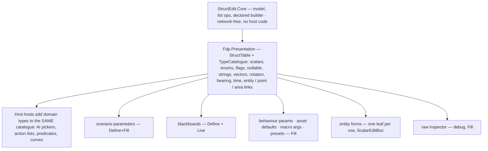
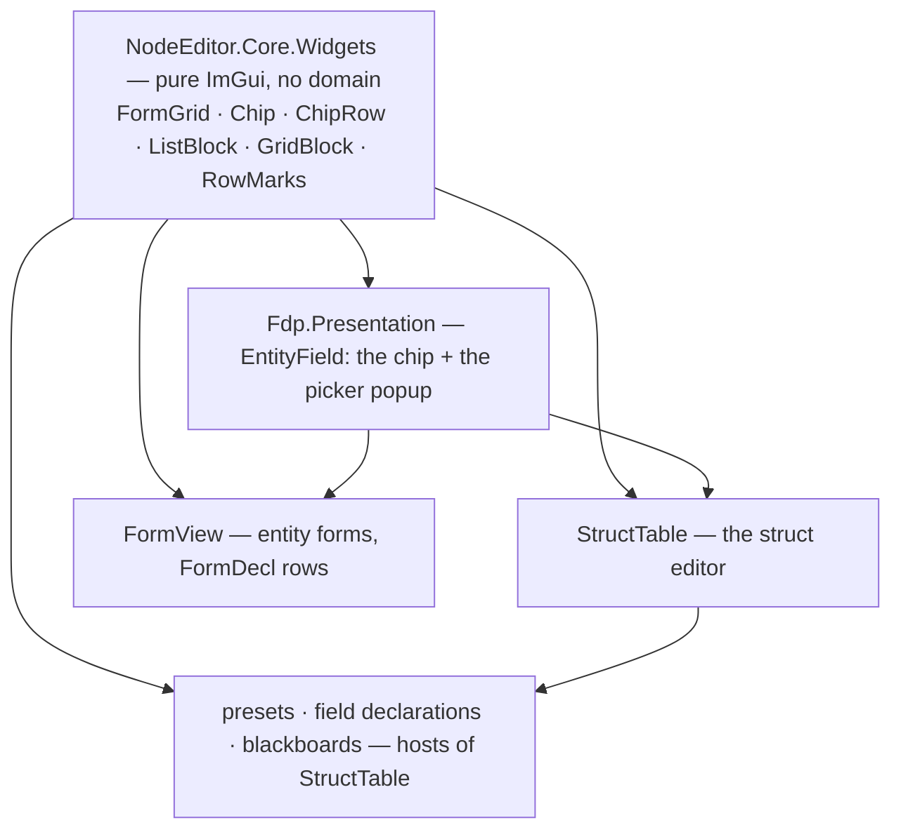
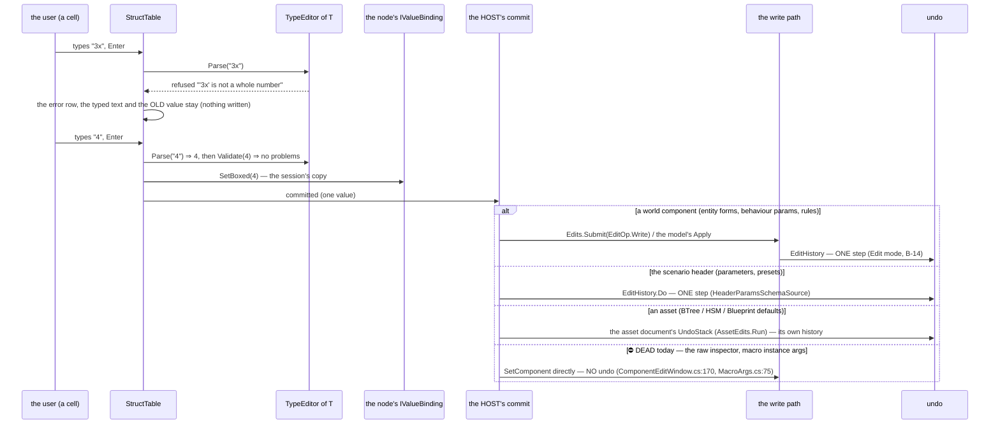
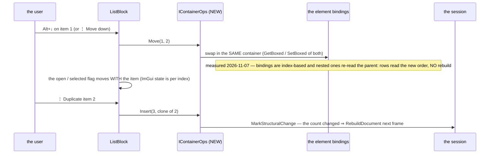
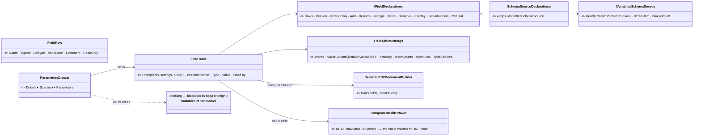
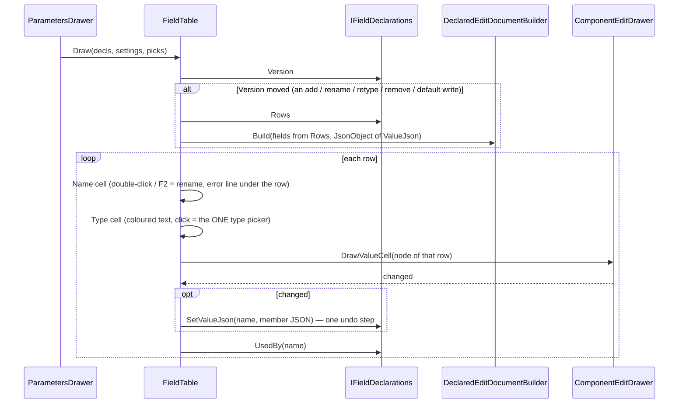

<!--STATUS
state: LIVE
build-state: READY-TO-BUILD — ✅ S1–S12 + K1–K6 APPROVED by the user 2026-11-07 ("Apprived."); the field-declaration D0 / D1–D11 are folded in by S1
updated: 2026-11-07
current-answer: the whole file — §1 what exists (measured) · §2 the library (UML) · §3 the type registration · §4 the list forms · §5 entities
  and places · §6 the decisions · §7 the build order · §8 ONE widget kit for every form (K1–K6) · §9 the entity inspector is a host · §10 sequences, zero allocation, input chain, undo per host, measured gates (G1, G3–G6) · §11 the adoption table (G2)
stale-below: nothing
known-rot: none
known-conflict: DESIGN_UI_Conventions.md C4 (move the 2-column tables onto FormGrid) — S11 reconciles: the struct editor's table IS FormGrid's label
  column, one rule · DESIGN_Field_Declaration_Editor.md §6 / §6.0 — folded HERE (Define mode is this library); that doc keeps the declaration seam
related-designs:
  - docs/DESIGN_Field_Declaration_Editor.md — §6 Define mode, the host settings and field-editor-visual.svg; §6.0 D0 (merge into StructEdit) is decided HERE
  - docs/UX/DESIGN_Scenario_Presets.md — the first host: scenario parameters, Define+Fill (§5a, §5d, §5e)
  - docs/UX/DESIGN_Details_Forms.md — entity FORMS stay FormDecl / FormView (Q1, R-4120: the raw inspector is a debug tool); each form row's VALUE is this library's leaf (ScalarEditBox)
  - docs/UX/DESIGN_Condition_Editor.md — §8 X1–X4 (R-4149): names from attributes + one humanizer, NumberInput, Add <element>, the EntityLink chip — the redesign this continues
  - docs/blueprints/DESIGN_Map_Picking_Unification.md — §6 F1: ONE drawer per reference type (ReferenceLeafDrawers) — the semantic leaves here
  - docs/UX/DESIGN_Show_On_Map.md — the ⌖ (MapPreviews.For(type)) every semantic leaf carries
  - docs/UX/DESIGN_UI_Conventions.md — FormGrid (label-first), the chevron · icon · label rule, slate headers
  - docs/UX/DESIGN_Edit_Framework.md — §2.5: StructEdit stays network-free; the FieldMark hook
  - docs/blueprints/Architect_Question_21_Action_DTO_Fixed_Lists.md — fixed lists through a view provider kept host-side; StructEdit references no host code
  - FDP/ExtDeps/StructEdit/docs/DESIGN.md — the library's own design (model, builders, buffers)
-->

# DESIGN — **the struct editor**: one library that DEFINES and FILLS structures, for every type

> 🔒 User, `2026-11-07`: *"please measure the struct edit capabilities and Let's try to merge this into one highly capable and nicely looking
> structure editor."* · *"the current structure editor is somewhat weak in editing our custom data types, like for example entities. For some
> custom data types, we are already having custom serializers or custom formatters or custom renderers. But because now we are talking about
> editing the fields, we would also need to have some custom deserializers and validators. So that might be a new category."* · *"design
> everything as a shared one single nice looking and feature rich reusable library … it must be supporting all variety of the data types,
> including various array fields … Struct edit has already some solution for that, but I'm not really sure if it's practical in all cases."*
> Earlier the same day: *"shouldn't we actually extend the struct edit or somehow unify and merge both so we have just one solution which allows
> editing structures from both point of views, like defining and filling?"*

🖼 **[`docs/UX/struct-editor-visual.svg`](UX/struct-editor-visual.svg)** (Fill: every kind, the list forms, the entity picker, the row menu,
the type registration) · **[`docs/UX/field-editor-visual.svg`](UX/field-editor-visual.svg)** (Define: the same table with Name / Type cells,
the hosts' settings). 📷 Today's look, rendered `2026-11-07` (a scratch frame, not committed): index rows `[0] [1]`, *"Add single"* (a C# type
name), an EntityRef as a bare `0`, a PointLink's form switch overflowing its cell, a nullable as an empty row, no units, no "changed".

## 1. What exists — measured `2026-11-07`

**INVENTORY.** Graph: `search_graph .*FieldDrawer.* Class` → **12**, `.*FieldEditor.* Class` → **15**; grep `: IImGuiFieldDrawer` → **16**
production classes, `: ICustomFieldEditor` → **13**. Three read-only sweeps (StructEdit core · the ImGui layer · the design corpus, `docs/`
then `.dev/`). ⚠ coverage unchecked (`check_index_coverage` is not in the CLI).

| area | today | file:line |
|---|---|---|
| model | `EditDocument` → immutable `EditNode` tree (`ClrType`, `Kind` of **17**, `Binding`, `Metadata`); a session commits a boxed value | `StructEdit.Core/EditNode.cs:10-18`, `EditNodeKind.cs:9-37` |
| shape from | ⛔ a C# TYPE only — one builder, `ReflectionEditDocumentBuilder`; values live in a CLR object or native memory, never JSON | `IEditDocumentBuilder.cs:5`, `ComponentEditService.cs:58-73` |
| lists | `IContainerBinding` = `Count · CanResize · GetElementBinding · Resize` — ⛔ no insert, remove-at, move, duplicate; new reference elements are **null** | `IContainerBinding.cs:5-8`, `DynamicArrayBinding.cs:63` |
| types | ✅ scalars, bool, string, enum, struct/class/record, `T[]`/`List<T>`, fixed / inline arrays (native only), polymorphic by `[JsonDerivedType]` combo · ⚠ flags: drawn as checkboxes, JSON writes null for a combination · ⛔ `Nullable<T>` (an empty Struct row), dictionaries · ⚠ `long` parsed as `int` | `ReflectionEditDocumentBuilder.cs:343-373`, `ComponentEditDrawer.cs:543-549, 613-664` |
| custom types | ⛔ **TWO registries**: StructEdit `ICustomFieldEditor` (makes the node a leaf) + the ImGui `IImGuiFieldDrawer` dictionary EACH HOST passes — most hosts pass none ⇒ Quaternion, Guid, Type draw as grey `ToString()` outside two hosts | `ComponentEditServices.cs:17-39`, `ComponentEditDrawer.cs:484, 666-668` |
| text ⇄ value | ⛔ no parser / formatter category — ad-hoc `TryParse` per drawer; invalid text is IGNORED silently | `ComponentEditDrawer.cs:545-557`, `GuidFieldDrawer.cs:21` |
| validation | ⛔ whole-component only, on Commit; one red line under the window; nothing per field | `Validation.cs:6-20`, `ComponentEditWindow.cs:173-179` |
| changed / default / read-only | ⛔ not in the drawer — each host adds its own (`*` + Reset, `BeginDisabled`); `[EditReadOnly]` exists and is never applied | `ParamsDefaultsForm.cs:140-160`, `EditAttributes.cs:38` |
| entities | EntityLink: a chip *"Kind: Name"* + ▾ (map · list · key · clear) ✅ · EntityRef: a raw network-id box ⛔ · gone entity → `#id`, no stale mark ⛔ | `ReferenceLeafDrawers.cs:426-443, 541-626`, `LiveRefScope.cs:212-217` |
| map | ⌖ for WorldPoint, PointLink, EntityRef, EntityLink, AreaLink (`MapPreviews.Has`); pick entity / location / area edit | `MapPreview.cs:25-26`, `ReferenceLeafDrawers.cs:223-303, 507-525` |
| look | names from `[EditDisplayName]` / the humanizer, units from `[EditUnit]` / the name, `NumberInput %g`, *Add <element>* + one-x trash, `EditSummaries` (only one registered) — the R-4149 redesign | `ComponentEditDrawer.cs:713-736, 756`, `NumberInput.cs:85-88` |
| define fields | ⛔ not in StructEdit — `VariablesPanelControl` (its own table, a StructEdit session per default cell) | `VariablesPanelControl.cs:483` |
| hosts | ~20 draw sites: the raw inspector (debug), BehaviorParamsForm (AI section, mission panel, orders, rules), ParamsDefaultsForm, ParamArgsTable, VariableEditModal, node properties, ReplaySearch, the action list | the sweep, §6 of its report |

⇒ **The engine is sound** (one tree, one leaf per type, the R-4149 look); **what is missing is a TYPE contract, list operations, per-field
errors, the default/changed state, and the Define half.** None needs a second editor.

## 2. The library — one model, one table, one registration per type

*What the picture shows that prose hid: there is ONE place a type is taught to the editor (`TypeEditor<T>` in one catalogue) and ONE table —
Define is the same table drawing a document whose shape came from declarations. Today's two registries and the declaration table both disappear.*

*What it shows: every host reaches the catalogue through the table — none passes a drawer dictionary, so none can forget one.*

## 3. The type registration — `TypeEditor<T>` (the user's "new category")

| part | does | today's pieces it absorbs |
|---|---|---|
| **Shape** | leaf / structure / list (what `ICustomFieldEditor` decides now) | `ICustomFieldEditor` |
| **Draw** | the ImGui cell | `IImGuiFieldDrawer`, `ReferenceLeafDrawers` |
| **Format** | value → text: the cell, a collapsed summary, Copy | `CopyText`, `ChipLabel`, `EditSummaries`, `RotationReadout` |
| **Parse** | text → value, for typing and Paste; a refusal is a MESSAGE | the ad-hoc `TryParse`s, the network-id box |
| **Validate** | value → problems, per field, live (a key that resolves to nothing, a range) | `KeyProblem`, `RefKeyProblem`, `[EditRange]` (never enforced) |
| **Default** | a new list element's value (never null) | `Activator.CreateInstance` / null |
| **Map** | ⌖ show · ⊕ pick for a semantic type | `MapPreviews.For(type)`, the pick context |

⭐ Every part is optional: a plain `float` registers nothing and gets the built-ins; an `EntityLink` registers all seven. ⭐ The readable-JSON
form (`[JsonText]`, CE-4295) is the FILE's text, not the cell's — Parse/Format may reuse it where they agree, never require it.

## 4. The list forms — the form follows the element (mockup B1–B6)

| # | element | form | why |
|---|---|---|---|
| **B1** | a few words / numbers / enums | **inline chips on one row**, ✕ per chip, ⊕ at the end, drag to reorder | ⛔ today one row per word, `[0]` labels |
| **B2** | structures | **one SUMMARY row per item** (⋮⋮ handle · number · kind glyph · the type's Format summary · ⋮ menu); ▸ opens its fields indented | today every item expands into all fields, no summary |
| **B3** | small flat structures (≤ 4 plain fields) | a **grid** — columns = fields; ⇄ rows by a per-type setting | waypoints, wind levels read as a table |
| **B4** | fixed size (inline / fixed buffers) | **slots** — no add / remove, *"4 / 4 — fixed size"* | the native-only kinds keep working |
| **B5** | polymorphic | **Add ▾** lists the kinds with their glyphs; the item row shows its kind | today a combo on an empty item |
| **B6** | long (> 50) | starts closed, **filter + pages** of 50 | ⛔ today all rows drawn every frame |
| all | — | ⋮ / right-click: Insert above / below · Duplicate · Move up / down (Alt+↑↓) · Copy / Paste value · Reset · Delete | ⛔ today: append + trash only |

## 5. Entities and places — one chip, one picker

| | lean |
|---|---|
| **EntityRef AND EntityLink** draw the SAME chip: kind glyph · name · side colour · ▾ | ⛔ today EntityRef is a raw network-id box |
| **gone** entity | a RED chip *"gone · #42"* and a line *"the entity no longer exists — pick another or Clear"* (Validate) |
| **the picker** (▾) | type-ahead over names · side · kind · distance from the selection; then *Pick on the map · By key (@name) · Clear*; `[MapPickableEntity]` narrows it |
| **places** | WorldPoint = ONE field *"x · y · z"* (Parse accepts the same text) + ⌖ ⊕; PointLink = a chip (*@RallyA · 668 · 427 m*) whose ▾ switches coordinates / entity / key — ⛔ no radio buttons in the cell |

## 6. Decisions — ✅ APPROVED (user, `2026-11-07`)

| # | question | ⭐ lean | rejected |
|---|---|---|---|
| **S1** | one editor or two | ⭐ ONE library: StructEdit (model) + its table (Fdp.Presentation); Define = §6 of the field-declaration design, folded here — **D0 = merge** | ⛔ keep both (two looks) · ⛔ a table wrapping StructEdit (two row owners) |
| **S2** | a shape with no C# type | ⭐ `DeclaredEditDocumentBuilder`: nodes typed by `ParamTypes`, values in a `JsonObject` binding | ⛔ generating C# types at edit time |
| **S3** | how a custom type is taught | ⭐ `TypeEditor<T>` (§3), ONE catalogue, registered once; a host may ADD types, never must | ⛔ today's two registries |
| **S4** | list operations | ⭐ `IContainerOps` in StructEdit.Core (insert · remove-at · move · duplicate · clear · new element from Default) | ⛔ Resize-only |
| **S5** | list look | ⭐ §4 B1–B6, chosen by the element type (and a per-type setting for grid) | ⛔ one form for all |
| **S6** | errors | ⭐ per field, on the row (a red line), live; a refused parse KEEPS the typed text and the old value | ⛔ silent ignore · one line under the window |
| **S7** | default / changed | ⭐ in the table: grey = default, amber bar + ↺ = changed (needs a "default value" per node — the host's Fill source) | ⛔ per-host `*` columns |
| **S8** | read-only | ⭐ `[EditReadOnly]` applied by the builder; the host's read-only = the whole table grey (R-4150), ⌖ still works | ⛔ `BeginDisabled` per host |
| **S9** | nullable / flags / long | ⭐ nullable = a *set* box + the value; flags = toggle chips, JSON writes the names joined; `long` parsed as `long` | bugs today |
| **S10** | entity forms | ⭐ stay FormDecl / FormView (R-4120) — each row's value is this library's leaf | ⛔ forms as StructEdit documents (Details Forms Q1 rejected it) |
| **S11** | layout | ⭐ the table IS FormGrid's label-first column (one label width, the slate headers, chevron · icon · label) | reconciles UI Conventions C4 |
| **S12** | where the code lives | ⭐ model + list ops + declared builder in **StructEdit.Core** (generic, network-free); table + catalogue in **Fdp.Presentation**; domain types (AI pickers, action lists, predicates) registered from Hrot | AQ21 D-p, R-4127: StructEdit references no host code |

## 7. The build order — each step keeps its hosts' frame rails green *(tracked: step 0 CE-3377 · 1 CE-3378 · 2 CE-3379 · 3 CE-3380 · 4 CE-3381 · 5 CE-3382 · 6 CE-3383 · 7 CE-3384 · entity forms CE-3385 · inspector CE-3386 · field words CE-3387)*

| step | what | proves it |
|---|---|---|
| **1** | `TypeEditor<T>` + the catalogue; move the 16 drawers + 13 field editors into it; hosts stop passing dictionaries | every host draws Quaternion / Guid / Type (a rail over all hosts) |
| **2** | `IContainerOps` + the list forms B1–B6 + the row menu | a rail per form; insert / move / duplicate round-trip |
| **3** | Parse / Validate per field, the error row; nullable, flags, long | typed garbage → the row says why, the value stays |
| **4** | default / changed + read-only in the table | the presets mockup's look, measured (R-4138) |
| **5** | the entity chip for EntityRef, the stale mark, the picker's type-ahead | a gone entity reads red |
| **6** | `DeclaredEditDocumentBuilder` + Define cells — scenario parameters move onto it (the presets editor) | presets §5a built on it |
| **7** | blackboards, `ParamArgsTable`, `ParamsDefaultsForm` → hosts of the table; `VariablesPanelControl`'s table deleted | their frame rails unchanged |

✅ **The two gates were MEASURED `2026-11-07` and PASS** — §10.5 (a JSON-backed document draws and takes a pick; a Move needs no rebuild).

## 8. ⭐⭐ ONE WIDGET KIT for every form — the struct editor, entity forms, presets *(user, `2026-11-07`)*

> 🔒 User: *"They are used some badges that have oval shape draggable etc. I'm not sure how much IMGUI can support that … it might need quite a
> lot of IMGUI magic to make it happen. It would pay off if we actually use it for almost any kind of form editing which we have designed as part
> of this UX design. For example, all the forms for the entity parameters. Please think how to make it reusable here, so we do not duplicate stuff.
> And render most of the form-like things using shared code instead of duplicating, while considering the IMGUI capabilities."*

**Measured `2026-11-07`:**

| fact | where |
|---|---|
| ⭐ a widget kit EXISTS — `FormGrid` (label · value · status), `GlyphWidgets`, `SectionHeader`, `TreeRow`, `RowPaint`, `Icons` | `FDP/ExtDeps/NodeEdit/src/NodeEditor.Core/Widgets/` |
| ⭐ the CHIP exists, in plain ImGui — `InvisibleButton` + a `DrawList` rect with the style's `FrameRounding` + glyph + clipped text + ▾; the EntityLink leaf and the condition editor's blanks draw it | `ReferenceLeafDrawers.cs:641` (*"The ONE chip (U-8)"*) |
| ⭐ drag-and-drop is ImGui's own (`BeginDragDropSource/Target`) and used in 3 places | `VariablesPanelControl.cs`, `SharedOrbatPanel.cs`, `MyBlueprintDragSource.cs` |
| ⛔ **the entity forms DUPLICATE it** — `FormView` draws its own list (a *Remove* `SmallButton`, *Add* + *List…* buttons), its own entity field (a name button + *List…* + *Clear*, NOT the chip) and its own red error text | `FDP/Engine/Fdp.Presentation/ImGui/Forms/FormView.cs:121-160, 349-351` |

🖼 Mockup panel **E** (an entity form with the same widgets) and **F** (the kit and its ImGui cost) in `struct-editor-visual.svg`.

*What it shows: the struct editor and the entity forms stop being two UIs — they are two ROW SOURCES (a type's fields; a form's declared rows)
over one kit. A widget is improved once and every form gets it.*

| widget | does | ImGui it needs — ⭐ cost | used by |
|---|---|---|---|
| **FormGrid** | label · value · status columns, one label width | exists (C1) | every form |
| **Chip** | glyph · text · ▾ (a picker) / ✕ (removable) / on-off (a toggle) | exists — one function, three ends | entity / place values, flags, B1 words, preset combo items |
| **ChipRow** | B1: chips that WRAP, ⊕ at the end, drag to reorder | cursor maths with `CalcTextSize` + the drag-drop API — ⭐ low | tags, numbers, flags |
| **ListBlock** | B2 / B5 / B6: one summary row per item (⋮⋮ · number · glyph · summary · ⋮), ▸ opens the item, *Add ▾* with kinds, filter + pages | `Selectable` rows + `BeginPopupContextItem` + drag-drop on the handle — ⭐ low | struct lists, FormView's lists (*Knows about*, routes, cloud layers) |
| **GridBlock** | B3: columns = fields | `BeginTable` — ⭐ low | waypoints, wind levels |
| **RowMarks** | amber changed bar + ↺ · the error line under a row · the *set* box of an optional | one `DrawList` rect + one text row — ⭐ trivial | every form |
| **EntityField** | the chip + the picker popup (type-ahead, side, kind, distance; map · key · clear) | `InputText` + filtered `Selectable`s in a popup — ⭐ low | EntityRef / EntityLink leaves, FormView's entity rows |

| # | ⭐ decision — lean | why / rejected |
|---|---|---|
| **K1** | ⭐ the kit lives in `NodeEditor.Core.Widgets` (pure ImGui, no domain); `EntityField` in `Fdp.Presentation` (it needs the reference scope) | the kit's existing home; StructEdit stays model-only (S12) |
| **K2** | ⭐ `FormView` draws its lists, entity rows and errors through the kit — its declared rows stay (R-4120, S10) | ⛔ the measured duplicate (`FormView.cs:121-160, 349-351`) |
| **K3** | ⭐ the chip keeps the style's `FrameRounding` (a rounded rectangle) — the mockups' full-round pill is approximate | ⛔ a true pill needs no magic either (`AddRectFilled` with rounding = height/2) but would differ from every other frame |
| **K4** | ⭐ drag is a BONUS on top: the ⋮ menu and Alt+↑/↓ ALWAYS move an item | ⛔ drag as the only way — hard to discover, and harder to test |
| **K5** | ⭐ one frame rail per widget, the widget alone, rendered next to its mockup (R-4146); hosts' rails keep passing | ⭐ the kit is proven once, not per host |
| **K6** | ⭐ type NAMES (in Define mode) stay plain coloured text — chips are for VALUES | the user, earlier the same day: *"plain colored text will do"* |

⇒ **Build order gains a step 0:** move the chip into the kit and add `ChipRow`, `ListBlock`, `GridBlock`, `RowMarks`, `EntityField` with their
rails; then §7's steps use them, and `FormView` moves onto them (with its frame rails, e.g. `TheUnitFormDrawsTests`, unchanged in content).

### 8.1 ⭐ AS-BUILT — step 0 (N-0, CE-3377), `2026-11-07`

| widget | file | API (one op per frame, never a callback) |
|---|---|---|
| `Chip` | `NodeEditor.Core/Widgets/Chip.cs` | `Chip.Draw(id, label, icon, maxWidth, ChipEnd, on, tint) → ChipHit {None, Body, Remove}` · `Chip.Dropdown(...) → bool` · `Chip.WidthOf(...)`. Ends: `None · Dropdown ▾ · Removable ✕ · Toggle`. ⭐ the old `ReferenceLeafDrawers.DrawChip` is DELETED (7 callers moved) |
| `ChipRow` | `ChipRow.cs` | `ChipRow.Draw(id, labels, canRemove, canAdd, icon) → ChipRowOp {Click i · Remove i · Add · Move from→to}` |
| `ListBlock` | `ListBlock.cs`, `OpenSet.cs` | `Begin(id, summaries, ListOptions, version)` · `VisibleCount / VisibleIndex(v)` · `ItemBegin(i, kind) → open` · `ItemEnd()` · `End() → ListOp`. `ListOptions`: Title, AddLabel, Kinds, FixedSize, Disabled (`ListCmd`), Shortcut labels (the kit reads no keys), LongThreshold/PageSize. `OpenSet` moves the open flag with its item |
| `GridBlock` | `GridBlock.cs` | `Begin(id, headers, count, opts)` · `Row(i)` · `Cell(c)` · `End() → ListOp`; row menu, Add and footer ARE `ListBlock`'s |
| `RowMarks` | `RowMarks.cs` | `ChangedBar(changed)` (slot always reserved) · `ResetButton(id)` · `ErrorLine(text)` · `SetBox(id, ref set)`; `FormRow`'s invalid-reason now calls `ErrorLine` (one painter) |
| `EntityField` | `Fdp.Presentation/ImGui/Editing/EntityField.cs` | `Draw(id, chipLabel, kind, maxWidth, candidates, version, goneText) → EntityFieldOp {Pick id · PickOnMap · ByKey · Clear}`; filter rebuilt only on text / version change. wired to EntityRef + EntityLink by N-5 (§12) |

Deviations from the text above: ① `ChipEnd.None` and a `tint` (the gone chip) were added to `Chip`. ② ONE shared `KitDrag` (internal) carries the drag-reorder gesture for chips, list handles and grid handles (the K7-adopter comment lives there) — not a function inside `ChipRow`. ③ ImGui.NET's `InputText` allocates a string per call, so `TextBuffer` (pinned UTF-8 buffer, native call) backs the filter / type-ahead boxes. ④ `KitProbe` (rails only) exposes the rectangles of popup rows, which ImGui.NET cannot reach. 📄 Rails: `WidgetKitFrameRail` (one test per widget, 0 B) + `WidgetKitLogicTests`.

## 9. The entity inspector — the C# case is ONE shape source, not a second editor *(user, `2026-11-07`)*

> 🔒 User: *"the older part of the engine, like the entity inspector, is using the struct edit, which is inlined for editing the component
> values. Will that fit as well to the new refactored unified struct edit? I hope so. And … the original struct edit, which passes there a C#
> structure, is basically just a special case of the generic one, I guess."*

**Yes, on both counts — measured:** the inspector (`FDP/Engine/Fdp.Presentation/ImGui/Utils/ComponentReflector.cs`) opens a StructEdit session
over the component's C# type, either IN PLACE for one field (`EditScope.ForField`, a double-click; drawn inside `FormGrid.BeginTree`, `:378-397`)
or in a `ComponentEditWindow` for the whole component, writing back through the edit framework's interceptor with a baseline (ruling 14,
`:357-366`). It passes its own drawer dictionary (`_fieldDrawers`, `:77`) — one of the two hosts that draws Quaternion / Guid today.

| what the inspector keeps | what it gains | what goes |
|---|---|---|
| the C# shape (`ReflectionEditDocumentBuilder`) — ⭐ the C# case is one SHAPE SOURCE beside the declared one (S2); both make the same `EditNode` tree for the one table | the catalogue (every type drawn), the list forms and item menu, per-field errors, changed marks, the entity chip | `_fieldDrawers` — the catalogue replaces it |
| single-field scope, the in-place / window choice, native buffers (unmanaged components, fixed buffers, unions) | read-only = the whole table grey when the session is read-only (S8) | its private error line (`ComponentEditWindow.cs:173-179`) → RowMarks |
| the write path: interceptor + baseline (the edit framework, R-4127) — ⛔ the library never writes the world | | |

⚠ It stays a DEBUG tool (R-4120) — users edit entities through the forms (S10, K2); it simply draws with the same library, so it costs nothing extra.

## 10. ⭐⭐ Extended for the overnight build — sequences, zero allocation, the input chain, undo per host, the measured gates *(backend, `2026-11-07`, coordinator note G1–G6)*

📄 Asked by [`NOTE_Coordinator_To_Backend_Struct_Editor_Design_Gaps.md`](blueprints/batches/NOTE_Coordinator_To_Backend_Struct_Editor_Design_Gaps.md) — 🔒 user:
*"Later I would like to give that to one of the lanes for an overnight autonomous batch, including replacing all the forms and many places in
the current UI where we can benefit from reusing the new library for editing forms."* G2 (the adoption table) is §11.

### 10.1 G1 — a typed value, end to end — and which host writes how

*What it shows that prose hid: the table never writes the world — it writes the session's copy and hands ONE committed value to the host; the
undo is the host's. And two hosts today bypass undo entirely (the dashed-off branch) — §10.4 routes them.*

*What it shows: a MOVE is cheap (no rebuild); an INSERT / DUPLICATE / REMOVE changes the count and rebuilds the document once — the same
`MarkStructuralChange` the drawer already calls on remove (`ComponentEditDrawer.cs:188-259`).*

### 10.2 G3 — zero allocation per steady frame (R-2084)

📐 Today: `ComponentEditDrawer.cs` has **10** interpolated strings in its draw path, `ReferenceLeafDrawers.cs` **26** — the table allocates every frame.
⭐ The precedent is `FormView`: **0 B per steady frame** by caching formatted text per row (`FormView.cs:16`, CE-4285, rail in `FormViewTests`).

| rule | |
|---|---|
| ⭐⭐ every label, id string, formatted value and summary is CACHED per node (by node id), recomputed only when the value's version changes (a set, a structural change, a rebuild) | `TypeEditor.Format` runs on change, never per frame |
| ⭐ ImGui ids: `PushID(int)` with the node id — ⛔ no `$"##x{id}"` per frame | |
| ⭐ the picker's filtered list, the page of a long list: rebuilt on a keystroke / page change, reused otherwise | |
| ⭐⭐ a rail PER WIDGET (step 0) and PER HOST (each adoption): `GC.GetAllocatedBytesForCurrentThread()` around the 3rd steady frame `== 0` | the CE-2394 rails' shape |

### 10.3 G4 — keys and gestures through the ONE input chain (R-4163, [`DESIGN_Input_And_Commands.md`](UX/DESIGN_Input_And_Commands.md) §2.2, §6b)

| binding | action | scope |
|---|---|---|
| Ctrl+D | Duplicate item | ⭐ a new **`InputScope.FocusedWindow` kind `StructTable`** — active while a table row has focus (`Keymap.cs:11`, `KeyRouter.cs:52`) |
| Alt+↑ / Alt+↓ | Move item up / down | same |
| Del | Delete item | same |
| Ctrl+C / Ctrl+V | Copy / Paste value (Format / Parse) | same |
| Enter / Esc in a cell | commit / revert the typed text | ⭐ `InputScope.TextField` — ImGui's own, the keymap never fires while a field has the keyboard |
| drag a ⋮⋮ handle or a chip | Move item | a declared GESTURE of the same scope (K7, §6b: one binding shape for keys AND mouse) |

⭐ The scope sits IN FRONT of the window's own scope and behind TextField / Modal — Ctrl+D in a table duplicates the item; outside a table it
falls through as today. ⛔ No `ImGui.IsKeyPressed` in the table or the kit. ⭐ The ⋮ menu shows the bindings (the keymap's labels, §2.9).

### 10.4 G5 — undo per host

| host | today | after |
|---|---|---|
| entity forms (`FormView`) | `Edits.Submit` → `EditHistory` ✅ (`FormView.cs:24`) | unchanged — one step per committed value / list op |
| behaviour params (`EntityAiDetailsView`) | `EntityAiEditModel` pushes ONE entry in Edit mode ✅ (CE-4219) | unchanged |
| rules (`RuleDetails`) | pushes to the shared history ✅ | unchanged |
| scenario parameters, presets | `EditHistory.Do` ✅ (`HeaderParamsSchemaSource`) | presets' data the same way |
| BTree / HSM / Blueprint defaults | the ASSET's `UndoStack` (`AssetEdits.Run`) ✅ | unchanged — an asset document owns its undo |
| ⛔ raw inspector | `SetComponent` — NO undo (`ComponentEditWindow.cs:170`) | ⭐ in Edit mode → `Edits.Submit(EditOp.Write)` with the baseline diff ⇒ one step; the paused-debugger staging stays |
| ⛔ macro instance args | `SetComponent` — NO undo (`MacroArgs.cs:75`) | ⭐ → `Edits.Submit(EditOp.Write)` ⇒ one step |
| mission panel · orders · game master | Live / Preview | ⛔ no undo (R-4120) — said in the ⋮ menu's greyed Undo |
| replay search · run setup | not a world edit | no undo |

⭐ A rail per host (Edit mode): edit → Ctrl+Z → the old value; a list op → Ctrl+Z → the old list.

### 10.5 G6 — the two gates, MEASURED `2026-11-07` (scratch tests in `Fdp.Presentation.Tests`, not committed)

| gate | result | what the step does |
|---|---|---|
| **step 6** — a `JsonObject`-backed `IValueBinding` with NO C# owner | ✅ **PASS.** A hand-built document (`EditNode` / `EditDocument` constructors are public) over a `JsonObject`, drawn by today's `ComponentEditDrawer` with a minimal `IEditSession` (the drawer uses only `RebuildState` and `MarkStructuralChange`): a map pick wrote `"target":1001` into the JSON | builds as designed (S2). ⚠ the binding serialises each leaf with the type's own JSON converter (EntityRef wrote `1001`) — the declared builder uses `FdpJsonOptionsRegistry` options, as the file does |
| **step 2** — element bindings valid across a MOVE without a full rebuild | ✅ **PASS** for `List<class>` and `T[]` of structs: after an in-place swap the rows read `[b, a]` / `[y, x]`, `RebuildState` stayed `Stable`, an edit through row 0 landed on the moved element (`b:99`, `y:99`) and Commit kept the order | Move = an in-place swap (no rebuild). ⚠ Insert / Duplicate / Remove change the count ⇒ `MarkStructuralChange` (as Remove does today). ⚠ A POLYMORPHIC list whose two items differ in kind ⇒ the rows' shapes differ ⇒ a Move there also marks a structural change. ⚠ ImGui open-state is per index — the ListBlock moves the flag with the item |

### 10.6 Ordering — confirmed

§7's order stands: step 0 (the kit) and step 1 (the catalogue) first — they are independent; the entity forms (CE-3385) and the inspector (CE-3386)
LAST; the presets' surfaces (CE-3391 … CE-3394) after step 6 (CE-3383), because the preset editor IS the Define+Fill table. ⭐ One argued
change: **the two undo routes of §10.4 (inspector, macro args) ride the step that moves each host** (CE-3386, CE-3384) — not a step of their own.

## 11. ⭐⭐ G2 — THE ADOPTION TABLE: every place that should draw through the table or the kit *(backend, `2026-11-07`)*

🔒 User: *"replacing all the forms and many places in the current UI where we can benefit from reusing the new library for editing forms."*

**INVENTORY** *(`2026-11-07`, a read-only sweep; production code, tests / obj / third-party excluded)*: `search_code` — `ImGui.BeginTable(` 65,
`ImGui.Columns(2` 2, `LabelText(` 14, `Button("Add` 4, `SmallButton(` 89, `RequestEntityPick` 40, `RequestLocationPick` 38,
`RequestEntityListPick` 9, `ComponentEditDrawer` 283, `BehaviorParamsForm.DrawFields` 7, `ParamsDefaultsForm` 14, `ParamArgsTable` 12,
`ScalarEditBox` 56, `FormGrid` 215 (**43 files** already on it), `TextColored(` 313 · `search_graph` Class — `.*Panel.*` 210, `.*Window.*` 205,
`.*Form.*` 122, `.*Inspector.*` 45, `.*Editor.*` 224, `.*Modal.*` 24, `.*Dialog.*` 29 · grep — 22 two-column `BeginTable` sites (≈13 are
label | value grids), 50 right-labelled inputs in 23 files, 27 Add / Remove button sites, 7 pick sites outside `ReferenceLeafDrawers`, 25 host
sites, 41 red / orange error lines in ≈30 files. ⭐ None of Chip / ChipRow / ListBlock / GridBlock / RowMarks / EntityField exists yet.
⚠ coverage unchecked (`check_index_coverage` is not in the CLI); a row's "rails" are its test classes found by grepping its class name.

| item | places (file : lines) | today | rails that must keep passing |
|---|---|---|---|
| **CE-3378** step 1 — leaves into the catalogue | `HsmPickerDrawers.cs:189,344` · `BTreePickerDrawers.cs:122` · ReplayBrowser `PropertyPath` / `BehaviorHash` / `WorkingSlot` / `FilteredTypeCombo` drawers · `PredicateValueFieldDrawer` · `GuidFieldDrawer` · `Inspector/PickerField.cs:87-140` | per-host drawer dictionaries | `PickerFieldTests`, `ReplaySearchPanelTests`, the HSM / BTree inspector tests |
| **CE-3384** step 7 — the STRUCT TABLE hosts | `BehaviorParamsForm.cs:75-82` (+ its 7 `DrawFields` hosts: `OrderForm.cs:95`, `RuleDetails.cs:388,411,451`, `OrdersTab.cs:250`, `EntityAiDetailsView.cs:149,172`) · `ParamsDefaultsForm.cs:142-160` (hosts `VariablesPanelControl.cs:276`, `BlueprintMyBlueprintWindow.cs:716`) · `ParamArgsTable.cs:81-184` (hosts `VariablesPanelControl.cs:303`, `AssetPickerLauncher.cs:88`, `MacroInstanceDetailsView.cs:51`) · `NodePropertiesDetailsView.cs:215-218, 289-291` · `VariableEditModal.cs:370, 447-454` · `ReplaySearchPanel.cs:209-227` (criteria) · `GameMasterWindow.cs:57` | own 2- / 3-column tables around the drawer, `*` + Reset, a nested `##defcell` | `EntityAiSectionTests`, `CgfBehaviorSetupTests`, `RuleEditorR5bTests`, `RuleEditorTests`, `TheRuleDetailsTabTests`, `MenuOrdersTests`, `TheOrdersTabTests`, `EveryDrawerCallSiteOpensItsTableTests`, `TheRunSetupDrawsTests`, `MacroInstanceDetailsTests`, `SE1_StructEditFacetRenderTests`, `NodePropertiesDetailsViewDumpsItsStateTests`, `TheValueColumnIsCircular…Tests`, `ReplaySearchPanelTests`, `RunnableRulesTests` |
| **CE-3383 / CE-3387** step 6 — DEFINE tables | `VariablesPanelControl.cs:483, 718, 754-821` · `ParametersDrawer.cs:84-91` · Blueprint `ParameterRowsView.cs:32-94`, `ExecRowsView.cs:50-115`, `GraphSignatureWindow.cs:277-363` | hand-drawn name / type / ✕ / + tables | `BlackboardAddRemoveTests`, `ThePropertiesFormIsCustomTests`, `TheScenarioParametersHeaderDrawsTests`, `BP114_TypeComboIndexTests`, `ReturnNodeDrawerTests`, `GraphSignatureWindowDumpsItsStateTests`, `TheGraphSignatureIsADetailsViewTests` |
| **CE-3385** entity forms | `FormView.cs:121-160, 349-351` (own list, picks, red line) · `FormRow.cs:70` · `FormDetailsView.cs:17` | own buttons + `TextColored` | `FormViewTests`, `TheUnitFormDrawsTests` |
| **CE-3386** the inspector | `ComponentEditWindow.cs:92-219` · `ComponentReflector.cs:388-406` | `##cedit` table, red error, `SetComponent` | `ComponentEditWindowTests`, `…DumpsItsSessionStateTests`, `ComponentReflectorTests`, `TheScenarioComponentsViewTests` |
| ⭐ **CE-3395 NEW** — hand-made LISTS → `ListBlock` / `GridBlock` / `ChipRow` | `ActionListFieldDrawer.cs:205-255` · `OrdersTab.cs:167-412` (tasks ✕ / + Add task) · `BrainStopWhen.cs:142-155` · `PlayMontageChainNodeDrawer.cs:343-419` · `DirectorWindow.cs:266,417,538,557` (keys, points, the reel, takes) · `CustomEventCreateModal.cs:89-140` (param rows) · `ParameterSyncDetailsView.cs:123-170` → GridBlock · `ClusterDiagnosticsPanel.cs:154-160` → ChipRow toggles · `ConditionEditor.cs:304` (Add condition) | ✕ per row, *+ Add …*, no reorder | `StringFieldTypingFrameRail`, `TheOrdersTabTests`, `TheBrainViewTests`, `PlayMontageChainNodeDrawerTests`, `DirectorPackTests`, `CustomEventCreateTests`, `ParameterSyncDetailsViewDumpsItsStateTests`, `ClusterConformanceRails`, `ConditionEditorHostsFrameRail` |
| ⭐ **CE-3396 NEW** — hand-made FORM ROWS and error lines → `FormGrid` + `RowMarks` | modals: Blueprint `VariableCreateModal.cs:165-210`, `FunctionCreateModal.cs:83-95`, `ItemRenameModal.cs:63-68`, `CustomEventCreateModal.cs` (name + problem) · `AssetRenameModal.cs:131-134` · Comparison `ExportDeliveryModal.cs:139-150`, `AssetSelectionDialog.cs:151-176`, `PasteResponseModal.cs:120` · `SaveSelectionAsMacroWindow.cs:50-81` · HSM `HsmEventsWindow.cs:255-257, 308-310` · node drawers `ChannelCommandNodeDrawer.cs:76-103` (5× `LabelText`), `CallPeerBlueprintNodeDrawer.cs:256`, `WhenNodeDrawer.cs:109-141`, `ReadEqsResultNodeDrawer.cs:41`, `SpawnEqsSensorNodeDrawer.cs:75`, `FormatArgTypeRows.cs:52-61` · panels `FederationPanel.cs:113-116`, `ClusterScenarioPanel.cs:450-921` (load / replay rows, red lines :714,723,780), `ScenarioEnvironmentView.cs:89`, `MacroInstanceDetailsView.cs:99`, `RuleDetails.cs:395,517` | `Text` + `SameLine` + input, label-above, orange / red `TextColored` | `ModalPopupIdTests`, `TypeChoiceUnionTests`, `GraphCreateTests`, `TheAssetRowMenuIsTheRefactorEntryPointTests`, `LabelFirstFormsFrameRail`, `TheSaveSelectionDialogDrawsTests`, `HsmEventsWindowBuildsItsModelTests`, `EveryModalAWindowOwnsIsDrawnTests`, `ChannelCommandNodeDrawerTests`, `UneditableNodeDrawerTests`, `WhenNodeDrawerTests`, `ReadEqsResultNodeDrawerTests`, `SpawnEqsSensorNodeDrawerTests`, `FederationPanelBuildsItsModelTests`, `ThePanelAsksTheOneRunSurfacesTests`, `TheScenarioEnvironmentViewTests`, `TheMacroSectionDrawsTests` |
| ⭐ **CE-3397 NEW** — own entity / area PICKS → `EntityField` | `ConditionEditor.cs:362-413` (its own entity / area / list picks) | buttons + `RequestEntityPick` | `ConditionEditorHostsFrameRail`, `RulesWindowFrameRail` |

**Stays — not a form (each with why):** data / log / trace tables (BTree / HSM traces, `BlueprintBlackboardRendererBase:94`, `ComponentDiffPanel:207`
(a diff), `MissionPlanQueueRenderer`, `BlueprintRuntimeInspectorPane:146` (read-only live; FormGrid optional), Director timelines, `FeatureGrid`,
`UnitRoster`, the profilers and diagnostics) · toolbars and filters (`RulesWindow:672-680`, `ReportsWindow:133-142`, `DebriefWindows:129`,
`SpawnerPanel:287`, `AssetBrowserPanel:720`, `MessageLogPanel:359-414`, `EventBrowserPanel`, `DirectorWindow` toggles) · status lines
(`DeployScreen:227`, `ClusterErrorStatusBarSection:45`, `DirectorWindow:100,627,632`) · services (`MapPickBroker`, `PickerToolHost`,
`MenuOrders` — the map's own order flow) · layout splits (`EntityInspectorPanel:409`, `DerEntityInspectorPanel:244`) · `FDP/Examples` (low
priority, examples). ⭐ The coordinator may promote any of these; none blocks the batch.

## 11a. ⭐⭐ N-6 — the Define table, as it will be built *(backend, `2026-11-07`; build-state: READY-TO-BUILD)*

**INVENTORY** *(grep — the graph index returned nothing this session; coverage unchecked)*: the define hosts are the 5 `IVariablesSchemaSource`
implementers (`HeaderParamsSchemaSource` · `BTreeHsmSchemaSource` · `BlueprintLocalVariableSchemaSource` · the two blueprint windows' sources), all
drawn by `VariablesPanelControl.DrawTable` (`Hrot.Editor.AiShared/Blackboard/VariablesPanelControl.cs:472`, 861 lines: name / type / bytes / value or
default / used-by / ✕, rename on double-click, drag reorder, aliasing, the params-DTO sub-rows). The value cells exist (§12 N-2, N-3/N-4); the declared
document exists (§12 N-6 model). ⇒ **what is NEW is only the declaration columns around the value cell, and one adapter.**

*What the picture shows that prose hid: the table owns no value drawing and no schema logic — the value column is the struct table's own cell over a
declared document, and every declaration edit is a callback to the source that already does it (with its one undo history). The adapter is the
only Hrot code; the blackboards can move onto it later with no new table.*

*The steady frame does no Build and no JSON: Version is an int compare (R-2084).*

| who calls it each frame | |
|---|---|
| `ScenarioEnvironmentView` → `ParametersDrawer.Draw` → `FieldTable.Draw` | only while the Parameters header is open (as today) |
| `FieldTable` → `ComponentEditDrawer.DrawValueCell` | per row; the drawer is the table's, built once per Version |

| decision | lean | rejected |
|---|---|---|
| where the value lives | the declared document over a `JsonObject` of the defaults; a change writes that member back through `SetValueJson` | ⛔ one StructEdit session per row (today's `DefaultValueAuthoring`) — N sessions, N looks |
| the type picker | ONE popup, groups Values · Enums · References/places · Structures · Lists; a group the settings forbid is GREYED with the reason (D6) | ⛔ a flat combo (today) |
| errors | a refused name / retype / remove = `RowMarks.ErrorLine` under that row (D7) | ⛔ one line above the table |
| keys | F2 rename · Del delete · Alt+↑/↓ move through the keymap (the StructTable scope gains the declaration commands); drag ⋮⋮ = ImGui drag-drop, a K7 adopter | ⛔ `IsKeyPressed` in the table |
| scope tonight | scenario parameters only (step ②); blackboards / blueprint stay on `VariablesPanelControl` (step ③, filed) | ⛔ moving all five hosts in one item |

## 12. As-built — the overnight build *(backend, `2026-11-07`, folded per item — obligation ⑤)*

| item | as built | deviation from §2–§10 (the prior text above stays as the design; this row wins where they differ) |
|---|---|---|
| **N-2 model** (CE-3379) | `IContainerOps : IContainerBinding` (`StructEdit.Core/IContainerOps.cs`) — `CanInsertRemove · Insert · RemoveAt · Move · Duplicate · Clear · NewElement`; `ContainerOps.Move / DefaultOf / Clone` shared by every container. `DynamicArrayBinding` implements all (a count change builds a NEW container and writes it back, as `Resize` did); inline / fixed buffers implement `Move` only (B4). Rail `ContainerOpsTests` (6) | ⭐ **Duplicate deep-copies in the model** (a JSON round trip with fields, the edit buffers' own copy; a value the serialiser refuses is copied shallowly) — §3 named the type's *Default* as the source of a NEW element only, so Duplicate needed no `TypeEditor` part |
| **N-6 model** (CE-3383) | `StructEdit.Core/Declared/`: `FieldDeclaration` (name · CLR type · label · unit · default JSON · read-only) → `DeclaredEditDocumentBuilder.Build(fields, JsonObject)`; `JsonMemberBinding` (read ONCE, cached ⇒ 0 B per steady read; a set writes the member; `Reset` REMOVES it — S7 "not set"; `Flush` writes back a list / class mutated in place); a structure's fields bind through `NestedMemberBinding`; a list is a `DynamicArrayBinding` over the cached list; `DeclaredEditSession : IEditSession` (`Commit` answers the `JsonObject`). Rail `DeclaredEditDocumentTests` (7) | ⚠ **not an `IEditDocumentBuilder`** (§2's realisation edge is SUPERSEDED): that seam builds from a component type over an edit buffer; a declared document has neither. The host resolves its own type ids (`ParamTypes`) to CLR types before the builder — the core stays free of `Fdp.Toolkits` (S12) |
| **N-4 model** (CE-3381) | S8: `ReflectionEditDocumentBuilder` APPLIES `[EditReadOnly]` — the member's node and its subtree (`AsReadOnly`); rail `EditReadOnlyAppliedTests`. S7: `StructEdit.Core/Defaults/` — `IFieldDefaults` (`DeclaredDefaults`: the declaration's default · `DocumentDefaults`: the same JSON path in a document over a defaults object, e.g. `new T()`), `FieldValues.Same / IsChanged` (Equals, else equal JSON — on a change only); rail `FieldDefaultsTests` (3) | ⭐ the "default per node" S7 asked for is a SOURCE the host passes (its Fill source), not a field on `EditNode` — the tree stays immutable and host-free |
| **N-3 model** (CE-3380) | `StructEdit.Core/Text/ValueText` — `TryParse(type, text, out value, out problem)` / `Format(value)` for the built-ins: a refusal is a message (*"'3x' is not a whole number"*, *"300 is out of range (0 … 255)"*), `long` as `long`, flags as joined names, `Nullable<T>` empty ⇒ null, invariant numbers (`"R"`); rail `ValueTextTests` | the catalogue's built-in `TypeEditor`s call it for Parse / Format (§3); a domain type brings its own |
| **N-1 contract** (CE-3378) | `Fdp.Presentation/ImGui/Editing/Types/`: `ITypeEditor` / `TypeEditor<T>` (Shape · CanDraw/Draw · Format · TryParse · Validate · NewValue — every part defaults to the built-ins), `TypeDrawContext` (node · session · picks · host services — how ONE instance serves every host), `FieldTypeEditor` (registers an old leaf + cell pair together), `TypeCatalogue` (`Standard` built once from `StandardTypes`; `Register` / `RegisterRule` at start-up; `With(...)` a host overlay; `FieldEditors` → every builder; `CreateBuilder()`). `ComponentEditServices.CreateBuilder` = `TypeCatalogue.Standard.CreateBuilder()`; `ComponentEditDrawer(… types, services)` draws a cell by `TryGetFor(node)` after the (transitional) host dictionary. Rail `TypeCatalogueTests` (5) | ⭐ **FIELD RULES** (`AddRule(attributeType, editor)`): a picker on a `string` / `int` / `ushort` (`[HsmStateSelector]`, `[AiAssetPicker]`, `[BehaviorHash]` …) is keyed by its ATTRIBUTE, not its type — §3 assumed one registration per TYPE; the measured drawers (`HsmCompositeStringDrawer`, `BTree CompositeStringDrawer.Resolve`, `IntPickerRouterFieldDrawer`) dispatch by attribute. A rule wins over the type's editor. ⭐ **Asset-bound pickers** (HSM / BTree: the asset, its exporter, the catalogue) stay a HOST OVERLAY (`Standard.With(...)` built once per document) — registered once per document, not per frame; the Standard types still answer below it |

| **N-1 migration** (CE-3378, as-built) | Hosts pass NO dictionary any more; `ComponentEditDrawer` / `ComponentEditWindow` lost `customDrawers` (`types:` / `services:` only). ① `HsmPickerDrawerFactory.BuildCatalogue` / `BTreePickerDrawerFactory.BuildCatalogue` (was `BuildDrawers`) return `TypeCatalogue.Standard.With(…)`: the binding drawer (and HSM `ushort` sync-group) are TYPE entries; state / event / SOP-behaviour pickers are FIELD RULES on `string`; the asset picker is ONE rule editor `AiAssetPickerRuleEditor` that picks the per-KIND drawer from the attribute instance (CE-396 kept; BTree now shares it). `HsmCompositeStringDrawer` / `CompositeStringDrawer` DELETED. Built once per document by `AiFacetPickerBinder`, carried as `NodePropertiesSource.Catalogue` / `PerspectiveWorkspaceServices.FacetCatalogue` / `facetCatalogue:`. ② Session-bound drawers became `TypeEditor<T>`s reading `ctx.Session` + `ctx.Get<BehaviorRegistry>()`: `PredicateValueTypeEditor` (STANDARD), `PropertyPathTypeEditor` (rule on `PropertyPathPicker`), `WorkingSlotTypeEditor` (rule on `WorkingSlotPicker`); `IntPickerRouterFieldDrawer` DELETED (CE-308's two int pickers are now two rules; `BehaviorHashFieldDrawer` stays a ctor-bound bridge). ③ `ReplaySearchPanel`: one overlay per mode (Type combo lists components or events), built once + a `ServiceBag`. `BehaviorParamsForm.DrawFields(…, types, services)` replaces `hostDrawers`; `RuleDetails` builds its do-list overlay once; `ActionListFieldDrawer` caches one drawer per row (was `new ComponentEditDrawer(…, StandardDrawers())` every frame). `ComponentReflector.Types` replaces `_fieldDrawers`. ④ Additions to the contract: `FieldTypeEditor.Drawer`, `IDrawerSource` + `TypeCatalogue.DrawerFor(node)` / `DrawerOf(type)` (rails ask what a node resolves to), `ServiceBag`, `MissingStandardLeaf()` (the all-hosts rail's question). ⑤ Deviations: a string with no picker attribute now draws the table's own string cell (the composites fell through to a plain `InputText` — same widget); latent finding, NOT changed: HSM `[HsmEventPicker]` on `ushort` fields never reached the event drawer (the `ushort` type entry won) — rules need `TargetType == node type`, so it still does not. Rails: `CE3378_*` in `ComponentEditWindow…`, `ComponentReflectorTests`, `ReplaySearchPanelTests`, `RuleEditorTests`, `SE2_PickerDrawerRebuildTests` (all ask the CONSTRUCTED drawer's / source's catalogue for Quaternion · Guid · Type). |
| **N-2 lists in the table** (CE-3379, as-built) | `ComponentEditDrawer.Lists.cs` (partial): a `DynamicArray` / `InlineArray` / `FixedBuffer` node draws through the kit — **chips** (B1) for a short leaf element (primitive · enum · string · decimal · Guid; ✕ removes, ⊕ adds `NewValue()`, a click selects the chip and draws its normal leaf cell on the row below), **`ListBlock`** summary rows (B2; B5 kinds from the element's `[JsonDerivedType]`s, Add ▾; B6 filter + pages from the kit), **`GridBlock`** for `[EditListForm(EditListForm.Grid)]` on the list field OR the element type (new in `EditAttributes.cs`), a fixed buffer of LEAVES (B4, as the mockup draws it) is one ROW per element — the field name's singular + the 1-based index in the label column (`Slot 1`; `[i]` when the label has no plural s) and the element's own cell in the value column, a `4 / 4 — fixed size` footer, no summary rows, no menu; a fixed buffer of STRUCTS keeps the fixed-size `ListBlock` summary rows. The form sits in the VALUE column of the field's row (an open item draws its fields as a nested two-column table); `BufferView` keeps the old container path. Summary text = `EditSummaries` → catalogue `Format` (a type with a text form) → the first two leaf fields (`Alpha · 10`), a polymorphic item leads with its kind name; cached per list by the table's EDIT EPOCH (bumped by every value write / op) and the count — 0 B in a steady frame. Ops go to `IContainerOps` (Insert / Duplicate / RemoveAt ⇒ `MarkStructuralChange`; Move in place via `ContainerOps.Move`; a container that is not one resizes only: Insert / Duplicate are greyed); copy = the element's JSON (`FdpJsonOptionsRegistry.DefaultRelaxed`; a leaf: its text) to the clipboard, paste parses it (`ValueText.TryParse` for a leaf) and a refusal is a `RowMarks.ErrorLine` under the list. The per-list state (`ListForm`, the kit's open flags and selection) is keyed by the node's JSON PATH, not its id — an insert rebuilds the document and ids change, the path does not. **Keys (§10.3 as-built):** `Fdp.Presentation/ImGui/Input/StructTableKeys.cs` — `StructTableFocus` (a table that has a selected row in the focused window says `Set(target)`; ⛔ no key read anywhere) and the scope `StructTable` (window kind in the keymap, six commands `structtable.duplicate · moveup · movedown · delete · copy · paste`, defaults Ctrl+D · Alt+↑ · Alt+↓ · Del · Ctrl+C · Ctrl+V, enabled by the target); `KeyRouter.Dispatch` declares it, runs it BEFORE the focused window (the consumed chord never reaches the window or Global) and clears it each frame; the ⋮ menu's chord labels come from the keymap (`StructTableFocus.ChordLabel`, defaults before a router exists). A key command queues a `ListOp` that the list applies on its next frame through `ListBlock.Inject` — the SAME path as the ⋮ menu. Kit additions: `ListBlock.SelectedIndex / OwnsSelection / Inject / NextSelected` (selection follows its item), `KitProbe` slots for chips, `GridBlock` header columns renamed (`##hcol` / `##mcol` — a header cell and row 0 shared one ImGui id) and equal column weights. Deviations: the grid and the item fields live in the value column (60 % of the table), not full width; Copy / Paste / the keys are list-block-only (chips and the grid have no row selection yet); `RemoveElementAtIndex` stays (the resize-only fallback and `BufferView`). Rails: `ListFormsFrameRail` (B1 chips · B2 rows + open flag follows a move · B3 grid · B4 fixed · B6 paging · the key scope), `WidgetKitLogicTests.NextSelected_*`. ⚠ R-2084 measurement: tier-0 JIT boxes the nullable kind argument of `ListBlock.ItemBegin` (40 B per row) — the method is now `AggressiveOptimization`, and the rails warm up with sleeps so the runtime promotes hot code before the 0 B assertion. |
| **N-3 / N-4 leaf cells** (CE-3380 / CE-3381, as-built) | `ComponentEditDrawer.Cells.cs`: a number / string / nullable / `[Flags]` leaf the catalogue does not draw (and that is not a min/max slider) is a CELL owned here. **N-3** the text lives in a pinned `TextBuffer` per node; every edit parses through the catalogue `TypeEditor.TryParse` (else `ValueText.TryParse`): a good value is written (then `Validate` — a problem shows its line, the value stands); a REFUSAL changes nothing but the cell — the typed text stays, the old value stays, the row tints, the box gets the red frame and `RowMarks.ErrorLine` says `'3x' is not a whole number — the value stays 3`. `long` parses as `long` (the old `int.TryParse` bug is gone); an open bound (`MaxValue`) reads as the hint *no limit*; a `Nullable<T>` of a built-in is one cell (set box + value, disabled while unset; routed in `DrawEditNode` whatever kind the builder gave it); a `[Flags]` enum is toggle chips (`Chip` Toggle end, wrapped) written back as the enum value (its joined names). Text is rebuilt from the binding only when the table's edit epoch moved and the cell is neither active nor refused; strings no longer allocate (ImGui.NET's `ref string` InputText did). **N-4** `ComponentEditDrawer(…, IFieldDefaults? defaults, bool readOnly)` / `.Defaults` / `.ReadOnly`: with a source, a leaf at its default draws grey (`TextDisabled`), a changed one the amber bar (`RowMarks.ChangedBar`, slot reserved only where a source exists) and `RowMarks.ResetButton` ↺ which writes the default back (one `SetBoxed`; the changed flag is cached per node by epoch). `TypeDefaults.For(type)` = a `DocumentDefaults` over `new T()`, built once per type. ⭐ HOSTS THAT PASS IT: `ComponentReflector` (edit windows via `ComponentEditWindow(…, defaults)` and the in-place editor), `BehaviorParamsForm.DrawFields` (every params form — rule tabs, orders, entity AI, missions), the do-list rows of `ActionListFieldDrawer`, `ReplaySearchPanel`, `NodePropertiesDetailsView` (facets). NOT given (they edit the defaults themselves or have none): `ParamArgsTable`, `VariableEditModal`, `ParamsDefaultsForm`, the default-value editor of a variable. **Read-only** = `node.IsReadOnly` (`[EditReadOnly]`, S8) or `ReadOnly`: the value cell draws disabled and refuses input; `ReferenceLeafDrawers.Draw(…, readOnly)` disables the value and its pickers but keeps the show-on-map ⌖ live (not an edit). Kit: `KitProbe` slots 64–75 (cell, flag chips, set box, ↺, ⌖). Rails: `LeafCellsFrameRail` (refusal keeps text + value + line, then a parse clears it · long · flags · nullable · grey vs amber measured · ↺ restores · a read-only table refuses input and still fires show-on-map · 0 B for a steady number row with default marks). Deviations: the error line and ↺ sit inside the value cell (not a separate row); validation does not block the write; defaults compare per leaf only (a closed structure does not yet say "1 changed"); the cache follows this table's own writes, an external change of the value shows after the document is rebuilt. |
| **N-5** (CE-3382, as-built) | ONE entity field for both: `ReferenceLeafDrawers.DrawEntityRef` (was a raw network-id `InputInt`) and `DrawEntityLinkCore`'s exact form both draw the kit's `EntityField` (chip: kind glyph · name · ▾; picker: type-ahead rows · *Pick on the map* · *By key* (EntityLink only — `offerKey`) · *Clear*), then the ⌖ map-pick glyph. Rows: `EntityPickerRows` (Fdp.Presentation, one per `LiveRefScope`, rebuilt only when `LiveRefScope.Generation` moves or the selection moves > 1 m ⇒ 0 B per steady frame) over `LiveRefScope.NamedIds()` (named entities, sorted BY NAME at the scope's rebuild) with side (`TrySideOf` = `EntityInfo.ForceId`, coloured by `EntityPickerRows.SideColor`), kind (the scope's kinds) and distance (*"427 m"* / *"1.2 km"*) from `IMapPickContext.TryGetSelectionPosition` — new member, default false; `MapPickBroker` → `IMapPickService.TryGetSelectionPosition` → `CanvasMapPickAdapter` (the world's `SelectionStore.Primary`, placed by the same scope); `ScopedMapPickContext` and `PickSink` forward it. Gone: `LiveRefScope.Exists` false ⇒ `GoneText` *"gone · #42"* (cached string) on the chip + `RowMarks.ErrorLine(GoneLine)` under the row. Rails: `LiveRefScopeTests.N5_*`, `EntityChipTests` (2), `TheMapPickBrokerConsumesAPickOnceTests.TheSelectionPosition_*` | ⚠ **`[MapPickableEntity]` narrows the MAP pick only** — §5 said it narrows the picker; the type-ahead lists every named entity (the CE-1059 *List…* button, which honoured the presets, is gone from the entity leaves: its rows are the type-ahead's now). ⛔ Not filtered yet because the presets are TKB-type predicates the scope does not index; follow-up: index the TKB type per id in `LiveRefScope` and filter the rows. ⚠ The side colours are `ForceId`'s documented colours on the kit palette — one more side palette for M16 to unify |

| **N-6 Define table** (CE-3383, as-built) | `Fdp.Presentation/ImGui/Editing/FieldTable.cs`: `IFieldDeclarations` (Rows · Version · IsReadOnly · LastRefusal · Add / Rename / Retype / Move / Remove → bool, UsedBy, SetValueJson), `FieldRow`, `TypeGroup` / `TypeChoice`, `FieldTableSettings` (AddLabel · NewNameStem · ValueHeader · UsedBy · AllowStructs / AllowLists + their off reasons · TypeChoices) and `FieldTable.Draw(decls, settings, picks)`. The table: Name (⋮⋮ grip + cell) · Type (coloured text: grey value · teal enum · blue reference / place · violet structure · orange list) · value · [Used by] · ⋮, `RowBg`, a header row. The document (`DeclaredEditDocumentBuilder` over the catalogue's `FieldEditors` + a `DeclaredEditSession`) and its `ComponentEditDrawer` are built ONLY when `decls.Version` moves (or the pick context changes); a value cell is `ComponentEditDrawer.DrawValueCell(node)` (extracted from the leaf row, `DrawValueControl` is shared by both — not duplicated) and a change is `decls.SetValueJson(name, member JSON)`; our own write sets the built version, so the focused text box is not torn down. Inline rename: double-click or F2, a `TextBuffer` box (`TextBuffer.Sync()` new) committed when the box deactivates (Enter / click away), unchanged or Escape ⇒ cancelled; a refusal draws `RowMarks.ErrorLine` under that row (clipped to the table width) and KEEPS the box open with the typed text. ONE type-picker popup (search + groups Values · Enums · References / places · Structures · Lists; a forbidden group is listed greyed with its reason as tooltip). ⋮ menu (Rename F2 · Duplicate Ctrl+D · Move up / down Alt+↑ / ↓ · Delete Del; chords from the keymap), the same commands run from the keys: `StructTableCommand.Rename` (F2) joins the `StructTable` scope and `FieldTable` is an `IStructTableTarget` for the selected row (the list form answers `false` to it). Drag ⋮⋮ = `KitDrag.Reorder` (now public: the K7 adopter; `KitGlyph` public too). Every op is queued and applied after the table so rows never move mid-draw. 0 B per steady frame. **Hrot side:** `Hrot.Editor.AiShared/Blackboard/SchemaSourceDeclarations` (the ONE adapter over `IVariablesSchemaSource`: every call forwarded, `Version` = its own forwarded-call count + the source's `IRevisionedSource.Revision`, refusals from `IRefusingSource`, a retype through `IRetypableSource`) and `BlackboardNameValidator.ValidateRename` (the rename rule MOVED out of `VariablesPanelControl.CommitRename`, which now calls it). `HeaderParamsSchemaSource` implements the three: `Revision` moves with the identity of the resident's `HeaderJson` string (the resident is replaced whole on every change, so an edit, an undo and a scenario load all move it), `LastRefusal` is cleared at the start of every mutating call, and `RetypeVariable` (refused while a field is bound; the default is dropped — it was a value of the old type). `ParametersDrawer` now draws `FieldTable` (`Add parameter` · `param1…` · `Default` · Used by · structures / lists off with *"structures and lists are off for scenario parameters"* · choices = `ParamTypes.All()`, links / bearing / rotation under References); probes `NameCells`, `RenameRefusal`, `DrawCount`, `RequestOpen` kept, `Control` (the old table) is gone from it. Rails: `FieldTableFrameRail` (8: add + 0 B · refused rename keeps the text + one undo step · duplicate name · F2 + Escape · picker retype + greyed structure group · default edit → JSON → one undo · Delete refused while used + the keys · drag + read-only), `TheScenarioParametersHeaderDrawsTests` (adapted: columns, used-by, an int default typed into its cell and undone) | ⭐ **An enum cell no longer allocates** (found by the 0 B rail: `DrawPrimitiveInput` called `Enum.GetNames` / `GetValues` / `GetValue` and `ImGui.Combo(string[])` every frame — the struct table's enum rows allocated too): names and boxed values are cached per enum type (`EnumInfoOf`) and the list is a `BeginCombo` that only walks them while open. ⭐ **Retype is refused while the parameter is bound** (§11a was silent; a bound field's binder converts to the TARGET type, so a silent retype could leave a binding the bind menu would not offer) and **drops the default**. ⭐ **Duplicate** appends (`param1` → `param11`-style free name) as ONE history step, not "right after the original" (that would be two steps). ⭐ **`Add` takes the value** (`IFieldDeclarations.Add(name, typeId, valueJson)`) so Duplicate is one call. The adapter validates the NAME through the shared `ValidateRename` / `Validate` before the source sees it; the source keeps its own length / duplicate checks. A click-away rename that is refused re-focuses the box (the typed text must stay) — Escape after a refusal restores the typed text, not the old name (set the old name back to cancel). The blackboards / blueprint tables stay on `VariablesPanelControl` (step ③, filed) |
| **CE-3391 preset editor on the Define table** (as-built) | `FieldRow.DefaultJson` + `FieldTableSettings.ShowDefaults`: with it the table builds its document with each row's declared default and gives its `ComponentEditDrawer` `DeclaredDefaults` (grey = default, amber bar + ↺ = override; ↺ writes the default back, the source decides that "equal to the default" removes the key). `SchemaSourceDeclarations` fills `DefaultJson` from the declaration. The preset decorator (`PresetDeclarations`, Hrot.Editor) and the drawer's preset row are described in `docs/UX/DESIGN_Scenario_Presets.md` §8 (CE-3391) | the table itself knows nothing of presets — a host that has "a value and the default it is measured against" sets `ShowDefaults` and fills the two JSON members |
| **N-8 struct-table hosts** (CE-3384 step 7, as-built; commits a / b / c) | **(a) ONE value form.** `ParamArgsTable` (macro args) is now `FieldTable` in **FILL mode** (`FieldTableSettings.Fill`: names / types fixed — no grip, ⋮, Add, rename, picker, key scope; `ShowDefaults` ⇒ grey = default, amber bar + ↺ = override) over `ArgsDeclarations : IFieldDeclarations` (the host's rows; `SetValueJson` ⇒ the caller's `onSet`, or `onReset` when the value equals the default; an own write is remembered so the host echoing it back does not rebuild the focused box). Its old table, `reset` column, alpha-0.55 default, per-row one-field holder sessions (`DefaultValueAuthoring`) and `DrawCell` are DELETED, with the dead pieces: `VariablesPanelControl`'s default cell (no host has `DefaultValueCell` since N-6; it shows the default as text), `AssetPickerLauncher._paramTable` (the Run-setup expander is gone since §5b). `ParamsDefaultsForm` (BTree / HSM / Blueprint params defaults) draws the **plain struct table** with `IFieldDefaults` = a document over the DTO's initialisers (`ParamsDefaultsModel.Defaults`), its third column (`*` + Reset) deleted; `TryEdited` treats a value equal to the DTO default as NO override (↺ writes the default). **Why two shapes, not one:** a DTO's fields are structures and lists, and `FieldTable`'s value cell shows a summary for those (they are edited through the struct table) — Fill would have lost them; a flat declared list (macro args, run setup) is exactly what Fill draws. Both look the same (the cells and marks are the table's). **(b) one chrome.** `StructTable.Begin/End` (`Fdp.Presentation/ImGui/Editing/StructTable.cs`): the two-column Field · Value table (stretch 40 / 60, row bg, inner dividers) — `BehaviorParamsForm.DrawFields` (the rule, order, entity-AI, mission hosts), `ParamsDefaultsForm`, `ActionListFieldDrawer` (and so the Game master), `NodePropertiesDetailsView` ×2, `VariableEditModal`, `ReplaySearchPanel` criteria use it instead of their own `BeginTable` + widths + flags. `ComponentEditWindow` / `ComponentReflector` (the raw inspector, N-10) keep theirs. **A defect found on the way:** `BehaviorParamsForm.DrawFields`, `NodePropertiesDetailsView` ×2 and `VariableEditModal` built a `ComponentEditDrawer` EVERY FRAME (2016 B per frame on the behaviour form; text cells, open flags and refusal lines lived one frame) — now one drawer per session. `ComponentEditDrawer.DrawRoot` / the `only` loop are index loops (a `foreach` over the interface boxed an enumerator, 40 B). **(c) undo.** `MacroArgs.Write(session, entity, next, world, label)` brackets the write with `EditSteps.Begin/End` — ONE step of the editor's `EditHistory`; `MacroInstanceDetailsView` passes the world and a label (*Edit macro argument 'x'* / *Reset…* / *Change macro*). Rails: `FieldTableFrameRail.Fill_…`, `ParamsDefaultsFrameRail` (defaults form: amber / ↺ / 0 B; behaviour-params form: one drawer, 0 B), `BehaviorParamsFormTests.CE3384_…`, `TheMacroArgsAreUndoableTests` (2), `EveryDrawerCallSiteOpensItsTableTests` (accepts `StructTable.Begin/End`; `ParamArgsTable.cs` left its list) | ⚠ **(c) is NOT `Edits.Submit(EditOp.Write)`**: `EditOp.Write` carries `EntityAttributeChange`s / a patch of replicated ATTRIBUTES, and a `MacroInstance` is a managed component with no attribute — so the write is bracketed with the SAME recorder every `Edits.Submit` uses (`WorldUndoRecorder`: the world before / after as a snapshot), which also gives the one-step undo and the coalescing of typing. A node that does not own the instance still refuses and records nothing. ⚠ The struct-table hosts' own **borders are gone** (inner dividers only) and the label column is a share (40 %), no longer a fixed 140 / 180 px. ⚠ Hosts with no undo by design (mission panel, orders, game master in Live / Preview) are unchanged |
| **N-9 lists to the kit + the condition field** (CE-3395 / CE-3397, as-built; commits b `3a542ee2b`, a) | **(b) CE-3397.** `ReferenceLeafDrawers.DrawEntityLinkField(id, ref link, width, ctx, path, presets, offerKey, consumePick, out byKey)` is the ONE entity chip + map glyph + pending marker; `DrawEntityLinkCore` now calls it, and so does `ConditionEditor`: the Who popup's *one thing* (`##whone` ⇒ `Kind = One`), the unit pick (`##whunit` ⇒ `Set = UnitsMen, Unit`) and the area thing (`##areathing`, `AreaLink.OfEntity` kept). The row-level `TryConsumeEntityPick` lines stay (the popup closes while a map pick runs). `KitProbe.EntityChip` (76) marks the chip. Rail `ConditionWhoFieldFrameRail` (pick a row ⇒ `Who.Kind = One`, 0 B). **(a) CE-3395.** Converted to the kit, ops going to each site's EXISTING model: the do list (`ActionListFieldDrawer` ⇒ `ListBlock "steps"`; running ▶ as the row mark; Add ⇒ the picker; ops ⇒ `ActionListEdit`; the args table opens under the row), the orders tasks (`OrdersTab` ⇒ `ListBlock "tasks"`; Add ⇒ the add menu; ops ⇒ the draft + `OrdersPlanEdits.Move`), the montage chain (`PlayMontageChainNodeDrawer` ⇒ `GridBlock`, Add disabled at 8), the custom-event payload (`CustomEventCreateModal` ⇒ `GridBlock`), the Director reel (`DirectorWindow` ⇒ `GridBlock`; the add-take combos sit above it and the Add chip adds the picked take). `ListBlock`'s Add chip sets `KitProbe.ListAdd` (77). Disabled everywhere: insert / duplicate / copy / paste / reset (the models have move · remove · add only). **Kept, with the reason:** `ParameterSyncDetailsView` (fixed sub-variable fields, order meaningless, a combo / checkbox per row — not a list); `ClusterDiagnosticsPanel` dump kinds (a fixed set of 4 booleans); `BrainStopWhen` (manager-owned breakpoints, reorder meaningless, and `ListBlock`'s Add chip is unconditional — it would duplicate the form above it); `DirectorWindow` keys / points / takes (buttons and counts, not row lists); `ConditionEditor` *Add condition* (conditions are unordered sentence rows with their own row menu). **A defect found on the way:** `ActionListFieldDrawer.Sync` serialised every step's `Args` to JSON EVERY FRAME (368 B for two steps) — a row now remembers the `Args` object it was synced from (the document is replaced whole on every edit), and the probe texts are rebuilt only when stale. Rails: `StringFieldTypingFrameRail.TheStepList_AsAListBlock_…` (0 B), `TheTaskListOps_…`, `Session_ChainGridOps_…`, `Modal_ParameterGridOps_…`, and the reel ops inside `DirectorPackTests.CE1306_…`; `RulesWindowFrameRail` clicks the row menu through `MenuRects` + `KitProbe.MenuRow`. | ⚠ The step list's row no longer shows ▲ ▼ ✕ buttons — the ⋮ menu and the drag grip do it. ⚠ `ConditionEditor` still allocates 64 B/frame for the fact `"strength"` (`FactValuePopupChip` strings, pre-existing; rail uses `"inside"`). ⚠ The Orders tab has no frame harness: its list is proved by the op rail, not by a rendered frame |
| **N-10 entity forms + inspector** (CE-3385 / CE-3386, as-built; commits a, b) | **(a) CE-3385.** `FormView` keeps `FormDecl` and its rows; its OWN parts are the library's: each seat list (`DrawList`) is a `ListBlock` (id `<form>.listN/g`; ⋮ menu: **Delete** = the list's own `Remove` action — *Take off / Detach / Put down / Drop / Let go*, ignored on a Passive row; **Add** = a pick through the form's one `IMapPickContext`, `List…` stays beside it where the context offers it; insert / duplicate / move / copy / paste / reset disabled — the rows are the world's, not an ordering), its footer and *pick on the map…* stay text, its red line is `RowMarks.ErrorLine`; the entity pick (`DrawPick`) is `ReferenceLeafDrawers.DrawEntityChip` — NEW, the ONE chip + type-ahead + pick-on-map + clear that `DrawEntityRef` / `DrawEntityLinkField` now call too (`EntityField` underneath), its Pick ⇒ `PickApply`, its Clear ⇒ `Commit`. Undo is unchanged (`Edits.Submit` brackets every write: one step per committed value / list op). Rails: `FormViewTests` / `TheUnitFormDrawsTests` unchanged and green; NEW `EntityFormListOpUndoFrameRail` (⋮ → Delete on the Commander row = ONE step "Detach from its commander"). **(b) CE-3386.** The inspector (`ComponentEditWindow`) and the in-place editor (`ComponentReflector`) draw in `StructTable.Begin/End` (was a private `##cedit` table / `FormGrid.BeginTree`), the red error is `RowMarks.ErrorLine`; the catalogue and defaults were already wired (N-1, N-4). **Undo (§10.4):** `RepositoryAdapter.SetComponent` — the one write seam of every inspector session — is bracketed `EditSteps.Begin/End` ("Edit <Type>"): in Edit mode the recorder is on ⇒ ONE `EditHistory` step (undo restores the world as it was — an unmanaged AND a managed component alike); Live / Preview / replay the recorder is off ⇒ no entry. Rails: NEW `TheInspectorWriteIsUndoableTests` (unmanaged · managed · not-in-Edit-mode); `ComponentEditWindowTests`, `…DumpsItsSessionStateTests`, `ComponentReflectorTests`, `TheScenarioComponentsViewTests` green. | ⚠ **Deviation from §10.4:** the write is NOT `Edits.Submit(EditOp.Write)` + baseline diff — that needs an attribute path the raw inspector has no more than a macro instance does; the bracket is the SAME `EditSteps` one N-8 (c) uses. ⚠ **Found on the way:** `ComponentEditWindow.DrawClientArea`'s OK button had its OWN copy of the commit (plain `SetComponent`, NO paused-debugger staging) beside `ExecuteOkLogic` (with it) — one path now (`ExecuteOkLogic`), so a paused debugger's OK stages the baseline-diff write as the design says. ⚠ The seat list shows the kit's ⋮⋮ grip though a drag does nothing there (the rows are not reorderable; the kit cannot hide the grip per list). ⚠ The inspector window has no frame harness (internal to `Fdp.Presentation`), so its 0 B is the shared drawer's (measured N-8, `ParamsDefaultsFrameRail`), not a rail of its own ⭐ **Opus review fix (SUPERSEDES the bracket on `RepositoryAdapter.SetComponent`):** bracketing the adapter's PLAIN write made every write through it a step — and `ParamUsage.Rename` writes through the same adapter INSIDE `HeaderParamsSchemaSource`'s history step, so in Edit mode a parameter rename recorded an extra step and its Undo `Push`ed mid-undo (cutting the redo tail). As built: `IInspectableSession.SetComponentAsUserStep(e, type, value, label)` (default = the plain write; `RepositoryAdapter` brackets it) is called ONLY by the two inspector commits (`ComponentEditWindow.ExecuteOkLogic`, `ComponentReflector`'s in-place OK); `SetComponent` stays plain; and `EditHistory.Applying` (true while a step's apply / undo / redo runs) makes `WorldUndoRecorder.Begin` record nothing ⇒ a write inside another step is part of THAT step. Rail `TheInspectorWriteIsUndoableTests.AWriteInsideAnotherSteps_*`. |
| **N-11 form rows + error lines** (CE-3396, as-built; commits modals / node drawers / panels) | **Label-first `FormGrid` rows** (`BeginField(form, label)` … `EndField()`, ONE label column per form id) replace the `Text` + `SameLine` + input / label-above pairs in: `VariableCreateModal` (Container · Capacity · Initial Length on the fields table's own id `var.props`, so they align with Name / Type), `FunctionCreateModal`, `ItemRenameModal` (gained its *Name* label), `CustomEventCreateModal` name, `AssetRenameModal`, `ExportDeliveryModal` (*Save to file* + its button in the value cell), `AssetSelectionDialog` (Version A / B), `SaveSelectionAsMacroWindow`, `HsmEventsWindow` (New name · Event name), `FederationPanel` (provider · per-node offsets), `ChannelCommandNodeDrawer` + `CallPeerBlueprintNodeDrawer` (the `ImGui.LabelText` rows ⇒ `LabelRow` / a field with a text value), `FormatArgTypeRows` (a combo per argument, label on the left). **Error / warning lines** are the kit's: a blocking reason ⇒ `RowMarks.ErrorLine`; a warning (does not block) ⇒ NEW `RowMarks.WarningLine` (same ⚠ + reason in `IconPalette.Warning`) — every `TextColored(StatusPalette.Error / Warning, …)` of `WhenNodeDrawer`, `ReadEqsResultNodeDrawer`, `SpawnEqsSensorNodeDrawer`, `CallPeerBlueprintNodeDrawer`, the modals above, `ScenarioEnvironmentView`, `MacroInstanceDetailsView`, and `ClusterScenarioPanel`'s three red lines. Rail: NEW `TheCreateModalsAreLabelFirstFormsTests` (the function and variable modals draw through `FormGrid` in a real frame; renders `modal-function.png` / `modal-variable.png`). **Kept, with the reason:** `RuleDetails:395` *Expert view* (a view option, §3.1 family) and `:517` the timing popup (inputs INSIDE a sentence — the ConditionEditor family); `ClusterScenarioPanel` *Inject Episode / Unarchived Local / Archived on NAS* (section headings, not label / value rows) and its transport / selector rows (§3.1: a selector on the line of its action buttons); `WhenNodeDrawer`'s edge row (already a `FormGrid` field). | ⚠ Layout only — no behaviour moved. ⚠ The `FormGrid` tables sit in `AlwaysAutoResize` popups, so each input keeps its explicit width (the stretch column has nothing to stretch to). ⚠ `ItemRenameModal` now shows a *Name* label it never had |
| **Y-8 ① CE-3404 condition value chip** (as-built) | `ConditionEditor.FactValuePopupChip` built its chip text (`"50 %"`, the side, the state, `"2 times"`, the time words) EVERY frame — 56-64 B on a `strength` row. The text is now built with the row's view (`RowView.ValueChip`, set in `RebuildViews`, which runs only when the condition changes) and the chip reads it. Rail `ConditionWhoFieldFrameRail.AStrengthRow_AllocatesNothingInASteadyFrame` (red-proof: the text built in the chip again ⇒ 56 B) | the cache is the view's, so a change of the row rebuilds it with everything else — no second invalidation rule |
| **Y-8 ② CE-3402 parameter defaults get the map** (as-built) | `ParametersDrawer.Picks` (a `Func<IMapPickContext?>`) is the `FieldTable`'s pick context (was `null`); `EditorSubsystem.WireParametersDrawer` sets it to the editor's ONE `FormsPick` broker — the property the Details forms already read (its inline `_formsPick ??= new MapPickBroker…` is now that property, one construction). A link-type default (EntityLink / PointLink / AreaLink) therefore has *Pick on the map* and ⌖ show-on-map (Field Declaration §6 D9). Rail `ThePresetEditorTests.TheEditorsParametersDrawer_IsHandedTheEditorsPickBroker` (the constructed drawer's context is the editor's broker; red-proof: the assignment removed) | no per-frame cost: the delegate returns the cached broker |
| **Y-8 ③ CE-3400 list elements carry the member's picker attributes** (as-built) | `ReflectionEditDocumentBuilder`: an ELEMENT node of a list / array now gets its container member's CUSTOM attributes as its metadata (`BuildNodeCore(… inheritedAttributes)` ← `BuildArrayElements(… elementAttributes)`, nested lists inherit through the chain) — so `[HsmEventPicker] List<ushort> DeferredEventIds` resolves each element to `HsmEventPickerDrawer` (it drew the `ushort` sync-group combo: the CE-3398 field rule never matched an element). Only the custom attributes: a display name / range / read-only of the LIST is the list's own. Rail `HsmPickerDrawerTests.CE3400_ADeferredEventsElement_DrawsTheEventPicker` (red-proof: the builder passing null ⇒ red). ⚠ `StructEdit.Tests.DocumentBuilderTests.Build_CircularReference_…` fails the same way at HEAD without this change (a `JsonException` cycle) — not caused here | one place (the builder), so every attribute-keyed rule of the catalogue (`[AiAssetPicker]`, `[HsmStateSelector]`, …) now reaches list elements |
| **Y-8 ④ CE-3399 presets narrow the type-ahead** (as-built) | `LiveRefScope` indexes each id's TKB type and entity at its rebuild (beside `_sideOf`) and answers `Admits(id, presets)`: the `tkb:<type>` preset by that index, the LAYER presets (`[MapPickableEntity("road_graphs")]`) by the host's `LayerFilter` — the editor's scope (`AuthoredRules.ScopeOf`) sets it to `HrotEntityFilterFactory` (the map pick's own filter; a world without the map's display component is not narrowed). One admitted-id set per PRESET ARRAY (the attribute's own instance, keyed by reference), rebuilt with the scope. `EntityPickerRows.Rows(refs, from, presets)` keeps ONE row list + version per scope and preset set (`VersionOf(presets)`); `ReferenceLeafDrawers.DrawEntityChip(…, presets)` passes the field's presets from `DrawEntityRef` / `DrawEntityLinkField`. The TKB-type parse is ONE place now (`LiveRefScope.TkbTypeOf`; `EntityListSource.TkbTypeOf` delegates). Rail `EntityChipTests.ThePresets_NarrowTheTypeAheadRows_PerPresetSet_AndStayCached` (tkb type · layer filter · unknown layer = not narrowed · 0 B steady; red-proof: the presets ignored ⇒ red) | ⚠ the FormView entity pick and the Who / unit / area fields pass no presets (they have none) — unchanged. A preset array rebuilt per frame would grow the per-scope dictionary: attributes hold theirs, so none does today |
| **Y-9 ① CE-3399 follow-ups** (review findings, as-built) | ⓐ `ReferenceLeafDrawers.Presets(node)` (called every frame per entity chip) is an index loop over `Metadata.CustomAttributes`, no LINQ — 0 B (now `public` for the rail). ⓑ The per-preset caches (`LiveRefScope`'s admitted sets, `EntityPickerRows`' row lists) were keyed by array REFERENCE, so a document rebuild (new attribute ⇒ new array, same presets) grew them for ever: both are now a `PresetSetCache<T>` — found by reference on the hot path (a `ConditionalWeakTable`, dies with the arrays), SHARED by content (a string key built once per new array). Rail `EntityChipTests.ThePresetLookup_AllocatesNothing_AndDocumentRebuildsDoNotGrowThePerPresetCaches` (25 rebuilds ⇒ `AdmissionSetCount` 1, `RowSetCount` 1; a different set ⇒ 2; red-proof: keyed by reference identity ⇒ red) | the LINQ → loop half is guarded by the 0 B assert (not mutated separately) |
| **Y-9 ② lint reds in our code** (as-built) | `StructEdit.Core` (`IContainerOps.cs`, `Defaults/FieldDefaults.cs`) is an external library with no `Fdp.Core` reference, so its two `JsonSerializerOptions` (an in-memory element clone and the "same value" text compare — neither persisted) are EXEMPTED in `OneSharedJsonOptionsTests` with that reason, as its sibling `Memory/*Buffer.cs` already are. `OrdersTab`'s `System.HashCode` (the tasks list's change key — UI-local, never persisted) is `Fdp.Core.StableHash` now, so `NoIdFromAProcessRandomisedHashTests` passes whole. The JSON scan still names `BehaviorParamsValidation`, NodeEdit `RecentStore` / `PickerViewStore` (other lanes') | |
| **Y-9 ③ Start screen fidelity** (ui's request, storyboard ① / ⑧; as-built) | `StartSurfaceWindow`: a large HROT title (1.7×), the sentence under it dropped in the Actions variant, the left column as the picture draws it (icon + words left-aligned: *+ New scenario... · Open scenario... · Open recording...*, *About* kept — display mapping only, the menu labels untouched), the Recent row of the run that JUST ended highlighted (`StartRecentRow.JustRun`, from `StartRecentRows`: the latest run's END within 15 min) with the hint line under the list. Row 3 (exercise number) skipped — not on the wire. Rails: `TheStartScreenShowsTheWallpaperTests.CE3414_…` (title ≥ 1.5× body, actions stacked at one x / width, Recent right of them, the highlight pixel) + `StartRecentRowsTests.TheJustRunRow_…` (red-proofs: window ignored / highlight colour equal). Answer: `batches/NOTE_Backend_To_Ui_Start_Screen_Fidelity_Done.md` | the font has no `…` / `▸` (three dots, `>`); the title is scaled, not bold |
