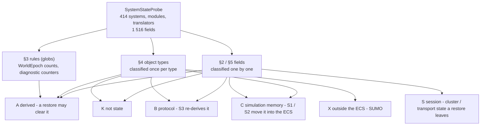
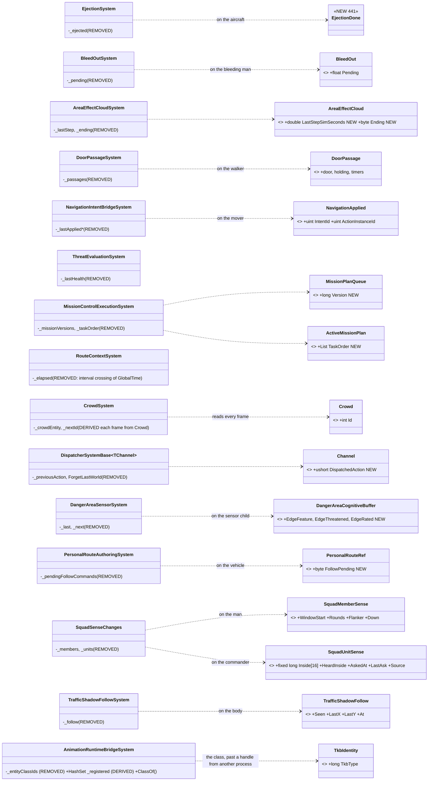
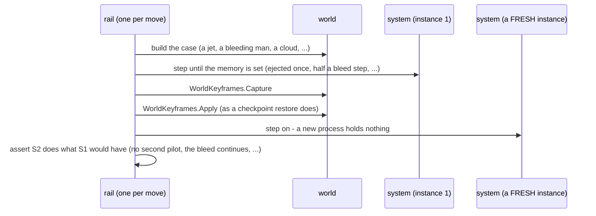
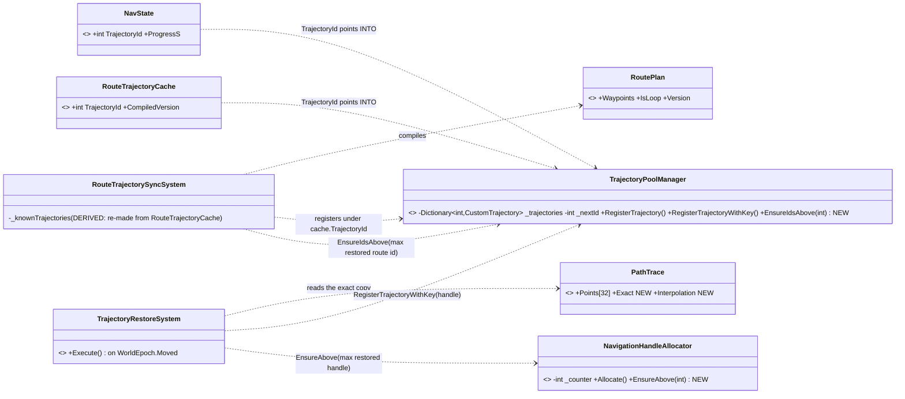
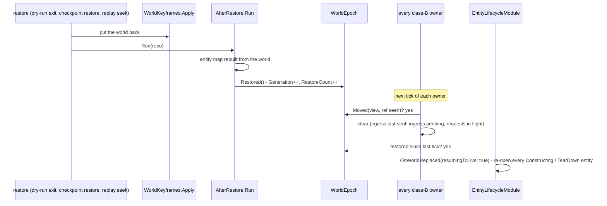
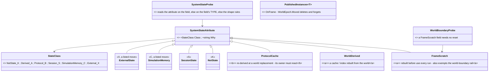
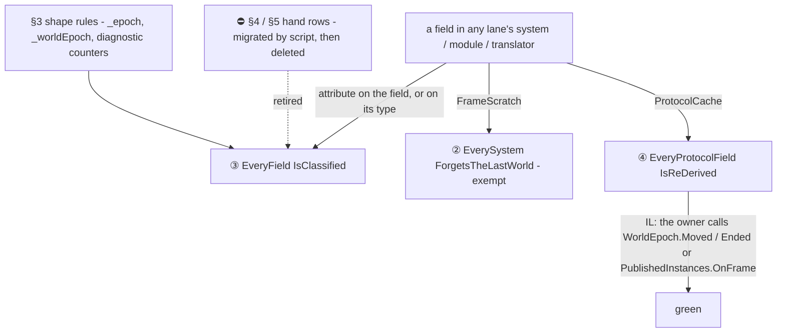

<!--STATUS
state: LIVE
updated: 2026-11-19
current-answer: §9 (R-4297 — the classification is attributes on the fields; the ledger tables retired) · §2 the work list prose
stale-below: none
known-rot: ⛔ SUPERSEDED 2026-10-28 (R-4095): the 7 rows that cited `Hrot/Network/Hrot.Network.BDC/**` (BDC readers, writers and translator fields) were DELETED with the stack (the one shared `type:DdsParticipant` row now cites `NedReplicationModule.cs:69`); §1's totals were measured before and still count them.
known-conflict: docs/blueprints/DESIGN_Paused_And_Stepped_Execution.md §7g.1 lists ~25 fields "SO FAR" — this replaces that list (it names ThreatEvaluationSystem as class A whole; measured here: _lastThreats is A, _lastHealth is C)
related-designs:
  - DESIGN_Replay_Time_Axis_And_Review.md — During Action Review: which classes survive a review (C in the keyframe, A/B re-derived, S/X frozen and deaf by the ReviewGate)
  - docs/blueprints/DESIGN_Paused_And_Stepped_Execution.md §7f / §7g — owns R-3039 (the rule, the A/B/C test, stages S1–S4); this file is its R2 inventory
  - docs/DESIGN_Checkpoint_And_Dry_Run_Restore.md — owns the keyframe restore that makes every C row here a lost value; its oracle R1 stays red until §2 is empty
  - docs/designs/replay-and-modules/DESIGN.md §2.1d — owns "restore the world, re-derive the protocol" (the B rows' S3 step)
-->

> ⛔ **SUPERSEDED `2026-10-28` (R-4095, CE-4077):** the 7 rows that cited `Hrot/Network/Hrot.Network.BDC/**` (BDC readers, writers and translator fields) were DELETED with the stack (the one shared `type:DdsParticipant` row now cites `NedReplicationModule.cs:69`); §1's totals were measured before and still count them. The reasoning below is kept as the record of that stack; do not read it as a live host.

# System state inventory — **every field a system, module or translator carries between frames** (R-3039 S4)

*What the picture shows that the tables hide:* only two of the five classes are work. K, A and B stay where they are (B gets the S3
re-derive step); C moves into a component or singleton; X cannot be moved by moving a field at all.

**The test, per field** ([Paused and Stepped §7f](blueprints/DESIGN_Paused_And_Stepped_Execution.md)): *with this field EMPTY and the
world restored, does the run continue as if nothing happened?* K and A: yes · B: yes once S3 re-derives it · C: ⛔ no · X: ⛔ no, and no
field move fixes it.

## 1. How this was made, and what it does not see

| | |
|---|---|
| ⭐ the probe | `FDP/TestShared/SystemStateProbe.cs` walks every production assembly beside the test: each concrete `IEcsModuleSystem`, `IEcsModule` and `INetworkTranslator`, and every field (instance and static, its base classes included) that is a collection or array, a mutable value or string, or a reference to a concrete class. Interfaces, delegates, constants and readonly scalars are skipped (dependencies and configuration). |
| ⭐ the rail | `Hrot.ClusterRunner.Tests/EverySystemStateFieldIsClassifiedTests` reads THIS FILE: every hit must match a row (exact key, a §3 glob, or for an object field its `type:` row); a row that names nothing fails; the C / X count may only shrink. ⚠ The Stride assemblies are NOT walked (they are not beside this test) — ⏳ **CE-3307**; ⚠ CE-3294's own Stride walk was never written either (`HrotStrideApp.Game.Tests` links `WorldBoundaryProbe` and calls it nowhere) |
| 📐 the classification | `2026-10-22`, four parallel read-only passes, one per assembly group, each row read in code (every read and write of the field) with a `file:line`; every C and X row and the contested ones re-read by the backend lane — corrected: `ThreatEvaluationSystem._lastThreats` C→A (empty falls back to the restored memory, `:203`), `_lastHealth` stays C (no fallback, `:221`); `BrainTickSystem._sopClock` C→A (fallback only without `GlobalTime`); `FakeDtCrowdProvider` C→K (no production host builds it); `TrafficReplicas` C→X (it pairs SUMO's ids) |
| ⚠ what a type cannot tell | the probe sees field TYPES, not meaning — the class is a reading, recorded per row. ⚠ A, B and K rows were mostly classified by shape after reading a few of each shape; ⛔ coverage was not checked by the code graph (`check_index_coverage` is not available through the CLI). R1 — the restore oracle — is what proves behaviour; this list plans the work and stops the next violator |
| ⚠ state the probe does not reach | a SERVICE object's own fields are classified as the type (§4), not field by field; static state outside systems, modules and translators (e.g. `BehaviorFrame._counter`, `PhaseRegistry._nextId`) is not walked |

| totals | K | A | B | C | X |
|---|---|---|---|---|---|
| fields — 1 516 hits: 485 read one by one (§2, §5) · 462 by §3's rules (73 epoch counts, 389 diagnostic counters) · 569 object fields by their type (§4) | 89 | 262 + 462 | 111 | 23 | 0 |
| object types (307) | 262 | 32 | 5 | 5 | 3 |

## 2. ⭐ THE WORK LIST — class C (simulation memory) and X (state outside the ECS)

The rail allows these rows only as the moves still to do; ⛔ a NEW C or X fails it. Each row's move gets its own *restore into a fresh system* rail (§7f.1's `EjectionSystem` probe is the template).

### 2a. S1 — per-entity memory onto the entity it is about (a component)

⭐ **Empty — S1 is built** (`2026-10-22`, §6): every per-entity C field is on its entity or derived, each with a *restore into a fresh
system* rail.

### 2b. S2 — world-wide memory into singleton components (pools and counters that components point into)

⭐ **Empty — S2 is built** (`2026-10-22`): routes re-derived (§7b), solved paths re-registered from each mover's exact `PathTrace` (§7c), the counters lifted (§7d), the two test-only types are K (§7a).

### 2c. X — state in an engine outside the ECS (a checkpoint cannot hold it by moving a field)

⏳ **Lean, not ruled** (backend, `2026-10-22`): a restore RESTARTS traffic — SUMO's own state is not in the ECS and none of these is a
field move; after a restore the traffic node starts SUMO again from the scenario's demand and the mirror rebuilds its replicas. The two
per-body memories beside it are moved or classified (§6 #14): the shadow follow is on the body; a hit held for a converting civilian
(`TrafficPanicSystem._held`) is in flight with SUMO and is lost with it (B, `R-3041`). Re-seeding SUMO from the restored replicas instead
is the alternative — larger, and only worth it if a restored run must keep its traffic.

### 2d. ⭐ C found by CE-3451 ③ (`2026-11-19`) — eleven listed moves ([CE-1981](blueprints/Blueprint_Issues_Tracker.md))

Classifying the 358-field backlog found simulation memory outside the ECS that had simply never been classified: `HeatSourceSystem._tracks` ·
`PlacementSolverSystem._reserved` / `_frame` · `VehicleImpactSystem._lastHit` · `DozerCutSystem._progress` · `MineBreadcrumbSystem._clearFor` ·
`MineTriggerSystem._clearers` · `VehicleOpeningsSystem._tracks` · `GrenadeDangerSystem._reacted` / `_seen` · `MacroExpansionSystem._frame`. Each carries
`[SimulationMemory("…")]` with its evidence; the rail's `PendingMoves` is **19** (8 before + 11) and may only shrink. Each moves the §6 way (onto its entity).

## 3. Rules — fields classified by shape (globs)

> ⛔ **RETIRED `2026-11-19` (R-4297, CE-1980, §9):** the shape rules (`_epoch`, `_worldEpoch`, `…Count` counters) are code in `SystemStateProbe.ShapeRule`; the DDS endpoints are its `CycloneDDS.Runtime` rule are ATTRIBUTES on the fields now (`[Fdp.Core.WorldDerived(…)]`, `[ProtocolCache(…)]`, `[NotState(…)]`, …) — the code is the one source. To list them: `HROT_STATE_DUMP=/tmp/s.tsv dotnet test Hrot/Runner/Hrot.ClusterRunner.Tests --no-build --filter FullyQualifiedName~EverySystemStateFieldIsClassifiedTests.Dump`.

## 4. Object types held in fields — classified once per type

> ⛔ **RETIRED `2026-11-19` (R-4297, CE-1980, §9):** the 303 type rows are ATTRIBUTES on the fields now (`[Fdp.Core.WorldDerived(…)]`, `[ProtocolCache(…)]`, `[NotState(…)]`, …) — the code is the one source. To list them: `HROT_STATE_DUMP=/tmp/s.tsv dotnet test Hrot/Runner/Hrot.ClusterRunner.Tests --no-build --filter FullyQualifiedName~EverySystemStateFieldIsClassifiedTests.Dump`.

## 5. Fields — B (protocol), S (session), A (derived), K (not state)

> ⛔ **RETIRED `2026-11-19` (R-4297, CE-1980, §9):** the 540 field rows (B, S, A, K) are ATTRIBUTES on the fields now (`[Fdp.Core.WorldDerived(…)]`, `[ProtocolCache(…)]`, `[NotState(…)]`, …) — the code is the one source. To list them: `HROT_STATE_DUMP=/tmp/s.tsv dotnet test Hrot/Runner/Hrot.ClusterRunner.Tests --no-build --filter FullyQualifiedName~EverySystemStateFieldIsClassifiedTests.Dump`.

## 6. ⭐ S1 — where each C field goes (design `2026-10-22`; build-state: BUILT `2026-10-22`)

**INVENTORY** (the S1 set): the C rows are the probe's own enumeration (§1 — reflection over every system, module and translator; `total`
1 516 fields, 23 C). The one place a row stood for a FAMILY was checked in the graph: `scripts/cbm.sh search_graph
'{"name_pattern":".*DispatcherSystem$","label":"Class"}'` ⇒ **total 7** — the five `DispatcherSystemBase<T>` subclasses (Locomotion,
Weapon, Interaction, Animation, LookAt; `grep "DispatcherSystemBase<"` agrees, 5 files), `MockDispatcherSystem` (a test double, no base)
and `WeaponTaskDispatcherSystem` (no base; its fields are classified on their own). ⚠ `check_index_coverage` is not available through the
CLI, so the graph count is corroborated by grep, not proven complete.

*What the picture shows that the table hides:* every arrow lands on the entity the memory is ABOUT, and only seven boxes are new — the
other memories fit a component that already sits on that entity. Component ids are the constraint (512-bit mask, backend's block 434–449;
441–447 now used, 448–449 free): an existing component first, a new one only where nothing on the entity fits.

| # | C field | ⭐ home | why there, and not | lane |
|---|---|---|---|---|
| 1 | `EjectionSystem._ejected` | NEW `EjectionDone` (441, tag) on the aircraft | the aircraft carries `Health` / `TkbIdentity` / `SimTransform` — none is the ejection's | backend |
| 2 | `BleedOutSystem._pending` | NEW `BleedOut { Pending }` (442) on the bleeding man, removed when he stops bleeding | ⛔ not `Health` (two floats every node reads; its layout is recorded everywhere) · ⛔ not `InjuryThresholds` (TKB configuration) | backend |
| 3 | `AreaEffectCloudSystem._lastStep` / `_ending` | fields on `AreaEffectCloud` | the cloud's own component; only its owner steps it, and the egress translator copies named fields | backend |
| 4 | `DoorPassageSystem._passages` | NEW `DoorPassage` (443) on the walker (the private `Passage` struct, as is) | nothing on a walker holds a door passage | backend |
| 5 | `NavigationIntentBridgeSystem._lastAppliedIntentId` / `_lastAppliedActionInstanceId` | NEW `NavigationApplied` (444) on the mover | ⛔ not `NavState` (infantry on a path has none, `:221`) · ⛔ not `NavigationIntent` (egressed: a write republishes it) | backend |
| 6 | `ThreatEvaluationSystem._lastHealth` | a field on the unit's `TargetMemory` (the memory this system already owns, `:195`) | the Hit edge is part of what the unit remembers | backend |
| 7 | `MissionControlExecutionSystem._missionVersions` / `_taskOrder` | `MissionPlanQueue.Version` (survives `EmptyPlan`) · `ActiveMissionPlan.TaskOrder` (null with the plan) | both already on the mission's entity | backend |
| 8 | `RouteContextSystem._elapsed` | ⭐ **no state:** run when `GlobalTime.TotalTime` crosses a multiple of the interval | the clock is restored with the world (D5), so the phase is too | backend (CGF) |
| 9 | `CrowdSystem._crowdEntity` / `_nextId` | ⭐ **derived:** rebuilt every frame from the `Crowd` entities (`Crowd.Id`) — reclassified A | the crowd entity already carries its id (`CrowdSystem.cs:24`) | backend |
| 10 | `DangerAreaSensorSystem._last` | `EdgeFeature` / `EdgeThreatened` / `EdgeRated` on the sensor child's `DangerAreaCognitiveBuffer` (as built) | ⛔ not `DangerAreaSensor` as designed — that is the sensor's CONFIGURATION, handed to the solver; the buffer is the brain-side answer the rating already writes, and a route change clears only its answer fields | ⚠ behaviors' code — built here (user, `2026-10-22`) |
| 11 | `DispatcherSystemBase<T>._previousAction` (×5) | `DispatchedAction` beside `DispatchedInstanceId` — in the pad of the three Brain channels (size unchanged), appended to the two Muscle report components | the lifecycle's two halves sit together; an index reused by the next world gets a fresh channel, so `ForgetLastWorld` (CE-3076) went with the array | ⚠ behaviors (3) + ui (2) — built here, said |
| 12 | `PersonalRouteAuthoringSystem._pendingFollowCommands` | `PersonalRouteRef.FollowPending` on the vehicle (the ref already names the route) | ⛔ no new id — the one-frame deferral stays (the trajectory compiles between the frames) | backend (SimHost) |
| 13 | `SquadSenseChanges._members` / `_units` | NEW `SquadMemberSense` (445) on the man · NEW `SquadUnitSense` (446) on the commander — written only when changed; absent = fresh | ⛔ not `SquadCognitiveState` (1 KB, the merged pool — its layout is pinned) · registered beside it in `HrotSharedComponentRegistry` | ⚠ behaviors' code — built here (user, `2026-10-22`) |
| 14 | `TrafficShadowFollowSystem._follow` · `TrafficPanicSystem._held` | NEW `TrafficShadowFollow` (447, backend's block, not traffic's 450–459) on the body · `_held` → **B** (in flight with SUMO, `R-3041`) | the X rows: §2c's lean — a restore restarts traffic | ⚠ traffic owner's code — built here (user, `2026-10-22`) |
| 15 | `AnimationRuntimeBridgeSystem._entityClassIds` | ⭐ **derived:** `_registered` (this process's backend) + `ClassOf` — the raw class in `BackendHandle`, else the entity's `TkbIdentity.TkbType` | ⛔ a `ClassId` field on `CharacterAnimationDefRuntime` was tried — it broke its 16 B layout contract, and the class was already on the entity | ⚠ ui's code — built here (user, `2026-10-22`) |

*What the picture shows:* the rail is the §7f.1 `EjectionSystem` probe generalised — ⭐ a FRESH system after a keyframe restore. A move is
done when its rail is green and its inventory row has gone from §2 (the ratchet in the S4 rail drops with it).

## 7. ⭐ S2 — the world-wide memory components point into (design `2026-10-22`; build-state: BUILT `2026-10-22` — 7c as §7c-bis's lean, approved by the user)

**INVENTORY** (the §2b rows, each measured — corpus sweep + reads, `2026-10-22`): `TrajectoryPoolManager` (one per process: SimHost
`SimHostNodeBootstrapper.cs:123` via `TrajectoryPoolProvider`; the editor's `GroundKinematicsModule.cs:108` lazy default; Stride
`StrideKinematicsModule.cs:94`) · `RouteTrajectorySyncSystem._knownTrajectories` · `BlockIdManager` · `EngineBackedPathRegistry` ·
`SharedPathRegistry`. Producers into the pool, `grep "RegisterTrajectory"` outside tests and examples ⇒ **4**: `RouteTrajectorySyncSystem`
(authored routes, auto id) · `PathfindingSolverSystem` (keyed by the route handle, `:226`/`:264`) · `PathfindingResultIngressTranslator`
(a path received over the wire, auto id, `PathfindingTranslators.cs:211`) · `SimHostScenarioManager` (a UI demo).

*What the picture shows that prose hid:* every arrow INTO the pool comes from a recorded component, but the pool itself is in no keyframe
(a managed singleton is in none either — Checkpoint Restore §1c D7, rail `WorldKeyframesTests.ManagedSingleton_SetBySetSingletonManaged_IsNotInAKeyframe`).
⇒ ⭐ **"into a singleton" (§7g.1's S2 line) does not survive a restore into a fresh process.** The pool stays what ROUTES1 §2.1 designed it
as — *"a transient, read-optimised performance cache"* — and becomes class A: re-derived from what the components record.

| # | item | ⭐ decision | basis |
|---|---|---|---|
| 7a | `BlockIdManager` · `SharedPathRegistry` | ⭐ **K** — no production host constructs either (only tests; `IdAllocationMonitorSystem` reads a `BlockIdManager` only if present) | the same call as `FakeDtCrowdProvider` (§1). The live allocators (`SequentialIdAllocator`, `DdsIdAllocator`) are owned by Deterministic Network Ids §4d |
| 7b | route trajectories (`RouteTrajectorySyncSystem`) | ⭐ **derived (as built):** at a world replacement the system forgets what it knew and compiles EVERY route again under the id its restored `RouteTrajectoryCache` names — `TrajectoryPoolManager.RegisterTrajectoryAt` (NEW: the full registration — CatmullRom, speeds, loop — at a pool-issued id; ⛔ not `RegisterTrajectoryWithKey`, which is linear-only and for caller-keyed handles) ⇒ `_knownTrajectories` is A | 🔴 measured by reading: today it frees its entries at `WorldEpoch.Moved` (`:69`) and then skips every route whose restored cache says "compiled" (`:103`) ⇒ after any restore the route's vehicle points at a freed / never-made trajectory |
| 7c | the solver's paths | ⭐ **as built:** `PathTrace` made exact (`Exact`, `Interpolation` in its padding — size unchanged); `TrajectoryRestoreSystem` (first in Simulation, after §7b's routes in BeforeSync) re-registers every mover's solved path from it under its handle, re-registers the path registry's entry, lifts `NavigationHandleAllocator`; a thinned trace is planned again (`PathRequests.FromIntent`) | §7c-bis — the user's design (a muscle-owned, unreplicated component on the unit), unmanaged so a replay allocates nothing |
| 7d | the id counters | ⭐ **derived:** at a world replacement the pool's `_nextId` is lifted above every restored route's id (`EnsureIdsAbove`, a pre-pass before anything compiles; `RegisterTrajectoryAt` lifts it too) — ✅ built. ⏳ `NavigationHandleAllocator._counter` (the muscle's handles) is lifted with 7c, whose records are what name those handles | the `CrowdSystem._nextId` precedent (§6 #9). ⛔ Without it, a fresh process re-issues a restored id: a new path overwrites one a vehicle is still driving |

### 7c — the solver's paths: where do the points live? (⛔ HISTORY — decided: §7c-bis, built)

| option | what | ⭐ cost | verdict |
|---|---|---|---|
| ⭐ **A — a recorded copy on the mover** | a managed `NavPathRecord { Id, Points, Traversals, meta }` on every entity whose `NavState.TrajectoryId` names a pool entry, written by one main-thread system when the id changes; 7d's restore step re-registers each under its id | one component on each moving unit (recorded only when its path changes); ⚠ **every scenario golden with a moving unit re-records once** (the coordinator's, `R-4065`) | ⭐ **lean** — a restored run continues on the SAME path (the R1 oracle can pass) |
| B — re-plan after a restore | nothing recorded; at a restore every mover asks for a new path from where it stands | none in the recording | ⛔ a restored run DIVERGES from the original (a new path, progress reset) — R1 can never pass |
| C — a recorded pool singleton | the recorder learns to write a managed singleton that opts in | a recorder change in the engine (D7 decided against recording managed singletons); the WHOLE pool is rewritten each time any path changes | ⛔ the cost lands in every frame of every recording |

### 7c-bis — measured `2026-10-22` (user: *"store paths as a component on the unit, owned by the muscle, not replicated … custom serialization … avoid allocations every tick during replay"*)

| ⭐ fact | where |
|---|---|
| a solved path's whole life is on the MUSCLE: request (`NavigationIntentBridgeSystem.RequestPath`, the entity packed in the request id) → solve (`PathfindingSolverSystem`, background) → response (`EngineBackedPathResponseSystem`, main thread, writes `NavState.TrajectoryId`) | `EngineBackedPathResponseSystem.cs:47-60` |
| `NavState` is muscle-owned and has no network translator ⇒ a path component beside it is muscle-local, never on the wire | `HrotOwnershipGroups.cs:105` |
| ⛔ **a MANAGED component is recorded and replayed per 16 384-entity chunk** — one changed unit rewrites every unit's component of that type, and playback allocates a new `T?[16384]` and a new object per occupied slot (`Deserialize<T?[]>` + `SetChunk`); no "read into the existing object" hook exists | `ManagedComponentTable.cs:18` · `RecorderSystem.cs:634` · `PlaybackSystem.cs:367` |
| ⭐ an UNMANAGED component replays as a raw copy into the existing 64 KB chunk — no allocation | `PlaybackSystem.cs:446` |
| ⭐ prior art: `PathTrace` (CE-3117) — an unmanaged, recorded, fixed-capacity (32) copy of each mover's path, written only when the path changes, not replicated — ⚠ lossy (thinned past 32 points, for the map) | `PathTrace.cs` · `PathTraceSystem.cs` |
| 📐 solved path lengths, `--verify` runs: `uc-urban-battle` 410 paths, median 2, p99 10, **max 12** points (≤ 227 m) · `pc-urban-move` 363, max 2 · `sl0-platoon-march` 344, max 3 · `cc-platoon-bound` 215, max 4 — ⚠ none drives a long ROAD route (the planner allows 128 navmesh points per leg plus a road leg) | probe, reverted |

⇒ ⭐ **lean (refines A):** the path lives in an UNMANAGED fixed-capacity component on the mover — `PathTrace` made exact (not a second component): the points as registered + their traversals, `Exact = 1` when the whole path fits (32 holds every path measured). The restore step re-registers each mover's trajectory from it under its handle (`RegisterTrajectoryWithKey`) and lifts `NavigationHandleAllocator` above the largest restored handle; a path longer than the capacity (thinned, `Exact = 0`) is RE-PLANNED for that unit after a restore — the one accepted divergence. ⭐ The managed-replay allocation is an engine item of its own (CE-3309), not this one.

## 8. ⭐ S3 — one re-derive step on every restore (design `2026-10-22`; build-state: BUILT `2026-10-22`)

*What the picture shows:* there is ONE signal (`WorldEpoch`), raised in ONE place (`AfterRestore.Run`), and every owner reacts to it on its own
next tick — ⛔ no list of systems for a restore handler to call. ⚠ `Ended` does not move, so nothing deletes entities on the wire.

| ⭐ | |
|---|---|
| **B means "re-derived at a world replacement"** | a B field's owner clears or re-derives it when `WorldEpoch.Moved` fires (directly, via `OnWorldBoundary`, or the ELM's `OnWorldReplaced`). 📐 Measured: 88 B owners, **15** with no such hook — the eight animation egress translators, the mission and route egress caches, the overlay ingress's pending set, the two entity-request trackers, `TrafficPanicSystem._held`, and the ELM (its re-derive, replay design §2.1m, is wired only into the editor preview) |
| **NEW class S — session state** | cluster, transport and process state that is not the world: a restore leaves it, by design (`ClusterSlave`, the cluster state cache, capability ingest, the SUMO wire reconstructors, publish-once latches, the time-mode echo suppression, three counters that only grow, the replay controller's own clock and mode). 📐 **12** owners, reclassified from B |
| **the rail** | `EveryProtocolFieldIsReDerivedAtARestore` — every B row's owner file reacts to the world replacing (`WorldEpoch` / `OnWorldBoundary` / `OnWorldReplaced`); an S row needs no hook. ⚠ A text check: it proves the hook exists, not that it clears the right field — the ELM gets a behavioural rail |

## 9. ⭐ R-4297 — the classification moves INTO THE CODE; this ledger retires *(CE-1980 / CE-3451 ②③④, ui; design `2026-11-19`; build-state: BUILDING)*

> 🔒 **DECIDED `2026-11-18` (user, via coordinator, `DECISIONS_Ui.md` CE-3451):** *② BUILD it — one system at a time, a reset or a rail-backed exemption per field ·
> ③ CHANGE THE RULE — classification moves into the CODE: an attribute on the field (`[FrameScratch]`, `[WorldDerived]`, `[ProtocolCache]` …) the rail reads; the
> central hand ledger retires · ④ BUILD it ONCE in the egress translators' shared shape (one reset on `WorldEpoch.Moved`; the wire unchanged).*

**INVENTORY / measured at ui `6ea6b2cc9`:** `SystemStateProbe` — 551 owners, 2 200 fields, **518 unclassified**, 8 C/X (rail allows 7); `WorldBoundaryProbe` — **21** of 68
entity-holding systems with neither a reset nor an exemption (the exemptions: a 44-entry dictionary in `EverySystemForgetsTheLastWorldTests`); the B rail — **45** red,
of which ⛔ **36 are STALE ROWS** (the field no longer exists: CE-4007 moved every egress send-on-change cache into `PublishedInstances<T>`, which ALREADY deletes and
forgets everything on `WorldEpoch.Moved` — `PublishedInstances.cs:76` — so ④'s "shared shape" is built), 4 are side caches their owners clear on `_instances.OnFrame(...)`
returning true (correct, invisible to a TEXT check), and **5 are real**: the ingress `_pending` sets of the Passengers, ScenarioClock, TrafficDemand, WeaponSystemState and
Weather translators never forget at a world move. `search_graph` for `.*(StateAttribute|FrameScratch|WorldDerived).*` → none; `DataPolicyAttribute` (`Fdp.Core`) is the
precedent of a classifying attribute the rails read.

*What the picture shows that prose hid:* ONE attribute family answers all three rails — ③ reads the class, ② treats a `FrameScratch` field as needing no reset (the
44-entry exemption dictionary becomes attributes), ④ requires a `ProtocolCache` field's owner to react — so a new field is classified once, where it is written.

*What the picture shows that prose hid:* ④ stops being a TEXT search over this file and reads the owner's compiled code, so the shared shape (`PublishedInstances.OnFrame`)
counts — the 36 stale rows were the text check failing on code that was right.

| ⭐ decision | taken | rejected |
|---|---|---|
| **where the attribute lives** | `Fdp.Core` (beside `DataPolicyAttribute`): every assembly the probes walk (`Fdp.*`, `Hrot.*`) reaches it | a new assembly — one more reference everywhere for seven types |
| **on a type or a field** | a field; ⭐ or the held TYPE (a class marked once classifies every field holding it — §4's "once per type") when the type is ours | type rows kept in a ledger — the ledger is what retires |
| **the shape rules (§3)** | stay, as code in the probe (they are rules, not rows) | an attribute on every `_epoch` |
| **the migration** | a script places each §4 / §5 row as an attribute on its field (or its type), then the rows are deleted; the 518 are classified by reading them, in the same attribute form | keep the ledger for old fields — two sources for one answer |
| **④ the check** | IL, as `WorldBoundaryProbe.CallsWorldEpochMoved` already reads it, plus `PublishedInstances<T>.OnFrame` (its own reset, CE-4007) | the text grep over an evidence file |
| **④ the 5 ingress `_pending`** | each clears on `WorldEpoch.Moved` at the top of its apply (the `MapVisualOverlayIngressTranslator` precedent, S3) — red-proved by removing one | a new shared ingress shape for five dictionaries — not asked, and ingress translators share no base |

**As built (`2026-11-19`):** ③ all 849 ledger rows are attributes (a script placed field rows on the field, a type row once on our own class — ⚠ twice it first
matched a same-named class in another namespace, `NetworkEntityMap` and `CombatModule`, both corrected and audited); the 358-field backlog was classified by a
worker and reviewed (three of its C's are A: `BallisticsSystem._lying` / `_lyingCount`, `EmitterLocatingSystem._sent`); `SystemStateProbe.ShapeRule` holds §3's
rules and a `CycloneDDS.Runtime` field is a transport endpoint (the ledger's 159 per-instantiation rows). ② the dictionary is empty; 67 fields carry
`[FrameScratch]`; seven systems reset held entities. ④ IL-checked; the deploy join flow (`DeployFlowSystem`, `DeployProcessorSystem`, `PlayerSlotReaderSystem`) is
**S** — its ids are checked against the live world on every use and its durable answers are deleted when a station leaves, so a reset at a reload would
orphan them; the monotonic id counters (`_requestId`, `_spawnCounter`, `_nextPlacementRequest`) are S — a reset would reuse an id an answer in flight still names.
All three rails green.

**Announced to every lane:** [`NOTE_Ui_To_All_Lanes_State_Attributes.md`](blueprints/batches/NOTE_Ui_To_All_Lanes_State_Attributes.md) (R-4297).
