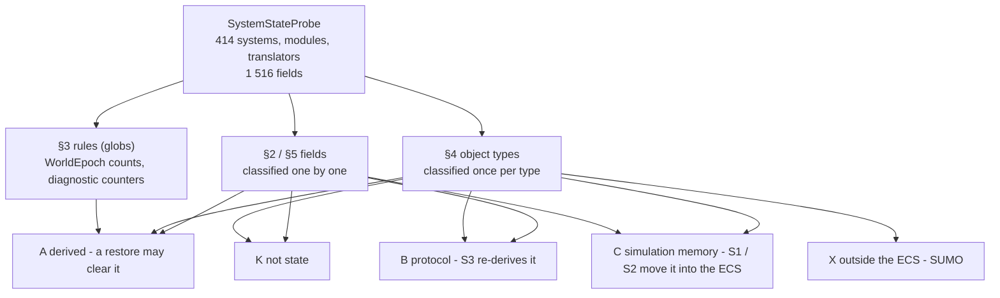

<!--STATUS
state: LIVE
updated: 2026-10-22 (created — backend; R-3039 S4 / R2: the full inventory, read by the rail EverySystemStateFieldIsClassifiedTests)
current-answer: §2 (the work list) — the rest is the evidence the rail checks
stale-below: none
known-rot: none
known-conflict: docs/blueprints/DESIGN_Paused_And_Stepped_Execution.md §7g.1 lists ~25 fields "SO FAR" — this replaces that list (it names ThreatEvaluationSystem as class A whole; measured here: _lastThreats is A, _lastHealth is C)
related-designs:
  - docs/blueprints/DESIGN_Paused_And_Stepped_Execution.md §7f / §7g — owns R-3039 (the rule, the A/B/C test, stages S1–S4); this file is its R2 inventory
  - docs/DESIGN_Checkpoint_And_Dry_Run_Restore.md — owns the keyframe restore that makes every C row here a lost value; its oracle R1 stays red until §2 is empty
  - docs/designs/replay-and-modules/DESIGN.md §2.1d — owns "restore the world, re-derive the protocol" (the B rows' S3 step)
-->

# System state inventory — **every field a system, module or translator carries between frames** (R-3039 S4)

*What the picture shows that the tables hide:* only two of the five classes are work. K, A and B stay where they are (B gets the S3
re-derive step); C moves into a component or singleton; X cannot be moved by moving a field at all.

**The test, per field** ([Paused and Stepped §7f](blueprints/DESIGN_Paused_And_Stepped_Execution.md)): *with this field EMPTY and the
world restored, does the run continue as if nothing happened?* K and A: yes · B: yes once S3 re-derives it · C: ⛔ no · X: ⛔ no, and no
field move fixes it.

## 1. How this was made, and what it does not see

| | |
|---|---|
| ⭐ the probe | `FDP/TestShared/SystemStateProbe.cs` walks every production assembly beside the test: each concrete `IEcsModuleSystem`, `IEcsModule` and `INetworkTranslator`, and every field (instance and static, its base classes included) that is a collection or array, a mutable value or string, or a reference to a concrete class. Interfaces, delegates, constants and readonly scalars are skipped (dependencies and configuration). |
| ⭐ the rail | `Hrot.ClusterRunner.Tests/EverySystemStateFieldIsClassifiedTests` reads THIS FILE: every hit must match a row (exact key, a §3 glob, or for an object field its `type:` row); a row that names nothing fails; the C / X count may only shrink. ⚠ The Stride assemblies are NOT walked (they are not beside this test) — ⏳ **CE-3307**; ⚠ CE-3294's own Stride walk was never written either (`HrotStrideApp.Game.Tests` links `WorldBoundaryProbe` and calls it nowhere) |
| 📐 the classification | `2026-10-22`, four parallel read-only passes, one per assembly group, each row read in code (every read and write of the field) with a `file:line`; every C and X row and the contested ones re-read by the backend lane — corrected: `ThreatEvaluationSystem._lastThreats` C→A (empty falls back to the restored memory, `:203`), `_lastHealth` stays C (no fallback, `:221`); `BrainTickSystem._sopClock` C→A (fallback only without `GlobalTime`); `FakeDtCrowdProvider` C→K (no production host builds it); `TrafficReplicas` C→X (it pairs SUMO's ids) |
| ⚠ what a type cannot tell | the probe sees field TYPES, not meaning — the class is a reading, recorded per row. ⚠ A, B and K rows were mostly classified by shape after reading a few of each shape; ⛔ coverage was not checked by the code graph (`check_index_coverage` is not available through the CLI). R1 — the restore oracle — is what proves behaviour; this list plans the work and stops the next violator |
| ⚠ state the probe does not reach | a SERVICE object's own fields are classified as the type (§4), not field by field; static state outside systems, modules and translators (e.g. `BehaviorFrame._counter`, `PhaseRegistry._nextId`) is not walked |

| totals | K | A | B | C | X |
|---|---|---|---|---|---|
| fields — 1 516 hits: 485 read one by one (§2, §5) · 462 by §3's rules (73 epoch counts, 389 diagnostic counters) · 569 object fields by their type (§4) | 89 | 262 + 462 | 111 | 23 | 0 |
| object types (307) | 262 | 32 | 5 | 5 | 3 |

## 2. ⭐ THE WORK LIST — class C (simulation memory) and X (state outside the ECS)

The rail allows these rows only as the moves still to do; ⛔ a NEW C or X fails it. Each row's move gets its own *restore into a fresh system* rail (§7f.1's `EjectionSystem` probe is the template).

### 2a. S1 — per-entity memory onto the entity it is about (a component)

| key | class | why empty is wrong | evidence |
|---|---|---|---|
| `CarKinem.Systems.DoorPassageSystem._passages` | **C** | per-walker door hold/open-command timers (Elapsed, Sent, SinceSent) | FDP/Toolkits/Fdp.Toolkits/CarKinem/Systems/DoorPassageSystem.cs:162 |
| `Fdp.Toolkit.Behavior.Systems.DispatcherSystemBase<*>._previousAction` | **C** | last dispatched action per entity (5 channels: interaction, locomotion, weapon, animation, look-at); empty skips the outgoing action's OnExit | Hrot/Subsystems/Hrot.MuscleCharacter.Animation/Systems/AnimationDispatcherSystem.cs:106 |
| `Fdp.Toolkit.Civilians.CrowdSystem._crowdEntity` | **C** | crowd id -> crowd entity map; components hold CrowdId; empty spawns duplicate crowd entities | FDP/Toolkits/Fdp.Toolkits/Civilians/CrowdSystem.cs:362 |
| `Fdp.Toolkit.Combat.Systems.AreaEffectCloudSystem._lastStep` | **C** | per-cloud last pulse/drift time; empty pulses at once and jumps drift | FDP/Toolkits/Fdp.Toolkits/Combat/Systems/AreaEffectCloudSystem.cs:59 |
| `Fdp.Toolkit.Combat.Systems.BleedOutSystem._pending` | **C** | bleed time accumulator per incapacitated entity | FDP/Toolkits/Fdp.Toolkits/Combat/Systems/BleedOutSystem.cs:45 |
| `Fdp.Toolkit.Navigation.Systems.NavigationIntentBridgeSystem._lastAppliedActionInstanceId` | **C** | already-applied locomotion action latch; empty re-runs crowd registration | FDP/Toolkits/Fdp.Toolkits/Navigation/Systems/NavigationIntentBridgeSystem.cs:387 |
| `Fdp.Toolkit.Navigation.Systems.NavigationIntentBridgeSystem._lastAppliedIntentId` | **C** | already-applied intent latch; empty re-applies every intent, restarting routes | FDP/Toolkits/Fdp.Toolkits/Navigation/Systems/NavigationIntentBridgeSystem.cs:215 |
| `Fdp.Toolkit.Perception.Systems.ThreatEvaluationSystem._lastHealth` | **C** | previous health for the Hit edge; no fallback, a hit in the first step after a restore raises nothing | FDP/Toolkits/Fdp.Toolkits/Perception/Systems/ThreatEvaluationSystem.cs:221 |
| `Fdp.Toolkit.Squad.Systems.DangerAreaSensorSystem._last` | **C** | hysteresis latch (threatened/feature) deciding AreaThreatened/Cleared events | FDP/Toolkits/Fdp.Toolkits/Squad/Systems/DangerAreaSensorSystem.cs:183 |
| `Hrot.CGF.Systems.Routing.RouteContextSystem._elapsed` | **C** | throttle accumulator of sim time; reset shifts when BrainInterrupts danger is written | Hrot/Subsystems/Hrot.CGF/Systems/Routing/RouteContextSystem.cs:82 |
| `Hrot.Common.EntityCreation.EjectionSystem._ejected` | **C** | latch: pilot already ejected per aircraft | Hrot/Engine/Hrot.Common/EntityCreation/EjectionSystem.cs:67 |
| `Hrot.Common.Systems.MissionControlExecutionSystem._missionVersions` | **C** | per-entity mission version for optimistic concurrency; empty resets to 0 | Hrot/Engine/Hrot.Common/Systems/MissionControlExecutionSystem.cs:106 |
| `Hrot.Common.Systems.MissionControlExecutionSystem._taskOrder` | **C** | per-entity task order; empty makes CMD_JUMP_TO_TASK jump to index 0 | Hrot/Engine/Hrot.Common/Systems/MissionControlExecutionSystem.cs:232 |
| `Hrot.MuscleCharacter.Animation.Systems.AnimationRuntimeBridgeSystem._entityClassIds` | **C** | entity registered with backend; empty re-registers using encoded handle as classId (backend itself X) | Hrot/Subsystems/Hrot.MuscleCharacter.Animation/Systems/AnimationRuntimeBridgeSystem.cs:58 |
| `Hrot.SimHost.Systems.Routing.PersonalRouteAuthoringSystem._pendingFollowCommands` | **C** | deferred FollowRoute intent dispatch next frame; lost means vehicle never follows | Hrot/Subsystems/Hrot.SimHost/Systems/Routing/PersonalRouteAuthoringSystem.cs:124 |
| `Hrot.Traffic.TrafficPanicSystem._held` | **C** | damage hit held 10 s awaiting its civilian; lost hit never applied | Hrot/Engine/Hrot.Traffic/TrafficPanic.cs:120 |
| `Hrot.Traffic.TrafficShadowFollowSystem._follow` | **C** | per-entity shadow Seen latch and last pose/time; empty holds body blocked forever | Hrot/Engine/Hrot.Traffic/TrafficShadowFollowSystem.cs:62 |
| `type:SquadSenseChanges` | **C** | edge latches, round windows, asked-at timers per man/squad | FDP/Toolkits/Fdp.Toolkits/Squad/Systems/SquadSenseChanges.cs:62 |

### 2b. S2 — world-wide memory into singleton components (pools and counters that components point into)

| key | class | why empty is wrong | evidence |
|---|---|---|---|
| `Fdp.Toolkit.Civilians.CrowdSystem._nextId` | **C** | crowd id counter; issued ids stored in CivilianState.CrowdId, reset collides | FDP/Toolkits/Fdp.Toolkits/Civilians/CrowdSystem.cs:339 |
| `Hrot.SimHost.Systems.Routing.RouteTrajectorySyncSystem._knownTrajectories` | **C** | entity to trajectory-pool id; components point into pool, empty leaks/never frees | Hrot/Subsystems/Hrot.SimHost/Systems/Routing/RouteTrajectorySyncSystem.cs:143 |
| `type:BlockIdManager` | **C** | pool of network ids held; issued ids live in components; capture/restore exists | FDP/Toolkits/Fdp.Toolkits/Replication/Services/BlockIdManager.cs:11 |
| `type:EngineBackedPathRegistry` | **C** | per-handle path meta keyed by TrajectoryId; IsCached gates FetchPathDetails success | FDP/Toolkits/Fdp.Toolkits/Navigation/EngineBacked/EngineBackedPathRegistry.cs:20 |
| `type:SharedPathRegistry` | **C** | holds MusclePathRegistry route waypoint pool; route handles live in components | FDP/Toolkits/Fdp.Toolkits/Navigation/Fake/SharedPathRegistry.cs:12 |
| `type:TrajectoryPoolManager` | **C** | trajectory pool; NavState.TrajectoryId in components points into it | FDP/Toolkits/Fdp.Toolkits/CarKinem/Trajectory/TrajectoryPoolManager.cs:15 |

### 2c. X — state in an engine outside the ECS (a checkpoint cannot hold it by moving a field)

| key | class | why empty is wrong | evidence |
|---|---|---|---|
| `type:TrafficReplicas` | **X** | the traffic node's SUMO-id -> entity pairing; restorable only with SUMO's own state | Hrot/Engine/Hrot.Traffic/TrafficModules.cs:138 |
| `type:TrafficRuntime` | **X** | owns the SUMO (LiveCitySim) session and stepping thread | Hrot/Engine/Hrot.Traffic/TrafficRuntime.cs:19 |
| `type:TrafficSession` | **X** | wraps one running SUMO LiveCitySim engine | Hrot/Engine/Hrot.Traffic/TrafficSession.cs:38 |

## 3. Rules — fields classified by shape (globs)

| key | class | why |
|---|---|---|
| `*._epoch` | **A** | the `WorldEpoch` seen-count — the CE-3294 reset mechanism itself |
| `*._worldEpoch` | **A** | the same, by its other name |
| `*.<*Count>k__BackingField` | **A** | a diagnostic counter (`SentSampleCount`, `ReceivedSampleCount`, `RefusedCount`, …) — read by diagnostics and tests only |

## 4. Object types held in fields — classified once per type

A reference to a concrete class is classified by what that OBJECT carries. A system or module held by another is classified on its own (its fields are in §5).

| key | class | why | evidence |
|---|---|---|---|
| `type:ClusterSlave` | **B** | cluster-orchestration slave: seen transaction ids, pending intents, node-op handshake | FDP/Toolkits/Fdp.Toolkits/Orchestration/ClusterSlave.cs:50 |
| `type:DdsMultiSourcePedSubscriber` | **B** | per-source ped wire reconstruction state, refilled by incoming stream | FDP/ExtDeps/SumoSharp/src/Sim.Replication.Dds/DdsMultiSourcePedSubscriber.cs:32 |
| `type:DdsMultiSourceSubscriber` | **B** | per-source vehicle wire reconstruction state, refilled by incoming stream | FDP/ExtDeps/SumoSharp/src/Sim.Replication.Dds/DdsMultiSourceSubscriber.cs:28 |
| `type:SimpleClusterStateCache` | **B** | cluster membership/load cache plus unsupported marks; rebuilt from heartbeats and durable topics | Hrot/Network/Hrot.Network.NED/Replication/NedReplicationModule.cs:234 |
| `type:SourceTimeOrder<ValueTuple<Int64,Int32>>` | **B** | newest-source-time per instance for stale-sample drop; empty re-accepts old samples | Hrot/Network/Hrot.Network.NED/SimHost/EqsSensorConfigIngressTranslator.cs:46 |
| `type:AsyncRecorder` | **A** | flight-recorder output buffers/counters; not simulation state | FDP/Engine/Fdp.Core/FlightRecorder/AsyncRecorder.cs:17 |
| `type:BakedAnimationCache` | **A** | cache of baked TKB animation data, refilled on demand/hot-reload | Hrot/Subsystems/Hrot.MuscleCharacter.Animation/Baking/BakedAnimationCache.cs:13 |
| `type:BehaviorFaultLog` | **A** | diagnostic message log with de-dup memory; no simulation effect | Hrot/Network/Hrot.Network.NED/Translators/BehaviorFaultTranslators.cs:122 |
| `type:BrainPathRegistry` | **A** | LRU cache of path details ingested from muscle registry; refillable | FDP/Toolkits/Fdp.Toolkits/Navigation/Systems/NavigationPathDetailsUpdateSystem.cs:71 |
| `type:ColliderOcclusion` | **A** | collider list/index rebuilt from world at each Build() call | FDP/Toolkits/Fdp.Toolkits/Perception/LineOfSight/LosStrategies.cs:415 |
| `type:DebugPrimitiveBuffer` | **A** | debug-draw scratch with persistent re-emit lifetimes; diagnostics only | FDP/Diagnostics/Fdp.Diagnostics.Contracts/DebugPrimitiveBuffer.cs:16 |
| `type:DoorStates` | **A** | door table recomputed from door entities each call | FDP/Toolkits/Fdp.Toolkits/Terrain/TerrainObjects.cs:93 |
| `type:EcsSelectionState` | **A** | UI mirror of selection components, resynced from world | Hrot/Engine/Hrot.Presentation/ScenarioEditor/Selection/EcsSelectionState.cs:44 |
| `type:EqsSchedule` | **A** | per-tick sensor ordering list, cleared by Begin() | FDP/Toolkits/Fdp.Toolkits/Spatial/Eqs/EqsSchedule.cs:88 |
| `type:GizmoCapabilitiesTracker` | **A** | connected-terminal id set, re-derived from events; gizmo UI only | FDP/Toolkits/Fdp.Toolkits/Diagnostics/Gizmos/Modules/GizmoCapabilitiesTracker.cs:17 |
| `type:GizmoExecutionController` | **A** | gizmo group toggle by listener count; diagnostic UI | FDP/Toolkits/Fdp.Toolkits/Diagnostics/Gizmos/GizmoExecutionController.cs:18 |
| `type:GizmoFocusRegistry` | **A** | which gizmo has input focus; tool UI, not simulation | FDP/Toolkits/Fdp.Toolkits/Diagnostics/Gizmos/Systems/GizmoFocusRegistry.cs:36 |
| `type:GizmoUndoStack` | **A** | editor gizmo undo/redo history; not simulation | FDP/Toolkits/Fdp.Toolkits/Diagnostics/Gizmos/UndoRedo/GizmoUndoStack.cs:13 |
| `type:ListPatchContext` | **A** | reusable per-create scratch slots, reset between uses | FDP/Toolkits/Fdp.Toolkits/Replication/Patching/ListPatchContext.cs:46 |
| `type:LocalGizmoUiStateTransport` | **A** | pending UI state mailbox for gizmo UI | FDP/Toolkits/Fdp.Toolkits/Diagnostics/Gizmos/Hub/LocalGizmoUiStateTransport.cs:14 |
| `type:MandatoryComponentResolver` | **A** | cache keyed by descriptor, invalidated by ingress generation | FDP/Toolkits/Fdp.Toolkits/Replication/Services/MandatoryComponentResolver.cs:49 |
| `type:MapCameraViewport` | **A** | camera extents/zoom for culling; view state, not simulation | Hrot/Subsystems/Hrot.IG/Systems/MapCameraViewport.cs:38 |
| `type:MapCanvas` | **A** | 2D map renderer/input canvas; presentation only | FDP/Engine/Fdp.Presentation/Vis2D/MapCanvas.cs:34 |
| `type:NetworkEntityMap` | **A** | net-id/entity maps rebuilt from world by RebuildFromWorld after restore | FDP/Toolkits/Fdp.Toolkits/Replication/Services/NetworkEntityMap.cs:222 |
| `type:OrderDraft` | **A** | in-progress UI order draft; cancelled/reset on restore | Hrot/Engine/Hrot.Presentation/ScenarioEditor/Map/MenuOrders.cs:36 |
| `type:PerceptionGridProvider` | **A** | spatial hash grid memory refilled each tick by LocalGridBuilderSystem | FDP/Toolkits/Fdp.Toolkits/Perception/Systems/LocalGridBuilderSystem.cs:120 |
| `type:PlaybackController` | **A** | replay file cursor; PlaybackTickSystem re-seeks by wall time when reset | FDP/Toolkits/Fdp.Toolkits/Replay/PlaybackTickSystem.cs:117 |
| `type:RoutePlanner` | **A** | reusable scratch point/traversal lists; planner config | FDP/Toolkits/Fdp.Toolkits/Navigation/RoutePlanner.cs:52 |
| `type:SensorMemoryStage` | **A** | per-call scratch maps, cleared each flush; memory is in components | FDP/Toolkits/Fdp.Toolkits/Perception/Sensors/SensorMemoryStage.cs:53 |
| `type:Stopwatch` | **A** | wall-clock perf timing / silence timer; no sim decisions | FDP/Toolkits/Fdp.Toolkits/CarKinem/Systems/CarKinematicsSystem.cs:57 |
| `type:Task<GeoPoint>` | **A** | pending UI map-pick task; dropped on restore | Hrot/Engine/Hrot.Presentation/ScenarioEditor/Map/MenuOrders.cs:32 |
| `type:Task<Int32>` | **A** | pending UI entity-pick task; dropped on restore | Hrot/Engine/Hrot.Presentation/ScenarioEditor/Map/MenuOrders.cs:33 |
| `type:Task<ObstacleBake>` | **A** | background obstacle bake; reset by WorldEpoch and re-baked from entities | Hrot/Engine/Hrot.Core/Services/StaticObstacleBake.cs:97 |
| `type:TerrainResidency` | **A** | loaded terrain plus obstacle bake derived from StaticObstacle entities, rebaked on signature change | Hrot/Engine/Hrot.Core/Services/StaticObstacleBake.cs:97 |
| `type:ToolController` | **A** | armed-tool modal stack; editor UI, not simulation | Hrot/Engine/Hrot.Presentation/ScenarioEditor/Tools/ToolController.cs:39 |
| `type:TrafficFrame` | **A** | frame of SUMO poses rebuilt and republished each mirror tick | Hrot/Engine/Hrot.Traffic/TrafficModules.cs:257 |
| `type:TrafficNetCache` | **A** | parsed SUMO net cached from file, NoScenario/NoReplay | Hrot/Engine/Hrot.Traffic/TrafficNetCache.cs:14 |
| `type:ActionDispatchModule` | **K** | a system/module, classified on its own | FDP/Toolkits/Fdp.Toolkits/Behavior/Modules/ActionDispatchModule.cs:46 |
| `type:ActiveSensorTracksUpdateSystem` | **K** | a system/module, classified on its own | FDP/Toolkits/Fdp.Toolkits/Perception/Systems/ActiveSensorTracksUpdateSystem.cs:40 |
| `type:AddEntityAction` | **K** | menu action; delegates and ids fixed at construction | Hrot/Engine/Hrot.Presentation/AddEntity/AddEntityAction.cs:35 |
| `type:AirMotionModule` | **K** | a system/module, classified on its own | FDP/Toolkits/Fdp.Toolkits/Motion/AirMotionSystem.cs:186 |
| `type:AirMotionSystem` | **K** | a system/module, classified on its own | FDP/Toolkits/Fdp.Toolkits/Motion/AirMotionSystem.cs:18 |
| `type:AnimationBackendCleanupSystem` | **K** | a system/module, classified on its own | Hrot/Subsystems/Hrot.MuscleCharacter.Animation/Systems/AnimationBackendCleanupSystem.cs:29 |
| `type:AnimationCapabilityChangeReactorSystem` | **K** | a system/module, classified on its own | Hrot/Subsystems/Hrot.MuscleCharacter.Animation/Systems/AnimationCapabilityChangeReactorSystem.cs:31 |
| `type:AnimationDispatcherSystem` | **K** | a system/module, classified on its own | Hrot/Subsystems/Hrot.MuscleCharacter.Animation/Systems/AnimationDispatcherSystem.cs:23 |
| `type:AnimationRuntimeBridgeSystem` | **K** | a system/module, classified on its own | Hrot/Subsystems/Hrot.MuscleCharacter.Animation/Systems/AnimationRuntimeBridgeSystem.cs:20 |
| `type:AnimationStateReporterSystem` | **K** | a system/module, classified on its own | Hrot/Subsystems/Hrot.MuscleCharacter.Animation/Systems/AnimationStateReporterSystem.cs:21 |
| `type:BehaviorGizmoRegistry` | **K** | startup-time factory table, only registered at init | FDP/Toolkits/Fdp.Toolkits/Diagnostics/Gizmos/Systems/BehaviorGizmoRegistry.cs:10 |
| `type:BehaviorIngressSystem` | **K** | a system/module, classified on its own | FDP/Toolkits/Fdp.Toolkits/Behavior/Systems/BehaviorIngressSystem.cs:38 |
| `type:BehaviorRegistry` | **K** | behaviour definitions registered at startup / hot-reload | FDP/Toolkits/Fdp.Toolkits/Behavior/BehaviorRegistry.cs:367 |
| `type:BinaryInterpreter<EntityAttributeChange>` | **K** | dispatch table immutable after Build; mutable state lives in per-call context | Hrot/Network/Hrot.Network.NED/Systems/UpdateEntityAttributeRequestSystem.cs:197 |
| `type:BlueprintRegistry` | **K** | compiled blueprint definitions, atomic snapshot swapped on commit/hot-reload | FDP/Toolkits/Fdp.Toolkits/Blueprints/BlueprintRegistry.cs:8 |
| `type:CgfThreatEvaluationSystem` | **K** | a system/module, classified on its own | Hrot/Subsystems/Hrot.CGF/Systems/CgfThreatEvaluationSystem.cs:22 |
| `type:ClusterCapabilityIngestSystem` | **K** | a system/module, classified on its own | Hrot/Network/Hrot.Network.NED/Replication/NedReplicationModule.cs:375 |
| `type:CognitiveRuntimeModule` | **K** | a system/module, classified on its own | FDP/Toolkits/Fdp.Toolkits/Behavior/Modules/CognitiveRuntimeModule.cs:30 |
| `type:CombatModule` | **K** | a system/module, classified on its own | Hrot/Subsystems/Hrot.SimHost/Modules/CombatModule.cs:23 |
| `type:CycloneEgressSystem` | **K** | a system/module, classified on its own | FDP/Network/Fdp.Network.Cyclone/Systems/CycloneEgressSystem.cs:19 |
| `type:CycloneNetworkCleanupSystem` | **K** | a system/module, classified on its own | Hrot/Network/Hrot.Network.NED/Replication/NedReplicationModule.cs:594 |
| `type:CycloneNetworkIngressSystem` | **K** | a system/module, classified on its own | FDP/Network/Fdp.Network.Cyclone/Systems/CycloneNetworkIngressSystem.cs:26 |
| `type:DamageAssessmentModule` | **K** | a system/module, classified on its own | FDP/Toolkits/Fdp.Toolkits/Combat/Modules/DamageAssessmentModule.cs:25 |
| `type:DdsParticipant` | **K** | DDS domain participant, injected dependency | Hrot/Network/Hrot.Network.BDC/Replication/BdcReplicationModule.cs:51 |
| `type:DdsReader<AudioTargetDetected>` | **K** | transport read endpoint; samples consumed at poll, wire state is protocol | Hrot/Network/Hrot.Network.NED/SimHost/AudioTargetDetectedIngressTranslator.cs:33 |
| `type:DdsReader<BdcEntityMaster>` | **K** | DDS reader endpoint created in translator ctor | Hrot/Network/Hrot.Network.BDC/Replication/BdcEntityMasterTranslator.cs:56 |
| `type:DdsReader<BdcWorldPos>` | **K** | DDS reader endpoint created in translator ctor | Hrot/Network/Hrot.Network.BDC/Replication/BdcWorldPosTranslator.cs:54 |
| `type:DdsReader<BehaviorFaultReport>` | **K** | transport read endpoint; samples consumed at poll, wire state is protocol | Hrot/Network/Hrot.Network.NED/Translators/BehaviorFaultTranslators.cs:120 |
| `type:DdsReader<ContextActionsUpdate>` | **K** | transport read endpoint; samples consumed at poll, wire state is protocol | FDP/Network/Fdp.Network.Cyclone/Translators/CycloneTranslator.cs:38 |
| `type:DdsReader<DangerAreaResultTopic>` | **K** | transport read endpoint; samples consumed at poll, wire state is protocol | Hrot/Network/Hrot.Network.NED/CGF/DangerAreaResultIngressTranslator.cs:38 |
| `type:DdsReader<DdsAnimNotifyEvent>` | **K** | DDS reader endpoint created in translator ctor | FDP/Network/Fdp.Network.Cyclone/Translators/CycloneNativeEventTranslator.cs:32 |
| `type:DdsReader<DdsAnimationChannelIntent>` | **K** | DDS reader endpoint created in translator ctor | Hrot/Subsystems/Hrot.Animation.Replication/Translators/Channels/AnimationChannelIntentIngressTranslator.cs:33 |
| `type:DdsReader<DdsAnimationChannelStatus>` | **K** | DDS reader endpoint created in translator ctor | Hrot/Subsystems/Hrot.Animation.Replication/Translators/Channels/AnimationChannelStatusIngressTranslator.cs:31 |
| `type:DdsReader<DdsHitWindowClosedEvent>` | **K** | DDS reader endpoint created in translator ctor | FDP/Network/Fdp.Network.Cyclone/Translators/CycloneNativeEventTranslator.cs:32 |
| `type:DdsReader<DdsHitWindowOpenedEvent>` | **K** | DDS reader endpoint created in translator ctor | FDP/Network/Fdp.Network.Cyclone/Translators/CycloneNativeEventTranslator.cs:32 |
| `type:DdsReader<DdsLookAtChannelIntent>` | **K** | DDS reader endpoint created in translator ctor | Hrot/Subsystems/Hrot.Animation.Replication/Translators/Channels/LookAtChannelIntentIngressTranslator.cs:33 |
| `type:DdsReader<DdsLookAtChannelStatus>` | **K** | DDS reader endpoint created in translator ctor | Hrot/Subsystems/Hrot.Animation.Replication/Translators/Channels/LookAtChannelStatusIngressTranslator.cs:32 |
| `type:DdsReader<DdsMontageEndedEvent>` | **K** | DDS reader endpoint created in translator ctor | FDP/Network/Fdp.Network.Cyclone/Translators/CycloneNativeEventTranslator.cs:32 |
| `type:DdsReader<DdsMontageQueue>` | **K** | DDS reader endpoint created in translator ctor | Hrot/Subsystems/Hrot.Animation.Replication/Translators/SideBuffers/AnimationMontageQueueIngressTranslator.cs:32 |
| `type:DdsReader<DdsMontageQueueState>` | **K** | DDS reader endpoint created in translator ctor | Hrot/Subsystems/Hrot.Animation.Replication/Translators/SideBuffers/AnimationMontageQueueStateIngressTranslator.cs:31 |
| `type:DdsReader<DdsMontageSectionAdvancedEvent>` | **K** | DDS reader endpoint created in translator ctor | FDP/Network/Fdp.Network.Cyclone/Translators/CycloneNativeEventTranslator.cs:32 |
| `type:DdsReader<DdsMontageStartedEvent>` | **K** | DDS reader endpoint created in translator ctor | FDP/Network/Fdp.Network.Cyclone/Translators/CycloneNativeEventTranslator.cs:32 |
| `type:DdsReader<DdsStanceChangedEvent>` | **K** | DDS reader endpoint created in translator ctor | FDP/Network/Fdp.Network.Cyclone/Translators/CycloneNativeEventTranslator.cs:32 |
| `type:DdsReader<DdsStanceIntent>` | **K** | DDS reader endpoint created in translator ctor | Hrot/Subsystems/Hrot.Animation.Replication/Translators/Descriptors/StanceIntentIngressTranslator.cs:32 |
| `type:DdsReader<DdsStanceStatus>` | **K** | DDS reader endpoint created in translator ctor | Hrot/Subsystems/Hrot.Animation.Replication/Translators/Descriptors/StanceStatusIngressTranslator.cs:32 |
| `type:DdsReader<DeferredTakeOwnership>` | **K** | transport read endpoint; samples consumed at poll, wire state is protocol | Hrot/Network/Hrot.Network.NED/Translators/DeferredTakeOwnershipIngressTranslator.cs:57 |
| `type:DdsReader<EntityAreaEffectCloud>` | **K** | transport read endpoint; samples consumed at poll, wire state is protocol | Hrot/Network/Hrot.Network.NED/Replication/Map/EntityAreaEffectCloudTranslators.cs:95 |
| `type:DdsReader<EntityBrainIntent>` | **K** | transport read endpoint; samples consumed at poll, wire state is protocol | Hrot/Network/Hrot.Network.NED/Translators/BrainIntentTranslators.cs:146 |
| `type:DdsReader<EntityCombatProficiency>` | **K** | transport read endpoint; samples consumed at poll, wire state is protocol | Hrot/Network/Hrot.Network.NED/Replication/Map/EntityCombatProficiencyTranslators.cs:92 |
| `type:DdsReader<EntityCustody>` | **K** | transport read endpoint; samples consumed at poll, wire state is protocol | Hrot/Network/Hrot.Network.NED/Replication/Map/EntityCustodyTranslators.cs:91 |
| `type:DdsReader<EntityDamage>` | **K** | transport read endpoint; samples consumed at poll, wire state is protocol | FDP/Network/Fdp.Network.Cyclone/Translators/CycloneTranslator.cs:38 |
| `type:DdsReader<EntityDemeanour>` | **K** | transport read endpoint; samples consumed at poll, wire state is protocol | Hrot/Network/Hrot.Network.NED/Replication/Map/EntityDemeanourTranslators.cs:91 |
| `type:DdsReader<EntityDescent>` | **K** | transport read endpoint; samples consumed at poll, wire state is protocol | Hrot/Network/Hrot.Network.NED/Replication/Map/EntityDescentTranslators.cs:107 |
| `type:DdsReader<EntityDoorState>` | **K** | transport read endpoint; samples consumed at poll, wire state is protocol | Hrot/Network/Hrot.Network.NED/Replication/Map/Ingress/EntityDoorStateIngressTranslator.cs:42 |
| `type:DdsReader<EntityEffectState>` | **K** | transport read endpoint; samples consumed at poll, wire state is protocol | Hrot/Network/Hrot.Network.NED/Replication/Map/EntityEffectStateTranslators.cs:93 |
| `type:DdsReader<EntityEngagementArea>` | **K** | transport read endpoint; samples consumed at poll, wire state is protocol | Hrot/Network/Hrot.Network.NED/Replication/Map/EntityEngagementAreaTranslators.cs:100 |
| `type:DdsReader<EntityGesture>` | **K** | transport read endpoint; samples consumed at poll, wire state is protocol | Hrot/Network/Hrot.Network.NED/Replication/Map/EntityGestureTranslators.cs:90 |
| `type:DdsReader<EntityHitDamage>` | **K** | transport read endpoint; samples consumed at poll, wire state is protocol | Hrot/Network/Hrot.Network.NED/SimHost/EntityHitDamageIngressTranslator.cs:51 |
| `type:DdsReader<EntityHitMarks>` | **K** | transport read endpoint; samples consumed at poll, wire state is protocol | Hrot/Network/Hrot.Network.NED/Replication/Map/EntityBodyPartTranslators.cs:200 |
| `type:DdsReader<EntityHostileAct>` | **K** | transport read endpoint; samples consumed at poll, wire state is protocol | Hrot/Network/Hrot.Network.NED/Replication/Map/EntityHostileActTranslators.cs:91 |
| `type:DdsReader<EntityInfo>` | **K** | transport read endpoint; samples consumed at poll, wire state is protocol | Hrot/Network/Hrot.Network.NED/ExCon/NedExConIngressTranslators.cs:256 |
| `type:DdsReader<EntityInteractionRequest>` | **K** | transport read endpoint; samples consumed at poll, wire state is protocol | Hrot/Network/Hrot.Network.NED/Replication/Interactions/InteractionTransport.cs:366 |
| `type:DdsReader<EntityLean>` | **K** | transport read endpoint; samples consumed at poll, wire state is protocol | Hrot/Network/Hrot.Network.NED/Replication/Map/EntityLeanTranslators.cs:91 |
| `type:DdsReader<EntityLifecycleStatusDescriptor>` | **K** | transport read endpoint; samples consumed at poll, wire state is protocol | Hrot/Network/Hrot.Network.NED/Replication/Map/Ingress/PeerLifecycleStatusIngressTranslator.cs:44 |
| `type:DdsReader<EntityLookState>` | **K** | transport read endpoint; samples consumed at poll, wire state is protocol | Hrot/Network/Hrot.Network.NED/Replication/Map/EntityLookStateTranslators.cs:106 |
| `type:DdsReader<EntityManualDrive>` | **K** | transport read endpoint; samples consumed at poll, wire state is protocol | Hrot/Network/Hrot.Network.NED/Replication/Map/Ingress/EntityPossessionIngressTranslators.cs:37 |
| `type:DdsReader<EntityMaster>` | **K** | transport read endpoint; samples consumed at poll, wire state is protocol | Hrot/Network/Hrot.Network.NED/Replication/Map/Ingress/EntityMasterIngressTranslator.cs:82 |
| `type:DdsReader<EntityMission>` | **K** | transport read endpoint; samples consumed at poll, wire state is protocol | Hrot/Network/Hrot.Network.NED/IG/IgMissionIngressTranslator.cs:34 |
| `type:DdsReader<EntityObstacleShape>` | **K** | transport read endpoint; samples consumed at poll, wire state is protocol | Hrot/Network/Hrot.Network.NED/Replication/Map/Ingress/EntityObstacleShapeIngressTranslator.cs:39 |
| `type:DdsReader<EntityOperatorUseStatus>` | **K** | transport read endpoint; samples consumed at poll, wire state is protocol | Hrot/Network/Hrot.Network.NED/Replication/Map/EntityOperatorUseStatusTranslators.cs:93 |
| `type:DdsReader<EntityPartDamage>` | **K** | transport read endpoint; samples consumed at poll, wire state is protocol | Hrot/Network/Hrot.Network.NED/Replication/Map/EntityBodyPartTranslators.cs:149 |
| `type:DdsReader<EntityPassengers>` | **K** | transport read endpoint; samples consumed at poll, wire state is protocol | Hrot/Network/Hrot.Network.NED/Replication/Map/EntityPassengersTranslators.cs:112 |
| `type:DdsReader<EntityPossessedBy>` | **K** | transport read endpoint; samples consumed at poll, wire state is protocol | Hrot/Network/Hrot.Network.NED/Replication/Map/Ingress/EntityPossessionIngressTranslators.cs:90 |
| `type:DdsReader<EntityScenarioClock>` | **K** | transport read endpoint; samples consumed at poll, wire state is protocol | Hrot/Network/Hrot.Network.NED/Replication/Map/EntityScenarioClockTranslators.cs:101 |
| `type:DdsReader<EntitySpawnLevel>` | **K** | transport read endpoint; samples consumed at poll, wire state is protocol | Hrot/Network/Hrot.Network.NED/Replication/Map/EntitySpawnLevelTranslators.cs:97 |
| `type:DdsReader<EntityTrafficDemand>` | **K** | transport read endpoint; samples consumed at poll, wire state is protocol | Hrot/Network/Hrot.Network.NED/Replication/Map/EntityTrafficDemandTranslators.cs:102 |
| `type:DdsReader<EntityTurretPose>` | **K** | transport read endpoint; samples consumed at poll, wire state is protocol | Hrot/Network/Hrot.Network.NED/Replication/Map/Ingress/EntityTurretPoseIngressTranslator.cs:39 |
| `type:DdsReader<EntityUnderFire>` | **K** | transport read endpoint; samples consumed at poll, wire state is protocol | Hrot/Network/Hrot.Network.NED/Replication/Map/EntityUnderFireTranslators.cs:105 |
| `type:DdsReader<EntityUtterance>` | **K** | transport read endpoint; samples consumed at poll, wire state is protocol | Hrot/Network/Hrot.Network.NED/Replication/Map/EntityUtteranceTranslators.cs:100 |
| `type:DdsReader<EntityWeaponAmmo>` | **K** | transport read endpoint; samples consumed at poll, wire state is protocol | Hrot/Network/Hrot.Network.NED/Replication/Map/EntityWeaponAmmoTranslators.cs:97 |
| `type:DdsReader<EntityWeaponPosture>` | **K** | transport read endpoint; samples consumed at poll, wire state is protocol | Hrot/Network/Hrot.Network.NED/Replication/Map/Ingress/EntityWeaponPostureIngressTranslator.cs:35 |
| `type:DdsReader<EntityWeaponSystemState>` | **K** | transport read endpoint; samples consumed at poll, wire state is protocol | Hrot/Network/Hrot.Network.NED/Replication/Map/EntityWeaponSystemStateTranslators.cs:90 |
| `type:DdsReader<EntityWeaponTask>` | **K** | transport read endpoint; samples consumed at poll, wire state is protocol | Hrot/Network/Hrot.Network.NED/Replication/Map/Ingress/EntityWeaponTaskIngressTranslators.cs:36 |
| `type:DdsReader<EntityWeaponTaskStatus>` | **K** | transport read endpoint; samples consumed at poll, wire state is protocol | Hrot/Network/Hrot.Network.NED/Replication/Map/Ingress/EntityWeaponTaskIngressTranslators.cs:90 |
| `type:DdsReader<EntityWeather>` | **K** | transport read endpoint; samples consumed at poll, wire state is protocol | Hrot/Network/Hrot.Network.NED/Replication/Map/EntityWeatherTranslators.cs:141 |
| `type:DdsReader<EqsResultTopic>` | **K** | transport read endpoint; samples consumed at poll, wire state is protocol | Hrot/Network/Hrot.Network.NED/CGF/EqsResultIngressTranslator.cs:41 |
| `type:DdsReader<EqsSensorConfigTopic>` | **K** | transport read endpoint; samples consumed at poll, wire state is protocol | Hrot/Network/Hrot.Network.NED/SimHost/EqsSensorConfigIngressTranslator.cs:82 |
| `type:DdsReader<FireInteractionEvent>` | **K** | transport read endpoint; samples consumed at poll, wire state is protocol | FDP/Network/Fdp.Network.Cyclone/Translators/CycloneTranslator.cs:38 |
| `type:DdsReader<FrameAckDescriptor>` | **K** | DDS reader endpoint created in translator ctor | FDP/Toolkits/Fdp.Toolkits/Time/Translators/MasterLockstepTranslator.cs:61 |
| `type:DdsReader<FrameOrderDescriptor>` | **K** | DDS reader endpoint created in translator ctor | FDP/Toolkits/Fdp.Toolkits/Time/Translators/SlaveLockstepTranslator.cs:74 |
| `type:DdsReader<GroundClampingOverride>` | **K** | transport read endpoint; samples consumed at poll, wire state is protocol | Hrot/Network/Hrot.Network.NED/IG/GroundClampingOverrideTranslator.cs:52 |
| `type:DdsReader<MapEntitySymbol>` | **K** | transport read endpoint; samples consumed at poll, wire state is protocol | Hrot/Network/Hrot.Network.NED/Replication/Map/Ingress/MapEntitySymbolIngressTranslator.cs:44 |
| `type:DdsReader<MapRoute>` | **K** | transport read endpoint; samples consumed at poll, wire state is protocol | Hrot/Network/Hrot.Network.NED/Replication/Map/Ingress/MapRouteIngressTranslator.cs:68 |
| `type:DdsReader<MapVisualOverlay>` | **K** | transport read endpoint; samples consumed at poll, wire state is protocol | Hrot/Network/Hrot.Network.NED/ExCon/NedExConIngressTranslators.cs:349 |
| `type:DdsReader<MeleeStrike>` | **K** | transport read endpoint; samples consumed at poll, wire state is protocol | Hrot/Network/Hrot.Network.NED/SimHost/MeleeStrikeTranslators.cs:77 |
| `type:DdsReader<MissileWarning>` | **K** | transport read endpoint; samples consumed at poll, wire state is protocol | Hrot/Network/Hrot.Network.NED/SimHost/AirDefenceTranslators.cs:74 |
| `type:DdsReader<MissionControlRequest>` | **K** | transport read endpoint; samples consumed at poll, wire state is protocol | Hrot/Network/Hrot.Network.NED/SimHost/MissionControlIngressTranslator.cs:50 |
| `type:DdsReader<MunitionDetonation>` | **K** | transport read endpoint; samples consumed at poll, wire state is protocol | Hrot/Network/Hrot.Network.NED/SimHost/MunitionDetonationIngressTranslator.cs:51 |
| `type:DdsReader<NavigationIntent>` | **K** | transport read endpoint; samples consumed at poll, wire state is protocol | FDP/Network/Fdp.Network.Cyclone/Translators/CycloneTranslator.cs:38 |
| `type:DdsReader<NavigationStatus>` | **K** | transport read endpoint; samples consumed at poll, wire state is protocol | FDP/Network/Fdp.Network.Cyclone/Translators/CycloneTranslator.cs:38 |
| `type:DdsReader<NearMiss>` | **K** | transport read endpoint; samples consumed at poll, wire state is protocol | Hrot/Network/Hrot.Network.NED/SimHost/NearMissTranslators.cs:76 |
| `type:DdsReader<NodeCapabilitiesTopic>` | **K** | transport read endpoint; samples consumed at poll, wire state is protocol | Hrot/Network/Hrot.Network.NED/Factory/NedNetworkFactory.cs:299 |
| `type:DdsReader<NodeHeartbeat>` | **K** | transport read endpoint; samples consumed at poll, wire state is protocol | Hrot/Network/Hrot.Network.NED/Factory/NedNetworkFactory.cs:298 |
| `type:DdsReader<OrchestratorContextTopic>` | **K** | transport read endpoint; samples consumed at poll, wire state is protocol | Hrot/Network/Hrot.Network.NED/Routing/ClusterCapabilityIngestSystem.cs:40 |
| `type:DdsReader<OwnershipUpdate>` | **K** | transport read endpoint; samples consumed at poll, wire state is protocol | FDP/Network/Fdp.Network.Cyclone/Translators/CycloneTranslator.cs:38 |
| `type:DdsReader<PathRequestBatch>` | **K** | transport read endpoint; samples consumed at poll, wire state is protocol | Hrot/Network/Hrot.Network.NED/SimHost/PathfindingTranslators.cs:256 |
| `type:DdsReader<PathResponseBatch>` | **K** | transport read endpoint; samples consumed at poll, wire state is protocol | Hrot/Network/Hrot.Network.NED/SimHost/PathfindingTranslators.cs:152 |
| `type:DdsReader<RaycastRequestBatch>` | **K** | transport read endpoint; samples consumed at poll, wire state is protocol | Hrot/Network/Hrot.Network.NED/SimHost/PerceptionTranslators.cs:428 |
| `type:DdsReader<RaycastResponseBatch>` | **K** | transport read endpoint; samples consumed at poll, wire state is protocol | Hrot/Network/Hrot.Network.NED/SimHost/PerceptionTranslators.cs:283 |
| `type:DdsReader<RoundImpact>` | **K** | transport read endpoint; samples consumed at poll, wire state is protocol | Hrot/Network/Hrot.Network.NED/SimHost/RoundImpactTranslators.cs:84 |
| `type:DdsReader<SensorConfig>` | **K** | transport read endpoint; samples consumed at poll, wire state is protocol | Hrot/Network/Hrot.Network.NED/SimHost/PerceptionTranslators.cs:354 |
| `type:DdsReader<SensorTrackState>` | **K** | transport read endpoint; samples consumed at poll, wire state is protocol | Hrot/Network/Hrot.Network.NED/SimHost/PerceptionTranslators.cs:218 |
| `type:DdsReader<SquadReport>` | **K** | transport read endpoint; samples consumed at poll, wire state is protocol | Hrot/Network/Hrot.Network.NED/Translators/SquadReportTranslators.cs:133 |
| `type:DdsReader<SwitchTimeModeWireDto>` | **K** | DDS reader endpoint created in translator ctor | Hrot/Subsystems/Hrot.ExCon/Services/DdsEventIngressHandlers.cs:18 |
| `type:DdsReader<TacticalIntentRequest>` | **K** | transport read endpoint; samples consumed at poll, wire state is protocol | Hrot/Network/Hrot.Network.NED/SimHost/TacticalIntentIngressTranslator.cs:51 |
| `type:DdsReader<TimeSyncRequest>` | **K** | DDS reader endpoint created in translator ctor | FDP/Toolkits/Fdp.Toolkits/Time/Translators/MasterTimeSyncTranslator.cs:55 |
| `type:DdsReader<TimeSyncResponse>` | **K** | DDS reader endpoint created in translator ctor | FDP/Toolkits/Fdp.Toolkits/Time/Translators/SlaveTimeSyncTranslator.cs:77 |
| `type:DdsReader<UpdateEntityDescriptorRequest>` | **K** | transport read endpoint; samples consumed at poll, wire state is protocol | Hrot/Network/Hrot.Network.NED/Replication/Map/Ingress/UpdateEntityDescriptorRequestSystem.cs:73 |
| `type:DdsReader<WeaponFire>` | **K** | transport read endpoint; samples consumed at poll, wire state is protocol | Hrot/Network/Hrot.Network.NED/IG/WeaponFireIngressTranslator.cs:49 |
| `type:DdsReader<WeaponFireRequest>` | **K** | transport read endpoint; samples consumed at poll, wire state is protocol | Hrot/Network/Hrot.Network.NED/SimHost/WeaponFireRequestIngressTranslator.cs:50 |
| `type:DdsReader<WorldPos>` | **K** | transport read endpoint; samples consumed at poll, wire state is protocol | FDP/Network/Fdp.Network.Cyclone/Translators/CycloneTranslator.cs:38 |
| `type:DdsReader<WorldSurveyResultTopic>` | **K** | transport read endpoint; samples consumed at poll, wire state is protocol | Hrot/Network/Hrot.Network.NED/CGF/WorldSurveyResultIngressTranslator.cs:39 |
| `type:DdsWriter<BdcEntityMaster>` | **K** | DDS writer endpoint created in translator ctor | Hrot/Network/Hrot.Network.BDC/Replication/BdcEntityMasterTranslator.cs:55 |
| `type:DdsWriter<BdcWorldPos>` | **K** | DDS writer endpoint created in translator ctor | Hrot/Network/Hrot.Network.BDC/Replication/BdcWorldPosTranslator.cs:53 |
| `type:DdsWriter<ContextActionsUpdate>` | **K** | transport write endpoint handle; re-announced from world, not saved | Hrot/Network/Hrot.Network.NED/ExCon/NedExConEgressWriters.cs:32 |
| `type:DdsWriter<DangerAreaResultTopic>` | **K** | transport write endpoint handle; re-announced from world, not saved | Hrot/Network/Hrot.Network.NED/SimHost/DangerAreaResultEgressTranslator.cs:36 |
| `type:DdsWriter<DdsAnimNotifyEvent>` | **K** | DDS writer endpoint created in translator ctor | FDP/Network/Fdp.Network.Cyclone/Translators/CycloneNativeEventTranslator.cs:33 |
| `type:DdsWriter<DdsHitWindowClosedEvent>` | **K** | DDS writer endpoint created in translator ctor | FDP/Network/Fdp.Network.Cyclone/Translators/CycloneNativeEventTranslator.cs:33 |
| `type:DdsWriter<DdsHitWindowOpenedEvent>` | **K** | DDS writer endpoint created in translator ctor | FDP/Network/Fdp.Network.Cyclone/Translators/CycloneNativeEventTranslator.cs:33 |
| `type:DdsWriter<DdsMontageEndedEvent>` | **K** | DDS writer endpoint created in translator ctor | FDP/Network/Fdp.Network.Cyclone/Translators/CycloneNativeEventTranslator.cs:33 |
| `type:DdsWriter<DdsMontageSectionAdvancedEvent>` | **K** | DDS writer endpoint created in translator ctor | FDP/Network/Fdp.Network.Cyclone/Translators/CycloneNativeEventTranslator.cs:33 |
| `type:DdsWriter<DdsMontageStartedEvent>` | **K** | DDS writer endpoint created in translator ctor | FDP/Network/Fdp.Network.Cyclone/Translators/CycloneNativeEventTranslator.cs:33 |
| `type:DdsWriter<DdsStanceChangedEvent>` | **K** | DDS writer endpoint created in translator ctor | FDP/Network/Fdp.Network.Cyclone/Translators/CycloneNativeEventTranslator.cs:33 |
| `type:DdsWriter<DeferredTakeOwnership>` | **K** | transport write endpoint handle; re-announced from world, not saved | Hrot/Network/Hrot.Network.NED/Translators/DeferredTakeOwnershipEgressTranslator.cs:44 |
| `type:DdsWriter<EntityAreaEffectCloud>` | **K** | transport write endpoint handle; re-announced from world, not saved | Hrot/Network/Hrot.Network.NED/Replication/Map/EntityAreaEffectCloudTranslators.cs:36 |
| `type:DdsWriter<EntityCombatProficiency>` | **K** | transport write endpoint handle; re-announced from world, not saved | Hrot/Network/Hrot.Network.NED/Replication/Map/EntityCombatProficiencyTranslators.cs:37 |
| `type:DdsWriter<EntityCustody>` | **K** | transport write endpoint handle; re-announced from world, not saved | Hrot/Network/Hrot.Network.NED/Replication/Map/EntityCustodyTranslators.cs:36 |
| `type:DdsWriter<EntityDamage>` | **K** | transport write endpoint handle; re-announced from world, not saved | Hrot/Network/Hrot.Network.NED/Replication/Map/Egress/EntityDamageEgressTranslator.cs:67 |
| `type:DdsWriter<EntityDemeanour>` | **K** | transport write endpoint handle; re-announced from world, not saved | Hrot/Network/Hrot.Network.NED/Replication/Map/EntityDemeanourTranslators.cs:36 |
| `type:DdsWriter<EntityDescent>` | **K** | transport write endpoint handle; re-announced from world, not saved | Hrot/Network/Hrot.Network.NED/Replication/Map/EntityDescentTranslators.cs:37 |
| `type:DdsWriter<EntityDoorState>` | **K** | transport write endpoint handle; re-announced from world, not saved | Hrot/Network/Hrot.Network.NED/Replication/Map/Egress/EntityDoorStateEgressTranslator.cs:37 |
| `type:DdsWriter<EntityEffectState>` | **K** | transport write endpoint handle; re-announced from world, not saved | Hrot/Network/Hrot.Network.NED/Replication/Map/EntityEffectStateTranslators.cs:36 |
| `type:DdsWriter<EntityEngagementArea>` | **K** | transport write endpoint handle; re-announced from world, not saved | Hrot/Network/Hrot.Network.NED/Replication/Map/EntityEngagementAreaTranslators.cs:37 |
| `type:DdsWriter<EntityGesture>` | **K** | transport write endpoint handle; re-announced from world, not saved | Hrot/Network/Hrot.Network.NED/Replication/Map/EntityGestureTranslators.cs:36 |
| `type:DdsWriter<EntityHitMarks>` | **K** | transport write endpoint handle; re-announced from world, not saved | Hrot/Network/Hrot.Network.NED/Replication/Map/EntityBodyPartTranslators.cs:87 |
| `type:DdsWriter<EntityHostileAct>` | **K** | transport write endpoint handle; re-announced from world, not saved | Hrot/Network/Hrot.Network.NED/Replication/Map/EntityHostileActTranslators.cs:36 |
| `type:DdsWriter<EntityLean>` | **K** | transport write endpoint handle; re-announced from world, not saved | Hrot/Network/Hrot.Network.NED/Replication/Map/EntityLeanTranslators.cs:36 |
| `type:DdsWriter<EntityLifecycleStatusDescriptor>` | **K** | transport write endpoint handle; re-announced from world, not saved | Hrot/Network/Hrot.Network.NED/Replication/Map/Egress/PeerLifecycleStatusEgressSystem.cs:48 |
| `type:DdsWriter<EntityLookState>` | **K** | transport write endpoint handle; re-announced from world, not saved | Hrot/Network/Hrot.Network.NED/Replication/Map/EntityLookStateTranslators.cs:44 |
| `type:DdsWriter<EntityManualDrive>` | **K** | transport write endpoint handle; re-announced from world, not saved | Hrot/Network/Hrot.Network.NED/Replication/Map/Egress/EntityPossessionEgressTranslators.cs:34 |
| `type:DdsWriter<EntityMaster>` | **K** | transport write endpoint handle; re-announced from world, not saved | Hrot/Network/Hrot.Network.NED/Replication/Map/Egress/EntityMasterEgressTranslator.cs:42 |
| `type:DdsWriter<EntityMission>` | **K** | transport write endpoint handle; re-announced from world, not saved | Hrot/Network/Hrot.Network.NED/Replication/Map/Egress/EntityMissionEgressTranslator.cs:48 |
| `type:DdsWriter<EntityObstacleShape>` | **K** | transport write endpoint handle; re-announced from world, not saved | Hrot/Network/Hrot.Network.NED/Replication/Map/Egress/EntityObstacleShapeEgressTranslator.cs:38 |
| `type:DdsWriter<EntityOperatorUseStatus>` | **K** | transport write endpoint handle; re-announced from world, not saved | Hrot/Network/Hrot.Network.NED/Replication/Map/EntityOperatorUseStatusTranslators.cs:36 |
| `type:DdsWriter<EntityPartDamage>` | **K** | transport write endpoint handle; re-announced from world, not saved | Hrot/Network/Hrot.Network.NED/Replication/Map/EntityBodyPartTranslators.cs:33 |
| `type:DdsWriter<EntityPassengers>` | **K** | transport write endpoint handle; re-announced from world, not saved | Hrot/Network/Hrot.Network.NED/Replication/Map/EntityPassengersTranslators.cs:34 |
| `type:DdsWriter<EntityPossessedBy>` | **K** | transport write endpoint handle; re-announced from world, not saved | Hrot/Network/Hrot.Network.NED/Replication/Map/Egress/EntityPossessionEgressTranslators.cs:85 |
| `type:DdsWriter<EntityScenarioClock>` | **K** | transport write endpoint handle; re-announced from world, not saved | Hrot/Network/Hrot.Network.NED/Replication/Map/EntityScenarioClockTranslators.cs:40 |
| `type:DdsWriter<EntitySpawnLevel>` | **K** | transport write endpoint handle; re-announced from world, not saved | Hrot/Network/Hrot.Network.NED/Replication/Map/EntitySpawnLevelTranslators.cs:38 |
| `type:DdsWriter<EntityTrafficDemand>` | **K** | transport write endpoint handle; re-announced from world, not saved | Hrot/Network/Hrot.Network.NED/Replication/Map/EntityTrafficDemandTranslators.cs:39 |
| `type:DdsWriter<EntityTurretPose>` | **K** | transport write endpoint handle; re-announced from world, not saved | Hrot/Network/Hrot.Network.NED/Replication/Map/Egress/EntityTurretPoseEgressTranslator.cs:45 |
| `type:DdsWriter<EntityUtterance>` | **K** | transport write endpoint handle; re-announced from world, not saved | Hrot/Network/Hrot.Network.NED/Replication/Map/EntityUtteranceTranslators.cs:40 |
| `type:DdsWriter<EntityWeaponAmmo>` | **K** | transport write endpoint handle; re-announced from world, not saved | Hrot/Network/Hrot.Network.NED/Replication/Map/EntityWeaponAmmoTranslators.cs:33 |
| `type:DdsWriter<EntityWeaponPosture>` | **K** | transport write endpoint handle; re-announced from world, not saved | Hrot/Network/Hrot.Network.NED/Replication/Map/Egress/EntityWeaponPostureEgressTranslator.cs:35 |
| `type:DdsWriter<EntityWeaponSystemState>` | **K** | transport write endpoint handle; re-announced from world, not saved | Hrot/Network/Hrot.Network.NED/Replication/Map/EntityWeaponSystemStateTranslators.cs:34 |
| `type:DdsWriter<EntityWeaponTask>` | **K** | transport write endpoint handle; re-announced from world, not saved | Hrot/Network/Hrot.Network.NED/Replication/Map/Egress/EntityWeaponTaskEgressTranslators.cs:35 |
| `type:DdsWriter<EntityWeaponTaskStatus>` | **K** | transport write endpoint handle; re-announced from world, not saved | Hrot/Network/Hrot.Network.NED/Replication/Map/Egress/EntityWeaponTaskEgressTranslators.cs:88 |
| `type:DdsWriter<EntityWeather>` | **K** | transport write endpoint handle; re-announced from world, not saved | Hrot/Network/Hrot.Network.NED/Replication/Map/EntityWeatherTranslators.cs:36 |
| `type:DdsWriter<EqsResultTopic>` | **K** | transport write endpoint handle; re-announced from world, not saved | Hrot/Network/Hrot.Network.NED/SimHost/EqsResultEventEgressTranslator.cs:36 |
| `type:DdsWriter<EqsSensorConfigTopic>` | **K** | transport write endpoint handle; re-announced from world, not saved | Hrot/Network/Hrot.Network.NED/SimHost/EqsSensorConfigEgressTranslator.cs:77 |
| `type:DdsWriter<FireInteractionEvent>` | **K** | transport write endpoint handle; re-announced from world, not saved | FDP/Network/Fdp.Network.Cyclone/Translators/CycloneTranslator.cs:39 |
| `type:DdsWriter<FrameAckDescriptor>` | **K** | DDS writer endpoint created in translator ctor | FDP/Toolkits/Fdp.Toolkits/Time/Translators/SlaveLockstepTranslator.cs:75 |
| `type:DdsWriter<FrameOrderDescriptor>` | **K** | DDS writer endpoint created in translator ctor | FDP/Toolkits/Fdp.Toolkits/Time/Translators/MasterLockstepTranslator.cs:60 |
| `type:DdsWriter<MapVisualOverlay>` | **K** | transport write endpoint handle; re-announced from world, not saved | Hrot/Network/Hrot.Network.NED/Replication/Map/Egress/MapVisualOverlayEgressTranslator.cs:52 |
| `type:DdsWriter<NavigationStatus>` | **K** | transport write endpoint handle; re-announced from world, not saved | FDP/Network/Fdp.Network.Cyclone/Translators/CycloneTranslator.cs:39 |
| `type:DdsWriter<OwnershipUpdate>` | **K** | transport write endpoint handle; re-announced from world, not saved | FDP/Network/Fdp.Network.Cyclone/Translators/CycloneTranslator.cs:39 |
| `type:DdsWriter<PathRequestBatch>` | **K** | transport write endpoint handle; re-announced from world, not saved | Hrot/Network/Hrot.Network.NED/SimHost/PathfindingTranslators.cs:46 |
| `type:DdsWriter<PathResponseBatch>` | **K** | transport write endpoint handle; re-announced from world, not saved | Hrot/Network/Hrot.Network.NED/SimHost/PathfindingTranslators.cs:345 |
| `type:DdsWriter<RaycastRequestBatch>` | **K** | transport write endpoint handle; re-announced from world, not saved | Hrot/Network/Hrot.Network.NED/SimHost/PerceptionTranslators.cs:129 |
| `type:DdsWriter<RaycastResponseBatch>` | **K** | transport write endpoint handle; re-announced from world, not saved | Hrot/Network/Hrot.Network.NED/SimHost/PerceptionTranslators.cs:429 |
| `type:DdsWriter<SensorConfig>` | **K** | transport write endpoint handle; re-announced from world, not saved | Hrot/Network/Hrot.Network.NED/SimHost/PerceptionTranslators.cs:47 |
| `type:DdsWriter<SensorTrackState>` | **K** | transport write endpoint handle; re-announced from world, not saved | Hrot/Network/Hrot.Network.NED/SimHost/PerceptionTranslators.cs:552 |
| `type:DdsWriter<SwitchTimeModeWireDto>` | **K** | DDS writer endpoint created in translator ctor | FDP/Toolkits/Fdp.Toolkits/Time/SwitchTimeModeDescriptorTranslator.cs:82 |
| `type:DdsWriter<TimeSyncRequest>` | **K** | DDS writer endpoint created in translator ctor | FDP/Toolkits/Fdp.Toolkits/Time/Translators/SlaveTimeSyncTranslator.cs:76 |
| `type:DdsWriter<TimeSyncResponse>` | **K** | DDS writer endpoint created in translator ctor | FDP/Toolkits/Fdp.Toolkits/Time/Translators/MasterTimeSyncTranslator.cs:56 |
| `type:DdsWriter<WorldPos>` | **K** | transport write endpoint handle; re-announced from world, not saved | FDP/Network/Fdp.Network.Cyclone/Translators/CycloneTranslator.cs:39 |
| `type:DdsWriter<WorldSurveyResultTopic>` | **K** | transport write endpoint handle; re-announced from world, not saved | Hrot/Network/Hrot.Network.NED/SimHost/WorldSurveyResultEgressTranslator.cs:36 |
| `type:DeferredTakeOwnershipEgressTranslator` | **K** | translator with only readonly fields (endpoint, ids); classified on its own | Hrot/Network/Hrot.Network.NED/Replication/NedReplicationModule.cs:326 |
| `type:DeferredTakeOwnershipIngressTranslator` | **K** | translator with only readonly fields (endpoint, ids); classified on its own | Hrot/Network/Hrot.Network.NED/Replication/NedReplicationModule.cs:327 |
| `type:DescriptorOwnershipMap` | **K** | descriptor-to-component tables, registered once at setup | FDP/Toolkits/Fdp.Toolkits/Replication/Services/DescriptorOwnershipMap.cs:25 |
| `type:EditorPerceptionSetupSystem` | **K** | a system/module, classified on its own | Hrot/Subsystems/Hrot.Editor/Systems/EditorPerceptionSetupSystem.cs:15 |
| `type:EditorZoneAuthoringSystem` | **K** | a system/module, classified on its own | Hrot/Subsystems/Hrot.Editor/Systems/EditorZoneAuthoringSystem.cs:38 |
| `type:EngineBackedDtCrowdProvider` | **K** | stateless no-op crowd stub | FDP/Toolkits/Fdp.Toolkits/Navigation/EngineBacked/EngineBackedDtCrowdProvider.cs:12 |
| `type:EngineBackedPathResponseSystem` | **K** | a system/module, classified on its own | FDP/Toolkits/Fdp.Toolkits/Navigation/EngineBacked/EngineBackedPathResponseSystem.cs:17 |
| `type:EngineBackedVolumetricPathProvider` | **K** | stateless direct-line planner | FDP/Toolkits/Fdp.Toolkits/Navigation/EngineBacked/EngineBackedVolumetricPathProvider.cs:12 |
| `type:EntityClassTable` | **K** | static built-in entity class table | Hrot/Engine/Hrot.Core/Tkb/EntityClassTable.cs:48 |
| `type:EntityLifecycleModule` | **K** | a system/module, classified on its own | FDP/Toolkits/Fdp.Toolkits/Lifecycle/EntityLifecycleModule.cs:18 |
| `type:EntityRequestFinalizationSystem` | **K** | a system/module, classified on its own | Hrot/Engine/Hrot.Common/Systems/EntityRequestFinalizationSystem.cs:57 |
| `type:EqsSolverSystem` | **K** | a system/module, classified on its own | Hrot/Subsystems/Hrot.SimHost/Systems/EqsSolverSystem.cs:31 |
| `type:EventToEffectSystem` | **K** | a system/module, classified on its own | Hrot/Subsystems/Hrot.IG/Systems/EventToEffectSystem.cs:38 |
| `type:FakeDtCrowdProvider` | **K** | test fake: NavigationFakesModule is built by no production host (grep) | FDP/Toolkits/Fdp.Toolkits/Navigation/Fake/NavigationFakesModule.cs:51 |
| `type:FakeNavmeshProvider` | **K** | layers/map fixed at construction or load | FDP/Toolkits/Fdp.Toolkits/Navigation/Fake/FakeNavmeshProvider.cs:64 |
| `type:FakeVolumetricPathProvider` | **K** | altitude bounds and no-fly zones are config; call counters diagnostic | FDP/Toolkits/Fdp.Toolkits/Navigation/Fake/FakeVolumetricPathProvider.cs:52 |
| `type:FdpEventBus` | **K** | event bus, treated as K per brief | FDP/Engine/Fdp.Core/FdpEventBus.cs:15 |
| `type:FormationTemplateManager` | **K** | formation templates built in ctor | FDP/Toolkits/Fdp.Toolkits/CarKinem/Formation/FormationTemplateManager.cs:34 |
| `type:GhostCreationSystem` | **K** | a system/module, classified on its own | FDP/Toolkits/Fdp.Toolkits/Replication/Systems/GhostCreationSystem.cs:11 |
| `type:GizmoRegistry` | **K** | compiled gizmo rules registered at startup | FDP/Toolkits/Fdp.Toolkits/Diagnostics/Gizmos/GizmoRegistry.cs:28 |
| `type:GizmoUiStateHub` | **K** | publisher endpoint list registered at setup | FDP/Toolkits/Fdp.Toolkits/Diagnostics/Gizmos/Hub/GizmoUiStateHub.cs:15 |
| `type:GlobalActionRegistry` | **K** | action id handlers registered at setup | Hrot/Engine/Hrot.Common/Interactions/GlobalActionRegistry.cs:17 |
| `type:GroundKinematicsModule` | **K** | a system/module, classified on its own | FDP/Toolkits/Fdp.Toolkits/CarKinem/Modules/GroundKinematicsModule.cs:38 |
| `type:HistoryRecordingSystem` | **K** | a system/module, classified on its own | Hrot/Subsystems/Hrot.IG/Systems/HistoryRecordingSystem.cs:34 |
| `type:HitResolutionSystem` | **K** | a system/module, classified on its own | FDP/Toolkits/Fdp.Toolkits/Physics/Systems/HitResolutionSystem.cs:57 |
| `type:HrotRouteSource` | **K** | stateless adapter reading route components | Hrot/Engine/Hrot.Core/Components/Map/HrotRouteSource.cs:22 |
| `type:IntentClearRegistry` | **K** | provider list registered at startup | FDP/Toolkits/Fdp.Toolkits/Behavior/TacticalOrderMapper/IntentClearRegistry.cs:30 |
| `type:InteractionDeps` | **K** | record of host dependency delegates | Hrot/Engine/Hrot.Presentation/ScenarioEditor/ScenarioEditorModule.cs:58 |
| `type:JsonAttributeCompiler` | **K** | routing table built at setup; warn-once set diagnostic | FDP/Toolkits/Fdp.Toolkits/Replication/Patching/JsonAttributeCompiler.cs:132 |
| `type:JsonSerializerOptions` | **K** | static serializer options | Hrot/Engine/Hrot.Presentation/ScenarioEditor/Map/MenuShortcuts.cs:81 |
| `type:LocalGridBuilderSystem` | **K** | a system/module, classified on its own | FDP/Toolkits/Fdp.Toolkits/Perception/Systems/LocalGridBuilderSystem.cs:65 |
| `type:Logger` | **K** | static NLog logger | FDP/Toolkits/Fdp.Toolkits/Navigation/Systems/NavigationIntentBridgeSystem.cs:46 |
| `type:LookAtDispatcherSystem` | **K** | a system/module, classified on its own | Hrot/Subsystems/Hrot.MuscleCharacter.Animation/Systems/LookAtDispatcherSystem.cs:21 |
| `type:MapCullingSystem` | **K** | a system/module, classified on its own | Hrot/Subsystems/Hrot.IG/Systems/MapCullingSystem.cs:40 |
| `type:MapLayerAssignmentSystem` | **K** | a system/module, classified on its own | Hrot/Engine/Hrot.Presentation/Map/MapLayerAssignmentSystem.cs:28 |
| `type:MapUserConfig` | **K** | user display toggles, config | Hrot/Subsystems/Hrot.IG/Systems/MapUserConfig.cs:19 |
| `type:MissionAdapterSystem` | **K** | a system/module, classified on its own | Hrot/Subsystems/Hrot.CGF/Systems/MissionAdapterSystem.cs:32 |
| `type:MissionControlExecutionSystem` | **K** | a system/module, classified on its own | Hrot/Engine/Hrot.Common/Systems/MissionControlExecutionSystem.cs:50 |
| `type:MissionControlModule` | **K** | a system/module, classified on its own | FDP/Toolkits/Fdp.Toolkits/Behavior/Modules/MissionControlModule.cs:19 |
| `type:MontageQueueAdvanceSystem` | **K** | a system/module, classified on its own | Hrot/Subsystems/Hrot.MuscleCharacter.Animation/Systems/MontageQueueAdvanceSystem.cs:27 |
| `type:NavTestMap` | **K** | declarative test map data | FDP/Toolkits/Fdp.Toolkits/Navigation/Fake/NavTestMap.cs:18 |
| `type:NavigationIntentBridgeSystem` | **K** | a system/module, classified on its own | FDP/Toolkits/Fdp.Toolkits/Navigation/Systems/NavigationIntentBridgeSystem.cs:44 |
| `type:NetworkGatewaySystem` | **K** | a system/module, classified on its own | Hrot/Network/Hrot.Network.NED/Replication/NedReplicationModule.cs:336 |
| `type:NetworkLaneSource` | **K** | static road-net lane lookup built from network | FDP/ExtDeps/SumoSharp/src/Sim.Core/NetworkLaneSource.cs:10 |
| `type:NetworkLifecycleSystemGroup` | **K** | a system/module, classified on its own | FDP/Engine/Fdp.ModuleHost/Scheduling/NetworkLifecycleSystemGroup.cs:80 |
| `type:NetworkSpawningSystem` | **K** | a system/module, classified on its own | Hrot/Subsystems/Hrot.SimHost/SimHostNodeBootstrapper.cs:429 |
| `type:NotifyEventEmitterSystem` | **K** | a system/module, classified on its own | Hrot/Subsystems/Hrot.MuscleCharacter.Animation/Systems/NotifyEventEmitterSystem.cs:19 |
| `type:Object` | **K** | static readonly menu item object | Hrot/Engine/Hrot.Presentation/Systems/CanvasMenuUpdateSystem.cs:25 |
| `type:OrderInfo` | **K** | order menu table entry from registry | Hrot/Engine/Hrot.Common/Orders/OrderMenu.cs:91 |
| `type:OwnershipApplier` | **K** | node id and descriptor map fixed at ctor | FDP/Toolkits/Fdp.Toolkits/Replication/Services/OwnershipApplier.cs:30 |
| `type:PathfindingSolverSystem` | **K** | a system/module, classified on its own | FDP/Toolkits/Fdp.Toolkits/Navigation/Systems/PathfindingSolverSystem.cs:31 |
| `type:PersonalRouteAuthoringSystem` | **K** | a system/module, classified on its own | Hrot/Subsystems/Hrot.SimHost/Systems/Routing/PersonalRouteAuthoringSystem.cs:45 |
| `type:PlaybackTickSystem` | **K** | a system/module, classified on its own | FDP/Toolkits/Fdp.Toolkits/Replay/PlaybackTickSystem.cs:58 |
| `type:RaycastSolverSystem` | **K** | a system/module, classified on its own | FDP/Toolkits/Fdp.Toolkits/Physics/Systems/RaycastSolverSystem.cs:48 |
| `type:RecordingConfiguration` | **K** | init-only recording options | FDP/Toolkits/Fdp.Toolkits/Replay/RecordingConfiguration.cs:11 |
| `type:RecordingModule` | **K** | a system/module, classified on its own | FDP/Toolkits/Fdp.Toolkits/Replay/RecordingModule.cs:24 |
| `type:RoadNetworkHolder` | **K** | road network blob published at scenario load | FDP/Toolkits/Fdp.Toolkits/CarKinem/Road/RoadNetworkHolder.cs:61 |
| `type:RouteContextSystem` | **K** | a system/module, classified on its own | Hrot/Subsystems/Hrot.CGF/Systems/Routing/RouteContextSystem.cs:37 |
| `type:RouteTrajectorySyncSystem` | **K** | a system/module, classified on its own | Hrot/Subsystems/Hrot.SimHost/Systems/Routing/RouteTrajectorySyncSystem.cs:32 |
| `type:ScenarioFileService` | **K** | editor file service; serializer/bus injected | Hrot/Engine/Hrot.Presentation/ScenarioEditor/Services/ScenarioFileService.cs:40 |
| `type:SelectionInteractionSystem` | **K** | a system/module, classified on its own | Hrot/Engine/Hrot.Presentation/ScenarioEditor/Systems/SelectionInteractionSystem.cs:31 |
| `type:SenderRegistry` | **K** | DDS participant service mapping writer handles to node ids; relearned from discovery | Hrot/Network/Hrot.Network.NED/Replication/Map/Ingress/EntityMasterIngressTranslator.cs:84 |
| `type:SimulatedInitReadinessParticipant` | **K** | a system/module, classified on its own | Hrot/Network/Hrot.Network.NED/Replication/NedReplicationModule.cs:349 |
| `type:SquadCoordinationSystem` | **K** | a system/module, classified on its own | FDP/Toolkits/Fdp.Toolkits/Squad/Systems/SquadCoordinationSystem.cs:34 |
| `type:StanceTransitionSystem` | **K** | a system/module, classified on its own | Hrot/Subsystems/Hrot.MuscleCharacter.Animation/Systems/StanceTransitionSystem.cs:17 |
| `type:StatelessGizmoRegistry` | **K** | compiled rules registered at startup | FDP/Toolkits/Fdp.Toolkits/Diagnostics/Gizmos/StatelessGizmoRegistry.cs:40 |
| `type:StyleResolutionSystem` | **K** | a system/module, classified on its own | Hrot/Subsystems/Hrot.IG/Systems/StyleResolutionSystem.cs:46 |
| `type:SystemScheduler` | **K** | a system/module, classified on its own | FDP/Engine/Fdp.ModuleHost/Scheduling/SystemScheduler.cs:15 |
| `type:TacticalIntentMapperRegistry` | **K** | mapper table registered at startup | FDP/Toolkits/Fdp.Toolkits/Behavior/TacticalOrderMapper/TacticalIntentMapperRegistry.cs:26 |
| `type:TacticalIntentResolutionSystem` | **K** | a system/module, classified on its own | Hrot/Subsystems/Hrot.CGF/Systems/TacticalIntentResolutionSystem.cs:56 |
| `type:TerrainWorld` | **K** | static authored terrain data | FDP/Toolkits/Fdp.Toolkits/Terrain/TerrainWorld.cs:83 |
| `type:ThreatEvaluationSystem` | **K** | a system/module, classified on its own | FDP/Toolkits/Fdp.Toolkits/Perception/Systems/ThreatEvaluationSystem.cs:49 |
| `type:ThreatMatrixAssignmentSystem` | **K** | a system/module, classified on its own | FDP/Toolkits/Fdp.Toolkits/Utility/Group/ThreatMatrixAssignmentSystem.cs:27 |
| `type:TogglableSimulationGroup` | **K** | a system/module, classified on its own | FDP/Engine/Fdp.ModuleHost/Scheduling/TogglableSimulationGroup.cs:14 |
| `type:VisualEffectCleanupSystem` | **K** | a system/module, classified on its own | Hrot/Subsystems/Hrot.IG/Systems/EventToEffectSystem.cs:141 |

## 5. Fields — B (protocol), A (derived), K (not state)

### 5a. B — protocol, re-derived at a restore (S3: one "the world was restored" step)

| key | class | why | evidence |
|---|---|---|---|
| `Fdp.Network.Cyclone.Systems.CycloneNetworkCleanupSystem._trackedEntities` | **B** | owned net ids awaiting wire dispose; rescanned from world each frame | FDP/Network/Fdp.Network.Cyclone/Systems/CycloneNetworkCleanupSystem.cs:85 |
| `Fdp.Network.Cyclone.Systems.CycloneNetworkCleanupSystem._trackedLightweight` | **B** | owned lightweight rounds awaiting wire dispose; rescanned from world | FDP/Network/Fdp.Network.Cyclone/Systems/CycloneNetworkCleanupSystem.cs:86 |
| `Fdp.Toolkit.Behavior.Systems.BrainTickSystem._publishedTerminalForInstanceId` | **B** | terminal-event published-once latch; cleared on WorldEpoch | FDP/Toolkits/Fdp.Toolkits/Behavior/Systems/BrainTickSystem.cs:443 |
| `Fdp.Toolkit.Behavior.Systems.EmbarkedStateSystem._killSent` | **B** | kill-damage already-sent latch per passenger; cleared on WorldEpoch | FDP/Toolkits/Fdp.Toolkits/Behavior/Systems/EmbarkedStateSystem.cs:147 |
| `Fdp.Toolkit.Combat.Systems.AreaEffectCloudSystem._ending` | **B** | once-only ask to destroy ended networked cloud | FDP/Toolkits/Fdp.Toolkits/Combat/Systems/AreaEffectCloudSystem.cs:92 |
| `Fdp.Toolkit.Lifecycle.EntityLifecycleModule._pendingConstruction` | **B** | in-flight construction handshake; re-derived by ResumeFromRestoredWorld | FDP/Toolkits/Fdp.Toolkits/Lifecycle/EntityLifecycleModule.cs:248 |
| `Fdp.Toolkit.Lifecycle.EntityLifecycleModule._pendingDestruction` | **B** | in-flight destruction handshake; re-derived by ResumeFromRestoredWorld | FDP/Toolkits/Fdp.Toolkits/Lifecycle/EntityLifecycleModule.cs:294 |
| `Fdp.Toolkit.Lifecycle.EntityLifecycleModule._resumePending` | **B** | armed flag to re-derive handshakes after world replacement | FDP/Toolkits/Fdp.Toolkits/Lifecycle/EntityLifecycleModule.cs:488 |
| `Fdp.Toolkit.Navigation.Systems.NavigationIntentBridgeSystem._pendingCrowd` | **B** | deferred crowd-join retries, re-derived by intent rescan | FDP/Toolkits/Fdp.Toolkits/Navigation/Systems/NavigationIntentBridgeSystem.cs:324 |
| `Fdp.Toolkit.Navigation.Systems.NavigationIntentBridgeSystem._pendingRoute` | **B** | deferred FollowRoute retries, re-derived by intent rescan | FDP/Toolkits/Fdp.Toolkits/Navigation/Systems/NavigationIntentBridgeSystem.cs:299 |
| `Fdp.Toolkit.Replay.PlaybackTickSystem.<AnchorWallTicks>k__BackingField` | **B** | cluster replay anchor sent by master on each seek | FDP/Toolkits/Fdp.Toolkits/Replay/PlaybackTickSystem.cs:97 |
| `Fdp.Toolkit.Replay.PlaybackTickSystem.<State>k__BackingField` | **B** | replay span mode (listening/restoring), re-derived each tick | FDP/Toolkits/Fdp.Toolkits/Replay/PlaybackTickSystem.cs:115 |
| `Fdp.Toolkit.Replication.Systems.DeferredConstructionParticipant._pending` | **B** | entities awaiting deferred construction completion | FDP/Toolkits/Fdp.Toolkits/Replication/Systems/DeferredConstructionParticipant.cs:115 |
| `Fdp.Toolkit.Replication.Systems.DeferredConstructionParticipant._pendingStartFrame` | **B** | start frame of deferred construction wait | FDP/Toolkits/Fdp.Toolkits/Replication/Systems/DeferredConstructionParticipant.cs:116 |
| `Fdp.Toolkit.Replication.Systems.DeferredConstructionParticipant._pendingTimeoutFrames` | **B** | per-entity timeout of deferred construction | FDP/Toolkits/Fdp.Toolkits/Replication/Systems/DeferredConstructionParticipant.cs:97 |
| `Fdp.Toolkit.Replication.Systems.GhostPromotionSystem._inQueue` | **B** | membership set paired with promotion queue | FDP/Toolkits/Fdp.Toolkits/Replication/Systems/GhostPromotionSystem.cs:215 |
| `Fdp.Toolkit.Replication.Systems.GhostPromotionSystem._promotionQueue` | **B** | ghost promotion queue, refilled from query of ready ghosts | FDP/Toolkits/Fdp.Toolkits/Replication/Systems/GhostPromotionSystem.cs:214 |
| `Fdp.Toolkit.Replication.Systems.NetworkGatewaySystem._deferFrame` | **B** | handshake start frame for timeout | FDP/Toolkits/Fdp.Toolkits/Replication/Systems/NetworkGatewaySystem.cs:109 |
| `Fdp.Toolkit.Replication.Systems.NetworkGatewaySystem._pendingPeerAcks` | **B** | pending peer acks of construction handshake; cleared at world boundary | FDP/Toolkits/Fdp.Toolkits/Replication/Systems/NetworkGatewaySystem.cs:106 |
| `Fdp.Toolkit.Replication.Systems.NetworkGatewaySystem._phase1Checked` | **B** | once-per-entity prune latch in ack handshake | FDP/Toolkits/Fdp.Toolkits/Replication/Systems/NetworkGatewaySystem.cs:170 |
| `Fdp.Toolkit.Replication.Systems.NetworkGatewaySystem._phase1Received` | **B** | phase-1 ack progress, handshake | FDP/Toolkits/Fdp.Toolkits/Replication/Systems/NetworkGatewaySystem.cs:110 |
| `Fdp.Toolkit.Replication.Systems.OwnershipEgressSystem._lastKnownOwnership` | **B** | last-published ownership per entity for egress change detection | FDP/Toolkits/Fdp.Toolkits/Replication/Systems/OwnershipEgressSystem.cs:46 |
| `Fdp.Toolkit.Replication.Systems.SimulatedInitReadinessParticipant._deferFrame` | **B** | readiness-wait start frame per entity; cleared at world boundary | FDP/Toolkits/Fdp.Toolkits/Replication/Systems/SimulatedInitReadinessParticipant.cs:88 |
| `Fdp.Toolkit.Time.SwitchTimeModeDescriptorTranslator._lastIngressed` | **B** | echo-suppression of last ingressed DDS sample on egress | FDP/Toolkits/Fdp.Toolkits/Time/SwitchTimeModeDescriptorTranslator.cs:133 |
| `Hrot.Animation.Replication.Translators.Channels.AnimationChannelIntentEgressTranslator._lastPublishedActionInstanceId` | **B** | last-published value for egress change detection; empty republishes | Hrot/Subsystems/Hrot.Animation.Replication/Translators/Channels/AnimationChannelIntentEgressTranslator.cs:102 |
| `Hrot.Animation.Replication.Translators.Channels.AnimationChannelIntentEgressTranslator._lastPublishedActionParams` | **B** | last-published value for egress change detection; empty republishes | Hrot/Subsystems/Hrot.Animation.Replication/Translators/Channels/AnimationChannelIntentEgressTranslator.cs:103 |
| `Hrot.Animation.Replication.Translators.Channels.AnimationChannelStatusEgressTranslator._lastPublished` | **B** | last-published value for egress change detection; empty republishes | Hrot/Subsystems/Hrot.Animation.Replication/Translators/Channels/AnimationChannelStatusEgressTranslator.cs:80 |
| `Hrot.Animation.Replication.Translators.Channels.LookAtChannelIntentEgressTranslator._lastPublishedActionInstanceId` | **B** | last-published value for egress change detection; empty republishes | Hrot/Subsystems/Hrot.Animation.Replication/Translators/Channels/LookAtChannelIntentEgressTranslator.cs:114 |
| `Hrot.Animation.Replication.Translators.Channels.LookAtChannelIntentEgressTranslator._lastPublishedActionParams` | **B** | last-published value for egress change detection; empty republishes | Hrot/Subsystems/Hrot.Animation.Replication/Translators/Channels/LookAtChannelIntentEgressTranslator.cs:115 |
| `Hrot.Animation.Replication.Translators.Channels.LookAtChannelStatusEgressTranslator._lastPublished` | **B** | last-published value for egress change detection; empty republishes | Hrot/Subsystems/Hrot.Animation.Replication/Translators/Channels/LookAtChannelStatusEgressTranslator.cs:78 |
| `Hrot.Animation.Replication.Translators.Descriptors.StanceIntentEgressTranslator._lastPublished` | **B** | last-published value for egress change detection; empty republishes | Hrot/Subsystems/Hrot.Animation.Replication/Translators/Descriptors/StanceIntentEgressTranslator.cs:85 |
| `Hrot.Animation.Replication.Translators.Descriptors.StanceStatusEgressTranslator._lastPublished` | **B** | last-published value for egress change detection; empty republishes | Hrot/Subsystems/Hrot.Animation.Replication/Translators/Descriptors/StanceStatusEgressTranslator.cs:89 |
| `Hrot.Animation.Replication.Translators.SideBuffers.AnimationMontageQueueEgressTranslator._lastPublishedQueueVersion` | **B** | last-published value for egress change detection; empty republishes | Hrot/Subsystems/Hrot.Animation.Replication/Translators/SideBuffers/AnimationMontageQueueEgressTranslator.cs:101 |
| `Hrot.Animation.Replication.Translators.SideBuffers.AnimationMontageQueueStateEgressTranslator._lastPublished` | **B** | last-published value for egress change detection; empty republishes | Hrot/Subsystems/Hrot.Animation.Replication/Translators/SideBuffers/AnimationMontageQueueStateEgressTranslator.cs:80 |
| `Hrot.BDC.Replication.BdcEntityMasterTranslator._publishedNetIds` | **B** | net ids already published as EntityMaster; empty republishes | Hrot/Network/Hrot.Network.BDC/Replication/BdcEntityMasterTranslator.cs:90 |
| `Hrot.Common.Systems.CreateEntityRequestSystem._pendingQueue` | **B** | accepted requests (already InProgress-acked) awaiting time-sliced spawn; requester handshake | Hrot/Engine/Hrot.Common/Systems/CreateEntityRequestSystem.cs:221 |
| `Hrot.Common.Systems.EntityRequestFinalizationSystem._tracked` | **B** | pending phase-2 ack tracking for create/delete requests | Hrot/Engine/Hrot.Common/Systems/EntityRequestFinalizationSystem.cs:84 |
| `Hrot.Common.Systems.MissionControlExecutionSystem._retryQueue` | **B** | command intents waiting for their entity to be ready; retried with frame budget | Hrot/Engine/Hrot.Common/Systems/MissionControlExecutionSystem.cs:177 |
| `Hrot.IG.Gizmos.IGCapabilitiesPublisherSystem._published` | **B** | announce-once latch for IG capabilities publication | Hrot/Subsystems/Hrot.IG/Gizmos/IGCapabilitiesPublisherSystem.cs:32 |
| `Hrot.Map.Common.Replication.Egress.EntityAreaEffectCloudEgressTranslator._last` | **B** | last-sent sample per entity for egress change detection; empty republishes | Hrot/Network/Hrot.Network.NED/Replication/Map/EntityAreaEffectCloudTranslators.cs:56 |
| `Hrot.Map.Common.Replication.Egress.EntityCombatProficiencyEgressTranslator._last` | **B** | last-sent sample per entity for egress change detection; empty republishes | Hrot/Network/Hrot.Network.NED/Replication/Map/EntityCombatProficiencyTranslators.cs:57 |
| `Hrot.Map.Common.Replication.Egress.EntityCustodyEgressTranslator._last` | **B** | last-sent sample per entity for egress change detection; empty republishes | Hrot/Network/Hrot.Network.NED/Replication/Map/EntityCustodyTranslators.cs:56 |
| `Hrot.Map.Common.Replication.Egress.EntityDamageEgressTranslator._lastPublished` | **B** | last-sent sample per entity for egress change detection; empty republishes | Hrot/Network/Hrot.Network.NED/Replication/Map/Egress/EntityDamageEgressTranslator.cs:119 |
| `Hrot.Map.Common.Replication.Egress.EntityDemeanourEgressTranslator._last` | **B** | last-sent sample per entity for egress change detection; empty republishes | Hrot/Network/Hrot.Network.NED/Replication/Map/EntityDemeanourTranslators.cs:56 |
| `Hrot.Map.Common.Replication.Egress.EntityDescentEgressTranslator._last` | **B** | last-sent sample per entity for egress change detection; empty republishes | Hrot/Network/Hrot.Network.NED/Replication/Map/EntityDescentTranslators.cs:67 |
| `Hrot.Map.Common.Replication.Egress.EntityDoorStateEgressTranslator._lastPublished` | **B** | last-sent sample per entity for egress change detection; empty republishes | Hrot/Network/Hrot.Network.NED/Replication/Map/Egress/EntityDoorStateEgressTranslator.cs:66 |
| `Hrot.Map.Common.Replication.Egress.EntityEffectStateEgressTranslator._last` | **B** | last-sent sample per entity for egress change detection; empty republishes | Hrot/Network/Hrot.Network.NED/Replication/Map/EntityEffectStateTranslators.cs:56 |
| `Hrot.Map.Common.Replication.Egress.EntityEngagementAreaEgressTranslator._last` | **B** | last-sent sample per entity for egress change detection; empty republishes | Hrot/Network/Hrot.Network.NED/Replication/Map/EntityEngagementAreaTranslators.cs:57 |
| `Hrot.Map.Common.Replication.Egress.EntityGestureEgressTranslator._last` | **B** | last-sent sample per entity for egress change detection; empty republishes | Hrot/Network/Hrot.Network.NED/Replication/Map/EntityGestureTranslators.cs:56 |
| `Hrot.Map.Common.Replication.Egress.EntityHitMarksEgressTranslator._lastSeq` | **B** | last-sent hit-mark sequence per entity for egress change detection | Hrot/Network/Hrot.Network.NED/Replication/Map/EntityBodyPartTranslators.cs:102 |
| `Hrot.Map.Common.Replication.Egress.EntityHostileActEgressTranslator._last` | **B** | last-sent sample per entity for egress change detection; empty republishes | Hrot/Network/Hrot.Network.NED/Replication/Map/EntityHostileActTranslators.cs:56 |
| `Hrot.Map.Common.Replication.Egress.EntityLeanEgressTranslator._last` | **B** | last-sent sample per entity for egress change detection; empty republishes | Hrot/Network/Hrot.Network.NED/Replication/Map/EntityLeanTranslators.cs:56 |
| `Hrot.Map.Common.Replication.Egress.EntityLookStateEgressTranslator._last` | **B** | last-sent sample per entity for egress change detection; empty republishes | Hrot/Network/Hrot.Network.NED/Replication/Map/EntityLookStateTranslators.cs:63 |
| `Hrot.Map.Common.Replication.Egress.EntityManualDriveEgressTranslator._last` | **B** | last-sent sample per entity for egress change detection; empty republishes | Hrot/Network/Hrot.Network.NED/Replication/Map/Egress/EntityPossessionEgressTranslators.cs:48 |
| `Hrot.Map.Common.Replication.Egress.EntityMasterEgressTranslator._publishedNetIds` | **B** | already-published-once set; empty re-announces EntityMaster, harmless | Hrot/Network/Hrot.Network.NED/Replication/Map/Egress/EntityMasterEgressTranslator.cs:120 |
| `Hrot.Map.Common.Replication.Egress.EntityMissionEgressTranslator._lastSentProgress` | **B** | last-sent mission progress for egress change detection; empty republishes | Hrot/Network/Hrot.Network.NED/Replication/Map/Egress/EntityMissionEgressTranslator.cs:101 |
| `Hrot.Map.Common.Replication.Egress.EntityObstacleShapeEgressTranslator._lastPublished` | **B** | last-sent sample per entity for egress change detection; empty republishes | Hrot/Network/Hrot.Network.NED/Replication/Map/Egress/EntityObstacleShapeEgressTranslator.cs:62 |
| `Hrot.Map.Common.Replication.Egress.EntityOperatorUseStatusEgressTranslator._last` | **B** | last-sent sample per entity for egress change detection; empty republishes | Hrot/Network/Hrot.Network.NED/Replication/Map/EntityOperatorUseStatusTranslators.cs:56 |
| `Hrot.Map.Common.Replication.Egress.EntityPartDamageEgressTranslator._last` | **B** | last-sent sample per entity for egress change detection; empty republishes | Hrot/Network/Hrot.Network.NED/Replication/Map/EntityBodyPartTranslators.cs:48 |
| `Hrot.Map.Common.Replication.Egress.EntityPassengersEgressTranslator._last` | **B** | last-sent sample per entity for egress change detection; empty republishes | Hrot/Network/Hrot.Network.NED/Replication/Map/EntityPassengersTranslators.cs:49 |
| `Hrot.Map.Common.Replication.Egress.EntityPossessedByEgressTranslator._last` | **B** | last-sent sample per entity for egress change detection; empty republishes | Hrot/Network/Hrot.Network.NED/Replication/Map/Egress/EntityPossessionEgressTranslators.cs:114 |
| `Hrot.Map.Common.Replication.Egress.EntityScenarioClockEgressTranslator._last` | **B** | last-sent sample per entity for egress change detection; empty republishes | Hrot/Network/Hrot.Network.NED/Replication/Map/EntityScenarioClockTranslators.cs:60 |
| `Hrot.Map.Common.Replication.Egress.EntitySpawnLevelEgressTranslator._last` | **B** | last-sent sample per entity for egress change detection; empty republishes | Hrot/Network/Hrot.Network.NED/Replication/Map/EntitySpawnLevelTranslators.cs:58 |
| `Hrot.Map.Common.Replication.Egress.EntityTrafficDemandEgressTranslator._last` | **B** | last-sent sample per entity for egress change detection; empty republishes | Hrot/Network/Hrot.Network.NED/Replication/Map/EntityTrafficDemandTranslators.cs:59 |
| `Hrot.Map.Common.Replication.Egress.EntityTurretPoseEgressTranslator._lastPublished` | **B** | last-sent sample per entity for egress change detection; empty republishes | Hrot/Network/Hrot.Network.NED/Replication/Map/Egress/EntityTurretPoseEgressTranslator.cs:66 |
| `Hrot.Map.Common.Replication.Egress.EntityUnderFireEgressTranslator._last` | **B** | last-sent sample per entity for egress change detection; empty republishes | Hrot/Network/Hrot.Network.NED/Replication/Map/EntityUnderFireTranslators.cs:68 |
| `Hrot.Map.Common.Replication.Egress.EntityUtteranceEgressTranslator._last` | **B** | last-sent sample per entity for egress change detection; empty republishes | Hrot/Network/Hrot.Network.NED/Replication/Map/EntityUtteranceTranslators.cs:64 |
| `Hrot.Map.Common.Replication.Egress.EntityWeaponAmmoEgressTranslator._last` | **B** | last-sent sample per entity for egress change detection; empty republishes | Hrot/Network/Hrot.Network.NED/Replication/Map/EntityWeaponAmmoTranslators.cs:53 |
| `Hrot.Map.Common.Replication.Egress.EntityWeaponPostureEgressTranslator._last` | **B** | last-sent sample per entity for egress change detection; empty republishes | Hrot/Network/Hrot.Network.NED/Replication/Map/Egress/EntityWeaponPostureEgressTranslator.cs:65 |
| `Hrot.Map.Common.Replication.Egress.EntityWeaponSystemStateEgressTranslator._last` | **B** | last-sent sample per entity for egress change detection; empty republishes | Hrot/Network/Hrot.Network.NED/Replication/Map/EntityWeaponSystemStateTranslators.cs:49 |
| `Hrot.Map.Common.Replication.Egress.EntityWeaponTaskEgressTranslator._last` | **B** | last-sent sample per entity for egress change detection; empty republishes | Hrot/Network/Hrot.Network.NED/Replication/Map/Egress/EntityWeaponTaskEgressTranslators.cs:59 |
| `Hrot.Map.Common.Replication.Egress.EntityWeaponTaskStatusEgressTranslator._last` | **B** | last-sent sample per entity for egress change detection; empty republishes | Hrot/Network/Hrot.Network.NED/Replication/Map/Egress/EntityWeaponTaskEgressTranslators.cs:101 |
| `Hrot.Map.Common.Replication.Egress.EntityWeatherEgressTranslator._last` | **B** | last-sent sample per entity for egress change detection; empty republishes | Hrot/Network/Hrot.Network.NED/Replication/Map/EntityWeatherTranslators.cs:56 |
| `Hrot.Map.Common.Replication.Egress.MapRouteEgressTranslator._publishedVersions` | **B** | last-published route version per entity; empty republishes route | Hrot/Network/Hrot.Network.NED/Replication/Map/Egress/MapRouteEgressTranslator.cs:131 |
| `Hrot.Map.Common.Replication.Egress.NavigationIntentEgressTranslator._lastPublishedIntentId` | **B** | last-sent (IntentId,Flags) per entity for egress change detection | Hrot/Network/Hrot.Network.NED/Replication/Map/Egress/NavigationIntentEgressTranslator.cs:180 |
| `Hrot.Map.Common.Replication.Egress.NavigationIntentEgressTranslator._lastScanTick` | **B** | egress QueryDelta cursor; reset to 0 on time-travel gives full republish | Hrot/Network/Hrot.Network.NED/Replication/Map/Egress/NavigationIntentEgressTranslator.cs:118 |
| `Hrot.Map.Common.Replication.Egress.NavigationIntentEgressTranslator._publishedIds` | **B** | ids this writer published, disposed on world wipe | Hrot/Network/Hrot.Network.NED/Replication/Map/Egress/NavigationIntentEgressTranslator.cs:160 |
| `Hrot.Map.Common.Replication.Egress.NavigationStatusEgressTranslator._lastPublished` | **B** | last-sent status per entity for egress change detection | Hrot/Network/Hrot.Network.NED/Replication/Map/Egress/NavigationStatusEgressTranslator.cs:128 |
| `Hrot.Map.Common.Replication.Egress.NavigationStatusEgressTranslator._publishedIds` | **B** | ids this writer published, disposed on world wipe | Hrot/Network/Hrot.Network.NED/Replication/Map/Egress/NavigationStatusEgressTranslator.cs:114 |
| `Hrot.Map.Common.Replication.Egress.PeerLifecycleStatusEgressSystem._reported` | **B** | phase-2 Active already reported per net-id; empty re-reports | Hrot/Network/Hrot.Network.NED/Replication/Map/Egress/PeerLifecycleStatusEgressSystem.cs:117 |
| `Hrot.Map.Common.Replication.Egress.PeerLifecycleStatusEgressSystem._reportedConstructing` | **B** | phase-1 Constructing already reported per net-id; empty re-reports | Hrot/Network/Hrot.Network.NED/Replication/Map/Egress/PeerLifecycleStatusEgressSystem.cs:90 |
| `Hrot.Map.Common.Replication.Ingress.EntityInfoIngressTranslator._pendingSubordinates` | **B** | deferred commander assignments awaiting spawn of commander; cleared on world epoch move | Hrot/Network/Hrot.Network.NED/Replication/Map/Ingress/EntityInfoIngressTranslator.cs:260 |
| `Hrot.Map.Common.Replication.Ingress.EntityInfoIngressTranslator._pendingUnspawnedSubordinates` | **B** | deferred assignments awaiting spawn of subordinate; cleared on world epoch move | Hrot/Network/Hrot.Network.NED/Replication/Map/Ingress/EntityInfoIngressTranslator.cs:238 |
| `Hrot.Map.Common.Replication.Ingress.EntityMasterIngressTranslator._lightweight` | **B** | replica-round net-ids to destroy on dispose; re-derivable from LightweightRound tag; epoch-cleared | Hrot/Network/Hrot.Network.NED/Replication/Map/Ingress/EntityMasterIngressTranslator.cs:228 |
| `Hrot.Map.Common.Replication.Ingress.EntityMasterIngressTranslator._ownerUnresolved` | **B** | ghost owner-resolution retry map (writer identity handshake); epoch-cleared | Hrot/Network/Hrot.Network.NED/Replication/Map/Ingress/EntityMasterIngressTranslator.cs:291 |
| `Hrot.Map.Common.Replication.Ingress.EntityPassengersIngressTranslator._pending` | **B** | sample held until vehicle/target is known here; applied then removed | Hrot/Network/Hrot.Network.NED/Replication/Map/EntityPassengersTranslators.cs:125 |
| `Hrot.Map.Common.Replication.Ingress.EntityScenarioClockIngressTranslator._pending` | **B** | sample held until vehicle/target is known here; applied then removed | Hrot/Network/Hrot.Network.NED/Replication/Map/EntityScenarioClockTranslators.cs:114 |
| `Hrot.Map.Common.Replication.Ingress.EntityTrafficDemandIngressTranslator._pending` | **B** | sample held until vehicle/target is known here; applied then removed | Hrot/Network/Hrot.Network.NED/Replication/Map/EntityTrafficDemandTranslators.cs:115 |
| `Hrot.Map.Common.Replication.Ingress.EntityWeaponSystemStateIngressTranslator._pending` | **B** | sample held until vehicle/target is known here; applied then removed | Hrot/Network/Hrot.Network.NED/Replication/Map/EntityWeaponSystemStateTranslators.cs:103 |
| `Hrot.Map.Common.Replication.Ingress.EntityWeatherIngressTranslator._pending` | **B** | sample held until vehicle/target is known here; applied then removed | Hrot/Network/Hrot.Network.NED/Replication/Map/EntityWeatherTranslators.cs:154 |
| `Hrot.Map.Common.Replication.Ingress.MapRouteIngressTranslator._pendingRoutes` | **B** | route samples deferred until entity is registered; epoch-cleared | Hrot/Network/Hrot.Network.NED/Replication/Map/Ingress/MapRouteIngressTranslator.cs:140 |
| `Hrot.Map.Common.Replication.Ingress.MapVisualOverlayIngressTranslator._pendingOverlays` | **B** | overlay polyline rebuild deferred until entity has SimTransform | Hrot/Network/Hrot.Network.NED/Replication/Map/Ingress/MapVisualOverlayIngressTranslator.cs:158 |
| `Hrot.Map.Common.Services.StaticObstacleBakeSystem._runningBatch` | **B** | obstacles of the in-flight bake awaiting ConstructionAck; re-collected from Constructing entities | Hrot/Engine/Hrot.Core/Services/StaticObstacleBake.cs:136 |
| `Hrot.Map.Common.Services.StaticObstacleBakeSystem._runningSignature` | **B** | signature of the in-flight bake; just handshake bookkeeping | Hrot/Engine/Hrot.Core/Services/StaticObstacleBake.cs:137 |
| `Hrot.Network.NED.Attributes.EntityAttributeSchemaPublisherSystem._published` | **B** | publish-schema-once latch; empty republishes schema, harmless | Hrot/Network/Hrot.Network.NED/Attributes/EntityAttributeSchemaPublisherSystem.cs:46 |
| `Hrot.Network.NED.Gizmos.GizmoInteractionEgressTranslator._sequenceNumber` | **B** | wire sequence number for gizmo batches; debug-UI egress only | Hrot/Network/Hrot.Network.NED/Gizmos/GizmoInteractionEgressTranslator.cs:87 |
| `Hrot.Network.NED.SimHost.EqsSensorConfigEgressTranslator._onWire` | **B** | mirror of what DDS holds for sensor instances; refilled by ReadWire/own writes | Hrot/Network/Hrot.Network.NED/SimHost/EqsSensorConfigEgressTranslator.cs:179 |
| `Hrot.Network.NED.SimHost.EqsSensorConfigEgressTranslator._published` | **B** | last config written per sensor entity for egress change detection | Hrot/Network/Hrot.Network.NED/SimHost/EqsSensorConfigEgressTranslator.cs:176 |
| `Hrot.Network.NED.SimHost.EqsSensorConfigEgressTranslator._recordedSolver` | **B** | solver already written to ownership record; empty re-applies idempotently | Hrot/Network/Hrot.Network.NED/SimHost/EqsSensorConfigEgressTranslator.cs:365 |
| `Hrot.Network.NED.SimHost.EqsSensorConfigEgressTranslator._solverOf` | **B** | solver node picked per sensor; re-derived from wire SolverNodeId or re-picked | Hrot/Network/Hrot.Network.NED/SimHost/EqsSensorConfigEgressTranslator.cs:322 |
| `Hrot.Network.NED.SimHost.EqsSensorConfigEgressTranslator._suspendedByUs` | **B** | once-per-orphan suspend handshake marker; empty re-suspends once | Hrot/Network/Hrot.Network.NED/SimHost/EqsSensorConfigEgressTranslator.cs:298 |
| `Hrot.Network.NED.SimHost.EqsSensorConfigIngressTranslator._awaitingPlayback` | **B** | carriers created via command buffer not yet in world; epoch-cleared | Hrot/Network/Hrot.Network.NED/SimHost/EqsSensorConfigIngressTranslator.cs:334 |
| `Hrot.Network.NED.SimHost.EqsSensorConfigIngressTranslator._pending` | **B** | config samples held until parent/slots resolve; epoch-cleared, resent on change only | Hrot/Network/Hrot.Network.NED/SimHost/EqsSensorConfigIngressTranslator.cs:138 |
| `Hrot.Network.NED.SimHost.EqsSensorConfigIngressTranslator._recordedSolver` | **B** | solver already written to ownership record; empty re-applies idempotently | Hrot/Network/Hrot.Network.NED/SimHost/EqsSensorConfigIngressTranslator.cs:412 |
| `Hrot.Network.NED.SimHost.RaycastBatchEgressTranslator._batchCorrelationId` | **B** | wire batch counter; only echoed to responses, never read by consumers | Hrot/Network/Hrot.Network.NED/SimHost/PerceptionTranslators.cs:177 |
| `Hrot.Network.NED.SimHost.RaycastBatchSolverEgressTranslator._batchCorrelationId` | **B** | wire batch counter; only echoed to responses, never read by consumers | Hrot/Network/Hrot.Network.NED/SimHost/PerceptionTranslators.cs:661 |
| `Hrot.Network.Routing.ClusterCapabilityIngestSystem._departed` | **B** | node-departure raised-once set; empty may re-raise NodeDeparted, idempotent | Hrot/Network/Hrot.Network.NED/Routing/ClusterCapabilityIngestSystem.cs:129 |
| `Hrot.Network.Routing.ClusterCapabilityIngestSystem._nodeCapabilities` | **B** | per-node capability tokens from durable DDS topic; rebuilt on reader replay | Hrot/Network/Hrot.Network.NED/Routing/ClusterCapabilityIngestSystem.cs:89 |
| `Hrot.Network.Translators.BrainIntentEgressTranslator._lastSent` | **B** | last-sent intent JSON per entity for egress change detection | Hrot/Network/Hrot.Network.NED/Translators/BrainIntentTranslators.cs:85 |
| `Hrot.Network.Translators.BrainIntentEgressTranslator._lastSignature` | **B** | last-sent intent signature per entity for egress change detection | Hrot/Network/Hrot.Network.NED/Translators/BrainIntentTranslators.cs:78 |
| `Hrot.Network.Translators.BrainIntentIngressTranslator._held` | **B** | intent JSON held until its unit is known here; epoch-cleared | Hrot/Network/Hrot.Network.NED/Translators/BrainIntentTranslators.cs:162 |

### 5b. A — derived: rebuilt from the world, scratch, caches, diagnostics

| key | class | why | evidence |
|---|---|---|---|
| `CarKinem.Systems.CarKinematicsSystem._totalUpdateTime` | **A** | perf-log accumulator, diagnostic only | FDP/Toolkits/Fdp.Toolkits/CarKinem/Systems/CarKinematicsSystem.cs:110 |
| `CarKinem.Systems.CarKinematicsSystem._updateCount` | **A** | perf-log frame counter, diagnostic only | FDP/Toolkits/Fdp.Toolkits/CarKinem/Systems/CarKinematicsSystem.cs:111 |
| `CarKinem.Systems.CarKinematicsSystem.t_crossings` | **A** | thread-static scratch list for trace results | FDP/Toolkits/Fdp.Toolkits/CarKinem/Systems/CarKinematicsSystem.cs:686 |
| `CarKinem.Systems.DoorPassageSystem.<DoorReplans>k__BackingField` | **A** | diagnostic counter — read by tests and diagnostics only |  |
| `CarKinem.Systems.DoorPassageSystem.<OpenCommandsSent>k__BackingField` | **A** | diagnostic counter — read by tests and diagnostics only |  |
| `CarKinem.Systems.DoorPassageSystem._doorEntities` | **A** | door entity cache, re-found by key; cleared on WorldEpoch | FDP/Toolkits/Fdp.Toolkits/CarKinem/Systems/DoorPassageSystem.cs:300 |
| `CarKinem.Systems.DoorPassageSystem._frame` | **A** | frame stamp for stale sweep; only compared within frame | FDP/Toolkits/Fdp.Toolkits/CarKinem/Systems/DoorPassageSystem.cs:81 |
| `CarKinem.Systems.DoorPassageSystem._stale` | **A** | scratch cleared before each use | FDP/Toolkits/Fdp.Toolkits/CarKinem/Systems/DoorPassageSystem.cs:166 |
| `CarKinem.Systems.DoorPassageSystem._turn` | **A** | per-frame door turn table, cleared at top | FDP/Toolkits/Fdp.Toolkits/CarKinem/Systems/DoorPassageSystem.cs:87 |
| `CarKinem.Systems.PathTraceSystem._writes` | **A** | scratch cleared at top of Execute | FDP/Toolkits/Fdp.Toolkits/CarKinem/Systems/PathTraceSystem.cs:29 |
| `CarKinem.Systems.SpatialHashSystem.<Dropped>k__BackingField` | **A** | diagnostic counter — read by tests and diagnostics only |  |
| `CarKinem.Systems.SpatialHashSystem.<Warnings>k__BackingField` | **A** | diagnostic counter — read by tests and diagnostics only |  |
| `CarKinem.Systems.SpatialHashSystem._grid` | **A** | grid cleared and refilled from world every frame | FDP/Toolkits/Fdp.Toolkits/CarKinem/Systems/SpatialHashSystem.cs:79 |
| `CarKinem.Systems.SpatialHashSystem._warned` | **A** | warn-once set, log throttle | FDP/Toolkits/Fdp.Toolkits/CarKinem/Systems/SpatialHashSystem.cs:108 |
| `Fdp.ModuleHost.Scheduling.TogglableInputGroup.<Enabled>k__BackingField` | **A** | execution gate re-driven by debug/replay controller; not sim memory | Hrot/Subsystems/Hrot.CGF/Debug/CgfClusterDebugTimeController.cs:298 |
| `Fdp.ModuleHost.Scheduling.TogglablePostSimulationGroup.<Enabled>k__BackingField` | **A** | execution gate re-driven by debug/replay controller; not sim memory | Hrot/Subsystems/Hrot.CGF/Debug/CgfClusterDebugTimeController.cs:298 |
| `Fdp.ModuleHost.Scheduling.TogglableSimulationGroup.<Enabled>k__BackingField` | **A** | execution gate re-driven by debug/replay controller; not sim memory | Hrot/Subsystems/Hrot.CGF/Debug/CgfClusterDebugTimeController.cs:298 |
| `Fdp.Network.Cyclone.Systems.CycloneEgressSystem._translatorProfileData` | **A** | per-translator profiling data; diagnostic only | FDP/Network/Fdp.Network.Cyclone/Systems/CycloneEgressSystem.cs:33 |
| `Fdp.Network.Cyclone.Systems.CycloneIngressSystem._translatorProfileData` | **A** | per-translator profiling data; diagnostic only | FDP/Network/Fdp.Network.Cyclone/Systems/CycloneIngressSystem.cs:40 |
| `Fdp.Network.Cyclone.Systems.CycloneNetworkCleanupSystem._goneLightweight` | **A** | scratch cleared before each refill | FDP/Network/Fdp.Network.Cyclone/Systems/CycloneNetworkCleanupSystem.cs:96 |
| `Fdp.Network.Cyclone.Systems.CycloneNetworkCleanupSystem._translatorProfileData` | **A** | per-translator profiling data; diagnostic only | FDP/Network/Fdp.Network.Cyclone/Systems/CycloneNetworkCleanupSystem.cs:37 |
| `Fdp.Toolkit.Behavior.CarryStationSystem.<Moved>k__BackingField` | **A** | diagnostic counter | FDP/Toolkits/Fdp.Toolkits/Behavior/CarryStations.cs:129 |
| `Fdp.Toolkit.Behavior.Diagnostics.TraceBufferLifecycleSystem._toAddBTree` | **A** | scratch cleared at top of Execute | FDP/Toolkits/Fdp.Toolkits/Behavior/Diagnostics/TraceBufferLifecycleSystem.cs:45 |
| `Fdp.Toolkit.Behavior.Diagnostics.TraceBufferLifecycleSystem._toAddHsm` | **A** | scratch cleared at top of Execute | FDP/Toolkits/Fdp.Toolkits/Behavior/Diagnostics/TraceBufferLifecycleSystem.cs:47 |
| `Fdp.Toolkit.Behavior.Diagnostics.TraceBufferLifecycleSystem._toAddUtility` | **A** | scratch cleared at top of Execute | FDP/Toolkits/Fdp.Toolkits/Behavior/Diagnostics/TraceBufferLifecycleSystem.cs:49 |
| `Fdp.Toolkit.Behavior.Diagnostics.TraceBufferLifecycleSystem._toRemoveBTree` | **A** | scratch cleared at top of Execute | FDP/Toolkits/Fdp.Toolkits/Behavior/Diagnostics/TraceBufferLifecycleSystem.cs:46 |
| `Fdp.Toolkit.Behavior.Diagnostics.TraceBufferLifecycleSystem._toRemoveHsm` | **A** | scratch cleared at top of Execute | FDP/Toolkits/Fdp.Toolkits/Behavior/Diagnostics/TraceBufferLifecycleSystem.cs:48 |
| `Fdp.Toolkit.Behavior.Diagnostics.TraceBufferLifecycleSystem._toRemoveUtility` | **A** | scratch cleared at top of Execute | FDP/Toolkits/Fdp.Toolkits/Behavior/Diagnostics/TraceBufferLifecycleSystem.cs:50 |
| `Fdp.Toolkit.Behavior.Possession.PossessionSystem.<Possessed>k__BackingField` | **A** | diagnostic counter | FDP/Toolkits/Fdp.Toolkits/Behavior/Possession/Possession.cs:261 |
| `Fdp.Toolkit.Behavior.Systems.BehaviorIngressSystem._shadow` | **A** | grow-only scratch buffer | FDP/Toolkits/Fdp.Toolkits/Behavior/Systems/BehaviorIngressSystem.cs:88 |
| `Fdp.Toolkit.Behavior.Systems.BehaviorIngressSystem._startedByNameThisFrame` | **A** | per-frame table cleared at top | FDP/Toolkits/Fdp.Toolkits/Behavior/Systems/BehaviorIngressSystem.cs:99 |
| `Fdp.Toolkit.Behavior.Systems.BrainTickSystem._blueprintLayout` | **A** | reload layout baseline; empty just re-records it | FDP/Toolkits/Fdp.Toolkits/Behavior/Systems/BrainTickSystem.cs:506 |
| `Fdp.Toolkit.Behavior.Systems.BrainTickSystem._seenThisFrame` | **A** | scratch cleared each sweep | FDP/Toolkits/Fdp.Toolkits/Behavior/Systems/BrainTickSystem.cs:343 |
| `Fdp.Toolkit.Behavior.Systems.BrainTickSystem._sopClock` | **A** | fallback clock only when no GlobalTime singleton; every host has GlobalTime | FDP/Toolkits/Fdp.Toolkits/Behavior/Systems/BrainTickSystem.cs:226 |
| `Fdp.Toolkit.Behavior.Systems.BrainTickSystem._sopWokenThisFrame` | **A** | per-frame wake set cleared each tick | FDP/Toolkits/Fdp.Toolkits/Behavior/Systems/BrainTickSystem.cs:228 |
| `Fdp.Toolkit.Behavior.Systems.BrainTickSystem._staleKeys` | **A** | scratch cleared each sweep | FDP/Toolkits/Fdp.Toolkits/Behavior/Systems/BrainTickSystem.cs:359 |
| `Fdp.Toolkit.Behavior.Systems.BrainTickSystem._tierQueries` | **A** | cached queries built on first tick | FDP/Toolkits/Fdp.Toolkits/Behavior/Systems/BrainTickSystem.cs:149 |
| `Fdp.Toolkit.Behavior.Systems.CognitiveInterruptSystem._toInit` | **A** | scratch cleared after use | FDP/Toolkits/Fdp.Toolkits/Behavior/Systems/CognitiveInterruptSystem.cs:87 |
| `Fdp.Toolkit.Behavior.Systems.EmbarkationSystem.<Applied>k__BackingField` | **A** | diagnostic counter — read by tests and diagnostics only |  |
| `Fdp.Toolkit.Behavior.Systems.EmbarkationSystem.<Refused>k__BackingField` | **A** | diagnostic counter — read by tests and diagnostics only |  |
| `Fdp.Toolkit.Behavior.Systems.EmbarkedStateSystem.<Boarded>k__BackingField` | **A** | diagnostic counter | FDP/Toolkits/Fdp.Toolkits/Behavior/Systems/EmbarkedStateSystem.cs:76 |
| `Fdp.Toolkit.Behavior.Systems.EmbarkedStateSystem.<Dropped>k__BackingField` | **A** | diagnostic counter — read by tests and diagnostics only |  |
| `Fdp.Toolkit.Behavior.Systems.EmbarkedStateSystem.<Killed>k__BackingField` | **A** | diagnostic counter | FDP/Toolkits/Fdp.Toolkits/Behavior/Systems/EmbarkedStateSystem.cs:154 |
| `Fdp.Toolkit.Behavior.Systems.EmbarkedStateSystem.<Left>k__BackingField` | **A** | diagnostic counter | FDP/Toolkits/Fdp.Toolkits/Behavior/Systems/EmbarkedStateSystem.cs:83 |
| `Fdp.Toolkit.Behavior.Systems.EmbarkedStateSystem.<Released>k__BackingField` | **A** | diagnostic counter | FDP/Toolkits/Fdp.Toolkits/Behavior/Systems/EmbarkedStateSystem.cs:218 |
| `Fdp.Toolkit.Behavior.Systems.EmbarkedStateSystem._boarders` | **A** | per-frame scratch cleared at end of Execute | FDP/Toolkits/Fdp.Toolkits/Behavior/Systems/EmbarkedStateSystem.cs:96 |
| `Fdp.Toolkit.Behavior.Systems.EmbarkedStateSystem._drops` | **A** | per-frame scratch cleared after use | FDP/Toolkits/Fdp.Toolkits/Behavior/Systems/EmbarkedStateSystem.cs:94 |
| `Fdp.Toolkit.Behavior.Systems.EmbarkedStateSystem._leavers` | **A** | per-frame scratch cleared at end of Execute | FDP/Toolkits/Fdp.Toolkits/Behavior/Systems/EmbarkedStateSystem.cs:97 |
| `Fdp.Toolkit.Behavior.Systems.EmbarkedStateSystem._leaving` | **A** | per-frame scratch cleared at end of Execute | FDP/Toolkits/Fdp.Toolkits/Behavior/Systems/EmbarkedStateSystem.cs:98 |
| `Fdp.Toolkit.Behavior.Systems.EmbarkedStateSystem._order` | **A** | per-frame scratch cleared at end of Execute | FDP/Toolkits/Fdp.Toolkits/Behavior/Systems/EmbarkedStateSystem.cs:99 |
| `Fdp.Toolkit.Behavior.Systems.EmbarkedStateSystem._released` | **A** | scratch cleared after use | FDP/Toolkits/Fdp.Toolkits/Behavior/Systems/EmbarkedStateSystem.cs:219 |
| `Fdp.Toolkit.Behavior.Systems.MissionDirectorSystem._behaviorFinishedThisFrame` | **A** | per-frame set cleared at top | FDP/Toolkits/Fdp.Toolkits/Behavior/Systems/MissionDirectorSystem.cs:98 |
| `Fdp.Toolkit.Behavior.Systems.MissionDirectorSystem._outcomeThisFrame` | **A** | per-frame table cleared at top | FDP/Toolkits/Fdp.Toolkits/Behavior/Systems/MissionDirectorSystem.cs:99 |
| `Fdp.Toolkit.Blueprints.Systems.BlueprintTickSystem._tierQueries` | **A** | cached queries built on first tick | FDP/Toolkits/Fdp.Toolkits/Blueprints/Systems/BlueprintTickSystem.cs:67 |
| `Fdp.Toolkit.Civilians.CrowdSystem._at` | **A** | scratch rebuilt from query each frame | FDP/Toolkits/Fdp.Toolkits/Civilians/CrowdSystem.cs:138 |
| `Fdp.Toolkit.Civilians.CrowdSystem._cellPool` | **A** | list pool for cell index scratch | FDP/Toolkits/Fdp.Toolkits/Civilians/CrowdSystem.cs:287 |
| `Fdp.Toolkit.Civilians.CrowdSystem._cells` | **A** | spatial cell index rebuilt each frame | FDP/Toolkits/Fdp.Toolkits/Civilians/CrowdSystem.cs:288 |
| `Fdp.Toolkit.Civilians.CrowdSystem._civs` | **A** | scratch rebuilt from query each frame | FDP/Toolkits/Fdp.Toolkits/Civilians/CrowdSystem.cs:137 |
| `Fdp.Toolkit.Civilians.CrowdSystem._forced` | **A** | scratch cleared each frame | FDP/Toolkits/Fdp.Toolkits/Civilians/CrowdSystem.cs:194 |
| `Fdp.Toolkit.Civilians.CrowdSystem._groups` | **A** | group scratch rebuilt each frame | FDP/Toolkits/Fdp.Toolkits/Civilians/CrowdSystem.cs:266 |
| `Fdp.Toolkit.Civilians.CrowdSystem._incidentOf` | **A** | scratch cleared each frame | FDP/Toolkits/Fdp.Toolkits/Civilians/CrowdSystem.cs:224 |
| `Fdp.Toolkit.Civilians.CrowdSystem._incidents` | **A** | scratch cleared each frame | FDP/Toolkits/Fdp.Toolkits/Civilians/CrowdSystem.cs:223 |
| `Fdp.Toolkit.Civilians.CrowdSystem._instigator` | **A** | scratch refilled each frame from components | FDP/Toolkits/Fdp.Toolkits/Civilians/CrowdSystem.cs:293 |
| `Fdp.Toolkit.Civilians.CrowdSystem._live` | **A** | live-ids scratch cleared each Assign | FDP/Toolkits/Fdp.Toolkits/Civilians/CrowdSystem.cs:320 |
| `Fdp.Toolkit.Civilians.CrowdSystem._mode` | **A** | scratch refilled each frame from components | FDP/Toolkits/Fdp.Toolkits/Civilians/CrowdSystem.cs:292 |
| `Fdp.Toolkit.Civilians.CrowdSystem._near` | **A** | neighbour scratch cleared per query | FDP/Toolkits/Fdp.Toolkits/Civilians/CrowdSystem.cs:304 |
| `Fdp.Toolkit.Civilians.CrowdSystem._parent` | **A** | union-find scratch reinitialised each frame | FDP/Toolkits/Fdp.Toolkits/Civilians/CrowdSystem.cs:257 |
| `Fdp.Toolkit.Civilians.CrowdSystem._police` | **A** | scratch cleared each frame | FDP/Toolkits/Fdp.Toolkits/Civilians/CrowdSystem.cs:158 |
| `Fdp.Toolkit.Civilians.CrowdSystem._policeFacing` | **A** | scratch cleared each frame | FDP/Toolkits/Fdp.Toolkits/Civilians/CrowdSystem.cs:159 |
| `Fdp.Toolkit.Civilians.CrowdSystem._root` | **A** | scratch refilled each frame | FDP/Toolkits/Fdp.Toolkits/Civilians/CrowdSystem.cs:272 |
| `Fdp.Toolkit.Civilians.CrowdSystem._votes` | **A** | vote scratch cleared per group | FDP/Toolkits/Fdp.Toolkits/Civilians/CrowdSystem.cs:330 |
| `Fdp.Toolkit.Civilians.CustodySystem.<Aborted>k__BackingField` | **A** | diagnostic counter | FDP/Toolkits/Fdp.Toolkits/Civilians/Custody.cs:153 |
| `Fdp.Toolkit.Civilians.CustodySystem.<Refused>k__BackingField` | **A** | diagnostic counter — read by tests and diagnostics only |  |
| `Fdp.Toolkit.Civilians.CustodySystem.<Searched>k__BackingField` | **A** | diagnostic counter | FDP/Toolkits/Fdp.Toolkits/Civilians/Custody.cs:159 |
| `Fdp.Toolkit.Combat.ChargeSystem.<Detonated>k__BackingField` | **A** | diagnostic counter | FDP/Toolkits/Fdp.Toolkits/Combat/Charges.cs:129 |
| `Fdp.Toolkit.Combat.Systems.AreaEffectCloudSystem.<Pulses>k__BackingField` | **A** | diagnostic counter | FDP/Toolkits/Fdp.Toolkits/Combat/Systems/AreaEffectCloudSystem.cs:137 |
| `Fdp.Toolkit.Combat.Systems.AreaEffectCloudSystem._gone` | **A** | scratch cleared at top | FDP/Toolkits/Fdp.Toolkits/Combat/Systems/AreaEffectCloudSystem.cs:44 |
| `Fdp.Toolkit.Combat.Systems.AreaEffectSystem.<Assessed>k__BackingField` | **A** | diagnostic counter | FDP/Toolkits/Fdp.Toolkits/Combat/Systems/AreaEffectSystem.cs:78 |
| `Fdp.Toolkit.Combat.Systems.AreaEffectSystem._crossings` | **A** | scratch list refilled per use | FDP/Toolkits/Fdp.Toolkits/Combat/Systems/AreaEffectSystem.cs:38 |
| `Fdp.Toolkit.Combat.Systems.AreaEffectSystem._partDamage` | **A** | scratch array cleared per target | FDP/Toolkits/Fdp.Toolkits/Combat/Systems/AreaEffectSystem.cs:288 |
| `Fdp.Toolkit.Combat.Systems.AreaEffectSystem._points` | **A** | scratch refilled per target | FDP/Toolkits/Fdp.Toolkits/Combat/Systems/AreaEffectSystem.cs:149 |
| `Fdp.Toolkit.Combat.Systems.AreaEffectSystem._shares` | **A** | scratch array refilled per target | FDP/Toolkits/Fdp.Toolkits/Combat/Systems/AreaEffectSystem.cs:295 |
| `Fdp.Toolkit.Combat.Systems.AreaEffectSystem._traces` | **A** | scratch trace results refilled per use | FDP/Toolkits/Fdp.Toolkits/Combat/Systems/AreaEffectSystem.cs:166 |
| `Fdp.Toolkit.Combat.Systems.BallisticsSystem.t_impacts` | **A** | thread-static scratch list | FDP/Toolkits/Fdp.Toolkits/Combat/Systems/BallisticsSystem.cs:73 |
| `Fdp.Toolkit.Combat.Systems.BleedOutSystem._gone` | **A** | scratch cleared after use | FDP/Toolkits/Fdp.Toolkits/Combat/Systems/BleedOutSystem.cs:56 |
| `Fdp.Toolkit.Combat.Systems.FireProcessingSystem._bodyPoints` | **A** | scratch refilled per shot | FDP/Toolkits/Fdp.Toolkits/Combat/Systems/FireProcessingSystem.cs:139 |
| `Fdp.Toolkit.Combat.Systems.HandsFuzeSystem.<BurntOut>k__BackingField` | **A** | diagnostic counter | FDP/Toolkits/Fdp.Toolkits/Combat/Systems/RoundPickUpSystem.cs:104 |
| `Fdp.Toolkit.Combat.Systems.HandsFuzeSystem.<CookedOff>k__BackingField` | **A** | diagnostic counter | FDP/Toolkits/Fdp.Toolkits/Combat/Systems/RoundPickUpSystem.cs:128 |
| `Fdp.Toolkit.Combat.Systems.HandsFuzeSystem.<Irritated>k__BackingField` | **A** | diagnostic counter | FDP/Toolkits/Fdp.Toolkits/Combat/Systems/RoundPickUpSystem.cs:101 |
| `Fdp.Toolkit.Combat.Systems.HandsFuzeSystem._cooked` | **A** | scratch cleared at top | FDP/Toolkits/Fdp.Toolkits/Combat/Systems/RoundPickUpSystem.cs:88 |
| `Fdp.Toolkit.Combat.Systems.RoundPickUpSystem.<Granted>k__BackingField` | **A** | diagnostic counter | FDP/Toolkits/Fdp.Toolkits/Combat/Systems/RoundPickUpSystem.cs:38 |
| `Fdp.Toolkit.Combat.Systems.RoundPickUpSystem.<Received>k__BackingField` | **A** | diagnostic counter — read by tests and diagnostics only |  |
| `Fdp.Toolkit.Combat.Systems.WeaponAmmoMirrorSystem._first` | **A** | scratch cleared at top | FDP/Toolkits/Fdp.Toolkits/Combat/Systems/WeaponAmmoMirrorSystem.cs:34 |
| `Fdp.Toolkit.Combat.Systems.WeaponAmmoMirrorSystem._links` | **A** | scratch cleared at top | FDP/Toolkits/Fdp.Toolkits/Combat/Systems/WeaponAmmoMirrorSystem.cs:35 |
| `Fdp.Toolkit.Diagnostics.Gizmos.Systems.BehaviorGizmoManagerSystem._activeBehaviorGizmos` | **A** | gizmo visuals reconciled from components; torn down on world reset | FDP/Toolkits/Fdp.Toolkits/Diagnostics/Gizmos/Systems/BehaviorGizmoManagerSystem.cs:92 |
| `Fdp.Toolkit.Diagnostics.Gizmos.Systems.DataDrivenGizmoSystem._activeGizmos` | **A** | gizmo visuals reconciled from components; torn down on world reset | FDP/Toolkits/Fdp.Toolkits/Diagnostics/Gizmos/Systems/DataDrivenGizmoSystem.cs:332 |
| `Fdp.Toolkit.Diagnostics.Gizmos.Systems.DataDrivenGizmoSystem._entityList` | **A** | iteration list mirroring active gizmos | FDP/Toolkits/Fdp.Toolkits/Diagnostics/Gizmos/Systems/DataDrivenGizmoSystem.cs:333 |
| `Fdp.Toolkit.Diagnostics.Gizmos.Systems.DataDrivenGizmoSystem._globalVisibilityCache` | **A** | visibility cache recomputed every frame | FDP/Toolkits/Fdp.Toolkits/Diagnostics/Gizmos/Systems/DataDrivenGizmoSystem.cs:389 |
| `Fdp.Toolkit.Diagnostics.Gizmos.Systems.DataDrivenGizmoSystem._injectedGizmos` | **A** | injected editor gizmos, visual only | FDP/Toolkits/Fdp.Toolkits/Diagnostics/Gizmos/Systems/DataDrivenGizmoSystem.cs:117 |
| `Fdp.Toolkit.Diagnostics.Gizmos.Systems.DataDrivenGizmoSystem._timeSliceOffset` | **A** | time-slice cadence cursor for gizmo budget | FDP/Toolkits/Fdp.Toolkits/Diagnostics/Gizmos/Systems/DataDrivenGizmoSystem.cs:467 |
| `Fdp.Toolkit.Diagnostics.Gizmos.Systems.GlobalGizmoManager._activeGizmos` | **A** | on-demand tool gizmos, visual/editor only | FDP/Toolkits/Fdp.Toolkits/Diagnostics/Gizmos/Systems/GlobalGizmoManager.cs:90 |
| `Fdp.Toolkit.Diagnostics.Gizmos.Systems.GlobalGizmoManager._nextId` | **A** | id counter for editor tool anchors, not stored in sim components | FDP/Toolkits/Fdp.Toolkits/Diagnostics/Gizmos/Systems/GlobalGizmoManager.cs:78 |
| `Fdp.Toolkit.Diagnostics.Gizmos.Systems.StatelessGizmoSystem._globalRulesVisibilityCache` | **A** | visibility cache recomputed every frame | FDP/Toolkits/Fdp.Toolkits/Diagnostics/Gizmos/Systems/StatelessGizmoSystem.cs:103 |
| `Fdp.Toolkit.Diagnostics.Gizmos.Systems.StatelessGizmoSystem._globalVisibilityCache` | **A** | visibility cache recomputed every frame | FDP/Toolkits/Fdp.Toolkits/Diagnostics/Gizmos/Systems/StatelessGizmoSystem.cs:113 |
| `Fdp.Toolkit.Lifecycle.EntityLifecycleModule._timeouts` | **A** | diagnostic counter | FDP/Toolkits/Fdp.Toolkits/Lifecycle/EntityLifecycleModule.cs:431 |
| `Fdp.Toolkit.Lifecycle.EntityLifecycleModule._totalConstructed` | **A** | diagnostic counter | FDP/Toolkits/Fdp.Toolkits/Lifecycle/EntityLifecycleModule.cs:351 |
| `Fdp.Toolkit.Lifecycle.EntityLifecycleModule._totalDestructed` | **A** | diagnostic counter | FDP/Toolkits/Fdp.Toolkits/Lifecycle/EntityLifecycleModule.cs:369 |
| `Fdp.Toolkit.Motion.AirMotionSystem._waypoints` | **A** | scratch refilled per route read | FDP/Toolkits/Fdp.Toolkits/Motion/AirMotionSystem.cs:81 |
| `Fdp.Toolkit.Motion.DescentLandingSystem._done` | **A** | scratch cleared at top of Execute | FDP/Toolkits/Fdp.Toolkits/Motion/DescentModels.cs:516 |
| `Fdp.Toolkit.Navigation.Systems.CorridorPreviewSystem._waypointScratch` | **A** | fixed scratch buffer | FDP/Toolkits/Fdp.Toolkits/Navigation/Systems/CorridorPreviewSystem.cs:69 |
| `Fdp.Toolkit.Navigation.Systems.NavigationIntentBridgeSystem._lastScanTick` | **A** | delta-scan cursor; 0 only rescans, filtered by applied-id cache | FDP/Toolkits/Fdp.Toolkits/Navigation/Systems/NavigationIntentBridgeSystem.cs:199 |
| `Fdp.Toolkit.Navigation.Systems.NavigationIntentBridgeSystem._routePoints` | **A** | scratch cleared before each use | FDP/Toolkits/Fdp.Toolkits/Navigation/Systems/NavigationIntentBridgeSystem.cs:118 |
| `Fdp.Toolkit.Navigation.Systems.NavigationPathDetailsUpdateSystem._waypointScratch` | **A** | fixed scratch buffer | FDP/Toolkits/Fdp.Toolkits/Navigation/Systems/NavigationPathDetailsUpdateSystem.cs:64 |
| `Fdp.Toolkit.Navigation.Systems.OffMeshLinkDetectionSystem._waypointScratch` | **A** | fixed scratch buffer | FDP/Toolkits/Fdp.Toolkits/Navigation/Systems/OffMeshLinkDetectionSystem.cs:105 |
| `Fdp.Toolkit.Navigation.Systems.PathfindingSolverSystem._activeRoadNetwork` | **A** | road network resolved every Execute from singleton/holder | FDP/Toolkits/Fdp.Toolkits/Navigation/Systems/PathfindingSolverSystem.cs:124 |
| `Fdp.Toolkit.Navigation.Systems.PathfindingSolverSystem._roundedPoints` | **A** | scratch reused per request | FDP/Toolkits/Fdp.Toolkits/Navigation/Systems/PathfindingSolverSystem.cs:216 |
| `Fdp.Toolkit.Navigation.Systems.PathfindingSolverSystem._roundedTraversals` | **A** | scratch reused per request | FDP/Toolkits/Fdp.Toolkits/Navigation/Systems/PathfindingSolverSystem.cs:216 |
| `Fdp.Toolkit.NetworkSpawning.Systems.SpawnLevelSystem._waiting` | **A** | scratch cleared at top of Execute | FDP/Toolkits/Fdp.Toolkits/NetworkSpawning/Systems/SpawnLevelSystem.cs:24 |
| `Fdp.Toolkit.Perception.Systems.ActiveSensorTracksUpdateSystem._order` | **A** | scratch cleared at top of Execute | FDP/Toolkits/Fdp.Toolkits/Perception/Systems/ActiveSensorTracksUpdateSystem.cs:55 |
| `Fdp.Toolkit.Perception.Systems.ActiveSensorTracksUpdateSystem._working` | **A** | scratch cleared at top of Execute | FDP/Toolkits/Fdp.Toolkits/Perception/Systems/ActiveSensorTracksUpdateSystem.cs:54 |
| `Fdp.Toolkit.Perception.Systems.LocalGridBuilderSystem.<Warnings>k__BackingField` | **A** | diagnostic counter — read by tests and diagnostics only |  |
| `Fdp.Toolkit.Perception.Systems.LocalGridBuilderSystem._grid` | **A** | spatial grid rebuilt from world by FullRebuild when state empty | FDP/Toolkits/Fdp.Toolkits/Perception/Systems/LocalGridBuilderSystem.cs:225 |
| `Fdp.Toolkit.Perception.Systems.LocalGridBuilderSystem._lastEntityCount` | **A** | change-detect for full rebuild; -1 forces rebuild | FDP/Toolkits/Fdp.Toolkits/Perception/Systems/LocalGridBuilderSystem.cs:145 |
| `Fdp.Toolkit.Perception.Systems.LocalGridBuilderSystem._liveByIndex` | **A** | slot-owner cache rebuilt by FullRebuild | FDP/Toolkits/Fdp.Toolkits/Perception/Systems/LocalGridBuilderSystem.cs:236 |
| `Fdp.Toolkit.Perception.Systems.LocalGridBuilderSystem._prevPositions` | **A** | incremental-update cache; rebuilt from world, cleared on WorldEpoch | FDP/Toolkits/Fdp.Toolkits/Perception/Systems/LocalGridBuilderSystem.cs:120 |
| `Fdp.Toolkit.Perception.Systems.LocalGridBuilderSystem._warned` | **A** | warn-once set, log throttle | FDP/Toolkits/Fdp.Toolkits/Perception/Systems/LocalGridBuilderSystem.cs:211 |
| `Fdp.Toolkit.Perception.Systems.ThreatEvaluationSystem._heard` | **A** | this frame's heard contacts, cleared each tick | FDP/Toolkits/Fdp.Toolkits/Perception/Systems/ThreatEvaluationSystem.cs:79 |
| `Fdp.Toolkit.Perception.Systems.ThreatEvaluationSystem._lastThreats` | **A** | empty falls back to ThreatCount of the restored memory (:203) — same edge | FDP/Toolkits/Fdp.Toolkits/Perception/Systems/ThreatEvaluationSystem.cs:203 |
| `Fdp.Toolkit.Perception.Systems.ThreatEvaluationSystem._nextHealth` | **A** | swap buffer cleared each tick | FDP/Toolkits/Fdp.Toolkits/Perception/Systems/ThreatEvaluationSystem.cs:88 |
| `Fdp.Toolkit.Perception.Systems.ThreatEvaluationSystem._nextThreats` | **A** | swap buffer cleared each tick | FDP/Toolkits/Fdp.Toolkits/Perception/Systems/ThreatEvaluationSystem.cs:89 |
| `Fdp.Toolkit.Physics.Systems.HitResolutionSystem._resolved` | **A** | per-frame resolved-round set, cleared at top | FDP/Toolkits/Fdp.Toolkits/Physics/Systems/HitResolutionSystem.cs:71 |
| `Fdp.Toolkit.Physics.Systems.RaycastSolverSystem._candidateOverflows` | **A** | diagnostic counter | FDP/Toolkits/Fdp.Toolkits/Physics/Systems/RaycastSolverSystem.cs:179 |
| `Fdp.Toolkit.Physics.Systems.RaycastSolverSystem._partTests` | **A** | diagnostic counter | FDP/Toolkits/Fdp.Toolkits/Physics/Systems/RaycastSolverSystem.cs:231 |
| `Fdp.Toolkit.Physics.Systems.RaycastSolverSystem._sphereRejects` | **A** | diagnostic counter | FDP/Toolkits/Fdp.Toolkits/Physics/Systems/RaycastSolverSystem.cs:230 |
| `Fdp.Toolkit.Replay.RecorderTickSystem._framesSinceKeyframe` | **A** | keyframe cadence counter; phase irrelevant to sim | FDP/Toolkits/Fdp.Toolkits/Replay/RecorderTickSystem.cs:58 |
| `Fdp.Toolkit.Replay.RecorderTickSystem._prevTick` | **A** | recorder delta baseline; empty only forces larger delta | FDP/Toolkits/Fdp.Toolkits/Replay/RecorderTickSystem.cs:69 |
| `Fdp.Toolkit.Replication.Systems.DeferredConstructionParticipant._completeBuffer` | **A** | scratch cleared before each use | FDP/Toolkits/Fdp.Toolkits/Replication/Systems/DeferredConstructionParticipant.cs:126 |
| `Fdp.Toolkit.Replication.Systems.DeferredConstructionParticipant._timedOutBuffer` | **A** | scratch cleared before each use | FDP/Toolkits/Fdp.Toolkits/Replication/Systems/DeferredConstructionParticipant.cs:156 |
| `Fdp.Toolkit.Replication.Systems.GhostCreationSystem.<BypassLifecycle>k__BackingField` | **A** | replay-mode flag toggled by load handler; never read anywhere | FDP/Toolkits/Fdp.Toolkits/Replication/Systems/GhostCreationSystem.cs:41 |
| `Fdp.Toolkit.Replication.Systems.GhostPromotionSystem._reportedStalls` | **A** | warn-once set (stalled components), log throttle | FDP/Toolkits/Fdp.Toolkits/Replication/Systems/GhostPromotionSystem.cs:119 |
| `Fdp.Toolkit.Replication.Systems.LightweightRoundIdentitySystem.<Assigned>k__BackingField` | **A** | diagnostic counter — read by tests and diagnostics only |  |
| `Fdp.Toolkit.Replication.Systems.LightweightRoundIdentitySystem._pending` | **A** | scratch cleared at top of Execute | FDP/Toolkits/Fdp.Toolkits/Replication/Systems/LightweightRoundIdentitySystem.cs:52 |
| `Fdp.Toolkit.Replication.Systems.OwnershipRecomputeSystem.<LateComponentsClaimed>k__BackingField` | **A** | diagnostic counter | FDP/Toolkits/Fdp.Toolkits/Replication/Systems/OwnershipRecomputeSystem.cs:209 |
| `Fdp.Toolkit.Replication.Systems.OwnershipRecomputeSystem.<PartClaimsChanged>k__BackingField` | **A** | diagnostic counter | FDP/Toolkits/Fdp.Toolkits/Replication/Systems/OwnershipRecomputeSystem.cs:157 |
| `Fdp.Toolkit.Replication.Systems.OwnershipRecomputeSystem.<SplitDescriptorsSkipped>k__BackingField` | **A** | diagnostic counter — read by tests and diagnostics only |  |
| `Fdp.Toolkit.Replication.Systems.OwnershipRecomputeSystem._order` | **A** | scratch cleared at top of Execute | FDP/Toolkits/Fdp.Toolkits/Replication/Systems/OwnershipRecomputeSystem.cs:99 |
| `Fdp.Toolkit.Replication.Systems.OwnershipRecomputeSystem._touched` | **A** | scratch cleared at top of Execute | FDP/Toolkits/Fdp.Toolkits/Replication/Systems/OwnershipRecomputeSystem.cs:98 |
| `Fdp.Toolkit.Replication.Systems.PartialOwnerReclaimSystem.<KeysReclaimed>k__BackingField` | **A** | diagnostic counter | FDP/Toolkits/Fdp.Toolkits/Replication/Systems/PartialOwnerReclaimSystem.cs:107 |
| `Fdp.Toolkit.Replication.Systems.PartialOwnerReclaimSystem._emptied` | **A** | scratch cleared before each use | FDP/Toolkits/Fdp.Toolkits/Replication/Systems/PartialOwnerReclaimSystem.cs:76 |
| `Fdp.Toolkit.Replication.Systems.PartialOwnerReclaimSystem._moves` | **A** | scratch cleared before each use | FDP/Toolkits/Fdp.Toolkits/Replication/Systems/PartialOwnerReclaimSystem.cs:75 |
| `Fdp.Toolkit.Replication.Systems.SimulatedInitReadinessParticipant._stallLogged` | **A** | stall log throttle set | FDP/Toolkits/Fdp.Toolkits/Replication/Systems/SimulatedInitReadinessParticipant.cs:107 |
| `Fdp.Toolkit.Squad.Command.StaffComposerSystem._launches` | **A** | scratch cleared at top of Execute | FDP/Toolkits/Fdp.Toolkits/Squad/Command/StaffSystems.cs:88 |
| `Fdp.Toolkit.Squad.Systems.DangerAreaSensorSystem._next` | **A** | double-buffer cleared at top of Rate, swapped | FDP/Toolkits/Fdp.Toolkits/Squad/Systems/DangerAreaSensorSystem.cs:163 |
| `Fdp.Toolkit.Terrain.DoorCommandSystem.<Applied>k__BackingField` | **A** | diagnostic counter — read by tests and diagnostics only |  |
| `Fdp.Toolkit.Time.LifespanSystem.<Alive>k__BackingField` | **A** | diagnostic counter — read by tests and diagnostics only |  |
| `Fdp.Toolkit.Time.LifespanSystem.<Removed>k__BackingField` | **A** | diagnostic counter — read by tests and diagnostics only |  |
| `Fdp.Toolkit.Vis2D.Systems.HierarchyOrderSystem._buffer` | **A** | topological-sort output buffer rebuilt from VisHierarchyNode | FDP/Engine/Fdp.Presentation/Vis2D/Systems/HierarchyOrderSystem.cs:52 |
| `Fdp.Toolkit.Vis2D.Systems.HierarchyOrderSystem._bufferCount` | **A** | count of sorted buffer; reset and refilled on each sort | FDP/Engine/Fdp.Presentation/Vis2D/Systems/HierarchyOrderSystem.cs:52 |
| `Fdp.Toolkit.Vis2D.Systems.HierarchyOrderSystem._isDirty` | **A** | sort-dirty flag; starts true, recompute from VisHierarchyNode | FDP/Engine/Fdp.Presentation/Vis2D/Systems/HierarchyOrderSystem.cs:46 |
| `Fdp.Toolkit.Vis2D.Systems.HierarchyOrderSystem._visited` | **A** | cycle-detection scratch cleared at top of sort | FDP/Engine/Fdp.Presentation/Vis2D/Systems/HierarchyOrderSystem.cs:53 |
| `Hrot.Common.EntityCreation.EjectionSystem.<Ejections>k__BackingField` | **A** | diagnostics counter of ejections made | Hrot/Engine/Hrot.Common/EntityCreation/EjectionSystem.cs:92 |
| `Hrot.Common.EntityCreation.EjectionSystem._byType` | **A** | per-TKB-type ejection descriptor cache from static template data | Hrot/Engine/Hrot.Common/EntityCreation/EjectionSystem.cs:106 |
| `Hrot.Common.EntityCreation.EjectionSystem._toEject` | **A** | scratch cleared at top of Execute | Hrot/Engine/Hrot.Common/EntityCreation/EjectionSystem.cs:45 |
| `Hrot.Common.EntityCreation.SeatPresetSystem._done` | **A** | scratch cleared at top of Execute | Hrot/Engine/Hrot.Common/EntityCreation/SeatPresets.cs:70 |
| `Hrot.Diagnostics.Breakpoints.DataBreakpointSystem._pendingHitsBuffer` | **A** | scratch cleared before each refill | Hrot/Diagnostics/Hrot.Diagnostics.Breakpoints/DataBreakpointSystem.cs:86 |
| `Hrot.Diagnostics.Breakpoints.DebugSnapshotProvider._isEnabled` | **A** | debugger snapshot gate set by breakpoint manager; no sim effect | Hrot/Diagnostics/Hrot.Diagnostics.Breakpoints/DebugSnapshotProvider.cs:41 |
| `Hrot.IG.Systems.ContextMenuSystem.<ActiveMenuEntity>k__BackingField` | **A** | UI mirror of open menu; ContextMenuState component holds IsOpen | Hrot/Subsystems/Hrot.IG/Systems/ContextMenuSystem.cs:158 |
| `Hrot.IG.Systems.ContextMenuSystem.<OpenSequence>k__BackingField` | **A** | render re-schedule counter for UI adapter | Hrot/Subsystems/Hrot.IG/Systems/ContextMenuSystem.cs:159 |
| `Hrot.IG.Systems.ContextMenuSystem._hasPendingClose` | **A** | UI input request queued, consumed next Execute; presentation only | Hrot/Subsystems/Hrot.IG/Systems/ContextMenuSystem.cs:242 |
| `Hrot.IG.Systems.ContextMenuSystem._hasPendingOpen` | **A** | UI input request queued, consumed next Execute; presentation only | Hrot/Subsystems/Hrot.IG/Systems/ContextMenuSystem.cs:147 |
| `Hrot.IG.Systems.ContextMenuSystem._pendingCloseEntity` | **A** | UI input request queued, consumed next Execute; presentation only | Hrot/Subsystems/Hrot.IG/Systems/ContextMenuSystem.cs:242 |
| `Hrot.IG.Systems.ContextMenuSystem._pendingOpenEntity` | **A** | UI input request queued, consumed next Execute; presentation only | Hrot/Subsystems/Hrot.IG/Systems/ContextMenuSystem.cs:242 |
| `Hrot.IG.Systems.ContextMenuSystem._pendingScreenX` | **A** | UI input request queued, consumed next Execute; presentation only | Hrot/Subsystems/Hrot.IG/Systems/ContextMenuSystem.cs:242 |
| `Hrot.IG.Systems.ContextMenuSystem._pendingScreenY` | **A** | UI input request queued, consumed next Execute; presentation only | Hrot/Subsystems/Hrot.IG/Systems/ContextMenuSystem.cs:242 |
| `Hrot.Map.Common.Replication.Egress.EntityDescentEgressTranslator._gone` | **A** | scratch cleared and refilled each scan | Hrot/Network/Hrot.Network.NED/Replication/Map/EntityDescentTranslators.cs:60 |
| `Hrot.Map.Common.Replication.Egress.EntityDescentEgressTranslator._seen` | **A** | scratch cleared at top of each scan | Hrot/Network/Hrot.Network.NED/Replication/Map/EntityDescentTranslators.cs:46 |
| `Hrot.Map.Common.Replication.Egress.EntityPossessedByEgressTranslator._gone` | **A** | scratch cleared and refilled each Scan | Hrot/Network/Hrot.Network.NED/Replication/Map/Egress/EntityPossessionEgressTranslators.cs:118 |
| `Hrot.Map.Common.Replication.Egress.EntityPossessedByEgressTranslator._seen` | **A** | scratch cleared at top of each Scan | Hrot/Network/Hrot.Network.NED/Replication/Map/Egress/EntityPossessionEgressTranslators.cs:99 |
| `Hrot.Map.Common.Replication.Egress.GeoSpatialEgressTranslator._tracedNetIds` | **A** | log-once trace set; no effect on simulation | Hrot/Network/Hrot.Network.NED/Replication/Map/Egress/GeoSpatialEgressTranslator.cs:252 |
| `Hrot.Map.Common.Replication.Egress.MapVisualOverlayEgressTranslator._tracedNetIds` | **A** | log-once trace set; no effect on simulation | Hrot/Network/Hrot.Network.NED/Replication/Map/Egress/MapVisualOverlayEgressTranslator.cs:129 |
| `Hrot.Map.Common.Replication.Ingress.EntityInfoIngressTranslator._recentlyRegistered` | **A** | registration-event queue drained and cleared every PollIngress | Hrot/Network/Hrot.Network.NED/Replication/Map/Ingress/EntityInfoIngressTranslator.cs:125 |
| `Hrot.Map.Common.Replication.Ingress.EntityMasterIngressTranslator._resolvedScratch` | **A** | scratch cleared at top of RetryUnresolvedOwners | Hrot/Network/Hrot.Network.NED/Replication/Map/Ingress/EntityMasterIngressTranslator.cs:298 |
| `Hrot.Map.Common.Replication.Ingress.EntityPassengersIngressTranslator._done` | **A** | scratch list cleared at end of every Flush | Hrot/Network/Hrot.Network.NED/Replication/Map/EntityPassengersTranslators.cs:141 |
| `Hrot.Map.Common.Replication.Ingress.EntityScenarioClockIngressTranslator._done` | **A** | scratch list cleared at end of every Flush | Hrot/Network/Hrot.Network.NED/Replication/Map/EntityScenarioClockTranslators.cs:130 |
| `Hrot.Map.Common.Replication.Ingress.EntityTrafficDemandIngressTranslator._done` | **A** | scratch list cleared at end of every Flush | Hrot/Network/Hrot.Network.NED/Replication/Map/EntityTrafficDemandTranslators.cs:131 |
| `Hrot.Map.Common.Replication.Ingress.EntityWeaponSystemStateIngressTranslator._done` | **A** | scratch list cleared at end of every Flush | Hrot/Network/Hrot.Network.NED/Replication/Map/EntityWeaponSystemStateTranslators.cs:119 |
| `Hrot.Map.Common.Replication.Ingress.EntityWeatherIngressTranslator._done` | **A** | scratch list cleared at end of every Flush | Hrot/Network/Hrot.Network.NED/Replication/Map/EntityWeatherTranslators.cs:168 |
| `Hrot.Map.Common.Replication.Ingress.MapRouteIngressTranslator._recentlyRegistered` | **A** | registration-event set drained and cleared every poll | Hrot/Network/Hrot.Network.NED/Replication/Map/Ingress/MapRouteIngressTranslator.cs:93 |
| `Hrot.Map.Common.Services.StaticObstacleBakeSystem.<Bakes>k__BackingField` | **A** | diagnostics counter of bakes | Hrot/Engine/Hrot.Core/Services/StaticObstacleBake.cs:164 |
| `Hrot.Map.Common.Services.StaticObstacleBakeSystem.<LastBakeMilliseconds>k__BackingField` | **A** | diagnostics: last bake duration | Hrot/Engine/Hrot.Core/Services/StaticObstacleBake.cs:165 |
| `Hrot.Map.Common.Services.StaticObstacleBakeSystem._bakedBase` | **A** | terrain base version of last bake; empty just triggers a rebake | Hrot/Engine/Hrot.Core/Services/StaticObstacleBake.cs:163 |
| `Hrot.Map.Common.Services.StaticObstacleBakeSystem._bakedSignature` | **A** | what terrain holds baked; empty just triggers an identical rebake | Hrot/Engine/Hrot.Core/Services/StaticObstacleBake.cs:162 |
| `Hrot.Map.Common.Services.StaticObstacleBakeSystem._pending` | **A** | pending-entity scratch cleared and refilled every frame | Hrot/Engine/Hrot.Core/Services/StaticObstacleBake.cs:181 |
| `Hrot.Map.Common.Services.StaticObstacleBakeSystem._prisms` | **A** | prism scratch cleared and refilled every frame from obstacle entities | Hrot/Engine/Hrot.Core/Services/StaticObstacleBake.cs:189 |
| `Hrot.Map.Common.Services.StaticObstacleBakeSystem._seenAt` | **A** | wall-clock debounce timestamp; empty restarts the quiet period | Hrot/Engine/Hrot.Core/Services/StaticObstacleBake.cs:129 |
| `Hrot.Map.Common.Services.StaticObstacleBakeSystem._seenSignature` | **A** | debounce signature; empty restarts the quiet period | Hrot/Engine/Hrot.Core/Services/StaticObstacleBake.cs:129 |
| `Hrot.MuscleCharacter.Animation.Systems.AnimationDispatcherSystem._tornDown` | **A** | scratch cleared at top of Execute | Hrot/Subsystems/Hrot.MuscleCharacter.Animation/Systems/AnimationDispatcherSystem.cs:59 |
| `Hrot.MuscleCharacter.Animation.Systems.LookAtDispatcherSystem._tornDown` | **A** | scratch cleared at top of Execute | Hrot/Subsystems/Hrot.MuscleCharacter.Animation/Systems/LookAtDispatcherSystem.cs:39 |
| `Hrot.Network.NED.CGF.DangerAreaResultIngressTranslator._childEntityCache` | **A** | cache of child sensor entity; revalidated by IsChildSensor on every hit | Hrot/Network/Hrot.Network.NED/CGF/DangerAreaResultIngressTranslator.cs:73 |
| `Hrot.Network.NED.CGF.EqsResultIngressTranslator._childEntityCache` | **A** | cache of child sensor entity; revalidated by IsChildSensor on every hit | Hrot/Network/Hrot.Network.NED/CGF/EqsResultIngressTranslator.cs:99 |
| `Hrot.Network.NED.CGF.WorldSurveyResultIngressTranslator._childEntityCache` | **A** | cache of child sensor entity; revalidated by IsChildSensor on every hit | Hrot/Network/Hrot.Network.NED/CGF/WorldSurveyResultIngressTranslator.cs:79 |
| `Hrot.Network.NED.SimHost.EqsSensorConfigEgressTranslator._gone` | **A** | scratch cleared and refilled each scan | Hrot/Network/Hrot.Network.NED/SimHost/EqsSensorConfigEgressTranslator.cs:194 |
| `Hrot.Network.NED.SimHost.EqsSensorConfigEgressTranslator._liveKeys` | **A** | scratch cleared at top of each scan | Hrot/Network/Hrot.Network.NED/SimHost/EqsSensorConfigEgressTranslator.cs:107 |
| `Hrot.Network.NED.SimHost.EqsSensorConfigEgressTranslator._orphans` | **A** | scratch cleared and refilled in SweepOrphans | Hrot/Network/Hrot.Network.NED/SimHost/EqsSensorConfigEgressTranslator.cs:283 |
| `Hrot.Network.NED.SimHost.EqsSensorConfigEgressTranslator._parentOf` | **A** | parent entity per sensor, refreshed from world every scan | Hrot/Network/Hrot.Network.NED/SimHost/EqsSensorConfigEgressTranslator.cs:131 |
| `Hrot.Network.NED.SimHost.EqsSensorConfigEgressTranslator._points` | **A** | wire-list cache rebuilt from EqsContextPoints when component differs | Hrot/Network/Hrot.Network.NED/SimHost/EqsSensorConfigEgressTranslator.cs:430 |
| `Hrot.Network.NED.SimHost.EqsSensorConfigEgressTranslator._seen` | **A** | scratch cleared at top of each scan | Hrot/Network/Hrot.Network.NED/SimHost/EqsSensorConfigEgressTranslator.cs:106 |
| `Hrot.Network.NED.SimHost.EqsSensorConfigIngressTranslator._childGhostCache` | **A** | carrier lookup cache; every hit revalidated via IsCarrierOf, else world scan | Hrot/Network/Hrot.Network.NED/SimHost/EqsSensorConfigIngressTranslator.cs:426 |
| `Hrot.Network.NED.SimHost.EqsSensorConfigIngressTranslator._refusalLogged` | **A** | warn-once set for refused configs | Hrot/Network/Hrot.Network.NED/SimHost/EqsSensorConfigIngressTranslator.cs:367 |
| `Hrot.Network.NED.SimHost.EqsSensorConfigIngressTranslator._resolvedKeys` | **A** | scratch cleared and refilled in ApplyPending | Hrot/Network/Hrot.Network.NED/SimHost/EqsSensorConfigIngressTranslator.cs:202 |
| `Hrot.Network.Systems.OwnershipTransferInitiationSystem._scratch` | **A** | scratch refilled per transfer request by ResolveOwnedDescriptors | Hrot/Network/Hrot.Network.NED/Systems/OwnershipTransferInitiationSystem.cs:70 |
| `Hrot.Presentation.Systems.CanvasMenuUpdateSystem._builtFor` | **A** | cache of menu JSON key; rebuilt on miss | Hrot/Engine/Hrot.Presentation/Systems/CanvasMenuUpdateSystem.cs:45 |
| `Hrot.Presentation.Systems.CanvasMenuUpdateSystem._json` | **A** | cached menu JSON; rebuilt on miss | Hrot/Engine/Hrot.Presentation/Systems/CanvasMenuUpdateSystem.cs:44 |
| `Hrot.ScenarioEditor.Map.MapSelfCheckSystem._reportedSilent` | **A** | diagnostic warn-once latch | Hrot/Engine/Hrot.Presentation/ScenarioEditor/Map/MapSelfCheckSystem.cs:117 |
| `Hrot.ScenarioEditor.Map.MapSelfCheckSystem._silentFrames` | **A** | diagnostic grace-frame counter | Hrot/Engine/Hrot.Presentation/ScenarioEditor/Map/MapSelfCheckSystem.cs:115 |
| `Hrot.ScenarioEditor.Map.MenuOrders._designateFor` | **A** | editor UI units a pending designation is for | Hrot/Engine/Hrot.Presentation/ScenarioEditor/Map/MenuOrders.cs:171 |
| `Hrot.ScenarioEditor.Map.MenuOrders._designating` | **A** | editor UI pending designation pick | Hrot/Engine/Hrot.Presentation/ScenarioEditor/Map/MenuOrders.cs:174 |
| `Hrot.ScenarioEditor.Map.MenuOrders._embarking` | **A** | editor UI pending vehicle pick | Hrot/Engine/Hrot.Presentation/ScenarioEditor/Map/MenuOrders.cs:110 |
| `Hrot.ScenarioEditor.Map.MenuOrders._unit` | **A** | editor UI pending-pick unit; lost pick cancels, sim unaffected | Hrot/Engine/Hrot.Presentation/ScenarioEditor/Map/MenuOrders.cs:170 |
| `Hrot.ScenarioEditor.Map.MenuShortcuts.<Fired>k__BackingField` | **A** | diagnostic counter of fired shortcuts | Hrot/Engine/Hrot.Presentation/ScenarioEditor/Map/MenuShortcuts.cs:52 |
| `Hrot.SimHost.Systems.EqsResultUpdateSystem._byIndex` | **A** | lookup scratch cleared and refilled each Execute | Hrot/Subsystems/Hrot.SimHost/Systems/EqsResultUpdateSystem.cs:109 |
| `Hrot.SimHost.Systems.EqsResultUpdateSystem._byKey` | **A** | lookup scratch cleared and refilled each Execute | Hrot/Subsystems/Hrot.SimHost/Systems/EqsResultUpdateSystem.cs:110 |
| `Hrot.SimHost.Systems.EqsSolverSystem.<LastSharedCopies>k__BackingField` | **A** | diagnostics counter reset each tick | Hrot/Subsystems/Hrot.SimHost/Systems/EqsSolverSystem.cs:127 |
| `Hrot.SimHost.Systems.EqsSolverSystem.<LastSpentUnits>k__BackingField` | **A** | diagnostics counter reset each tick | Hrot/Subsystems/Hrot.SimHost/Systems/EqsSolverSystem.cs:165 |
| `Hrot.SimHost.Systems.EqsSolverSystem._currentTick` | **A** | set each Execute from PerceptionClock | Hrot/Subsystems/Hrot.SimHost/Systems/EqsSolverSystem.cs:122 |
| `Hrot.SimHost.Systems.EqsSolverSystem._lastSchedule` | **A** | last schedule for diagnostics, cleared each tick | Hrot/Subsystems/Hrot.SimHost/Systems/EqsSolverSystem.cs:125 |
| `Hrot.SimHost.Systems.EqsSolverSystem._shared` | **A** | this-tick shared answers, cleared every tick | Hrot/Subsystems/Hrot.SimHost/Systems/EqsSolverSystem.cs:126 |
| `Hrot.SimHost.Systems.EqsSolverSystem._surveyScratch` | **A** | scratch reused per survey solve | Hrot/Subsystems/Hrot.SimHost/Systems/EqsSolverSystem.cs:445 |
| `Hrot.SimHost.Systems.EqsSolverSystem._surveys` | **A** | survey solve/publish memo; empty re-solves and republishes identical answer | Hrot/Subsystems/Hrot.SimHost/Systems/EqsSolverSystem.cs:449 |
| `Hrot.SimHost.Systems.GenesisMaterializationSystem.<RefusedBoardings>k__BackingField` | **A** | diagnostics counter of refused boardings | Hrot/Engine/Hrot.EcsNode/Systems/GenesisMaterializationSystem.cs:115 |
| `Hrot.SimHost.Systems.InitialBrainMaterializationSystem._done` | **A** | scratch cleared at top of Execute | Hrot/Engine/Hrot.EcsNode/Systems/InitialBrainMaterializationSystem.cs:33 |
| `Hrot.Traffic.TrafficBodyFeedSystem._scratch` | **A** | scratch cleared in Gather each frame | Hrot/Engine/Hrot.Traffic/TrafficBodies.cs:54 |
| `Hrot.Traffic.TrafficBodyFeedSystem._toldPersons` | **A** | log throttle for SUMO told-person count | Hrot/Engine/Hrot.Traffic/TrafficBodies.cs:61 |
| `Hrot.Traffic.TrafficBodyFeedSystem._toldVehicles` | **A** | log throttle for SUMO told-vehicle count | Hrot/Engine/Hrot.Traffic/TrafficBodies.cs:61 |
| `Hrot.Traffic.TrafficHandoverSystem._scratch` | **A** | scratch cleared in Gather each frame | Hrot/Engine/Hrot.Traffic/TrafficHandover.cs:36 |
| `Hrot.Traffic.TrafficMirrorSystem._cars` | **A** | car poses scratch cleared/refilled on resolve from wire | Hrot/Engine/Hrot.Traffic/TrafficModules.cs:72 |
| `Hrot.Traffic.TrafficMirrorSystem._generation` | **A** | SUMO session restart counter in session key (SUMO engine state itself is X in TrafficRuntime) | Hrot/Engine/Hrot.Traffic/TrafficModules.cs:162 |
| `Hrot.Traffic.TrafficMirrorSystem._lastResolved` | **A** | resolve cadence gate; NaN forces re-resolve | Hrot/Engine/Hrot.Traffic/TrafficModules.cs:212 |
| `Hrot.Traffic.TrafficMirrorSystem._lights` | **A** | traffic-light table re-derived from wire each frame | Hrot/Engine/Hrot.Traffic/TrafficModules.cs:178 |
| `Hrot.Traffic.TrafficMirrorSystem._liveMirrors` | **A** | scratch cleared every frame | Hrot/Engine/Hrot.Traffic/TrafficModules.cs:79 |
| `Hrot.Traffic.TrafficMirrorSystem._livePedMirrors` | **A** | scratch cleared every frame | Hrot/Engine/Hrot.Traffic/TrafficModules.cs:76 |
| `Hrot.Traffic.TrafficMirrorSystem._mirrors` | **A** | per-sender car reconstructors rebuilt from wire stream | Hrot/Engine/Hrot.Traffic/TrafficModules.cs:78 |
| `Hrot.Traffic.TrafficMirrorSystem._pedMirrors` | **A** | per-sender pedestrian reconstructors rebuilt from wire stream | Hrot/Engine/Hrot.Traffic/TrafficModules.cs:74 |
| `Hrot.Traffic.TrafficMirrorSystem._peds` | **A** | ped poses scratch cleared/refilled on resolve from wire | Hrot/Engine/Hrot.Traffic/TrafficModules.cs:73 |
| `Hrot.Traffic.TrafficMirrorSystem._silence` | **A** | wall-clock silence timer for DDS sources; empty restarts timeout only | Hrot/Engine/Hrot.Traffic/TrafficModules.cs:188 |
| `Hrot.Traffic.TrafficMirrorSystem._staleMirrors` | **A** | scratch cleared before each refill | Hrot/Engine/Hrot.Traffic/TrafficModules.cs:80 |
| `Hrot.Traffic.TrafficMirrorSystem._stalePedMirrors` | **A** | scratch cleared before each refill | Hrot/Engine/Hrot.Traffic/TrafficModules.cs:75 |
| `Hrot.Traffic.TrafficMirrorSystem._wireNow` | **A** | wire-silence clock derived each frame from SilenceClock | Hrot/Engine/Hrot.Traffic/TrafficModules.cs:188 |
| `Hrot.Traffic.TrafficPanicSystem._conversions` | **A** | scratch cleared before TakeConversions | Hrot/Engine/Hrot.Traffic/TrafficPanic.cs:102 |
| `Hrot.Traffic.TrafficPanicSystem._done` | **A** | scratch cleared before each use | Hrot/Engine/Hrot.Traffic/TrafficPanic.cs:61 |
| `Hrot.Traffic.TrafficPanicSystem._frame` | **A** | scratch cleared at top of Execute | Hrot/Engine/Hrot.Traffic/TrafficPanic.cs:85 |
| `Hrot.Traffic.TrafficShadowFollowSystem._gone` | **A** | scratch cleared and refilled each Execute | Hrot/Engine/Hrot.Traffic/TrafficShadowFollowSystem.cs:49 |
| `Hrot.Traffic.TrafficShadowFollowSystem._shadows` | **A** | scratch cleared and refilled each Execute from TrafficFrame | Hrot/Engine/Hrot.Traffic/TrafficShadowFollowSystem.cs:44 |
| `Hrot.UI.Common.Effects.EffectSpawnSystem.<ImpactsDrawn>k__BackingField` | **A** | diagnostics counter | Hrot/Engine/Hrot.Presentation/Effects/EffectSystems.cs:178 |
| `Hrot.UI.Common.Effects.EffectSpawnSystem.<InertLandings>k__BackingField` | **A** | diagnostics counter | Hrot/Engine/Hrot.Presentation/Effects/EffectSystems.cs:149 |
| `Hrot.UI.Common.Effects.EffectSpawnSystem.<Spawned>k__BackingField` | **A** | diagnostic counter — read by tests and diagnostics only |  |
| `Hrot.UI.Common.Effects.EffectSpawnSystem._decals` | **A** | scratch cleared and refilled each cadence from Lifespan entities | Hrot/Engine/Hrot.Presentation/Effects/EffectSystems.cs:311 |
| `Hrot.UI.Common.Effects.WreckSpawnSystem.<Spawned>k__BackingField` | **A** | diagnostic counter — read by tests and diagnostics only |  |
| `Hrot.UI.Common.Effects.WreckSpawnSystem._burns` | **A** | per-TKB-type burns cache from static TKB data | Hrot/Engine/Hrot.Presentation/Effects/EffectSystems.cs:406 |
| `Hrot.UI.Common.Effects.WreckSpawnSystem._gone` | **A** | scratch cleared before each use | Hrot/Engine/Hrot.Presentation/Effects/EffectSystems.cs:394 |
| `Hrot.UI.Common.Effects.WreckSpawnSystem._seen` | **A** | scratch cleared before each pass | Hrot/Engine/Hrot.Presentation/Effects/EffectSystems.cs:379 |
| `Hrot.UI.Common.Effects.WreckSpawnSystem._wasDestroyed` | **A** | visual edge memory (first seen never burns); designed to drop on replay/world change | Hrot/Engine/Hrot.Presentation/Effects/EffectSystems.cs:390 |

### 5c. K — not state: dependencies and configuration fixed at start-up

| key | class | why | evidence |
|---|---|---|---|
| `CarKinem.Systems.CarKinematicsSystem.<EnablePerformanceLogging>k__BackingField` | **K** | config property, default false, never written by system | FDP/Toolkits/Fdp.Toolkits/CarKinem/Systems/CarKinematicsSystem.cs:43 |
| `CarKinem.Systems.CarKinematicsSystem.<ForceSerial>k__BackingField` | **K** | config property, default false, never written by system | FDP/Toolkits/Fdp.Toolkits/CarKinem/Systems/CarKinematicsSystem.cs:48 |
| `CarKinem.Systems.CarKinematicsSystem._clampFlags` | **K** | set once in Initialize from component registration | FDP/Toolkits/Fdp.Toolkits/CarKinem/Systems/CarKinematicsSystem.cs:72 |
| `CarKinem.Systems.CarKinematicsSystem._health` | **K** | set once in Initialize from component registration | FDP/Toolkits/Fdp.Toolkits/CarKinem/Systems/CarKinematicsSystem.cs:76 |
| `CarKinem.Systems.CarKinematicsSystem._recovery` | **K** | set once in Initialize from component registration | FDP/Toolkits/Fdp.Toolkits/CarKinem/Systems/CarKinematicsSystem.cs:74 |
| `Fdp.ModuleHost.Scheduling.TogglableInputGroup._innerSystems` | **K** | built once in ctor from composition-root system list | FDP/Engine/Fdp.ModuleHost/Scheduling/TogglableInputGroup.cs:36 |
| `Fdp.ModuleHost.Scheduling.TogglablePostSimulationGroup._innerSystems` | **K** | built once in ctor from composition-root system list | FDP/Engine/Fdp.ModuleHost/Scheduling/TogglablePostSimulationGroup.cs:48 |
| `Fdp.ModuleHost.Scheduling.TogglableSimulationGroup._innerSystems` | **K** | built once in ctor from composition-root system list | FDP/Engine/Fdp.ModuleHost/Scheduling/TogglableSimulationGroup.cs:35 |
| `Fdp.Network.Cyclone.Modules.CycloneNetworkIngressSystem._translators` | **K** | translator list injected in ctor, never mutated | FDP/Network/Fdp.Network.Cyclone/Systems/CycloneNetworkIngressSystem.cs:82 |
| `Fdp.Network.Cyclone.Systems.CycloneEgressSystem._contributedDescriptorMap` | **K** | one-shot latch contributing static descriptor map to the repo slot | FDP/Network/Fdp.Network.Cyclone/Systems/CycloneEgressSystem.cs:72 |
| `Fdp.Network.Cyclone.Systems.CycloneEgressSystem._translators` | **K** | translator list injected in ctor, never mutated | FDP/Network/Fdp.Network.Cyclone/Systems/CycloneEgressSystem.cs:28 |
| `Fdp.Network.Cyclone.Systems.CycloneIngressSystem._translators` | **K** | translator list injected in ctor, never mutated | FDP/Network/Fdp.Network.Cyclone/Systems/CycloneIngressSystem.cs:34 |
| `Fdp.Network.Cyclone.Systems.CycloneNetworkCleanupSystem._translators` | **K** | translator list injected in ctor, never mutated | FDP/Network/Fdp.Network.Cyclone/Systems/CycloneNetworkCleanupSystem.cs:31 |
| `Fdp.Toolkit.Behavior.Systems.DispatcherSystemBase<AnimationChannelWork>._executors` | **K** | executors registered at setup via RegisterExecutor | FDP/Toolkits/Fdp.Toolkits/Behavior/Systems/DispatcherSystemBase.cs:25 |
| `Fdp.Toolkit.Behavior.Systems.DispatcherSystemBase<InteractionChannel>._executors` | **K** | action executors registered at setup | FDP/Toolkits/Fdp.Toolkits/Behavior/Systems/DispatcherSystemBase.cs:25 |
| `Fdp.Toolkit.Behavior.Systems.DispatcherSystemBase<LocomotionChannel>._executors` | **K** | action executors registered at setup | FDP/Toolkits/Fdp.Toolkits/Behavior/Systems/DispatcherSystemBase.cs:25 |
| `Fdp.Toolkit.Behavior.Systems.DispatcherSystemBase<LookAtChannelWork>._executors` | **K** | executors registered at setup via RegisterExecutor | FDP/Toolkits/Fdp.Toolkits/Behavior/Systems/DispatcherSystemBase.cs:25 |
| `Fdp.Toolkit.Behavior.Systems.DispatcherSystemBase<WeaponChannel>._executors` | **K** | action executors registered at setup | FDP/Toolkits/Fdp.Toolkits/Behavior/Systems/DispatcherSystemBase.cs:25 |
| `Fdp.Toolkit.CarKinem.Systems.LinearKinematicsSystem._requiredComponentIds` | **K** | required component ids fixed at ctor | FDP/Toolkits/Fdp.Toolkits/CarKinem/Systems/LinearKinematicsSystem.cs:81 |
| `Fdp.Toolkit.Diagnostics.Gizmos.Modules.GizmoNetworkTransportModule._translators` | **K** | translators created once in ctor from factory | FDP/Toolkits/Fdp.Toolkits/Diagnostics/Gizmos/Modules/GizmoNetworkTransportModule.cs:56 |
| `Fdp.Toolkit.Diagnostics.Gizmos.Systems.DataDrivenGizmoSystem.<MaxGizmoFrameMs>k__BackingField` | **K** | a setting copied from GlobalDebugSettings |  |
| `Fdp.Toolkit.Diagnostics.Gizmos.Systems.StatelessGizmoSystem.<MaxGizmoFrameMs>k__BackingField` | **K** | a setting copied from GlobalDebugSettings |  |
| `Fdp.Toolkit.Lifecycle.EntityLifecycleModule._blueprintRequirements` | **K** | per-blueprint participant requirements registered at setup | FDP/Toolkits/Fdp.Toolkits/Lifecycle/EntityLifecycleModule.cs:165 |
| `Fdp.Toolkit.Lifecycle.EntityLifecycleModule._globalParticipants` | **K** | participant registration at setup | FDP/Toolkits/Fdp.Toolkits/Lifecycle/EntityLifecycleModule.cs:90 |
| `Fdp.Toolkit.Lifecycle.EntityLifecycleModule._moduleTimeoutFrames` | **K** | per-module timeout config registered at setup | FDP/Toolkits/Fdp.Toolkits/Lifecycle/EntityLifecycleModule.cs:193 |
| `Fdp.Toolkit.Lifecycle.EntityLifecycleModule._templateRequirements` | **K** | template requirement rules registered at setup | FDP/Toolkits/Fdp.Toolkits/Lifecycle/EntityLifecycleModule.cs:179 |
| `Fdp.Toolkit.Lifecycle.EntityLifecycleModule._translators` | **K** | injected translator list, set in ctor/SetTranslators | FDP/Toolkits/Fdp.Toolkits/Lifecycle/EntityLifecycleModule.cs:93 |
| `Fdp.Toolkit.Lifecycle.Systems.BlueprintApplicationSystem._translators` | **K** | injected translator list, set in ctor | FDP/Toolkits/Fdp.Toolkits/Lifecycle/Systems/BlueprintApplicationSystem.cs:22 |
| `Fdp.Toolkit.NetworkSpawning.Systems.NetworkSpawningSystem._translators` | **K** | injected translator list, set in ctor | FDP/Toolkits/Fdp.Toolkits/NetworkSpawning/Systems/NetworkSpawningSystem.cs:82 |
| `Fdp.Toolkit.Physics.Systems.RaycastSolverSystem.<CellWalk>k__BackingField` | **K** | feature toggle property, never written by system | FDP/Toolkits/Fdp.Toolkits/Physics/Systems/RaycastSolverSystem.cs:72 |
| `Fdp.Toolkit.Physics.Systems.RaycastSolverSystem.<PersonParts>k__BackingField` | **K** | feature toggle property, never written by system | FDP/Toolkits/Fdp.Toolkits/Physics/Systems/RaycastSolverSystem.cs:68 |
| `Fdp.Toolkit.Physics.Systems.RaycastSolverSystem.<VehicleParts>k__BackingField` | **K** | feature toggle property, never written by system | FDP/Toolkits/Fdp.Toolkits/Physics/Systems/RaycastSolverSystem.cs:77 |
| `Fdp.Toolkit.Replication.ReplicationLogicModule._translators` | **K** | injected translator list, set in ctor | FDP/Toolkits/Fdp.Toolkits/Replication/ReplicationLogicModule.cs:36 |
| `Fdp.Toolkit.Replication.Systems.GhostPromotionSystem._explicitTranslators` | **K** | injected translator list, set in ctor | FDP/Toolkits/Fdp.Toolkits/Replication/Systems/GhostPromotionSystem.cs:149 |
| `Fdp.Toolkit.Replication.Systems.IdAllocationMonitorSystem._clientId` | **K** | process identity, computed once lazily | FDP/Toolkits/Fdp.Toolkits/Replication/Systems/IdAllocationMonitorSystem.cs:31 |
| `Fdp.Toolkit.Replication.Systems.OwnershipRecomputeSystem._anyDescriptorComponent` | **K** | bit mask built once from static descriptor map | FDP/Toolkits/Fdp.Toolkits/Replication/Systems/OwnershipRecomputeSystem.cs:229 |
| `Fdp.Toolkit.Replication.Systems.OwnershipRecomputeSystem._descriptorComponents` | **K** | descriptor table built once from static descriptor map | FDP/Toolkits/Fdp.Toolkits/Replication/Systems/OwnershipRecomputeSystem.cs:227 |
| `Fdp.Toolkit.Replication.Systems.OwnershipRecomputeSystem._descriptorMasks` | **K** | bit masks built once from static descriptor map | FDP/Toolkits/Fdp.Toolkits/Replication/Systems/OwnershipRecomputeSystem.cs:228 |
| `Fdp.Toolkit.Squad.Command.StaffComposerSystem.s_relayed` | **K** | static readonly constant array | FDP/Toolkits/Fdp.Toolkits/Squad/Command/StaffSystems.cs:272 |
| `Fdp.Toolkit.Squad.Systems.SquadCoordinationSystem.<MergeIntervalTicks>k__BackingField` | **K** | tuning property, never written by system | FDP/Toolkits/Fdp.Toolkits/Squad/Systems/SquadCoordinationSystem.cs:41 |
| `Hrot.BDC.Replication.BdcEntityMasterTranslator._targetIds` | **K** | static readonly component id list | Hrot/Network/Hrot.Network.BDC/Replication/BdcEntityMasterTranslator.cs:40 |
| `Hrot.BDC.Replication.BdcWorldPosTranslator._targetIds` | **K** | static readonly component id list | Hrot/Network/Hrot.Network.BDC/Replication/BdcWorldPosTranslator.cs:40 |
| `Hrot.CGF.CgfLogicPack.<InputSystems>k__BackingField` | **K** | system list assembled once in ctor | Hrot/Subsystems/Hrot.CGF/CgfLogicPack.cs:275 |
| `Hrot.CGF.CgfLogicPack.<SimulationSystems>k__BackingField` | **K** | system list assembled once in ctor | Hrot/Subsystems/Hrot.CGF/CgfLogicPack.cs:272 |
| `Hrot.CGF.Systems.Routing.RouteContextSystem.<TickIntervalSeconds>k__BackingField` | **K** | configuration property, default 0.5 s, set at setup | Hrot/Subsystems/Hrot.CGF/Systems/Routing/RouteContextSystem.cs:42 |
| `Hrot.Common.Interactions.GizmoInteractionModule._interactionRuns` | **K** | manual-system wrappers built once in RegisterSystems | Hrot/Engine/Hrot.Common/Interactions/GizmoInteractionModule.cs:73 |
| `Hrot.Common.Interactions.GizmoInteractionModule._interactionSystems` | **K** | interaction systems injected in ctor | Hrot/Engine/Hrot.Common/Interactions/GizmoInteractionModule.cs:48 |
| `Hrot.IG.Systems.ContextMenuSystem._mapId` | **K** | DDS writer map id set once via SetCacheMissWriter | Hrot/Subsystems/Hrot.IG/Systems/ContextMenuSystem.cs:212 |
| `Hrot.Map.Common.Replication.Egress.EntityAreaEffectCloudEgressTranslator.s_targetIds` | **K** | static readonly component-id list, fixed at type load | Hrot/Network/Hrot.Network.NED/Replication/Map/EntityAreaEffectCloudTranslators.cs:26 |
| `Hrot.Map.Common.Replication.Egress.EntityCombatProficiencyEgressTranslator.s_targetIds` | **K** | static readonly component-id list, fixed at type load | Hrot/Network/Hrot.Network.NED/Replication/Map/EntityCombatProficiencyTranslators.cs:27 |
| `Hrot.Map.Common.Replication.Egress.EntityCustodyEgressTranslator.s_targetIds` | **K** | static readonly component-id list, fixed at type load | Hrot/Network/Hrot.Network.NED/Replication/Map/EntityCustodyTranslators.cs:26 |
| `Hrot.Map.Common.Replication.Egress.EntityDemeanourEgressTranslator.s_targetIds` | **K** | static readonly component-id list, fixed at type load | Hrot/Network/Hrot.Network.NED/Replication/Map/EntityDemeanourTranslators.cs:26 |
| `Hrot.Map.Common.Replication.Egress.EntityEffectStateEgressTranslator.s_targetIds` | **K** | static readonly component-id list, fixed at type load | Hrot/Network/Hrot.Network.NED/Replication/Map/EntityEffectStateTranslators.cs:26 |
| `Hrot.Map.Common.Replication.Egress.EntityEngagementAreaEgressTranslator.s_targetIds` | **K** | static readonly component-id list, fixed at type load | Hrot/Network/Hrot.Network.NED/Replication/Map/EntityEngagementAreaTranslators.cs:27 |
| `Hrot.Map.Common.Replication.Egress.EntityGestureEgressTranslator.s_targetIds` | **K** | static readonly component-id list, fixed at type load | Hrot/Network/Hrot.Network.NED/Replication/Map/EntityGestureTranslators.cs:26 |
| `Hrot.Map.Common.Replication.Egress.EntityHostileActEgressTranslator.s_targetIds` | **K** | static readonly component-id list, fixed at type load | Hrot/Network/Hrot.Network.NED/Replication/Map/EntityHostileActTranslators.cs:26 |
| `Hrot.Map.Common.Replication.Egress.EntityInfoEgressTranslator._targetIds` | **K** | static readonly component-id list, fixed at type load | Hrot/Network/Hrot.Network.NED/Replication/Map/Egress/EntityInfoEgressTranslator.cs:56 |
| `Hrot.Map.Common.Replication.Egress.EntityLeanEgressTranslator.s_targetIds` | **K** | static readonly component-id list, fixed at type load | Hrot/Network/Hrot.Network.NED/Replication/Map/EntityLeanTranslators.cs:26 |
| `Hrot.Map.Common.Replication.Egress.EntityLookStateEgressTranslator.s_targetIds` | **K** | static readonly component-id list, fixed at type load | Hrot/Network/Hrot.Network.NED/Replication/Map/EntityLookStateTranslators.cs:34 |
| `Hrot.Map.Common.Replication.Egress.EntityMasterEgressTranslator._targetIds` | **K** | static readonly component-id list, fixed at type load | Hrot/Network/Hrot.Network.NED/Replication/Map/Egress/EntityMasterEgressTranslator.cs:33 |
| `Hrot.Map.Common.Replication.Egress.EntityOperatorUseStatusEgressTranslator.s_targetIds` | **K** | static readonly component-id list, fixed at type load | Hrot/Network/Hrot.Network.NED/Replication/Map/EntityOperatorUseStatusTranslators.cs:26 |
| `Hrot.Map.Common.Replication.Egress.EntityScenarioClockEgressTranslator.s_targetIds` | **K** | static readonly component-id list, fixed at type load | Hrot/Network/Hrot.Network.NED/Replication/Map/EntityScenarioClockTranslators.cs:28 |
| `Hrot.Map.Common.Replication.Egress.EntitySpawnLevelEgressTranslator.s_targetIds` | **K** | static readonly component-id list, fixed at type load | Hrot/Network/Hrot.Network.NED/Replication/Map/EntitySpawnLevelTranslators.cs:28 |
| `Hrot.Map.Common.Replication.Egress.EntityTrafficDemandEgressTranslator.s_targetIds` | **K** | static readonly component-id list, fixed at type load | Hrot/Network/Hrot.Network.NED/Replication/Map/EntityTrafficDemandTranslators.cs:28 |
| `Hrot.Map.Common.Replication.Egress.EntityUnderFireEgressTranslator.s_targetIds` | **K** | static readonly component-id list, fixed at type load | Hrot/Network/Hrot.Network.NED/Replication/Map/EntityUnderFireTranslators.cs:29 |
| `Hrot.Map.Common.Replication.Egress.EntityUtteranceEgressTranslator.s_targetIds` | **K** | static readonly component-id list, fixed at type load | Hrot/Network/Hrot.Network.NED/Replication/Map/EntityUtteranceTranslators.cs:27 |
| `Hrot.Map.Common.Replication.Egress.EntityWeatherEgressTranslator.s_targetIds` | **K** | static readonly component-id list, fixed at type load | Hrot/Network/Hrot.Network.NED/Replication/Map/EntityWeatherTranslators.cs:23 |
| `Hrot.Map.Common.Replication.Egress.GeoSpatialEgressTranslator._targetIds` | **K** | static readonly component-id list, fixed at type load | Hrot/Network/Hrot.Network.NED/Replication/Map/Egress/GeoSpatialEgressTranslator.cs:37 |
| `Hrot.Map.Common.Replication.Egress.MapRouteEgressTranslator._targetIds` | **K** | static readonly component-id list, fixed at type load | Hrot/Network/Hrot.Network.NED/Replication/Map/Egress/MapRouteEgressTranslator.cs:52 |
| `Hrot.Map.Common.Replication.Egress.MapVisualOverlayEgressTranslator._targetIds` | **K** | static readonly component-id list, fixed at type load | Hrot/Network/Hrot.Network.NED/Replication/Map/Egress/MapVisualOverlayEgressTranslator.cs:42 |
| `Hrot.Map.Common.Replication.Egress.NavigationIntentEgressTranslator._targetIds` | **K** | static readonly component-id list, fixed at type load | Hrot/Network/Hrot.Network.NED/Replication/Map/Egress/NavigationIntentEgressTranslator.cs:53 |
| `Hrot.Map.Common.Replication.Egress.NavigationStatusEgressTranslator._targetIds` | **K** | static readonly component-id list, fixed at type load | Hrot/Network/Hrot.Network.NED/Replication/Map/Egress/NavigationStatusEgressTranslator.cs:38 |
| `Hrot.Map.Common.Replication.Egress.PeerLifecycleStatusEgressSystem._targetIds` | **K** | static readonly component-id list, fixed at type load | Hrot/Network/Hrot.Network.NED/Replication/Map/Egress/PeerLifecycleStatusEgressSystem.cs:43 |
| `Hrot.Map.Common.Replication.Ingress.PeerLifecycleStatusIngressTranslator._targetIds` | **K** | static readonly component-id list, fixed at type load | Hrot/Network/Hrot.Network.NED/Replication/Map/Ingress/PeerLifecycleStatusIngressTranslator.cs:38 |
| `Hrot.Map.Common.Replication.Interactions.InteractionEgressTranslator._codecs` | **K** | stateless codec list (delegates only), fixed in ctor | Hrot/Network/Hrot.Network.NED/Replication/Interactions/InteractionTransport.cs:317 |
| `Hrot.Map.Common.Replication.Interactions.InteractionIngressTranslator._byKind` | **K** | kind-to-codec lookup filled once in ctor from stateless codecs | Hrot/Network/Hrot.Network.NED/Replication/Interactions/InteractionTransport.cs:365 |
| `Hrot.Network.NED.SimHost.EqsSensorConfigEgressTranslator.s_noPoints` | **K** | static empty-list sentinel, never mutated | Hrot/Network/Hrot.Network.NED/SimHost/EqsSensorConfigEgressTranslator.cs:414 |
| `Hrot.Network.Replication.NedReplicationModule._cognitiveTranslators` | **K** | translator pack assigned once in ctor, never mutated | Hrot/Network/Hrot.Network.NED/Replication/NedReplicationModule.cs:304 |
| `Hrot.Network.Replication.NedReplicationModule._contributedDescriptorPairings` | **K** | one-shot idempotent registration of pairings into world map on first tick | Hrot/Network/Hrot.Network.NED/Replication/NedReplicationModule.cs:687 |
| `Hrot.Network.Replication.NedReplicationModule._kinematicTranslators` | **K** | translator pack assigned once in ctor, never mutated | Hrot/Network/Hrot.Network.NED/Replication/NedReplicationModule.cs:294 |
| `Hrot.Network.Replication.NedReplicationModule._sharedTranslators` | **K** | translator pack assigned once in ctor, never mutated | Hrot/Network/Hrot.Network.NED/Replication/NedReplicationModule.cs:290 |
| `Hrot.Network.Replication.NedReplicationModule._tkbEntityTranslators` | **K** | translator pack assigned once in ctor, never mutated | Hrot/Network/Hrot.Network.NED/Replication/NedReplicationModule.cs:243 |
| `Hrot.Network.Replication.NedReplicationModule._trafficTranslators` | **K** | translator pack assigned once in ctor, never mutated | Hrot/Network/Hrot.Network.NED/Replication/NedReplicationModule.cs:298 |
| `Hrot.Presentation.Map.MapLayerAssignmentSystem._layers` | **K** | layer definitions injected in ctor | Hrot/Engine/Hrot.Presentation/Map/MapLayerAssignmentSystem.cs:41 |
| `Hrot.SimHost.SimHostCoreLogicPack.<InputSystems>k__BackingField` | **K** | system list assembled once in ctor | Hrot/Subsystems/Hrot.SimHost/SimHostCoreLogicPack.cs:149 |
| `Hrot.SimHost.SimHostCoreLogicPack.<PostSimulationSystems>k__BackingField` | **K** | system list assembled once in ctor | Hrot/Subsystems/Hrot.SimHost/SimHostCoreLogicPack.cs:151 |
| `Hrot.SimHost.SimHostCoreLogicPack.<SimulationSystems>k__BackingField` | **K** | system list assembled once in ctor | Hrot/Subsystems/Hrot.SimHost/SimHostCoreLogicPack.cs:150 |
| `Hrot.SimHost.Systems.EqsSolverSystem.<BudgetUnits>k__BackingField` | **K** | work-unit budget configuration, default 150000 | Hrot/Subsystems/Hrot.SimHost/Systems/EqsSolverSystem.cs:72 |
| `Hrot.Traffic.TrafficMirrorSystem.EmptyLights` | **K** | static empty sentinel dictionary | Hrot/Engine/Hrot.Traffic/TrafficModules.cs:87 |
