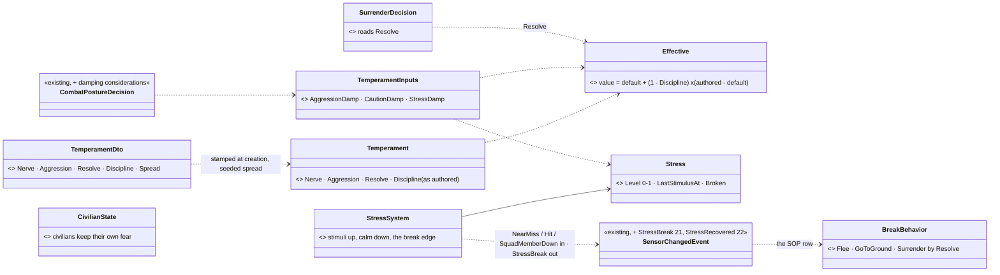
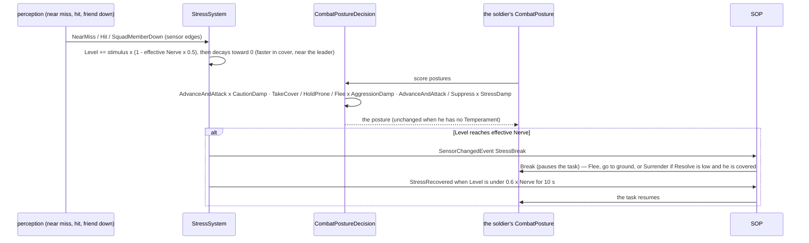
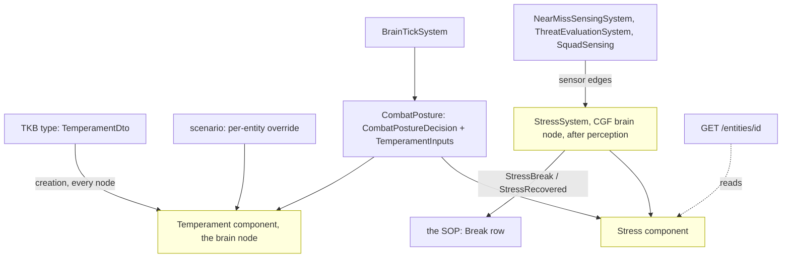

<!--STATUS
state: LIVE
updated: 2026-10-18
build-state: READY-TO-BUILD — the lean APPROVED 2026-10-18 (R-2034); TS-6 and TS-8 are refinements found while designing, marked "lean" for review
current-answer: §1–§3 the diagrams · §4 decisions · §5 slices · §6 demos
stale-below: nothing.
known-rot: none.
known-conflict: none.
related-designs:
  - docs/designs/utility-ai/Utility_AI_Design_v1_1.md — OWNS the scorer, inputs and curves; this design adds three inputs and damping considerations to the posture decision, nothing to the scorer
  - docs/DESIGN_Civilians_And_Crowd_Control.md — OWNS the civilians' own temperament (Attitude, RiotAt, PanicAt) and fear / anger; this design is for COMBATANTS only and does not touch civilians
  - docs/designs/group-maneuvers/DESIGN_Building_Clearing.md — CB-28's Resolve (an insurgent's willingness to surrender) lives here; the clearing demos give the defenders temperaments
  - docs/DESIGN_Sensors_And_Doctrine.md — OWNS the SOP and the near-miss / hit sensor edges that feed stress; §7.4's doctrine swap ("aggressive / defensive") stays the coarse, whole-unit lever
  - docs/designs/group-maneuvers/DESIGN_Squad_Tactics.md — OWNS the squad leader (succession) whose presence calms; ROE StayOnTask and the break (TS-6)
  - docs/OVERVIEW_Behaviour_Building_Blocks.md — the machinery map (§3 utility decisions)
-->

# Temperament and stress — brave, cautious or cowardly combatants *(behaviors, `2026-10-18`)*

🔒 User, `2026-10-18`: *"Do we have some bravery/catiousness/moral setting for combatants, usually non-military (order driven military
leaving less space for bravery driven autonomous decisions) so they might be taking risks or be cautious or cowardly?"* — then, on the
lean: *"Approved."* (R-2034).

**The decision in one line:** a small per-person **`Temperament`** (Nerve · Aggression · Resolve · Discipline — defaults on the type, a
seeded spread per man, overridable per entity) and a live **`Stress`**, read by the existing posture decision through three new utility
inputs that only ever DAMP options (1.0 with no temperament ⇒ every existing behaviour unchanged), plus one **break** when stress beats
nerve. **Discipline** is how far orders override character: a regular soldier behaves nearly by the book, an insurgent by temperament.

## 0. INVENTORY *(2026-10-18 — codebase-memory CLI `search_graph` (Morale / Courage / Bravery / Aggress / Caution / Personality / Temperament / Discipline / Resolve / Suppress / Fear / Risk: no combatant symbol), grep over `FDP/Toolkits`, `Hrot/Engine`, `Hrot.AI.Behaviors`, and the design corpus; `check_index_coverage` not run — CLI only)*

| need | exists | where | missing |
|---|---|---|---|
| a combatant's temperament | ⛔ none | searched code + `docs/` + `.dev/` | everything here |
| a civilian's temperament | ✅ `Attitude`, `RiotAt`, `PanicAt` per person (params) + live `Fear` / `Anger` | `CivilianBehavior.cs` params; `CivilianState` | — (the precedent: per-person, authored, seeded) |
| the posture decision | ✅ `CombatPostureDecision`: AdvanceAndAttack · TakeCover · Suppress · Flee · HoldProne (WeightedProduct) · Hold (WeightedSum) over Health · Ammo · EnemyStrengthRatio · EQS scores · HaveLiveTarget | `Utility/StarterPack/CombatPostureDecision.cs:41-66` | inputs for temperament and stress |
| a utility input | ✅ `[UtilityInput("Name")] static float F(in UtilityInputCtx)`; ⚠ an UNREGISTERED reader yields raw **0** | `Utility/Inputs/StandardInputs.cs:72`; `UtilityScorer.cs:615` | — ⇒ the new inputs must be registered everywhere the decision runs |
| what stresses a man | ✅ `NearMissEvent` ⇒ `SensorChange.NearMiss`; `SensorChange.Hit`; `SquadMemberDown`; `EnemyStrengthRatio` | `Perception/Systems/NearMissSensingSystem.cs:15`; `SensorChangedEvent.cs` | an accumulator |
| what calms | ✅ the squad leader (`SquadLeadership` designation), cover (EQS cover score), time | `Squad/SquadLeadership.cs` | — |
| a coarse aggressive / defensive lever | ✅ swapping the unit's doctrine (SOP) | Sensors & Doctrine §7.4 | — (stays; this is the per-man layer under it) |
| seeded per-man variation | ✅ `SimRng.FromSim(seed, salt, time)` | `Determinism/SimRng.cs:35`; used by `CivilianBehavior.Routine` | — |
| refusing reactions under orders | ✅ ROE `StayOnTask` refuses every SOP reaction | `SopSlotTests.CE2078_StayOnTask_RefusesEveryReaction` | the break's exception (TS-6) |

## 1. Classes

*What the picture shows that prose hid:* nothing new decides anything on its own except the break — temperament reaches behaviour only
through three inputs of the decision that already chooses postures, so every behaviour that asks it (CombatPosture, its HSM and
blueprint forms) changes at once; and the civilians' model is a separate box that is not touched.

## 2. Sequences

*What the picture shows that prose hid:* stress changes WHICH posture wins long before anything breaks — a stressed man stops
advancing and suppressing first; the break is the end of a slope, not a coin flip.

## 3. Modules — who runs it each frame

*Caption:* one new system on the brain node, scheduled after perception so a near miss counts the same frame; the components are
brain-local like the civilians' state (visible over HTTP for debugging) — no new wire in v1.

## 4. Decisions *(✅ approved 2026-10-18, R-2034 — TS-6 and TS-8 are leans found while designing, for review)*

| id | decision | ✅ ruled / ⭐ lean | rejected — one line each |
|---|---|---|---|
| **TS-1** | what temperament is | **four static traits**: `Nerve` 0–1 (how much danger before he goes to ground or breaks) · `Aggression` −1…+1 (the risk he takes: + closes and assaults, − holds and peeks) · `Resolve` 0–1 (willingness to give up; 1 = fanatic) · `Discipline` 0–1 (how far orders override the rest) | one "morale" number: cannot tell a disciplined coward from a reckless volunteer |
| **TS-2** | discipline | **effective = default + (1 − Discipline) × (authored − default)** for Nerve, Aggression, Resolve; defaults Nerve 0.5, Aggression 0, Resolve 0.5. Type defaults: regular soldier Discipline 0.8, police 0.8, militia 0.5, insurgent 0.3 | discipline as a separate gate per behaviour: every behaviour would grow its own check |
| **TS-3** | where it lives | **`TemperamentDto` on the TKB type** (the defaults) + a **seeded spread** per man (`SimRng`, ± `Spread`, default 0.15, from the entity's own seed) + a **per-entity override in the scenario**, stamped into a `Temperament` component on the brain node | per-behaviour params: a man's character is not the behaviour's · no spread: every insurgent a clone |
| **TS-4** | stress | a live **`Stress`** 0–1 on the brain node: **+** a near miss 0.08 · a hit 0.25 · a friend down within 15 m 0.2 · outnumbered (`EnemyStrengthRatio` > 1.5) 0.02 / s · alone (no friend within 20 m) 0.01 / s — each × (1 − 0.5 × effective Nerve); **−** 0.03 / s, × 2 in cover, × 2 with his squad leader within 20 m | stress from health alone: the decision already reads health |
| **TS-5** | how it shapes behaviour | **three inputs that only DAMP an option**, 1.0 exactly with no `Temperament` ⇒ every existing score unchanged: `CautionDamp` = 1 − 0.5 × max(0, −Aggression) on AdvanceAndAttack · `AggressionDamp` = 1 − 0.5 × max(0, Aggression) on TakeCover / HoldProne / Flee · `StressDamp` = 1 − Stress on AdvanceAndAttack and Suppress. ⭐ Measured: an unregistered input reads 0 (`UtilityScorer.cs:615`) and five of the six options MULTIPLY their considerations ⇒ damping with a neutral of 1.0 is the only shape that leaves today's scores bit-identical | boosting inputs: a product cannot boost past 1, and a neutral of 0.5 would rescale every demo |
| **TS-6** | the break | when Stress ≥ effective Nerve ⇒ `SensorChange.StressBreak` ⇒ the SOP's **Break** (pauses the task): Surrender if effective Resolve < 0.3 and he is covered by an enemy (`Covering.By`), else Flee if a retreat point exists, else go to ground (HoldProne, no fire). Recovered when Stress < 0.6 × Nerve for 10 s (`StressRecovered`). ⭐ **Lean: ROE `StayOnTask` does NOT refuse the break** — men break whatever the order; discipline is what makes it rare | StayOnTask refuses it: a disciplined unit would never break even at stress 1 — but discipline already raises effective nerve |
| **TS-7** | who has it | **combatants only** (soldiers, insurgents, police); civilians keep their own model | one model for both: the civilians' fear / anger / attitude is built, approved and tuned |
| **TS-8** | the wire | ⭐ **lean: brain-local in v1** (like `CivilianState`), visible over HTTP (`GET /entities/{id}` shows the components on the brain node); ui's G2 mood quantised later if wanted | replicate now: no reader on another node yet |
| **TS-9** | the coarse lever | the doctrine swap (aggressive / defensive SOP, Sensors §7.4) **stays**; temperament is the per-man layer beneath it | replace doctrine: a commander's choice and a man's character are different things |

## 5. Slices *(behaviors ids from `CE-2269`)*

| order | slice | what | needs |
|---|---|---|---|
| 1 | **TS-A** `CE-2269` | `TemperamentDto` + type defaults (soldier, police, militia, insurgent) + the seeded spread + the scenario override + `Temperament` component + `Effective` (TS-1…TS-3); rails: the formula, the spread is deterministic per entity, an override wins | — |
| 2 | **TS-B** `CE-2270` | `Stress` + `StressSystem` (TS-4); rails: each stimulus, the nerve scaling, the calming by cover and by the leader | TS-A |
| 3 | **TS-C** `CE-2271` | the three inputs + the damping considerations on `CombatPostureDecision` (TS-5); ⭐ **the neutral rail: with no `Temperament` every option's score is bit-identical to today** (and every posture rail / golden unchanged) | TS-B |
| 4 | **TS-D** `CE-2272` | the break: the two sensor changes, the SOP row, `BreakBehavior`, recovery (TS-6); demos §6 | TS-C |
| — | CB-28 `CE-2267` | the insurgent's `SurrenderDecision` reads effective Resolve | TS-A |

## 6. Demos *(each with an HTTP live check and an in-process twin)*

| demo | cast | must end with |
|---|---|---|
| `ts-fire-discipline` | two fire teams of 4 under the same suppressive fire from a machine gun 150 m off: regulars (Discipline 0.8) and militia (Discipline 0.3, Nerve 0.3) | the regulars keep suppressing (posture trace); at least half the militia go to ground or flee (`StressBreak`); no regular breaks |
| `ts-aggression` | two identical riflemen vs one enemy, one Aggression +0.8, one −0.8 | the aggressive one advances and assaults; the cautious one takes cover and suppresses — the same scores otherwise (utility trace) |
| `ts-house-defenders` | the CQB house (Building Clearing §8) with three insurgents: a fanatic (Resolve 1, Nerve 0.9), a coward (Nerve 0.1), a waverer (Resolve 0.2) | on the stun grenade the coward flees out of the back door; the waverer surrenders when challenged and covered; the fanatic fights from his corner |
