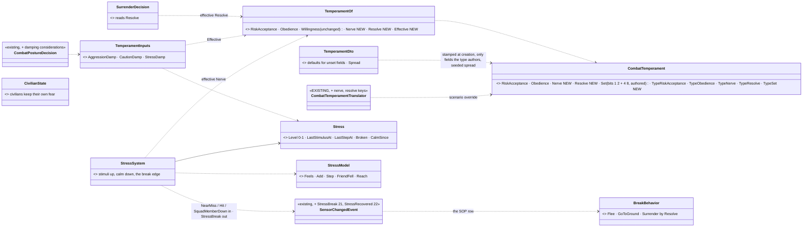
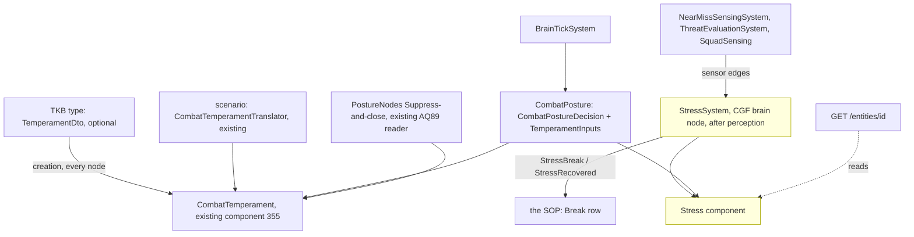

<!--STATUS
state: LIVE
updated: 2026-10-24
build-state: BUILDING — TS-A (CE-2269), TS-B (CE-2270) and TS-D (CE-2272) BUILT 2026-10-24 (§7); TS-C blocked on §7.3's scorer finding (a question with a lean). APPROVED 2026-10-18 (R-2034), TS-6 and TS-8 included; traits MERGED into the existing CombatTemperament the same day (see HISTORY)
current-answer: §1–§3 the diagrams · §4 decisions · §5 slices · §6 demos · ⭐ §7 AS BUILT (where it differs from §4, §7 wins)
stale-below: ⛔ HISTORY — the first draft's NEW `Temperament` component with Aggression and Discipline; do not quote it.
known-rot: ⛔ §4 TS-6's sensor-change numbers 21 / 22 are TAKEN (CE-2283's ContactInEngagementArea / ContactOutsideSector, 21–24) ⇒ StressBreak / StressRecovered take 25 / 26 (§7.2). ⛔ §4 TS-5's "damping with a neutral of 1.0 leaves today's scores bit-identical" is FALSE — the product mode's compensation depends on the consideration COUNT (§7.3). ⚠ §4 TS-4's "EnemyStrengthRatio > 1.5": the input is a SHARE 0–1, so it reads > 0.6 (§7.1).
known-conflict: none.
related-designs:
  - docs/blueprints/Architect_Question_96_Movement_Under_Fire.md — ASKED 2026-10-20: the short per-move drop under fire that TS-4 would lengthen and TS-6's break replace
  - docs/blueprints/Architect_Question_89_Suppress_And_Close.md — OWNS the existing `CombatTemperament { RiskAcceptance, Obedience }` (R-269 (backend)), `TemperamentOf`, Willingness and the 0.6 closing threshold; this design ADDS Nerve and Resolve to that component and leaves AQ89's readers unchanged
  - docs/designs/utility-ai/Utility_AI_Design_v1_1.md — OWNS the scorer, inputs and curves; this design adds three inputs and damping considerations to the posture decision, nothing to the scorer
  - docs/DESIGN_Civilians_And_Crowd_Control.md — OWNS the civilians' own temperament (Attitude, RiotAt, PanicAt) and fear / anger; this design is for COMBATANTS only and does not touch civilians
  - docs/designs/group-maneuvers/DESIGN_Building_Clearing.md — CB-28's Resolve (an insurgent's willingness to surrender) lives here; the clearing demos give the defenders temperaments
  - docs/DESIGN_Sensors_And_Doctrine.md — OWNS the SOP and the near-miss / hit sensor edges that feed stress; §7.4's doctrine swap ("aggressive / defensive") stays the coarse, whole-unit lever
  - docs/designs/group-maneuvers/DESIGN_Squad_Tactics.md — OWNS the squad leader (succession) whose presence calms; ROE StayOnTask and the break (TS-6)
  - docs/OVERVIEW_Behaviour_Building_Blocks.md — the machinery map (§3 utility decisions)
  - docs/DESIGN_People_Display.md — §7e U20 DRAWS stress (with the breaking point as a tick) and a civilian's fear on the 3-D card (ui, `CE-1309`); the breaking-point arithmetic moved to `Stresses` (FDP, beside `Stress`) so the card and `StressModel` share one copy
  - docs/designs/group-maneuvers/DESIGN_Defend_And_Attack_Position.md — OWNS a man's ABILITY (CombatProficiency, the tiers, the commander's repertoire); kept apart from this design's will
-->

# Temperament and stress — brave, cautious or cowardly combatants *(behaviors, `2026-10-18`)*

🔒 User, `2026-10-18`: *"Do we have some bravery/catiousness/moral setting for combatants, usually non-military (order driven military
leaving less space for bravery driven autonomous decisions) so they might be taking risks or be cautious or cowardly?"* — then, on the
lean: *"Approved."* (R-2034).

**The decision in one line:** the EXISTING per-man **`CombatTemperament`** (AQ89 (suppress and close), R-269 (backend): `RiskAcceptance`
· `Obedience`) gains two traits, **`Nerve`** and **`Resolve`**; a type may carry defaults and a seeded spread; a live **`Stress`** is
added; the existing posture decision reads them through three new utility inputs that only ever DAMP options (1.0 with no temperament ⇒
every existing behaviour unchanged), plus one **break** when stress beats nerve. **`Obedience`** is how far orders override character: a
regular soldier behaves nearly by the book, an insurgent by temperament.

## 0. INVENTORY *(2026-10-18 — codebase-memory CLI `search_graph` (Morale / Courage / Bravery / Aggress / Caution / Personality / Temperament / Discipline / Resolve / Suppress / Fear / Risk), grep over `FDP/Toolkits`, `Hrot/Engine`, `Hrot.AI.Behaviors`, and the design corpus; `check_index_coverage` not run — CLI only. ⛔ The first pass MISSED `CombatTemperament`; a corpus sweep found it — see HISTORY)*

| need | exists | where | missing |
|---|---|---|---|
| a combatant's temperament | ✅ **`CombatTemperament { RiskAcceptance, Obedience, Set }`** (component id 355) read only through **`TemperamentOf`** (defaults 0.5 / 0.8, `Willingness`, `Willing` at ≥ 0.6); an unset field reads the default by its `Set` bit, never 0 | `FDP/Toolkits/Fdp.Toolkits/Behavior/Components/CombatTemperament.cs`; registered `HrotSharedComponentRegistry.cs:193`; read by `PostureNodes.cs:237` | Nerve, Resolve, type defaults, a spread |
| its scenario form | ✅ `"Temperament": { "riskAcceptance", "obedience" }`, only authored fields written back, extraction-safe | `Hrot/Engine/Hrot.EcsNode/Serializers/CombatTemperamentTranslator.cs`; `scenarios/ua-grenade-or-rifle/scenario.json:88` | `nerve`, `resolve` keys |
| a civilian's temperament | ✅ `Attitude`, `RiotAt`, `PanicAt` per person (params) + live `Fear` / `Anger` | `CivilianBehavior.cs` params; `CivilianState` | — (the precedent: per-person, authored, seeded) |
| the posture decision | ✅ `CombatPostureDecision`: AdvanceAndAttack · TakeCover · Suppress · Flee · HoldProne (WeightedProduct) · Hold (WeightedSum) over Health · Ammo · EnemyStrengthRatio · EQS scores · HaveLiveTarget | `Utility/StarterPack/CombatPostureDecision.cs:41-66` | inputs for temperament and stress |
| a utility input | ✅ `[UtilityInput("Name")] static float F(in UtilityInputCtx)`; ⚠ an UNREGISTERED reader yields raw **0** | `Utility/Inputs/StandardInputs.cs:72`; `UtilityScorer.cs:615` | — ⇒ the new inputs must be registered everywhere the decision runs |
| what stresses a man | ✅ `NearMissEvent` ⇒ `SensorChange.NearMiss`; `SensorChange.Hit`; `SquadMemberDown`; `EnemyStrengthRatio`; ⭐ and an `UnderFire { LastTime }` component the hit model reads — a shooter hit or near-missed within 5 s has his spread doubled (`HitModel.Sigma`, `UnderFireFactor`) | `Perception/Systems/NearMissSensingSystem.cs:15`; `SensorChangedEvent.cs`; `Combat/HitModel.cs` | an ACCUMULATOR — `UnderFire` is a 5 s window, not a level |
| what calms | ✅ the squad leader (`SquadLeadership` designation), cover (EQS cover score), time | `Squad/SquadLeadership.cs` | — |
| a coarse aggressive / defensive lever | ✅ swapping the unit's doctrine (SOP) | Sensors & Doctrine §7.4 | — (stays; this is the per-man layer under it) |
| seeded per-man variation | ✅ `SimRng.FromSim(seed, salt, time)` | `Determinism/SimRng.cs:35`; used by `CivilianBehavior.Routine` | — |
| refusing reactions under orders | ✅ ROE `StayOnTask` refuses every SOP reaction | `SopSlotTests.CE2078_StayOnTask_RefusesEveryReaction` | the break's exception (TS-6) |

## 1. Classes

*What the picture shows that prose hid:* there is ONE temperament component and ONE reader — AQ89's — and this design only widens them;
nothing new decides anything on its own except the break, temperament reaches behaviour only through three inputs of the decision that
already chooses postures, and the civilians' model is a separate box that is not touched.

## 2. Sequences

*What the picture shows that prose hid:* stress changes WHICH posture wins long before anything breaks — a stressed man stops
advancing and suppressing first; the break is the end of a slope, not a coin flip.

## 3. Modules — who runs it each frame

*Caption:* one new system on the brain node, scheduled after perception so a near miss counts the same frame; the temperament is the
component AQ89 already saves, injects and extracts; `Stress` is brain-local like the civilians' state (visible over HTTP for debugging) —
no new wire in v1.

## 4. Decisions *(✅ approved 2026-10-18, R-2034 — all nine, TS-6 and TS-8 included; TS-1…TS-3 re-expressed on `CombatTemperament` the same day, same behaviour)*

| id | decision | ✅ ruled / ⭐ lean | rejected — one line each |
|---|---|---|---|
| **TS-1** | what temperament is | **four static traits on the existing `CombatTemperament`**: `RiskAcceptance` 0–1 (AQ89's bravery: the risk he takes on his own — high closes and assaults, low holds and peeks; 0.5 is neutral) · `Obedience` 0–1 (AQ89's: how far orders override the rest) · **NEW** `Nerve` 0–1 (how much danger before he goes to ground or breaks) · **NEW** `Resolve` 0–1 (willingness to give up; 1 = fanatic). New `Set` bits `NerveSet = 4`, `ResolveSet = 8`; defaults Nerve 0.5, Resolve 0.5 | one "morale" number: cannot tell a disciplined coward from a reckless volunteer · a second component: two producers for one man's character |
| **TS-2** | obedience | **`TemperamentOf.Effective(trait)` = default + (1 − Obedience) × (value − default)** for RiskAcceptance, Nerve, Resolve — read by the new inputs, the stress and the break. ⛔ **AQ89's `RiskAcceptance` / `Willingness` / `Willing` readers stay RAW and unchanged** — they already apply obedience their own way (Obedience when ordered to assault, else RiskAcceptance), and blending under them would drop an authored 0.8 to 0.56, under the 0.6 threshold (`scenarios/ua-grenade-or-rifle/scenario.json:88`). Type defaults for Obedience: regular soldier 0.8, police 0.8, militia 0.5, insurgent 0.3 | blend inside the AQ89 readers: silently changes the built grenade-or-rifle behaviour · obedience as a separate gate per behaviour: every behaviour would grow its own check |
| **TS-3** | where it lives | the existing component, filled in three layers: an **optional `TemperamentDto` on the TKB type** (defaults per field) + a **seeded spread** per man (`SimRng`, ± `Spread`, default 0.15, from the entity's own seed) stamped only for the fields the type authors (their `Set` bits on) + the **existing per-entity scenario override**, which wins and gains `nerve` / `resolve` keys. ⭐ A type with no `TemperamentDto` stamps nothing ⇒ today's soldiers read exactly today's defaults | per-behaviour params: a man's character is not the behaviour's · no spread: every insurgent a clone · spread on every soldier: would push some past AQ89's 0.6 and change built rails |
| **TS-4** | stress | a live **`Stress`** 0–1 on the brain node: **+** a near miss 0.08 · a hit 0.25 · a friend down within 15 m 0.2 · outnumbered (`EnemyStrengthRatio` > 1.5) 0.02 / s · alone (no friend within 20 m) 0.01 / s — each × (1 − 0.5 × effective Nerve); **−** 0.03 / s, × 2 in cover, × 2 with his squad leader within 20 m | stress from health alone: the decision already reads health |
| **TS-5** | how it shapes behaviour | **three inputs that only DAMP an option**, 1.0 exactly with no `CombatTemperament` ⇒ every existing score unchanged; with `a` = 2 × effective RiskAcceptance − 1 (−1…+1): `CautionDamp` = 1 − 0.5 × max(0, −a) on AdvanceAndAttack · `AggressionDamp` = 1 − 0.5 × max(0, a) on TakeCover / HoldProne / Flee · `StressDamp` = 1 − Stress on AdvanceAndAttack and Suppress. ⭐ Measured: an unregistered input reads 0 (`UtilityScorer.cs:615`) and five of the six options MULTIPLY their considerations ⇒ damping with a neutral of 1.0 is the only shape that leaves today's scores bit-identical; and the default RiskAcceptance 0.5 gives `a` = 0 ⇒ neutral too | boosting inputs: a product cannot boost past 1, and a neutral of 0.5 would rescale every demo |
| **TS-6** | the break | when Stress ≥ effective Nerve ⇒ `SensorChange.StressBreak` ⇒ the SOP's **Break** (pauses the task): Surrender if effective Resolve < 0.3 and he is covered by an enemy (`Covering.By`), else Flee if a retreat point exists, else go to ground (HoldProne, no fire). Recovered when Stress < 0.6 × Nerve for 10 s (`StressRecovered`). ✅ **ROE `StayOnTask` does NOT refuse the break** — men break whatever the order; obedience is what makes it rare | StayOnTask refuses it: a disciplined unit would never break even at stress 1 — but obedience already raises effective nerve |
| **TS-7** | who has it | **combatants only** (soldiers, insurgents, police); civilians keep their own model | one model for both: the civilians' fear / anger / attitude is built, approved and tuned |
| **TS-8** | the wire | ✅ **brain-local in v1** for `Stress` (like `CivilianState`), visible over HTTP (`GET /entities/{id}` shows the components on the brain node); `CombatTemperament` stays what AQ89 made it (saved, extraction-safe); ui's G2 mood quantised later if wanted | replicate now: no reader on another node yet |
| **TS-9** | the coarse lever | the doctrine swap (aggressive / defensive SOP, Sensors §7.4) **stays**; temperament is the per-man layer beneath it | replace doctrine: a commander's choice and a man's character are different things |

## 5. Slices *(behaviors ids from `CE-2269`)*

| order | slice | what | needs |
|---|---|---|---|
| 1 | **TS-A** `CE-2269` | widen the existing `CombatTemperament` with `Nerve` / `Resolve` + their `Set` bits; `TemperamentOf.Nerve`, `.Resolve`, `.Effective`; the optional `TemperamentDto` + type defaults (soldier, police, militia, insurgent) + the seeded spread; the translator's `nerve` / `resolve` keys (TS-1…TS-3). ⚠ The component, its reader and the translator are in FDP Toolkits / `Hrot.EcsNode` — a cross-lane edit of AQ89's files, said in the commit and a note to backend. Rails: the formula, the spread is deterministic per entity, an override wins, a type without a dto stamps nothing; ⭐ **every AQ89 rail unchanged** (`CombatTemperamentTests`, `CombatTemperamentTranslatorTests`, `GrenadeOrRifleScenarioTests`) | — |
| 2 | **TS-B** `CE-2270` | `Stress` + `StressSystem` (TS-4); rails: each stimulus, the nerve scaling, the calming by cover and by the leader | TS-A |
| 3 | **TS-C** `CE-2271` | the three inputs + the damping considerations on `CombatPostureDecision` (TS-5); ⭐ **the neutral rail: with no `CombatTemperament` every option's score is bit-identical to today** (and every posture rail / golden unchanged) | TS-B |
| 4 | **TS-D** `CE-2272` | the break: the two sensor changes, the SOP row, `BreakBehavior`, recovery (TS-6); demos §6 | TS-C |
| — | CB-28 `CE-2267` | the insurgent's `SurrenderDecision` reads effective Resolve | TS-A |

## 6. Demos *(each with an HTTP live check and an in-process twin)*

| demo | cast | must end with |
|---|---|---|
| `ts-fire-discipline` | two fire teams of 4 under the same suppressive fire from a machine gun 150 m off: regulars (Obedience 0.8) and militia (Obedience 0.3, Nerve 0.3) | the regulars keep suppressing (posture trace); at least half the militia go to ground or flee (`StressBreak`); no regular breaks |
| `ts-aggression` | two identical riflemen vs one enemy, one RiskAcceptance 0.9, one 0.1 (Obedience 0.3, so character shows) | the bold one advances and assaults; the cautious one takes cover and suppresses — the same scores otherwise (utility trace) |
| `ts-house-defenders` | the CQB house (Building Clearing §8) with three insurgents: a fanatic (Resolve 1, Nerve 0.9), a coward (Nerve 0.1), a waverer (Resolve 0.2) | on the stun grenade the coward flees out of the back door; the waverer surrenders when challenged and covered; the fanatic fights from his corner |

## 7. AS BUILT *(2026-10-24 — TS-A `CE-2269`, TS-B `CE-2270`; where this differs from §4, this wins)*

### 7.1 TS-A and TS-B

| | as built | why it differs from §4 |
|---|---|---|
| **the type layer** | `CombatTemperament` gains four `Type*` fields and a `TypeSet` byte (same bits as `Set`); `TemperamentOf`'s readers take **authored › type › default**. `TemperamentOf.StampType` writes only the type fields | ⭐ §4 put the type's values in the authored fields. ⛔ Then a scenario inject (which REPLACES the authored layer, AQ89) wiped them, and a save wrote them into the file. Two layers in two fields is `CombatProficiency`'s rule (`CombatProficiency.cs` `TypeDefault`) |
| **`TemperamentDto`** | `Fdp.Toolkit.Tkb.Domain.TemperamentDto`, descriptor `"AI.Temperament"`: `float?` per trait + `Spread` (0.15); presets `RegularSoldier` / `Police` (0.8) · `Militia` (0.5) · `Insurgent` (0.3). Stamped by `BehaviorTkbTranslator` on every node at creation | ⭐ only `Insurgent` (2003) carries one (`UrbanCombatTkbCatalog`) — the soldier and police defaults ARE today's 0.8, so they need none (TS-3: no spread on soldiers) |
| **the spread** | `SimRng.FromSim(entity.Index, salt + trait, 0)` — the same man the same value every run | ⚠ the entity INDEX, as every other per-man draw here (`FirePacing`, `Restless`): two nodes with different indices draw differently — harmless while temperament is read only on the brain node |
| **the scenario** | `"Temperament": { …, "nerve", "resolve" }`; an inject replaces only the authored layer, the type fields survive; the type's values are never extracted | — |
| **`Stress`** | component `421`, NoScenario, brain-local; `StressSystem` in `CgfLogicPack` after `GrenadeDangerSystem`, before the cognitive runtime; `StressModel` holds every rule | — |
| **the edges** | read with `ReadEvents` — LAST frame's edges (a frame later than §3 says) | the bus is double-buffered; a frame is immaterial to a level that calms at 0.03 / s |
| **friend down** | `SquadMemberDown` on the commander ⇒ every roster member in the fight within 15 m of the fallen man | ⚠ that edge fires for an INCAPACITATED man only (`SquadSensing.MemberDown`); a man killed outright raises no stress. Left so: one producer per fact (R-195) — widen the edge if it matters live |
| **outnumbered** | `EnemyShare > 0.6` — the same sum the `EnemyStrengthRatio` input reads | ⛔ the input is the enemy's SHARE (0–1), so §4's "> 1.5" can never be met; 0.6 is that ratio (1.5 ÷ 2.5) |
| **in cover** | a cover point within 1.5 m facing his nearest remembered threat — `UnderFire.CoverNear` with a minimum of 0 m (it was fixed at 1 m: somewhere to GO) | — |
| **his leader** | `SquadLeadership.Leader` of his commander, in the fight, within 20 m, not himself | — |
| **who** | `StressModel.Feels`: a brain, health, a stance (a person — a vehicle has none), not a `CivilianState`, `Armament.IsCombatant`, in the fight | TS-7 |

Rails: `CombatTemperamentTests` (CE2269 ×4 + AQ89's unchanged), `CombatProficiencyTests.CE2269_…StampedAtSpawn…`, `CombatTemperamentTranslatorTests.CE2269_…`, `StressSystemTests` (8). Mutants: TS-A 7/7 and TS-B in the report of the commit.

### 7.2 TS-D — the break *(`CE-2272`)*

| | as built | why it differs from §4 |
|---|---|---|
| **the numbers** | `SensorChange.StressBreak` = **25**, `StressRecovered` = **26**, published on the man, once per edge | ⛔ 21–24 belong to `CE-2283` (`ContactInEngagementArea`, `ContactOutsideSector`, `PositionUntenable`, `FiredOnFromStructure`) |
| **who starts it** | ⭐ `StressSystem` itself (`StressModel.Judge` → `StartBreak`), as a REACTION at the new **`ReactionUrgency.Break` = 6** — not an SOP row | ⭐ the grenade reflex's precedent (`GrenadeDangerSystem`, AQ102 I): every combatant breaks, with an SOP or without (the police types have none). The edges still reach the bus, so an SOP, an HSM or a blueprint may react to them too |
| **StayOnTask** | `BehaviorIngressSystem.AdmitsWithReactions` refuses every reaction under StayOnTask **but a break** | TS-6 as approved |
| **the order of reflexes** | a running grenade reflex is never replaced by a break; the break starts once it ends | the grenade is seconds; the break is minutes |
| **when** | breaks at `max(effective Nerve, 0.05)`; recovers under 0.6 × that for 10 s | ⚠ a man with no nerve at all would break at 0 — the floor means something must have happened first |
| **what he does** | surrenders (the existing `Surrender`, for good) when effective Resolve < 0.3 and a forces rifle covers him (`Covering.By`); else the new **`Break`** behaviour: no aimed fire (an AimAndFire on his weapon channel is ended every tick), runs upright at 4.5 m/s to a retreat point when he has one, then prone; with none, prone where he is; Success when he recovers ⇒ his task resumes | ⚠ `Covering.By` counts FRIEND-force rifles only (CV-13a), so in v1 only a man the blue side covers surrenders this way. A retreat point = a cover point within 30 m facing his nearest remembered threat and ≥ 3 m farther from it than he is (the EQS `FindSafeRetreatPoint` needs a sensor child the posture tree owns — a cover query is synchronous and reuses `UnderFire.CoverNear`) |
| ⚠ **to measure in the demo** | a near miss is one edge PER ROUND: an ordinary soldier (0.06 a round, breaks at 0.5) breaks after ~9 near misses inside a few seconds — machine-gun fire may break regulars, which `ts-fire-discipline` says must not happen | the numbers are §4's; ⛔ not re-tuned before a live measurement |

Rails: `StressSystemTests` — `CE2272_AtHisNerve_HeBreaks_EvenUnderStayOnTask_GoesToGround_AndRecovers` · `…TheBreakAndTheRecovery_AreEdges_OnTheMan` · `…HeBreaksAtHisEffectiveNerve_NeverUnderTheFloor` (3 rows) · `…LowResolve_AndCovered_HeSurrenders_ElseHeBreaks` · `…AWayOut_IsACoverPointFartherFromTheThreat`.

### 7.3 ⛔ TS-C is BLOCKED — a neutral consideration is NOT neutral

📐 `Aggregator.AggregateProduct` (`FDP/Toolkits/Fdp.Toolkits/Utility/Core/Aggregator.cs`) applies Dave Mark's compensation: `final = raw + (1 − raw) × (1 − 1/n) × raw`, with **n = the number of considerations**. ⇒ adding a consideration that reads exactly 1.0 leaves `raw` alone but raises `n`, and so raises the option's score (raw 0.5: n = 3 ⇒ 0.667, n = 4 ⇒ 0.688). The five product options have 3–5 considerations each and TS-5 adds different counts to each ⇒ **every posture choice shifts, with or without a temperament.** The neutral rail §5 promises cannot pass as designed. ⇒ **a question for the user** (the scorer is the Utility AI design's):

| | option | verdict |
|---|---|---|
| ⭐ **lean** | **a MODIFIER consideration**: a consideration flagged as a plain multiplier, applied AFTER the compensated product and NOT counted in `n` (`.Modify(In.StressDamp())` beside `.Consider(…)`) — a modifier reading 1.0 leaves every score bit-identical, which is exactly TS-5's promise | blast radius: the scorer's aggregate, the builder and the decision generator (the flag); no existing decision changes. ⭐ It is also the natural home of every future "only ever damp" input |
| rejected | add the three as ordinary considerations and accept the shift | every posture choice moves, with or without a temperament — TS-5 promised the opposite |
| rejected | fold the damping into an existing input (a temperament-aware `EnemyStrengthRatio`) | couples two meanings in one input and hides the damping from the utility trace |

What would change the lean: the Utility AI design ruling that compensation must count every factor.

## ⛔ HISTORY

- **2026-10-18, first draft (SUPERSEDED the same day):** proposed a NEW `Temperament` component with `Nerve · Aggression (−1…+1) ·
  Resolve · Discipline`, a separate `Effective` class, and claimed *"no combatant temperament exists"*. ⛔ Wrong: AQ89's
  `CombatTemperament { RiskAcceptance, Obedience }` was BUILT (R-269 (backend)) and the symbol search missed it; the defend/attack corpus
  sweep found it. Merged: Aggression ⇒ `RiskAcceptance` (a = 2 × RiskAcceptance − 1), Discipline ⇒ `Obedience`, Nerve and Resolve added
  to the existing component; the approved behaviour (TS-1…TS-9) is unchanged.
