<!--STATUS
state: LIVE
build-state: DESIGN — R-4198…R-4201 ruled; ⭐ the S-0 MOCKUPS ✅ approved (§15, R-4203); L-1…L-7 ✅ approved (R-4202, L-2 amended); §16 the wizard → editor step and cluster sync ✅ (R-4203)
updated: 2026-11-11
current-answer: ⭐⭐⭐ §18 THE COMPILED MODEL (R-4204 — supersedes §5 and §16 V-2…V-6) · §17 the critical review (15 gaps → tracker CE-4415…CE-4426) · §16 wizard → editor, cluster sync (leans) · §15 the mockups (S-0) · §14 editing a baked terrain again, non-terrain entities in a source (leans E-1…E-6) · §13 the workflow (✅ R-4200) · §12 the random terrain = an empty surface + placed blocks (✅ R-4200) · §11 the user's view (blocks as RECIPE assets through Add Entity — ✅ APPROVED R-4199) · §2 the model (one feature vocabulary, three uses) · §3 decisions · §4–§6 diagrams · §7 street clutter · §8 rivers and bridges · §9 slices · §10 not yet measured
stale-below: §5's sequences and §16's V-2…V-6 (expand on every node at load) are SUPERSEDED by §18 (R-4204, compile at save) — kept for the reasoning, ⛔ not to be built
related-designs:
  - DESIGN_Peek_And_Fire.md — §9 P-7a OWNS the mechanism this extends: a scenario entity that IS terrain, baked on every node, lifecycle-gated (R-242, R-243, R-244)
  - DESIGN_Terrain_Import_UTM.md — §8 destruction (breaches and collapses ride the same bake), §10 the input set, §11 the importer and its terrain folder writer, CE-4403 flattening under buildings
  - DESIGN_Terrain_Synth.md — hrot-terrain-synth, the generator the random terrain grows from
  - DESIGN_Terrain_From_OSM.md — the OSM wizard this one mirrors (§6 frame, preview); Q-O5 "one shot, no terrain editor" — superseded for authoring by R-4198, not for OSM import
  - DESIGN_Terrain_World.md — the terrain world model the features become (prisms, walkables, surfaces, walls)
  - DESIGN_Map_3D_Mode.md — §6ah / §6ai how terrain, trees and roofs are drawn
  - DESIGN_Add_Entity_Picker.md — how a scenario entity is picked and placed today (obstacles included)
  - PLAN_Large_Terrain.md — budgets R-4192
-->

# DESIGN — terrain authoring: a random terrain, a layout of blocks, and terrain features in a scenario

## 0. The request

🔒 User, `2026-11-11`: *"couldn't we have an option to create a random terrain … not too much tuning knobs. Rather to have a few presets"* ·
*"the user could optionally move the blocks, like the city center or village … Maybe it could include also the wood drawer by enabling some polygon
footprint editor"* · *"Sometimes we need a scenario which modifies something a little bit on an existing terrain … place a house here, or some fences
or bushes here and there, or tree areas … saved only in the scenario … applied at the beginning by baking into the terrain"* · *"I rather specify it now
when we design the feature so we can share it a lot."* · *"When we create a city, it's usually empty … there are parked cars. There are piles of
rubbish."* — and the answers in §3 (R-4198).

## 1. INVENTORY — measured `2026-11-11`

Queries: `scripts/cbm.sh search_graph` name patterns `.*(Obstacle|Fortification|Berm|Fence|PlacedBuilding|TerrainFeature|Barrier|Sandbag|Prop).*`
(80, paged once), `(Terrain(Tree|Wood|Building|Premise|Concealment|Vegetation|Scrub).*|.*Premises.*|.*Woods.*)` (3), `.*(Synth|TerrainGen|Generator).*`;
grep for `bridge`, `water`, `TerrainSurfaceType`, `StaticObstacleBake`; the design corpus for *terrain overlay / edit / delta*. ⚠ Coverage could not be
checked (`check_index_coverage` is not in the CLI).

| what | exists | where |
|---|---|---|
| ⭐ a scenario entity that IS terrain, baked on every node off the frame, all at once at load, the sim held until the bake commits, only touched navmesh tiles rebaked | ✅ boxes only | `StaticObstacle`, `ObstacleShape` (`Fdp.Toolkits/Terrain/StaticObstacles.cs`); `StaticObstacleBakeSystem` (`Hrot.Core/Services/StaticObstacleBake.cs`); `TerrainResidency.BakeObstacles`; Peek and Fire §9 |
| obstacle types | ✅ `Car` 8806 · `Sandbag wall` 8807 · `Concrete block` 8808 · `Crate` 8809 | `TkbEntityTypes.cs:108-114`, `NedTkbCatalog.cs:1176` |
| placing them in the editor | ✅ | `ObstaclePlacementGizmo` |
| the same bake follows destruction (breaches, collapses) and replay keyframes | ✅ | UTM §8.5; `BuildingDamageBakeTests.cs:170` |
| buildings from templates, woods (area + density), lone trees, walls / fences / hedges, surfaces open / forest / water, walkable slabs and ramps | ✅ in the TERRAIN files | `TerrainBuildingExpander`, `TerrainWoods`, `TerrainWorld.cs:13,17`, `TerrainFolderWriter.cs:8` (`WorldWall`) |
| a writer of a whole terrain folder | ✅ | `Hrot.Terrain.Import/TerrainFolderWriter.cs` |
| a generator of heights, villages, roads, trees, a pond, a river strip, scrub | ✅ a CLI | `Hrot/Tools/Hrot.Tools.TerrainSynth` (`SynthProfile`, `RoadNetwork`, `Extras.cs:83`) |
| water cuts the ground mesh | ✅ | `TerrainWorldMesh.cs:369` |
| ⛔ a town layout (blocks, 3–6 storeys) · a bridge · street clutter · a feature kind other than a box in a scenario · "Save terrain as" | none (grep) | NEW |

## 2. The model — ONE feature vocabulary, THREE uses

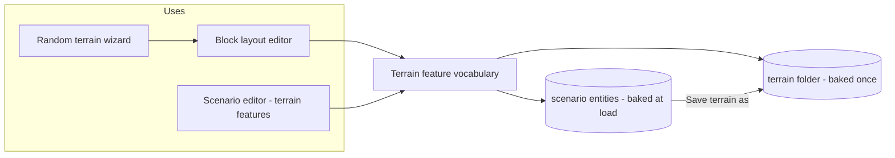

*What the picture shows that prose hid:* the random generator and the scenario tools are NOT two editors — the generator's **blocks** expand into the
**same features** a scenario places, and the only difference is **where they are saved**. "Save terrain as" is the one arrow between the two stores.

| feature kind | becomes in the terrain world | movement | sight / fire | first slice |
|---|---|---|---|---|
| **house** (a template, or a generated unique one) | a building (walls, openings, doors, floors) — destructible | doors, stairs | walls, windows | ✅ |
| **fence / wall / hedge** (a polyline) | `WorldWall` segments, by material | blocks (hedge: per material) | per material | ✅ |
| **wood** (a polygon + density) | a forest surface + trees | slows (when CE movement costs land) | conceals | ✅ |
| **lone tree · bush / scrub patch** | a tree / a scrub area | trunk only / slows | conceals | ✅ |
| **clutter** (§7) — parked car, skip, rubbish pile, bench … | a small prism of a material (the obstacle bake, as today) | blocks | cover by material | ✅ |
| **water** (a polygon: lake, pond, river) | a water surface (cuts the ground) | impassable | — | S-3 |
| **bridge** (§8) | a walkable deck + ramps over water, a road edge on the net | crosses | deck | S-3 |
| **block** — town centre · village · wood · open field | expands to the features above (generator only) | — | — | S-2 |
| *ground shaping — flatten pad, berm* | the height store patched | — | — | ⏭ later (counted: every house carries its pad, §3 TA-6) |

## 3. Decisions

**Settled by the user — R-4198** (`2026-11-11`):

| # | ruling |
|---|---|
| TA-1 | features edited in the scenario editor are saved **in the scenario by default**; ⭐ an option **"Save terrain as…"** writes a NEW terrain that includes them — *"a kind of a terrain editor hidden in the scenario editor"* |
| TA-2 | the random generator can produce **plain terrain** — no houses, nothing — to start from and add features to |
| TA-3 | scenario-placed houses are **destructible** like every other |
| TA-4 | **flattening the ground under houses is required** — not in slice 1, but the design must count with it |
| TA-5 | **rivers and bridges** are in scope — *"they make the movement behavior more difficult"* |
| TA-6 | the random generator **populates** what it builds — parked cars, rubbish piles and the like (§7) |

**Leans — ✅ approved `2026-11-11` (R-4202; L-2 amended by the user: the generator becomes a library at the START, so generated unique houses are available from slice 1, beside the templates):**

| # | lean | why | rejected |
|---|---|---|---|
| L-1 | ⭐ a scenario feature is **an entity** of a feature kind, and the existing **obstacle bake learns the new kinds** | R-243 already gives load-time bake, determinism, replay rebake, navmesh tiles — for free | a second "scenario overlay" path beside it — two implementations of one concept |
| L-2 | a house is placed from the **building templates** and gets a **generated unique** option later | templates exist and are what the scale terrain uses (R-4192 §7) | generating per placement in slice 1 — the generator is not a library yet |
| L-3 | **"Save terrain as"** writes through the importer's `TerrainFolderWriter` (base terrain + baked features) | one writer of the terrain folder | a second writer in the editor |
| L-4 | the block layout is **only in the random wizard** — click a block, drag it, draw a wood's outline; **Shuffle** re-rolls what is not pinned | the user's "optionally move the blocks" | a free-form terrain painter — out of scope |
| L-5 | each house feature carries a **ground pad** field from day one (the height it stands at); slice 1 writes it and ignores it, the flattening slice uses it | TA-4 counts with it without a format change later | adding it later — every saved scenario would need migrating |
| L-6 | clutter is **written into the terrain** when generated (thousands, no entity each); in a scenario it is an obstacle entity like today | 5 000 parked cars as entities would cost the entity budget and the wire | entities everywhere |
| L-7 | the external visual engine learns scenario features through a **wire descriptor per feature kind**, like `EntityObstacleShape` | the other engine must draw a scenario's house | relying on the terrain files — they do not hold scenario features |

## 4. Classes


*What it shows:* three new classes and one new library; the bake, the residency and the folder writer are the existing ones. `FeatureExpander` is the
**one** place a feature becomes terrain-world parts — the bake, "Save terrain as" and the generator all call it.
⚠ The shape component's fixed capacity (vertices per fence / wood) is a §10 measurement — a recorded component is unmanaged (CLAUDE.md).

## 5. Sequences *(⛔ SUPERSEDED by §18, R-4204 — the bake no longer expands blocks on every node; kept for the reasoning)*

**A scenario with features loads (and a replay starts)** — the obstacle bake as built, with the expander added:

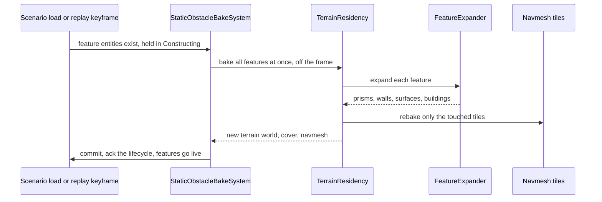

**Save terrain as:**

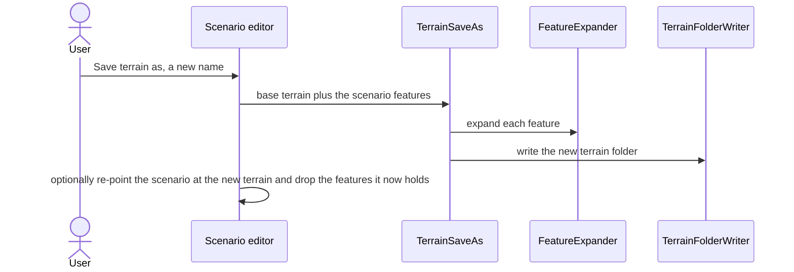

## 6. Who runs it

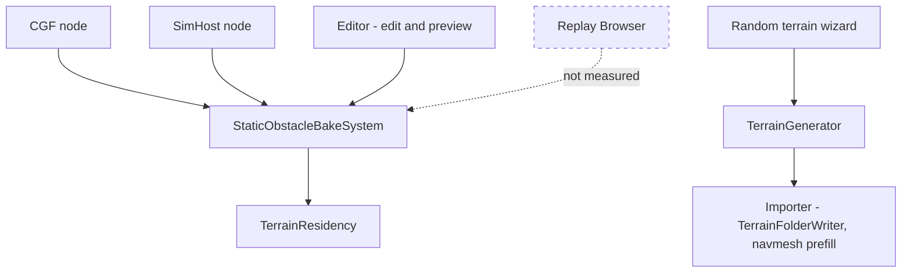

*What it shows:* the bake already runs on every simulating host and the editor (rails `CgfSubsystemTests.cs:123`,
`TheEditorRunsTheOrchestratorCoreTests.cs:278`); ⚠ the separate Replay Browser is **not measured** (dashed). The generator ends in the **existing
importer path**, so a random terrain gets the navmesh prefill and the folder layout every imported terrain has.

## 7. Street clutter — what the generator scatters

⭐ Every item is a small box of a material — the obstacle bake's own shape — placed by a rule, with a density per block type (town high, village low,
open field none). Lean: these, and nothing that needs its own model in slice 1:

| item | where | material | why it matters in play |
|---|---|---|---|
| parked car (the existing `Car` type) | kerbside, both sides of town streets, in yards | `car-body` | cover, blocks lanes, hides men |
| skip / large bin | street corners, yards | steel | cover |
| rubbish pile | alleys, beside skips | soft (sight 0, low protection) | concealment, not protection |
| bench · bus shelter | squares, main streets | wood / glass | low obstacle |
| lamp post · traffic sign | along streets | steel, thin | almost nothing — sight lines read as real |
| low garden wall · hedge | around village houses | brick / hedge | cover, channels movement |
| construction fence · barrier | one or two sites per town | steel mesh | blocks movement, not sight |
| market stalls | the town square | wood | concealment |
| burnt-out car | rare | steel | cover — a battlefield look |
| woodpile · hay bales | villages, field edges | wood / straw | cover / concealment |

⚠ Thousands of these in a town: the draw (ui, instanced like trees) and the terrain index must be measured (§10).

## 8. Rivers and bridges

- **A river** is a water polygon along a path (width by preset), cutting the ground — impassable to men and ground vehicles; the generator routes it
  through the low ground and roads cross it only at bridges.
- **A bridge** = a walkable **deck** (a slab, `TerrainWalkableKind.Slab`) with **ramps** at each end over the water, plus the road edge across it on the
  road net (SUMO already models bridges, `DESIGN_Terrain_From_OSM.md` §2) — a **chokepoint** the AI must find by pathing.
- ⭐ In a scenario the user can place a bridge over an existing river (a feature) — and destroy it later (a collapse, like a building: R-4188 D-7).
- ⚠ Not measured: does the navmesh treat water as impassable (the cut suggests yes), and does a vehicle's road path cross a deck. §10.

## 9. Slices

| slice | what | done when |
|---|---|---|
| **S-0** | ⭐ the mockups (R-4143): the random wizard (preset, size, relief, vegetation, seed, layout with draggable blocks and a polygon drawer) and the scenario editor's terrain-feature tools; ui | the user approves the pictures |
| **S-1** | scenario terrain features: house (template), fence / wall / hedge, wood, lone tree, bush, clutter items — entities, the bake extended, saved, recorded, replayed, destructible houses; the wire descriptors (L-7) | rails: each kind blocks / conceals as its row says, a replay rebuilds it, a scenario round-trips |
| **S-2** | the random terrain: the generator as a library, presets incl. **plain terrain**, the town layout (new), clutter, the wizard with Shuffle and the block layout | a 3 km "Town with suburbs" generates, imports and loads in budget; plain terrain is empty |
| **S-3** | rivers and bridges: in the generator and as scenario features | a river cuts the map, units path over the bridges, a destroyed bridge cuts the route |
| **S-4** | "Save terrain as" | the saved terrain loads with the features baked in, the scenario re-pointed |
| **S-5** | flattening under houses (TA-4, CE-4403) — the pad (L-5) applied to the height store | no house buried on a slope; every door reachable |

## 10. Not yet measured — before S-1 is READY-TO-BUILD

| question | why it matters |
|---|---|
| load time of a scenario with ~500 features (the one bake) | R-4192 budgets |
| the fixed capacity of a feature's shape (vertices) | unmanaged recorded components |
| does the separate Replay Browser run the bake | replays of edited terrains |
| water impassable in the navmesh; a vehicle over a deck | rivers and bridges are pointless otherwise |
| the external gateway: what it needs to draw a scenario feature | L-7 |
| how many clutter boxes a town holds, and their cost in the draw and the terrain index | §7 |

## 11. The user's view — what makes it practical *(✅ APPROVED `2026-11-11`, R-4199 — B-1…B-8 and the leans of B-Q1…B-Q3)*

🔒 User, `2026-11-11`: *"the blocks that we are able to put into the scenario, that needs to be kind of an asset, and it needs to be addable by the same
mechanism like the entities. Add entity, and it will open the picker dialog with nice thumbnails"* · *"this could be also some kind of a random asset
… So we do not need to store all predefined blocks as files on the disk"* · *"What makes sense for the user? What would make it practical? Not just
blindly add features."*

**What a scenario author actually wants to do** — four jobs, and the one tool each needs:

| job | example | the tool |
|---|---|---|
| ① furnish an empty spot | "a farmstead here", "a roadblock on this road", "a hamlet by the crossroads" | ⭐ place a **block** from Add Entity — one click, it fits itself to the site |
| ② add one thing | "a wall here", "a bridge over this river", "one more house" | place a single **feature** from Add Entity (lines and areas through the existing area / route tools) |
| ③ make a place look lived-in | "this town is empty — fill its streets" | ⭐ an **area scatter**: draw an area, pick *Street clutter* / *Undergrowth*, a density |
| ④ adjust what was placed | "another layout", "not that house" | **Re-roll** (new seed) · **Unpack** into single features to delete / move one |

**Leans:**

| # | lean | why |
|---|---|---|
| B-1 | ⭐ a block is a **RECIPE asset** (small data: which features, how many, spacing, rules) **+ a seed per placed instance** — the user's "random asset". A few recipes on disk, endless variants | the user: *"we do not need to store all predefined blocks"* |
| B-2 | ⭐ **a placed block is ONE scenario entity** (recipe id, seed, footprint, heading); it expands to features **at bake time**, deterministically (same recipe + seed + site ⇒ same houses on every node and in replay) | one entity per block, not 40 — the entity budget and the wire stay small; the bake of §5 already runs it |
| B-3 | ⭐ **it fits the site**: aligns to the nearest road, keeps out of water and existing buildings, sits its houses on pads (TA-4) | a block that ignores the terrain is the weird-looking result the user saw on the slope; fitting is what makes one click enough |
| B-4 | ⭐ **the same recipes are the random terrain's blocks** — the generator lays out recipes; the scenario places recipes | one catalogue, two uses (CLAUDE.md shared and unified) |
| B-5 | the Add Entity picker gets **terrain groups**: *Blocks* (farmstead, hamlet, village street, town block, checkpoint, roadblock, defensive position, copse, orchard, hedgerow fields) · *Buildings* · *Vegetation* · *Walls and fences* · *Clutter* · *Water and bridges*; ⭐ a recipe's thumbnail is rendered from its default seed by the existing atlas pipeline (§2j of the picker design) | the user's "same mechanism like the entities" |
| B-6 | one block = **one undo step**; moving / rotating moves the whole block; Unpack is itself undoable | the editor's undo works per edit |
| B-7 | the external visual engine receives the **expanded** features, never the recipe | it cannot run our recipes |
| B-8 | ⭐ **a small curated catalogue first** — ~10 blocks, ~15 single features, 2 scatters — grown from what scenarios ask for | the user's "not just blindly add features" |

**Open — needs a decision:**

| # | question | lean |
|---|---|---|
| B-Q1 | a recipe is edited later — do scenarios that placed it change? | ⭐ yes, like a building template today (a recipe is content); the editor shows which scenarios use it before saving the recipe; Unpack freezes an instance for good |
| B-Q2 | who authors recipes — the user in the editor, or we ship them as data? | ⭐ we ship them as data files in slice 1; a recipe editor only if users ask |
| B-Q3 | can a scatter be destroyed / felled? | a scattered car or bin is an obstacle like today — yes; trees with CE-3426 (felling) |

## 12. The random terrain IS an empty terrain plus placed blocks *(✅ AGREED `2026-11-11`, R-4200)*

🔒 User, `2026-11-11`: *"the random terrain creation tool might be basically the same like creating an empty scenario, having just these blocks in it
with some kind of variant number per each … what we need to actually really generate at the very beginning is just the terrain surface, because
everything else can be added later by editing. Am I right? And terrain surface is basically a height map."*

⭐ **Right, with one correction: the surface is MORE than the height map — it is everything a block FITS ITSELF TO** (B-3), which is the part a
block cannot add later:

| generated with the SURFACE (once) | why it cannot be a block |
|---|---|
| ⭐ **the height map** (relief preset) | everything stands on it |
| ⭐ **the road network** (a SUMO net) | blocks align to roads (B-3); traffic and vehicle routes need ONE connected net, built by netconvert; a road is drawn later as a feature only for small additions |
| ⭐ **rivers and lakes** | they follow the low ground of the height map and cut it; bridges sit where roads meet them |
| ground cover (fields, meadow, bare) | a surface colour / class under everything — cheap, terrain-wide |

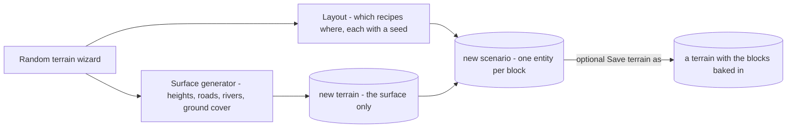

*What the picture shows:* the wizard makes **two** things — a surface terrain and a scenario of placed blocks — and the blocks are **ordinary
scenario entities** (B-2), editable, re-rollable and unpackable like any the user places by hand. ⇒ the generator writes **no houses at all**;
"plain terrain" (TA-2) is simply the layout step skipped.

| lean | why | rejected |
|---|---|---|
| R-1 ⭐ the wizard = **surface generator + an automatic layout of recipe blocks into a new scenario** | one house-making path (the recipes), shared by hand-placing and generating | the synth's own house code as a second path |
| R-2 ⭐ **"Save terrain as" is the step that makes a large town FAST** — the blocks bake once into the terrain, with the navmesh prefilled | a 5.5 km town of ~1 800 houses re-expanded at every load would cost load time (§10, not yet measured); a baked terrain does not | always expanding at load |
| R-3 the synth's house, tree and road code is not thrown away: its roads and heights become the **surface generator**; its villages become **recipes** | reuse | rewriting |

## 13. The workflow — generate and shuffle, then edit, then bake *(✅ AGREED `2026-11-11`, R-4200; W-1…W-4 ✅ approved the same day)*

🔒 User, `2026-11-11`: *"the generator will generate something initially, but stores it as a scenario, which is editable later. So the user is then
able to move the stuff around and in the end save it as a terrain, which will trigger the normal terrain generation stuff, including the navmesh
pre-generation."*

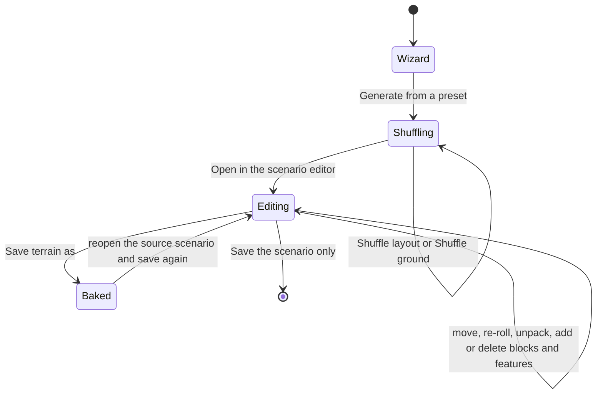

*What the picture shows:* ONE path, not two modes — the wizard's result is already the editable scenario, so a user who is happy after
shuffling just saves, and one who is not keeps editing the SAME thing. *Save terrain as* is the one exit into the normal terrain pipeline
(the importer's folder writer, the navmesh prefill).

| # | lean | why |
|---|---|---|
| W-1 | ⭐ **two shuffles**: *Shuffle layout* (new seeds for the blocks — seconds) and *Shuffle ground* (new heights, roads, rivers — slower: netconvert) | re-rolling the town should not wait on the roads; keeping the ground while trying layouts is the common case |
| W-2 | the wizard's preview is the **2-D plan** (the OSM wizard's), with the blocks drawn as their footprints | the existing preview, and fast enough to shuffle |
| W-3 | ⭐ **Save terrain as keeps the block scenario as the terrain's SOURCE**: it writes the new terrain AND a new scenario that uses it (empty of the baked blocks); the source scenario stays, so the terrain can be edited and saved again | a baked terrain is no longer editable as blocks; without the source the user's work would be one-way |
| W-4 | the source scenario remembers which terrain it produced; saving again **overwrites that terrain** after a confirmation naming the scenarios that use it | the same "who uses this" check as a changed recipe (B-Q1) |

## 14. Editing a baked terrain again — the source travels with the terrain *(✅ user `2026-11-11`: "yes, add section 14"; E-1…E-6 ✅ agreed, R-4201)*

🔒 User, `2026-11-11`: *"Will there be any way how to open an existing terrain as a scenario so I can keep editing it? … even if we bake everything
into a terrain, we might want to keep the original scenario together with it somehow."* · *"What if the scenario we are editing, the terrain one,
will get some non-terrain entities? Is it harmless? Or will we need to somehow filter those out?"*

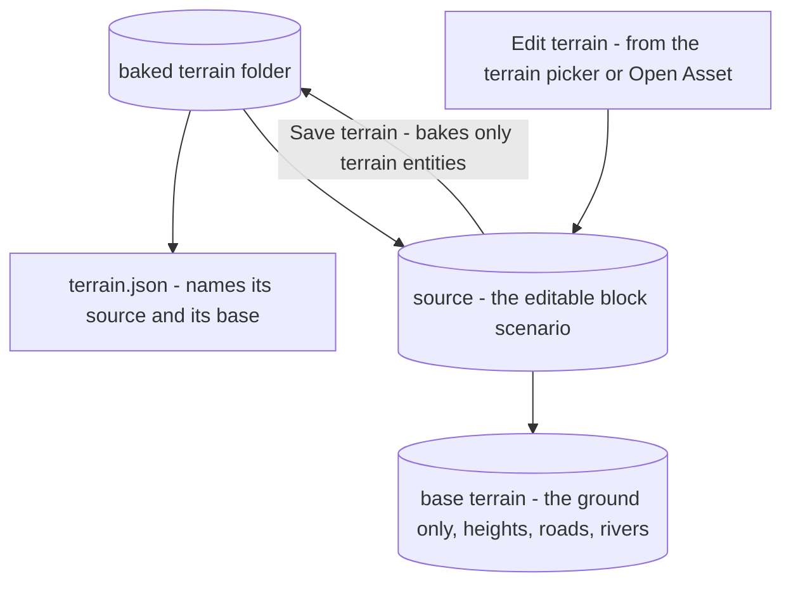

*What the picture shows:* the chain ground → blocks → baked result is stored **inside the terrain**, so copying, syncing or sharing the terrain
carries what is needed to edit it again; *Edit terrain* always reopens the whole chain.

| # | lean | why |
|---|---|---|
| E-1 | ⭐ the source scenario lives in the baked terrain's folder (`source/`), and `terrain.json` names it and the base terrain | the terrain and its source can never be separated (copies, the NAS sync, sharing) |
| E-2 | **Edit terrain…** in the terrain picker and Open Asset opens the source in the editor; the editor shows it is a **terrain source** (the title) | the user always knows whether a save changes a terrain or a mission |
| E-3 | a terrain with **no source** (imported, or older) gets one on the first *Edit terrain*: a new source that holds only additions on top of it | every terrain is editable the same way; its existing houses are not blocks and stay baked |
| E-4 | ⭐ **non-terrain entities in a source are harmless and kept**: *Save terrain* bakes ONLY terrain entities — 📐 the bake already selects by component (`StaticObstacleBake.cs:187`, `With<StaticObstacle>().With<ObstacleShape>()`), the new kinds join that query; units, AI, triggers and areas are not terrain and are never baked. ⭐ They are useful there: place a squad to try whether the town is passable, run it, look along a street | filtering by KIND is what the bake does by construction; there is nothing to strip |
| E-5 | the summary of *Save terrain* names what was **not** baked ("12 units and 2 areas stay in the source only"), and the new scenario *Save terrain as* writes (W-3) does **not** copy them — a mission on the terrain is its own scenario | a terrain source should not quietly turn into a mission; the user sees the rule each time |
| E-6 | ⛔ **damage is not baked**: a breach or collapse made while trying the source (a run) stays scenario state; *Save terrain* bakes the intact geometry and says so. A *pre-damaged town* ("a ruined village") is a later option — a block variant, or an explicit "bake damage" tick | a test shot should not quietly change the terrain |
| E-Q | ⏭ **removing a baked house** (an imported one, to make room for a block) = a new "remove" feature saved in the source; designed now, built only if needed early | the user's call when it is needed |

## 15. The mockups — S-0 *(drawn `2026-11-11`; ✅ approved the same day, R-4203; generator `scripts/gen-terrain-authoring-mockups.py` on the one kit, R-4143)*

| page | shows | basis |
|---|---|---|
| [1 — the workflow and the wizard](UX/terrain-authoring-1-wizard.svg) | the workflow strip (wizard → shuffle → edit → save terrain → edit terrain…); step ① six preset pictures + Size / Relief / Vegetation / Water + seed; step ② the 2-D preview with the blocks outlined, what was generated, the budget verdict, *Shuffle layout* / *Shuffle ground*, *Open in editor* | §12, §13, W-1, W-2, TA-2 |
| [2 — blocks in the editor](UX/terrain-authoring-2-blocks.svg) | the TERRAIN SOURCE title chip; a placed block (outline, menu: Re-roll · Rotate · Move · Unpack · Change recipe · Delete; Details: recipe, seed, *Fit to the site*); a block being placed, fitting itself to the track; Add Entity with the six terrain groups and the Blocks tiles | §11 B-1…B-8, E-2 |
| [3 — single features and the scatter](UX/terrain-authoring-3-features.svg) | ① a hedge / wall / fence line; ② a bridge over the river on the road; ③ the area scatter (Street clutter, density, seed); the Clutter tiles | §2, §7, §8, §11 job ③ |
| [4 — saving, and editing again](UX/terrain-authoring-4-save.svg) | the File menu; *Save terrain as* with its summary (baked · stays in the source · damage not baked · mesh pre-built · a new scenario); the overwrite confirmation naming the users; the terrain picker with SOURCE and *Edit terrain…* | §13 W-3, W-4, §14 E-1…E-6 |

⚠ Scope (R-4151): the editor, the menu bar and the picker's existing groups are drawn as dimmed or plain CONTEXT and are unchanged. Clutter tiles
show glyphs where the real tiles will be model renders (the thumbnail atlas).

## 16. From the wizard to the editor, and the same terrain on every node *(✅ V-1…V-6 approved `2026-11-11`, R-4203 — ⛔ V-2…V-6 SUPERSEDED the same day by §18, R-4204: compile at save; V-1 stands)*

🔒 User, `2026-11-11`: *"How will we get from the wizard to the editor? … In a cluster, when the scenario contains this terrain stuff, how will we
make sure that the others will receive the same stuff so they can bake the terrain features into their own 3D map and terrain representations?"*

**Wizard → editor (lean V-1):** *Open in editor* is the wizard's last step and does it all: it writes the ground terrain, **saves** the block
scenario at once (nothing is lost if the editor is closed), and **opens it** in the editor — the same as the OSM wizard's *Open in New Scenario*
(`OsmTerrainWizardWindow.cs:645`, through `Services.OpenNewScenario`). An open scenario with unsaved changes gets the editor's usual save prompt first.

**The same features on every node:**

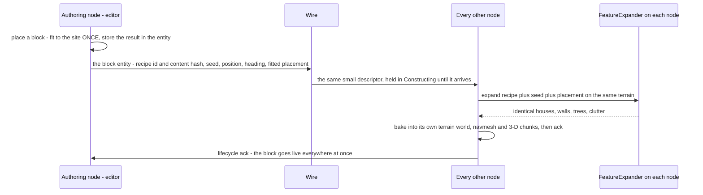

*What the picture shows:* the wire carries a **small descriptor**, never the houses; each node **expands it itself** and gets the same result
because every input is the same — the mechanism static obstacles already use (`ObstacleShape` is `[PerInstanceValue]`, the creator publishes it and
a node does not promote the ghost before it arrives, R-136; the bake's lifecycle gate, R-243).

| # | lean | why |
|---|---|---|
| V-1 | *Open in editor* saves the scenario and opens it automatically | one click, nothing to find; the OSM wizard's precedent |
| V-2 | ⭐ **fit to the site happens ONCE, at placement, on the authoring node; the result is stored in the entity** | the bake on every node then depends only on recipe + seed + stored placement + the terrain — never on the order other blocks arrive in, so no node can expand differently |
| V-3 | ⭐ the descriptor carries the **recipe's content hash**; recipes are content assets synced to every node before a load (asset management) — a node whose recipe differs **refuses the load and names it**, never expands a different block | the one way two nodes could still disagree |
| V-4 | the expander is **pure and integer-seeded** (one RNG, no wall clock, no dictionary order) and has a rail that expands the same block twice in two processes and compares the result byte for byte | determinism stated as a test, not a hope |
| V-5 | the external visual engine gets the **expanded** features (L-7, B-7) from the node that owns the entity | it cannot run our recipes |
| V-6 | a replay records the **descriptor** (unmanaged, tiny) and expands it again on load | the recording stays small; the bake follows keyframes as today |

## 17. ⛔ Critical review `2026-11-11` — what the design gets wrong or leaves out *(before S-1; three independent reviews + the coordinator, every load-bearing claim re-checked in code)*

🔒 User, `2026-11-11`: *"take a new critical look on the whole terrain editing feature from different perspectives and find flaws and gaps"*.
Reviews: simulation / cluster / replay · scale / data / content pipeline · the author's workflow. ✔ = re-verified by the coordinator.

### 17.1 The gaps, most severe first

| # | gap | evidence | consequence |
|---|---|---|---|
| G-1 | ⛔ **damage and door state are addressed by INDEX and by terrain NAME** | ✔ `WallBreach.Panel` is the GLOBAL panel index, `BuildingDamage.Building` an int (`BuildingDamage.cs:21,57`); keys `"<terrain>/<label>"` (`:113`), doors `DoorKey(terrain, label, id)` (`TerrainBuildingExpander.cs:299`), state keyed so (`TerrainObjectsSection.cs`) | houses appended in each node's query order get different indices ⇒ the Muscle breaches house N, another node draws the hole in a different house; re-roll / unpack / *Save terrain as* orphan every saved door and damage |
| G-2 | ⛔ **the bake merges BOXES only** — L-1's "the bake learns the new kinds" is a rewrite | ✔ `BakeObstacles(IReadOnlyList<TerrainPrism>)` → `TerrainObstacles.With` appends prisms and SHARES the base's surfaces, panels, buildings, doors, walkables and heights (`TerrainResidency.cs:505-517`, `StaticObstacles.cs:~150-195`) | a house's floors and doors, a wood's concealment, water's cut, a bridge deck, a pad — none can be added; collapse works only on buildings, so a bridge cannot fall |
| G-3 | ⛔ **added houses get no door entities** | ✔ door entities are created once, at scenario load, from the base world (`ScenarioLoadStep.cs:264`, `TerrainObjectRequests.ForDoors`); the navmesh's fine areas read `world.Buildings` / `world.Doors` (`RecastNavmeshFactory.cs:144-156`) | doors that cannot open, no building clearing, coarse navmesh inside, door state not saved |
| G-4 | ⛔ **every change rebuilds the WHOLE terrain on every node** | ✔ new world + whole index + whole cover + every navmesh tile re-keyed (`TerrainResidency.cs:510-513`); ≈ 16 s navmesh + 1 s index/cover on scale-1 (`DESIGN_Scale_Rig.md:140-142`); re-fires 0.5 s after any change; the 3-D view rebuilds every chunk on a new world (`TerrainLayer3D.cs:48-57`) | moving one hedge in a town ≈ 17 s and a full 3-D rebuild; a generated town as blocks = a COLD navmesh bake on every node at first load (scale-1 cold 536 s) — far over R-4192's 30 s |
| G-5 | ✅ **FIXED `2026-11-11` (CE-4419, backend): the terrain module waits without a timeout (`EntityLifecycleModule.WaitWithoutTimeout`)** — was: ⛔ **a slow bake DESTROYS the entities** | ✔ construction timeout 18 000 FRAMES (`EntityCreationPack.cs:75`); a timeout destroys the entity (Peek and Fire §9 O2) | a big town on a fast headless node can exceed it ⇒ its blocks vanish on that node only |
| G-6 | ⛔ **recipes and terrains are identified by NAME, and B-Q1 / V-3 / V-6 contradict** | B-Q1 "a changed recipe changes every scenario" vs V-3 "a hash mismatch refuses"; `RecordingMetadata.TerrainName` is a name (`RecordingMetadata.cs:79`); asset sync compares length + mtime (Asset Management) | after any recipe edit or terrain re-save, old scenarios refuse or change, and old RECORDINGS replay different houses (paths through walls) |
| G-7 | **the Replay Browser does not bake** | ✔ no `StaticObstacleBakeSystem` in `ReplayBrowserSubsystem` (0 references); it mirrors the base world only | scenario houses, walls, woods — and today's obstacles — are invisible in replays there |
| G-8 | **the external engine: the design contradicts itself, and a baked terrain is lost to it** | V-2 "never the houses" vs V-5 / B-7 "the expanded features"; one block = ~40 houses with panels in one descriptor (DIS / HLA has no building type); after *Save terrain* the houses live only in our files | the other engine draws nothing scenario-added, or nothing baked |
| G-9 | **"Save terrain as" has no writer that can write it** | ✔ `TerrainFolderWriter` writes template houses with `rotation` 0 (`:70-71`), has no slab / ramp / obstacle prism, takes importer inputs, not a `TerrainWorld`; the parser has no clutter kind | rotated houses saved wrong, bridges and clutter dropped; E-3 (add to an imported terrain) has no write path; and §5 (re-point THIS scenario) contradicts W-3 / E-5 (a NEW scenario) |
| G-10 | **saving to a new folder re-bakes every navmesh tile** | ✔ prefill reads only the new folder (`NavmeshPrefill.cs:22-28`), never the base's tiles | each *Save terrain as* ≈ 9 min cold at 5.5 km |
| G-11 | **E-3 bakes twice** | a terrain with no source has no separate ground base | the second *Save terrain* stacks the additions onto a terrain that already holds them |
| G-12 | **roads and traffic never change** | the bake never touches the road net (`RoadNetworkHolder`); no road feature kind in §2 | a placed bridge carries no vehicles; a destroyed bridge is still driven over by SUMO traffic |
| G-13 | **re-saving a terrain breaks the missions on it** | W-4 only NAMES the users; scenarios name their terrain by string | a new house stands on a squad, a hedge cuts a route — found at run time |
| G-14 | **storage** — ✅ the git half FIXED `2026-11-11` (CE-4425): `assets/terrain/*` is ignored except the named demos, plus `*/source/` and `**/terrain-overlay/` | ✔ only `assets/terrain/scale-*/` is gitignored — a generated `assets/terrain/<name>/` (heights, navtiles, source, base: hundreds of MB) is committable; the source + base inside the terrain double what every node downloads; publish never deletes stale navtiles | repo bloat; slow syncs |
| G-15 | smaller | shapes: an unmanaged fixed list vs the 1 024-byte component cap (✔ `EntityCommandBuffer.cs:37`) vs the managed `EditablePolyline` the area tools already use · a big feature would get ONE movement collider of half its diagonal (`ObstacleTkbTranslator`) · clutter destructible (B-Q3) vs written into the terrain (L-6) · replica float noise (✔ the bake already rounds to 1 cm) and templates / materials not in the recipe hash · per-house edits inside a block (only Re-roll / Unpack) · multi-select · two authors on one source · a bake is not undoable · "terrain out of date" never shown · the Add Entity picker's groups are DIS masks and its pictures an atlas built into the executable — a recipe fits neither · blocks on dense OSM towns · water in the navmesh unverified · the per-frame collection allocates | each a row for S-1…S-4 |

### 17.2 ⭐ The fork these point to — **F-1: expand at LOAD on every node, or COMPILE at SAVE?**

G-1, G-4, G-6, G-7, G-8 and G-10 share one root: the approved model (R-4203 V-2…V-6) EXPANDS blocks on every node at every load and
BAKES them into a world rebuilt from scratch. The alternative:

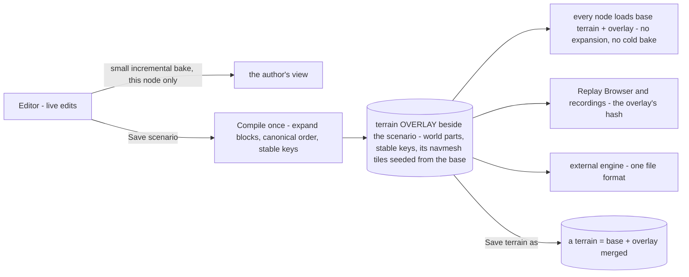

| | expand at load (approved) | ⭐ compile at save (proposed) |
|---|---|---|
| identity (G-1) | per-node order, must be made canonical everywhere | fixed once in the file, stable keys |
| load time (G-4, G-10) | cold navmesh for every block tile, every node | tiles baked at save, seeded from the base's |
| determinism (G-6, V-4) | every node must expand byte-identically | expanded once; nodes load bytes |
| recordings (G-6, G-7) | old replays re-expand from today's recipe | the recording names the overlay's hash |
| external engine (G-8) | a descriptor per block it cannot expand | the same parts file |
| save terrain (G-9) | a second writer | the overlay IS the terrain's own format; *Save terrain as* = base + overlay |
| cost | — | an overlay file per scenario (binary — ⛔ not in git; NAS / content root, like real terrains); the editor still needs a small LIVE bake for edits; runtime-placed obstacles keep today's entity bake |

**F-1 ✅ DECIDED `2026-11-11`: compile at save** (R-4204) — see §18.
Either way G-2, G-3, G-5, G-12, G-13, G-14 need their own fixes (a general world merge with doors; a wall-clock timeout; a road-net
patch; a conflict check against the missions on a re-saved terrain; content outside git).

## 18. ⭐ The compiled model — build once at save, load everywhere *(✅ R-4204 `2026-11-11`; supersedes §5 and §16 V-2…V-6)*

🔒 User, `2026-11-11`: *"approved, compile at save. Orchestrator can make sure the compiled saved stuff gets distributed to nas and to other nodes in
the cluster"*.

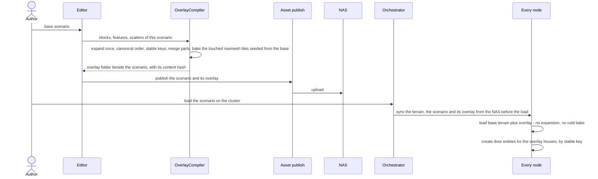

*What the picture shows:* the expensive and non-deterministic work (expanding recipes, fitting, merging, navmesh) happens ONCE, on the authoring
node, at save; every other consumer only LOADS bytes. Distribution is the existing asset path (Asset Management §4 NAS → node before a load,
§5 node → NAS publish), now carrying one more part.

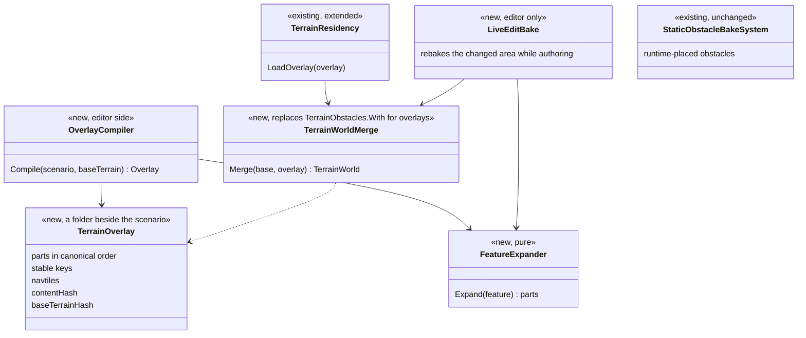

| # | rule | closes |
|---|---|---|
| C-1 | ⭐ **the overlay is compiled when the scenario is SAVED** (and by *Open in editor* from the wizard); it lives beside the scenario as a folder: the merged parts (buildings with panels and doors, walls, surfaces, walkables, prisms, trees, pads) in **canonical order**, each with a **stable key** (`<feature entity guid>/<index in its expansion>`), its **navmesh tiles** (seeded from the base terrain's tiles — only the touched ones are new) and a **content hash** + the **base terrain's hash** | G-1, G-4, G-6, G-10 |
| C-2 | ⭐ **the orchestrator distributes it**: the editor PUBLISHES the overlay to the NAS with the scenario; before a load the orchestrator SYNCS it to every node, exactly as it does the terrain folder (Asset Management §4 / §5; a new load part beside the terrain) | the user's ruling |
| C-3 | **every node LOADS, never expands**: `TerrainResidency` merges base + overlay (`TerrainWorldMerge` — the general merge G-2 needs: surfaces, panels, buildings, doors, walkables, heights, in the overlay's order) and creates the overlay houses' door entities by stable key | G-2, G-3, determinism |
| C-4 | **damage and door state are keyed by the stable key**, never by index or terrain name; a replicated breach names `<key>` + panel-in-building | G-1 |
| C-5 | **a load checks the hashes**: the overlay's base-terrain hash must match the terrain on the node, else the load refuses and names both; a recording stores the overlay's hash and the browser loads the same overlay | G-6, G-7 |
| C-6 | **the scenario keeps its blocks and features as ENTITIES for editing** (recipe, seed, fitted placement — R-4199 / R-4203 V-1 unchanged); on a node they are inert data — the overlay, not the entities, is the terrain. A recipe changed later reaches a scenario only when it is compiled again (saved), so old recordings and loads are unaffected | B-Q1 vs V-3 contradiction |
| C-7 | **while editing, a LIVE bake on the editor node only** rebuilds the changed area (incremental: the touched tiles, the touched 3-D chunks), off the frame | G-4 in the editor |
| C-8 | the external engine reads the **overlay's parts** (the same format as a terrain's world) | G-8 |
| C-9 | ***Save terrain as* = base + overlay merged by the same `TerrainWorldMerge`** and written by a writer of a `TerrainWorld` (rotation, slabs, ramps, prisms — G-9); its navmesh is the base's tiles + the overlay's, no cold bake | G-9, G-10 |
| C-10 | obstacles placed DURING a running exercise keep today's entity bake (`StaticObstacleBakeSystem`), with a wall-clock timeout (G-5) | runtime |
| C-11 | ⛔ the overlay is binary content — **never in git**; it lives on the NAS / content root like real terrains (G-14) | storage |

Still open in their own rows: roads and bridges in the road net (G-12, CE-4423), the check of missions on a re-saved terrain (G-13, CE-4424),
the smaller items (G-15, CE-4426).

## 18a. The overlay as built — format, classes, the load, the distribution *(O-1, backend `2026-11-11`; build-state: READY-TO-BUILD — numbers in §18b)*

**INVENTORY — the queries run** (`scripts/cbm.sh search_graph`, `label: Class`, + grep): `.*Terrain(Residency|Obstacles|FolderWriter|Parser|Loader|World)$` → 4
(`TerrainResidency`, `TerrainObstacles`, `TerrainWorld`, `SumoNetTerrainLoader`) · `.*Terrain.*(Writer|Parser|Reader|Folder|Catalog|Manifest|Hash).*` → 3
(`TerrainCatalog`, `TerrainDefinitionParser`, `TerrainWorldParser`; grep adds `TerrainFolderWorld`, `TerrainFolderWriter`) · `.*(Navtile|NavmeshPrefill|…).*` →
`NavTileCache`, `NavTileKey` · `.*(AssetSync|LoadPhase|…).*` → `AssetSyncService`, `AssetTreeSync`, `LoadPhaseChain`, `LoadPhaseContext`,
`AssetInventoryProcessManager` · `.*(BuildingDamage|WallBreach|DoorKey|DoorState|TerrainObject).*` → `DoorState(s)`, `TerrainObjectKey`, `TerrainObjectRef`,
`TerrainObjectRequests`, `TerrainObjectsSection`, `EntityDoorState` translators (+ `BuildingDamage`, `WallBreach` by grep). ⚠ coverage could not be checked
(`check_index_coverage` is not in the CLI). ⇒ ⛔ no overlay, merge, content hash or overlay sync exists; every piece below EXTENDS one of these.

### The format — a terrain folder in miniature *(the lean taken: the terrain's own format, so the one parser reads it)*

```
<scenario folder>/terrain-overlay/          (⛔ never in git — .gitignore **/terrain-overlay/, O-6)
  overlay.json                 header: format 1 · contentHash · base { name, contentHash } · scenario id · world file name · part counts
  overlay.world.geojson        the SAME schema as a terrain's world file; features in CANONICAL order (ordinal sort of the stable key);
                               every building / wall / surface / walkable carries "label": "<feature entity guid>/<index in its expansion>"
  buildings/<t>.building.json  generated templates only (the shared assets/buildings/ ones are referenced, not copied)
  navtiles/<x>_<z>_<hash>.navtile   ONLY the tiles whose key differs from the base's (NavTileKey — the same file format)
```

| rule | why — the measured fact it rests on |
|---|---|
| the overlay world is PARSED by `TerrainWorldParser` into its own `TerrainWorld` (indices from 0), then MERGED | ⭐ one parser, one building expander (`TerrainBuildingExpander`: panels, openings, doors, storeys, walkables) — ⛔ a second reader drifts (CE-4393's own rule, `TerrainFolderWorld.cs:7-9`) |
| the merge APPENDS: base parts keep their indices; overlay part i lands at `base.Count + i`, and every cross-index is offset — `TerrainPrism.Panel / .Building`, `TerrainWalkable.Building`, `TerrainWallPanel.Building`, `TerrainDoorDef.Panel` (`TerrainWorld.cs:42,46,64`, `TerrainBuildings.cs:49,61`) | the base's indices — and every saved / replicated state keyed by them today — are untouched; the overlay's are the same on every node because its order is in the FILE (G-1's "per-node query order" cannot arise) |
| building key = its LABEL (globally unique: base labels as today, overlay labels `<guid>/<i>`); door key = `<building key>/<door id>`; ⛔ no terrain-name prefix for new keys (O-3) | `BuildingDamages.KeyOf` and `DoorKey` prefix the terrain NAME (`BuildingDamage.cs:113`, `TerrainBuildingExpander.cs:299`) ⇒ *Save terrain as* (a new name) orphans every saved state (G-1). A legacy key `"<terrain>/<label>"` is still READ (prefix stripped when it names the resident terrain) |
| content hash = SHA-256 over `overlay.json`'s parts and the world file (not navtiles); the base's hash = SHA-256 over `terrain.json` + the files it names, cached in `terrain.hash` keyed by each file's (length, mtime) | a NAME identifies nothing (`RecordingMetadata.TerrainName`, G-6); the cache keeps a 127 MB height store from being re-hashed per load |
| navtiles: the merged world's bake seeds from the base's `navtiles/` THEN the overlay's (`RecastNavmeshFactory.cs:115-120` reads ONE `SourceFolder` today ⇒ it takes a list) | the overlay's houses touch few tiles — every untouched tile is the base's file (G-4, G-10) |
| ⛔ NOT in v1: height pads (no type exists — `grep Pad` in the world types: none) | a finding row in this lane's block, not a silent drop |

### Classes

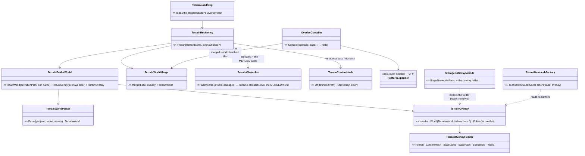
*What it shows that prose hid:* the merged world becomes `_baseWorld` (`TerrainResidency.cs:323`), so the runtime obstacle bake (C-10) and building damage
lay over base + overlay with NO change to `TerrainObstacles.With` — the overlay is not a second bake path, it is a bigger base.

### The load — every node

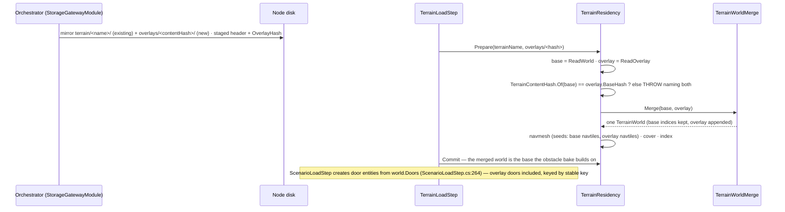

### The modules — who calls what each load *(dashed red = NOT reached today — the dead edges)*

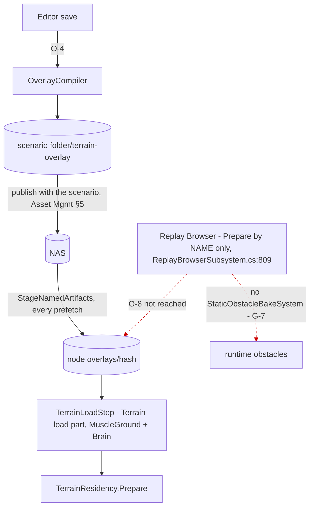
*What it shows:* the cluster nodes reach the overlay through the ONE prefetch the terrain already rides; the Replay Browser calls `Prepare(name)` itself and
reaches neither the overlay nor obstacles — O-8's two edges.

| claim the design rests on | code — how it IS | design basis |
|---|---|---|
| the prefetch mirrors the terrain folder to every target before the load | ✅ `StorageGatewayModule.cs:557-563` (`AssetTreeSync().Sync`) | ✅ Asset Management §4 |
| the terrain step runs only after distribution is acked | ✅ `TerrainLoadStep.cs:82-86` (L8 comment) | ✅ Cluster Load Phase §7.3 ④ |
| the obstacle bake builds on `_baseWorld` | ✅ `TerrainResidency.cs:323,508-512` | ✅ Peek and Fire §9 |
| door entities come from `world.Doors` at scenario load | ✅ `ScenarioLoadStep.cs:264` → `TerrainObjectRequests.ForDoors` | ✅ §17 G-3 |
| fine navmesh areas read `world.Buildings` / `world.Doors` | ✅ `RecastNavmeshFactory.cs:142-155` | ✅ §17 G-3 |
| keys carry the terrain name | ✅ `BuildingDamage.cs:113`, `TerrainBuildingExpander.cs:299` | ✅ §17 G-1 |

### 18a-3. Stable keys — O-3 as built *(CE-4417, backend `2026-11-11`)*

| decision | why — measured |
|---|---|
| ⭐ a replicated breach names the house by KEY and the wall by its index WITHIN the house; the receiver resolves both against ITS world (`BuildingDamages.IndexOfKey`, `BuildingPanelIndex.ToGlobal`) — the global indices never cross the wire | the sample carried the sender's global `Building` and `Panel` and the receiver applied them as they were (`EntityBuildingDamageTranslators.cs:77,179`) ⇒ two worlds assembled differently breach different houses (G-1). The SAVE already used key + panel-in-building (`BuildingDamageSave.cs:42-62,149`) — the wire now speaks the same language |
| a key resolves with or without the terrain-name prefix (`"<terrain>/<label>"` and `"<label>"`) | after *Save terrain as* (a new name) an old key still finds its house |
| ⚠ **DEVIATION from §18a's first table — the terrain-name PREFIX is NOT dropped from the keys written today; it moves to O-5** | 📐 measured: six shipped scenarios (`bt-doors`, `bd-destruction`, `bc-*`, `ua-civ-shelter`) save door state under `"<terrain>/<building>/<door>"`, AND behaviour params name doors that way (`DoorLocksmith`: `"door":"bt-range/House A/front"`), compared as strings in places not yet enumerated; recordings hold them in `TerrainObjectKey`. Dropping the prefix now touches all three; O-5 (*Save terrain as*) rewrites keys anyway, so it is done there, with the legacy read already in place here. Overlay labels are `<guid>/<i>` — stable across re-saves whatever the prefix |

### 18a-2. The merge — O-2 as built *(CE-4416, backend `2026-11-11`)*

| as built | where |
|---|---|
| `TerrainWorldMerge.Merge(base, overlay)` — appends; offsets `TerrainPrism.Panel/.Building`, `TerrainWalkable.Building`, `TerrainWallPanel.Building`, `TerrainDoorDef.Panel` (`Opening` panel-local, not offset), `BakedCollapsed`; every field of every part copied (checked against the types); a duplicate building label or door key THROWS naming both; bounds = union; Name, SourceFolder, Height, GroundZ, Materials, Breaches (a material rule set — no per-panel index), Beyond = the base's | `FDP/Toolkits/Fdp.Toolkits/Terrain/TerrainWorldMerge.cs` |
| `TerrainWorld.SeedFolders` (default `[SourceFolder]`); the merge lists base then overlay; `NavTileCache.ForSeeds(folders)` reads them in order; `TerrainObstacles.With` keeps them | `TerrainWorld.cs`, `NavTileCache.cs`, `RecastNavmeshFactory.cs`, `StaticObstacles.cs` |
| `TerrainOverlay` + `TerrainOverlayHeader` (`overlay.json`, format 1); `TerrainFolderWorld.ReadOverlay(folder, terrainName, sharedBuildingsRoot)` — ⚠ DEVIATION: a third parameter, because an overlay beside a scenario cannot find the shared `assets/buildings` from its own folder; `TerrainResidency` passes `TerrainAssets.RecipesSibling(baseFolder)` | `TerrainOverlay.cs`, `TerrainFolderWorld.cs` |
| `TerrainResidency.Prepare(terrainName, overlayFolder = null)` — the merged world is indexed and becomes `_baseWorld`; the "already resident" skip also compares the overlay (else a changed overlay was skipped) | `TerrainResidency.cs` |
| a bridge: slab / ramp / polygon-building features with `"structure": "<key>"` form ONE `TerrainBuilding` (label = key, no panels, solid; footprint = the part, or the box of several; storey from the lowest ground under it to the deck) ⇒ the existing collapse path drops its deck (`TerrainObstacles.With` removes walkables of a collapsed building) | `TerrainWorldParser.cs` |
| 📐 water is ALREADY impassable — the ground mesh cuts water polygons out (no fix; kept as a rail) | `RecastNavmeshFactoryTests.O2_WaterFromAMergedOverlay_IsImpassable…` |

Rails (each red-proved by a compiling mutation): `TerrainWorldMergeTests` (indices, duplicate keys, seed folders, the merged bake seeds from both folders, `ReadOverlay` resolves shared templates) · `RecastNavmeshFactoryTests.O2_*` (an overlay house is enterable through its offset door, a locked door blocks; water impassable) · `TerrainWoodsTests.O2_AForestFromAnOverlay_ConcealsLikeTheBasesWoods` · `BuildingOverlayTests.O2_AStructureBridge_Carries…AndStopsCarrying…` · `TerrainLoadStepTests.Prepare_WithAnOverlayFolder_StagesTheMergedWorld_O2`.

### 18b. The numbers — scale-1 with a 700-house overlay *(O-1, measured `2026-11-11`, this cloud VM: 4 cores, Debug build)*

Input: scale-1 (5.5 km, 1 651 houses) split by `scripts/terrain-overlay-measure.py` into a 951-house BASE and an OVERLAY of 700 of its houses (labels
`<guid>/<i>`) + 40 woods of 60 m, canonical order. Harness: `TerrainWorldMergeTests.O1_Measure_AScaleOneOverlay` (opt-in, `HROT_MEASURE_OVERLAY=1`).

| measure | value | reads as |
|---|---|---|
| overlay folder size (no navtiles) | **153 KB** (one world file) | 0.2 KB per house — the parts are template placements, expanded by the parser |
| overlay read + expand (700 houses → 36 001 prisms, 8 130 panels, 3 002 doors, 4 527 walkables) | **0.63 s** | the cost a node pays per load, beside the base read (951 houses: 1.66 s, with the 127 MB height store) |
| the merge | **11 ms** | negligible |
| ✅ merged prisms | **84 607 = the unsplit scale-1's** (`DESIGN_Scale_Rig.md` §5.1) | base + overlay rebuilds the original terrain exactly |
| navmesh tiles the overlay touches | **2 006 of 52 900 per layer** (3.8 %; ×2 layers ≈ 4 012 tiles) | the tiles a COMPILE bakes; every other tile is the base's file |
| ⚠ the compile's tile bake | **≈ 20 s estimated, not measured** — 4 012 tiles × 5.1 ms (the cold rate: 536 s / 105 800 tiles on 4 cores, §5.1) | once, at SAVE, on the authoring node; a loading node bakes NOTHING cold (it reads the overlay's tiles) |
| ⚠ the overlay's `navtiles/` size | **not measured** — needs O-4's compile | |

⇒ **READY-TO-BUILD.** A node's load grows by ≈ 0.64 s for a 700-house overlay; the save carries the tile bake.

### 18c. The compile — O-4 part 2 *(CE-4415, backend `2026-11-11`; build-state: READY-TO-BUILD)*

```mermaid
sequenceDiagram
  participant N as Nodes (their slices)
  participant M as Master - StorageProcessManager
  participant C as OverlayCompiler
  participant X as FeatureExpander
  participant NAS as NAS scenario folder
  N->>M: scenario slices (save)
  M->>M: ScenarioMergeCore.Merge -> canonical scenario.json
  M->>C: Compile(canonical dom, scenario dir, base terrain definition)
  C->>C: entities with TerrainBlock / TerrainFeature (guid = stable key prefix)
  C->>X: Expand(recipe, seed, site, base world) per block - pure, seeded
  X-->>C: features labelled guid/i
  C->>C: canonical order, write overlay.world.geojson + overlay.json (hashes)
  C->>C: bake the merged world's navmesh: write ONLY tiles the base's seed lacks
  C->>NAS: scenario dir/terrain-overlay - already on the NAS: published by construction
  Note over C: no TerrainBlock / TerrainFeature entity => no overlay folder (a stale one is deleted)
```
*What it shows:* the compile runs where the CANONICAL scenario is born — the master's merge writes it straight to the NAS — so "publish the overlay"
is not a step. The editor's own save (`EditorScenarioSession.SaveTo`, one node, no cluster) calls the SAME `OverlayCompiler.Compile`.

| element | decision | why |
|---|---|---|
| `TerrainBlock { FixedString32 Recipe; uint Seed; float HeadingDeg }` + `SimTransform` | an unmanaged, saved component — one entity per placed block (B-2); its guid prefixes every part's key | recorded ⇒ unmanaged (CLAUDE.md); one entity per block keeps the wire small |
| `TerrainFeature { byte Kind; FixedString32 Template; float HeadingDeg; float Pad }` + `SimTransform` | a single placed house (Kind = House) in v1; `Pad` written, not yet used (L-5) | the smallest kind that proves the path; lines / areas need the shape capacity measurement (§10) |
| recipe = `assets/terrain-recipes/<id>.recipe.json`: houses (templates, count range, radius, spacing) + woods (count, size) | shipped data (B-Q2); the content hash covers the EXPANDED world, so a recipe edit reaches a scenario only when it is compiled again (C-6) | B-1 |
| `FeatureExpander.Expand` — pure; its own seeded generator (xorshift, never `System.Random`); keeps out of the base's building footprints and water surfaces (B-3 part) | identical bytes for the same input on every machine | ⚠ road alignment (B-3) needs the road net — a finding row, not v1 |
| navtiles: the compile bakes the merged world in Prefill mode seeded from the base; a seed hit is NOT written | the overlay's `navtiles/` holds only the touched tiles (§18b: 3.8 %) | G-4, G-10 |
| ⛔ the TKB type + the Add Entity groups for blocks / features | ui's (B-5), later; the engine reads the components from the scenario JSON whatever placed them | the handoff's "UI is ui's, later" |

#### 18c-1. What the approved mockups need from the engine *(user `2026-11-11`: "make sure the visuals reasonably match the mockup design")*

The screens are ui's; ⭐ the DATA each screen shows is this batch's, so ui can draw the mockup as drawn — nothing invented, nothing missing:

| mockup | it shows | the engine provides | item |
|---|---|---|---|
| [2 — blocks](UX/terrain-authoring-2-blocks.svg), Details | *Fit to the site*: Align to the nearest road · Keep out of water · Keep out of buildings · Level houses on pads | `TerrainBlock.Fit` flags (four bits, all on by default), honoured by `FeatureExpander` (road alignment ⚠ needs the road net — a row; pads written, flattening later S-5) | O-4 |
| 2, Details | *Contents: 28 houses · 64 clutter items* | `overlay.json` `blocks[]`: per block key, recipe, seed, house / clutter / wood counts | O-4 |
| 2, the canvas | the block OUTLINE and the placing ghost | `blocks[].outline` (the expanded parts' hull, local metres); `FeatureExpander` is pure, so the ghost is the same call on the editor | O-4 (ghost: ui) |
| 2, the canvas | the houses drawn like the terrain's own | the merged world is the terrain world ⇒ the 2-D / 3-D terrain layers draw overlay houses with no change — ⭐ VERIFIED by rendering a frame (O-4 gate) | O-2 / O-4 |
| [4 — save](UX/terrain-authoring-4-save.svg), *Save terrain as* | *Baked: 23 blocks → 684 houses, 41 farm buildings · 14 woods, 3 scatters, 220 trees · 6.1 km of walls, fences and hedges · 3 bridges* | `TerrainSaveSummary` — counts per kind + wall length (km) + bridges | O-5 |
| 4 | *Stays in the source only: 12 units and 2 areas — not terrain (E-4) · damage to 3 houses from a test run — not baked (E-6)* | the summary's `NotBaked` (units, areas, damaged houses) | O-5 |
| 4 | *Pre-build the walkable mesh ≈ 2 min* | the summary's tile count + the estimate (the cold rate, §18b) | O-5 |
| 4, overwrite | *Used by 3 scenarios: …* | `TerrainUsers.Of(terrainName)` — the scenarios naming it | O-5 |
