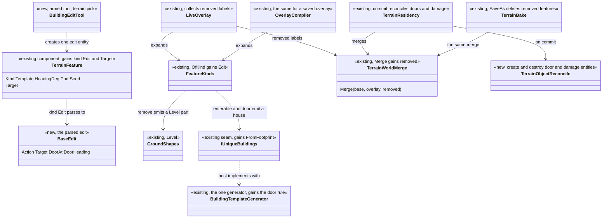
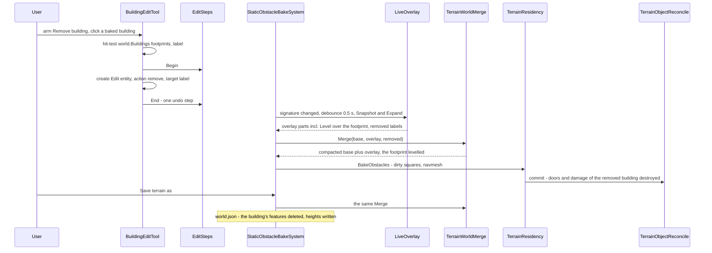
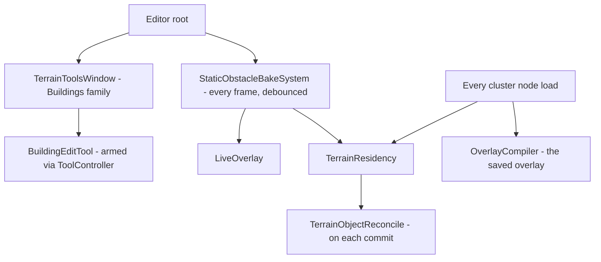

<!--STATUS
state: LIVE
updated: 2026-11-18
tracker: CE-5024, CE-5025 (rows) · slices CE-5027…CE-5031
build-state: READY-TO-BUILD — ✅ D-1…D-8 APPROVED by the user `2026-11-18` ("approved", R-5067); mockup docs/UX/terrain-base-edits.svg
current-answer: §1 inventory · §2 the proven solution · §3 decisions · §4 UML · §5 the UI · §6 slices · §7 acceptance
stale-below: nothing
known-rot: none
known-conflict: none
related-designs:
  - DESIGN_Glass_Windows.md — the windows the generator writes are glazed by default (`glazed`, D-1 there)
  - DESIGN_Terrain_Authoring.md — OWNS the overlay machinery this extends: TerrainFeature kinds, the live overlay (§18e), "Save terrain as" (L-3), the merge; its gap G-3 (added houses get no door entities) is closed here as a dependency
  - DESIGN_Terrain_Editor_UX.md — OWNS the Terrain toolbar and its families (TE-*, as built S-1…S-4); this adds the BUILDINGS family
  - DESIGN_Terrain_Import_UTM.md — OWNS the importer's building generator (§11, R-4186 enterable houses) this reuses, and the import that makes the solid / doorless houses
  - DESIGN_Building_Interiors.md — OWNS the *.building.json template the generator writes (walls, storeys, doors, windows, stairs)
  - DESIGN_Ground_Patches_And_Road_Blockage.md — OWNS ground shapes and the house pad (G-5, G-14: Level, islands) the flattening reuses
  - DESIGN_Vehicle_Breaching.md — OWNS felled trees by key (§7.7) and building damage (B-*): the "remove a baked object by its key" precedent, and the damage that goes with a removed building
  - UX/UX_Feature_Tool_Model.md — OWNS the armed-tool model the three tools ride on
-->

# DESIGN — editing BAKED-IN buildings: remove · make enterable · add door (CE-5024, CE-5025)

🔒 User, `2026-11-18`, verbatim: *"In the editor I would like to have a tool that is able to convert such non-enterable building into enterable one"* ·
*"By enterable i mean a building having one or more door and also internal floors, ramps and true windows (holes in the walls)"* ·
*"i would like also have a tool in the enditor that can remove an already baked-in building."* · *"removed building leaves bare flattened ground. of course
the door objects should go with the buildings (and destructions as well). pls write a design, including the whatever ui design this needs."*

**Enterable** (the user's definition): **≥ 1 door · a floor per storey · stairs / ramps between storeys · windows as real openings in the walls.**

## 1. INVENTORY *(measured `2026-11-18`; graph: `search_graph name_pattern=".*(Removed|Remove|Suppress|Hidden|Erase|Delete).*(Building|Object|Prism|Feature|Base).*" label=Class` ⇒ **0**; `search_graph name_pattern=".*(Overlay|TerrainFeature|TerrainBlock|FeatureExpander|OverlayCompiler|TerrainBake|TerrainFolderWriter|TerrainObjectKey|TerrainObjectRequests|BuildingDamage|TerrainTool|TerrainToolbar).*" label=Class` ⇒ the overlay / damage classes below; `search_graph name_pattern=".*(Osm|OSM).*(Building|Import|Footprint).*"`; grep for every reader of a building index; ⚠ index coverage cannot be checked through the CLI)*

| piece | where | what it is | for this design |
|---|---|---|---|
| `TerrainBuilding` | `Terrain/TerrainBuildings.cs:72-97` | a building of the world: `Label` (its STABLE identity), `Footprint`, `BaseZ`, `StoreyZ`, `Solid`, `Pad` | ⭐ the target of every edit, keyed by `Label` |
| solid / doorless at import | `Hrot.Terrain.Osm/Rules/BuildingRules.cs:140` (R-4193), `:89` `NoFreeWall`; `Hrot.Terrain.Import/BuildingTemplateGenerator.cs:60` `SolidBecauseNoStair` | SOLID: sheds / garages / huts / kiosks / service / transformer towers, ruins / construction, < 25 m², no stair fits; DOORLESS: no free wall | what *Make enterable* / *Add door* fix |
| THE generator | `Hrot.Terrain.Import/BuildingTemplateGenerator.cs` (footprint → floors, `StairPlanner` stairs, `OpeningPlacer` doors + windows); toolkit seam `IUniqueBuildings` (`Terrain/UniqueBuildings.cs:21-25`), host `SynthUniqueBuildings` | the ONE path footprint → enterable template | ⭐ reused, never copied (ruling 9) |
| `TerrainFeature` | `Terrain/TerrainBlock.cs:46-57` — `Kind`, `Template` (FixedString32), `HeadingDeg`, `Pad`, `Seed`; kinds House=1 … Group=15 | a placed scenario terrain feature (an entity, saved, undoable) | ⭐ an edit is a NEW KIND of it (D-1) |
| kind touch-points | `FeatureKinds.cs:30-74` (OfKind, NeedsShape, IsKnown) · `TerrainPicks.cs:32-111` · `EditorToolStrips.cs:101-117` · `TerrainBirth.cs:73` · `TerrainFeatureGizmo.cs:22-35` · `TerrainFeatureOps.cs` · `TerrainFeatureDetailsView.cs:60-145` · `BlockOperations.cs:168,201` · `OverlayCompiler.cs:94,103` · `LiveOverlay.cs:279` · `TerrainSnap.cs:89` | every list of kinds | each takes the new kind |
| `TerrainWorldMerge.Merge(base, overlay)` | `Terrain/TerrainWorldMerge.cs:70-154` | ADDITIVE: base parts keep their index, overlay parts appended and offset (prism `Panel`/`Building`, walkable / panel `Building`, door `Panel`, `BakedCollapsed`); throws on a duplicate label / door key | ⛔ nothing REMOVES a base part — the gap |
| ground shapes | `GroundPatches.cs:465-535` (`level`, `raise`, `lower`, `ditch`, `berm`), applied only in `Merge:154`; islands `TerrainWorldMerge.cs:35-42` | `Level` sets a polygon to a fixed height with a skirt; ⛔ every building footprint (+ 1 m) is an ISLAND a shape leaves untouched (`GroundPatches.cs:523`) | ⭐ the flattening, once the building is gone from the base |
| house pad | `TerrainWorldMerge.PadHeights:24-32`, `GroundPatches.PadOf:59-83` | an overlay house's ground cut to its `BaseZ` (cut only, ≤ 3 m, skirt ≥ 4 m) | a precedent; ⛔ cut-only, so not the removal's flattening |
| building index readers | `BuildingDamage.Building` (`BuildingDamage.cs:57`), `BuildingPanelIndex` / `WallGroups` (`BuildingDamageSave.cs:45-210`), `BuildingDamages.IndexOfKey` (`:161`), `BuildingFootprints` (`TerrainWorld.cs:250-262`), `TerrainResidency.DamageHashes` / `DirtyRegions` (`:769-839`), the navmesh's building / door areas (`RecastNavmeshFactory.cs:218-226`, `NavDoorways`), Bepu (`TerrainResidency.cs:535`), `TerrainObstacles.With` (`:628`) | indices into `world.Buildings` / `Panels` | ⭐ all recomputed from the committed world; `TerrainResidency.RemapDamageEntities` (`:672-682`) already re-keys damage by LABEL on every commit |
| door entities | `TerrainObjectRequests.ForDoors` (`:32-66`), once at scenario commit (`ScenarioLoadStep.cs:269-275`), keyed by door `Key` | transient entities (`DoorState`, `TerrainObjectKey`) | ⛔ created ONCE; ⛔ never removed (an orphan is skipped by readers, still saved); ⛔ none for overlay houses (Authoring **G-3**) |
| building damage | `BuildingDamage` (index + `TerrainObjectKey "<terrain>/<label>"`), saved under `TerrainObjects` by key (`TerrainObjectsSection.cs:219-231`), loaded by `BuildingDamageLoad.Resolve` (`BuildingDamageSave.cs:296-333`) | a missing building ⇒ warned, ignored; live `Remap` ⇒ `Building = -1`, entity kept | ⭐ must be DESTROYED with its building |
| felled trees | `TreeDamage`, `TerrainObjects["#trees"]` (CE-4603) | a BAKED object removed BY ITS KEY, cut from navmesh and drawing | ⭐ the precedent (runtime) |
| the live re-bake | `StaticObstacleBakeSystem.Execute` (`StaticObstacleBake.cs:121-181`) → `LiveOverlay.Snapshot/Expand` → `TerrainResidency.BakeObstacles` (merge → `DirtyRegions` → incremental navmesh) → `CommitObstacles` | the editor's 0.5 s-debounced background bake | ⭐ the one path an edit goes through |
| "Save terrain as" | `TerrainBake.SaveAs` (`TerrainBake.cs:128-216`): copy the base folder, APPEND overlay features to `world.json`, write merged heights | ⛔ never deletes a base feature | ⭐ must delete the removed building's features |
| picking a base building | ⛔ impossible: not an entity (`EcsSelectionState.cs:94,213`, `MapMenuActions.cs:248`); only drawn (`TerrainLayer2D.cs:464`, `TerrainPlan2D.cs:214`); the editor UX doc calls base terrain "imported, not editable" (`DESIGN_Terrain_Editor_UX.md:207`) | — | ⭐ a terrain pick (D-5) |
| Terrain toolbar | `TerrainToolsWindow` (`EditorToolStrips.cs:75-118`): Wood, Trees, Walls, Obstacles, Earthworks, Water, Scatter; `TerrainLock` while open | — | ⭐ a BUILDINGS family |
| undo | `EditSteps.Begin/End` (`EditOp.cs:141-170`) → `WorldUndoRecorder` | snapshot before / after, nested = one step | an edit = one step |

## 2. The proven solution, and what we take

| the problem class | how it is solved elsewhere | here |
|---|---|---|
| editing an IMPORTED, read-only base layer | **non-destructive overrides**: a layer stack where an upper layer can add, replace or MASK a lower layer's objects by their stable id (GIS edit layers, game-level "prefab overrides", USD "deactivate a prim") — the base file is never touched until an explicit "flatten / bake" | ⭐ ADOPT: an edit is an override in the overlay, keyed by the base building's `Label`, applied at merge; "Save terrain as" is the bake. ⛔ Editing `world.json` in place: no undo, no scenario-level variants, and every node would need the new file |
| identity of a masked object | a stable id, never a position in a list | ⭐ ADOPT: `Label` (the merge already requires it unique); an index renumbers |
| what remains where an object is removed | the ground under it re-derived (here: the user ruled **bare, flattened ground**) | ⭐ the existing `Level` ground shape over the footprint, at the building's floor height |

## 3. Decisions — ✅ APPROVED `2026-11-18` (🔒 user: *"approved"*, R-5067)

| # | question | ⭐ lean | why / what would change it |
|---|---|---|---|
| **D-1** | what IS an edit? | **a new `TerrainFeature` kind `Edit` (16)** — an entity at the building, saved with the scenario, undoable, listed; its `Template` field holds the ACTION (`remove` · `enterable` · `door`), a new APPENDED `Target` (FixedString64) holds the building's `Label`; for *Add door* the entity's position + `HeadingDeg` is the door's place | one feature family (G-30), every existing tool (Details, undo, delete = restore, save, the live bake) works on it for free. ⛔ a separate component family would duplicate all that. ⚠ `Label` can exceed 32 chars (an overlay label is `<guid>/<i>`) ⇒ 64 |
| **D-2** | how is a base building REMOVED? | **`TerrainWorldMerge.Merge(base, overlay, removed)`** — a third input, the set of removed labels: the base is COMPACTED first (the building, its prisms incl. roof caps and floors, panels, walkables, doors dropped; every index re-pointed), then the overlay appended as today | the merge is the ONE place a world is composed; every index reader (§1) is rebuilt from the committed world, and damage is already re-keyed by label. ⛔ a "hidden" flag on the base part: every reader would have to skip it |
| **D-3** | the ground left behind | **bare, flattened** (🔒 user) — the edit expands to a `Level` ground part over the footprint at the building's `BaseZ`, with the usual skirt; the removed footprint is no longer an island | reuses the ONE ground-shape path (G-14) |
| **D-4** | its doors and its destruction | **they go with it** (🔒 user): on commit, a door entity whose key the world no longer has is DESTROYED, and a `BuildingDamage` whose building is gone is destroyed (not left at `-1`); the scenario save drops both | ⭐ the same reconcile also CREATES door entities for doors the world gained ⇒ closes Authoring **G-3** (needed by *Make enterable*) |
| **D-5** | picking a base building | **a terrain pick** while the Terrain toolbar is open: the armed tool hit-tests `world.Buildings` footprints (2-D and 3-D), highlights the hit, and acts on click — ⛔ base buildings do NOT become entities | they number in thousands (1 988 on full-1); entities would cost memory and replication for nothing |
| **D-6** | *Make enterable* | the edit REMOVES the solid base building (D-2) and ADDS the generator's template for the same footprint (storeys from its height), placed as an overlay house with the edit's own label `<editGuid>/0`; **≥ 1 door guaranteed**: the generator places one on the free wall facing the nearest road, else on the longest free wall, else REFUSES (a footprint with every wall shared) — ⭐ the IMPORTER uses the same rule, so an imported house is never doorless | one generator, one door rule (ruling 9) — through the `IUniqueBuildings` seam, extended with `FromFootprint(...)` |
| **D-7** | *Add door* (a doorless templated house) | the same as D-6 with a DOOR HINT at the clicked wall point: the house is regenerated with a door there (its windows placed again by the same rule) | ⛔ patching one opening into a base panel would be a second way to make openings |
| **D-8** | "Save terrain as" | bakes the edits: the removed buildings' features are DELETED from `world.json` (by label), the generated templates written, the merged heights (with the levelled ground) written as today | the only change to `TerrainBake.SaveAs`: delete before append |

## 4. UML

### 4.1 Classes — existing and new

*What the picture shows that prose hid:* nothing new composes a world — the edit is one more feature kind, expanded by the SAME `FeatureKinds`
for the live and the saved overlay, merged by the SAME `Merge`; the only new classes are the parsed edit, the tool, and the reconcile that closes G-3.

### 4.2 Sequence — *Remove building* in the editor, then Save terrain as

*What it shows:* the edit never touches the base file until "Save terrain as"; the doors and the damage go in the SAME commit that publishes the
world without the building, so no frame sees a door of a building that is gone.

### 4.3 Modules — who registers it, who calls it each frame

*What it shows:* the reconcile runs where every world commit already runs (`TerrainResidency`), on the editor AND on every node's load — so a
node that loads a scenario with an edit never creates the removed building's doors in the first place.

## 5. The UI — mockup [`UX/terrain-base-edits.svg`](UX/terrain-base-edits.svg) *(generated by `scripts/gen-terrain-base-edits-mockup.py`)*

| piece | as drawn |
|---|---|
| ⭐ **Buildings** family on the Terrain toolbar | flyout: **Remove building** (red trash) · **Make enterable** (green wand) · **Add door** (teal door) — each an ARMED tool (UX_Feature_Tool_Model), Esc disarms |
| hover | the building the click would act on is outlined amber; a tooltip names it (label, SOLID / enterable / NO DOOR, storeys, area, type) and the action; a building the tool cannot act on says why (*Make enterable* on an enterable one, *Add door* on a wall shared with a neighbour) |
| after *Remove* | the footprint's ground is levelled; while the toolbar is open a dashed GHOST with a `removed` chip marks it; right-click → **Restore building** (deletes the edit) · **Select the edit** |
| the edit's Details | Action · Building (label, baked) · Ground (levelled to Z) · Goes with it (n doors, its damage) · **Restore building** · **Show on map** |
| closed toolbar | no ghost, no chip (TE-18: terrain marks only while the toolbar is open) |

⛔ The mockup specifies only the Buildings family, the hover, the ghost and the edit's Details; the other toolbar families are context, *unchanged*.

## 6. Slices *(proposed)*

| slice | builds | rails |
|---|---|---|
| **BE-1** ([CE-5027](blueprints/Blueprint_Issues_Tracker.md)) the merge removes | `Merge(base, overlay, removed)` compacts the base (every index re-pointed); `Edit` kind (`remove`) → removed label + a `Level` part; `LiveOverlay` + `OverlayCompiler` pass the labels | a removed building's prisms / panels / walkables / doors are gone and every other index still names its own part; the footprint's ground equals its `BaseZ`; a base world without edits merges byte-for-byte as today |
| **BE-2** ([CE-5028](blueprints/Blueprint_Issues_Tracker.md)) doors and damage go, doors come | `TerrainObjectReconcile` on every commit: destroy door entities whose key is gone, destroy damage of a gone building; create door entities for new doors (G-3) | remove a house with a breached wall: its 2 door entities and its damage entity are gone the same commit; a scenario saved after it carries neither; an overlay house gains its door entities |
| **BE-3** ([CE-5029](blueprints/Blueprint_Issues_Tracker.md)) enterable + door | `IUniqueBuildings.FromFootprint(footprint, storeys, doorHint)`; the generator's ≥ 1 door rule (the importer too); `Edit` kinds `enterable` / `door` | a solid 22 m² shed becomes a template with ≥ 1 door, a floor, windows; a terrace's middle house with a door hint gets the door there; every imported house has ≥ 1 door or is reported |
| **BE-4** ([CE-5030](blueprints/Blueprint_Issues_Tracker.md)) the tools | the Buildings family, the terrain pick (2-D / 3-D), hover, ghost, the edit's Details, one undo step | frame rails measured against the mockup (R-4146) |
| **BE-5** ([CE-5031](blueprints/Blueprint_Issues_Tracker.md)) Save terrain as | delete the removed buildings' features from `world.json` before the append; write the templates | a saved terrain reloaded without the scenario has no building there, flat ground, the new house enterable |

### 6a. As built — BE-1 *(terrain, `2026-11-18`)*

| design said | as built — and why |
|---|---|
| D-2 `Merge(base, overlay, removed)` — a third input | ⭐ the removals ride IN the overlay world: an `Edit` expands to a `"remove"` part (`target`), the parser collects them into `TerrainWorld.RemovedBuildings`, and `Merge(base, overlay)` calls `TerrainWorldMerge.Without(base, overlay.RemovedBuildings)` first — the signature is unchanged and a SAVED (compiled) overlay carries its removals by construction, so every node that loads it removes the same buildings |
| D-2 "the building, its prisms incl. roof caps and floors, panels, walkables, doors dropped" | ⭐ and a SOLID BLOCK by its label: 📐 measured, an imported solid house (`"kind":"building"` with a polygon, `TerrainWorldParser.cs:175-193`) is ONE prism with no `TerrainBuilding` record — so a target is a record's label OR a solid block prism's; a label the world lacks is a warning (the base may have been re-imported) |
| D-3 a `Level` part at `BaseZ` | as designed — `FeatureExpander.Edit`: the target's footprint (`FeatureExpander.BaseFootprint`: the record's, else the block's ring) at its floor height, draw order `uint.MaxValue` (above every authored shape); the `remove` part carries the footprint as its geometry so the live bake's dirty rectangle is the building's |
| D-1 `TerrainFeature.Target` (FixedString64, appended) | as designed; `OverlaySource` / `FeatureSpec` / `OfKind` carry it (both expansion paths, live and compiled — one expansion, ruling 9) |

Rails: `TerrainWorldMergeTests.CE5025_Without_DropsTheBuildingWithItsParts_AndASolidBlockByLabel_ReindexingTheRest`, `CE5025_AnEditRemovingABaseHouse_LeavesItsFootprintLevelledAtItsFloor`.

### 6b. As built — BE-2 *(terrain, `2026-11-19`)*

| design said | as built — and why |
|---|---|
| D-4 `TerrainObjectReconcile` on every commit | ⭐ `TerrainObjectReconcile.Reconcile` (`Hrot.Core/Services/LoadPhase`), called by `TerrainResidency.CommitObstacles` right after the new world is published (after the damage remap): an OWNED door entity whose key the world lost is destroyed; an OWNED damage entity the remap left at building −1 is destroyed (its windows with it); every door the world gained is asked for through `TerrainObjectRequests.ForDoors` — the load step's own request (closes Authoring G-3) |
| — | ⚠ **who creates:** the node that already OWNS door entities (it made them at load), or — a world with none yet — this node. ⛔ Never on a world's FIRST commit (the load step creates the doors then: two creators would make each door twice). A door asked for is remembered per world until its entity exists (two bakes can commit before the creation system runs). ⚠ A cluster whose terrain started with NO doors would get its first new doors from every baking node — not reached today (the live overlay is the editor's, one node) |
| — | a node destroys only what it owns; another node's orphan is left to its owner |

Rail: `LiveOverlayBakeTests.CE5028_AddedHousesGainTheirDoors_ARemovedHouseTakesItsDoorAndDamage` (a real live bake: six huts' doors asked once, a removed base house's door and damage gone the same commit), red-proved (no reconcile ⇒ red).

### 6c. As built — BE-3 *(terrain, `2026-11-19`)*

| design said | as built — and why |
|---|---|
| D-6 the generator places a door on the free wall facing the nearest road, else the longest, else refuses — the importer too | ⭐ `OpeningPlacer.Place` (the importer's, and through it the editor's): a ground-floor door added when the data gave none; a ground-floor window where it goes gives way; every wall shared ⇒ `ImportReport.Doorless` + a warning. ⚠ The importer passes no road points yet ⇒ the LONGEST free wall (the road-facing choice works when a caller passes `nearestRoad`) |
| D-6 `IUniqueBuildings.FromFootprint(footprint, storeys, doorHint)` | `FromFootprint(footprint, baseZ, height, door)` — a DEFAULT interface method (null: a host without a generator), implemented by `SynthUniqueBuildings` through `BuildingTemplateGenerator`: storeys from the height (3 m each), a window every 3.5 m on every wall per storey, the door hint as a door OPENING (the placer's own input — no second door path) |
| D-6 placed as an overlay house `<editGuid>/0` | the edit's parts: `/0` remove, `/2` the levelled footprint, `/1` the house with its template INLINE (`"building": {…}`, the parser's own form) — no template file to register |
| D-7 add door = regenerate with a hint | as designed: the same path, `door` passes the edit's position as the hint |
| — | ⛔ no generator, a building not in the base, or no house fits (no stair) ⇒ the edit expands to NOTHING (the building stays) and the host warns — never a removed house with nothing in its place |

Rails: `OpeningPlacerDoorRuleTests` (5), `BaseEditHouseTests` (2, the real generator), both red-proved.

### 6d. As built — BE-5 *(terrain, `2026-11-19`)*

| design said | as built — and why |
|---|---|
| D-8 delete the removed buildings' features from `world.json` (by label) before the append | ⭐ `TerrainBake.BakeFeatures(baseFeatures, overlayFeatures)` — ONE step used by both `SaveAs` and the save's in-memory check (`TerrainBake` preview): the targets of the overlay's `"remove"` parts are deleted from the base's features by `label` (the same key `TerrainWorldMerge.Without` drops), then the overlay's features are appended **without** their remove parts (a baked world has nothing left for them to remove) |
| D-8 write the templates | nothing new: the levelled ground and a made-enterable house are ordinary overlay features, the house's template INLINE (§6c) ⇒ the existing append carries them |

Rail: `TerrainBakeTests.CE5031_ARemovedBaseHouse_IsGoneFromTheSavedTerrain` (the saved folder read on its own: no "B", no door, no remove part, the levelled ground kept), red-proved. ⚠ The made-enterable house in a SAVED terrain is not railed on its own — it rides the same append as every overlay feature, which `TheSavedFolder_ParsesToTheSameWorldAsTheMerge` covers.

## 7. Acceptance *(the scenarios — R-4277, by §6a proportionate)*

| scenario | expect rows |
|---|---|
| ⭐ new `te-remove-building` | after the edit: no door entity of the building; a man walks straight across the footprint (it was a wall); the ground there within 0.05 m of the building's floor height |
| ⭐ new `te-make-enterable` | a rifleman ordered into the converted shed enters through its door and stands inside; the shed has ≥ 1 door entity |
| existing `bd-destruction`, `tt-dozer-breach` | unchanged (the merge without edits is byte-for-byte as today) |
