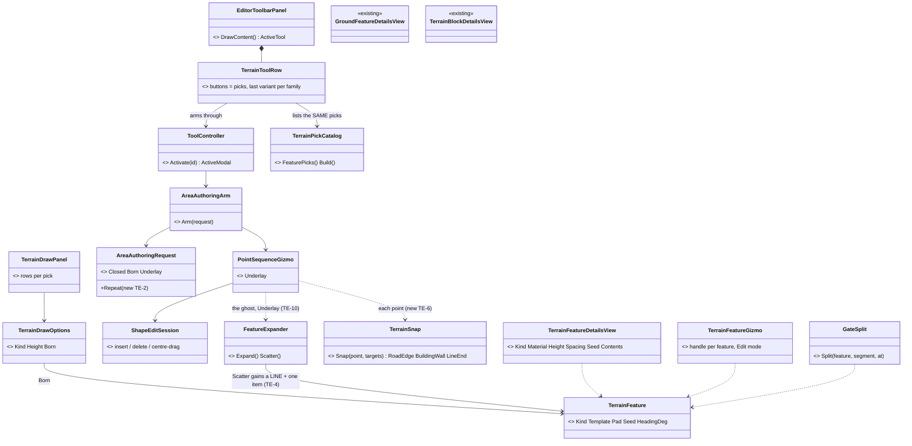
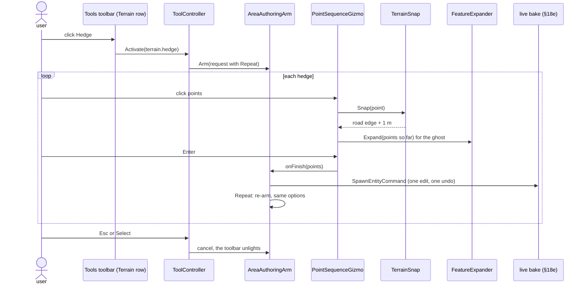
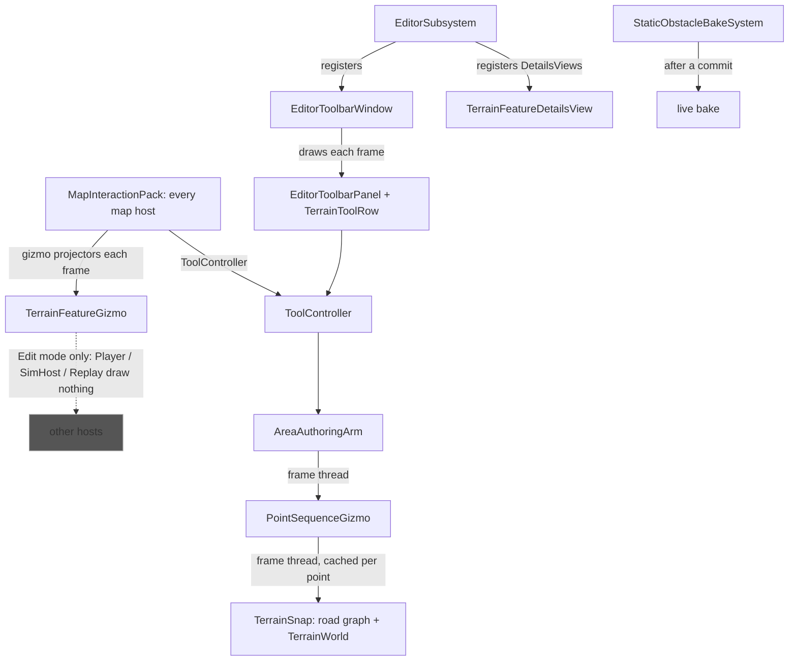

<!--STATUS
state: LIVE
build-state: DESIGN — leans TE-1…TE-12 await the user (§5); nothing built
updated: 2026-11-15 (first version — terrain lane, close-out item 4)
current-answer: §5 the decisions with leans · §3 the diagrams · §2 the friction measured · §6 slices
stale-below: nothing
known-rot: none
known-conflict: TE-6 sets road-edge and line-end snapping ON for terrain lines, where Map Interaction §2.5 says snap is "off by default" (written for units) — said in TE-6, not reconciled until the user rules
related-designs:
  - DESIGN_Ground_Patches_And_Road_Blockage.md — §4d BINDS this design (G-30 one feature family, G-31 one patch type, G-32 the stack, G-33 expand on the patched ground); OWNS the Earthworks tools (P-5, P-6) this design only re-homes on the toolbar
  - DESIGN_Terrain_Authoring.md — OWNS the feature machinery this design gives a UX to: the picks and the draw panel (§15a U-1, U-2, U-7, §15a-2 C), the live bake (§18e), the scatter (§18g T-2), blocks (§11, §18h)
  - UX/DESIGN_Map_Interaction.md — OWNS drawing / shape editing (§2.5 D11: finish / cancel, insert, centre-drag, delete), snapping (the row TE-6 extends), always-multi placement (D5) and multi-select
  - UX/UX_Feature_Tool_Model.md — OWNS the tool arbiter (ToolController) and "the toolbar marks the armed tool" (step 5) the Terrain row rides on
  - UX/UX_Feature_Multi_Select.md — OWNS the box / Shift selection TE-9's bulk edit needs (NOT-BUILT there)
  - DESIGN_Vehicle_Breaching.md — B-6 OWNS what a lone tree does (felled, blocks); B-2 / B-3 what a wall does — the Contents lines of TE-8 quote them
  - DESIGN_Add_Entity_Picker.md — OWNS the picker the terrain groups live in; stays the search / gallery door
-->

# DESIGN — the terrain editor, the user-friendly way (CE-4594)

🔒 User, `2026-11-14`: *"we might need some tool to define where the forest area is … create walls along a defined line … plant trees and various
obstacles … These deserve a new design with a lot of thinking what would be the user-friendly way how to do that"*. Row:
[CE-4594](blueprints/Blueprint_Issues_Tracker.md). Mockup: [terrain-editor.svg](UX/terrain-editor.svg) (generator `scripts/gen-terrain-editor-mockup.py`).

⭐ **The machinery exists** (Terrain Authoring T-2 / U-7, P-5, P-6: every kind, the draw panel, the live bake). **This design is only the
WAY a user reaches and repeats it.** It adds no storage: every change below is a `TerrainFeature` (G-30).

## 1. INVENTORY — measured `2026-11-15`

| query (graph via `scripts/cbm.sh`, then grep) | total | what it says |
|---|---|---|
| `search_graph name_pattern=".*Terrain.*(Pick\|Draw\|Ghost\|Birth\|Placement\|Details\|Gizmo\|Ops\|Palette\|Tool).*" label=Class` | **23** (has_more false) | `TerrainPickCatalog`, `TerrainDrawPanel` / `TerrainDrawOptions`, `TerrainGhost*`, `TerrainBirth`, `TerrainPlacement`, `TerrainBlockGizmo`, `TerrainZoneGizmo`, `TerrainBlockOps`, `TerrainBlockDetailsView` — ⛔ **no palette, no terrain-FEATURE gizmo, no feature Details** (grep adds `GroundFeatureDetailsView`, Ground kind only) |
| `search_graph ".*(Toolbar\|ToolController\|ToolDescriptor\|ShapeEditSession\|AreaAuthoring\|PointSequence\|Snap).*" Class` | 116 (76 read; the rest `*Snapshot`) | `EditorToolbarPanel` (+ `EditorToolbarWindow`), `MainToolbarManager` (the shell's command toolbar), `AreaAuthoringArm` / `AreaAuthoringRequest`, `PointSequenceGizmo`, `ShapeEditSession` — ⛔ **no snap class** |
| `search_graph ".*(Scatter\|FeatureExpander\|OverlayExpansion\|ClutterType).*" Class` | 7 | `FeatureExpander` (3 partials), `OverlayExpansion`, `ClutterTypes`, `TerrainRecipe.ScatterItem` |
| `search_graph ".*(Snap\|Terrain\|Tool).*" Interface` | 13 | `IToolController`, `ITerrainDrawSource`, the terrain services — ⛔ no snap seam |
| `search_graph ".*(Brush\|Eyedropper\|Stamp\|Gate).*" Class` | 83 | none for terrain (gates are flow gates) |

⚠ `check_index_coverage` is not available through the CLI — the absences above are "not in the graph or in grep", not proven.

## 2. The friction, measured — what a user meets today

| the job | today, measured | file:line |
|---|---|---|
| reach a terrain tool | right-click ▸ Add Entity ▸ group ▸ tile ▸ *Place on map*: a modal gallery per item | `TerrainPicks.cs:79-108`, §15a U-1 |
| draw the 2nd, 3rd hedge | ⛔ a line / area tool **removes itself after Finish** — back to the picker each time; point placement stays armed (D5) | `AreaAuthoringArm.cs:119-160` (`onRemove`) vs `EntityPlacementGizmo.cs:392` |
| plant trees | one click per tree, or a WOOD (a canopy mass); ⛔ no row, no small group | picks `TerrainPicks.cs:89` |
| a row of obstacles | one click per sandbag / block | `TerrainPicks.cs:105-106` |
| street clutter | ⛔ the tile is greyed: no scatter recipe ships | `TerrainPicks.cs:95`, `assets/terrain-recipes/` (11, none with `scatter`) |
| a wall along a road, onto a house | free-hand clicks; ⛔ no snap of any kind | INVENTORY rows 2, 4 |
| a wall round a plot, a gate | a line is open; ⛔ no gate | `TerrainPicks.cs:90-92` |
| change a hedge into a wall, its height | ⛔ no Details tab for a non-ground feature (Ground and Block only) | `EditorSubsystem.cs:3975-3977` |
| find / pick a placed tree or item | ⚠ only the generic entity symbol (`EntityPresentationGizmo`, TKB 8818 "a map graphic, no body") — no terrain look; **not run in a frame — S-6 measures it first** | `EntityPresentationGizmo.cs:37`, `NedTkbCatalog.cs:1234-1238` |
| see what a line will make while drawing | the generic polyline look (U-7's own deviation) | §15a U-7 |
| edit a drawn shape | ✅ Edit Shape (E): vertex drag, insert on a segment, centre-drag, Delete — a feature with a polyline is an Area target | `MapMenuActions.cs:119`, `:265-274`; Map Interaction §2.5 |
| undo | ✅ one edit = one step by construction | Terrain Authoring §18h |

## 3. The diagrams

### 3.1 Classes — existing (grey) and what this adds (green)

*What the picture shows that prose hid: every new box hangs off an existing seam — the row off the Tools toolbar, the snap off the point gizmo,
the Details beside the two existing tabs; the only DATA change is the scatter's line shape (TE-4), on the record that already exists.*

### 3.2 Sequence — three hedges along a road (TE-1, TE-2, TE-6, TE-10)

### 3.3 Modules — who registers it, who calls it each frame

*What it shows: the row and the Details tab are editor-only (the editor registers them); the gizmo is in the shared pack but draws only while
authoring; snap runs on the frame thread on cached inputs — it must allocate 0 B per moved point (R-2084).*

## 4. The proven solution, and what we take from it

Map editors that do this well (game level editors, GIS editing) share four habits: **a persistent tool palette** (not a modal per object) ·
**sticky tools** (stay armed until Esc) · **snapping to the things that matter** (edges, ends, angles) · **objects along a path / in an area**
(one object, many instances, spacing). Sculpt brushes and per-instance painting are the fifth habit — ⛔ **rejected here**: our ground is
parametric patches re-applied on every node (G-31, G-32) and every placed thing is a replicated entity, so a brush stroke of hundreds of
entities breaks the entity budget (B-2: one entity per block).

## 5. Decisions — a lean for each

| # | question | ⭐ lean | why · blast radius |
|---|---|---|---|
| **TE-1** | where do the terrain tools live? | ⭐ a **Terrain row on the editor's Tools toolbar**: Wood · Tree · Wall-family · Obstacle · Earthworks · Scatter; each button shows its last variant, its arrow opens the family; the buttons ARE `TerrainPickCatalog` picks armed through `ToolController`; Add Entity keeps the gallery and search | one door, one click; ⭐ the Tools window already marks the armed tool (Tool Model step 5). ⛔ not the shell's `MainToolbarManager` — that holds commands, not map tools. Blast: editor UI only |
| **TE-2** | after Finish? | ⭐ a terrain **line / area tool stays armed** with the same options until Esc or another tool (`AreaAuthoringRequest.Repeat`, terrain requests only) | point placement already is always-multi (D5); drawing ten hedges should not be ten trips. Other area tools unchanged |
| **TE-3** | how are trees planted? | ⭐ one Tree tool, three gestures: **One** (click) · **Row** (a line, spacing) · **Group** (an area, a count) — lone trunks, ⛔ never a wood | the user means trunks they can see and fell (B-6); a wood is a canopy mass |
| **TE-4** | what is a row / a group in data? | ⭐ the existing **Scatter** feature gains a **line shape** and a **single-item** mode (`Template = item:<tree \| clutter type>`, `Pad` = spacing on a line / count in an area); the expander already scatters lone trees (`FeatureKinds.cs:216`) | ⭐ one mechanism for tree rows, obstacle rows and street clutter (shared, not three kinds); ⚠ a data change on a recorded component — a NEW meaning of existing fields, no new field. Blast: `FeatureKinds.Scatter`, the compile, saved scenarios (old ones unchanged: an area + recipe id) |
| **TE-5** | obstacles? | ⭐ the Obstacle family lists the clutter types with their glyphs; click = one, drag a line = a row (TE-4) facing along or across; a row across a road blocks it like any blocker (P-2) | the roadblock / checkpoint jobs in one gesture |
| **TE-6** | snapping? | ⭐ extend Map Interaction's snap row with three terrain targets: **road edges** (+ an offset), **building walls**, **line ends**; ON by default for terrain lines, Alt suspends for one point, Shift = 15° | the jobs are "along this road", "up to this house", "continue that hedge". ⚠ deviates from "off by default" (units) — **the user rules** |
| **TE-7** | a wall round a plot; a gate? | ⭐ *Wall around a plot* = a CLOSED line; a gate = **Add gate here** on a segment in Edit Shape, which SPLITS the feature into two with a 3 m gap (one undo) | no new data (a gate is the absence of wall, G-30); a breach stays a runtime record (B-2) |
| **TE-8** | changing what was placed? | ⭐ ONE **Terrain** Details tab for every non-ground feature — Kind within its family, material, height, spacing / count, species / size, seed + dice, a Contents line of what it does — beside the Ground and Block tabs | the Details seam exists (`DetailsViewDescriptor`); one tab, not one per kind |
| **TE-9** | finding what was placed | ⭐ a `TerrainFeatureGizmo` draws each feature's handle in Edit mode (a tree: a dot; a line / area: its outline, selected as ONE) — usable before the bake lands; bulk delete / kind change waits on multi-select | ⚠ **measure first (S-6):** what the generic entity symbol shows for TKB 8818 today |
| **TE-10** | seeing it before it is made | ⭐ the drawing **ghost** is `FeatureExpander` on the points so far (a wall in its colour, tree dots, items) + a count line (*Row of 16 trees · 124 m*) — the placement ghost's pattern (U-2) | closes U-7's own deviation; the same pure expansion as the compile, so the ghost cannot lie |
| **TE-11** | "another one like that" | Alt-click a placed feature while a terrain tool is armed copies its kind and settings into the tool | cheap; ⚠ optional — build only if wanted |
| **TE-12** | a berm (raised line) | ⭐ the Earthworks family gains **Berm** = a Line · Raise ground shape | G-30 names it; one preset, no new code path |
| + | ship the first scatter recipes | ⭐ *Street clutter* and *Undergrowth* | the tile is greyed today only for want of data |

**Rejected — one line each:**
- a separate terrain-editor mode or app — the compile and the live bake already run in the scenario editor (R-4204); a second editor is a second storage.
- sculpt brushes — the ground is parametric patches re-applied on every node (G-31); a painted raster has no place in the stack (G-32).
- paint-brush tree placement — hundreds of entities per stroke; Row / Group are one entity each.
- per-tree editing inside a wood — a wood is a seeded mass of thousands; Unpack is for blocks.
- Add Entity as the only door — the measured friction of §2 rows 1–2.
- the shell's main toolbar — commands, perspective-filtered, not map tools (`MainToolbarManager`).

**Design docs checked:** Ground §4d — binds it (one family, one patch type, the stack). · Terrain Authoring §11, §15a, §18e, §18g — owns
the machinery; settles every "what is built". · Map Interaction §2.5 — settles finish / cancel and shape editing; its snap row is extended,
not replaced. · Tool Model — settles how a button arms a tool. · Multi-select — not built, so bulk edit (TE-9) waits. · Breaching B-2, B-3,
B-6 — settle what a wall and a lone tree do (the Contents lines). · Add Entity Picker — stays the gallery; does not settle a palette.

## 6. Slices *(proposed; each mockup-checked, R-4146)*

| slice | builds | lane |
|---|---|---|
| S-1 | TE-1 the Terrain row + TE-2 sticky line / area tools | ui |
| S-2 | TE-4 the scatter's line + single item, the two recipes | backend (terrain) |
| S-3 | TE-3 / TE-5 the Tree and Obstacle draw-panel rows on S-2 | ui |
| S-4 | TE-6 snapping (road edges from the road graph, walls from `TerrainWorld`, line ends from the features) | ui + backend |
| S-5 | TE-8 the Terrain Details tab | ui |
| S-6 | TE-9 measure the generic symbol, then the feature gizmo; TE-10 the ghost | ui |
| S-7 | TE-7 the gate split, TE-12 the berm | backend + ui |

## 7. Acceptance

1. Three hedges are drawn with ONE click on the toolbar; Esc stops the tool; the toolbar lights the armed one.
2. A row of 16 trees along a road is one entity, one undo; each tree fells like a lone tree (B-6); 2 m off the road edge.
3. Four concrete blocks dragged across a road close it to vehicles (P-2); infantry passes.
4. A wall drawn near a road snaps to its edge + 1 m; Alt draws free; a hedge started at another's end joins it.
5. A closed wall round a house, then *Add gate here*: two features, a 3 m gap, one undo.
6. Selecting a placed wall shows the Terrain tab; Kind → Hedge changes it after one bake.
7. While drawing, the ghost shows what the bake will make, and the frames match [the mockup](UX/terrain-editor.svg).
8. Steady drawing frames allocate 0 B (snap, ghost — R-2084); every rail runs under `HROT_PARALLEL_SIM=1 HROT_READ_CHECK=1` where it touches the sim.
