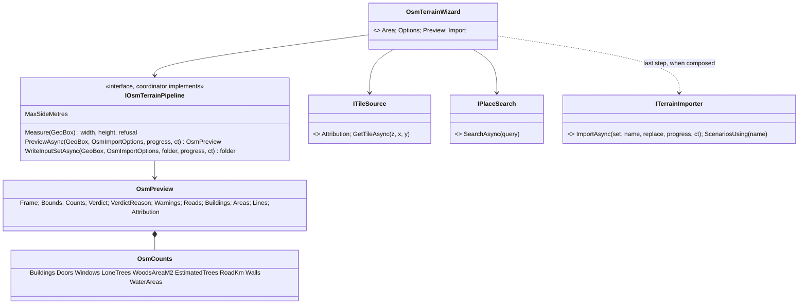
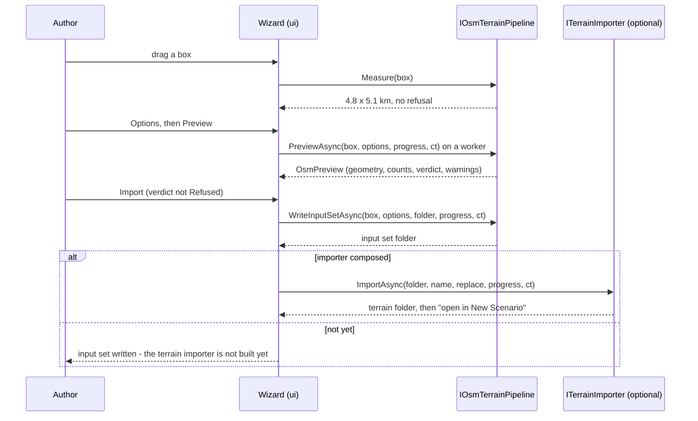
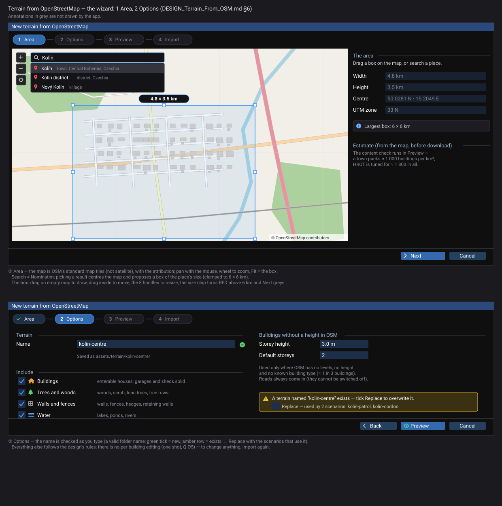
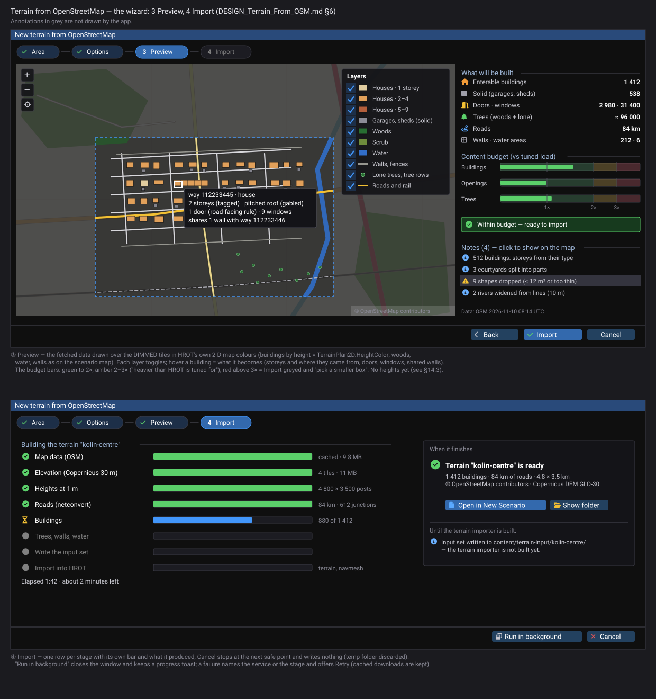
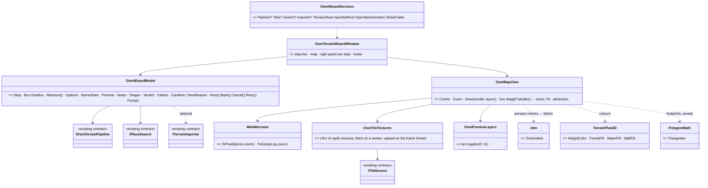
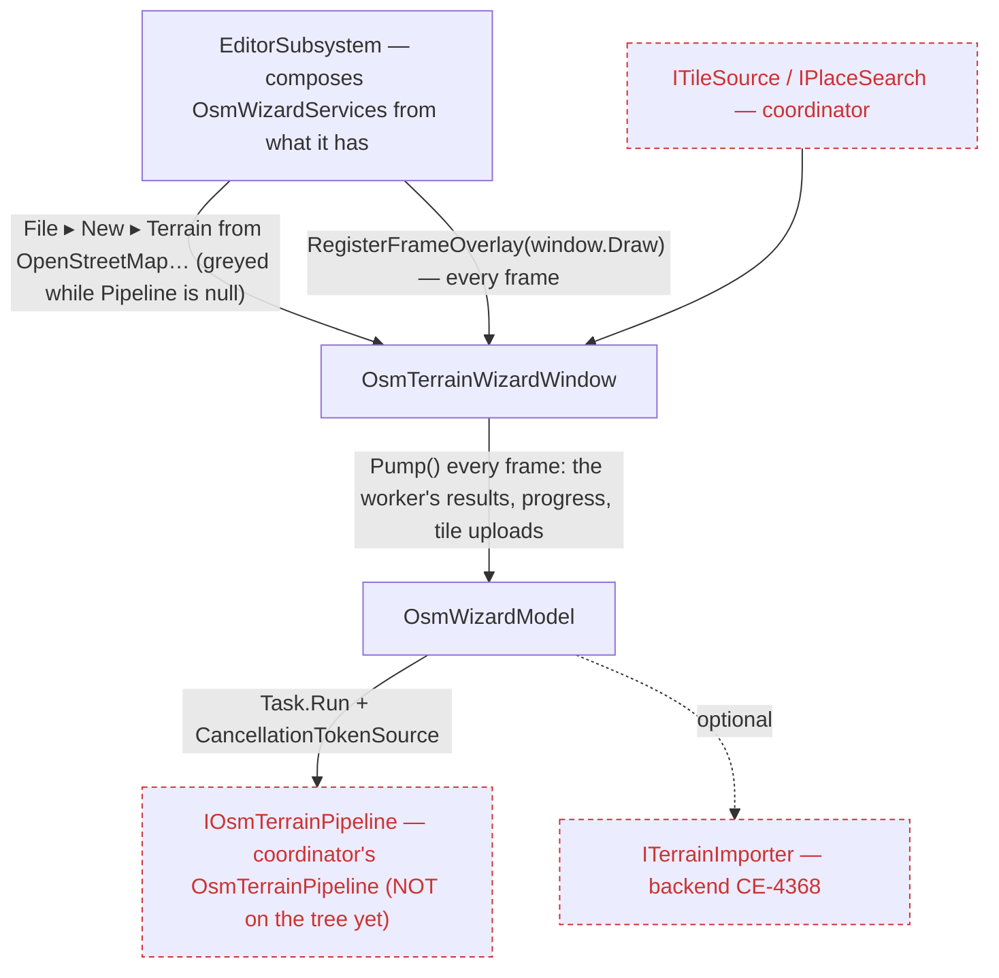
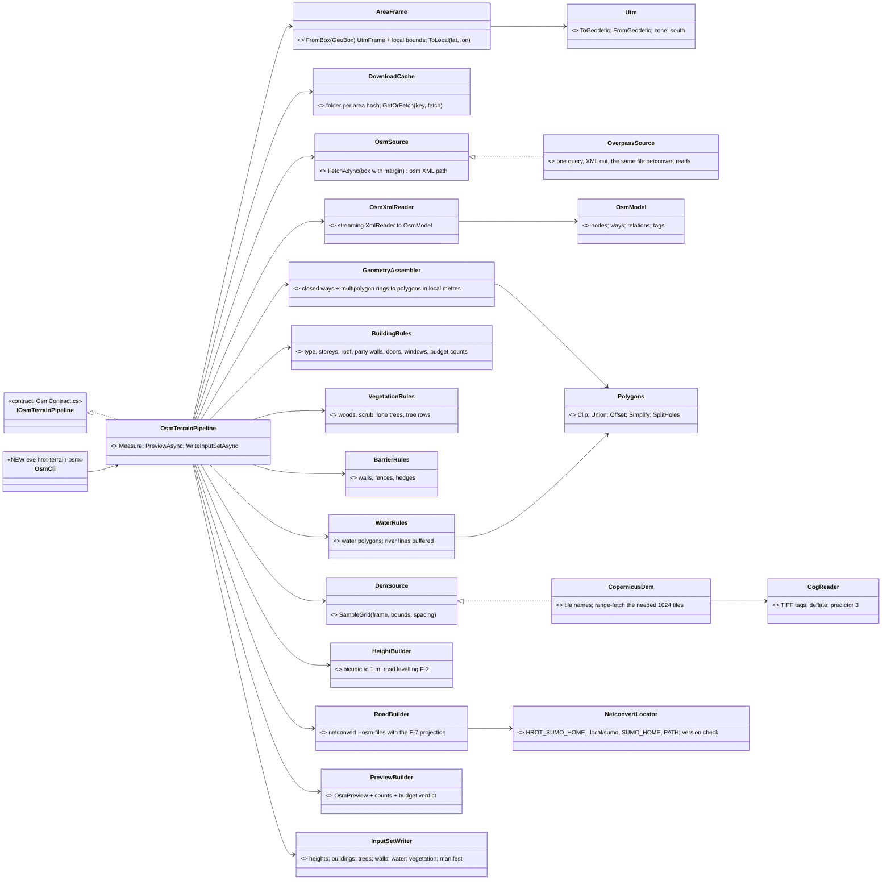
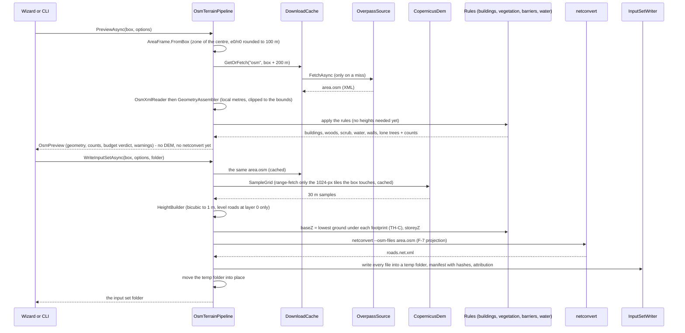
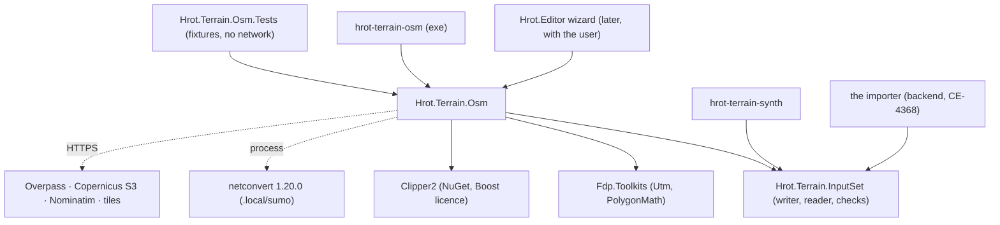

<!--STATUS
state: LIVE
build-state: DESIGN — §14 library side READY-TO-BUILD (Q-O10…Q-O12 decided, R-4193, 2026-11-10); §6 wizard MOCKUP for the user; §4a the wizard ⇄ pipeline contract BUILT as types (coordinator 2026-11-09); reviewed (builder check + coordinator review F-1…F-11, folded in 2026-11-09), Q-O1…Q-O9 answered; map background / imagery LEFT OPEN for the user (§8)
updated: 2026-11-10 (§14 detailed design of the library side — coordinator) · 2026-11-09 (source-data session)
current-answer: ⭐ §14 the detailed design (inventory, measured sample, classes, sequence, modules, E-1…E-12, Q-O10…Q-O12) · §4a the wizard contract · §5 the rules · §13 the review
known-rot: §5.5's "split along the shortest cut" for holes is replaced by §14.5 E-4 (a cut through each hole's centre)
related-designs:
  - PLAN_Large_Terrain.md — §9: this pipeline goes THROUGH the importer and is built in parallel; O-0 adds the input-set READER + conformance checks to Hrot.Terrain.InputSet
  - DESIGN_Terrain_Import_UTM.md §10 — the import input set (the target format of this tool)
  - DESIGN_Terrain_Synth.md — the synthetic generator of the same input set
  - blueprints/Architect_Question_93_Sumo_Traffic_Node.md §11.3 — SUMO net placement (anchor), terrain-from-sumo.py
-->

# DESIGN — an HROT terrain from any place on OpenStreetMap

## 0. Why

🔒 User, `2026-11-09`: *"Do the OpenStreetMaps contain the building information, some that can be used for generating the building, at least
approximate? If so, that would be a really interesting option to create a generator that takes whatever place from OpenStreetMap and generates
hrot terrain including road net."*

🔒 User, `2026-11-09` (Q-O1): *"The OpenStreetMap importer is for scenario authors, and it would become a feature in the editor in the HROT, a way
how to create new terrains. HROT doesn't have any authoring capability for terrains at the moment, so this will become one. So no CLI tool only. It
needs to work within HROT editor, which is IMGUI application in raylib/cs."*

⇒ This is HROT's FIRST terrain-authoring feature. It lives in `Hrot.Editor` (ImGui on raylib-cs; offline scenario authoring, no DDS needed —
`00-SOLUTION-OVERVIEW.md:308`). The user is a scenario author, not a developer: picking a place, seeing what will come out, and getting a usable
terrain must work without command lines or hand-edited files.

## 1. What exists today *(measured `2026-11-09`)*

| fact | where |
|---|---|
| no OSM import anywhere in HROT (no reader, no Overpass client) | grep of `docs/`, `scripts/` |
| `terrain-from-sumo.py` builds a terrain folder straight from a SUMO net + a buildings JSON (solid prisms) — `demo-city` was made this way | `scripts/terrain-from-sumo.py`, `assets/terrain/demo-city` |
| the import input set (§10 of Terrain Import UTM) is the agreed source-neutral format the importer reads: heights, unique buildings with doors / windows / storeys / roofs, trees, a SUMO net, walls | `DESIGN_Terrain_Import_UTM.md` §10, §10.6, §10.7 |
| SUMO ships the OSM tooling: `netconvert --osm-files` (roads, junctions, traffic lights), `polyconvert` (areas: buildings, landuse), `tools/osmGet.py` / `osmBuild.py` / `osmWebWizard.py` | the installed SUMO |

## 2. What OpenStreetMap can give *(general knowledge — to be verified per target area)*

| layer | in OSM | gap to the input set |
|---|---|---|
| roads | excellent: `highway=*`, lanes, speed, one-way, bridges / tunnels (`layer`), rail | none — `netconvert` builds the SUMO net directly |
| building footprints | very complete in most of Europe (`building=*` polygons, incl. holes / multipolygons) | holes: the input set has none → split or drop |
| building height | partial: `building:levels` common in cities, sparse in villages; `height`, `roof:levels`, `min_level` rarer | storeys and height must be INFERRED where missing (by type, size, neighbours) |
| roofs | `roof:shape` / `roof:height` sometimes | default by type / region |
| doors | `entrance=*` nodes on the outline, sometimes; `door=*` rarely | the rest GENERATED (street-facing facade) |
| windows | essentially none | GENERATED by rule (rows per storey) |
| woods / vegetation | `landuse=forest`, `natural=wood`, `natural=scrub`; single trees `natural=tree`, rows `natural=tree_row` in places | woods → tree points by density (or polygons directly, §9.6 of the UTM design); scrub could finally give the "bush" class |
| walls / fences | `barrier=wall/fence/hedge` lines, fairly common | none — maps to `walls.geojson` |
| water | `natural=water`, `waterway=*` | not in the input set yet |
| heights (terrain) | ⛔ not in OSM | a public DEM: Copernicus GLO-30 (30 m), SRTM (30 m), or national LiDAR DEMs (1 m, many countries, various licences) |

**Licence:** OSM data is ODbL — internal use is free; a PUBLISHED derived database must credit OSM and stay under ODbL. Copernicus GLO-30 is
free with attribution. ⇒ a generated terrain committed to a public repo is allowed, with attribution and the ODbL terms attached.

## 3. Approaches and the choice *(Q-O6)*

| approach | trade-off | |
|---|---|---|
| ⭐ **A. ONE pipeline library, used in-process by the editor AND by a thin CLI** | the editor shows a live preview from the same data the import writes; one code path; an editor bug or out-of-memory in the pipeline can stall or crash the editor | ✅ **CHOSEN** |
| B. a separate import exe the editor launches | crash / memory isolation, cancel = kill; but the preview needs intermediate files and a progress protocol between processes | rejected |
| C. SUMO's Python OSM scripts | a Python runtime on every author machine | rejected |

🔒 User, `2026-11-09`: *"I want a library that can be used both in the offline tool as well integrated into the editor. The preview capability is of
course very important, so better to have it in the editor even at the cost of some crash risk. If distributing the netconvert is okay with sumo
license, let's do it."*

## 4. Architecture

```
                         ┌────────────── Hrot.Terrain.Osm (library) ──────────────┐
 area (UTM box) ──► OsmFetch ──► OsmModel ──┬─► RoadsStage ── netconvert ──► roads/
                    DemFetch ──► DemGrid ───┤   BuildingsStage ─────────────► buildings/
                                            │   VegetationStage ────────────► trees/, walls/, water/
                                            └─► HeightsStage ───────────────► heights/
                                                PreviewModel (for the editor) ManifestWriter ► manifest.json
                         └──── writes through Hrot.Terrain.InputSet (shared with hrot-terrain-synth) ────┘
 input set ──► the terrain importer (Terrain Import UTM §6.1 stages) ──► assets/terrain/<name>/
```

| part | what | notes |
|---|---|---|
| **`Hrot.Terrain.InputSet`** (new library) | the §10 input-set MODEL + WRITERS (heights BIL, buildings / unassigned GeoJSON, trees CSV, SUMO plain XML + netconvert runner, walls, manifest with SHA-256) | ⭐ EXTRACTED from `Hrot.Tools.TerrainSynth` (its `HeightField.Write`, `GeoJsonWriter`, `SumoWriter`, `ManifestWriter`), so the format is defined ONCE; the synth tool then references it |
| **`Hrot.Terrain.Osm`** (new library) | fetch (Overpass, DEM), parse, the stages, the preview model, cancellation, progress | references `Hrot.Terrain.InputSet` and the ONE shared `Utm` class (✅ MOVED 2026-11-10, CE-4372: `FDP/Toolkits/Fdp.Toolkits/Geographic/Transforms/Utm.cs`, namespace `Fdp.Modules.Geographic.Transforms`; north + south; measured round trip 0.29 mm on the central meridian, 0.47 mm at 3.04° = a 6 km box centred on a zone edge, 2.8 mm at 4° — F-8); no UI, no raylib |
| **`Hrot.Tools.TerrainOsm`** (new exe, `hrot-terrain-osm`) | thin CLI: `--bbox lat0,lon0,lat1,lon1 --name N --out DIR [options]` | headless tests, batch use, reproducing an author's import |
| **editor wizard** (`Hrot.Editor`) | pick area → options → preview → import → open in the New Scenario picker | §6 |
| **the terrain importer** | input set → `assets/terrain/<name>/` | ⛔ NOT part of this design — Terrain Import UTM §6.1 stages 0–7. This feature DEPENDS on it |

### 4a. ⭐ The wizard ⇄ pipeline CONTRACT *(coordinator, `2026-11-09`; built as code — `Hrot/Engine/Hrot.Terrain.Osm/OsmContract.cs`, `Hrot/Engine/Hrot.Terrain.InputSet/ITerrainImporter.cs`)*

🔒 User, `2026-11-09`: the coordinator builds the library side (O-0…O-2) itself; the ui lane builds only the wizard, overnight. ⇒ the boundary
is fixed FIRST, as compiled types, so the two sides build at once — the wizard against a fake pipeline, the pipeline against its tests.


*What the picture shows: the wizard sees four interfaces and nothing else of the pipeline; the importer reaches it only as an optional
dependency the editor's composition passes in (null until backend's CE-4368 lands — the Import step then stops after the input set).*



## 5. The pipeline

### 5.1 Area and frame
- the author gives a box in lat/lon; the library converts it to the **UTM zone of the box centre**; `e0/n0` = the box centre rounded to 100 m;
  bounds = the box in local metres. Max **6 × 6 km** (Q-O3). A box crossing a UTM zone edge is accepted (the frame uses the centre's zone). ⭐ ANY zone and BOTH hemispheres ("whatever place", §0) — a
  requirement on the shared `UtmTransform`; tests include a southern-hemisphere and a zone-edge box. *(source session's call)*
- needs `UtmTransform` and the moved `Utm` class (Terrain Import UTM stage 1, F-8) — shared, not built here.

### 5.2 Fetch (online only, Q-O2)
| data | source (default — replaceable behind an interface) | size for 6 × 6 km |
|---|---|---|
| OSM features | Overpass API (public instance, configurable URL): `highway`, `railway`, `building` (+ `building:part`), `entrance`, `landuse`, `natural`, `barrier`, `waterway` in the box + a 200 m margin | ≈ 10–50 MB XML |
| elevation | Copernicus GLO-30 DEM (30 m, global, free with attribution; public cloud-optimised GeoTIFF tiles) | a few 1° tiles, read by window |

- HTTP: one `HttpClient`, a descriptive User-Agent, timeouts, 3 retries with back-off, the OS proxy settings.
- ⛔ no connection or a service error ⇒ the import FAILS with a clear message; nothing is written into the output folder (write to a temp
  folder, move on success).
- the raw downloads are kept in a per-import cache folder so the preview and the import (and a re-import of the same box with other options)
  do not download twice.

### 5.3 Heights
- resample the 30 m DEM to the input set's grid at **1 m** (bicubic) over the bounds; no nodata (sea is 0 m, see water).
- ⛔ NO flattening under buildings (F-1): the ground stays as the DEM gives it; a building stands on the LOWEST ground under its footprint
  (HROT's slope rule, Terrain Height TH-C), exactly as the real input set does.
- road corridors are levelled ACROSS their width (blended over 3 m each side) so roads do not tilt sideways — ONLY ways at `layer` 0 without
  `bridge` / `tunnel` (F-2): a bridge stays SUMO-elevated with the valley under it untouched; a tunnel leaves the hill above it untouched.
- the manifest records the TRUE source resolution, `heights.sourceResolution: 30` (metres), so the importer and the 3-D map do not over-trust
  the 1 m grid (F-9).
- ⚠ 30 m data gives smooth hills only — no banks, ditches or walls in the ground. A better DEM (national 1 m LiDAR) is a later, per-country source.

### 5.4 Roads
- the OSM ways (`highway`, `railway`) of the box go to **`netconvert --osm-files`** with SUMO's standard OSM type map and an EXPLICIT
  projection, because `--proj.utm` picks its own zone and normalises the offset (F-7):
  `--proj "+proj=utm +zone=<Z> [+south] +datum=WGS84 +units=m" --offset.disable-normalization true --offset.x -<e0> --offset.y -<n0>`
  ⇒ net coordinates == local metres (manifest `sumoAnchor` = [0, 0]). A test asserts that a known OSM node lands at its local metres (as
  `SumoNetPlacement` does for the existing nets).
- `netconvert` comes from the SUMO install script (§9.1).

### 5.5 Buildings (Q-O4: every building enterable)
| attribute | rule |
|---|---|
| footprint | the OSM outer ring; multipolygon holes (courtyards) → the ring is split into hole-free parts along the shortest cut; `building:part` merged into its building; footprints < 12 m² or thinner than 2.5 m dropped |
| type | `building=roof` / `carport` → NO building (a slab later); `ruins` / `construction` → a solid low prism, NOT enterable; `greenhouse` → enterable, 1 storey; `building:part` with `min_level` > 0 (an overhang) → ignored; everything else → an enterable building (F-6) |
| storeys | `building:levels` (+ `roof:levels` as an attic storey) when tagged; else `height` / 3 m; else by `building=` type: house / detached / residential 2, apartments 4, commercial / retail 2, industrial / warehouse 1 (tall), garage / shed 1, church 1 (tall); else 2 |
| floors (`storeyZ`) | ground floor (`baseZ`) = the LOWEST ground under the footprint (TH-C, F-1); 3.0 m per storey; a "tall" single storey = `height` or 6 m |
| roof | `roof:shape` flat → flat, else pitched (`ridgeZ` = eaves + `roof:height`, else 0.35 × the shorter side); untagged: houses pitched, apartments / commercial / industrial flat |
| party walls | an edge shared with another footprint (≤ 0.3 m apart and parallel — terraced / semi-detached houses) gets NO doors and NO windows; slivers between touching footprints are snapped so the shared edge is ONE edge, which the importer builds as ONE party wall (F-4) |
| doors | OSM `entrance` nodes on the outline when present (never on a party wall); else ONE door on the facade facing the nearest road (the centre of the wall whose outward normal points closest to the road); + a back door on houses larger than 150 m² |
| windows | every storey, every wall except party walls: one every 2.5–3 m, 1 m margins, none within 1 m of a door; garages / sheds / industrial ground floors without windows |
| id | the OSM way / relation id (stable across re-imports of the same data) |
| material | `building:material` when tagged (brick / concrete / stone / wood / metal), else omitted (importer default) |

### 5.6 Vegetation, walls, water
- woods (`landuse=forest`, `natural=wood`) → POLYGONS in `vegetation/woods.geojson` with `properties: { density }` (trees / ha; default ≈ 115) —
  NOT invented tree points (F-3, accepted as UTM §10.9 ②); `trees.csv` holds only lone `natural=tree` nodes and `tree_row` lines (a tree every
  10 m). `natural=scrub` → SCRUB polygons (`vegetation/scrub.geojson`) for the future concealment class (Terrain Import UTM T-8) — shown in the
  preview, not consumed by the importer until that class exists.
- `barrier=wall|fence|hedge|retaining_wall` → `walls.geojson` (height by type: wall 2 m, fence 1.5 m, hedge 1.5 m).
- water → `water/water.geojson` (polygons): `natural=water` / `waterway=riverbank` polygons as they are; `waterway=river|canal` LINES buffered
  by their `width`, else by type (river 10 m, canal 8 m); `stream` / `ditch` → no water (too narrow to matter); `natural=coastline` (sea polygons
  assembled from lines) → a later stage (F-5). HROT already has water surfaces (`TerrainSurfaceType.Water`, unwalkable), so the importer
  consumes the file in its stage 5 (UTM §10.9 ①).
- water, scrub and woods are OPTIONAL files of the §10 input set, listed in the manifest like the others, `schemaVersion` stays 1 —
  ✅ accepted by the importer side (Terrain Import UTM §10.8 / §10.9).

### 5.7 Content budget *(Q-O8)*

🔒 User, `2026-11-09`: *"The OpenStreetMap import needs to be kept somehow. 60,000 buildings is likely way out of possibilities for HROT."*

HROT is being tuned for ≈ 1 800 enterable buildings, ≈ 70 000 doors + windows and ≈ 176 000 trees in a 5.5 km square (Terrain Import UTM
§10.7). The preview computes the same three counts for the chosen box — trees as lone trees + woods AREA × density (woods are polygons, F-3) —
and applies a budget:

| load vs. the tuned load | wizard |
|---|---|
| ≤ 2× (≤ 3 600 buildings, ≤ 140 000 openings, ≤ 350 000 trees) | OK |
| 2×–3× | a warning ("heavier than HROT is tuned for"); import allowed |
| > 3× (> 5 400 buildings or > 210 000 openings or > 530 000 trees) | ⛔ REFUSED before any import work — the author picks a smaller box (the preview shows how much smaller) |

The limits are settings (one place), so they follow HROT's measured performance. *(thresholds: source session's call)*

⭐ The preview also shows an ESTIMATED import time from the counts — the importer's interior navmesh bake is the slow part (UTM R-4187) — once
the importer's stage 6 has measured the bake time per building (F-10).

### 5.8 Output and handover
- the library writes the input set to a per-import folder outside git (`<content>/terrain-input/<name>/`), then the importer writes
  `{shared}/assets/terrain/<name>/` — a folder with `terrain.json` is picked up by the New Scenario picker without registration
  (`TerrainCatalog.List`, `EditorSubsystem.cs:4181`).
- the wizard calls the importer IN-PROCESS through one interface (`ITerrainImporter`: input set → terrain folder, with progress and
  cancellation), as Q-O6 chose for the pipeline. ⚠ until the importer exists (Terrain Import UTM §6.1), the wizard stops after writing the input
  set; "open in New Scenario" arrives with the importer. *(source session's call)*
- an existing terrain name is REFUSED unless the author ticks "replace"; replacing warns and lists the scenarios that use that terrain.
  *(source session's call)*
- `manifest.json` gets `source: {osm: <Overpass data timestamp>, dem: "Copernicus GLO-30"}` and the ATTRIBUTION text (§9); the terrain's
  description carries the attribution too, so it travels with the terrain.

## 6. The editor wizard *(one-shot, Q-O5)* — ⭐ MOCKUP `2026-11-10` (coordinator, for the user)




*Generated by `scripts/gen-terrain-osm-wizard-mockup.py`. Scope: the wizard window only. ⭐ ONE map canvas through every step — OSM's
standard map tiles to pick the place (Area), the same map dimmed with the fetched data on top (Preview); the right panel changes per step.
Preview colours are HROT's own 2-D map colours (`TerrainPlan2D.HeightColor` / forest / water / wall fills), so the preview looks like the
scenario map will.*


| step | what the author sees | notes |
|---|---|---|
| 1. **Area** | a map with live OSM tiles; search a place name (Nominatim); drag a box; its size in km with the 6 × 6 km limit enforced | its own small map widget in the wizard, not the scenario map |
| 2. **Options** | terrain name; toggles: buildings / trees / walls / water; building defaults (storey height, default storeys) | everything else per §5 |
| 3. **Preview** | the downloaded data drawn over the tiles: roads by class, footprints coloured by storeys, woods, walls, water; counts (buildings, doors, windows, trees, road km); warnings (heights inferred, shapes dropped) | `PreviewModel` built on a worker; drawn as retained meshes like `TerrainLayer2D` (CE-1227) |
| 4. **Import** | progress per stage + Cancel; on success: "open in New Scenario" | worker + `CancellationTokenSource`, mirroring `ReplaySearchPanel` |

- host: an ImGui modal via `WindowManager.RegisterFrameOverlay` (as the existing modals), opened from the New menu next to New Scenario.
- the frame never blocks: fetch, parse, stages and preview run on a worker; only texture / mesh uploads on the frame thread.

### 6a. ✅ APPROVED `2026-11-10` (R-4194) — the layout, and the wizard's OWN map

🔒 User, `2026-11-10`: *"Layout approved, 2-D only, colour by height, rectangle. … The wizard will show [the map] rendered inside the wizard's
ImGui window … this is not the 2D map the HROT is using, correct? It's something that the wizard operates itself in its own context."*

| | |
|---|---|
| layout | ✅ one map canvas through every step, the right panel changes per step (the mockup above) |
| preview | ✅ **2-D only** (no 3-D block view: heights are not fetched until Import) · buildings **coloured by height** (`TerrainPlan2D.HeightColor`), solid ones grey · the area is a **rectangle** |
| the map | ✅ **the wizard's own small map, drawn INSIDE its ImGui window** — not HROT's scenario 2-D map |

📐 **Why not the scenario map** (measured): `MapCanvas` (`Fdp.Presentation/Vis2D/MapCanvas.cs`) is the editor's scene canvas — a `MapCamera` in the
terrain's LOCAL metres, scene layers, its own input map, drawn into the main viewport. The wizard needs a map of the WHOLE EARTH in
web-Mercator tiles, inside a modal, before any terrain exists. ⇒ a different job; ⛔ forcing it through `MapCanvas` would bend the scene
canvas for one dialog.

| the wizard map — ⭐ what it REUSES (no second copy) | where |
|---|---|
| PNG bytes → raylib texture → drawn in ImGui | `Raylib.LoadImageFromMemory` + `LoadTextureFromImage` (`EmbeddedAtlasResources.cs:21`), `drawList.AddImage` (`IconWidgets.cs:41`) |
| the preview's colours | `TerrainPlan2D.HeightColor`, its forest / water / wall fills (public statics — read, never copied) |
| concave footprints and woods filled | `PolygonMath.Triangulate` (ImGui fills only convex polygons) |
| ⭐ NEW, small | an ImGui child region: XYZ tiles from `ITileSource` laid out by zoom / pan (web-Mercator maths), an LRU of tile textures, the drag box with 8 handles, and the preview's geometry (local metres → lat/lon through the frame → screen) drawn with the draw list |

### 6b. ⭐ The wizard's design — for the build *(ui, `2026-11-10`, CE-4375 W-1; build-state: BUILT against the fakes — the pipeline is not on the tree yet)*

**INVENTORY** *(grep + reads `2026-11-10` — the graph server was not up on this VM, ⚠ so absence claims are "not found by grep")*: the modal host = `WindowManager.RegisterFrameOverlay` (6 hosts use it, e.g.
`EditorSubsystem` `assetRenameModal.Draw`) · the New submenu = `FileMenuLayout` (`File/New/Scenario…` …) · the worker + `CancellationTokenSource` = `ReplaySearchPanel`
(`Fdp.Presentation/ImGui/Panels/ReplayBrowser`) · PNG → texture = `Raylib.LoadImageFromMemory` + `LoadTextureFromImage` (`EmbeddedAtlasResources`) · concave fill =
`PolygonMath.Triangulate` (`Fdp.Toolkits/Terrain`) · the colours = `TerrainPlan2D.HeightColor` (public) and its forest / water / wall fills (private ⇒ made public, read
never copied) · local metres → lat/lon = **`Utm.ToGeodetic`** (the ONE UTM class — `Fdp.Modules.Geographic.Transforms.Utm`, moved from `Hrot.Traffic` by CE-4372; ⛔ no second UTM) · the glyphs and their
colours = `Icons` / `IconPalette`. ⛔ Not found: any web-Mercator / XYZ tile code — the map widget's maths is new (small, pure, tested).


*What the picture shows that the prose hid: the step logic is a PURE model (the state-machine rail drives it with fakes, no window); the window only draws it; the map
widget is the one canvas of Area and Preview, and it is the only new drawing code — every colour, triangulation and projection is read from where it already lives.*

```mermaid
stateDiagram-v2
  [*] --> Area
  Area --> Options : Next (box measured, no refusal, ≤ 6 km)
  Options --> Area : Back
  Options --> Previewing : Preview (name valid; exists ⇒ Replace ticked)
  Previewing --> Preview : the pipeline answered
  Previewing --> Failed : the service / stage failed
  Failed --> Previewing : Retry
  Failed --> Options : Back
  Preview --> Options : Back
  Preview --> Importing : Import (verdict not Refused)
  Importing --> Done : finished (importer composed)
  Importing --> InputSetOnly : finished (no importer — "not built yet")
  Importing --> ImportFailed : a stage failed
  ImportFailed --> Importing : Retry
  Importing --> Preview : Cancel (temp folder discarded)
  Done --> [*] : Open in New Scenario / close
  InputSetOnly --> [*]
  Area --> [*] : Cancel
  Options --> [*] : Cancel
  Preview --> [*] : Cancel
```


*What the picture shows: Cancel in Importing stops the run and returns to Preview (nothing written); Refused is not a state — it is Preview with Import greyed.*


*What the picture shows: the window ticks only through the frame overlay; the three red boxes are NOT on the merged tree yet — until the pipeline lands the menu item is
greyed with its reason, and the rails drive the same window with the fakes (W-2). ⛔ No stub pipeline in production code.*

#### 6b-as-built *(ui, `2026-11-10`, CE-4375 W-3…W-5)* — what the build changed, and the ⚠ list

✅ Built as the three diagrams above: `Hrot.Presentation/TerrainOsm/` (`OsmWizardModel` · `OsmMapView` · `OsmTileTextures` · `OsmWizardStyle` · `OsmTerrainWizardWindow` ·
`WebMercator`), composed by `EditorSubsystem`; the menu item is registered by the SHARED `ScenarioMenuCommands` (run-gated like its siblings). Conformance per C-row, with
the rails that measure it: [`STATUS_Ui_Osm_Wizard.md`](blueprints/batches/STATUS_Ui_Osm_Wizard.md) §1.

| ⚠ as-built difference from the mockup | why |
|---|---|
| the greyed item says why in its LABEL — *"… (unavailable — the pipeline is not built yet)"* — not a tooltip; not on the Start surface | the shell's menu items have no tooltip (VC-3 is the label); the Start surface draws every Idle item as a button, which the mockup does not cover (R-4151) |
| ONE window size (1200 × 600) for all four steps | C-1 "the SAME window"; the mockup draws Options / Import shorter to save page space |
| Fit centres the box | the mockup's off-centre box is page layout, not behaviour |
| the name check shows `WARNING` amber while the name exists | the mockup draws the tick and the amber row together only to show both cases |
| no lone trees; the hover tooltip = id · enterable/solid · storeys · ≈ height | the contract (`OsmPreview`) has no lone-tree positions and no building type / roof / openings / shared walls — ⭐ a contract extension, then the window draws them |
| notes not clickable, header "Notes (n)"; severity from the words; the data line = attribution | `Warnings` are strings (no location, no severity); no data timestamp in the contract — same extension |
| Import rows follow `OsmStage` ("Read the map data" for Parse; elevation is inside Heights) | the contract's stages; the mockup's "Elevation (Copernicus 30 m)" row is not a stage the pipeline reports |
| the Import step's right box shows only what is TRUE (heading "When it finishes" until it has) | the mockup's inset illustrates both ends at once |

## 7. Failure and limits
| case | behaviour |
|---|---|
| no network / service down / rate-limited | clear error naming the service; a Retry button; nothing written |
| box > 6 × 6 km | the wizard refuses before any download |
| Overpass result too large (dense city) | split the box into 4 and fetch the parts (merge by OSM id) |
| a footprint the rules cannot make valid | dropped, counted in the preview warnings |
| `netconvert` fails | the import fails with its stderr (roads are not optional) |
| out of memory / crash in a stage | accepted risk (Q-O6); stages stream where they can (heights by band, as the synth tool does) |

## 8. ⛔ OPEN (✏ M3 DROPPED 2026-11-10, R-4193) — map background and terrain imagery *(the user decides later; the importer side leans M2 as the baseline for every terrain, M3 per country later — §13 F-11)*

✏ 🔒 User, `2026-11-10`: *"I'm changing my mind that we probably do not need satellite imagery at all."* ⇒ **M3 (satellite / aerial imagery) is dropped**; M1 / M2 / M4 stay open. ⚠ The wizard's Area step still shows OSM's standard MAP tiles (drawn streets, not imagery) to pick the place.

🔒 User, `2026-11-09`: *"best to mention all the possibilities in the document without any concrete decision, and I will take the decision later.
The satellite imagery as the 3D map default terrain texture is very tempting."* — and: most editing happens in the 3-D view, so a 2-D
background matters less; imagery used in 3-D could serve the 2-D map too; HROT would then need a texture / tile cache.

| option | what | licensing / usage (as known — to be verified before choosing) |
|---|---|---|
| **M1. live OSM tiles as the 2-D background** of OSM-made terrains (the wizard's tile view, reused) | the familiar map look; a tile cache in the editor | OSM tile servers: interactive use with attribution allowed; ⛔ bulk download / offline storage forbidden by their usage policy. Commercial OSM-based tile providers (keyed, paid tiers) allow caching under their terms; or a self-hosted tile renderer |
| **M2. a background RENDERED BY HROT** from the input set (roads, buildings, woods, water + hillshade from the heights), stored with the terrain as one low-resolution georeferenced JPEG (2 m / px ⇒ ≈ 3 000 px, ≈ 2 MB for 6 km) | no extra download; HROT's own style; works for EVERY terrain made from an input set (real, synthetic, OSM) | derived from ODbL data for OSM terrains ⇒ attribution; no tile-policy issue |
| **M3. satellite / aerial imagery as the default 3-D terrain texture** (and the 2-D background) | the most realistic look; needs texture streaming / a tile cache in HROT (6 km at 0.5 m ≈ 12 000² px) | ⛔ Google / Bing / Esri / Mapbox imagery: terms forbid storing it in a product without a licence. ✅ free: Copernicus Sentinel-2 (10 m — too coarse up close); EOX Sentinel-2 cloudless (10 m; licence differs by year, some non-commercial); national orthophotos (0.2–1 m, open data in many EU countries — per-country licence); USGS NAIP (US, public domain) |
| **M4. none** — the 3-D view only, the 2-D map without background (today) | nothing to build | — |

Combinations are possible (e.g. M2 for every terrain + M3 per country where open orthophotos exist).

## 9. Licensing and attribution
| item | licence | what HROT must do |
|---|---|---|
| OSM data | ODbL 1.0 | credit "© OpenStreetMap contributors"; a PUBLISHED terrain made from it is a derived database under ODbL |
| Copernicus GLO-30 | free, attribution | credit Copernicus DEM GLO-30 (DLR / Airbus, provided under COPERNICUS by the EU and ESA) — exact wording to be copied from the provider |
| SUMO `netconvert` (only if a packaged release later bundles it — today the install script downloads it, §9.1) | EPL-2.0 (secondary licence GPL-2.0+); binary redistribution allowed | ship the licence text and notices; state where the source is available; ship the notices of its runtime libraries (e.g. Xerces-C: Apache-2.0, PROJ: MIT, zlib); it runs as a separate process, so HROT's own code is unaffected. ⚠ confirm against the exact SUMO build shipped |
| Overpass / Nominatim / OSM tiles | usage policies | low-volume interactive use, a real User-Agent, attribution; no bulk downloads |

### 9.1 Getting `netconvert` *(Q-O9)*

🔒 User, `2026-11-09`: *"HROT has no installer now. It is still living just in the Git repository as a source files. So maybe the right option is to
provide a script that downloads or installs the sumo from its official source? And yes, it should follow the version which is in sumo sharp."*

- the version is **SUMO 1.20.0** — the one the vendored SumoSharp follows (`FDP/ExtDeps/SumoSharp/src/Sim.Ingest/NetworkParser.cs:916`); ONE
  file holds it (`tools/sumo/version.txt`), read by the scripts and by the library.
- `scripts/install-sumo.ps1` (Windows: the official `sumo-win64-<version>.zip` from the SUMO release site) and `scripts/install-sumo.sh` (Linux:
  the official `eclipse-sumo==<version>` package in a private virtual environment) install into a gitignored folder of the repo
  (`.local/sumo/<version>/`); nothing SUMO-made is committed.
- the library finds `netconvert` in this order: `HROT_SUMO_HOME` → `.local/sumo/<version>/bin` → `SUMO_HOME/bin` → `PATH`, runs `netconvert
  --version`, and refuses a different version with a message that names the install script.
- licensing: nothing is redistributed by HROT — the script downloads from the official source; the notices of §9 apply only if a packaged
  release later bundles SUMO.

## 10. Tests
- `Hrot.Terrain.Osm.Tests`: the stages on a small RECORDED Overpass response + a small DEM window committed as test data (a few hundred KB,
  with attribution), so tests run offline; building rules (levels, height, type defaults, holes split, entrances, door on the road-facing facade,
  window spacing, party walls, building types); road levelling (skipping bridges and tunnels); the netconvert projection lands a known node at its local metres; the output passes the same input-set conformance checks as the synth tool (shared in
  `Hrot.Terrain.InputSet.Tests`).
- the CLI against the live services: one opt-in test (not in CI).
- the wizard: a headless test of the step state machine (area → options → preview → import) with a fake pipeline.

## 11. Stages
| # | stage | depends on |
|---|---|---|
| O-0 | extract `Hrot.Terrain.InputSet` from the synth tool (no behaviour change; the synth tests stay green) | — |
| O-1 | `Hrot.Terrain.Osm`: fetch + parse + buildings / vegetation / walls / water + the CLI, writing an input set | O-0, `UtmTransform` (UTM stage 1) |
| O-2 | heights from the DEM (road levelling, no flattening under buildings); roads via `netconvert` from the install script (§9.1) | O-1 |
| O-3 | the editor wizard (area with live tiles, options, preview, import with progress / cancel) | O-2, the importer (UTM §6.1) |
| O-4 | (after the user's §8 decision) the chosen background / imagery | O-3 |

## 12. Questions

| # | question | answer |
|---|---|---|
| **Q-O1** | ✅ who uses it? — **scenario authors, as an editor feature** (§0) | |
| **Q-O2** | ✅ where does the data come from? — 🔒 user `2026-11-09`: *"Assume the internet access is available. And if not, then the import simply fails."* ⇒ **online services only** (OSM API / Overpass, a DEM service, map tiles for the area picker); no offline extracts; no connection = a clear error, nothing half-written | |
| **Q-O3** | ✅ area size — 🔒 user `2026-11-09`: *"HROT will need to be optimized for the terrain data which we are going to import from [the imported terrain], meaning 6 by 6 kilometers squared. So this could become the size limit."* ⇒ **up to 6 × 6 km (36 km²)** — the same envelope the imported-terrain work is tuned for; one inset, no sparse-insets dependency | |
| **Q-O4** | ✅ buildings — 🔒 user `2026-11-09`: *"Buildings should have generated floors and a staircase ramp. Street side doors, windows on every floor. All buildings enterable."* ⇒ **every OSM building enterable**: storeys from OSM levels / height where tagged, else inferred; one empty floor per storey + a stair ramp (as R-4186); doors on the street-facing facade (OSM `entrance` nodes used where present); window rows on every floor | |
| **Q-O5** | ✅ one-shot — 🔒 user `2026-11-09`: *"One shot. No terrain editor for now."* ⇒ an **import wizard**: pick the area, choose options, preview, import; to change anything, import again | |
| **Q-O6** | ✅ in-process library or separate exe? — **one library used by the editor in-process and by a CLI**; `netconvert` shipped if SUMO's licence allows (§3, §9) | |
| **Q-O7** | ⛔ OPEN — map background / imagery (§8) | the user decides later |
| **Q-O8** | ✅ a cap on the CONTENT of the box, not only its size — a budget against the tuned load: warn above 2×, refuse above 3× (§5.7) | |
| **Q-O9** | ✅ how `netconvert` reaches authors — an install script from the official source, SUMO 1.20.0 as SumoSharp (§9.1) | |

## 13. Coordinator review *(`2026-11-09`; the importer side's feedback — each row a finding with a lean; the source session folds in what it accepts)*

✅ **Folded in `2026-11-09` (source session, the user: "Yes, please"): F-1…F-10 all accepted and written into §4–§5.7 above; F-11 recorded in §8 (the user decides).**

✅ **The shape is right**: one pipeline library for the editor and a CLI, writing the SAME §10 input set the real and synthetic sets use, then ONE
importer (Terrain Import UTM §6.1). ⭐ That makes the importer the single consumer of three producers — no OSM-specific path inside HROT's terrain.
✅ Extracting `Hrot.Terrain.InputSet` from the synth tool first (O-0) is exactly the one-format rule.

| # | finding | lean |
|---|---|---|
| **F-1** | ⛔ **§5.3 flattening under buildings conflicts with HROT's slope rule.** HROT already stands a building on the **lowest ground under its footprint** and skips the ground inside it (Terrain Height **TH-C**, `DESIGN_Terrain_Height.md` §TH-C); the real input set does not flatten (its `baseZ` = ground at the lowest door, §10). Flattening to the footprint MEAN buries the downhill doors' sill or floats the uphill side, and makes OSM terrains behave differently from the real one | ⭐ **do not flatten under buildings**; write `baseZ` = the lowest ground under the footprint (TH-C), doors on that floor. Keep the ground as the DEM gives it |
| **F-2** | ⛔ **§5.3 road levelling must skip bridges and tunnels** — levelling a `bridge=yes` corridor carves the valley under it; a `tunnel=yes` corridor cuts the hill | ⭐ level only ways at `layer` 0 with no `bridge` / `tunnel`; bridges stay SUMO-elevated, the ground under them untouched |
| **F-3** | ⚠ **woods make a lossy round trip**: OSM gives woods as POLYGONS; §5.6 turns them into points (≈ 115 / ha), and the importer (R-4190, §9.6 T-1) clusters points back into polygons. Edges blur by a grid cell and 36 km² of forest is ≈ 400 000 points for nothing | ⭐ an OPTIONAL `vegetation/woods.geojson` (Polygon, `properties: { density }` trees / ha) beside `scrub.geojson`; `trees.csv` then holds only lone trees and `tree_row` points. The importer takes woods polygons when present and clusters dense points otherwise (the real set). ⇒ the content budget counts woods by AREA, not by invented points |
| **F-4** | ⚠ **terraced / semi-detached houses**: OSM footprints in towns share walls (touching or overlapping by centimetres). A shared wall must get no windows and no door; an exactly-shared edge must not become two walls 0 m apart | ⭐ detect edges shared with another footprint (≤ 0.3 m apart, parallel) → no openings there; snap slivers. The importer's door / wall builder treats a shared edge as ONE party wall |
| **F-5** | ⚠ **rivers are mostly LINES in OSM** (`waterway=river/stream/canal`), polygons only for wide ones (`natural=water` + `water=river`); `natural=coastline` needs sea polygons assembled from lines | ⭐ buffer `waterway` lines by `width` (else by type: river 10 m, canal 8 m, stream 2 m — streams as no water, too narrow to matter); coastline → sea polygon in a later stage (rare inland) |
| **F-6** | ⚠ **building types that are not houses**: `building=roof` (a canopy, no walls), `ruins`, `construction`, `carport`, `greenhouse`, `transformer_tower`, `building:part` with `min_level` > 0 (an overhang) | ⭐ `roof` / `carport` → no building (or a slab later); `ruins` / `construction` → solid low prism, not enterable; `greenhouse` → enterable, 1 storey; tiny technical buildings < 12 m² already dropped |
| **F-7** | ⚠ **§5.4 "net == local metres"** needs the exact `netconvert` options spelled out — `--proj.utm` picks the zone itself and then NORMALISES the offset | ⭐ `--proj "+proj=utm +zone=Z [+south] +datum=WGS84" --offset.disable-normalization --offset.x -e0 --offset.y -n0` (or `--proj.plain-geo` + own projection); a rail asserts a known node lands at its local metres (as `SumoNetPlacement` does) |
| **F-8** | ⚠ **§1/§4 references "geographic transforms in `Fdp.Toolkits`"** — the UTM maths lives in `Hrot/Engine/Hrot.Traffic/Utm.cs` (north and south hemispheres already, `ToGeodetic(..., south)`). Stage 1's `UtmTransform` should MOVE it to the shared place, not copy it | ⭐ one `Utm` class; the OSM library and `UtmTransform` both reference it |
| **F-9** | ⚠ **1 m heights from a 30 m DEM** — fine as the input-set spacing (the importer's tile store is 1 m anyway), but the manifest should say the TRUE source resolution so the importer and the 3-D map do not over-trust it | ⭐ `manifest.heights.sourceResolution: 30` |
| **F-10** | ⚠ **§5.5 "every building enterable" at OSM counts** — a town box hits the budget in buildings long before area; §5.7's budget covers it. Also: the importer's interior navmesh bake is the slow part (§7 R-4187), so the preview should show an ESTIMATED import time from the counts | ⭐ add the estimate once stage 6 measures bake time per building |
| **F-11** | ✅ **§8 background** — the user decides; for the record the importer side's lean is **M2 (rendered by HROT from the input set) for every terrain** as the baseline, M3 per country later — M2 needs no download and serves real, synthetic and OSM terrains alike | — |

**Accepted from Terrain Import UTM §10.8:** `water/water.geojson` and `vegetation/scrub.geojson` as optional files — ⚠ correction to §5.6: HROT ALREADY has water surfaces (`TerrainSurfaceType.Water`, unwalkable, drawn — `TerrainWorld.cs:17`, `PlacementSolverSystem.cs:138`), so water is consumed in the importer's stage 5, not "once supported". ⭐ Plus F-3's `vegetation/woods.geojson`.

## 14. ⭐ DETAILED DESIGN — the library side, for the build *(coordinator, `2026-11-10`; CE-4371…CE-4374; the user: "Lets focus in designing the open street map importer now")*

### 14.0 INVENTORY *(graph queries run `2026-11-10`; ⚠ `check_index_coverage` is not available through the CLI, so absence claims are "not found by these queries + grep")*

| query (`scripts/cbm.sh search_graph`, `label: Class`) | total | what it found that matters |
|---|---|---|
| `.*(Osm\|Overpass\|Nominatim\|Tile).*` | 26 | ⛔ **no OSM, Overpass, Nominatim or map-tile code** — only `NavTileCache`, `AnnouncingZoneTileLoader` (terrain zones) and same-substring names (`HostileAct`, `Projectile`) |
| `.*(Tiff\|Dem\|Raster\|HeightGrid).*` | 140 | ⛔ **no TIFF / GeoTIFF reader**; `BepuHeightGridProbe` only (the rest is `Demo*`) |
| `.*(Polygon\|Clipper\|Triangulat\|Buffer).*` | 9 + 75 | `PolygonMath` (`Fdp.Toolkits/Terrain/PolygonMath.cs`: signed area, contains, ear-clip triangulate, segment-inside intervals) · SumoSharp's pedestrian `PolygonGeometry` / `PolygonGraph` · ⛔ **no boolean ops, no offset / buffer, no simplification** |
| `.*(Utm\|Geographic\|Wgs84\|Projection\|GeoOrigin).*` | 28 | `Hrot.Traffic.Utm` (north + south) · `WGS84Transform` · `TerrainGeoOrigin` · `GeographicModule` |
| `.*(HttpClient\|Download\|Fetch\|WebClient).*` | 14 | ⛔ no HTTP download helper (only the orchestrator's asset PREFETCH, a cluster protocol) |
| NuGet (grep of every `.csproj`) | — | ⛔ no geometry library (NetTopologySuite, Clipper), no image / TIFF library; ✅ `System.Text.Json`, `System.IO.Compression` (in the framework) |

### 14.1 Measured on real data *(not in git — a one-off sample in the scratchpad, `2026-11-10`)*

📐 OSM API 0.6 `map`, one box ≈ **1.8 × 1.7 km of a Czech town** (10 MB XML, 32 225 nodes, 5 044 ways): ⚠ Overpass is NOT reachable from the
cloud VM (`overpass-api.de`, `overpass.kumi.systems` time out); the OSM API, Nominatim, the OSM tiles and the Copernicus DEM bucket ARE.

| | measured | ⇒ for the design |
|---|---|---|
| buildings | **2 974** in ≈ 3 km² — residential 931, **garage 689**, house 401, yes 271, detached 212, apartments 118 | ⚠ a 6 × 6 km TOWN box is ≈ 30 000 buildings — 17× the tuned load. The budget refuses it (§5.7) ⇒ in towns the author picks ≈ 1.5 × 1.5 km. ⚠ and **garages are 23 %** — see **Q-O10** |
| footprint area | p10 19 · p50 100 · p90 259 · max 4 897 m²; 20 under 12 m² | the 12 m² drop rule removes almost nothing; the small ones are garages / sheds |
| shared walls | **1 852 edges shared by node ids** (of 19 722) | ⭐ terraces are the NORM in towns (the synthetic set has 140 in 5.5 km) ⇒ party walls (F-4) are core, and OSM shares NODE IDS — detection by id, not by distance, for most of them |
| `building:levels` | 64 % tagged (1: 920, 2: 816, 3: 147, 4: 23) | the type defaults matter for one in three |
| `roof:shape` | 62 % (gabled 736, flat 337, hipped 326, **many 281**, half-hipped 55) | `many` → pitched |
| `entrance` nodes | **41** for 2 974 buildings | ⇒ the road-facing door RULE places almost every door |
| woods / water / barriers | `landuse=forest` 3, `natural=water` 7, `tree_row` 3, stream 11, ditch 4; walls 76, fences 88, **retaining_wall 61**, city_wall 12 | `city_wall` → wall 6 m; `retaining_wall` → wall 2 m (a terrain step the DEM does not have) |

📐 **Copernicus GLO-30 tile** (`Copernicus_DSM_COG_10_N49_00_E015_00_DEM.tif`, range request): 3 600 × 3 600 float32, **deflate + predictor 3
(floating point)**, **1 024 × 1 024 internal tiles**, overviews follow, server `Accept-Ranges: bytes`, 42 MB. ⚠ the tile WIDTH varies with
latitude in GLO-30 (narrower above 50°) — read it from the tags, never assume 3 600.

### 14.2 The classes


*What the picture shows: ONE pipeline class composes small single-purpose stages; the only network edges are `OsmSource` and `DemSource`
(both interfaces — tests pass fixtures); the only external process is `netconvert`; the only output path is the shared `InputSetWriter`.
Every box is NEW except `Utm` (moved) and the writer (extracted) — the inventory found nothing to reuse for OSM, TIFF or polygon booleans.*

### 14.3 Preview, then write


*What the picture shows: the PREVIEW needs no heights and no netconvert — it is only the OSM download and the rules, so it is fast and works
without SUMO installed; the heavy work (DEM, resampling, netconvert) happens once, on Write.*

### 14.4 The modules — who calls it


*What the picture shows: nothing calls the pipeline per FRAME — it is a one-shot authoring tool, so the hot-path rules do not bind it (it may
allocate); the editor reaches it only through the contract. `Hrot.Terrain.InputSet` stays free of engine references (both the synth tool and
the importer use it).*

### 14.5 Engineering decisions *(coordinator; each with the reason — none needs the user)*

| # | decision | rejected (one line each) |
|---|---|---|
| **E-1** | **one OSM download, XML**: an Overpass query for the box + 200 m returning OSM XML (`out meta; >; out meta qt;`), cached; the SAME file goes to `netconvert --osm-files` | JSON with inline geometry (`out geom`) — netconvert cannot read it, so it would be two downloads |
| **E-2** | **a streaming `XmlReader`** into a compact model (node ids → coordinates in local metres; ways as id arrays; relations' members) | `XDocument` — a 50 MB file costs ≈ 10× its size in memory |
| **E-3** | **Clipper2** (NuGet, Boost licence, C#) for clip to bounds, union, offset (river lines → polygons), simplify, and hole splitting | NetTopologySuite — far larger for the same four operations · hand-written booleans — the robustness Clipper already has |
| **E-4** | **holes**: a polygon with courtyards is cut by a straight line through each hole's centre, across the shorter axis (two Clipper intersections with half-planes), repeated until no hole is left; parts under 12 m² dropped | the shortest-cut search of §5.5 — more code, same result for courtyards |
| **E-5** | **party walls by NODE IDS first** (two footprints sharing a consecutive node pair — 1 852 in the sample), then by distance (≤ 0.3 m, parallel, overlapping) for the rest; a shared edge is written ONCE: in BOTH footprints with identical vertices, so the importer sees the same shape the synthetic set has | distance only — misses nothing but costs a spatial search per edge |
| **E-6** | **an own minimal COG reader** (TIFF tags, tile offsets / byte counts, deflate through `ZLibStream`, predictor 3 undone) with HTTP RANGE requests for just the 1 024² tiles the box touches (a 6 km box ≈ 1–4 internal tiles ≈ 4–16 MB, not the 42 MB file) | `BitMiracle.LibTiff.NET` — reads files, not ranges, so the whole 42 MB would download; its floating-point predictor support would have to be proven anyway |
| **E-7** | **heights**: bicubic from the 30 m samples straight to the 1 m grid; written through the input set's heights writer; `sourceResolution: 30` | bilinear — visible facets on slopes at 1 m |
| **E-8** | **the frame**: the UTM zone of the box centre; e0 / n0 rounded to 100 m; local bounds = the box's four corners projected, taking the INNER rectangle (no slivers outside the data) | the outer rectangle — corners outside the fetched data |
| **E-9** | **every rule is a pure function of the model** (`BuildingRules.Apply(model, frame, options)` → records), so each §5.5 row and each F-row is one unit test against a hand-written fixture | rules inside the parser — untestable apart |
| **E-10** | **HTTP**: one `HttpClient` per pipeline, User-Agent `HROT-terrain/<version> (+repo url)`, 60 s timeout, 3 retries with back-off on 429 / 5xx / timeouts, the system proxy; an Overpass `429` / `504` names the service and the retry time in the error | per-call clients · no back-off (Overpass rate-limits) |
| **E-11** | **tests**: a hand-written synthetic `.osm` fixture (≈ 300 lines: a street grid, a terrace of 4 sharing node ids, a courtyard building, an entrance node, a garage, a church, a wood multipolygon with a clearing, a river line, a stream, a wall, a tree row, a bridge) and a synthetic 3 × 3-tile COG (written by the test itself, predictor 3) — ⛔ no real OSM data in git (ODbL) | a recorded real response — ODbL obligations in the repo |
| **E-12** | **the CLI** `hrot-terrain-osm --bbox s,w,n,e --name N [--out DIR] [--preview-only] [--osm-file F] [--dem-dir D]` — `--osm-file` / `--dem-dir` run offline from local files (CI, and environments without Overpass, like this VM) | network-only — untestable here |

### 14.6 Questions for the user

| # | question | ⭐ lean |
|---|---|---|
| **Q-O10** | **garages, sheds, barns, carports with walls** (689 garages = 23 % of the sample): enterable like houses (Q-O4 "all buildings enterable"), or **solid** (they still block sight, fire and movement) and counted apart from the enterable budget? | ⭐ **solid, not enterable** — an empty 18 m² garage interior adds a navmesh island and openings nobody uses; it cuts the town load by ≈ a quarter. Types: `garage`, `garages`, `shed`, `hut`, `kiosk`, `service`, `transformer_tower`, and any footprint under 25 m² |
| **Q-O11** | the budget in TOWNS: 6 × 6 km is a village / countryside size; a town fits ≈ 1.5 × 1.5 km under the 2× limit. Keep the budget as is (the preview tells the author to shrink the box), or allow a mode where only part of the buildings are enterable (e.g. within 500 m of a chosen point) and the rest solid? | ⭐ **keep it as is for the first version**; the "enterable focus area" is a good later option — noted, not designed |
| **Q-O12** | Overpass is blocked from the cloud VM: for the ONE opt-in live test, allow `overpass-api.de` in the environment? | ⭐ **not now** — the CLI's `--osm-file` makes every test offline; allow it only if a live run is wanted |

### 14.7 ✅ DECIDED `2026-11-10` (R-4193)

🔒 User: *"What is the overpass for? … No issue trying to reach it, but maybe we might avoid it at all. I'm changing my mind that we probably
do not need satellite imagery at all. otherwise accepted."*

| | |
|---|---|
| **Q-O10** | ✅ garages, sheds, huts, kiosks, service / transformer buildings and anything under 25 m² are **SOLID, not enterable**; counted apart from the enterable budget |
| **Q-O11** | ✅ the budget stays as is; an "enterable focus area" is a later option |
| **Q-O12** | ✅ no environment change now; tests run offline (`--osm-file`, `--dem-dir`) |
| Overpass | ✅ **kept** — it is the read-only QUERY service for OSM DATA (not imagery): one request returns every road, building, wood, wall and river in the box. The alternatives are worse: the OSM editing API (`/api/0.6/map`) refuses boxes over 50 000 nodes (a 1.8 × 1.7 km town is already 32 000) and its policy forbids bulk reads; a country extract (Geofabrik `.pbf`) is hundreds of MB to download plus a PBF reader. ⭐ Behind `OsmSource`, so a second source can be added later |
| imagery | ✅ M3 dropped (§8) |
