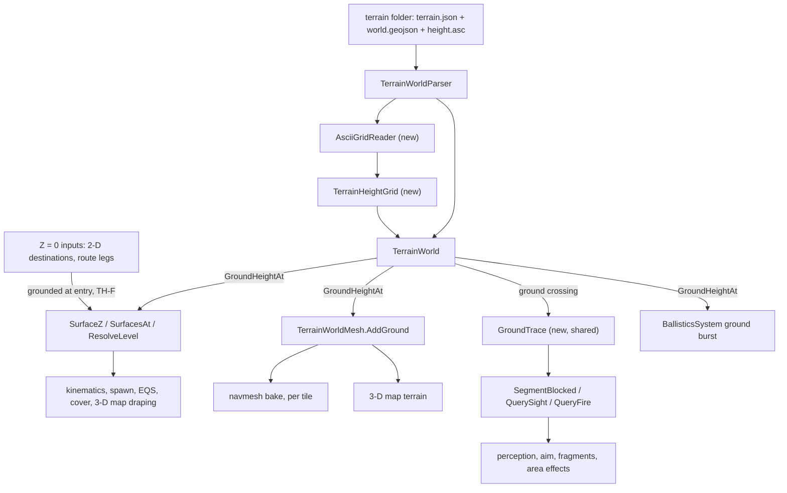
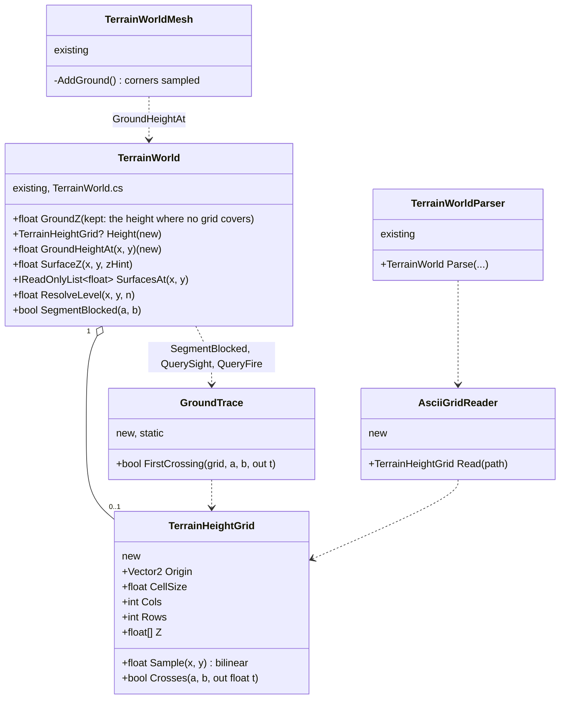
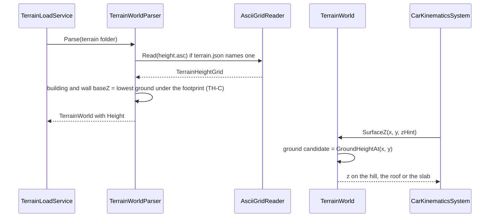
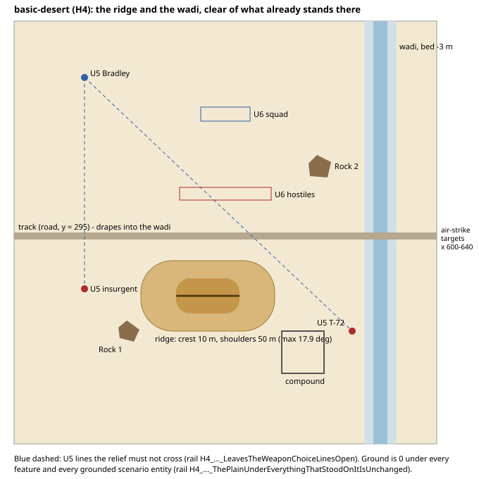

<!--STATUS
state: LIVE
build-state: BUILDING — H1, H2, H3 BUILT 2026-10-10 (§5a, §5b as-built); H4 (basic-desert's ridge and wadi as a grid) BUILT 2026-10-15 (§5d, CE-3086); H3b + H5a–H5d BUILT 2026-10-11 (§5c: bridges, road heights, the highway-rest terrain, CE-1048); H4 and H6 to come. Leans TH-A..TH-H APPROVED (R-249); the library
  question settled by the Q0 spike (DESIGN_World_Query_Seam.md §5a: Bepu for objects, the height stays a grid).
updated: 2026-10-10 (rev 5 — §5b H2 + H3 as built. Rev 4 — §5a H1 as built, with its deviations argued. Rev 3 — §7 corrected by R-250/R-251: a real interface, Bepu not Jolt. Rev 2 — all leans approved; grounding is the entity's clamping flag + motion model, no zero rule
  (R-249, §4a); §7 the library question. Rev 1 — R-248: the flat ground is a temporary simplification; this file plans its removal)
current-answer: §1 why · §2 INVENTORY · §3 the diagrams · §4 decisions with leans · §5 slices · §6 not verified.
stale-below: nothing.
known-rot: §7's rev-1 lean (Jolt; TerrainWorld's methods as the seam; Bepu rejected) — corrected by R-250/R-251, see its banner.
known-conflict: none. (Resolved 2026-10-15: CE-3086 built basic-desert's ridge and wadi as TH-G's grid, §5d — the Utility demo
  design's ramp plan is superseded there.)
related-designs:
  - DESIGN_Body_Geometry_And_Ground_Contact.md — the gear height and resting pose (pitch/roll on a slope) of a CG-referenced
    body; the motion model that grounds an aircraft (§4a, R-249) uses it.
  - DESIGN_World_Query_Seam.md — owns the engine-neutral interface (IWorldQuery) GroundHeightAt is exposed through, and the
    library choice (Bepu inside the stand-in).
  - DESIGN_Terrain_World.md — OWNS TerrainWorld, the world file, the parser, TerrainWorldMesh and the queries; this file
    adds the ground height to them (one function, one grid) and changes nothing else about the model.
  - docs/blueprints/Architect_Question_81_SimHost_Test_Terrain_World.md — T1/T2 (APPROVED, R-181): "ground (flat or
    heightfield)", "Optional heightmap as ESRI ASCII grid. Referenced from the existing terrain definition JSON".
  - DESIGN_Terrain_Zones_And_Assets.md — owns the terrain asset (§2.1e: "later its terrain DB / heightmap / navmesh");
    the grid file is one more file in the terrain folder.
  - designs/navig-2/Navigation_Design_v2_0.md §14 — owns the tiled navmesh bake; a tile's key already hashes its OWN
    triangles, so relief changes only the tiles it touches.
  - designs/eqs-2/EQS_Design_v1.3_final.md §19 — EQS terrain sight and ground placement; inherits TH-D unchanged.
  - DESIGN_Building_Interiors.md — storeys, slabs, wall panels; TH-C sets where a building stands on a slope.
  - DESIGN_Map_3D_Mode.md §3.10 — the 3-D map reaches the ground only through the mesh and level 0, so it gets relief
    for free; it asked for this file.
  - DESIGN_Utility_AI_Demo_Scenarios.md — basic-desert's ridge and wadi (TH-G).
  - designs/promote-to-3d/3D_Cognitive_Spatial_Awareness_Promotion_Design_v1_1.md — "SimTransform.Position.Z is
    authoritative"; relief is what makes that true outdoors.
-->

# DESIGN — terrain height (removing the flat ground)

## 1. Why

🔒 **User, `2026-10-10` (`R-248`):** *"Terrain needs height. Current flat terrain bed is unbearable. never count with
terrain being flat, this is just current simplification that should be removed soon."*

📐 Today `TerrainWorld` has one number for the ground, `GroundZ` (`TerrainWorld.cs:93`), and every terrain file sets it to
0. The approved plan already allows height (Q81 T1/T2, `R-181`) — but no design, file slot, parser, tracker row or raster
asset exists for it.

## 2. INVENTORY — measured `2026-10-10` (graph CLI `search_code`/`search_graph` + grep; two sweeps)

⚠ `check_index_coverage` is not available through the CLI, so "every reader" below is graph + grep agreeing, not a
coverage proof.

| what | count | where |
|---|---|---|
| production reads of `GroundZ` | **9 in 6 places** | `TerrainWorld.cs:224,227` (`SurfaceZ`), `:248,249,270` (`SurfacesAt`, level 0); `TerrainWorldMesh.cs:57` (ground grid — the navmesh input); `BallisticsSystem.cs:175` (area-round burst plane); `StaticObstacles.cs:110` (copy); `WorldInfoReport.cs:47` (report) |
| the one writer | 1 | `TerrainWorldParser.cs:231`, from `hrot.groundZ` (`:71`) |
| queries that never test the ground | 3 | `SegmentBlocked` (`:314-360`, *"until a heightfield exists"* `:317-319`), `QuerySight` (`:382-435`), `QueryFire` (*"the ground is not an occluder"*) ⇒ a hill blocks neither sight nor fragments |
| flat defaults in the loader | 5 | building/wall/fence `baseZ` default to `groundZ` (`TerrainWorldParser.cs:117,127,149`); ground-floor slab test (`TerrainBuildingExpander.cs:36,100`) |
| callers already on the right seam | many | kinematics (`CarKinematicsSystem.cs:374,382`), spawn (`NetworkSpawningSystem.cs:221`, `ResolveLevel`), EQS (`EqsTerrainSight.cs:64`), cover (`TerrainCoverProvider.cs:98,210`), danger areas, LOS callers via `SegmentBlocked` ⇒ **follow with no edit** |
| `Z = 0` entering from outside | ~16 sites | 2-D destinations and waypoints (`CgfNodes.cs:281,422`, `HillAttackTankNodes.cs:300,490`, `VehicleCommandSystem.cs:64,86`, `ScenarioSpawnAdapter.cs:414`, SimHost UI); `RoutePlanner.cs:189-190` snaps at Z 0 with a ±4 m search (`DotRecastNavmeshProvider.cs:43`); `INavmeshProvider.cs:10` documents *"for flat-earth queries use Z 0"*; `TrajectoryPoolManager.cs:120-128` |
| an older height seam | 1 | `ITerrainProvider` + `TerrainQueryResolutionSystem` (an IG ground-clamp pipeline), installed only at `IgApplication.cs:2176`, no production caller found — and a clamp is what `R-182` ruled out |
| Stride | flat slab | `StrideHrotGame.cs:1006` *"DELIBERATELY not a heightfield"* — out of scope (U1: Stride untouched) |
| raster files in the repo | **0** | four terrains, all `"groundZ": 0` |

## 3. The design

### 3.1 Where height enters — module view

*What the picture shows that prose hid:* height reaches every consumer through **three** seams — `GroundHeightAt`, the
ground grid in the mesh, and one shared ground trace. Everything to the right of them (kinematics, spawn, EQS, cover, the
3-D map, the navmesh tiles) needs no edit. The only outside work is the `Z = 0` inputs at the bottom.

### 3.2 Classes — existing vs new

*What it shows:* one new data class and one reader; the grid is optional (`0..1`), so a terrain without one is today's
flat world, byte for byte.

### 3.3 Load and query — sequence

### 3.4 Bridges — a deck and two ramps on top of the height grid *(U-TH1, `2026-10-11`)*

> 🔒 **User, `2026-10-11` (U-TH1):** *"The requirement is for bridges mainly (could be a simple rectangular ramp) so the cars/people are
> not driving on height grid only. No import of complex 3d meshes. So your lean probably suffices."*

📐 **What a bridge already gets from the existing primitives** (measured `2026-10-11`):

| needed | exists | where |
|---|---|---|
| a deck to stand and drive on | ✅ `slab`: a walkable polygon with per-vertex Z (test-town's garage deck is one) | `TerrainWorld.cs:49-60`, `TerrainWorldParser.cs:181-186` |
| approaches linking the deck to the ground | ✅ `ramp`: the same with a sloped Z | same |
| the navmesh on the deck AND under it | ✅ slabs and ramps are baked; stacked spans are kept | `TerrainWorldMesh.cs`, `DESIGN_Building_Interiors.md:57` |
| a mover keeps to its own level (deck vs the road under it) | ✅ the motion side resolves a 2-D destination at the mover's level; rail `Q0b_A2DDestination_LandsOnTheSurfaceAtTheMoversLevel` (a deck vs the ground under it) | `NavigationIntentBridgeSystemTests.cs:98`, `DESIGN_World_Query_Seam.md` §5c |
| sight and fire see the deck | ✅ a walkable blocks a line that crosses it | `TerrainWorld.cs:47` |
| piers | ✅ `building` / `wall` prisms | `TerrainWorld.cs:23-45` |
| drawn in 3-D | ✅ the walkables are in the render mesh (S4: slab kind) | `TerrainLayer3D` |

⛔ **The gaps on a height grid:**
1. A ramp's low end must meet the GROUND, but walkable Z is ABSOLUTE only (`TerrainWorldParser.cs:184`). On relief the author would have
   to know the grid's height at each end.
2. ⛔ **SUPERSEDED the same day (U-TH2):** an earlier line here said a road crossing a bridge "is routed on the ground under it".
   Measured wrong for DRIVING: the movement model takes its Z from height queries, never from the navmesh or the path —
   `CarKinematicsSystem.cs:380-382` uses `SurfaceZ(x, y, current Z)`, the HIGHEST surface at or below the current Z + 0.6 m step
   (`TerrainWorld.cs:196-235`, `StepHeight` `:86`). A car on the road climbs the ramp at its foot (within the step) and stays on the
   deck, and a car under the bridge stays on the ground (the deck is beyond the step). What IS wrong is only the planned path's
   reported Z on a road leg: `RoutePlanner.HeightAt` snaps it from the navmesh around the ground (`RoutePlanner.cs:197-202`), so a
   road leg over a deck reports ground heights. The car ignores them (it follows the path's XY), but path readers such as the danger
   check and the gizmo see a road under the bridge.
3. **The road data has no height at all** — `RoadNode.Position` is a `Vector2`, a segment is a 2-D Hermite spline (`RoadNode.cs`,
   `RoadSegment.cs`, the JSON `position` is 2-D). ⛔ Searched `docs/` for road heights (relative or absolute): none found.

> 🔒 **User, `2026-10-11` (U-TH5):** *"Approved. Test terrain for height based terrain should include the bridges and roads over and under - for example a bridge above a highway leading to driver resting place on the other side of the highway, with proper navmesh so non-road (but navmesh) navigated entities can cross the highway as well."*
>
> 🔒 **User, `2026-10-11` (U-TH4):** *"Wait roads are leading over bridges how can we defer their height?"*
>
> 🔒 **User, `2026-10-11` (U-TH3), on TH-J and TH-K:** *"Approved."*
>
> 🔒 **User, `2026-10-11` (U-TH2):** *"a thought roads node have height already (either relative to terrain height or absolute — i like
> relative ones), independently on the navmesh … i thought … that vehicle follows a road, it drives over the height queries not navmesh
> queries, and that navmesh is not used for height by the movement model. … will the navmesh be created both on the bridge ramp as well
> as the terrain under it? Both required. How to ensure the navmesh builder find the ramp to terrain connection?"*

| # | question | ⭐ lean | rests on | rejected |
|---|---|---|---|---|
| **TH-I** ✅ | the ramp's ends on relief | an optional **ground-relative height** on `slab` and `ramp` vertices — `"aboveGround": h` (one value) or per vertex — resolved against the height grid when the terrain loads; absolute Z keeps working unchanged. A ramp then reads "0 at the bank, 6 m at the deck", wherever the bank is | the parser reads absolute Z only (`:184`) · U-TH1 *"your lean probably suffices"* | importing 3-D meshes (U-TH1: no) · splitting a straight ramp at the grid's cells — a bridge approach is a straight slope by design; splitting is only needed for a sidewalk that must follow relief, which is not the requirement |
| **TH-J** ✅ | a road over a bridge | ⭐ **the road leg's reported Z follows the SAME rule the car drives by**: each sampled road point takes `SurfaceZ(x, y, previous point's Z)` starting from the entry point's surface — no navmesh. No road data change is needed for driving. ⛔ *(its deferral of road heights is SUPERSEDED by TH-L, U-TH4: chaining from the entry fails when a vehicle JOINS the road on the wrong level)* | `CarKinematicsSystem.cs:380-382` · `RoutePlanner.cs:197-202` · U-TH2 | ⛔ SUPERSEDED: per-node road heights as the fix — not needed, the car never reads them · the navmesh snap — it answers "where can I stand near the ground", not "which level is this road on" |
| **TH-K** ✅ | the navmesh on the deck AND under it, and the ramp joining the ground | ⭐ **(a) both levels:** Recast keeps every walkable span in a column, so the deck and the ground under it are baked as long as the free height between them is at least the agent height (Infantry 1.8 m, Vehicle 2.0 m, plus one 0.2 m cell) — a lower deck correctly blocks the space under it. ⭐ **(b) the join:** Recast links neighbouring spans only within the agent's step (Infantry 0.4 m; Vehicle **0.1 m**, below the 0.2 m cell height, so effectively NONE) — the ramp's foot must therefore be continuous with the ground, not merely close. ⭐ Make it continuous by construction: **the ramp's foot is buried** — extended about 1 m past the bank and sunk 0.3 m below the ground (TH-I's ground-relative heights make that one number) — so the walkable top surface is max(ground, ramp), joined along their intersection whatever the grid's triangulation. ⭐ **(c) the slope:** a vehicle ramp no steeper than the Vehicle layer's 20° (a 6 m deck needs at least about 16.5 m of ramp); the parser warns otherwise | `RecastNavmeshBaker.cs:66-87` (agent radius, slope, step, height), `:112-121` (cells 0.3 / 0.15 m, height 0.2 m) · `TerrainWorld.cs:196-235` (the same buried foot works for the movement model: ground until the ramp emerges, then the ramp) | relying on the foot meeting the ground exactly — between the ramp's two foot vertices the 2 m grid bends, a few centimetres off is already beyond the vehicle step · an off-mesh link at each ramp foot — a second mechanism for what the geometry can give |

| **TH-L** ✅ | ⛔ *the deferral of road heights is SUPERSEDED (U-TH4)* — the road carries its own level | ⭐ **each road node gets an optional ground-relative height** (`aboveGround`, default 0 — today's behaviour). A road point's height is resolved in two steps: (1) a NOMINAL height — each node's ground + its `aboveGround`, interpolated linearly along the segment in absolute metres; (2) **snapped to the real surface nearest that nominal height** (`SurfaceZ` with the nominal as the hint). A bridge's end nodes sit at the banks (`aboveGround` 0, or +h at a ramp top), so the nominal runs level with the deck and snaps to it; a road down in the valley snaps to the valley floor, the deck being far above. ⭐ **Every place a vehicle JOINS a road takes the road's resolved height**: the route planner's access and exit points (instead of the unit's level), the road leg's points (replacing TH-J's chaining from the entry), and a vehicle spawned on a road (`VehicleCommandSystem` — instead of level 0). The data: `RoadNodeJson` gains `aboveGround`, `RoadNode` a height field (a road-network schema bump with a migration, defaults 0) | measured failures: 2-D nearest access (`RoadGraphRouter.cs:30-44`) + the unit's level at the access point (`RoutePlanner.cs:143`); 2-D spawn on level 0 (`VehicleCommandSystem.cs:61`) · U-TH2 *"i like relative ones"*, U-TH4 | pure relative node heights with no snap — over a valley the deck's height above the ground changes along the span, so interpolating relative values (0 at both banks) gives 0 mid-span · absolute node heights — the user prefers relative, and absolute breaks when the grid is re-surveyed · a per-segment "on structure X" reference — needs bridge identities in the road data, the snap gives the same answer with one number |

🔴 **Measured `2026-10-11` (H5b):** on the Infantry layer the deck, the ground under it, both buried feet and the passage under the
bridge all bake (`TerrainHeightTests.H5b_…`). ⛔ The **Vehicle layer bakes nothing on ANY slope** — its 0.1 m step is below the 0.2 m
voxel, so Recast's climb is 0 cells and every span on relief is filtered as a ledge (`CE-1048`, lean: a 0.3 m vehicle step).
⚠ **Not verified:** that the buried foot bakes for vehicles (blocked by `CE-1048`), and that a deck high above
relief keeps the navmesh tile height range (`RecastNavmeshBaker.cs:328` sizes it from the highest surface + agent height).

## 4. DECISIONS

| # | decision | ⭐ lean | rejected — one line each |
|---|---|---|---|
| **TH-A** | the source file | ⭐ **ESRI ASCII grid** (`ncols`, `nrows`, `xllcorner`, `yllcorner`, `cellsize`, `NODATA_value`, then rows of heights), **local metres**, one file in the terrain folder, named from `terrain.json` — exactly Q81 T2 (approved) | GeoTIFF — needs an imaging library · a TIN in the GeoJSON — hand-authoring thousands of points · SRTM/DTED — geodetic, `R-181` says local metres |
| **TH-B** | the model | ⭐ `TerrainHeightGrid` (a float array, bilinear `Sample`) held by `TerrainWorld`; **`GroundHeightAt(x, y)`** = grid sample, else `GroundZ`; the 9 reads go through it | adopting the IG's `ITerrainProvider` — batched, asynchronous, unwired, and built for the clamp `R-182` ruled out · a second height service — `R-181` says one world model feeds every query |
| **TH-C** | buildings on a slope | ⭐ a building, wall or fence with no explicit `baseZ` stands on the **lowest ground under its footprint** (no gap under the downhill side; the uphill side sits in the slope, which the ground cells inside the footprint already skip) | the ground at the centre — leaves the downhill side floating |
| **TH-D** | sight and fire over hills | ⭐ one shared, allocation-free **`GroundTrace`** (march the segment cell by cell against the grid) called by `SegmentBlocked`, `QuerySight`, `QueryFire`; ballistics bursts at `GroundHeightAt` instead of a plane | per-caller ground tests — three copies · leaving LOS flat — a hill would not hide anyone, which is the point of relief |
| **TH-E** | navmesh | ⭐ the mesher samples each ground cell's corners — the only bake change; per-layer slope limits already exist (infantry 60°, vehicle 20°); the vertical search box (±4 m) is centred on the **grounded** hint, not on 0 | a separate terrain navmesh source — the tiled bake already takes one triangle soup |
| **TH-F** | `Z = 0` inputs | ⭐ ground them **where they enter** (2-D destination, route leg, UI drag, `VehicleCommandSystem`): `ResolveLevel(x, y, 0)`; `INavmeshProvider`'s *"use Z 0"* note becomes *"pass the ground height"* | grounding inside every consumer — the same fix many times |
| **TH-G** | test terrains | ⭐ a small **sloped fixture** for rails, and `basic-desert`'s ridge and wadi as a real height grid (proposal to the backend lane's CE-3086, which plans them as ramps only because no heightfield existed) | ramps as fake hills — the workaround this file removes |
| **TH-H** | what is NOT in this design | ⭐ Stride stays flat (U1); a 2-D hillshade or contour layer and terrain streaming/tiles come later; the dormant IG clamp pipeline is retired in a follow-up, not reused | — |

## 4a. Who puts an entity on the ground — 🔒 `R-249`

🔒 **User, `2026-10-10`:** *"Whether entity should be ground clamped needs to be controlled by its 'ground clamping enabled'
realtime flag and its motion model, not by adding exception for zero coordinate. Motion model usually lifts such entity on
the ground anyway."*

| | |
|---|---|
| ⛔ | no special case for a saved `Z = 0` — a loaded entity keeps the Z it was saved with |
| ⭐ the motion model | grounds as it moves: `CarKinematicsSystem` already sets Z from `SurfaceZ` every step (`CarKinematicsSystem.cs:370-375`, W8/`R-182`) |
| ⭐ the flag | the per-entity, runtime **ground-clamping flag** decides whether an entity is held to the surface at all. 📐 One already exists: `GroundClampingConfig { Mode: Auto/ForceOn/…, BaseRequiresClamping }` — TKB default (1 = ground vehicle, 0 = aircraft), overridable at runtime over DDS (`GroundClampingOverrideTranslator`) (`GroundClampingConfig.cs:12-35`) |
| ⚠ the gap | today that flag drives only the dormant IG clamp pipeline (`TerrainQuerySubmitSystem.cs:45`), and the motion model grounds regardless of it ⇒ the motion model must read the flag (an aircraft keeps its altitude) — H1 |

⚠ `R-182` ("no ground clamp") ruled out a SEPARATE clamp step; `R-249` keeps that — the flag is read BY the motion model,
not by a second system.

## 5. SLICES

| slice | delivers | proves |
|---|---|---|
| **H1** ✅ | `TerrainHeightGrid` (+ its ASCII-grid reader), `GroundHeightAt`; the reads routed; the mesher on the grid's cells; TH-C defaults; the clamping flag in the movement model; the sloped fixture — §5a | an entity drives up a hill (kinematics, unchanged), spawns on the slope, the navmesh follows it — and every existing flat terrain is byte-identical |
| **H2** ✅ | the ground trace (`TerrainHeightGrid.Crosses`) in the three queries; rounds and fragments stop at a hill — §5b | a hill blocks sight and fragments |
| **H3** ✅ | road legs, road access points and the 2-D spawn command on the real ground; the navmesh search centred on it; 2-D move orders already resolved by Q0b — §5b | 2-D orders and route legs work on a hill |
| **H4** ✅ | basic-desert's ridge and wadi as a grid — §5d | the utility demos on real relief |
| **H3b** ✅ | a frame-rail shot of a REAL height-grid terrain (the sloped fixture) through the 3-D map | the 3-D renderer draws relief from a grid, not only from a height function |
| **H5a** ✅ | TH-I: `aboveGround` on `slab` / `ramp` (one value or per vertex), resolved against the grid at load; TH-K: the buried ramp foot (extended ~1 m, sunk 0.3 m) and the slope warning (vehicle ramp > 20°) | parser + `SurfaceZ` rails: the foot is continuous with the ground on a slope |
| **H5b** ✅ | TH-K bake proof: a bridge on the sloped fixture baked on the Infantry AND Vehicle layers — the deck, the ground under it (clearance ≥ agent height + one cell), the ramp foot joined; a path from bank to bank over the deck and one under it | the navmesh finds both levels and the join, on both layers |
| **H5c** ✅ | TH-L: road nodes' `aboveGround` (road-network schema + migration), the nominal-then-snap resolve; the route planner's access / exit points and road legs and the vehicle spawn on a road take it (TH-J's no-navmesh rule, now from the road's own level) | a unit under the bridge sent along the deck road climbs a ramp to it; a car spawned on the bridge road stands on the deck; a road over the deck reports the deck, one under it the ground |
| **H5d** ✅ | ⭐ **the test terrain `highway-rest`** (U-TH5): a height grid with gentle relief; a multi-lane **highway** at grade; an **overpass** — a deck slab about 6 m up with a buried-foot ramp each side — carrying a local road from the near side to a **drivers' rest area** (a parking surface and a building) on the far side; the navmesh over the deck, so a non-road, navmesh-navigated entity (infantry, an off-road vehicle) crosses the highway by the bridge; the highway under the deck with vehicle clearance. Live rails: a car on the highway passes under the deck; a car on the local road crosses over it into the rest area; a soldier walks from the near side to the rest area over the bridge; a 3-D frame-rail shot | over and under, road and navmesh, end to end on relief |
| **H6** | the 3-D terrain mesh in chunks with a distance level of detail — only when a grid larger than a few hundred metres lands (H4 or a real map) | a 2 km grid draws without a 170 MB single mesh |
| — | *deferred:* imported 3-D meshes (U-TH1: no) | — |

⭐ Gates: the terrain feature suites first (`TerrainWorldTests`, the Recast and SimHost terrain tests — about 35 asserts assume
ground 0 and stay green on flat terrains), then new rails on the sloped fixture.

## 5a. H1 — as built `2026-10-10`

| piece | as built |
|---|---|
| the file (TH-A) | an ESRI ASCII grid beside the world file, named by **`hrot.heightGrid`** in the world file; read through the new `TerrainAssets.ReadFile` (bare names only); a corner origin becomes the first cell's centre, the north row first, NODATA takes `groundZ` |
| the model (TH-B) | `TerrainHeightGrid` (samples, two triangles per cell split south-west → north-east, the edge holds outside); `TerrainWorld.Height` + **`GroundHeightAt(x, y)`**; `SurfaceZ` and `SurfacesAt` take the ground HERE (level 0 = the ground at (x, y)); `StaticObstacles.With` carries the grid; `TerrainWorldQuery.GroundHeightAt` answers from it |
| the mesher (TH-E) | with a grid, the ground cells ARE the grid's cells (origin and size) and every corner sits on it — so the navmesh, the future 3-D terrain and `GroundHeightAt` are one surface; without a grid, unchanged |
| buildings and walls (TH-C) | no explicit `baseZ` ⇒ the lowest ground under the footprint (corners + every sample inside) / along the wall; a template building resolves it on its rotated footprint inside the expander, and its ground storey gets no slab when it stands on that ground |
| bounds | a file with no `bounds` includes the grid's extent |
| the clamping flag (R-249, §4a) | `CarKinematicsSystem` holds an entity to the surface only when its `GroundClampingConfig` says so; no flag = clamped, as before |

**Deviations, argued:** ① the grid is named in the **world file**, not in `terrain.json` (TH-A said the latter): it REPLACES the
world file's `groundZ`, so the world file describes its whole ground and the parser — which sees only the world file and the
terrain folder — needs no second input. ② the mesher **adopts the grid's cells** instead of sampling its own 2 m cells: two
triangulations of one surface disagree between samples, and the navmesh, the drawn terrain and the movement model must agree.

**Finding:** ⚠ `GroundClampingConfig` has **no production producer** — its comment says *"seeded from the TKB blueprint"*, but no
translator adds it (graph + grep: only tests and the dormant IG pipeline). ⇒ today every entity is clamped exactly as before; an
aircraft keeps its altitude only once something gives it the flag. Filed with the TKB/air-domain work, not built here.

**Gates:** the 7 new rails (`TerrainHeightTests` ×5 on `SlopeFixture`, `CarKinematicsSystemTests.H1_…` ×2) pass; regressions on
H1: `Fdp.Toolkits.Tests` **3038/3038** (+1 skip), `Hrot.SimHost.Tests` all executed pass (count varies per run, `CE-1038`),
`Hrot.Editor.Tests` **474/474** (+2 skips).

## 5b. H2 + H3 — as built `2026-10-10`

**H2 (TH-D) — a hill blocks sight and fire.** `TerrainHeightGrid.Crosses(a, b)` walks only the cells under the segment
(Amanatides–Woo, the segment first clipped to the grid) and tests their two triangles (Möller–Trumbore) — allocation-free, no
memory beyond the grid; a hit within 5 cm of either end is that end touching the ground, and an end UNDER the ground is a
malformed query, not an occluder. It is ONE helper the three queries share:

| query | a hill in the way |
|---|---|
| `SegmentBlocked` (perception, EQS, aiming, danger areas) | blocked — the yes/no form stops at the first cell |
| `QuerySight` (diagnostic) | a `"ground"` crossing, transmittance 0 |
| `QueryFire` (rounds, fragments, blast) | a `"ground"` crossing of `GroundResistanceMmRha` (stops anything); its `TopZ` is the **crest** along the whole line, so `AreaEffect.TerrainShadow` diffracts a blast over the hill like over a wall; not a closed barrier |

⇒ every consumer moved onto `IWorldQuery` (Q1/Q2) gets hills with no edit. Without a grid nothing changes (no line between two
points above a flat ground can dip under it).

**H3 (TH-E/TH-F) — points that arrive 2-D stand on the real ground.**

| entry point | as built |
|---|---|
| 2-D move orders | ✅ already Q0b: the brain flags them, `NavigationDestination.Of` resolves them |
| road legs (`RoutePlanner`) | `RoutePlanner.World` (set by both production callers — `PathfindingSolverSystem`, `DangerAlongRouteSolve`); a road node's height = the navmesh snapped **from the ground there** (the ±4 m search box now centred on the real ground, not on 0), else the ground; the road's entry/exit points stand on the surface at the level of the end they serve |
| the 2-D spawn command (`VehicleCommandSystem`) | the vehicle is born on level 0 at (x, y), and so is its idle destination |
| `INavmeshProvider`'s contract note | *"for flat-earth queries use Z 0"* replaced by *"never pass Z = 0 meaning on the ground — pass the ground height"* |

**Left, named:** `TrajectoryPoolManager.Lift` still lifts 2-D trajectories to Z = 0 — harmless while the movement model takes Z
from the surface each step, but a reader of trajectory Z would be wrong; the SimHost UI's built-in scenarios spawn at Z = 0
(their entities are grounded by the movement model once they move, R-249; a static one is not); the route-waypoint up-axis
question (§6) is still open.

**Gates:** 10 rails on the slope and the ridge (`TerrainHeightTests` H1 ×5 + H2 ×3 + H3 ×1, `FormationCreationTests.H3_…`) pass;
regressions: `Fdp.Toolkits.Tests` **3043/3044** (+1 skip), `Hrot.SimHost.Tests` **1177/1180** (3 skips), `Hrot.Editor.Tests`
**474/476** (2 skips) — all green. ⚠ The cluster integration suite was NOT re-run for H2/H3 (its last run, 148/150 with the
pre-existing `CE-1036`/`CE-1037`, was H1's).

## 5c. H3b + H5a–H5d — as built `2026-10-11` (bridges over a height grid, road heights, highway-rest)

| built | where |
|---|---|
| **H5a** TH-I: `slab` / `ramp` take `"aboveGround": h` or `"zRef": "ground"` (`z` / per-vertex Z read above the ground), resolved against the grid at load; absolute Z unchanged. TH-K: a ground-relative ramp vertex at 0 is SUNK `RampFootSink` (0.3 m) below the ground. A ramp steeper than the vehicles' 20° loads with a warning (`TerrainWorld.Warnings`, logged) | `TerrainWorldParser.cs` (slab / ramp case, `MaxSlopeDegrees`), `TerrainWorld.Warnings` |
| **H5b** the navmesh on a bridge: deck, ground under it, both buried feet joined, passage under — on BOTH layers | rails `TerrainHeightTests.H5b_*` |
| **CE-1048** the Vehicle navmesh step 0.1 → **0.3 m** (≥ one 0.2 m voxel): the layer was EMPTY on any slope | `RecastNavmeshBaker.cs` Vehicle profile; `H1_TheNavmesh_BakesOverTheSlope…` now asserts each layer |
| **H5c** TH-L: `RoadNode.AboveGround` (JSON `aboveGround`); `RoadHeights` — the nominal (nodes' absolute heights carried along the segment, or ground + interpolated above-ground, whichever is higher) snapped by `SurfaceZ`; the route planner's access / exit points and road legs (TH-J: no navmesh snap) and a vehicle spawned on a road (`VehicleCommandSystem.OnRoadHeight`) take it | `Navigation/RoadHeights.cs`, `RoutePlanner.cs`, `RoadGraphRouter.EmitLeg` (segment-aware), `CarKinem/Road/*` |
| **H5d** `Recipes/Terrain/highway-rest`: a 400 × 300 m grid (gentle relief), an east–west 4-lane highway at grade, an overpass (deck 6 m up, two 40 m buried-foot ramps, two piers on the verges) carrying the local road from the near side to a drivers' rest area (a rest stop, a picnic wood); `*.asc` grids now ship with the build | the terrain folder; `Hrot.AI.Behaviors.csproj` content include |
| **H3b** a 3-D frame rail on the REAL grid: relief, the overpass, a car on the deck, one on the ramp, a truck on the highway under it | `Map3DFrameRail.H5d_HighwayRest_In3D…` (`map3d-9-highway-rest.png`) |

⚠ **Deviations, argued:** the ramp's foot is **sunk, not also extended** — sinking alone makes the top surface max(ground, ramp), so
the join is continuous wherever the grid bends; the visible start moves about 1–2 m inside the outline, so an author draws the foot
that far past the bank. · The road file's schema version is **not bumped**: `aboveGround` is an optional additive field and a v1 file
without it reads as before. · TH-L's nominal is the **higher of** the carried and the draped height (the design said the carried one):
carried alone dips under a hump between two nodes, draped alone drops into a valley under a bridge.
🔴 **Found on the way:** `LitShader.Shared` survived a closed window, so a second 3-D frame rail in one test run drew only the sky (a
GL program dies with its context, its stale id still reads valid; GLFW reuses the window address). Fix: `LitShader.Reset()`, called
by the rails after opening a window.
**Gates:** `TerrainHeightTests` 21/21 (H5a 3, H5b 2, H5c 3, H5d 3) · `CarKinematicsSystemTests.H5d_*` (a car climbs the ramp onto the
deck over the highway; a car on the highway passes under it on the ground) · the 3 frame rails · Toolkits full 3056/3057, SimHost
1177/1180 with the new vehicle step.

## 5d. H4 — basic-desert's ridge and wadi on the grid *(`CE-3086`, backend, `2026-10-15`; TH-G, R-249)*

*What the picture shows that prose hid: the relief had to fit in the gaps the three desert demos leave. The ridge sits between the
track and the compound, west of the U5 Bradley-to-T-72 line; the wadi runs east of everything but the air strike's targets (which
stand past the map edge).*

| piece | as built | why there / why that size |
|---|---|---|
| the grid | `basic-desert.height.asc`, 61 × 61 samples at 10 m (`xllcenter 0`), named by `heightGrid` in the world file — the H1 path, no code change | written by `scripts/basic-desert-height.py`, so the relief can be re-made from its numbers rather than hand-edited |
| the ridge | crest **10 m** along y = 210 from x = 230 to 320; a cosine shoulder falls to the plain over **50 m** (footprint x 180–370, y 160–260) | south of the track so U7's squad crosses the track and open ground to reach it (Utility demo §U7); a 50 m shoulder keeps the steepest triangle at **17.9°**, under the vehicles' 20°; x ≤ 370 keeps the U5 Bradley→T-72 line clear; y ≥ 160 and x ≥ 180 keep the compound and Rock 1 on flat ground |
| the wadi | a **3 m** deep, 20 m wide flat bed along x = 520, banks 15 m wide, through the whole map | crosses the track (a road into a dip — TH-J) and stays east of every demo's entities; banks ≤ 18° |
| the plain | 0 everywhere else | ⭐ nothing that stood on basic-desert moves: the cover database checksum (`CE3134_…`) and every scenario's Z-0 entity stay valid |

⚠ **Deviation from the original plan, argued:** the Utility demo design planned the ridge as two ramps "because a heightfield (not
built)"; H1 built one, so TH-G's grid replaces the ramps — no `ramp` features, no fake hill. ⚠ `CE-3081`'s `CrestLine` danger-area
kind (*"ramp peak"*) is not built and now has a grid crest to find, not a ramp peak.

**Rails** (in the feature's suite, `TerrainHeightTests`): `H4_BasicDesert_HasItsRidgeAndWadi_AndThePlainUnderEverythingThatStoodOnItIsUnchanged`
(crest, bed, slope < 20°, ground 0 under every prism and every grounded entity of every `scenarios/*` on basic-desert) ·
`H4_…_TheRidgeHidesOneSideFromTheOther_AndLeavesTheWeaponChoiceLinesOpen` · `H4_…_TheNavmesh_GoesOverTheRidge_AndThroughTheWadi`
(Infantry and Vehicle) · `H4_…_TheTrack_DipsIntoTheWadi_OnTheGround`.
**Gates:** the H4 rails 5/5 with the terrain regressions that load basic-desert — `TerrainHeightTests` all, `CE3134_TerrainsWithoutBuildings_KeepTheirCoverDatabase` (the checksum unchanged: 313 points), `BepuTerrainIndexTests`, `TerrainDefinitionTests` — **54/54**. ⚠ The live utility demos on basic-desert (U5, U6, the air strike) were not re-run: their entities stand where the ground is still 0.

## 7. Build or use a library? — the user's question, `2026-10-10` *(⚠ rev 1 below is CORRECTED by `R-250`/`R-251` — read the banner first)*

> ⭐ **CURRENT ANSWER (rev 3, `2026-10-10`) — see [`DESIGN_World_Query_Seam.md`](DESIGN_World_Query_Seam.md):**
> ① the seam is a real interface, **`IWorldQuery`** — not `TerrainWorld`'s own methods (`R-250`: all engine capabilities
> behind interfaces, production uses a mature engine); ② the library is **BepuPhysics v2, inside the stand-in** — the
> user's *"too young"* was about **Stride's Bepu integration, not the library** (`R-251`), and Jolt's current C# binding
> targets net9/net10 while HROT is net8; ③ sound around corners is Building Interiors' B-6 behind `Trace(Sound)`.
> ⛔ The lean below (Jolt; "behind TerrainWorld's queries"; "Bepu rejected") is HISTORY — do not quote it.

🔒 **User:** *"we iterated quite far into a small 3d engine … Does it still make sense to do it all by ourselves? isnt most
of that already solved by … existing highly optimized and reliable libraries? Could we benefit for introducing physics
library and its optimized raycasts and similar capabilities?"*

| claim | code — how it IS | design basis — how it was MEANT |
|---|---|---|
| the terrain's ray queries scan **every** prism per ray (an AABB reject each), no spatial index | ✅ `TerrainWorld.cs:330-360` (`SegmentBlocked`); same shape in `QueryFire` | ⛔ searched `docs/`+`.dev/`: no timing, no BVH ever considered; the recorded work is allocation only (`DESIGN_Terrain_World.md` §6a, R-220) |
| the sim's own physics is a deliberate cheap stand-in | ✅ `RaycastSolverSystem` (async, 2-D circle colliders) | ✅ `.dev/_DONE/stride-1/Stride-Integration_v0_3.md:105-107` *"SimHost's kinematics, perception, and ground queries are themselves the fakes"* |
| a swap seam for rays already exists | ✅ `IRaycastBackend` (`Physics/IRaycastBackend.cs:31`), `ILosService` (`Eqs/ILosService.cs:15`), a Stride implementation `StrideRaycastLosService` (unadopted) | ✅ `DESIGN_Stride_Port.md:160-163` |
| the user ruled against Bepu | ✅ Stride uses Bullet (`Stride.Physics`) | ✅ `STRANDED_FEATURES_AUDIT.md:12-18` *"bepu is too young and not the most proven solution; the bullet was intentional"* — written for Stride |
| a library must run headless on Linux and stay out of `Fdp.Toolkits` | ✅ SimHost/Toolkits are `net8.0`; Stride is `net8.0-windows` | ✅ `DESIGN_Terrain_World.md` W1 (DotRecast kept in its own project) · `DESIGN_Stride_Node_Modes.md:797` *"Bullet cannot be stepped headless"* (Bullet inside Stride) |

**Decision (lean):**
- ⭐ **The 3-D map stays on Raylib.** It is not an engine: the mesh, the picking maths and the GPU work already come from
  libraries (`TerrainWorldMesh`, Raylib). Ours is the glue: a small shader, shape kits, draping, the card.
- ⭐ **The simulation's spatial queries move onto a proven collision library, used for QUERIES ONLY** (rays with all hits,
  shape sweeps, overlaps, a native height-field) — no rigid-body dynamics, which the motion models own. It sits **behind
  the existing seams** (`TerrainWorld`'s queries, `IRaycastBackend`, `ILosService`) in its own project (the W1 precedent);
  `TerrainWorld` stays the one model (`R-181`) and the library holds an index built from it. Materials, transmittance,
  levels and doors stay ours, in the hit callbacks. The 3-D map's terrain pick uses the same backend — the user's U21
  wish, *"the same raycast machinery as for simulation"*.
- ⭐ **Candidate: Jolt** (via its C# binding) — proven in shipped games, native Linux and Windows builds, a height-field
  shape, batched ray and shape casts. ⚠ From the library's own documentation, **not verified here**; the C# binding is
  the young part.
- ⭐ **A spike first:** `SegmentBlocked` + `QueryFire` + `GroundHeightAt` on the library behind one seam; the existing terrain
  rails must give **identical** answers (R-216 "rails stay exact"); timed against the scan on a terrain scaled to
  thousands of prisms; run headless in the cloud. Commit only if all three pass.

**Rejected — one line each:**
- a full engine (Godot, Stride) for the map — Godot §8 (no supported .NET 8 in-process path); Stride is `net8.0-windows` and not headless.
- Bepu standalone — the user called it *"too young and not the most proven"*.
- Bullet standalone — its C# bindings are old and thinly maintained; inside Stride it cannot run headless.
- writing our own BVH — fixes the scan but not sweeps, overlaps or the height-field; a second implementation of what a library does.
- doing nothing — the per-ray scan grows with every building, and relief adds a ground trace to every ray.

## 6. NOT VERIFIED — say so before it is built on

| claim | how it is settled |
|---|---|
| ⚠ `HumanGait.MaxStepDown`'s "never step off a ledge" rule (`CarKinematicsSystem.cs:377-386`) does not fire on a steep slope | H1 rail |
| ✅ the bake over relief works on a 10 % slope and a path climbs it (`TerrainHeightTests.H1_TheNavmesh_BakesOverTheSlope_AndAPathClimbsIt`); ⚠ `filterLedgeSpans: false` over steep relief (near the 20° vehicle limit) still unmeasured | H1 / H4 |
| ✅ grid cell size vs the mesher's cells — resolved: with a grid the mesher uses the grid's cells (§5a) | H1 |
| ✅ `GroundTrace` as a grid march: 11.9 µs for a 300 m line on a 2 km grid at 2 m, no extra memory, exact vs a full triangle scan (Debug, cloud) — and a Bepu mesh is NOT the way (+477 MB for that grid) — `DESIGN_World_Query_Seam.md` §5a | measured in Q0 |
| ✅ scenarios that saved Z = 0: no special case — the clamping flag and the motion model decide (`R-249`, §4a) | ruled |
