<!--STATUS
state: LIVE
build-state: §11 THE IMPORTER BUILT 2026-11-10 (CE-4368, as-built table §11.4) · DESIGN — §9.6 trees APPROVED (R-4190); the source-data answers are in (§5); Q-U8 decided (R-4186: open floors + a stair ramp); §5.4 ② decided (§7, R-4187); §8 destructible buildings APPROVED (R-4188: walls + collapse as a whole-building replacement); §6 re-bases the stages on Terrain World §9
updated: 2026-11-10 (§8.2 the destruction build design, S-0 of CE-4391 — B-1…B-11; B-10 supersedes §8.1's NavRebuildRequester / P3-c / P3-d by the P-7a obstacle bake — coordinator) · 2026-11-10 (§11.4 as built — CE-4368) · 2026-11-09 (§8.1 L-8: the breach at runtime — sequence, modules, the P3 additions; READY-TO-BUILD — backend) · 2026-11-09 (§9 trees: questions — coordinator) · 2026-11-09 (§5 answers from the source-data session; §1 corrected — a height grid EXISTS; §2 / §3 revised — coordinator) · 2026-11-09 (first version — coordinator)
current-answer: ⭐ §11 THE IMPORTER (design for the build, CE-4368, coordinator) · ⭐ §10 the import input set (§10.2 answers Q-X1…Q-X6 · §10.3 the real 5.5 km bounds · ⭐ §10.6 UNIQUE buildings, exact floors (R-4191; supersedes §10.4/§10.5's templates)) · §9.6 trees APPROVED (R-4190: woods polygons + 25 m density grid, lone trunks in the index, wheeled forbidden in woods, tracked slow, only lone trees destructible, no bush cover yet) · §9.5 the source-data answers · ⭐ §8.2 destructible buildings — THE BUILD DESIGN (CE-4391, READY-TO-BUILD; §8 decisions R-4188, §8.1 runtime with B-10's supersession) · §7 paths and units (DECIDED R-4187) · §7a the performance take · ⭐ §6 the prior designs this builds on (sweep 2026-11-09) · ⭐ §5 ANSWERS (source-data session) · §5.4 the two questions left · §2 the idea (UML, revised) · §3 the stages (revised) · §1 measured · §4 the questions as asked
stale-below: nothing
known-rot: §8.1's NavRebuildRequester and P3-c / P3-d are superseded by §8.2 B-10 (the existing P-7a obstacle bake does both); §1's grid row said the grids were FIXED at 1.5 km — they already fit the terrain (Terrain World §4.4), corrected; the first version missed DESIGN_Terrain_World §9 (sparse terrain), the World Query Seam and the built NavTileCache — §6 corrects §2 / §3; §1's first-version row "⛔ no heightmap" was WRONG (corrected by §5.3) — a single-grid ESRI ASCII height grid exists (CE-1034)
known-conflict: none
related-designs:
  - PLAN_Large_Terrain.md — ORDERS this importer's stages beside the scale work (load, measure, optimise) so both lanes start at once
  - DESIGN_Terrain_Synth.md — OWNS hrot-terrain-synth, the deterministic SYNTHETIC input set: the importer's development and test terrain (§10.9)
  - DESIGN_Terrain_From_OSM.md — OWNS the OpenStreetMap pipeline: a THIRD producer of the same §10 input set
  - DESIGN_Terrain_World.md — ⭐ THE owning terrain design (the world file, the ONE TerrainWorld model); ⭐ its §9 SPARSE TERRAIN (S1–S7 approved, R-4051; CE-4011 outer ground, CE-4012 insets, deferred) is the frame this import builds on
  - DESIGN_World_Query_Seam.md — OWNS IWorldQuery (R-253): every height / trace / LOS reader goes through it — the import adds DATA, never a second query path
  - designs/navig-2/Navigation_Design_v2_0.md — OWNS the navmesh bake (§14 P2: tiled, 24 m) and the BUILT NavTileCache (memory + local folder, keyed by each tile's input hash)
  - blueprints/Architect_Question_71_Terrain_Zones_And_The_Asset_Build.md — R7: the per-node tile cache, keyed geographically; zones as fidelity windows
  - DESIGN_Terrain_Height.md — OWNS the terrain's height grid (TerrainHeightGrid, one .asc per terrain, CE-1034) this extends to a tiled store
  - DESIGN_Building_Interiors.md — OWNS the *.building.json template (walls, storeys, doors, windows) the importer GENERATES for each house
  - DESIGN_Geo_Origin.md — OWNS the simulation's origin and IGeographicTransform (R-229); this adds a second, UTM implementation
  - DESIGN_Terrain_Zones_And_Assets.md — OWNS what a terrain is (the content pack, TerrainCatalog) and zones as windows onto it (R-146)
  - DESIGN_Artifact_Staging.md — OWNS getting terrain files from the NAS to every node (a 100–200 MB terrain rides it)
  - blueprints/Architect_Question_93_Sumo_Traffic_Node.md — E1 (R-4025): the existing UTM ↔ WGS84 maths (Hrot.Traffic/Utm.cs) this reuses
  - DESIGN_Map_3D_Mode.md — the 3-D terrain layer and BeyondGround (the procedural outer band) a heightmap would replace inside its bounds
  - DESIGN_Content_Layout.md — where a terrain folder lives (assets/terrain/<name>/)
-->

# DESIGN (preliminary) — importing UTM terrains: a UTM frame, a heightmap, many buildings

## 0. Why

🔒 User, `2026-11-09`: *"HROT is now using tangent plane flat coordinates; what would it take to start using UTM grid map projection instead? still
with local small coordinates around zero, just placed somewhere to the UTM grid. Why: i need to import UTM terrains into HROT. Around 6x6km of
heightmap data and lots of buildings. What that would mean to how we store data? there would need to be some quite big optimizations i guess."*

⚠ R-250 / R-252: HROT's own terrain, 3-D view and SimHost are a development stand-in; production uses a mature 3-D engine behind interfaces. The
import feeds the SAME interfaces (heights, surfaces, per-purpose traces) and adds no shortcut the final engine would not have.

## 1. Measured *(`2026-11-09`, grep + reads; the graph index was used for the transform's users)*

| fact | where |
|---|---|
| the simulation is local metres at ONE origin; geodetic ↔ local goes through ONE seam `IGeographicTransform` (`SetOrigin`, `ToCartesian`, `ToGeodetic`, `Origin`) — 53 files use it through the interface | `FDP/Toolkits/Fdp.Toolkits/Geographic/IGeographicTransform.cs` · R-229 |
| its ONE implementation is the tangent plane (ECEF → ENU at the origin) | `WGS84Transform.cs` |
| the origin comes from the terrain (`terrain.json` `origin {lat, lon, alt}`) and is carried by a recording | `TerrainDefinition` · `RecordingMetadata.GeoOriginRecord` |
| UTM ↔ WGS84 maths EXISTS (the SUMO net placement) | `Hrot/Engine/Hrot.Traffic/Utm.cs` (⭐ MOVED 2026-11-10 by CE-4372 to `FDP/Toolkits/Fdp.Toolkits/Geographic/Transforms/Utm.cs`) (`ToGeodetic`, `FromGeodetic`), `SumoNetPlacement.cs:55-66` |
| ✏ (corrected by §5.3) the ground is ONE height grid per terrain — an ESRI ASCII `.asc` loaded into one `float[]` (`basic-desert`, `highway-rest` use it) — plus walkable meshes; outside the terrain a procedural hilly band (`BeyondGround`). ⛔ What is missing is a TILED / large grid: 6 × 6 km at 1 m is 36 M floats (144 MB) in one array, and an equally large render mesh | `TerrainHeightGrid.cs:14-31, :187` · `TerrainWorldParser.cs:81` · `DESIGN_Terrain_Height.md` (CE-1034) · `BeyondGround.cs` |
| buildings are GeoJSON footprints extruded to a height (`*.world.geojson`; the largest, demo-city, 84 KB) + optional `houses.json` | `assets/terrain/*` |
| ✏ (corrected `2026-11-09`) the grids ALREADY follow the terrain: `SpatialGridFit` rebases each grid's origin and CELL SIZE to the terrain's bounds with a FIXED cell count (Terrain World §4.4, CE-3018) — the collider grid 300 × 300, the perception grid 200 × 200 ⇒ at 6 km the cells grow to ≈ 20 m and ≈ 30 m (density, not coverage, is the question) | `SpatialHashConstants.cs`, `PerceptionConstants.cs:81-84`, Terrain World §4.4 |
| the navmesh is TILED (24 m tiles) but BAKED AT LOAD; a cold bake already ejects SimHost | `RecastNavmeshBaker.cs:110-113` · CE-4033 |
| terrains reach every node through the NAS staging copy | `DESIGN_Artifact_Staging.md` |

## 2. The idea

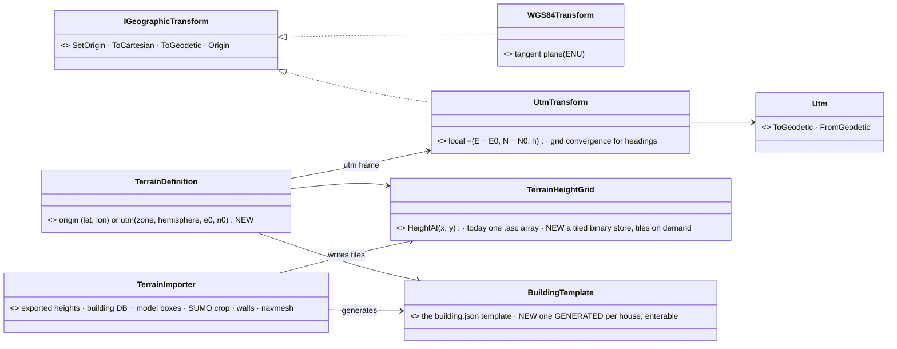
*What it shows: the frame is ONE new implementation of the existing seam — nothing that uses positions changes; the height grid and the building
template EXIST and are extended (tiled storage, generated templates); the grids sized as constants are the rest of the size problem.*

| part | the idea |
|---|---|
| frame | a terrain declares `utm {zone, hemisphere, e0, n0}`; local x = E − E0, y = N − N0 (grid north), z = height; existing terrains keep the tangent plane. ⭐ For this terrain **e0/n0 = the source engine's own origin (32N, 372 000 / 6 043 000)** so both engines' local positions are numerically identical (§5 Q-U2); convergence (−1.6…−1.7°) only at a true-north gateway |
| heights | the EXISTING `TerrainHeightGrid` gains a tiled binary store (e.g. 256 × 256 posts per tile, 16-bit + offset/scale), resampled from the input's float32 height raster at **1 m** (72 MB); loaded where heights are asked (Muscle, map hosts — ⛔ never the Brain, R-2037); the 3-D view renders it with LOD; the 2-D map gets a hillshade |
| buildings | ✅ **ENTERABLE, OPEN FLOORS** (R-4186): the importer GENERATES a `*.building.json` per house (1 988): footprint → walls; each storey ONE empty floor slab + a stair `ramp` between storeys (the existing `TerrainWalkable` slab / ramp — Building Interiors `:71-97`); the ground floor at the door points' altitude, upper floors at their window points' altitude − a ≈ 0.9 m sill; door and window OPENINGS exactly at the source points (they sit where the visual engine draws the openings, so HROT's openings match); a flat roof; no partitions |
| grids | the collider hash and the perception grid sized from the terrain's bounds, not constants |
| navmesh | baked OFFLINE by the importer, stored with the terrain, loaded as a file (also closes CE-4033) |
| sizes (estimate) | 6 × 6 km at 1 m posts = 36 M samples ≈ 72 MB (16-bit); at 2 m ≈ 18 MB; buildings unknown (Q-U3); the navmesh ≈ 62 500 tiles per layer — staged once per terrain version |

## 3. The stages (revised to §5)

1. `UtmTransform` + the terrain's frame declaration (e0/n0 = the source engine's origin) — small, independent
2. the collider and perception grids sized from the terrain's bounds (the data area is x −8000…−2000, y −2000…4000)
3. the tiled `TerrainHeightGrid` store + the importer's height path (input height raster → 1 m tiles), 3-D LOD, the 2-D hillshade
4. the building GENERATOR (1 988 enterable `*.building.json`, doors / windows from the source points), batched rendering
5. the other layers: the SUMO net cropped to the box with its anchor; walls from model instances; forest surfaces derived from tree positions
6. the offline navmesh bake incl. the interiors, stored with the terrain
7. the importer as a repeatable tool here; ⛔ the converted terrain never in git (§5 Q-U5)

## 4. OPEN QUESTIONS — for the session that knows the source data

| # | question | why it matters | lean (if any) |
|---|---|---|---|
| **Q-U1** | the HEIGHTMAP's format (GeoTIFF, ASCII grid, raw + world file …), post spacing (m), vertical datum, units | the importer's reader; memory and file size (1 m vs 2 m is 4×) | GeoTIFF; keep the source spacing |
| **Q-U2** | the UTM zone(s) and hemisphere; does the 6 × 6 km area cross a zone edge? | one zone per terrain is the simple case | one zone, chosen from the area's centre |
| **Q-U3** | the BUILDINGS: footprints with heights (shapefile / GeoJSON / CityGML LoD1) or full 3-D models (OBJ / FBX / CityGML LoD2+)? roughly how many? roof shapes, floors, interiors? | footprints extrude like today; real models need a model pipeline, LOD and instancing | footprints + heights first; models later |
| **Q-U4** | other layers: roads, vegetation / forests, water, land-use / surface type, bridges, walls | each is a separate import (surfaces feed movement and perception) | roads + surface type first |
| **Q-U5** | is the data licensed / allowed in the repo, or NAS-only? | a 100–200 MB terrain should not go into git (R-4135 allows only a small preview) | NAS / content root only, never git |
| **Q-U6** | which hosts must show it: 2-D map only, 3-D view, Stride? | decides what must render it | 2-D + the editor's 3-D first |
| **Q-U7** | do units need to path everywhere in the 6 × 6 km (vehicles AND foot), or in parts? | the navmesh size and bake time | everywhere, baked offline |
| **Q-U8** | building interiors / enterable buildings (doors, rooms) in the imported set? | today's CQB features need authored interiors | not imported; authored where needed |
| **Q-U9** | how often does the source data change — a one-off import or a repeated pipeline? | a tool vs a one-time conversion | a repeatable tool |
| **Q-U10** | does the output also go to an external engine / DIS / HLA in UTM or in lat/lon? | where grid convergence must be applied | lat/lon at the gateway, as today |
| **Q-U11** | the expected unit count and view distances on this terrain | perception and collider grid cell sizes over 6 km | — |
| **Q-U12** | is the beyond-terrain hilly band still wanted around an imported terrain, or does the import bring its own surroundings? | `BeyondGround` vs real data at the edges | real data inside; the band only outside |

---
_coordinator lane, 2026-11-09_

## 5. ANSWERS — from the source-data session *(`2026-11-09`; "verified" = read in the source data or the source engine's code, "lean" = a proposal, not a decision)*

🔒 User, `2026-11-09`: *"I would like to import all 6x6 km and convert the buildings (enterable of course)."* — so the scope is the whole source
data area and Q-U8 is decided: the buildings are imported as ENTERABLE.

🔒 User, `2026-11-09`: the converted terrain NEVER enters this git repository; it stays on a local drive (later a company content repository).
This document stays generic: it describes the source only by its formats and contents, not by product or project names.

### 5.1 The source terrain and the import input

| fact | |
|---|---|
| the source is another engine's terrain database; its internals do not matter here. What the importer reads is an **IMPORT INPUT SET** prepared from it OUTSIDE this repo (on a local drive) in plain formats: heights, building footprints with door / window points and heights, tree positions, a road network | verified (contents); the buildings' conversion to GeoJSON and their heights = still to prepare |
| ✅ the data area is **6 × 6 km: UTM 32N E 364 000–370 000, N 6 041 000–6 047 000** | verified |

### 5.2 Answers

| # | answer | status |
|---|---|---|
| **Q-U1** | **Heights:** a float32 raster with an ESRI BIL header (`.hdr`) and a JSON with origin / extents / size, in local metres (Q-U2). Source spacing ≈ **0.5 m**. **Units:** metres. **Vertical datum:** none to convert — heights are taken as-is (≈ 480–770 m in this area). | verified |
| | → the importer resamples to **1 m** (36 M posts, 72 MB as 16-bit). 0.5 m is 4× the size for no simulation gain; 2 m is coarse next to building walls | lean |
| **Q-U2** | **UTM zone 32, northern hemisphere** (WGS 84 / UTM 32N, EPSG 32632). The area is ≈ 54.50–54.55°N, 6.90–6.99°E: inside zone 32, ≈ 58 km from its western edge — **no zone crossing**. Grid convergence here ≈ **−1.64° … −1.71°**: a tangent-plane frame would be rotated ≈ 1.7° against the UTM grid (≈ 30 m at 1 km). | verified |
| | ⭐ **`utm {zone: 32, hemisphere: N, e0: 372000, n0: 6043000}`** — the local origin the other engine uses for this terrain, so HROT local positions are numerically identical to the other engine's (both run together on this terrain). The data area is then x −8000…−2000, y −2000…4000 (off-centre — the grids need bounds-based sizing, stage 2, anyway) | lean |
| **Q-U3** | **Footprints + door / window points; no interiors.** Per building: footprint polygon (local metres; median 5 vertices, max 47), DOOR and WINDOW points (position, altitude, facing heading, storey index), and a height (to be added to the input set). In the 6 × 6 km: **1 988 buildings, 5 123 doors, 75 299 windows** (1 901 buildings have windows; storeys mostly 2–3, max 7; window rows ≈ 2.7 m apart). No interior geometry exists in the source | verified |
| **Q-U4** | **Roads:** a SUMO net covering a larger area (UTM 32 WGS84) → crop it to the box (`netconvert --keep-edges.in-boundary`) and reference it from `terrain.json` `sumoNet` with **anchor (139 761.25, 162 886.77)**, so net − anchor == HROT local; `scripts/terrain-from-sumo.py` already has this shape. In the box: ≈ 145 km of roads (residential 60, unclassified 27, primary / secondary / tertiary 42, motorway / trunk 16) + 13 km of rail. **Vegetation:** individual tree positions (§9.5); no forest polygons → `forest` surfaces are DERIVED. **Water:** none in this area. **Walls / fences:** placed objects → `wall` LineStrings. **Bridges:** few → author as `slab` / `ramp`. **Also present:** tunnels, power lines, street lamps (shapefiles, UTM 32N). **Land use:** no vector land use | verified (what exists); derivations = leans |
| **Q-U5** | **✅ decided: never in this git repository.** The input set and the converted terrain stay on a local drive, later in a company content repository; only the importer TOOL lives here | decided |
| **Q-U6** | HROT runs **alongside another engine that renders the full visual scene of the same terrain**; HROT's own hosts need an engineering view only: the 2-D map (+ hillshade, footprints) and the editor's 3-D view for checking; Stride not needed for this terrain | lean |
| **Q-U7** | the whole 6 × 6 km is imported; where units must path is not stated — lean as §4 (everywhere, offline bake); the infantry navmesh inside 1 988 interiors is the expensive part | — (the user) |
| **Q-U8** | **✅ decided: enterable.** The importer GENERATES each house as a `*.building.json` template: footprint → exterior walls, a floor slab per storey, DOOR openings at the input door points (position + heading → wall + offset; storey index → level), WINDOW openings at the input window points, a flat roof (sloped roofs approximated). Scale: 1 988 enterable houses vs 164 in demo-city — door entities and the interior navmesh grow with it | decided |
| | 🔒 User, `2026-11-09`: *"I do not care about rooms on a floor. Can stay one big empty floor. At most we might need to add staircase ramp so soldier can go up."* → **✅ decided: each storey is ONE empty open floor + a stair `ramp` between storeys; no partitions.** The hard requirement is the OPENINGS: HROT soldiers enter through the same doors and look out of the same windows the visual engine draws, standing on matching floors — the input points sit where the openings are drawn. Storey floors: ground floor = the door points' altitude; upper storeys = their window points' altitude − the sill offset measured per building (typically ≈ 1 m). Doors in the visual engine never open — accepted | decided |
| **Q-U9** | a **repeatable tool** reading the input set; the building generator will be tuned iteratively | lean |
| **Q-U10** | with e0/n0 from Q-U2 the two engines' local frames are IDENTICAL, so convergence never appears between them; geodetic ↔ local on both sides is standard WGS84 UTM (the same as `Utm.cs`), so lat/lon at a gateway agrees to sub-mm; convergence matters only where a heading is exchanged relative to TRUE north (DIS/HLA, lat/lon gateways) — apply the −1.6…−1.7° there | verified / lean |
| **Q-U11** | not known here | — (the user) |
| **Q-U12** | outside the 6 × 6 km there is no real data → real data inside, `BeyondGround` outside, as leaned; the heights at the edge should blend into the band | lean confirmed |

### 5.3 Correction to §1

- ⚠ §1 "⛔ no heightmap" is out of date: `FDP/Toolkits/Fdp.Toolkits/Terrain/TerrainHeightGrid.cs` (CE-1034, `DESIGN_Terrain_Height.md`) already loads ONE ESRI ASCII `.asc` grid per terrain (`basic-desert`, `highway-rest` use it). What is missing is a TILED / large heightfield — 6 × 6 km at 1 m is 36 M floats (144 MB) in one array, plus an equally large render mesh.

### 5.4 Still open — for the user

1. ~~the INSIDE of the generated houses: open-plan storeys, or a procedural room + stair layout (Q-U8)~~ ✅ decided `2026-11-09`: open floors + a stair ramp (Q-U8)
2. expected unit counts / view distances (Q-U11) and where units must path (Q-U7)

| # | ⭐ coordinator's lean `2026-11-09` | rejected — one line |
|---|---|---|
| 1 | **open-plan storeys + ONE stair per house first** (enterable, clearable, cheap to generate and to bake); a procedural room / corridor generator later, as its own stage, if the CQB drills need rooms | rooms first: new generator work before anything is enterable |
| 2 | **paths everywhere outdoors + inside every generated house**, baked offline; unit counts and view distances decide the grid cell sizes in stage 2 — until known, size for the largest shipped scenario (`perf-stress`: 1 000 soldiers) | a partial navmesh: a unit ordered outside it silently cannot move |


## 6. ⭐ The prior designs this builds on — the corpus sweep *(coordinator, `2026-11-09`; the user: "check the design documents for the related terrains so you do not repeat the error")*

INVENTORY: the `docs/` file names matching terrain · height · building · nav · zone · ground · world · geo · staging · content (44 files), their
STATUS lines read; `grep -l TerrainWorld docs` (40 files); `.dev/_DONE/{navig-2, map-features, stride-1}`; the classes confirmed in code
(`TerrainHeightGrid`, `NavTileCache`, `Utm`). ⚠ `check_index_coverage` is not available through the CLI.

| design | applies — how | ✏ what it changes in §2 / §3 |
|---|---|---|
| [Terrain World](DESIGN_Terrain_World.md) §2 (the world file), ⭐ §9 SPARSE TERRAIN (S1–S7 ✅ R-4051; CE-4011, CE-4012 deferred) | ✅ **directly**: S1 an `outer` ground block (flat / coarse grid / SUMO lattice) · S2 `insets[]`, each a rectangle with its own height grid and navmesh bounds · S3 the ground query picks the inset, else the outer ground, blended at the edge · S4 the mesh and navmesh PER INSET · S5 each inset an implicit fidelity zone · S6 every inset loaded at terrain load (streaming = the zone 2PC, later) · ⭐ S7 float local metres are precise enough to hundreds of km — **no double precision needed** | the 6 × 6 km area is **ONE INSET** (S2); Q-U12's "real data inside, a band outside" is **S1's outer ground**; ⇒ **CE-4011 + CE-4012 become PREREQUISITES of this import** (stage 0), not new inventions. What §9 does NOT cover and this design adds: a TILED height store INSIDE one large inset, the UTM frame, the building generator |
| [Terrain Height](DESIGN_Terrain_Height.md) (CE-1034; §8 the ambient ground outside, A1–A4 ✅ R-4050) | ✅ the ONE `TerrainHeightGrid` (ESRI ASCII, one array) and the outer-ground height fallback (A1) and the straight open-ground legs between areas (A2) | the tiled store EXTENDS this class (as §2 now says); the outer ground's heights use §8 A1 |
| [World Query Seam](DESIGN_World_Query_Seam.md) (WQ-A…WQ-H ✅ R-253; Bepu for objects, a plain grid for heights) | ✅ every height / trace / LOS reader (31 production files) goes through `IWorldQuery` | the import adds DATA behind the seam; ⛔ no reader learns about tiles or UTM |
| [Navigation v2](designs/navig-2/Navigation_Design_v2_0.md) §14 P2 + [AQ71](blueprints/Architect_Question_71_Terrain_Zones_And_The_Asset_Build.md) R7 | ✅ the bake is tiled (24 m) and **`NavTileCache` is BUILT** (`NavTileCache.cs:35`: memory + a local folder, key = layer, tile x/z, the hash of the tile's inputs) | "bake offline" = the importer **pre-fills the tile cache** that ships with the terrain (same keys) — ⛔ not a second navmesh store |
| [Terrain Zones and Assets](DESIGN_Terrain_Zones_And_Assets.md) (zones are windows, R-146; fidelity zones §11, R-4042) | ✅ the terrain is the content pack; an inset is an implicit fidelity zone (§9 S5) | nothing new |
| [Building Interiors](DESIGN_Building_Interiors.md) | ✅ the `*.building.json` template the generator writes | the generator's output must pass the templates' own validation; 1 988 houses × doors is a scale its door / room systems have not seen — measure in stage 4 |
| [Geo Origin](DESIGN_Geo_Origin.md) (R-229) | ✅ the ONE origin and `IGeographicTransform` | `UtmTransform` is its second implementation |
| [Artifact Staging](DESIGN_Artifact_Staging.md) · [Content Layout](DESIGN_Content_Layout.md) | ✅ how a terrain reaches every node; where it lives | the terrain stays OUTSIDE git (Q-U5) — the content root is configured, not the repo copy |
| [AQ93 SUMO](blueprints/Architect_Question_93_Sumo_Traffic_Node.md) E1 (R-4025) | ✅ `Utm.cs` and the net anchor | the SUMO crop + anchor of Q-U4 |
| [Map 3D Mode](DESIGN_Map_3D_Mode.md) (`BeyondGround`, the apron) · [Terrain Combat Tuning](DESIGN_Terrain_Combat_Tuning.md) · [World Survey Sensor](DESIGN_World_Survey_Sensor.md) · [Body Geometry and Ground Contact](DESIGN_Body_Geometry_And_Ground_Contact.md) | ✅ consumers of the world model — unchanged by construction (they read `TerrainWorld` / `IWorldQuery`) | the 3-D view's LOD for a 6 km ground is new work in Map 3D Mode |
| [PLAN 3D World and Realism](PLAN_3D_World_And_Realism.md) | ⛔ its roadmap has no large-terrain phase — this import is a new line in it | add it there when this design is approved |

### 6.1 ✏ The stages, re-based on §9 *(supersedes §3's list)*

0. **CE-4011 + CE-4012** — Terrain World §9 S1 (outer ground) and S2–S4 (insets, per-inset ground and navmesh): the approved, deferred groundwork
1. `UtmTransform` + the terrain's frame (e0/n0 = the source engine's origin)
2. the collider and perception grids at 6 km: they already fit the terrain (§4.4) — check the cell SIZES (≈ 20 m / 30 m with today's counts) against 1 000 soldiers, and raise the counts if a rail shows crowding; ⭐ AND the long-range engagements of §7 (R-4189): sight at 2–8 km for vehicles, AT teams and aircraft by a direct list, the LOS trace cost over 2–3 km of heights + buildings, a rail per weapon at its range (tank gun 3 km, ATGM 2–5 km, SAM 5 km)
3. the TILED store inside one large inset's `TerrainHeightGrid` + the importer's height path (1 m), the 3-D LOD, the 2-D hillshade
4. the building generator (1 988 enterable templates: open floors + one stair ramp, openings at the source points — R-4186), measured against Building Interiors' door systems at that scale; ✅ the complete door / window point set is prepared in the input set (outside this repo)
5. the other layers (the SUMO crop + anchor, walls, derived forest surfaces)
6. the importer pre-fills the `NavTileCache` per inset (interiors included)
7. the importer as a repeatable tool; ⛔ the converted terrain never in git


## 7. ✅ Decided `2026-11-09` — paths and units *(R-4187)*

🔒 User: *"A walkable anywhere, outdoors and inside, computed once, no more than 1,000 soldiers, but cars, aircraft, anti-aircraft. This needs to
work. For the soldiers, they do not need to see across the whole city … They are interesting just a few hundred meters away from each other. But the
aircraft should see them, and the anti-aircraft should see the aircraft."*

| decision | ⇒ for the build |
|---|---|
| **walkable everywhere — outdoors and inside every house — computed ONCE** | the importer pre-fills the `NavTileCache` for the whole inset, every layer (infantry, vehicles), interiors included (§6.1 stage 6) |
| **≤ 1 000 soldiers, plus cars, aircraft and anti-aircraft** | the collider and perception grids at 6 km (stage 2) are checked against this load |
| **soldiers sense each other to a few hundred metres** | the perception grid's ≈ 30 m cells at 6 km are fine for that range |
| **aircraft see ground units; anti-aircraft sees aircraft — kilometres, across the whole area** | ⚠ to MEASURE in stage 2: how the air sensors (`SensorModality.Radar`, the Air Operations design) find targets beyond the soldiers' local grid — air ↔ ground and AA ↔ air must not depend on a few-hundred-metre grid; with a handful of aircraft a direct list is cheap |
| ✏ **long-range ground fire must work** (R-4189) — 🔒 *"the anti-tank weapons, the missiles, needs to work at proper distance, so it could be maybe 2,000 meters … same with the tank cannon"* | 📐 the DATA already holds it: `120mm_M256` 3 000 m (the M1 sights 8 000 m), `125mm_2A46` 2 800 m, Javelin 2 500, TOW 3 750, Kornet 5 000, NLAW 800, Stinger / Igla 4 800–5 200, ZU-23 2 500 (`NedTkbCatalog.cs:403-761`). ⚠ what stage 2 must MEASURE on the 6 km heightmap: ① **sight at 2–8 km** — a sensor of that range covers the whole perception grid (≈ 30 m cells), so a per-cell scan is the wrong shape: vehicles, AT teams and aircraft need the same long-range path as air ↔ ground (a direct list — at most a few hundred of them); ② **the line-of-sight trace over 2–3 km of 1 m heights + buildings** — its cost per pair and how many pairs a second, budgeted / spread over frames; ③ **a round or missile flying 3 km** through the collider grid (≈ 20 m cells) and the missile flight times (TOW ≈ 15 s) — a rail per weapon at its range |

### 7a. ⭐ The performance take — no new engine; three measured upgrades *(coordinator, `2026-11-09`; the user: "I guess with those requirements we would need to switch to some heavy optimized mechanism for line of sight and maybe even navigation … use the BEPU physics much more intensively than now … What's your take?")*

| measured | where |
|---|---|
| ⭐ OBJECTS (buildings, walls, slabs, door leaves) are already indexed by a Bepu bounding-volume tree: on a 12 800-prism town a 100 m sight line **234 → 1.2 µs**, a 400 m one **251 → 2.1 µs**, fire alike; the index builds in 25 ms; 0 B per warm query — and it is ATTACHED in production (`TerrainResidency.Indexed`, CE-3279) | [World Query Seam](DESIGN_World_Query_Seam.md) §5a (Debug, indicative) |
| ⭐ the GROUND is a grid march, by decision: a 300 m ground trace on a 2 m grid **11.9 µs**; the same height grid as a Bepu MESH (2 km at 2 m) was **2.6 µs but +477 MB and a 10 s build** — rejected | same §5a; Terrain Height TH-B / TH-D |
| the navmesh is DotRecast, tiled (24 m), with the built `NavTileCache` and copy-on-write snapshots | Navigation v2 §14 |

| question | ⭐ take | rejected — one line |
|---|---|---|
| line of sight vs BUILDINGS | ✅ **already the optimized mechanism** — the Bepu object index scales with the pieces a line passes, not the town's size (×100–190 measured); 1 988 houses are well inside what was measured | a new LOS engine: the index is the right shape and is built |
| line of sight vs the GROUND at 2–3 km on 1 m heights | ⚠ the plain march grows with length: by extrapolation ≈ 3 000 steps ≈ 0.2 ms (Debug) per 3 km line. ⭐ **a max-height pyramid** (a coarse "highest point in this block" level per 8 × 8 / 64 × 64 posts) lets the march skip every block the line clears — ≈ tens of steps instead of thousands, identical answers, a few MB | the height grid as a Bepu mesh: ≈ 36 × the measured 477 MB at 6 km × 1 m — not affordable |
| HOW MANY long-range checks | ⭐ the real cost is pairs × length: a few hundred long-range viewers (vehicles, AT teams, aircraft, AA) × the targets in their range — **check only in range and in the field of view, each viewer re-checks a target on a slow cadence (e.g. 2–4 Hz, spread over frames), on worker threads** (perception already runs off the frame) | every pair every frame: tens of thousands of 3 km traces a frame |
| NAVIGATION | ✅ **keep DotRecast** — tiled, cached, swapped copy-on-write; ⚠ to MEASURE: a 6 km path's search cost (DotRecast's node budget may cut a very long path); ⭐ if it does, a **coarse route first** (the road graph for vehicles — SUMO's — or a tile-level graph) and DotRecast only for the local legs | a new navigation engine: nothing measured says DotRecast fails here |
| BEPU "more intensively" | ⭐ **more of the SAME use** — the index, extended to entity boxes (WQ-F: vehicles as moving occluders) — ⛔ not Bepu as a rigid-body physics simulation (nothing in these requirements needs simulated bodies) and ⛔ not Bepu as the height field | Bepu dynamics for vehicles: a different engine's job (R-250) |

⇒ stage 2 measures exactly these on the imported terrain before anything is built: a 3 km ground trace, the pair budget at 1 000 soldiers + a few hundred long-range viewers, a 6 km path. The pyramid and the coarse route are BUILT only if the measurement asks for them.

## 8. ✅ APPROVED `2026-11-09` (R-4188) — DESTRUCTIBLE BUILDINGS *(coordinator; D-1…D-8 and Q-D1…Q-D4 accepted by the user — "accepted. The wall removal is fine"; D-7 REVISED: a collapse REPLACES the building, in stage 1)*

🔒 User: *"I would like to support destructible buildings. That means that the building can lose some of its walls. I'm not sure how we could do that
exactly, maybe by removing that part of wall and making it a window, actually a big one. I'm not sure if we can actually remove floor. The destruction
is usually the outcome of a bomb explosion or sometimes a breach using some explosive hitting the wall. Could be a tank shell, artillery shell, or
some missile hit."*

| measured — what already exists | where |
|---|---|
| ⭐ a wall is a `TerrainWallPanel` (segment, thickness, base..top) with an `Openings[]` list — doors and windows ARE openings | `TerrainBuildings.cs:39-61` · [Building Interiors](DESIGN_Building_Interiors.md) §2 (`TerrainWallPanel *-- TerrainOpening`) |
| ⭐ the building design already NAMES this: *"E3 damage to the building itself — v1: a door can be Destroyed (already a `DoorState`); wall breaching = changing geometry at runtime → later"*, waiting on the navmesh's P2 | Building Interiors `:38, :365` |
| ⭐ runtime GEOMETRY change is DESIGNED and half BUILT: *"a breached wall, a crater, a collapsed building — copy-on-write: rebuild off-thread, swap one immutable snapshot"* — P1 the snapshot ✅, P2 tiles + `NavTileCache` ✅, P3 replan (with 5d) not built; the CHANGE itself (AQ81 T6) not built | [Navigation v2](designs/navig-2/Navigation_Design_v2_0.md) §14 (R-218) |
| a blast already acts on doors (a door can be destroyed by a blast) and a tall wall already shades a blast | `AreaEffectSystem.cs:346` · `AreaEffect.cs:93-96` |
| a hit already crosses walls by penetration vs the material's resistance | [Terrain Combat Tuning](DESIGN_Terrain_Combat_Tuning.md) §3 |
| destruction is the MUSCLE's: the brain never reads world geometry | R-2037 |

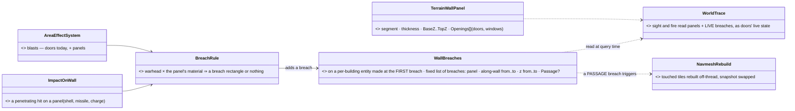
*What it shows: a breach is the user's "big window" — ONE more opening on the existing wall panel, kept as WORLD STATE (recorded, replicated, saved,
restored by a checkpoint) beside the static content, exactly as a door's live state sits beside its static definition. Sight and fire see it at once;
only a breach big enough to walk through touches the navmesh, through the copy-on-write rebuild Navigation v2 §14 already designs.*

| # | ⭐ lean | rejected — one line |
|---|---|---|
| **D-1** | **a breach = an extra opening on a wall panel** (the user's "big window"): a rectangle clipped to the panel and its storey | deleting the panel: a wall is rarely gone whole; a new geometry kind beside openings |
| **D-2** | a breach whose bottom reaches the floor and is ≥ 0.8 × 1.8 m is a **PASSAGE** (walkable — the navmesh changes); smaller is a **HOLE** (sight and fire only, no navmesh change) | every breach walkable: a shell-sized hole is not a door |
| **D-3** | **world state**: a `WallBreaches` component (UNMANAGED, a fixed list per building — recorded, R-2084 / new-components rule) on a per-building entity created only at the FIRST breach ⇒ 1 988 houses cost nothing until one is hit; owned by the Muscle that decided it; replicated, saved with the scenario (a scenario may start pre-breached), restored by a checkpoint | breaches in the terrain content: content is NoReplay (R-3043) — a replay would show the walls whole |
| **D-4** | **who breaches — the Muscle, by ONE rule** (warhead × the panel's material): a blast near a wall (bombs, artillery, a breaching charge) through `AreaEffectSystem` (doors already), a penetrating hit (tank shell, missile) at its hit point | the brain asks for a breach: R-2037 |
| **D-5** | **size by warhead** (tunable data, the material's resistance scales it): breaching charge ≈ a 1 × 2 m passage · tank / missile ≈ a 1–1.5 m hole · artillery shell ≈ 2–3 m · a heavy bomb close by ≈ the whole panel of that storey | one size for every weapon |
| **D-6** | sight and fire read the live breaches at QUERY time (as `DoorAwareQueryFilter` reads live doors); a passage triggers Nav v2 §14's copy-on-write rebuild of the touched tiles (seconds, off the frame) — building **P3 replan** (5d) is part of this work | rebuilding the navmesh on the frame: the CE-4033 stall |
| **D-7** ✏ R-4188 | ⛔ **no floor removal, ever in v1** — 🔒 user: *"if the building collapses after being hit by a bomb from an aircraft, maybe it is easier to just replace the building with some destroyed model which is not enterable … no floor removals, but the whole building replacement"* ⇒ **IN STAGE 1: a COLLAPSE replaces the whole building** with a RUBBLE MOUND — the EXISTING solid, non-enterable `TerrainPrism` kind (`TerrainWorld.cs:10`; Building Interiors: *"solid prisms stay valid for walls and non-enterable buildings"*): the footprint at a reduced height (≈ ⅓ of the building), no doors, no floors; units inside are casualties; the building's doors are gone. It is ONE more state on the same per-building entity (`BuildingState: Intact · Collapsed`, recorded, replicated, saved, restored), read at query time like the breaches; its tiles rebuilt through the SAME copy-on-write path (Nav v2 §14) — one building's tiles at once. HROT's own 2-D / 3-D draw the mound; the external engine swaps its model on the same published state (D-8) | removing floor slabs: units falling, stairs hanging, a navmesh changing storey by storey · a modelled ruin per building: no data for it, a mound does the job in the sim |
| **D-8** | the EXTERNAL visual engine must draw the breach — HROT publishes `WallBreaches` like any replicated state; how that engine consumes it is outside this repo | — |

| # | question for the user | lean |
|---|---|---|
| **Q-D1** ✅ | walls in v1 (holes and passages) **AND the collapse as a whole-building replacement by a rubble mound (D-7, revised)**; no floor removal | accepted |
| **Q-D2** ✅ | the sizes per warhead (D-5) as the starting table, tuned in data | accepted |
| **Q-D3** ✅ | breaches and collapses persist for the whole exercise (no repair), are saved with a scenario and restored by checkpoints | accepted |
| **Q-D4** ✅ | every building — the imported 1 988 and today's authored ones — one rule | accepted |

⇒ it is its own stage (after the importer's buildings, stage 4) — walls AND collapse together; it also delivers Building Interiors' E3 for today's terrains. The collapse trigger: a heavy bomb (or an equivalent blast) close enough by the D-5 rule — a threshold in the same data table.

### 8.1 📐 The breach at runtime — sequence, modules, what Nav v2 §14 P3 must add *(L-8, CE-4370, backend `2026-11-09` — DESIGN ONLY, ⛔ not built)*

<!-- build-state: READY-TO-BUILD (§8 + §8.1) -->

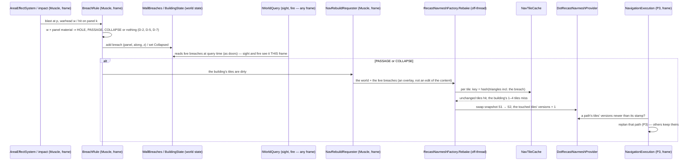

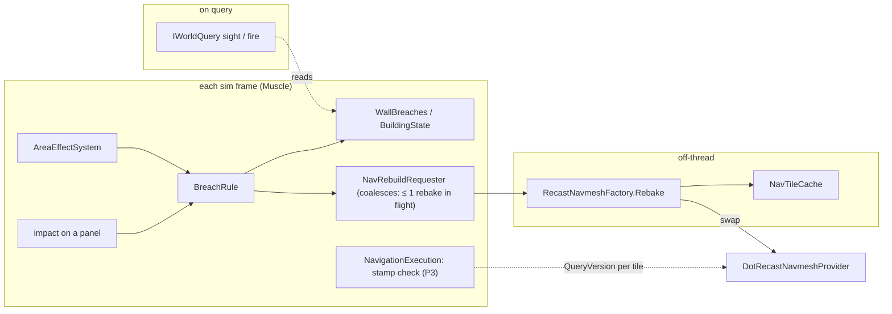
*What it shows: only BreachRule and the stamp check run per frame; the rebake is off the frame; sight and fire never wait for the navmesh.*

**What Navigation v2 §14 P3 must add for this** (named here; built with stage "destruction"):

| # | P3 addition | why (measured / from §14) |
|---|---|---|
| P3-a ✅ S-3 (§8.5) | **per-TILE versions** in the snapshot (today one `QueryVersion` for the whole provider) and a path stamped with the versions of the tiles it crosses | one breach must not replan 1 000 soldiers' paths across 5.5 km — only those through its 1–4 tiles |
| P3-b ✅ S-3 (§8.5) | `NavigationExecution` checks the stamp each frame (an integer compare per moving entity, no allocation) and replans the stale path | §14's PathReplanCheck, made per tile |
| P3-c ⛔ superseded by B-10 (built as §8.5 #1) | **a rebake input = the content world + the live state overlay** (breach openings as extra `TerrainOpening`s on their panels; a collapsed building's panels and slabs replaced by its rubble prism) — the content (`TerrainWorld`, NoReplay) is never edited | D-3: breaches are world state, replayed and restored; the overlay is rebuilt from them after a checkpoint restore |
| P3-d ⛔ superseded by B-10 (the P-7a bake, §8.5 #2) | a **coalescing requester**: at most one rebake in flight; breaches arriving meanwhile join the next one | artillery: tens of breaches a minute — one rebake each would queue unboundedly |
| P3-e ✅ S-3 (§8.5) | units standing in a collapsed building: removed from the navmesh's agent set before the swap (they are casualties, D-7) | a path from inside a mound has no start polygon |

⚠ To measure when built (L-4's rig): rebake seconds for one building's tiles on `scale-1` with the cache warm, and the replans per breach.

### 8.2 📐 The build design — classes, the frame, the navmesh *(S-0 of CE-4391, coordinator `2026-11-10`; refines §8 / §8.1 within R-4188)*

<!-- build-state: BUILDING (§8.2) — S-1 (breaches) BUILT `2026-11-10`, see §8.3; S-2 (collapse) BUILT, see §8.4 · S-3 (navmesh) BUILT, see §8.5 · S-4 save / load BUILT, see §8.6 (drawing = CE-4392) · S-5 demo + numbers BUILT, see §8.7 (scale-1 numbers: backend's Windows machine) still to build -->

**INVENTORY** *(graph re-indexed `2026-11-10`; `scripts/cbm.sh search_graph`, production hits only; coverage could not be checked — the CLI has no `check_index_coverage`)*

| query | total | what it holds |
|---|---|---|
| `.*Breach.*` (Class) | 3 | only `BreachDoorBehavior` (+ its blackboard, its params DTO) — doors, ⛔ nothing for walls |
| `.*Collapse.*` (Class) | 19 | all Blueprint / node-editor graph collapse — ⛔ nothing for buildings |
| `.*Rubble.*` · `.*WallDamage.*\|.*BuildingDamage.*\|.*BuildingState.*` · `.*PathStamp.*\|.*TileVersion.*` | 0 · 0 · 0 | NEW |
| `.*Destruct.*` (Class) | 6 | entity lifecycle (`DestructionOrder`, `DestructionAck`, …) — not geometry |
| `.*DoorState.*` | 27 | ⭐ `DoorState` + `TerrainObjectKey` + the `DoorStates` view (`TerrainObjects.cs:16-206`), `EntityDoorState` egress/ingress, `DoorCommandSystem` |
| `.*CloudTable.*` | 3 | ⭐ `CloudTable` (`AreaEffectClouds.cs:95`) — a RUNTIME-created replicated entity its creator owns, read through a per-view table: the precedent for a damage entity made by a blast |
| `.*Rebake.*` | 13 | `RecastNavmeshFactory.Rebake` (`:86`), `DotRecastNavmeshProvider.Rebake` (`:313`); ⭐ the tests named `P7a_*` led to `StaticObstacleBakeSystem` (`Hrot.Core/Services/StaticObstacleBake.cs:49`) + `TerrainResidency.BakeObstacles` (`:498`) |
| `.*Replan.*` | 30 | Nav v2 §3.4 / §5.4 design sections, `NavigationConstants` — ⛔ no per-tile stale-path check |
| grep `DoorStates` (production) | 29 files | every sight / fire / path / sound / EQS caller already passes ONE `DoorStates` — see B-3 |
| grep `Doors.Count > 0` | 9 | the gates that build `DoorStates` only when the terrain has doors (B-3 must widen 3 of them) |

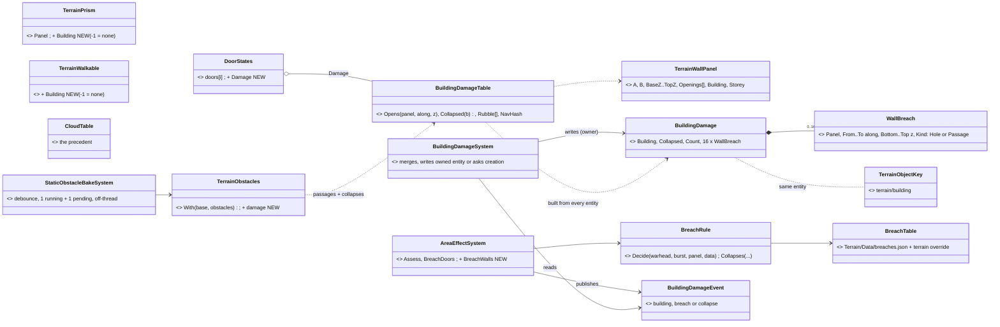
*What it shows that the prose cannot: there is no new query path and no new rebuild pipeline. The damage rides the ONE object every sight / fire caller
already passes (`DoorStates`), and the navmesh follows through the obstacle bake that already exists. The genuinely new boxes are the
component, the view, the rule, its data, and one system.*

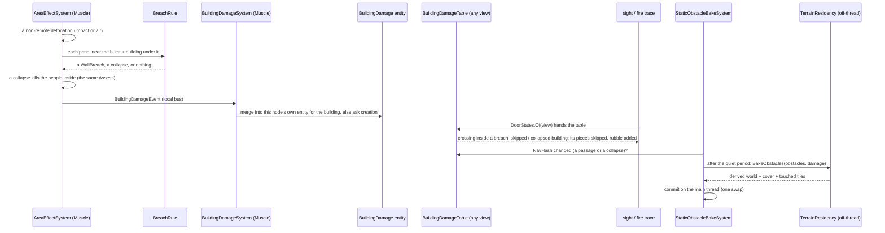
*What it shows: sight and fire see a breach in the frame after it is written (the entity write, then the table). Only a passage or a collapse
reaches the bake, and the bake never runs on the frame.*

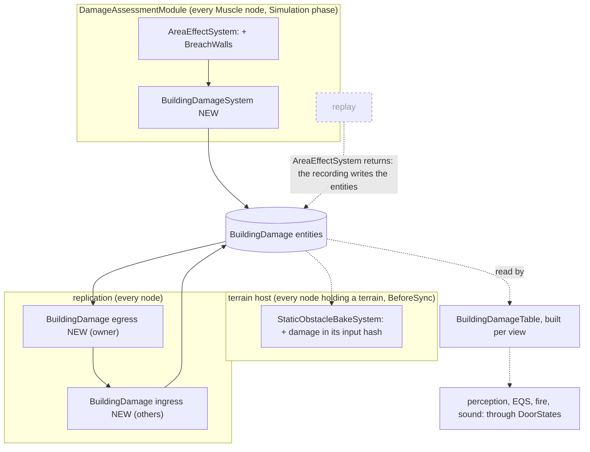
*What it shows: the breach is DECIDED only where the detonation is local. Every other node, and a replay, gets the entities by replication or from the
recording, so the table and the bake behave the same everywhere. The dashed edge is the deciding side that never runs during a replay
(`AreaEffectSystem.cs:51`).*

| # | decision (within R-4188) | rejected — one line |
|---|---|---|
| **B-1** | ⭐ **ONE component, `BuildingDamage`**: R-4188's `WallBreaches` and `BuildingState` (both per building, written by the same rule, read by the same view). `[DataPolicy(NoScenario)]`; it is saved through the `TerrainObjects` section like a door (B-7) | two components on one entity: two descriptors and two readers for one fact |
| **B-2** | ⭐ **one entity per (building, deciding node)**, made at that node's first breach of the building, owned by it. The view UNIONS every entity with the same building. ⇒ no cross-node request and no creation race: two Muscles breaching the same untouched building in the same frame each make their own. Single-Muscle runs (editor, one CGF) have exactly one per building, as D-3 says | one entity per building: the first breach needs an owner to ASK, but a building with no entity has no owner, and two nodes would race to create it |
| **B-3** | ⭐ **the table rides `DoorStates`** (`DoorStates.Damage`, built and cached in `DoorStates.Of`). All 29 production readers get breaches with no signature change. The 3 gates that build `DoorStates` only for terrains with doors (`TerrainWorldQuery.cs:52`, `WorldSurveySolve.cs:118`, `AcousticPerception.cs:284`) widen to "doors OR damage". ✏ built as "doors OR buildings" (`TerrainWorld.HasLiveState`) — see §8.3 row 5. A later Roslyn rename `DoorStates` → `TerrainLiveState` is left for later | a second parameter beside `doors` through ~30 files: every caller has to remember it (the SILENT-DEFAULT pattern) |
| **B-4** | **capacity 16 breaches per entity** (24 B each, ≈ 400 B per entity). D-5's largest breach short of a collapse is one storey's panel; 16 is four facades × four storeys hit once. A new breach overlapping one already on the same panel and storey is MERGED into it (the union rectangle), so a barrage on one wall does not fill the list. ⭐ Past 16, the owner opens a second entity for the same building; B-2's union already reads it | a bigger fixed list: every entity pays for the worst case · a merge-to-whole-panel rule: it loses shape the view can keep |
| **B-5** | **the deciding point is the detonation**: a tank HE shell, a missile, a charge or a bomb hitting a wall already raises a `DetonationNotification` at its hit point, so `AreaEffectSystem` alone decides walls, as it decides doors (`:355`). ✏ **S-1 measured it: true, with a stand-off** — a warhead round that STOPS at a wall bursts `AreaEffect.BurstStandOffMetres` (0.1 m) back along its flight (`BallisticsSystem.cs:239`, then `Detonate` `:304`), so d ≈ 0 against the wall it hit; one that PENETRATES the wall bursts where it stops (inside the room or beyond), and then the rule breaches whatever panel is within reach of THAT point (§8.3 row 12). ⛔ A kinetic round (no explosive) makes NO breach in v1: a sabot's hole is too small to change sight or movement | a second hook in `BallisticsSystem` / `HitResolutionSystem`: two deciders for one rule |
| **B-6** | **the rule, scaled distance**: Z = d / ∛kg (d = the burst to the panel, the line clear but for the panel itself, as `BreachDoors` tests — ⛔ SUPERSEDED in part by §8.3 rows 2 and 3: the line is traced to the panel's NEAR FACE, and a row's size also scales with ∛(kg ÷ referenceKg)). The table gives rows {kind, Z-max, width, height, passage?}. The size scales by (concrete ÷ the material's `ResistanceMmRhaPerMetre`)^½, clamped 0.5…2. **Collapse:** ≥ `collapseMinKg` with the burst within Z-collapse of the footprint. Starter rows from D-5: charge ≈ 1 × 2 m passage at contact · HE shell 1–1.5 m hole · artillery 2–3 m · ≥ 100 kg ⇒ the whole storey panel · ≥ 200 kg within ½ ∛kg m ⇒ collapse. All of it is DATA (`Terrain/Data/breaches.json`, embedded beside `materials.json`, overridable per terrain like the materials) | per-weapon rows: the TKB already gives each warhead `ExplosiveKg` and `Kind`, and one table keyed on them covers every future weapon |
| **B-7** | **saved like a door**: the `TerrainObjects` section gains `"breaches": [[panelInBuilding, from, to, bottom, top, kind], …]` and `"collapsed": true` under `"<terrain>/<building>"`. A load creates one entity per saved building (`TerrainObjectRequests`, as `ForDoors`) ⇒ a scenario may start pre-breached (Q-D3). The panel is saved as its index WITHIN the building (stable across terrain versions that add buildings); the runtime holds the global panel index | runtime global indices in the file: one more house in the terrain shifts every index after it |
| **B-8** | **sight / fire / segment test**: when a crossing of a panel prism lies inside a breach on that panel (its mid-point projected along the panel, and z), it is skipped. A collapsed building's prisms and walkables are skipped (`TerrainPrism.Building` / `TerrainWalkable.Building`, NEW, set by the expander), and its rubble prism is crossed instead. One `bool[]` lookup per panel crossing; ⛔ no allocation (`GC.GetAllocatedBytesForCurrentThread() == 0` rails) | re-expanding the panel's prisms on the frame: an allocation per breach on the hot path |
| **B-9** | **rubble** = the EXISTING solid `TerrainPrism` (`Kind = Building`, the footprint, from the base to ⅓ of the roof height, material `rubble`, a new row in `materials.json`). The doors of a collapsed building read Destroyed in the view | a new prism kind: every reader would need to learn it |
| **B-10** | ⭐ **the navmesh reuses the P-7a obstacle bake**: `StaticObstacleBakeSystem`'s input hash gains `BuildingDamageTable.NavHash` (passages + collapses only; a hole changes no walkable). `TerrainObstacles.With(base, obstacles, damage)` re-expands the breached panels with the passages as extra `Gap` openings, drops the collapsed buildings' prisms and walkables, and adds their rubble. ⛔ It never removes or reorders `Panels`, `Doors` or `Buildings`, so every index stays valid. Debounce, one bake running + one pending, off-thread, main-thread commit: all already built. ✏ **This supersedes §8.1's `NavRebuildRequester`, P3-c and P3-d** (that box is not needed). P3-a/b (per-tile versions, stale-path replan) and P3-e stay NEW, for S-3 | a second coalescing bake pipeline beside P-7a: two implementations of one thing (ruling 9) |
| **B-11** | **replicated** by a new descriptor `dtBuildingDamage` (owner → every node; the next free ordinal), with egress / ingress translators that copy the `EntityDoorState` pair, and a TKB type `BuildingDamage`. Recorded by bytes (unmanaged); restored by a checkpoint; the bake follows the restored entities through B-10's hash | — |

| **B-12** ✏ R-4196 | ⭐⭐ **DESTRUCTION HAPPENS ON THE MUSCLE ONLY; every other node only DRAWS it.** 🔒 User, `2026-11-10`: *"i need the destructions to happen on muscle role node (other has terrain just for displaying their map, no querying or modification allowed)"*. As built: deciding (`AreaEffectSystem` + `BuildingDamageSystem`, both in `DamageAssessmentModule`) is installed only by `SimHostCoreLogicPack` (`SimHostCoreLogicPack.cs:116`), and that pack is built only by `MuscleRoleInputs.cs:68`; only a LOCAL detonation decides (`evt.IsRemote` is skipped); the damage entity is owned by the muscle that decided it (no ownership group, `NedOwnershipGroupBinding`); every other node receives it by ingress (`EntityBuildingDamageTranslators`). ⛔ **The gap, closed in S-3:** `StaticObstacleBakeSystem` is installed on EVERY node holding a terrain (`EntityCreationPack.cs:123`), so the damage overlay must be baked only on a node with a navmesh (the muscle) — a display node's terrain is NEVER rewritten by damage; it draws breaches and rubble from the replicated entities (S-4) | baking the overlay wherever a terrain is resident: it modifies the display node's terrain, which the user forbids |

⚠ Known limits, said: ✏ S-3 — the world queries `SurfaceZ` / `SurfacesAt` / `InsideFootprint` are right once the bake has committed (§8.5 #6); only the time until the bake (0.5 s debounce + the off-thread bake) is a limit. Sound's PORTAL graph does not learn breaches (its trace part does). Both
are recorded here and left for later.

### 8.3 ✅ AS BUILT `2026-11-10` — S-1 (breaches: the rule, the entity, the view, the traces, the wire) *(CE-4391, coordinator)*

**Matched §8.2:** one `BuildingDamage` per (building, deciding node) · the table rides `DoorStates.Damage` · the rule on scaled distance as data · the Muscle decides in `AreaEffectSystem` · a breach is one more opening seen by sight / fire at query time · merge, capacity 16, a second entity past it · `dtBuildingDamage` + a TKB type · recorded by bytes (a keyframe round-trip rail). **Not built (later slices):** collapse and rubble (S-2: the `Collapsed` byte, `collapseMinKg` and `collapseZ` exist and are unread) · navmesh and P3-a/b/e (S-3) · save / load and drawing (S-4: B-7) · the demo (S-5).

| # | what was built | file:line | vs §8.2 |
|---|---|---|---|
| 1 | `BuildingDamage` (unmanaged, `Capacity` 16, parallel fixed arrays, `Collapsed` byte), `WallBreach`, `BreachKind`, the merge rule `BuildingDamages.Add` (atomic, reclassifies a merged union, allocation-free), TKB `7203`, component id `485` (`GlobalComponentIds.cs:1286`) | `Terrain/BuildingDamage.cs:51`, `:107` | as designed (B-1, B-4). A merge re-decides the union's kind (two holes can make a passage) |
| 2 | `BreachRule` (static, pure: `TryDecide`, `Classify`, `Reach`, `MaterialScale`) | `Terrain/BreachRule.cs:10` | ✏ **deviation from B-5/B-6.** "Line clear except the panel itself" was specified as "every `FireCrossing` is that panel's own prism" — ⛔ a `FireCrossing` names its building and storey, NOT its panel (it carries `Label`, `Building`, `Storey`; the prism's `Panel` is dropped), so the test cannot be written. Built instead: `AreaEffectSystem.LineClearToFace` traces the burst to a point just OUTSIDE the panel's near face and requires ZERO crossings |
| 3 | `BreachTable` + embedded `Terrain/Data/breaches.json` (`minKg` 0.5, `referenceKg` 8, rows, `collapseMinKg`/`collapseZ` unread); a terrain folder's own `breaches.json` overlays it key by key (`TerrainAssets.Breaches` → `TerrainWorld.Breaches`) | `Terrain/BreachTable.cs:17`, `Terrain/Data/breaches.json` | ✏ **deviation from B-6.** A row's width / height are metres for an 8 kg charge and scale with ∛(kg ÷ 8) (so 3.4 kg → 0.75×, 100 kg → 2.3×), then with the material (√(1500 ÷ resistance), clamped 0.5…2). Rows gained `kgMin` and `wholePanel` (the ≥ 100 kg "whole storey panel"), the table `minKg`. The per-terrain override (B-6) was cheap and is built |
| 4 | `BuildingPanelGrid`: a lazy, immutable 16 m cell grid of the building panels (`TerrainWorld.BuildingPanels`), `Near(point, radius, list)` | `Terrain/BuildingPanelGrid.cs:13` | ✏ **chosen:** the grid, not `SpatialIndex` — `ITerrainSpatialIndex` narrows a SEGMENT query and cannot be asked "the panels within R". Rail: 3 600 panels, a burst's `Near` returns 4…40 |
| 5 | `BuildingDamageTable` (sorted breaches, a bit per panel, `Opens(panel, along, z)`, `HasBreaches`, `BreachesOf`), `DoorStates.Damage`, `TerrainWorld.HasLiveState` (doors OR buildings) widening the gates `TerrainWorldQuery.ForView`, `WorldSurveySolve`, `AcousticPerception`, `AreaEffectSystem`, `DoorStates.Of(view)` | `Terrain/BuildingDamageTable.cs:16`, `Terrain/TerrainObjects.cs:79`, `TerrainWorld.cs:179` | ✏ the gate is "doors OR buildings", not "doors OR damage" (whether there is damage is only known after the table is built). The other `Doors.Count > 0` sites are door-specific and stay. The table has its OWN `FrameStamp`; `DoorStates.Of` re-wraps the same door array when only the damage changed |
| 6 | The traces: `SegmentBlockedCore`, `QuerySightCore`, `QueryFireCore` skip a WALL-PANEL crossing whose height-clipped mid-point lies in a breach (`CrossingBreached`); a door's own leaf is unaffected | `TerrainWorld.cs:581` | as B-8. 0 bytes warm (rail) |
| 7 | `AreaEffectSystem.BreachWalls` (after `BreachDoors`), `DetonationRecord.BuildingBreaches` | `Combat/Systems/AreaEffectSystem.cs:386` | as B-5; timing slot `buildings.BreachWalls` |
| 8 | `BuildingDamageEvent` (id `5101`, local) and `BuildingDamageSystem` (registered in `DamageAssessmentModule` after `AreaEffectSystem`): merge into this node's entity, else ask for one; breaches arriving while a request is in flight wait in a pending list keyed by the building (dropped after 3 600 ticks); skips a replay | `Terrain/BuildingDamageSystem.cs:20`, `:47` | ✏ the creation request names THIS node as the owner (`INetworkTopology.LocalNodeId`; 0 with none) — "the default processor" would put the entity on a node that did not decide the breach. `IsTransient` so a scenario never saves the entity (B-7's section does, S-4) |
| 9 | `dtBuildingDamage = 183`, `EntityBuildingDamage` (+ `DdsWallBreach`), `EntityBuildingDamageEgressTranslator` / `…IngressTranslator`, shared pack, `NedOwnershipGroupBinding` (no group); components + event registered in `HrotSharedComponentRegistry`; `BuildingDamageTkb` in `HrotEnvironment` | `Hrot.Network.NED/AllDescriptors.cs`, `SimDescriptors.cs`, `Replication/Map/EntityBuildingDamageTranslators.cs` | as B-11. The ordinal is stated in the toolkit (`BuildingDamageSystem.DescriptorOrdinal`) and pinned by a rail |
| 10 | `EntityBodyLayer3D.LookOf` does not draw the damage entity as a box | `Hrot.Presentation/Map3D/EntityBodyLayer3D.cs:1713` | a one-line cross-lane edit (ui); drawing breaches is S-4 |
| 11 | Systems count of the SimHost pack 10 → 11 | `SimHostCoreLogicPackTests.cs` | — |
| 11a | ✏ **fuze filter (review fix `CE-4391 S-1 fix`).** A row may name the `fuzes` it applies to; the charge (doorway) row is `["time"]`. WHY: an impact round bursts 0.1 m off the wall it struck, so Z ≈ 0 and the first row (the doorway) caught EVERY impact — a tank HE made a floor doorway instead of D-5's hole, a 155 mm a walkable one. The fuze is the WARHEAD's (`WarheadDto.Fuze`; `DetonationNotification` carries none), passed to `BreachRule.TryDecide`. No placed charge exists in the data yet (the reference "8 kg demolition charge" is impact-fuzed, so it too makes the shell-row hole, floor-reaching at 8 kg on brick) | `Terrain/BreachRule.cs`, `breaches.json` | deviation from B-6's row shape |
| 12 | ⚠ measured limits, said: (a) only a round that STOPS at a wall bursts at it (row B-5); one that penetrates breaches by where it ends. (b) A warhead with no blast and no fragment radius never reaches `Assess`, so never breaches whatever its `ExplosiveKg`. (c) A breach that covers a door leaves the door's own leaf standing (doors' leaves are unaffected, B-8). (d) the wire carries GLOBAL panel and building indices (the same terrain on every node); B-7's per-building panel index is for the file only | — | — |

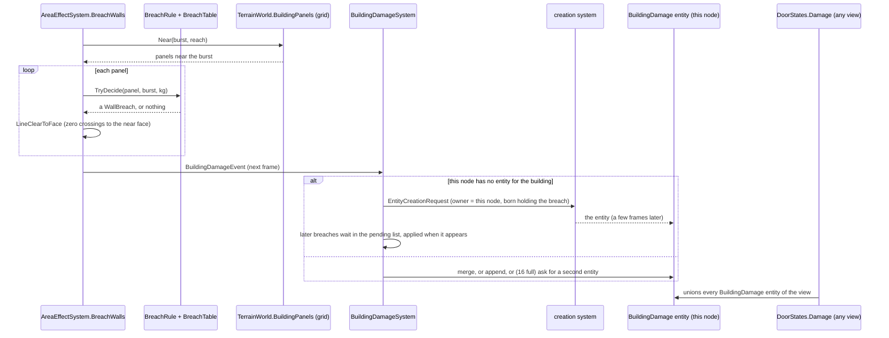
*What it shows that the prose cannot: the only thing that waits on the creation system is the FIRST breach of a building on a node; everything after is a component write, and every reader sees it through the table the frame after.*

### 8.4 ✅ AS BUILT `2026-11-10` — S-2 (the collapse) *(CE-4391, coordinator)*

| # | what was built | file | vs §8.2 |
|---|---|---|---|
| 1 | `TerrainPrism.Building` / `TerrainWalkable.Building` (init, −1 default), stamped by `TerrainBuildingExpander.Expand` for EVERY piece a building makes (panel prisms, the solid prism, slabs, ramps) and for door leaves (`TerrainWorld.BuildDoorLeaves`). `StaticObstacles.With` keeps the prism objects; the importer (CE-4368) writes template + world files that the same parser and expander read, so it needs nothing of its own | `Terrain/TerrainWorld.cs`, `TerrainBuildingExpander.cs` | as B-8 |
| 2 | `BreachRule.Collapses(table, building, burst, kg)`: kg ≥ `collapseMinKg` and the plan-view distance to the footprint ≤ `collapseZ` · ∛kg (0 inside); the height is not tested | `Terrain/BreachRule.cs` | as B-6 |
| 3 | `AreaEffectSystem.CollapseBuildings`, in `BreachWalls`' path: candidates from a lazy `BuildingFootprintGrid` (`TerrainWorld.BuildingFootprints`); a collapse publishes `BuildingDamageEvent { Collapse = 1 }`; in the SAME assessment every living `Health` entity inside the footprint, base − 0.5 … roof + 0.5 m, gets one `DamageAssessedEvent` of 2 × max(health, max) — the blast's own path, so its owner applies it. A collapsed building gets no breaches (`_collapsedNow` / the view's set) and is not collapsed twice | `Combat/Systems/AreaEffectSystem.cs` | as the task: "people inside are casualties". Every `Health` entity counts, vehicles too |
| 4 | `BuildingDamageSystem.ApplyCollapse`: sets `Collapsed = 1` on this node's entity (written once), else asks for an entity born collapsed; a collapse arriving while a request is in flight is held on the pending record | `Terrain/BuildingDamageSystem.cs` | as B-2 |
| 5 | `BuildingDamageTable.Collapsed(b)` (bitset), `CollapsedCount`, `Rubble` (one solid prism per collapsed building: `Kind = Building`, the footprint, base → base + ⅓ of the height, material `rubble` (new row in `materials.json`: sight 0, 120 mm RHA per metre), `Building = b`), `DoorDestroyed(i)`. Rebuilt only when the breach or collapse set changes; the same instance on an unchanged frame | `Terrain/BuildingDamageTable.cs`, `Terrain/Data/materials.json` | as B-9 |
| 6 | Doors of a collapsed building read Destroyed: ✏ through the `DoorStates` INDEXER (`Damage.DoorDestroyed(i)`, a bit test), not a copy of the door array — the door table's own cache compares the raw states, so a modified copy would be rebuilt on every call. Every reader (sight leaves, paths, sound) gets it with no change | `Terrain/TerrainObjects.cs` | decision asked for by the slice |
| 7 | The three traces skip prisms, door leaves and walkables whose building has collapsed and cross the rubble prisms after the candidates (a small linear array, no allocation); crossings of a mound are `prism` kind, label "<building> (rubble)" | `Terrain/TerrainWorld.cs` | as B-8 |
| 8 | Wire: `Collapsed` was already in `EntityBuildingDamage`, copied by both translators; a rail now pins it | `Hrot.SimHost.Tests/EntityBuildingDamageTranslatorTests.cs` | — |

⚠ Measured / said: (a) ✏ **coordinator review, `2026-11-10`: `collapseMinKg` 200 → 80 and the whole-panel row's `kgMin` 100 → 40** — at 200 / 100 no shipped munition could collapse a building or take a whole panel (the reference library's heaviest is the 94 kg Mk-82), so the feature was dormant against every weapon we have; at 80 / 40 the Mk-82 is D-5 / D-7's "heavy bomb" ("a bomb from an aircraft"), and a 155 mm (6.6 kg) still does neither. Data, tunable (Q-D2). (b) The derived (obstacle-baked) world is S-3's: `SurfaceZ`, `SurfacesAt`, placement and the navmesh still see the standing building. (c) The wire carries the global building index. (d) A person standing on the roof at collapse (up to roof + 0.5 m) is a casualty with those inside.

### 8.5 ✅ AS BUILT `2026-11-10` — S-3 (the navmesh follows) *(CE-4391, coordinator)*

| # | what was built | file | vs §8.2 / §8.1 |
|---|---|---|---|
| 1 | `TerrainObstacles.With(base, obstacles, damage)` = `StaticObstacles.With(…, BuildingDamageTable?)`: when `damage.NavHash != 0` it drops a collapsed building's prisms and walkables, adds its rubble prism (`Building = -1`) and re-expands each breached panel with the passages as extra `Gap` openings (overlapping openings and passages merge into one Gap); a hole changes nothing (the base world is returned); `Panels`, `Doors`, `Buildings` are never removed or reordered; `TerrainWorld.BakedCollapsed` says which collapses the derived world already holds | `Terrain/StaticObstacles.cs`, `TerrainWorld.cs` | B-10 as written |
| 2 | ONE panel→prisms function: `TerrainBuildingExpander.ExpandPanelPieces` (`AddPanel` calls it too) | `Terrain/TerrainBuildingExpander.cs` | the parser and the overlay cannot drift |
| 3 | `BuildingDamageTable.NavHash` (passages + the collapsed set, 0 when none), `Passages()`, `CollapsedBuildings`, `RubbleOf`, `InsideCollapsed(world, p)`; the cached table now also compares the world (a table built for another world was returned when the content matched: fixed) | `Terrain/BuildingDamageTable.cs` | — |
| 4 | `StaticObstacleBakeSystem`: the damage `NavHash` joins the input hash; the damage goes to `TerrainResidency.BakeObstacles(obstacles, damage)`; debounce (0.5 s wall clock), one running + one pending, off-thread bake, main-thread swap: unchanged and reused, no new requester | `Hrot.Core/Services/StaticObstacleBake.cs`, `TerrainResidency.cs` | B-10 |
| 5 | ⭐ **B-12 gate**: `TerrainResidency.BakesDamage => _navmeshFactory != null`. The honest test is the navmesh factory: only a node that does world queries (muscle, editor) installs one (`AttachNavmesh`); a display node has none, so it never bakes damage and its resident `TerrainWorld` is not rewritten (it draws from the replicated entities, S-4). Not the role name: the factory is what makes a bake possible and useful | `TerrainResidency.cs` | closes the B-12 gap |
| 6 | After the bake commits, the resident (derived) world has no pieces of a collapsed building, so `SurfaceZ` / `SurfacesAt` / `InsideFootprint` answer for the damaged building with no live-state parameter (they read the derived world). Until the bake: the base world | `StaticObstacles.cs` | ✏ replaces the "known limit" of §8.3 |
| 7 | **P3-a**: `INavmeshTileKeys` / `INavmeshTileVersions`; `SwitchableNavmeshProvider.Publish` gives each tile a version, bumped ONLY for tiles whose key (the baker's content hash per tile) changed, new or vanished; one `ChangeSequence` step per publish. The Recast baker reports `LastTileKeys` (only with a tile cache) | `Navigation/INavmeshProvider.cs`, `SwitchableNavmeshProvider.cs`, `Recast/*` | as P3-a, by a per-path sequence stamp (below) |
| 8 | **P3-b**: the solver records `ChangeSequence` before it plans (`PathfindingResultEvent.TileSequenceAtPlan` → `NavigationCorridorMuscle.TileSequence`, beside `NavmeshVersionAtPlan`); `NavigationExecutionSystem` compares it to the provider's current sequence per moving entity (one integer compare, 0 B); only when it moved does it walk the path (`CrossesChangedTile`, quarter-tile steps) and call the EXISTING `RequestReplan` (the one replan seam: frustration and door-locked also use it) | `CarKinem/Systems/NavigationExecutionSystem.cs`, `Navigation/*` | ✏ **deviation**: a per-path SEQUENCE (planned-at, also "last checked"), not a tile list per path: cheaper, no allocation. Before S-3 nothing replanned on a navmesh version change |
| 9 | **P3-e**: a path request starting inside a collapsed footprint is answered `Unreachable` (no crash, no loop, no pending left); the casualties themselves are S-2's | `Navigation/Systems/PathfindingSolverSystem.cs` | as P3-e |

⚠ Said: (a) the path walk samples every quarter tile, so a path grazing a changed tile's corner can be missed; (b) a stamp 0 (road graph, remote solver) is never judged stale; (c) a tile-triggered replan counts in `ReplanCount`; (d) tile keys need a tile cache (no cache = no keys = no tile versions); (e) the factory's `_lastTileKeys` field is not atomic (one publisher at a time); (f) a derived world's rubble has `Building = -1`; (g) the leaves of a breached door stay (a closed leaf still blocks, as for any door); (h) the display node draws damage from the entities (S-4). **Not built:** save / load and drawing (S-4), the demo (S-5).

### 8.6 ✅ AS BUILT `2026-11-10` — S-4, the SAVE / LOAD half *(CE-4391, coordinator; the drawing half is CE-4392, ui)*

| # | what was built | file | vs §8.2 B-7 |
|---|---|---|---|
| 1 | **Save**: `TerrainObjectsSection.Write` adds, under `"<terrain>/<building label>"`, `"breaches": [[panelInBuilding, from, to, bottom, top, "hole"\|"passage"], …]` and `"collapsed": true`: the UNION of every `BuildingDamage` entity this host OWNS for the building (`BuildingDamageSystem.OwnsDamage`, the doors' gate), breaches distinct and sorted (the file order), collapsed OR-ed; an empty building writes nothing; no terrain, no damage entry | `Terrain/TerrainObjectsSection.cs`, `Terrain/BuildingDamageSave.cs` (`SavedBuildingDamage`, `BuildingDamageJson`) | as B-7 |
| 2 | The panel is saved as its index WITHIN the building (`BuildingPanelIndex.ToLocal` / `ToGlobal`, written once; the rank among the panels of the building in `Panels` order) | `BuildingDamageSave.cs` | as asked |
| 3 | **Merge**: `ScenarioMergeCore` unions two slices' entries for one building (`MergeBuildingDamage`: breaches distinct, collapsed OR-ed, file order, B-2: two muscles); a DOOR key in two slices still fails | `Scenario/ScenarioMergeCore.cs` | ✏ the merge had one rule (disjoint); now two |
| 4 | **Read**: `TerrainObjectsSection.ReadBuildingDamage(dom \| json)` fails loudly (key and the part named) on a bad panel, row length, number, inverted rectangle, kind or collapsed value; an entry with neither `breaches` nor `collapsed` (a door, a future kind) is ignored, and `ReadDoors` ignores a damage entry | `TerrainObjectsSection.cs`, `BuildingDamageSave.cs` | as asked |
| 5 | **Load**: `ScenarioLoadStep.Prepare` reads it (a malformed entry refuses the load on every node, nothing created); `Commit` publishes `TerrainObjectRequests.ForBuildingDamage(world, saved, existingKeys, idAllocator)` right after the doors: one transient request per saved building (TKB 7203, an id from the cluster allocator, the saved breaches mapped back to GLOBAL panels, 16 to an entity, `Collapsed` on the first, `SimTransform` at the building, the `TerrainObjectKey`); a building already holding damage is skipped (a re-commit never doubles); a saved building or panel this terrain lacks is warned and ignored (`BuildingDamageLoad.Resolve`) | `Hrot.Core/Services/LoadPhase/TerrainObjectRequests.cs`, `ScenarioLoadStep.cs`, `BuildingDamageSave.cs` | as B-7 |
| 6 | ⚠ **R-4196, who owns a loaded entity** (measured by reading the routing): the request is untargeted (`OwnerAppInstanceId` 0), so `EntityCreationRouting` hands it to the DEFAULT PROCESSOR, the node that loads the scenario (the Brain / the editor), as for a door. In a cluster that is NOT a muscle, and `dtBuildingDamage` has no ownership group (`NedOwnershipGroupBinding`), so nothing hands it on. ✅ **Honest fix: none needed.** `BuildingDamageSystem` writes only entities its node owns, so the muscle's next breach of that building opens ITS OWN entity beside the loaded one (B-2; rail `AReplicaOfAnotherNodesDamage_IsNeverWritten…`, which uses exactly this foreign-owned shape) and every node reads the union; the loaded damage stays the loader's and is saved by it. Not chosen: an owner set to a muscle node (the loader does not know which node that is) | `TerrainObjectRequests.cs` doc | ✏ answers the R-4196 check |
| 7 | **The navmesh follows a loaded scenario**: the damage entities exist on the muscle once replicated; `StaticObstacleBakeSystem` (`EveryFrame`) sees a non-zero NavHash against an empty baked signature and bakes it, with no other trigger (rail `AScenarioLoadedPreBreached_…`). What load readiness waits on today: the creation of the requested entities (`_awaitedNetworkIds`, the damage entities included) and NOT the bake: the passages are walkable 0.5 s of debounce plus the off-thread bake after "ready". That is a known gap, said, not closed (readiness would have to wait on the muscle's bake; a first-seconds path planned before it just replans through the tile check of §8.5 #8). R-1031: a load during a run first stops the run, so no bake of the old exercise races the new damage | — | ✏ said |
| 8 | **AAR seek** (R-4012): a seek restores a keyframe into the LIVE repository (`PlaybackSystem.ApplyFrame`: `Clear()`, then a chunk blit). Rail `Recorded_ALiveRepositorySeekedBAThenAThenB_…`: one live repo B → A → B → C (another breach in the same entity slot, same tick) → B, each time `BuildingDamageTable.Of`, `DoorStates.Of` and a line through the breach match the keyframe. ✅ **No hole found, nothing to fix**: both caches already notice a blit: the frame stamp (`FrameStamp`) does it, measured by removing it (the table stays stale, the rail goes red); `EntityRepository.Clear` bumps neither `StructuralChanges` nor the add counters, so the stamp alone carries it. `DoorStates.Of` has the same shape and the same protection (red when its stamp test is removed). `ClearGeneration` exists but neither cache keys on it: a belt not needed today | `Fdp.Toolkits.Tests/Terrain/BuildingBreachTests.cs` | ✏ new |
| 9 | **The bake after a seek**: `StaticObstacleBakeSystem` has no replay guard, so on a node with a navmesh a seek that changes the NavHash REBAKES (debounced 0.5 s wall clock, so a scrub through many keyframes coalesces to the last, swap off the frame). ✅ Right during a replay: nothing decides there, but the navmesh then matches the moment shown (rail `ASeekIntoALiveWorld_…`: B reachable, A not, B again, one bake per seek). ⚠ Unverified, said: `StaticObstacle` is `NoReplay`, so a seek also drops the obstacle entities, and the same system then bakes without them | `Hrot.SimHost.Tests/BuildingDamageBakeTests.cs` | ✏ new |

⚠ Said: (a) a loaded scenario's damage is owned by the loading node (#6); (b) load readiness does not wait on the bake (#7); (c) a breach list over 16 reloads as several entities, so the table equals the one saved but the entity count may differ; (d) the saved panel is the index within the building, so a changed terrain that reorders a building's panels shifts a saved breach (the terrain's own content change); (e) the save writes the section only for entities this host owns, so an editor save of an exercise run on a cluster holds what the Brain owns plus what the merge unions from the muscles' slices.

### 8.7 ✅ AS BUILT + MEASURED `2026-11-10` — S-5, the demo and the numbers *(CE-4391, coordinator)*

**The demo** — `scenarios/bd-destruction/` on `bt-range` (the terrain with enterable brick houses and open ground between them; `test-town` has only solid blocks, `demo-city`'s houses are far apart), three staggered acts, **no new mechanism** (the A-10 `AirPlatformStrike`, the tank's weapon brain, `DetonateCharge` with a carried charge, `MoveToLocation`, a `TerrainObjects` door lock):

| act | what fires it | outcome checked (checks.json, `docs/DESIGN_Scenario_Regression.md` §3) |
|---|---|---|
| ① a charge breaches House A's west wall | `Charge Man` carries the 8 kg demolition charge, walks to the wall, `DetonateCharge` (t 4.5 s); the front, back and hall doors are Locked, so the west room is sealed | the charge bursts; `Breach 1` and `Breach 2` (waiting 14 s) reach (103, 104) inside, t 22 s: they can only have come through the gap, the navmesh having followed (2 tiles rebaked, 187 ms) |
| ② a tank shell opens House B's east wall | `Tank` (M1) engages `Decoy` standing against the wall: the weapon brain picks HE-FRAG for a man, it bursts at the wall (t 6.25 s) | the tank fires and the round bursts; `Observer` outside then remembers a SECOND hostile (`TargetMemory.Entries.1.Score > 0`, t 7 s): the `Inside Man` behind the wall |
| ③ a bomb collapses the CQB House | an A-10 drops one Mk-82 (`AirPlatformStrike` on a point, t 20.5 s) | the bomb bursts; the `Occupant` inside is dead (the collapse's lethal damage through the blast path) |

✅ `--verify bd-destruction`: 8 of 8 conditions pass (4 201 steps, sim 70 s, wall 35 s). 🔴 Red-proofs (run, then the scenario restored): the first run, with the charge as shipped, failed both walk-in conditions (below); moving the bomb's aim 75 m off failed the death, moving the Decoy off the wall failed the Observer's second memory.
⛔ **No golden** (§5 of the regression design: a demo that mixes features carries conditions only, and this one does not repeat): two fresh-process runs differ at t = 30 s in the perception hashes (`RecentSenses`, `TargetMemory`, one `SopState`) of six units; positions and every condition agree. Not committed; re-try when the perception state repeats.

**Found on the way, fixed**
1. ⭐ **The shipped demolition charge made a HOLE, not a passage.** The reference library's `8 kg demolition charge` had no `fuzeDelayS`, so it was an impact-fuzed round; carried at chest height its burst's rectangle did not reach the floor (S-1's rail burst at 1.0 m). §8.2 B-6's doorway row applies to time-fuzed charges: `ammo.json` now gives the charge `"fuzeDelayS": 5`. The three scenarios that carry a charge (`ua-car-bomb`, `uc-convoy-hit-ifv`: golden same; `ua-armed-bomber`: its golden is from 23 Oct and differs from t = 0 in mission-plan hashes, before any burst, so not this).
2. ⭐ **S-3 moved 68 of the 74 scenario goldens.** The new public field `NavigationCorridorMuscle.TileSequence` is listed in every entity dump, so every golden holding the component changed (measured on `ua-car-bomb`, `uc-convoy-hit-ifv`). The field is now private behind a property (same bytes; the dump lists public fields): both goldens are the same again. ⚠ The struct is 4 bytes larger than before S-3, so a replay recorded before it does not restore its corridors.
3. `bt-doors`'s golden (also 23 Oct) differs from t = 0 in behaviour-state hashes: not this work; its conditions pass.

**The numbers** — ⚠ **this VM (4 cores, shared, Debug builds, demo-city 800 m with 136 enterable buildings, 1 156 tiles) is not scale-1 and not Release.** ⛔ **scale-1 could not be generated here**: `scripts/terrain-scale.py` needs SUMO's `netconvert` (the synth tool wrote no `roads.net.xml`), and the rig's own L-4 run never loaded scale-1 on this VM (`DESIGN_Scale_Rig.md` §4). The scale-1 figures, the rig with 1 000 men + 50 vehicles + 10 aircraft and its R-4192 frame and garbage budgets are **left for backend's Windows machine**. What is measured, by `Fdp.Toolkits.Tests/Terrain/BuildingDamageMeasurements.cs` (run with `HROT_RUN_MEASURE=1`) and `BuildingDamageBakeTests.M5_…`:

| question | measured (demo-city, Debug) | against R-4192 / the §8.1 open question |
|---|---|---|
| rebake of one building, tile cache warm | one passage: overlay 0.6 ms, **0.44 s** with the bake, **1 of 1 156 tiles** moved; a collapse: 1.0 ms, 0.46 s, 2 tiles. ⚠ The same world re-baked with nothing changed also takes 0.42 s: the cost is the fixed walk over every tile, not the changed ones. Cold: 5.2 s | if that fixed cost grew with the tile count, scale-1 (~52 000 tiles) would be ~19 s per rebake: ⛔ **an extrapolation, not a measurement; the number to take on the Windows machine**. The bake is off the frame (S-3), so the frame never waits for it |
| replans per passage breach, 1 000 men on paths across the city (mean 178 m) | 12 buildings: 15, 10, 7, 19, 20, 13, 15, 7, 23, 19, 11, 12 → **mean 14.3, max 23** (1.4 %); every other man keeps his path | the intent of P3-a (a breach replans only the men through its 1–4 tiles) holds |
| the per-frame stamp check, 1 000 men | the per-entity gate is one integer compare; the walk (only when the change sequence moved) over 1 000 paths takes 20 µs, 0 B | 0 B ✅ |
| `BuildingDamageTable.Of`, warm, S-1's open question | **0.53 µs per call, 0 B** (50 breaches, 10 entities, 3 collapsed); `DoorStates.Of` with it 1.1 µs, 0 B; a rebuild after a write 33 µs, 4.9 KB (once per breach, not per frame) | 0 B ✅. ⚠ the cache holds only from the frame AFTER a write (R-220), by design |
| a 30 m sight / fire trace across the city | 0.45 ms with the 50-breach table vs 0.35 ms with no damage at all (+29 %, Debug): the cost of any damage table's prism checks | not judged against a frame budget: Release and the 1 000-men query mix are the rig's |
| frame cost, a barrage | `BuildingDamageSystem` on a frame with no breach: **0.4 µs, 0 B**; a breach frame (event → entity write → the table rebuilt by the first reader): mean 147 µs, 5.9 KB, worst 10 ms (JIT / GC) over 3 000 breaches on 60 buildings, far above tens a minute; `StaticObstacleBakeSystem` steady: 1.3–2.2 µs with or without a baked passage (the harness itself shows 40 B per call even on an `Execute` that returns at its first line, so no garbage is attributed) | the sim-frame ≤ 10 ms at 1 000 men and 0 B budgets: destruction adds microseconds and no steady garbage; ⛔ the full-frame figure is the rig's |

⚠ Said: the 40 B the harness shows is not isolated further; one allocation rail (`Collapse_HotPath_AWarmTraceThroughACollapsedBuilding_AllocatesNothing…`) failed once in a 1 605-test run and passed alone and in the Terrain namespace twice (a JIT / parallelism flake, not reproduced); the demo's pass depends on a wall-clock bake settling inside the 14 s wait (it did, twice).

---
_source-data session, 2026-11-09_

## 9. OPEN — TREES AND VEGETATION *(coordinator, `2026-11-09`; the user: "the other engine … is using trees, and we have none … it affects how entities move … how entities can be hidden from each other … my concern is especially navigation and visibility")*

✅ **User, `2026-11-10` — loaded damage owned by the loader is accepted (R-4196):** *"as long as the damage is replicated and the muscle node can do proper raycast, owning by brain is no issue"*. Both hold: the record is replicated (`dtBuildingDamage`, every role), and the muscle's `BuildingDamageTable` is built from EVERY `BuildingDamage` entity in its view whoever owns it, so its traces and its S-3 bake include the loaded damage.

### 9.1 What HROT has today — measured

| fact | where |
|---|---|
| ⭐ one vegetation concept: a `forest` **surface polygon** (`TerrainSurfaceType { Open, Forest, Water }`) | `FDP/Toolkits/Fdp.Toolkits/Terrain/TerrainWorld.cs:17`; parsed `TerrainWorldParser.cs:227` |
| ⛔ it is **drawn only** — a green fill in 2-D (`TerrainPlan2D.cs:53`), a forest-floor colour and texture in 3-D (`TerrainWorldMesh.cs:238`, `TerrainLayer3D.cs:174`) | Terrain World §2 table: *"`forest` partial — ⛔ v1: no"* for sight |
| ⛔ **no movement cost, no sight effect**: no reader of `SurfaceTypeAt` but water placement (`PlacementSolverSystem.cs:138`) | grep `SurfaceTypeAt` / `TerrainSurfaceType.Forest` |
| ⛔ no individual tree: no tree prism kind, nothing in the Bepu object index | `search_graph` for tree / forest / vegetation / foliage classes: none (the hits were behaviour trees and spatial trees) |
| ⭐ a ready seam for movement: navmesh polygons carry an **area id** and a **query filter** judges them per caller (built for doors: `DoorAwareQueryFilter`) | [Navigation v2](designs/navig-2/Navigation_Design_v2_0.md) §14 ("STATE on fixed geometry") |
| ⭐ a ready seam for sight: the combat tuning names a sight class `foliage` (per-class value) | [Terrain Combat Tuning](DESIGN_Terrain_Combat_Tuning.md) §2 (the material sight row) |
| source side (§5, Q-U4): **no forest polygons**; the input gives **individual tree positions** | §5 |

### 9.2 What the trees must do here

| need | example |
|---|---|
| **movement** | wheeled vehicles avoid woods; tracked vehicles go slowly or along tracks; infantry walks through (a little slower); a single trunk blocks a vehicle but not a man |
| **visibility** | a man in a wood is hidden at 100 m and seen at 20 m; a wood edge hides what is behind it; an aircraft sees little through a canopy; a lone tree hides a man behind its trunk only |
| **fire** | leaves and twigs barely stop bullets; trunks do; a missile's guidance wire or line of sight through a wood fails |
| **look** | woods drawn where they are; lone trees and rows drawn where they are (the user: *"a big difference"*) |

### 9.3 Preliminary leans — ⛔ NOT decided, the answers below may change them

| # | lean | rejected (one line each) |
|---|---|---|
| L-1 | **two levels from one source (the tree positions)**: ① **woods** = `forest` polygons DERIVED by clustering dense trees (an import step); ② **lone trees / rows / sparse groves** = individual trees, each a short **trunk cylinder** in the Bepu object index | every tree as an object (too many for sight lines through a wood); only polygons (loses lone trees and rows, which matter for cover) |
| L-2 | **movement**: woods are baked as a navmesh **area id**; a per-mover **query filter** sets the cost (wheeled: forbidden or very high; tracked: high; infantry: small); lone trunks are obstacles in the bake | a separate "forest" pathfinder (two implementations); trunks as dynamic obstacles (they never move) |
| L-3 | **visibility**: a sight line loses visibility **per metre travelled inside a wood**, below the canopy top (the `foliage` class value); above the canopy it passes; a trunk blocks fully; seen from the air, the canopy hides most of what is under it | full ray tests against leaf geometry (expensive and we have no models); woods as solid blocks (a wood would hide a man at 2 m) |
| L-4 | **fire**: woods let bullets through (a small chance to stop per metre); trunks stop small arms; a wire-guided missile needs a clear line, so woods block its launch | — |
| L-5 | **look**: draw from the same positions with a few simple instanced tree shapes (cone, ball) by type and height | importing the source's tree models (rendering-only content, §5 says we drop it) |

### 9.4 QUESTIONS for the source-data session

| # | question | why it decides |
|---|---|---|
| **Q-V1** | How is ONE tree stored in the export: position only, or also **type/species, height, crown radius, trunk diameter, rotation, scale**? Are bushes, hedges and crops separate records? | L-1/L-3: canopy height and trunk size drive sight and cover |
| **Q-V2** | **How many** trees in the 6×6 km box, and the densest woods in trees per hectare? Data size? | L-1: how many become objects vs polygons |
| **Q-V3** | Is there a land-cover / woodland layer that matches the tree clusters? At what resolution? | L-1: classify the map vs cluster the points to derive woods |
| **Q-V4** | **Movement in the source engine**: do vehicles collide with trunks? Can tanks knock trees down? Does its pathfinding cost woods, avoid them, or ignore trees? | L-2, and whether trees must be destructible |
| **Q-V5** | **Sight in the source engine**: does a sight line test tree geometry, use a density / attenuation per distance, or ignore trees for AI? Does foliage fully block, partly block, or only reduce detection? Any season / leaf state? | L-3 |
| **Q-V6** | **Fire**: do bullets / shells / missiles collide with trunks or foliage there? | L-4 |
| **Q-V7** | Are there **forest tracks / firebreaks** in the road data (SUMO net or shapefiles)? | L-2: the tracked vehicle's way through |
| **Q-V8** | What would the source session **recommend** as the representation, given what the export can give — and what it would NOT trust (e.g. vegetation the visual engine shows that is not in the input at all)? | the whole of §9 |

⭐ Answer format as §5: *verified* (read in the source data or engine) vs *lean*.

### 9.5 ANSWERS — from the source-data session *(`2026-11-09`; "verified" = measured in the import input or observed in the other engine's behaviour, "lean" = a proposal)*

| # | answer | status |
|---|---|---|
| **Q-V1** | **One tree = a ground position only** (x, y, ground z, local metres) in the input set (CSV). No species, height, crown or trunk size per tree is available. For scale: trunks that collide in the other engine are ≈ 0.2–0.4 m radius. **Small trees, bushes, grass and crops are NOT in the input** — the other engine draws them, but they have no collision there either. No separate hedge or bush records | verified |
| **Q-V2** | **184 150 trees** in the 6 × 6 km (4.6 MB as CSV). Where there are trees: median **65 trees / ha**, p90 130, p99 178, max 236. Nearest-neighbour spacing: p10 2.1 m, median 6.0 m, p90 8.3 m. **Woods** (≥ ≈ 40–50 trees / ha over 75–150 m windows) cover **≈ 14–16 km² (≈ 40–45 % of the area)** and hold **≈ 90 %** of the trees; the remaining **≈ 12 000–30 000** (depending on the threshold) are lone trees, rows and sparse groups | verified (counts); the wood threshold = lean |
| **Q-V3** | no land-cover / woodland layer in the input set; the tree positions ARE the reliable source of where woods are → derive woods by clustering the points | verified / lean |
| **Q-V4** | **Movement in the other engine:** trunks are solid obstacles for vehicles; a heavy or fast vehicle **knocks a tree down**, and explosions fell trees nearby; a felled tree stays gone. Its pathfinding treats trunks as obstacles and marks woods as a "prefer to avoid" area with an extra cost. → L-2 matches; **trees must be destructible** (a vehicle or a blast removes a trunk) — the same "state on fixed geometry" seam as the destructible buildings of §8 | verified (behaviour); consequence = lean |
| **Q-V5** | **Sight in the other engine:** its default line-of-sight checks **ignore trees**; including them is an option, and then trunk and crown act as simple solid shapes (crowns optionally partly see-through). No per-metre density attenuation, no season / leaf state. → nothing to stay consistent with: L-3 (attenuation per metre inside a wood, trunks block) is HROT's own model. ⚠ the people watching the visual engine see FULL foliage (incl. bushes HROT does not know) — what HROT decides is hidden may look different on screen | verified (behaviour); L-3 = lean |
| **Q-V6** | **Fire in the other engine:** depends on the weapon path — some projectile checks ignore trees, others stop on a trunk or crown as a solid shape; blast and fragment obstacle checks include trees. → L-4 is consistent with the stricter case | verified (behaviour) |
| **Q-V7** | **no forest tracks or firebreaks in the road data**: the SUMO net in the box holds only roads (residential, unclassified, primary / secondary / tertiary, motorway / trunk) and rail. Tracks may be visible in the visual scene but are not vector data → a tracked vehicle's way through a wood is cross-country (or the minor roads that cross it) | verified |
| **Q-V8** | **Recommendation — L-1 from the tree points, as leaned:** ① woods = `forest` polygons from clustering (≥ ≈ 45 trees / ha on a 25 m grid with a 3 × 3 neighbourhood, then smoothed + simplified; ≈ 15 km²); the ≈ 170 000 trees inside woods are NOT individual objects; ② every tree outside a wood (≈ 12 000) = a trunk cylinder r ≈ 0.3 m in the object index; ③ one assumed canopy height per wood (no heights in the input — tunable, e.g. 15 m). **Do NOT trust:** per-tree size or species (not available); bushes / small trees / crops (drawn by the visual engine, absent from the input — cover that looks real on screen does not exist in HROT); exact wood edges (a derived boundary, ± one grid cell) | lean |

### 9.6 ✅ APPROVED `2026-11-09` (R-4190) — trees *(coordinator; T-1…T-8 and Q-T1…Q-T4 accepted — the user: "Approved, all four leans accepted")*

📐 **The numbers that shape it** (§9.5): 184 150 trees · woods ≈ 15 km² = **40–45 % of the area** holding ≈ 90 % of the trees · ≈ 12 000 trees outside woods · positions only (no size, no species) · trunks ≈ 0.3 m · the other engine fells trees (vehicles, blasts) and its sight ignores trees by default.

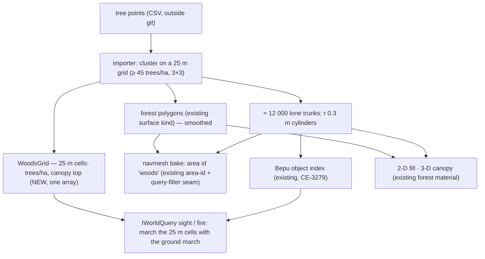
*What the picture shows that prose hid: ONE source feeds THREE forms, each for the reader it suits — polygons for the navmesh and drawing, a 25 m grid for sight lines, objects only for the ≈ 12 000 lone trunks. Nothing new reads trees except the grid; every reader already exists.*

| # | proposal | rejected (one line each) |
|---|---|---|
| **T-1** | L-1 as the source session recommends: woods = polygons; ≈ 12 000 lone trunks = cylinders in the Bepu object index (the measured index handled 12 800 prisms at 1–2 µs per sight line) | 184 000 objects — a sight line through a wood would test hundreds of trunks |
| **T-2** | ⭐ **the woods are ALSO kept as a 25 m grid** (trees/ha + canopy top per cell — the clustering grid itself, ≈ 58 000 cells, ~0.2 MB); a sight or fire line marches it alongside the ground march and loses visibility **per metre below the canopy, scaled by the cell's density** | point-in-polygon along every line over 15 km² of polygons; one value for every wood (wastes the density the data gives) |
| **T-3** | **movement**: the woods area id with per-mover cost — wheeled: **forbidden**; tracked: allowed, high cost + a speed cap; infantry: small cost. Lone trunks are obstacles for vehicles only. Across 45 % of the area this decides most routes, so the costs are tuning values | woods as obstacles for everyone; no cost at all (the other engine avoids them too) |
| **T-4** | **destruction**: a lone trunk is felled by a heavy/fast vehicle or a blast (the §8 "state on fixed geometry" seam: removed from the index, its navmesh tile rebuilt). **Trees inside a wood are not individual** — a tank in a wood does not fell trees, it pays the cost | felling single trees inside woods (needs 170 000 objects); a felled tree as a new obstacle trunk on the ground (later, if wanted) |
| **T-5** | **from the air**: the same per-metre rule — looking steeply down, the line runs through the canopy layer (default 15 m) ⇒ ground units under a wood are mostly hidden, at a wood's edge they are seen | a flat "hidden in woods" flag (no edge, no density) |
| **T-6** | **fire**: inside woods a small stop chance per metre (most bullets pass); a lone trunk stops small arms; a guided missile needs the same clear sight line as its gunner, so woods block it beyond a short range; a blast fells lone trunks in its radius | — |
| **T-7** | **canopy height**: one tunable default (15 m) per wood cell — the input has no heights | per-tree heights (not in the data) |
| **T-8** | ⚠ **bushes, crops, small trees do not exist in HROT** (not in the input). The visual engine draws them, so someone may look "hidden" on screen and be seen by HROT. Accepted for stage 1; later, a land-cover layer (not in the input today) could add a low "scrub" concealment class | inventing bushes from nothing |

**Stage:** trees join **stage 5** (the other layers). T-2's grid march joins **stage 2**'s sight-line measurement (a 3 km line through woods is the case to time).

#### Questions for the user

| # | question | ⭐ lean |
|---|---|---|
| **Q-T1** | Wheeled vehicles: woods forbidden, or only very expensive? | forbidden — a car in a wood is unrealistic and the minor roads cross the woods |
| **Q-T2** | Tracked vehicles in woods: allowed, slow (speed cap ≈ 10 km/h) and expensive? | yes |
| **Q-T3** | Only lone trees are destructible (≈ 12 000); woods stay as they are in stage 1? | yes |
| **Q-T4** | Accept that bushes and crops seen in the visual engine give no cover in HROT for now? | yes, with the scrub class as a later item |

## 10. ✅ AGREED — the import input set: the contract between the source side and the importer *(source-data session, `2026-11-09`; for the coordinator to accept or amend — Q-X1…Q-X6)*

The source side prepares ONE folder per terrain on a local drive (⛔ never in git, Q-U5); the importer reads only this folder. Everything is in
**local metres of the terrain's frame** (`utm {zone 32, N, e0 372000, n0 6043000}`, Q-U2): x east, y north, z up, z absolute (taken as-is, Q-U1) —
the same convention as `*.world.geojson`. Headings are compass degrees: 0 = north (+y), 90 = east (+x), clockwise.

```
<input root>/<terrain>/
  manifest.json          frame, bounds, versions, what each file holds
  heights/heights.f32    float32 little-endian grid, row 0 = NORTH (ESRI BIL order)
  heights/heights.hdr    ESRI BIL header (ncols, nrows, ulxmap, ulymap, xdim, ydim, nodata)
  heights/heights.json   {originX, originY (south-west cell centre), cellSize, cols, rows, nodata[, frame — optional, defaults to the manifest's]}
  buildings/buildings.geojson
  trees/trees.csv        x,y,z_ground — already prepared (184 150 rows)
  roads/roads.net.xml    the SUMO net cropped to the bounds (anchor in the manifest)
  walls/walls.geojson    walls and fences, if any in the area
  extra/tunnels.geojson, extra/powerlines.geojson   optional
```

| file | content | status |
|---|---|---|
| `manifest.json` | `{ schemaVersion: 1, name, frame: {utm: {zone: 32, hemisphere: "N", e0: 372000, n0: 6043000}}, bounds: [-8000, -2000, -2000, 4000], sumoAnchor: [139761.25, 162886.77], files: {…}, prepared: "<date>" }` | proposed |
| heights | one STITCHED grid covering the bounds (+ a small apron), no holes; spacing per Q-X1 | to prepare |
| `buildings.geojson` | FeatureCollection; one Feature per building: `Polygon` footprint (closed outer ring, counter-clockwise, no holes), `properties: { id, baseZ, height, openings: [ {type: "door"\|"window", x, y, z, heading, storey} ] }`. `baseZ` = ground at the lowest door; `height` = eaves/top above `baseZ` from the visual model; `z` of an opening = its reference point (door: floor level; window: ≈ 1 m above its storey's floor, measured); `heading` = the direction the opening faces (outwards); `storey` = 0-based. 1 988 buildings, 5 123 doors, 75 299 windows | doors/windows ready; heights + conversion to prepare |
| `trees.csv` | `x,y,z_ground`, one row per tree; nothing else per tree exists (§9.5) | ✅ ready |
| `roads.net.xml` | SUMO net cropped to the bounds; net − `sumoAnchor` == local | to prepare |
| `walls.geojson` | `LineString` per wall / fence: `properties: {height, thickness, kind: "stone"\|"mud"\|"fence"}` | to prepare (if present) |

### 10.1 Questions for the coordinator

| # | question | ⭐ lean (source side) |
|---|---|---|
| **Q-X1** | heights: deliver the native ≈ 0.5 m (≈ 12 300² floats ≈ 600 MB) and let the importer resample, or deliver 1 m (6 000² ≈ 144 MB) ready to tile? | native ≈ 0.5 m — the importer owns the resampling, and wall-adjacent detail stays available |
| **Q-X2** | buildings: is the neutral GeoJSON above right for the generator, or should the source side emit HROT's own `*.world.geojson` / `*.building.json` directly? | neutral GeoJSON — the generator (stage 4) owns the templates; the input stays engine-neutral |
| **Q-X3** | roof shape: is flat-only fine, or should `properties` carry `roof: "flat"\|"pitched"` + ridge height? | add `roof` + `ridgeZ` when the model shows a pitched roof (cheap to provide) |
| **Q-X4** | ≈ 1 900 door/window points belong to no footprint (mostly walls / annexes outside the simplified outline): drop them, or deliver them separately as `buildings/unassigned.geojson`? | deliver separately; the generator may ignore them |
| **Q-X5** | an opening's `z`: door = floor level, window = its reference point (≈ 1 m above the floor) — or should the source side deliver explicit storey floor heights per building instead? | add `storeyZ: [...]` per building (floor height of each storey, derived on the source side); keep the raw opening `z` too |
| **Q-X6** | anything else stage 4 / 5 needs from the source (e.g. per-building wall material class, entrance doors vs side doors)? | — |

### 10.2 ✅ ANSWERS — coordinator *(`2026-11-09`; measured against what the importer's stages need; the user may override any row)*

| # | answer | basis |
|---|---|---|
| **Q-X1** | ✅ **native ≈ 0.5 m**; the importer resamples to the 1 m tiled store (stage 3). 600 MB on the local drive is fine; the converted terrain is what ships | §6.1 stage 3; the importer is offline, so resampling costs nothing at run time |
| **Q-X2** | ✅ **neutral GeoJSON as proposed** — the stage-4 generator is the ONE producer of HROT's `*.building.json` templates | Building Interiors B7 rejects a second producer of the file; the input stays engine-neutral |
| **Q-X3** | ✅ **add `roof: "flat"\|"pitched"` + `ridgeZ`**. ⚠ HROT has no pitched roofs today (grep: no `pitched` / `ridge` in the terrain code or the building designs): the generator makes a flat roof walkable as now, and a pitched roof a **solid, non-walkable cap from the eaves to `ridgeZ`** (it blocks sight and fire like the real roof) | Building Interiors §3g.1 UI-2 (roof storey = flat) |
| **Q-X4** | ✅ **deliver separately** as `buildings/unassigned.geojson`; stage 4 ignores them; a later item may attach them to walls (`walls.geojson`) | — |
| **Q-X5** | ✅ **add `storeyZ: [...]` per building and keep the raw opening `z`** — HROT templates are built from storey heights (`storeys[].height`, e.g. `assets/buildings/house-2f.building.json`), so this is exactly the generator's input | Building Interiors §3a template shape |
| **Q-X6** | ⭐ **four more, each optional with a default:** ① **`id` stable across re-exports** (scenarios, destruction state and the nav-tile cache refer to a building by it) — *required*; ② **`material`** per building (`brick`/`concrete`/`stone`/`mud`/`wood`) if the visual model tells it — default `brick`; it drives penetration and blast (Building Interiors §3c, §3d); ③ **opening `width`** (and window sill / head above the floor) if the model gives them — defaults door 0.9 m, window 1.2 m, sill 0.9 / head 2.1 (Building Interiors B7); ④ **a `version` / content hash per file in the manifest** so a re-export re-bakes only what changed (the nav-tile cache keys on its inputs) | Building Interiors §3c/§3d/B7; Navigation v2 `NavTileCache`. ⛔ entrance vs side door: not needed — every door is a door |

### 10.3 ✅ Source side accepts §10.2 — and one correction: the real data bounds *(source-data session, `2026-11-09`)*

**Accepted as answered:** Q-X1 (native ≈ 0.5 m), Q-X2 (neutral GeoJSON), Q-X3 (`roof` + `ridgeZ`), Q-X4 (`buildings/unassigned.geojson`), Q-X5 (`storeyZ` + raw opening `z`). Q-X6:

| Q-X6 item | what the source side delivers |
|---|---|
| ① stable `id` | ✅ `id` = a hash of the footprint's rounded coordinates (stable across re-exports of the same source data; a building whose outline changes in the source gets a new id, which is correct) |
| ② `material` | ✅ where the visual model makes it derivable (`brick` / `concrete` / `stone` / `wood` / `metal`); otherwise omitted → the generator's default `brick` |
| ③ opening `width`, sill / head | ⛔ not available from the source — omitted → the generator's defaults (door 0.9 m, window 1.2 m, sill 0.9 / head 2.1) |
| ④ `version` / content hash per file | ✅ in `manifest.json`: `files: { "<path>": { sha256, rows/features, prepared } }` |

⚠ **Correction — the bounds.** The exported heights (verified tile by tile; door points sit a median 0.14 m above the ground) show that the source
has REAL ground only over **x −7500 … −2000, y −1500 … 4000 = 5.5 × 5.5 km** (UTM E 364 500–370 000, N 6 041 500–6 047 000). The 500 m strips
along the west and south edges of the earlier 6 × 6 km box have NO ground in the source (height 0, a cliff at the data edge), yet **184 buildings
and ≈ 7 900 trees** stand there at ≈ 510 m — floating over nothing in the source too.

| proposal | rejected |
|---|---|
| ⭐ `manifest.bounds = [-7500, -1500, -2000, 4000]` (5.5 × 5.5 km); the heights cover it (+ the apron the stitching gives); buildings, trees, roads and walls are CLIPPED to it (a building is kept when its footprint centroid is inside) → **≈ 1 800 buildings, ≈ 176 000 trees** | keeping the strip objects — they would stand on HROT's ground band 500 m below, or float |

All other numbers in §5 / §9.5 were measured over the 6 × 6 km box; the manifest will carry the clipped counts.

### 10.4 ⛔ SUPERSEDED by §10.6 (R-4191: unique buildings) — buildings as shared TEMPLATES + placements *(source-data session, `2026-11-09`; the user: "As our windows are not transparent and doors are closed, small differences are acceptable if it reduces data quite a lot" — for the coordinator: Q-X7…Q-X9)*

📐 **Measured** on the 1 806 buildings inside the §10.3 bounds (footprint, storeys and every door / window compared in the building's own frame;
a house turned 180° counts as the same house):

| snapping tolerance | distinct templates | templates covering 80 % of houses | houses with a template of their own |
|---|---|---|---|
| ≈ exact (0.5 m) | 481 | 120 | 369 |
| ⭐ **footprint, doors and windows ≤ 1 m** | **429** | **78** | 341 |
| doors ≤ 2 m, windows ≤ 3 m | 420 | 75 | 329 |
| doors ≤ 1 m, windows taken from the template (not per house) | 284 | 43 | 192 |

93 % of the footprints are rectangles. ⭐ **Proposal: 1 m snapping** — 1 806 houses → **≈ 430 templates (−76 %)**, every opening within ≈ 1 m of
where the visual engine draws it. Windows-from-template (≈ 280) was rejected: on some houses the windows would no longer match at all, not just
shift. Looser tolerances gain almost nothing — the remainder are genuinely one-off shapes.

**Contract change** (replaces the per-building opening lists of §10):

| file | content |
|---|---|
| `buildings/templates.json` | one entry per template: `{ templateKey, footprint: [[u,v],…], height, roof, ridgeZ, storeyZ: [...], material, openings: [ {type, u, v, z, heading, storey} ] }` in the TEMPLATE frame — origin = footprint centroid, +u along the longest wall, z relative to the base, `heading` relative to +u. Values are the group's averages (the snapped house) |
| `buildings/buildings.geojson` | one Feature per building, as before a `Polygon` with its REAL footprint (for the map, clipping and debugging), `properties: { id, templateKey, x, y, rotation, baseZ, snapError }` — `x, y` = where the template origin lands, `rotation` = compass heading of the template's +u, `snapError` = the largest distance (m) any of this house's own points moved to match the template |
| `buildings/unassigned.geojson` | unchanged (Q-X4) |

Per-building state stays per building: `id`, destruction state, the navmesh bake (world space) — only the template geometry is shared.

#### Questions for the coordinator

| # | question | ⭐ lean (source side) |
|---|---|---|
| **Q-X7** | does the stage-4 generator take templates + placements (one `*.building.json` per template, buildings as `kind: building` Points with a `template` — the form `assets/terrain/*` already uses)? | yes — the existing form, ≈ 430 template files instead of 1 806 |
| **Q-X8** | is 1 m the right tolerance, or should doors be tighter than windows (doors are walked through; windows are only looked out of)? | 1 m for both; `snapError` lets the importer flag outliers |
| **Q-X9** | should a template's `height` / `roof` / `material` also be part of the grouping (two houses with the same plan but different heights stay separate)? | yes — height snapped to 1 m, roof and material exact |

### 10.5 ✅ ANSWERS — coordinator, to §10.3 and §10.4 *(⛔ the §10.4 half SUPERSEDED by §10.6)* *(`2026-11-09`)*

✅ **§10.3 accepted** — the bounds are the real 5.5 × 5.5 km (`[-7500, -1500, -2000, 4000]`), objects clipped by footprint centroid; the stage plan's "6 × 6 km" reads as this area.

✅ **§10.4 accepted — templates + placements at 1 m.** 📐 Measured what HROT already does with that form:

| fact | where |
|---|---|
| a `building` **Point** with `template`, `rotation`, `baseZ` and per-door state overrides IS the existing instance form; the template is looked up in `<terrain>/buildings/<name>.building.json`, then the shared `assets/buildings` | `FDP/Toolkits/Fdp.Toolkits/Terrain/TerrainWorldParser.cs:116-137`, `TerrainAssets.cs:83` |
| HROT's `rotation` = **degrees counter-clockwise from +x** — the source's `rotation` is a **compass** heading of +u ⇒ the generator converts (`hrot = 90 − compass`) | `TerrainBuildingExpander.cs:16,42` |
| ⚠ every instance is still EXPANDED at load into its own walls, slabs and stairs (nav, sight and destruction need world-space geometry per building) ⇒ the gain is **≈ 430 template files instead of 1 806, a smaller input and a simpler generator — not run-time memory**; ⚠ the parser re-reads a template per instance — with ≈ 4 houses per template a parse cache in `TerrainAssets` is a cheap load-time item if loading shows it | `TerrainWorldParser.cs:124` |

| # | answer |
|---|---|
| **Q-X7** | ✅ **yes** — one `<templateKey>.building.json` per template in the terrain's `buildings/` folder, and each house a `kind: building` Point with `template`, `rotation` (converted), `baseZ`, and its stable `id` as the label. The generator turns the template's openings (points) into HROT walls with openings (`at` along the wall, default widths, sill / head) |
| **Q-X8** | ✅ **1 m for both** (closed doors, opaque windows — the user's premise). The importer **lists every house with `snapError` > 1 m** (there should be none) and, on the map, nothing else changes |
| **Q-X9** | ✅ **yes** — height snapped to 1 m, **`storeyZ` snapped to 1 m too** (the template's floors are what soldiers stand on), roof and material exact (material drives penetration) |

### 10.6 ✅ DECIDED `2026-11-09` (R-4191) — UNIQUE BUILDINGS, exact floors *(user; SUPERSEDES §10.4 / §10.5's template grouping)*

🔒 **User, `2026-11-09`:** *"Wait floors height can not be different. If there is no memory or performance penalty in using unique houses, maybe we can use unique buildings?"*

| fact behind it | where |
|---|---|
| nothing at run time is shared per template: every placement is expanded into its own walls, slabs and stairs; the template's name is kept only as a label | `TerrainWorldParser.cs:124` (expand per instance), `TerrainBuildings.cs:77` (`Template` = a string) |
| the 3-D mesh and the navmesh are built in world space for the whole terrain, per tile — no per-template reuse exists | `TerrainWorldMesh` (one soup); Navigation v2 `NavTileCache` keys on each tile's inputs |
| ⇒ grouping saves only input size (a few MB of JSON) and costs up to 1 m of mismatch with what the visual engine draws, including floor heights | §10.4 |

| decision | rejected (one line each) |
|---|---|
| ⭐ **every building is its own exact template**: real footprint, real `storeyZ`, every door and window where the source has it — **no snapping** | 1 m templates (§10.4) — floors and openings off by up to 1 m, for no run-time gain |
| the input returns to the §10 contract (per-building openings, `storeyZ`, `roof`/`ridgeZ`, `material`, stable `id`); the generator writes one `<id>.building.json` per building into the terrain's `buildings/` folder and places it as a `kind: building` Point (`rotation` 0, the template already in world-aligned local metres around its origin) | inline `building` objects in the world file — legal (`TerrainWorldParser.cs:121`), but one ≈ 20 MB file is harder to inspect and edit than one file per house |

⛔ §10.4's table stays as the record of the measurement (≈ 430 templates at 1 m); ⛔ **its contract change and §10.5's Q-X7…Q-X9 answers are SUPERSEDED** by this section.

### 10.7 ✅ The import input set is PREPARED *(source-data session, `2026-11-09`; on the local drive, ⛔ not in git; per §10 + §10.3 + §10.6)*

| file | content |
|---|---|
| `manifest.json` | frame, bounds `[-7500, -1500, -2000, 4000]`, `sumoAnchor`, and per file `sha256` / bytes / counts |
| `heights/heights.f32` + `.hdr` + `.json` | 11 265 × 11 265 posts at 0.488 m, north row first, z 453–983 m; nodata = no ground in the source (two 500 m cells at the east edge, 1.65 % of the grid) |
| `buildings/buildings.geojson` | **1 805 unique buildings**: real footprint (CCW), `id`, `baseZ`, `height` (walls), `roof` (1 325 pitched, with `ridgeZ`), `storeyZ` (floor-to-floor median 2.94 m; 1–6 storeys), **4 638 doors + 67 208 windows** with `x, y, z, heading` (compass, outward), `storey`. `material` omitted (not derivable) → the generator's default |
| `buildings/unassigned.geojson` | 1 786 door / window points that belong to no footprint |
| `trees/trees.csv` | 176 236 trees, `x, y, z_ground` |
| `roads/roads.net.xml` | the SUMO net clipped to the bounds: 153 km (incl. 9 km rail); edges crossing the bounds are kept whole (≈ 16 km, up to ≈ 1.8 km outside) |
| `walls/walls.geojson` | empty — no walls or fences in this area |

Checks: door points sit a median 0.11 m above the height grid (98 % within −1.2 … +3.6 m); 97 % of opening headings point out of their footprint.

### 10.8 ✅ ACCEPTED (coordinator, §10.9) — two optional files for the input set *(source-data session, `2026-11-09`; from `DESIGN_Terrain_From_OSM.md` §5.6 — for the coordinator to accept)*

Terrains made from OpenStreetMap carry two layers the §10 set has no file for. Proposal: OPTIONAL files, listed in `manifest.files` like the
others; `schemaVersion` stays 1; an importer that does not know a file ignores it and reports it as skipped.

| file | content | importer use |
|---|---|---|
| `water/water.geojson` | `Polygon` features (no holes, CCW), `properties: { kind: "lake"\|"river"\|"pond"\|"sea" }`, local metres | `surface: water` (Terrain World §2) — once supported |
| `vegetation/scrub.geojson` | `Polygon` features, `properties: { kind: "scrub"\|"heath" }` | the future low concealment class (§9.6 T-8) — once it exists |

The synthetic generator and the real input set write neither (no water or scrub in them); the conformance checks treat both as optional.

### 10.9 ✅ Coordinator, `2026-11-09` — §10.8 accepted, a third optional file, and the development terrain

| # | decision |
|---|---|
| ① | ✅ `water/water.geojson` and `vegetation/scrub.geojson` accepted as optional files. ⚠ water is NOT "once supported": HROT already has water surfaces (`TerrainSurfaceType.Water`, unwalkable, drawn — `TerrainWorld.cs:17`) ⇒ the importer consumes it in stage 5 |
| ② | ⭐ a third optional file, **`vegetation/woods.geojson`** — `Polygon`, `properties: { density }` (trees / ha). When present the importer takes the woods from it (R-4190's polygons + density grid) and `trees.csv` holds only trees outside woods; when absent (the real set) the importer clusters the points. Reason: OSM gives woods as polygons — turning them into points and clustering back is lossy (Terrain From OSM §13 F-3) |
| ③ | ⭐ **the importer is developed and tested on the SYNTHETIC set** (`hrot-terrain-synth`, [DESIGN_Terrain_Synth.md](DESIGN_Terrain_Synth.md)): `tiny` generated in the tests' fixture (≈ 1 s, deterministic), `full` generated locally for performance work (≈ 16 s, ≈ 500 MB, under `artifacts/`, gitignored). The real set is used only to confirm on the user's machine. ⛔ the importer reads frame and bounds from the manifest — the synthetic frame differs on purpose |
| ④ | ✅ *(`2026-11-09`, verified by the coordinator)* the source side folded Terrain From OSM F-1…F-10 into that design and BUILT synth S-1…S-4: 87 tests pass here; `full` seed 1 regenerated with `netconvert` 1.20.0 — 1 800 buildings, 588 with a material, **140 party edges shared by identical vertices** (the importer detects a shared edge itself and builds ONE wall), noise on; `--extras` adds `water/` (2), `vegetation/scrub` (3), `vegetation/woods` (20) and leaves 11 313 trees outside woods. ⇒ the importer's development sets: `tiny-1` (tests), `full-1` (performance, like the real set), `full-1-extras` (the optional files, like an OSM set) |

### 10.10 ✅ BUILT `2026-11-10` — the ONE format code: `Hrot.Terrain.InputSet` *(coordinator, CE-4371)*

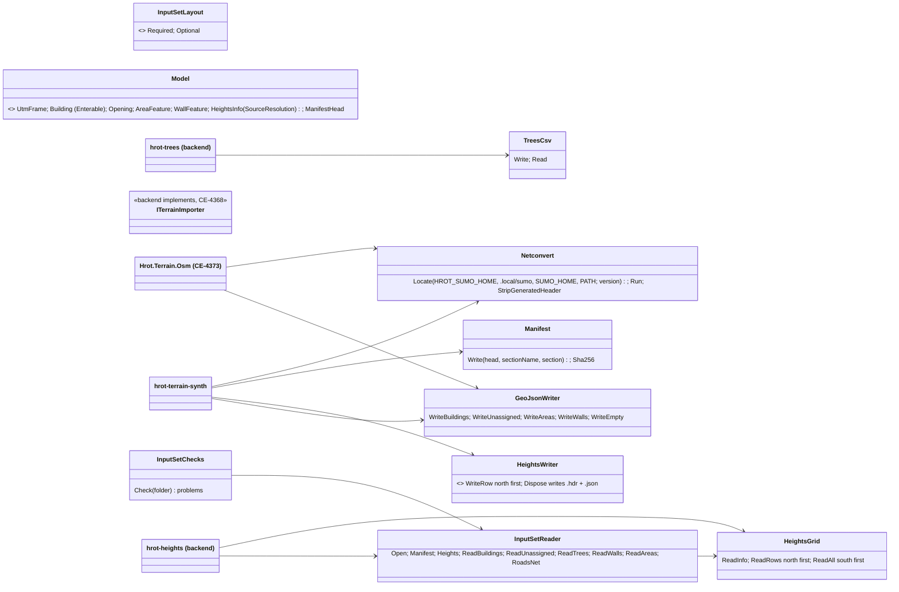
*What the picture shows: every producer WRITES and every consumer READS through this one library; the importer (backend L-6) reads through
`InputSetReader` and implements `ITerrainImporter` beside it. The Python `scripts/terrain-scale.py` still reads `manifest.json`'s bounds itself
(a script cannot reference C#) — the one remaining direct reader, and only of the manifest.*

| as built | |
|---|---|
| `InputSetChecks` checks the FORMAT (files present, hashes and sizes, the grid's size, closed counter-clockwise rings, unique ids, ascending `storeyZ` with `storeyZ[0] == baseZ`, roof values, opening storeys and headings in range, woods with a density) — ⛔ not the clean-geometry rules: a real set has noise (§10.7) | rails: `Hrot.Terrain.InputSet.Tests` (11; the counter-clockwise check red-proved) |
| `Building.Enterable` (default true; written as `"enterable": false` only when false) — R-4193's solid garages and sheds | the synth tool never writes it ⇒ its output is unchanged |
| `HeightsInfo.SourceResolution` → `heights.json` `sourceResolution` (OSM F-9) | absent when not set ⇒ the synth's files unchanged |
| `Netconvert.Locate` — the shared locator with the version check (`tools/sumo/version.txt` = 1.20.0); `HROT_SUMO_NO_LOCAL=1` hides the repo install (tests of "not found") | ⚠ a netconvert of another version is now REFUSED (the synth tool then keeps the plain files and warns) |
| the synth tool rebuilt on it: **byte-identical** output — its 87 tests (the hash pins) green, and a regenerated `tiny` diffed equal to the earlier one, `manifest.json` and `roads.net.xml` included | |

## 11. ⭐ THE IMPORTER — input set → `assets/terrain/<name>/` *(coordinator, `2026-11-10`; CE-4368 — taken over from backend's L-6: the user, "The backend is now optimizing for the large terrain so it is not going to work in the import anytime soon. Is there something you can do yourselves instead?")*

### 11.0 INVENTORY *(graph + grep, `2026-11-10`)*

| what the importer needs | exists — reused, never copied |
|---|---|
| read the input set | `Hrot.Terrain.InputSet` — `InputSetReader`, `HeightsGrid.ReadRows`, `InputSetChecks` (CE-4371, §10.10) |
| heights → the 1 m store | `TerrainHeightGrid.Resample(src north-first, ulx, uly, dx, dy, nodata, minX, minY, cols, rows, spacing)` + `WriteStore` (`.heights`, CE-4365) — as `hrot-heights` uses them |
| tree points → woods + lone trees | `TerrainWoods.Cluster(trees, min, max, roads)` (CE-4369) — as `hrot-trees` uses it; woods POLYGONS (§10.9 ②) go in as forest surfaces with their density directly (`TerrainWoods.Build` takes any polygon) |
| a building as a template + a placement | the world file's `building` Point with `template` / `rotation` / `baseZ` / `doors` (`TerrainWorldParser.cs:116-137`); templates in `<terrain>/buildings/<name>.building.json` (`TerrainAssets.cs:83`); the template schema the expander reads (`TerrainBuildingExpander`): `footprint`, `material`, `storeys[{height, walls[{from, to, thickness, material, height, openings[{kind, at, width, sillZ, headZ, doorId, initial}]}], stairs[{from, to, width, toStorey}], floor: rings}]`, `roof: flat \| none \| rings`, or `solid` + `height` |
| the terrain folder | `terrain.json` (`name`, `origin {lat, lon, alt}`, `world`, `sumoNet {file, anchor}`) + `<name>.world.geojson` (`hrot.bounds`, `hrot.heightGrid`) — the shape `scripts/terrain-from-sumo.py` writes |
| UTM ⇄ lat / lon | `Fdp.Modules.Geographic.Transforms.Utm` (CE-4372) |
| polygon booleans (the stairwell notch) | `Clipper2` (the OSM pipeline's dependency, §14.5 E-3 of Terrain From OSM) |
| ⛔ not found | a pitched / gabled roof in the template schema (flat, none or rings only) · a C# writer of terrain folders (only the Python scripts) · `UtmTransform` (stage 1, not built) |

### 11.1 The classes

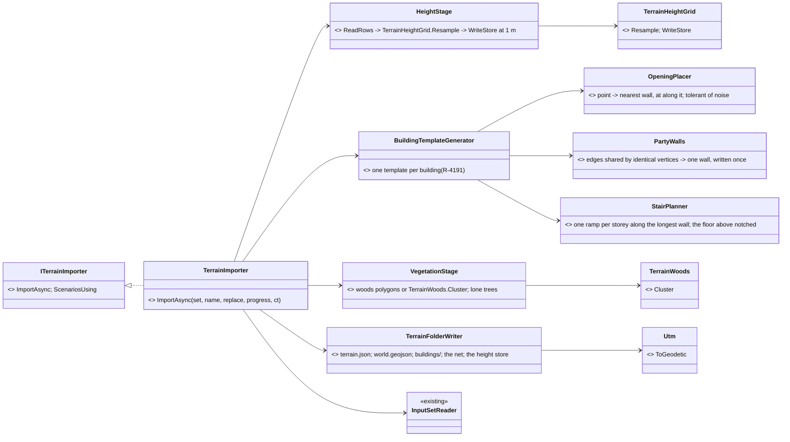
*What the picture shows: the only NEW logic is the building generator (and its three helpers) and the folder writer; heights, woods, reading
and the maths are existing code called in order.*

### 11.2 The import

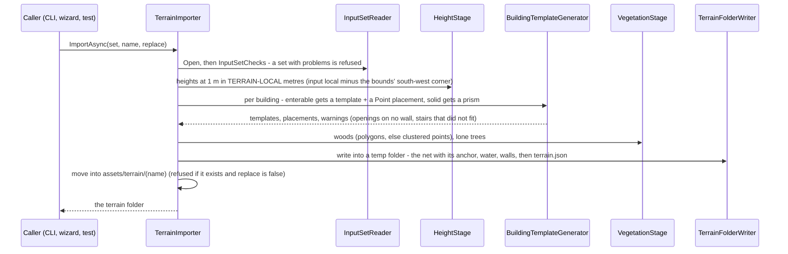

### 11.3 Decisions *(coordinator; none changes a user ruling)*

| # | decision | rejected (one line each) |
|---|---|---|
| **I-a** | **terrain-local = input local − the bounds' south-west corner** (the terrain starts at 0, 0 as every HROT terrain does; `hrot-heights` already uses this); the net's anchor = `sumoAnchor` + that corner | input local as is — negative coordinates in a terrain; every existing terrain starts at 0, 0 |
| **I-b** | **placement**: geographic `origin` = the lat / lon of the terrain's (0, 0) through `Utm.ToGeodetic`, so today's engine places it; the exact `frame.utm` (+ the corner) is ALSO written for stage 1's `UtmTransform` — until that lands lat / lon read-outs drift from the tangent plane by ≲ 2 m at 5 km; local positions are exact | waiting for `UtmTransform` — blocks the whole import on an engine change touching 53 users |
| **I-c** | **one template per building** (R-4191), named by its id, in `<terrain>/buildings/`; footprint in template-local metres (origin = the footprint's first vertex), placement rotation 0 | rotating to the longest wall — no gain for a unique template |
| **I-d** | **storeys**: heights from `storeyZ` differences; the top storey up to `baseZ + height`; outer walls on the footprint edges, 0.3 m | an inner-wall guess — none in the data (R-4186: open floors) |
| **I-e** | **openings**: each point → the nearest footprint edge within **0.6 m** (the real noise is ≤ 0.3 m off-wall, §10.7 — the heading is NOT trusted, 3 % are flipped); `at` = the projection along the wall; door 0.9 m, window 1.2 m wide, window sill / head 0.9 / 2.1 m above its storey's floor; DOORS are placed before windows; an opening overlapping one already on that wall is dropped; one beyond 0.6 m (a ground-floor DOOR: 1.5 m — recessed entrances) is dropped and counted *(doors-first + door reach: real-data run, REPORT_Terrain_Import_Real_Runs F-R2 / F-R7)* | trusting the heading — 3 % wrong in the real set |
| **I-f** | **party walls**: an edge whose two vertices match another building's edge (identical, or ≤ 0.05 m) is ONE wall, written in the building that comes first by id; no openings on it | two walls 0 m apart — the expander would build both |
| **I-g** | **stairs** (R-4186 one ramp): per storey above the ground, a 1 m-wide ramp along the inside of the longest wall, run = 1.7 × the storey height; the floor above is the footprint minus that stairwell (a notch against the wall, never a hole — Clipper2); when no wall is long enough the building is SOLID and counted *(⭐ CE-4379: after a switch-back is tried, §11.4)* | a stair at the centre — leaves a hole the floor rings cannot express |
| **I-h** | **roofs**: flat → the template's `flat` roof; pitched → a flat roof + a SOLID cap (a world `building` prism from the eaves to `ridgeZ`) — conservative for sight and fire; a true gable is a later item (the template schema has none) | ignoring the ridge — the roof would hide nothing above the eaves |
| **I-i** | **solid buildings** (`Enterable: false`, R-4193; or no stair fits): a world `building` polygon prism, `baseZ`, `height` (+ the cap) | an empty template — a navmesh island nobody uses |
| **I-j** | **woods**: `woods.geojson` polygons → forest surfaces with their density; else `trees.csv` → `TerrainWoods.Cluster` (roads left open); lone trees → `tree` points; scrub → not imported (no class yet, T-8) — reported | — |
| **I-k** | **heights**: the 1 m store (`.heights`) always; NODATA posts take the nearest valid height (`Resample`'s rule) | an `.asc` — 813 MB / 5.9 s at 1 m (measured by backend, CE-4365) |
| **I-l** | **the navmesh prefill (stage 6) is NOT in this item**: the first load bakes and caches it (`NavTileCache`); a prefill is a later item once the bake time per terrain is measured | — |
| **I-m** | **all or nothing**: written into a temp folder beside the target and moved into place; Cancel or a failure leaves nothing | writing in place |

### 11.4 ✅ AS BUILT `2026-11-10` (CE-4368) — what matched §11.1 / §11.3 and where it deviated

`Hrot/Engine/Hrot.Terrain.Import/` (+ `Hrot.Terrain.Import.Tests`, 36 rails), CLI `Hrot/Tools/Hrot.Tools.TerrainImport` (`hrot-terrain-import --set DIR --name N [--replace] [--terrains DIR] [--verify]`), and `hrot-terrain-osm --import [--replace] [--terrains DIR]` (the CLI composes the importer; the OSM library does not know it).

| §11.1 box | as built |
|---|---|
| `TerrainImporter : ITerrainImporter` | ✅ constructor `(terrainsRoot?, scenariosRoot?)`, defaults `<repo>/assets/terrain` and `<repo>/scenarios`; `LastReport` (`ImportReport`: counts, warnings, seconds per stage) because the contract returns only the folder. The set is checked with `InputSetChecks` first |
| `HeightStage` | ✅ `HeightsGrid.ReadRows` → `TerrainHeightGrid.Resample` → `WriteStore`, exactly as `hrot-heights` |
| `BuildingTemplateGenerator`, `OpeningPlacer`, `PartyWalls`, `StairPlanner` | ✅ I-c … I-g as decided; two passes — the stair plan first (a building without one is solid), then party walls over the FINAL templated set, so a shared edge is never left without a wall because its owner became a prism |
| `VegetationStage` | ✅ I-j; the roads `Cluster` leaves open are the net's lanes (`<lane shape width>`) in terrain-local metres |
| `TerrainFolderWriter` | ✅ `terrain.json`, `<name>.world.geojson`, `buildings/<id>.building.json`, the net copied unchanged as `<name>.net.xml`, `<name>.heights` |
| `ScenariosUsing` | ✅ scans `<scenarios>/*/scenario.json` for `header.terrainName` (what `ScenarioHeaderDto.TerrainName` serialises, written first, so the first 64 KB suffice) |

**Deviations / what §11.3 left open**
- **I-b:** `terrain.json` carries `origin` (lat / lon of the terrain's (0, 0) through `Utm.ToGeodetic`) AND a top-level **`frame`** `{utm: {zone, hemisphere, e0, n0}, corner: [swX, swY]}`. `TerrainDefinitionParser` reads only the keys it knows, so the extra key is tolerated (a rail parses it).
- **I-g stairs, refined:** a stair rectangle (1 m wide, run = 1.7 × the storey height) is placed against ANY footprint wall long enough (run + 1.0 m), from either end; successive storeys take places whose expanded rectangles (± 0.6 m landing) do not overlap, so a ramp never starts in the notch above the one below. The floor above is the footprint minus a notch that reaches the wall; Clipper returning a hole fails the plan. Not "the longest wall only".
- **I-g stairs, SWITCH-BACK fallback (⭐ CE-4379, `2026-11-10`) — ⛔ SUPERSEDES "when no wall is long enough the building is SOLID" above, for walls of 4.55 m and up:** per storey the planner tries the straight flight on every wall first (unchanged); only when none fits it tries a **U**: two 1 m runs side by side (0.2 m apart) with a 1 m landing slab at mid-height — a well of 2.2 m × (0.85 × storey height + 1 m) (≈ 2.2 × 3.1 m at 2.5 m storeys) against a wall corner (landing end 0.4 m from the corner, open end ≥ 0.6 m from the wall's other end). Each run climbs half the rise over 0.85 × the storey height = **the straight ramp's slope (1 : 1.7, 30.5°)**, so the bake's infantry limit (60°, `RecastNavmeshBaker`) is met by the same margin. Both runs enter and leave on the well's open end, so the floor above has ONE notch against the wall, as for the straight flight; the `taken` rule (± 0.6 m) keeps successive storeys' wells apart. Template format (⚠ additive, in `TerrainBuildingExpander`, owned by Building Interiors): a stair object's `fromRise` / `toRise` (m above its storey's floor) and a storey's `landings: [{ring, rise}]`; the report counts ramps in `Stairs` (a U = 2) and the U's in `StairsSwitchBack`. ⚠ **OPEN: `BuildingLayout` writes no stair PORTAL for a two-run stair** (it reads a ramp's ends against the storey levels; a mid-height end is no level) — the navmesh walks it (rail below), but room-graph consumers do not see the upstairs link on those houses.
- **I-h:** a pitched template gets the cap as a world `building` prism from the eaves (`baseZ` + the storeys' heights) to `ridgeZ`, labelled `<id>-roof`. A pitched SOLID building is ONE prism up to its ridge.
- **Storeys lower than 2.4 m** are raised to 2.4 m (the opening heads need 2.1 m) with a warning.
- **Door ids:** every placed door gets `doorId` `d<n>`, `initial: closed` (the input set's rule: doors are closed).
- **Materials:** building `material` brick / concrete / stone / wood / metal / mud → library `brick` / `concrete` / `concrete` / `fence-wood` / `steel-plate` / `earth-berm`, default `brick`. Walls (`walls.geojson` kinds, incl. the OSM side's `hedge`): `stone`, `wall` → `brick`; `retaining_wall`, `city_wall` → `concrete`; `mud` → `earth-berm`; `fence` → `fence-wood` (world kind `fence`); `hedge` → `hedge`.
- **Not imported (reported):** scrub polygons, `unassigned.geojson` points, the navmesh prefill (I-l).

**Measured, `full-1`** (synth full seed 1, 5.5 km, Release, this VM): import **18.1 s** — read + format checks (hashing 507 MB) 14.9, heights 2.0, roads 0.1, buildings 0.8, vegetation 0.2, write 0.1; output **140.7 MB** (126.9 MB the 1 m height store, 4.6 MB world, 8 MB of 1 686 templates, 4.1 MB net); **1 686 buildings enterable, 114 solid (no stair fits)**, 1 231 roof caps, 115 shared walls merged, 2 340 stairs; openings **68 396 placed, 204 dropped** (39 off wall, 165 overlapping a neighbour), 1 751 loose points ignored; woods 11 907 rectangles + 11 062 lone trees from the points. The terrain loader parses it in **2.2 s** (1 686 buildings, 229 750 prisms, 16 482 wall panels, 4 327 doors, 7 930 slabs / ramps, 11 907 surfaces). ⚠ the first load still bakes the navmesh (I-l) — not measured here.

**Measured, `full-1` after CE-4379** (same set, Release): **1 752 enterable, 48 solid** (was 1 686 / 114 — solid share **6.3 % → 2.7 %**), 83 switch-back stairs, 2 572 ramps (was 2 340), 129 shared walls merged (was 115). ⚠ The 48 left are all 3–6-storey buildings (27 of them 5-storey) whose wells run out of wall, plus one 2-storey 14.9 × 11.5 m — not yet looked at. ⏭ **`real-1` (60 of 1 805 solid, 3.3 %) is NOT in this repo: re-run `hrot-terrain-import` on it and read the `buildings:` line.**
