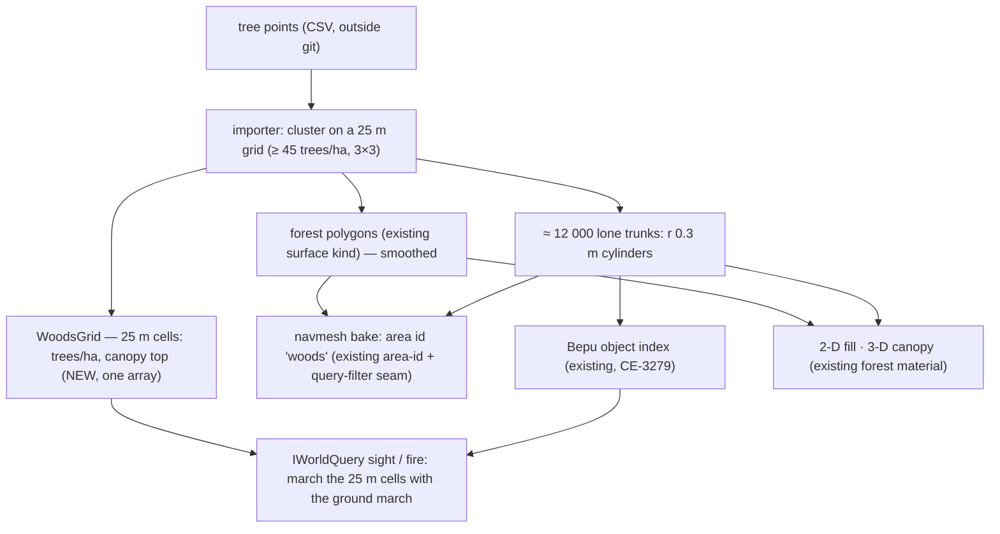

<!--STATUS
state: LIVE
build-state: DESIGN — the source-data answers are in (§5); Q-U8 decided (R-4186: open floors + a stair ramp); §5.4 ② decided (§7, R-4187); §8 destructible buildings APPROVED (R-4188: walls + collapse as a whole-building replacement); §6 re-bases the stages on Terrain World §9
updated: 2026-11-09 (§9 trees: questions — coordinator) · 2026-11-09 (§5 answers from the source-data session; §1 corrected — a height grid EXISTS; §2 / §3 revised — coordinator) · 2026-11-09 (first version — coordinator)
current-answer: ⭐ §9.6 trees PROPOSAL (Q-T1…Q-T4 for the user) · §9.5 the source-data answers · ⭐ §8 destructible buildings (PROPOSAL, Q-D1…Q-D4) · §7 paths and units (DECIDED R-4187) · §7a the performance take · ⭐ §6 the prior designs this builds on (sweep 2026-11-09) · ⭐ §5 ANSWERS (source-data session) · §5.4 the two questions left · §2 the idea (UML, revised) · §3 the stages (revised) · §1 measured · §4 the questions as asked
stale-below: nothing
known-rot: §1's grid row said the grids were FIXED at 1.5 km — they already fit the terrain (Terrain World §4.4), corrected; the first version missed DESIGN_Terrain_World §9 (sparse terrain), the World Query Seam and the built NavTileCache — §6 corrects §2 / §3; §1's first-version row "⛔ no heightmap" was WRONG (corrected by §5.3) — a single-grid ESRI ASCII height grid exists (CE-1034)
known-conflict: none
related-designs:
  - DESIGN_Terrain_World.md — ⭐ THE owning terrain design (the world file, the ONE TerrainWorld model); ⭐ its §9 SPARSE TERRAIN (S1–S7 approved, R-4051; CE-4011 outer ground, CE-4012 insets, deferred) is the frame this import builds on
  - DESIGN_World_Query_Seam.md — OWNS IWorldQuery (R-253): every height / trace / LOS reader goes through it — the import adds DATA, never a second query path
  - designs/navig-2/Navigation_Design_v2_0.md — OWNS the navmesh bake (§14 P2: tiled, 24 m) and the BUILT NavTileCache (memory + local folder, keyed by each tile's input hash)
  - blueprints/Architect_Question_71_Terrain_Zones_And_The_Asset_Build.md — R7: the per-node tile cache, keyed geographically; zones as fidelity windows
  - DESIGN_Terrain_Height.md — OWNS the terrain's height grid (TerrainHeightGrid, one .asc per terrain, CE-1034) this extends to a tiled store
  - DESIGN_Building_Interiors.md — OWNS the *.building.json template (walls, storeys, doors, windows) the importer GENERATES for each house
  - DESIGN_Geo_Origin.md — OWNS the simulation's origin and IGeographicTransform (R-229); this adds a second, UTM implementation
  - DESIGN_Terrain_Zones_And_Assets.md — OWNS what a terrain is (the content pack, TerrainCatalog) and zones as windows onto it (R-146)
  - DESIGN_Artifact_Staging.md — OWNS getting terrain files from the NAS to every node (a 100–200 MB terrain rides it)
  - blueprints/Architect_Question_93_Sumo_Traffic_Node.md — E1 (R-4025): the existing UTM ↔ WGS84 maths (Hrot.Traffic/Utm.cs) this reuses
  - DESIGN_Map_3D_Mode.md — the 3-D terrain layer and BeyondGround (the procedural outer band) a heightmap would replace inside its bounds
  - DESIGN_Content_Layout.md — where a terrain folder lives (assets/terrain/<name>/)
-->

# DESIGN (preliminary) — importing UTM terrains: a UTM frame, a heightmap, many buildings

## 0. Why

🔒 User, `2026-11-09`: *"HROT is now using tangent plane flat coordinates; what would it take to start using UTM grid map projection instead? still
with local small coordinates around zero, just placed somewhere to the UTM grid. Why: i need to import UTM terrains into HROT. Around 6x6km of
heightmap data and lots of buildings. What that would mean to how we store data? there would need to be some quite big optimizations i guess."*

⚠ R-250 / R-252: HROT's own terrain, 3-D view and SimHost are a development stand-in; production uses a mature 3-D engine behind interfaces. The
import feeds the SAME interfaces (heights, surfaces, per-purpose traces) and adds no shortcut the final engine would not have.

## 1. Measured *(`2026-11-09`, grep + reads; the graph index was used for the transform's users)*

| fact | where |
|---|---|
| the simulation is local metres at ONE origin; geodetic ↔ local goes through ONE seam `IGeographicTransform` (`SetOrigin`, `ToCartesian`, `ToGeodetic`, `Origin`) — 53 files use it through the interface | `FDP/Toolkits/Fdp.Toolkits/Geographic/IGeographicTransform.cs` · R-229 |
| its ONE implementation is the tangent plane (ECEF → ENU at the origin) | `WGS84Transform.cs` |
| the origin comes from the terrain (`terrain.json` `origin {lat, lon, alt}`) and is carried by a recording | `TerrainDefinition` · `RecordingMetadata.GeoOriginRecord` |
| UTM ↔ WGS84 maths EXISTS (the SUMO net placement) | `Hrot/Engine/Hrot.Traffic/Utm.cs` (`ToGeodetic`, `FromGeodetic`), `SumoNetPlacement.cs:55-66` |
| ✏ (corrected by §5.3) the ground is ONE height grid per terrain — an ESRI ASCII `.asc` loaded into one `float[]` (`basic-desert`, `highway-rest` use it) — plus walkable meshes; outside the terrain a procedural hilly band (`BeyondGround`). ⛔ What is missing is a TILED / large grid: 6 × 6 km at 1 m is 36 M floats (144 MB) in one array, and an equally large render mesh | `TerrainHeightGrid.cs:14-31, :187` · `TerrainWorldParser.cs:81` · `DESIGN_Terrain_Height.md` (CE-1034) · `BeyondGround.cs` |
| buildings are GeoJSON footprints extruded to a height (`*.world.geojson`; the largest, demo-city, 84 KB) + optional `houses.json` | `assets/terrain/*` |
| ✏ (corrected `2026-11-09`) the grids ALREADY follow the terrain: `SpatialGridFit` rebases each grid's origin and CELL SIZE to the terrain's bounds with a FIXED cell count (Terrain World §4.4, CE-3018) — the collider grid 300 × 300, the perception grid 200 × 200 ⇒ at 6 km the cells grow to ≈ 20 m and ≈ 30 m (density, not coverage, is the question) | `SpatialHashConstants.cs`, `PerceptionConstants.cs:81-84`, Terrain World §4.4 |
| the navmesh is TILED (24 m tiles) but BAKED AT LOAD; a cold bake already ejects SimHost | `RecastNavmeshBaker.cs:110-113` · CE-4033 |
| terrains reach every node through the NAS staging copy | `DESIGN_Artifact_Staging.md` |

## 2. The idea

*What it shows: the frame is ONE new implementation of the existing seam — nothing that uses positions changes; the height grid and the building
template EXIST and are extended (tiled storage, generated templates); the grids sized as constants are the rest of the size problem.*

| part | the idea |
|---|---|
| frame | a terrain declares `utm {zone, hemisphere, e0, n0}`; local x = E − E0, y = N − N0 (grid north), z = height; existing terrains keep the tangent plane. ⭐ For this terrain **e0/n0 = the source engine's own origin (32N, 372 000 / 6 043 000)** so both engines' local positions are numerically identical (§5 Q-U2); convergence (−1.6…−1.7°) only at a true-north gateway |
| heights | the EXISTING `TerrainHeightGrid` gains a tiled binary store (e.g. 256 × 256 posts per tile, 16-bit + offset/scale), resampled from the input's float32 height raster at **1 m** (72 MB); loaded where heights are asked (Muscle, map hosts — ⛔ never the Brain, R-2037); the 3-D view renders it with LOD; the 2-D map gets a hillshade |
| buildings | ✅ **ENTERABLE, OPEN FLOORS** (R-4186): the importer GENERATES a `*.building.json` per house (1 988): footprint → walls; each storey ONE empty floor slab + a stair `ramp` between storeys (the existing `TerrainWalkable` slab / ramp — Building Interiors `:71-97`); the ground floor at the door points' altitude, upper floors at their window points' altitude − a ≈ 0.9 m sill; door and window OPENINGS exactly at the source points (they sit where the visual engine draws the openings, so HROT's openings match); a flat roof; no partitions |
| grids | the collider hash and the perception grid sized from the terrain's bounds, not constants |
| navmesh | baked OFFLINE by the importer, stored with the terrain, loaded as a file (also closes CE-4033) |
| sizes (estimate) | 6 × 6 km at 1 m posts = 36 M samples ≈ 72 MB (16-bit); at 2 m ≈ 18 MB; buildings unknown (Q-U3); the navmesh ≈ 62 500 tiles per layer — staged once per terrain version |

## 3. The stages (revised to §5)

1. `UtmTransform` + the terrain's frame declaration (e0/n0 = the source engine's origin) — small, independent
2. the collider and perception grids sized from the terrain's bounds (the data area is x −8000…−2000, y −2000…4000)
3. the tiled `TerrainHeightGrid` store + the importer's height path (input height raster → 1 m tiles), 3-D LOD, the 2-D hillshade
4. the building GENERATOR (1 988 enterable `*.building.json`, doors / windows from the source points), batched rendering
5. the other layers: the SUMO net cropped to the box with its anchor; walls from model instances; forest surfaces derived from tree positions
6. the offline navmesh bake incl. the interiors, stored with the terrain
7. the importer as a repeatable tool here; ⛔ the converted terrain never in git (§5 Q-U5)

## 4. OPEN QUESTIONS — for the session that knows the source data

| # | question | why it matters | lean (if any) |
|---|---|---|---|
| **Q-U1** | the HEIGHTMAP's format (GeoTIFF, ASCII grid, raw + world file …), post spacing (m), vertical datum, units | the importer's reader; memory and file size (1 m vs 2 m is 4×) | GeoTIFF; keep the source spacing |
| **Q-U2** | the UTM zone(s) and hemisphere; does the 6 × 6 km area cross a zone edge? | one zone per terrain is the simple case | one zone, chosen from the area's centre |
| **Q-U3** | the BUILDINGS: footprints with heights (shapefile / GeoJSON / CityGML LoD1) or full 3-D models (OBJ / FBX / CityGML LoD2+)? roughly how many? roof shapes, floors, interiors? | footprints extrude like today; real models need a model pipeline, LOD and instancing | footprints + heights first; models later |
| **Q-U4** | other layers: roads, vegetation / forests, water, land-use / surface type, bridges, walls | each is a separate import (surfaces feed movement and perception) | roads + surface type first |
| **Q-U5** | is the data licensed / allowed in the repo, or NAS-only? | a 100–200 MB terrain should not go into git (R-4135 allows only a small preview) | NAS / content root only, never git |
| **Q-U6** | which hosts must show it: 2-D map only, 3-D view, Stride? | decides what must render it | 2-D + the editor's 3-D first |
| **Q-U7** | do units need to path everywhere in the 6 × 6 km (vehicles AND foot), or in parts? | the navmesh size and bake time | everywhere, baked offline |
| **Q-U8** | building interiors / enterable buildings (doors, rooms) in the imported set? | today's CQB features need authored interiors | not imported; authored where needed |
| **Q-U9** | how often does the source data change — a one-off import or a repeated pipeline? | a tool vs a one-time conversion | a repeatable tool |
| **Q-U10** | does the output also go to an external engine / DIS / HLA in UTM or in lat/lon? | where grid convergence must be applied | lat/lon at the gateway, as today |
| **Q-U11** | the expected unit count and view distances on this terrain | perception and collider grid cell sizes over 6 km | — |
| **Q-U12** | is the beyond-terrain hilly band still wanted around an imported terrain, or does the import bring its own surroundings? | `BeyondGround` vs real data at the edges | real data inside; the band only outside |

---
_coordinator lane, 2026-11-09_

## 5. ANSWERS — from the source-data session *(`2026-11-09`; "verified" = read in the source data or the source engine's code, "lean" = a proposal, not a decision)*

🔒 User, `2026-11-09`: *"I would like to import all 6x6 km and convert the buildings (enterable of course)."* — so the scope is the whole source
data area and Q-U8 is decided: the buildings are imported as ENTERABLE.

🔒 User, `2026-11-09`: the converted terrain NEVER enters this git repository; it stays on a local drive (later a company content repository).
This document stays generic: it describes the source only by its formats and contents, not by product or project names.

### 5.1 The source terrain and the import input

| fact | |
|---|---|
| the source is another engine's terrain database; its internals do not matter here. What the importer reads is an **IMPORT INPUT SET** prepared from it OUTSIDE this repo (on a local drive) in plain formats: heights, building footprints with door / window points and heights, tree positions, a road network | verified (contents); the buildings' conversion to GeoJSON and their heights = still to prepare |
| ✅ the data area is **6 × 6 km: UTM 32N E 364 000–370 000, N 6 041 000–6 047 000** | verified |

### 5.2 Answers

| # | answer | status |
|---|---|---|
| **Q-U1** | **Heights:** a float32 raster with an ESRI BIL header (`.hdr`) and a JSON with origin / extents / size, in local metres (Q-U2). Source spacing ≈ **0.5 m**. **Units:** metres. **Vertical datum:** none to convert — heights are taken as-is (≈ 480–770 m in this area). | verified |
| | → the importer resamples to **1 m** (36 M posts, 72 MB as 16-bit). 0.5 m is 4× the size for no simulation gain; 2 m is coarse next to building walls | lean |
| **Q-U2** | **UTM zone 32, northern hemisphere** (WGS 84 / UTM 32N, EPSG 32632). The area is ≈ 54.50–54.55°N, 6.90–6.99°E: inside zone 32, ≈ 58 km from its western edge — **no zone crossing**. Grid convergence here ≈ **−1.64° … −1.71°**: a tangent-plane frame would be rotated ≈ 1.7° against the UTM grid (≈ 30 m at 1 km). | verified |
| | ⭐ **`utm {zone: 32, hemisphere: N, e0: 372000, n0: 6043000}`** — the local origin the other engine uses for this terrain, so HROT local positions are numerically identical to the other engine's (both run together on this terrain). The data area is then x −8000…−2000, y −2000…4000 (off-centre — the grids need bounds-based sizing, stage 2, anyway) | lean |
| **Q-U3** | **Footprints + door / window points; no interiors.** Per building: footprint polygon (local metres; median 5 vertices, max 47), DOOR and WINDOW points (position, altitude, facing heading, storey index), and a height (to be added to the input set). In the 6 × 6 km: **1 988 buildings, 5 123 doors, 75 299 windows** (1 901 buildings have windows; storeys mostly 2–3, max 7; window rows ≈ 2.7 m apart). No interior geometry exists in the source | verified |
| **Q-U4** | **Roads:** a SUMO net covering a larger area (UTM 32 WGS84) → crop it to the box (`netconvert --keep-edges.in-boundary`) and reference it from `terrain.json` `sumoNet` with **anchor (139 761.25, 162 886.77)**, so net − anchor == HROT local; `scripts/terrain-from-sumo.py` already has this shape. In the box: ≈ 145 km of roads (residential 60, unclassified 27, primary / secondary / tertiary 42, motorway / trunk 16) + 13 km of rail. **Vegetation:** individual tree positions (§9.5); no forest polygons → `forest` surfaces are DERIVED. **Water:** none in this area. **Walls / fences:** placed objects → `wall` LineStrings. **Bridges:** few → author as `slab` / `ramp`. **Also present:** tunnels, power lines, street lamps (shapefiles, UTM 32N). **Land use:** no vector land use | verified (what exists); derivations = leans |
| **Q-U5** | **✅ decided: never in this git repository.** The input set and the converted terrain stay on a local drive, later in a company content repository; only the importer TOOL lives here | decided |
| **Q-U6** | HROT runs **alongside another engine that renders the full visual scene of the same terrain**; HROT's own hosts need an engineering view only: the 2-D map (+ hillshade, footprints) and the editor's 3-D view for checking; Stride not needed for this terrain | lean |
| **Q-U7** | the whole 6 × 6 km is imported; where units must path is not stated — lean as §4 (everywhere, offline bake); the infantry navmesh inside 1 988 interiors is the expensive part | — (the user) |
| **Q-U8** | **✅ decided: enterable.** The importer GENERATES each house as a `*.building.json` template: footprint → exterior walls, a floor slab per storey, DOOR openings at the input door points (position + heading → wall + offset; storey index → level), WINDOW openings at the input window points, a flat roof (sloped roofs approximated). Scale: 1 988 enterable houses vs 164 in demo-city — door entities and the interior navmesh grow with it | decided |
| | 🔒 User, `2026-11-09`: *"I do not care about rooms on a floor. Can stay one big empty floor. At most we might need to add staircase ramp so soldier can go up."* → **✅ decided: each storey is ONE empty open floor + a stair `ramp` between storeys; no partitions.** The hard requirement is the OPENINGS: HROT soldiers enter through the same doors and look out of the same windows the visual engine draws, standing on matching floors — the input points sit where the openings are drawn. Storey floors: ground floor = the door points' altitude; upper storeys = their window points' altitude − the sill offset measured per building (typically ≈ 1 m). Doors in the visual engine never open — accepted | decided |
| **Q-U9** | a **repeatable tool** reading the input set; the building generator will be tuned iteratively | lean |
| **Q-U10** | with e0/n0 from Q-U2 the two engines' local frames are IDENTICAL, so convergence never appears between them; geodetic ↔ local on both sides is standard WGS84 UTM (the same as `Utm.cs`), so lat/lon at a gateway agrees to sub-mm; convergence matters only where a heading is exchanged relative to TRUE north (DIS/HLA, lat/lon gateways) — apply the −1.6…−1.7° there | verified / lean |
| **Q-U11** | not known here | — (the user) |
| **Q-U12** | outside the 6 × 6 km there is no real data → real data inside, `BeyondGround` outside, as leaned; the heights at the edge should blend into the band | lean confirmed |

### 5.3 Correction to §1

- ⚠ §1 "⛔ no heightmap" is out of date: `FDP/Toolkits/Fdp.Toolkits/Terrain/TerrainHeightGrid.cs` (CE-1034, `DESIGN_Terrain_Height.md`) already loads ONE ESRI ASCII `.asc` grid per terrain (`basic-desert`, `highway-rest` use it). What is missing is a TILED / large heightfield — 6 × 6 km at 1 m is 36 M floats (144 MB) in one array, plus an equally large render mesh.

### 5.4 Still open — for the user

1. ~~the INSIDE of the generated houses: open-plan storeys, or a procedural room + stair layout (Q-U8)~~ ✅ decided `2026-11-09`: open floors + a stair ramp (Q-U8)
2. expected unit counts / view distances (Q-U11) and where units must path (Q-U7)

| # | ⭐ coordinator's lean `2026-11-09` | rejected — one line |
|---|---|---|
| 1 | **open-plan storeys + ONE stair per house first** (enterable, clearable, cheap to generate and to bake); a procedural room / corridor generator later, as its own stage, if the CQB drills need rooms | rooms first: new generator work before anything is enterable |
| 2 | **paths everywhere outdoors + inside every generated house**, baked offline; unit counts and view distances decide the grid cell sizes in stage 2 — until known, size for the largest shipped scenario (`perf-stress`: 1 000 soldiers) | a partial navmesh: a unit ordered outside it silently cannot move |

## 6. ⭐ The prior designs this builds on — the corpus sweep *(coordinator, `2026-11-09`; the user: "check the design documents for the related terrains so you do not repeat the error")*

INVENTORY: the `docs/` file names matching terrain · height · building · nav · zone · ground · world · geo · staging · content (44 files), their
STATUS lines read; `grep -l TerrainWorld docs` (40 files); `.dev/_DONE/{navig-2, map-features, stride-1}`; the classes confirmed in code
(`TerrainHeightGrid`, `NavTileCache`, `Utm`). ⚠ `check_index_coverage` is not available through the CLI.

| design | applies — how | ✏ what it changes in §2 / §3 |
|---|---|---|
| [Terrain World](DESIGN_Terrain_World.md) §2 (the world file), ⭐ §9 SPARSE TERRAIN (S1–S7 ✅ R-4051; CE-4011, CE-4012 deferred) | ✅ **directly**: S1 an `outer` ground block (flat / coarse grid / SUMO lattice) · S2 `insets[]`, each a rectangle with its own height grid and navmesh bounds · S3 the ground query picks the inset, else the outer ground, blended at the edge · S4 the mesh and navmesh PER INSET · S5 each inset an implicit fidelity zone · S6 every inset loaded at terrain load (streaming = the zone 2PC, later) · ⭐ S7 float local metres are precise enough to hundreds of km — **no double precision needed** | the 6 × 6 km area is **ONE INSET** (S2); Q-U12's "real data inside, a band outside" is **S1's outer ground**; ⇒ **CE-4011 + CE-4012 become PREREQUISITES of this import** (stage 0), not new inventions. What §9 does NOT cover and this design adds: a TILED height store INSIDE one large inset, the UTM frame, the building generator |
| [Terrain Height](DESIGN_Terrain_Height.md) (CE-1034; §8 the ambient ground outside, A1–A4 ✅ R-4050) | ✅ the ONE `TerrainHeightGrid` (ESRI ASCII, one array) and the outer-ground height fallback (A1) and the straight open-ground legs between areas (A2) | the tiled store EXTENDS this class (as §2 now says); the outer ground's heights use §8 A1 |
| [World Query Seam](DESIGN_World_Query_Seam.md) (WQ-A…WQ-H ✅ R-253; Bepu for objects, a plain grid for heights) | ✅ every height / trace / LOS reader (31 production files) goes through `IWorldQuery` | the import adds DATA behind the seam; ⛔ no reader learns about tiles or UTM |
| [Navigation v2](designs/navig-2/Navigation_Design_v2_0.md) §14 P2 + [AQ71](blueprints/Architect_Question_71_Terrain_Zones_And_The_Asset_Build.md) R7 | ✅ the bake is tiled (24 m) and **`NavTileCache` is BUILT** (`NavTileCache.cs:35`: memory + a local folder, key = layer, tile x/z, the hash of the tile's inputs) | "bake offline" = the importer **pre-fills the tile cache** that ships with the terrain (same keys) — ⛔ not a second navmesh store |
| [Terrain Zones and Assets](DESIGN_Terrain_Zones_And_Assets.md) (zones are windows, R-146; fidelity zones §11, R-4042) | ✅ the terrain is the content pack; an inset is an implicit fidelity zone (§9 S5) | nothing new |
| [Building Interiors](DESIGN_Building_Interiors.md) | ✅ the `*.building.json` template the generator writes | the generator's output must pass the templates' own validation; 1 988 houses × doors is a scale its door / room systems have not seen — measure in stage 4 |
| [Geo Origin](DESIGN_Geo_Origin.md) (R-229) | ✅ the ONE origin and `IGeographicTransform` | `UtmTransform` is its second implementation |
| [Artifact Staging](DESIGN_Artifact_Staging.md) · [Content Layout](DESIGN_Content_Layout.md) | ✅ how a terrain reaches every node; where it lives | the terrain stays OUTSIDE git (Q-U5) — the content root is configured, not the repo copy |
| [AQ93 SUMO](blueprints/Architect_Question_93_Sumo_Traffic_Node.md) E1 (R-4025) | ✅ `Utm.cs` and the net anchor | the SUMO crop + anchor of Q-U4 |
| [Map 3D Mode](DESIGN_Map_3D_Mode.md) (`BeyondGround`, the apron) · [Terrain Combat Tuning](DESIGN_Terrain_Combat_Tuning.md) · [World Survey Sensor](DESIGN_World_Survey_Sensor.md) · [Body Geometry and Ground Contact](DESIGN_Body_Geometry_And_Ground_Contact.md) | ✅ consumers of the world model — unchanged by construction (they read `TerrainWorld` / `IWorldQuery`) | the 3-D view's LOD for a 6 km ground is new work in Map 3D Mode |
| [PLAN 3D World and Realism](PLAN_3D_World_And_Realism.md) | ⛔ its roadmap has no large-terrain phase — this import is a new line in it | add it there when this design is approved |

### 6.1 ✏ The stages, re-based on §9 *(supersedes §3's list)*

0. **CE-4011 + CE-4012** — Terrain World §9 S1 (outer ground) and S2–S4 (insets, per-inset ground and navmesh): the approved, deferred groundwork
1. `UtmTransform` + the terrain's frame (e0/n0 = the source engine's origin)
2. the collider and perception grids at 6 km: they already fit the terrain (§4.4) — check the cell SIZES (≈ 20 m / 30 m with today's counts) against 1 000 soldiers, and raise the counts if a rail shows crowding; ⭐ AND the long-range engagements of §7 (R-4189): sight at 2–8 km for vehicles, AT teams and aircraft by a direct list, the LOS trace cost over 2–3 km of heights + buildings, a rail per weapon at its range (tank gun 3 km, ATGM 2–5 km, SAM 5 km)
3. the TILED store inside one large inset's `TerrainHeightGrid` + the importer's height path (1 m), the 3-D LOD, the 2-D hillshade
4. the building generator (1 988 enterable templates: open floors + one stair ramp, openings at the source points — R-4186), measured against Building Interiors' door systems at that scale; ✅ the complete door / window point set is prepared in the input set (outside this repo)
5. the other layers (the SUMO crop + anchor, walls, derived forest surfaces)
6. the importer pre-fills the `NavTileCache` per inset (interiors included)
7. the importer as a repeatable tool; ⛔ the converted terrain never in git

## 7. ✅ Decided `2026-11-09` — paths and units *(R-4187)*

🔒 User: *"A walkable anywhere, outdoors and inside, computed once, no more than 1,000 soldiers, but cars, aircraft, anti-aircraft. This needs to
work. For the soldiers, they do not need to see across the whole city … They are interesting just a few hundred meters away from each other. But the
aircraft should see them, and the anti-aircraft should see the aircraft."*

| decision | ⇒ for the build |
|---|---|
| **walkable everywhere — outdoors and inside every house — computed ONCE** | the importer pre-fills the `NavTileCache` for the whole inset, every layer (infantry, vehicles), interiors included (§6.1 stage 6) |
| **≤ 1 000 soldiers, plus cars, aircraft and anti-aircraft** | the collider and perception grids at 6 km (stage 2) are checked against this load |
| **soldiers sense each other to a few hundred metres** | the perception grid's ≈ 30 m cells at 6 km are fine for that range |
| **aircraft see ground units; anti-aircraft sees aircraft — kilometres, across the whole area** | ⚠ to MEASURE in stage 2: how the air sensors (`SensorModality.Radar`, the Air Operations design) find targets beyond the soldiers' local grid — air ↔ ground and AA ↔ air must not depend on a few-hundred-metre grid; with a handful of aircraft a direct list is cheap |
| ✏ **long-range ground fire must work** (R-4189) — 🔒 *"the anti-tank weapons, the missiles, needs to work at proper distance, so it could be maybe 2,000 meters … same with the tank cannon"* | 📐 the DATA already holds it: `120mm_M256` 3 000 m (the M1 sights 8 000 m), `125mm_2A46` 2 800 m, Javelin 2 500, TOW 3 750, Kornet 5 000, NLAW 800, Stinger / Igla 4 800–5 200, ZU-23 2 500 (`NedTkbCatalog.cs:403-761`). ⚠ what stage 2 must MEASURE on the 6 km heightmap: ① **sight at 2–8 km** — a sensor of that range covers the whole perception grid (≈ 30 m cells), so a per-cell scan is the wrong shape: vehicles, AT teams and aircraft need the same long-range path as air ↔ ground (a direct list — at most a few hundred of them); ② **the line-of-sight trace over 2–3 km of 1 m heights + buildings** — its cost per pair and how many pairs a second, budgeted / spread over frames; ③ **a round or missile flying 3 km** through the collider grid (≈ 20 m cells) and the missile flight times (TOW ≈ 15 s) — a rail per weapon at its range |

### 7a. ⭐ The performance take — no new engine; three measured upgrades *(coordinator, `2026-11-09`; the user: "I guess with those requirements we would need to switch to some heavy optimized mechanism for line of sight and maybe even navigation … use the BEPU physics much more intensively than now … What's your take?")*

| measured | where |
|---|---|
| ⭐ OBJECTS (buildings, walls, slabs, door leaves) are already indexed by a Bepu bounding-volume tree: on a 12 800-prism town a 100 m sight line **234 → 1.2 µs**, a 400 m one **251 → 2.1 µs**, fire alike; the index builds in 25 ms; 0 B per warm query — and it is ATTACHED in production (`TerrainResidency.Indexed`, CE-3279) | [World Query Seam](DESIGN_World_Query_Seam.md) §5a (Debug, indicative) |
| ⭐ the GROUND is a grid march, by decision: a 300 m ground trace on a 2 m grid **11.9 µs**; the same height grid as a Bepu MESH (2 km at 2 m) was **2.6 µs but +477 MB and a 10 s build** — rejected | same §5a; Terrain Height TH-B / TH-D |
| the navmesh is DotRecast, tiled (24 m), with the built `NavTileCache` and copy-on-write snapshots | Navigation v2 §14 |

| question | ⭐ take | rejected — one line |
|---|---|---|
| line of sight vs BUILDINGS | ✅ **already the optimized mechanism** — the Bepu object index scales with the pieces a line passes, not the town's size (×100–190 measured); 1 988 houses are well inside what was measured | a new LOS engine: the index is the right shape and is built |
| line of sight vs the GROUND at 2–3 km on 1 m heights | ⚠ the plain march grows with length: by extrapolation ≈ 3 000 steps ≈ 0.2 ms (Debug) per 3 km line. ⭐ **a max-height pyramid** (a coarse "highest point in this block" level per 8 × 8 / 64 × 64 posts) lets the march skip every block the line clears — ≈ tens of steps instead of thousands, identical answers, a few MB | the height grid as a Bepu mesh: ≈ 36 × the measured 477 MB at 6 km × 1 m — not affordable |
| HOW MANY long-range checks | ⭐ the real cost is pairs × length: a few hundred long-range viewers (vehicles, AT teams, aircraft, AA) × the targets in their range — **check only in range and in the field of view, each viewer re-checks a target on a slow cadence (e.g. 2–4 Hz, spread over frames), on worker threads** (perception already runs off the frame) | every pair every frame: tens of thousands of 3 km traces a frame |
| NAVIGATION | ✅ **keep DotRecast** — tiled, cached, swapped copy-on-write; ⚠ to MEASURE: a 6 km path's search cost (DotRecast's node budget may cut a very long path); ⭐ if it does, a **coarse route first** (the road graph for vehicles — SUMO's — or a tile-level graph) and DotRecast only for the local legs | a new navigation engine: nothing measured says DotRecast fails here |
| BEPU "more intensively" | ⭐ **more of the SAME use** — the index, extended to entity boxes (WQ-F: vehicles as moving occluders) — ⛔ not Bepu as a rigid-body physics simulation (nothing in these requirements needs simulated bodies) and ⛔ not Bepu as the height field | Bepu dynamics for vehicles: a different engine's job (R-250) |

⇒ stage 2 measures exactly these on the imported terrain before anything is built: a 3 km ground trace, the pair budget at 1 000 soldiers + a few hundred long-range viewers, a 6 km path. The pyramid and the coarse route are BUILT only if the measurement asks for them.

## 8. ✅ APPROVED `2026-11-09` (R-4188) — DESTRUCTIBLE BUILDINGS *(coordinator; D-1…D-8 and Q-D1…Q-D4 accepted by the user — "accepted. The wall removal is fine"; D-7 REVISED: a collapse REPLACES the building, in stage 1)*

🔒 User: *"I would like to support destructible buildings. That means that the building can lose some of its walls. I'm not sure how we could do that
exactly, maybe by removing that part of wall and making it a window, actually a big one. I'm not sure if we can actually remove floor. The destruction
is usually the outcome of a bomb explosion or sometimes a breach using some explosive hitting the wall. Could be a tank shell, artillery shell, or
some missile hit."*

| measured — what already exists | where |
|---|---|
| ⭐ a wall is a `TerrainWallPanel` (segment, thickness, base..top) with an `Openings[]` list — doors and windows ARE openings | `TerrainBuildings.cs:39-61` · [Building Interiors](DESIGN_Building_Interiors.md) §2 (`TerrainWallPanel *-- TerrainOpening`) |
| ⭐ the building design already NAMES this: *"E3 damage to the building itself — v1: a door can be Destroyed (already a `DoorState`); wall breaching = changing geometry at runtime → later"*, waiting on the navmesh's P2 | Building Interiors `:38, :365` |
| ⭐ runtime GEOMETRY change is DESIGNED and half BUILT: *"a breached wall, a crater, a collapsed building — copy-on-write: rebuild off-thread, swap one immutable snapshot"* — P1 the snapshot ✅, P2 tiles + `NavTileCache` ✅, P3 replan (with 5d) not built; the CHANGE itself (AQ81 T6) not built | [Navigation v2](designs/navig-2/Navigation_Design_v2_0.md) §14 (R-218) |
| a blast already acts on doors (a door can be destroyed by a blast) and a tall wall already shades a blast | `AreaEffectSystem.cs:346` · `AreaEffect.cs:93-96` |
| a hit already crosses walls by penetration vs the material's resistance | [Terrain Combat Tuning](DESIGN_Terrain_Combat_Tuning.md) §3 |
| destruction is the MUSCLE's: the brain never reads world geometry | R-2037 |

*What it shows: a breach is the user's "big window" — ONE more opening on the existing wall panel, kept as WORLD STATE (recorded, replicated, saved,
restored by a checkpoint) beside the static content, exactly as a door's live state sits beside its static definition. Sight and fire see it at once;
only a breach big enough to walk through touches the navmesh, through the copy-on-write rebuild Navigation v2 §14 already designs.*

| # | ⭐ lean | rejected — one line |
|---|---|---|
| **D-1** | **a breach = an extra opening on a wall panel** (the user's "big window"): a rectangle clipped to the panel and its storey | deleting the panel: a wall is rarely gone whole; a new geometry kind beside openings |
| **D-2** | a breach whose bottom reaches the floor and is ≥ 0.8 × 1.8 m is a **PASSAGE** (walkable — the navmesh changes); smaller is a **HOLE** (sight and fire only, no navmesh change) | every breach walkable: a shell-sized hole is not a door |
| **D-3** | **world state**: a `WallBreaches` component (UNMANAGED, a fixed list per building — recorded, R-2084 / new-components rule) on a per-building entity created only at the FIRST breach ⇒ 1 988 houses cost nothing until one is hit; owned by the Muscle that decided it; replicated, saved with the scenario (a scenario may start pre-breached), restored by a checkpoint | breaches in the terrain content: content is NoReplay (R-3043) — a replay would show the walls whole |
| **D-4** | **who breaches — the Muscle, by ONE rule** (warhead × the panel's material): a blast near a wall (bombs, artillery, a breaching charge) through `AreaEffectSystem` (doors already), a penetrating hit (tank shell, missile) at its hit point | the brain asks for a breach: R-2037 |
| **D-5** | **size by warhead** (tunable data, the material's resistance scales it): breaching charge ≈ a 1 × 2 m passage · tank / missile ≈ a 1–1.5 m hole · artillery shell ≈ 2–3 m · a heavy bomb close by ≈ the whole panel of that storey | one size for every weapon |
| **D-6** | sight and fire read the live breaches at QUERY time (as `DoorAwareQueryFilter` reads live doors); a passage triggers Nav v2 §14's copy-on-write rebuild of the touched tiles (seconds, off the frame) — building **P3 replan** (5d) is part of this work | rebuilding the navmesh on the frame: the CE-4033 stall |
| **D-7** ✏ R-4188 | ⛔ **no floor removal, ever in v1** — 🔒 user: *"if the building collapses after being hit by a bomb from an aircraft, maybe it is easier to just replace the building with some destroyed model which is not enterable … no floor removals, but the whole building replacement"* ⇒ **IN STAGE 1: a COLLAPSE replaces the whole building** with a RUBBLE MOUND — the EXISTING solid, non-enterable `TerrainPrism` kind (`TerrainWorld.cs:10`; Building Interiors: *"solid prisms stay valid for walls and non-enterable buildings"*): the footprint at a reduced height (≈ ⅓ of the building), no doors, no floors; units inside are casualties; the building's doors are gone. It is ONE more state on the same per-building entity (`BuildingState: Intact · Collapsed`, recorded, replicated, saved, restored), read at query time like the breaches; its tiles rebuilt through the SAME copy-on-write path (Nav v2 §14) — one building's tiles at once. HROT's own 2-D / 3-D draw the mound; the external engine swaps its model on the same published state (D-8) | removing floor slabs: units falling, stairs hanging, a navmesh changing storey by storey · a modelled ruin per building: no data for it, a mound does the job in the sim |
| **D-8** | the EXTERNAL visual engine must draw the breach — HROT publishes `WallBreaches` like any replicated state; how that engine consumes it is outside this repo | — |

| # | question for the user | lean |
|---|---|---|
| **Q-D1** ✅ | walls in v1 (holes and passages) **AND the collapse as a whole-building replacement by a rubble mound (D-7, revised)**; no floor removal | accepted |
| **Q-D2** ✅ | the sizes per warhead (D-5) as the starting table, tuned in data | accepted |
| **Q-D3** ✅ | breaches and collapses persist for the whole exercise (no repair), are saved with a scenario and restored by checkpoints | accepted |
| **Q-D4** ✅ | every building — the imported 1 988 and today's authored ones — one rule | accepted |

⇒ it is its own stage (after the importer's buildings, stage 4) — walls AND collapse together; it also delivers Building Interiors' E3 for today's terrains. The collapse trigger: a heavy bomb (or an equivalent blast) close enough by the D-5 rule — a threshold in the same data table.

---
_source-data session, 2026-11-09_

## 9. OPEN — TREES AND VEGETATION *(coordinator, `2026-11-09`; the user: "the other engine … is using trees, and we have none … it affects how entities move … how entities can be hidden from each other … my concern is especially navigation and visibility")*

### 9.1 What HROT has today — measured

| fact | where |
|---|---|
| ⭐ one vegetation concept: a `forest` **surface polygon** (`TerrainSurfaceType { Open, Forest, Water }`) | `FDP/Toolkits/Fdp.Toolkits/Terrain/TerrainWorld.cs:17`; parsed `TerrainWorldParser.cs:227` |
| ⛔ it is **drawn only** — a green fill in 2-D (`TerrainPlan2D.cs:53`), a forest-floor colour and texture in 3-D (`TerrainWorldMesh.cs:238`, `TerrainLayer3D.cs:174`) | Terrain World §2 table: *"`forest` partial — ⛔ v1: no"* for sight |
| ⛔ **no movement cost, no sight effect**: no reader of `SurfaceTypeAt` but water placement (`PlacementSolverSystem.cs:138`) | grep `SurfaceTypeAt` / `TerrainSurfaceType.Forest` |
| ⛔ no individual tree: no tree prism kind, nothing in the Bepu object index | `search_graph` for tree / forest / vegetation / foliage classes: none (the hits were behaviour trees and spatial trees) |
| ⭐ a ready seam for movement: navmesh polygons carry an **area id** and a **query filter** judges them per caller (built for doors: `DoorAwareQueryFilter`) | [Navigation v2](designs/navig-2/Navigation_Design_v2_0.md) §14 ("STATE on fixed geometry") |
| ⭐ a ready seam for sight: the combat tuning names a sight class `foliage` (per-class value) | [Terrain Combat Tuning](DESIGN_Terrain_Combat_Tuning.md) §2 (the material sight row) |
| source side (§5, Q-U4): **no forest polygons**; the input gives **individual tree positions** | §5 |

### 9.2 What the trees must do here

| need | example |
|---|---|
| **movement** | wheeled vehicles avoid woods; tracked vehicles go slowly or along tracks; infantry walks through (a little slower); a single trunk blocks a vehicle but not a man |
| **visibility** | a man in a wood is hidden at 100 m and seen at 20 m; a wood edge hides what is behind it; an aircraft sees little through a canopy; a lone tree hides a man behind its trunk only |
| **fire** | leaves and twigs barely stop bullets; trunks do; a missile's guidance wire or line of sight through a wood fails |
| **look** | woods drawn where they are; lone trees and rows drawn where they are (the user: *"a big difference"*) |

### 9.3 Preliminary leans — ⛔ NOT decided, the answers below may change them

| # | lean | rejected (one line each) |
|---|---|---|
| L-1 | **two levels from one source (the tree positions)**: ① **woods** = `forest` polygons DERIVED by clustering dense trees (an import step); ② **lone trees / rows / sparse groves** = individual trees, each a short **trunk cylinder** in the Bepu object index | every tree as an object (too many for sight lines through a wood); only polygons (loses lone trees and rows, which matter for cover) |
| L-2 | **movement**: woods are baked as a navmesh **area id**; a per-mover **query filter** sets the cost (wheeled: forbidden or very high; tracked: high; infantry: small); lone trunks are obstacles in the bake | a separate "forest" pathfinder (two implementations); trunks as dynamic obstacles (they never move) |
| L-3 | **visibility**: a sight line loses visibility **per metre travelled inside a wood**, below the canopy top (the `foliage` class value); above the canopy it passes; a trunk blocks fully; seen from the air, the canopy hides most of what is under it | full ray tests against leaf geometry (expensive and we have no models); woods as solid blocks (a wood would hide a man at 2 m) |
| L-4 | **fire**: woods let bullets through (a small chance to stop per metre); trunks stop small arms; a wire-guided missile needs a clear line, so woods block its launch | — |
| L-5 | **look**: draw from the same positions with a few simple instanced tree shapes (cone, ball) by type and height | importing the source's tree models (rendering-only content, §5 says we drop it) |

### 9.4 QUESTIONS for the source-data session

| # | question | why it decides |
|---|---|---|
| **Q-V1** | How is ONE tree stored in the export: position only, or also **type/species, height, crown radius, trunk diameter, rotation, scale**? Are bushes, hedges and crops separate records? | L-1/L-3: canopy height and trunk size drive sight and cover |
| **Q-V2** | **How many** trees in the 6×6 km box, and the densest woods in trees per hectare? Data size? | L-1: how many become objects vs polygons |
| **Q-V3** | Is there a land-cover / woodland layer that matches the tree clusters? At what resolution? | L-1: classify the map vs cluster the points to derive woods |
| **Q-V4** | **Movement in the source engine**: do vehicles collide with trunks? Can tanks knock trees down? Does its pathfinding cost woods, avoid them, or ignore trees? | L-2, and whether trees must be destructible |
| **Q-V5** | **Sight in the source engine**: does a sight line test tree geometry, use a density / attenuation per distance, or ignore trees for AI? Does foliage fully block, partly block, or only reduce detection? Any season / leaf state? | L-3 |
| **Q-V6** | **Fire**: do bullets / shells / missiles collide with trunks or foliage there? | L-4 |
| **Q-V7** | Are there **forest tracks / firebreaks** in the road data (SUMO net or shapefiles)? | L-2: the tracked vehicle's way through |
| **Q-V8** | What would the source session **recommend** as the representation, given what the export can give — and what it would NOT trust (e.g. vegetation the visual engine shows that is not in the input at all)? | the whole of §9 |

⭐ Answer format as §5: *verified* (read in the source data or engine) vs *lean*.

### 9.5 ANSWERS — from the source-data session *(`2026-11-09`; "verified" = measured in the import input or observed in the other engine's behaviour, "lean" = a proposal)*

| # | answer | status |
|---|---|---|
| **Q-V1** | **One tree = a ground position only** (x, y, ground z, local metres) in the input set (CSV). No species, height, crown or trunk size per tree is available. For scale: trunks that collide in the other engine are ≈ 0.2–0.4 m radius. **Small trees, bushes, grass and crops are NOT in the input** — the other engine draws them, but they have no collision there either. No separate hedge or bush records | verified |
| **Q-V2** | **184 150 trees** in the 6 × 6 km (4.6 MB as CSV). Where there are trees: median **65 trees / ha**, p90 130, p99 178, max 236. Nearest-neighbour spacing: p10 2.1 m, median 6.0 m, p90 8.3 m. **Woods** (≥ ≈ 40–50 trees / ha over 75–150 m windows) cover **≈ 14–16 km² (≈ 40–45 % of the area)** and hold **≈ 90 %** of the trees; the remaining **≈ 12 000–30 000** (depending on the threshold) are lone trees, rows and sparse groups | verified (counts); the wood threshold = lean |
| **Q-V3** | no land-cover / woodland layer in the input set; the tree positions ARE the reliable source of where woods are → derive woods by clustering the points | verified / lean |
| **Q-V4** | **Movement in the other engine:** trunks are solid obstacles for vehicles; a heavy or fast vehicle **knocks a tree down**, and explosions fell trees nearby; a felled tree stays gone. Its pathfinding treats trunks as obstacles and marks woods as a "prefer to avoid" area with an extra cost. → L-2 matches; **trees must be destructible** (a vehicle or a blast removes a trunk) — the same "state on fixed geometry" seam as the destructible buildings of §8 | verified (behaviour); consequence = lean |
| **Q-V5** | **Sight in the other engine:** its default line-of-sight checks **ignore trees**; including them is an option, and then trunk and crown act as simple solid shapes (crowns optionally partly see-through). No per-metre density attenuation, no season / leaf state. → nothing to stay consistent with: L-3 (attenuation per metre inside a wood, trunks block) is HROT's own model. ⚠ the people watching the visual engine see FULL foliage (incl. bushes HROT does not know) — what HROT decides is hidden may look different on screen | verified (behaviour); L-3 = lean |
| **Q-V6** | **Fire in the other engine:** depends on the weapon path — some projectile checks ignore trees, others stop on a trunk or crown as a solid shape; blast and fragment obstacle checks include trees. → L-4 is consistent with the stricter case | verified (behaviour) |
| **Q-V7** | **no forest tracks or firebreaks in the road data**: the SUMO net in the box holds only roads (residential, unclassified, primary / secondary / tertiary, motorway / trunk) and rail. Tracks may be visible in the visual scene but are not vector data → a tracked vehicle's way through a wood is cross-country (or the minor roads that cross it) | verified |
| **Q-V8** | **Recommendation — L-1 from the tree points, as leaned:** ① woods = `forest` polygons from clustering (≥ ≈ 45 trees / ha on a 25 m grid with a 3 × 3 neighbourhood, then smoothed + simplified; ≈ 15 km²); the ≈ 170 000 trees inside woods are NOT individual objects; ② every tree outside a wood (≈ 12 000) = a trunk cylinder r ≈ 0.3 m in the object index; ③ one assumed canopy height per wood (no heights in the input — tunable, e.g. 15 m). **Do NOT trust:** per-tree size or species (not available); bushes / small trees / crops (drawn by the visual engine, absent from the input — cover that looks real on screen does not exist in HROT); exact wood edges (a derived boundary, ± one grid cell) | lean |

### 9.6 ⭐ PROPOSAL after the answers — trees *(coordinator, `2026-11-09`; ⛔ not decided until the user approves Q-T1…Q-T4)*

📐 **The numbers that shape it** (§9.5): 184 150 trees · woods ≈ 15 km² = **40–45 % of the area** holding ≈ 90 % of the trees · ≈ 12 000 trees outside woods · positions only (no size, no species) · trunks ≈ 0.3 m · the other engine fells trees (vehicles, blasts) and its sight ignores trees by default.

*What the picture shows that prose hid: ONE source feeds THREE forms, each for the reader it suits — polygons for the navmesh and drawing, a 25 m grid for sight lines, objects only for the ≈ 12 000 lone trunks. Nothing new reads trees except the grid; every reader already exists.*

| # | proposal | rejected (one line each) |
|---|---|---|
| **T-1** | L-1 as the source session recommends: woods = polygons; ≈ 12 000 lone trunks = cylinders in the Bepu object index (the measured index handled 12 800 prisms at 1–2 µs per sight line) | 184 000 objects — a sight line through a wood would test hundreds of trunks |
| **T-2** | ⭐ **the woods are ALSO kept as a 25 m grid** (trees/ha + canopy top per cell — the clustering grid itself, ≈ 58 000 cells, ~0.2 MB); a sight or fire line marches it alongside the ground march and loses visibility **per metre below the canopy, scaled by the cell's density** | point-in-polygon along every line over 15 km² of polygons; one value for every wood (wastes the density the data gives) |
| **T-3** | **movement**: the woods area id with per-mover cost — wheeled: **forbidden**; tracked: allowed, high cost + a speed cap; infantry: small cost. Lone trunks are obstacles for vehicles only. Across 45 % of the area this decides most routes, so the costs are tuning values | woods as obstacles for everyone; no cost at all (the other engine avoids them too) |
| **T-4** | **destruction**: a lone trunk is felled by a heavy/fast vehicle or a blast (the §8 "state on fixed geometry" seam: removed from the index, its navmesh tile rebuilt). **Trees inside a wood are not individual** — a tank in a wood does not fell trees, it pays the cost | felling single trees inside woods (needs 170 000 objects); a felled tree as a new obstacle trunk on the ground (later, if wanted) |
| **T-5** | **from the air**: the same per-metre rule — looking steeply down, the line runs through the canopy layer (default 15 m) ⇒ ground units under a wood are mostly hidden, at a wood's edge they are seen | a flat "hidden in woods" flag (no edge, no density) |
| **T-6** | **fire**: inside woods a small stop chance per metre (most bullets pass); a lone trunk stops small arms; a guided missile needs the same clear sight line as its gunner, so woods block it beyond a short range; a blast fells lone trunks in its radius | — |
| **T-7** | **canopy height**: one tunable default (15 m) per wood cell — the input has no heights | per-tree heights (not in the data) |
| **T-8** | ⚠ **bushes, crops, small trees do not exist in HROT** (not in the input). The visual engine draws them, so someone may look "hidden" on screen and be seen by HROT. Accepted for stage 1; later, the ground-material map (§5) could add a low "scrub" concealment class | inventing bushes from nothing |

**Stage:** trees join **stage 5** (the other layers). T-2's grid march joins **stage 2**'s sight-line measurement (a 3 km line through woods is the case to time).

#### Questions for the user

| # | question | ⭐ lean |
|---|---|---|
| **Q-T1** | Wheeled vehicles: woods forbidden, or only very expensive? | forbidden — a car in a wood is unrealistic and the minor roads cross the woods |
| **Q-T2** | Tracked vehicles in woods: allowed, slow (speed cap ≈ 10 km/h) and expensive? | yes |
| **Q-T3** | Only lone trees are destructible (≈ 12 000); woods stay as they are in stage 1? | yes |
| **Q-T4** | Accept that bushes and crops seen in the visual engine give no cover in HROT for now? | yes, with the scrub class as a later item |
