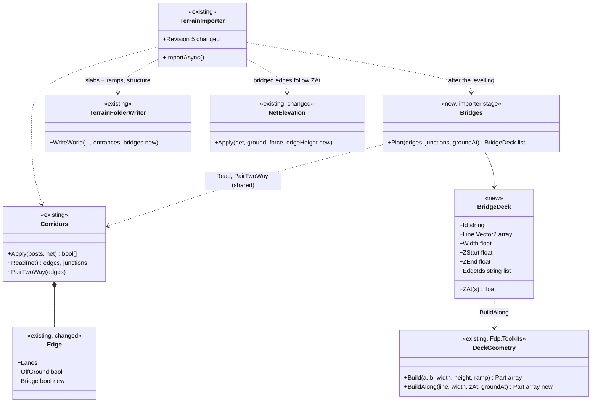
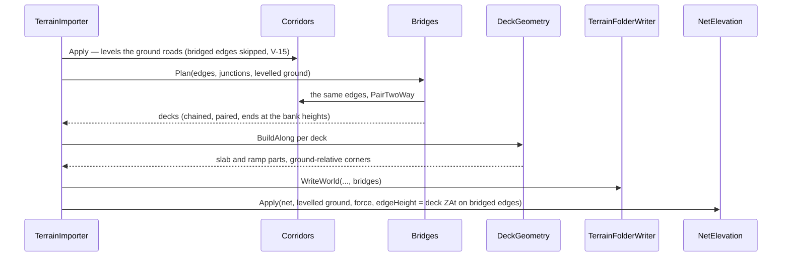
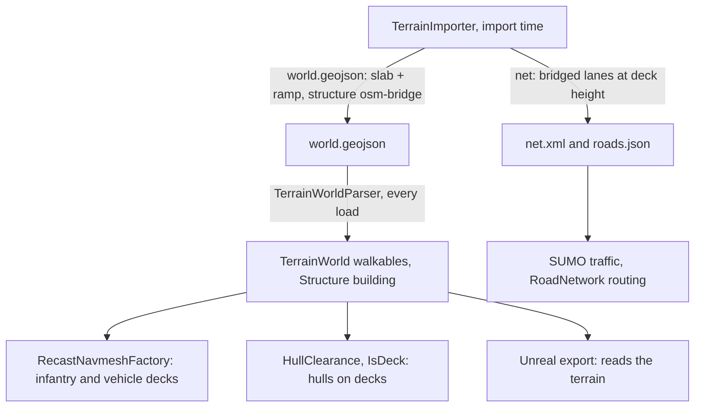

<!--STATUS
state: LIVE
build-state: BUILT (2026-11-27) — the synthetic net (A-1…A-4) and Stechovice (A-5: the Vltava crossings are decks; stechovice-battle's bridge rows pass on them)
updated: 2026-11-27 (§8a: a fallen OSM bridge closes its road, revision 6; CE-11077 / CE-11078 answered) · 2026-11-26 (§8 as built — the synthetic net) · 2026-11-26 (first version)
current-answer: §8 as built (+ §8a) · §2 the decision · §3 the UML · §4 the claim table · §5 open questions with leans · §6 acceptance
stale-below: nothing
known-rot: none
known-conflict: DESIGN_Terrain_From_OSM.md §5.3 says "a bridge stays SUMO-elevated with the valley under it untouched" — the valley stays untouched here too, but the importer's net re-elevation (G-25) DRAPES the bridge's road onto the valley today (measured, §1); this design makes the bridge's road follow its deck
related-designs:
  - DESIGN_Terrain_From_OSM.md — OWNS the OSM stage (F-2: bridge / tunnel / layer kept on the net's edges); this owns what the importer makes of a bridge edge
  - DESIGN_Terrain_Import_UTM.md — OWNS the importer's stages and its revision (§13: a revision bump re-imports); a new stage "bridges" and revision 5
  - designs/engineering/DESIGN_Bridge_Laying.md — OWNS the ONE deck geometry (DeckGeometry, BL-4) and decks as walkables / hull decks (BL-12, CE-4694); this adds a deck ALONG a polyline at given heights
  - DESIGN_Ground_Patches_And_Road_Blockage.md — OWNS the road corridors (G-21…G-25, V-15: a bridge edge levels no corridor; G-25: the net re-elevated over the levelled ground)
  - DESIGN_Terrain_Authoring.md §8 — OWNS the AUTHORED bridge feature (a deck 1.5 m above the ground under it, ramps); an OSM bridge is written with the same parts and the same structure rule
-->
# OSM bridges become terrain bridges — a deck from bank to bank (CE-11063 (unreal-ig) · CE-5057)

## 1. The problem (measured `2026-11-26`)

| | measured | file |
|---|---|---|
| ① an OSM `bridge=yes` road | the OSM stage keeps `bridge` / `tunnel` / `layer` as edge params; the importer uses them ONLY to skip the edge's road corridor (V-15) | `NetconvertRoadBuilder.cs:41-43`, `Corridors.cs:35`, `:164` |
| ② the deck | ⛔ **no deck**: nothing turns a bridged edge into a walkable — units, vehicles, the navmesh, the map and Unreal see road ends on two banks | handoff §1 (Stechovice: 0 bridges) |
| ③ ⭐ the net's height on a bridge | ⛔ the importer re-elevates EVERY net point over the LEVELLED ground, forced (`NetElevation.Apply(…, force: true)`, G-25) — so a bridged edge's lanes lie ON THE RIVER BED: SUMO's cars and Unreal's road mesh drive under water | `TerrainImporter.cs:116-121`, `NetElevation.cs:41,56,77` |
| ④ Stechovice's committed net | 0 bridge tags — generated before the OSM stage kept them | handoff §1 (`unreal-ig` regenerates it) |

## 2. Decision

⭐ **A new importer stage — BRIDGES — after the road levelling: every bridged edge chain of the net becomes ONE deck, straight in height from bank to bank, written as the authored bridge's own parts (slabs and, where needed, ramps) under one collapsible structure; and the net's lanes on those edges are re-elevated onto the deck, not the river bed.**

| # | rule | why |
|---|---|---|
| D-1 | a **bridged edge** = OSM `bridge` says yes (`Corridors.Says`); ⛔ `tunnel` never; `layer` > 0 WITHOUT `bridge` only when the levelled ground at the edge's middle lies ≥ 1 m under the straight line between its ends | OSM tags every real bridge `bridge=*`; a bare `layer=1` is often a ramp or a road on an embankment, which the ground already carries |
| ⭐ D-1a *(user, `2026-11-26`: "road bridges are important, not rail bridges")* | a `railway.*` edge (the SUMO edge type) is never a deck | 📐 Stechovice's rail edges are netconvert-merged to 1 145 / 1 749 / 2 694 m — far longer than the structures |
| D-2 | **chain**: consecutive bridged edges joined at a junction with exactly one bridged edge in and one out become ONE polyline; a **two-way road**'s pair (the corridors' `PairTwoWay`, CE-4694) is ONE deck along their midline, as wide as both | one bridge = one deck (no staircase of decks); the same pairing as the road corridors — one rule |
| D-3 | **heights**: the deck's two ENDS sit at the levelled ground at the chain's first and last points (the bank roads, which the corridors levelled); in between the deck is LINEAR along the arc length | the bridge meets the road at the bank with no step; a straight deck over a valley — not 1.5 m above the river (the authored rule, made for a footbridge) |
| ⭐ D-3a *(measured on Stechovice, `2026-11-26`)* | a deck is laid only over the DIPS of a chain, two cases: ① the straight line between its ends never cuts the ground (by > 0.3 m) — the edge IS the structure: that line (D-3), kept where it clears the ground by > 0.3 m, a kept stretch re-based on its own banks; ② it cuts the ground (a hill: the edge is longer than the structure) — each dip filled to its SPILL level (the lower of its two rims, as rain-water is trapped) and decked FLAT there. Each deck reaches 2 m onto a level or rising bank (meeting rising ground), never past a crest; an edge may give several decks (`osm-bridge/<id>#k`) or none; its lanes off every deck stay on the ground | 📐 netconvert merges a bridge with its approaches: a 201 m path edge's straight deck ran **15 m under a hill** (`951897521#1`). ⛔ Tried and rejected on the way, both measured on a hill-and-dip rail: the UPPER HULL of the profile (a dip decked from the distant hilltop, a deck over flat ground) and re-based chords alone (the chord from a hill's flank floats ~4 m over flat ground). ⚠ What remains approximate: which part of a merged edge is the structure is not in the data — a dip is bridged where the ground is lower than its rims |
| D-4 | **width**: the edge's lanes' widths (as the corridor's `half` × 2, without the shoulder) | the deck carries what the road carries |
| D-5 | **geometry**: `DeckGeometry.BuildAlong(polyline, width, zAt, groundAt)` — mitred quads (the corners at an interior vertex on the bisector, so neighbouring slabs share an edge), each corner's height ABOVE THE GROUND under it (`z(s) − ground(corner)`), exactly the format the authored bridge writes; a RAMP at an end only when that end's deck stands > 0.3 m (one step) above the ground under it (`RampLengthFor`) | ONE deck geometry (ruling 9): the authored bridge, the laid bridge and now the OSM bridge |
| D-6 | **written** to `world.geojson` as `slab` (and `ramp`) features, `zRef: ground`, under `"structure": "osm-bridge/<first edge id>"`, labels `osm-bridge/<id>/<i>` | the parser already makes them walkables of a STRUCTURE building (collapsible, a hull deck — `TerrainBuilding.Structure`, CE-4694); destruction as the authored bridge |
| D-7 | **the net**: `NetElevation.Apply` takes an optional per-EDGE height override; a bridged edge's lane points take the deck's `z(s)` | ⛔ NOT "the max of ground and deck" — that lifts a road passing UNDER a bridge onto the deck |
| D-8 | `TerrainImporter.Revision` → 5 | an existing import re-imports once (CE-5056 / CE-11061: into the machine root) |

| rejected | the one fact |
|---|---|
| the authored rule (1.5 m above the ground under it) | over a river the deck would sit 1.5 m above the WATER, metres below both banks — the road would step down into the valley |
| a deck at the net's own z | the net's z IS the ground (G-25, §1 ③) — it would be the river bed; and netconvert's OSM import has no elevation of its own here |
| the net's lane geometry as the deck outline | lanes are per direction and per lane; the deck must be one surface, as the corridor is one profile (CE-4694's cliff lesson) |

## 3. The UML

### 3.1 Classes — existing beside proposed (`<<new>>` / `<<changed>>`)

*What the picture shows that prose hid:* the bridge stage invents no parsing and no geometry — it reads the net through `Corridors` (the SAME edges, the SAME two-way pairing) and builds through `DeckGeometry` (the SAME deck the authored and the laid bridge use); the only genuinely new pieces are the chain planner and a per-edge override in the net re-elevation.

### 3.2 Sequence — one import

*What the picture shows:* the decks are planned on the LEVELLED ground (the bank heights are the corridor's), and the net is re-elevated AFTER the decks exist, so its bridged lanes take the deck's height.

### 3.3 Modules — who reads what the bridge stage writes

*Caption:* every consumer already exists — the decks ride the authored bridge's path into the parser (walkables of a structure ⇒ navmesh, hull decks, collapse), and the net's z reaches SUMO and the road graph unchanged in shape. Nothing downstream needs a new code path.

## 4. Claim table

| the decision rests on | code — how it IS | design — how it was MEANT to be |
|---|---|---|
| the OSM stage keeps `bridge` on the net's edges | ✅ `NetconvertRoadBuilder.cs:41-43` (`--osm.extra-attributes bridge,tunnel,layer`) | ✅ `DESIGN_Terrain_From_OSM.md` F-2 |
| the importer reads it per edge | ✅ `Corridors.cs:164` (`OffGround`) | ✅ V-15 / G-22 |
| bridged edges level no corridor; the banks do | ✅ `Corridors.cs:35` | ✅ G-22 |
| the net is draped over the levelled ground, bridges included | ✅ `TerrainImporter.cs:120` (`force: true`), `NetElevation.cs:56,77` | ⛔ `DESIGN_Terrain_From_OSM.md` §5.3 wants a bridge "SUMO-elevated" — a conflict, named in the STATUS |
| ground-relative corners can carry a straight deck over a valley | ✅ the parser sets each corner to `under + above` (`TerrainWorldParser.cs:304-313`) — a corner's absolute z is free | ✅ TH-I (`docs/DESIGN_Terrain_Height.md` §3.4) |
| a structure's walkables are decks for hulls and collapse | ✅ `TerrainWorld.IsDeck` (`Structure`), CE-4694 | ✅ `DESIGN_Bridge_Laying.md` BL-12; O-2 |
| ⛔ assumed | a junction between two bridged edges of one OSM bridge has exactly one bridged edge in and out — a bridge with a junction ON it (a ramp joining mid-span) is chained by its through-edges only | not searched — measured on the synthetic net, then on Stechovice when its net is regenerated |
| the proven solution | road importers (OSM → game engines, e.g. the bridge handling of CityEngine / OSM2World) build a bridge as a deck between its endpoints at the connecting roads' heights, with the terrain under it untouched — adopt: it is exactly what HROT's corridors already do on the ground | — |

## 5. Open questions (with leans)

| # | question | lean |
|---|---|---|
| Q1 | a bridge end on an embankment where the ground falls away AT the end (the deck end stands above the bank) | ⭐ a ramp at that end (D-5) — the authored rule's ramp, only where needed |
| Q2 | a very long viaduct over a valley that rises in the middle (the straight deck would cut the ground) | ⭐ the deck is `max(linear, ground + 1 m)` at its interior vertices — measure on Stechovice first; none expected on the Vltava crossings |
| Q3 | footbridges / railway bridges (`highway=footway`, `railway`) | ⭐ the same rule: any bridged EDGE of the net (the net carries what the OSM stage kept); a railway bridge's deck is walkable for infantry, which is right |
| Q4 | `bridge=movable` / a ford | ⭐ treated as a bridge (`Says` already: anything but no) — a ford is `ford=yes`, not `bridge`, and gets no deck |

## 6. Acceptance

| # | rail / scenario | asserts |
|---|---|---|
| A-1 | `BridgesTests` on a SYNTHETIC net (a straight road over a 6 m dip, one edge tagged `bridge=yes`) | one deck from bank to bank, its ends at the banks' levelled height (± 0.05 m), straight between; an untagged edge over the same dip ⇒ none |
| A-2 | the same, a bridge split into two edges at a junction, and a two-way pair | ONE deck each, no step at the joint |
| A-3 | `ImporterTests` on a synthetic input set with a river | the world has the deck parts under one `structure`; the infantry AND vehicle navmesh connect the banks over it; the net's bridged lanes lie on the deck (not the river bed) |
| A-4 | a scenario on that synthetic terrain (`te-osm-bridge`) — `scripts/scenario-regression.sh te-osm-bridge` | a vehicle crosses (a `near` row on the far bank); a man walks across |
| A-5 | Stechovice, once `unreal-ig` commits the regenerated net | the Vltava crossings are decks in `Stechovice.world.geojson`; `stechovice-battle` stays green on its bridgehead rows |

## 8. As built *(terrain, `2026-11-26`)*

| piece | as built | vs §2–§3 |
|---|---|---|
| D-1 | `Corridors.Edge` gets `Bridge`, `Tunnel`, `Layer` beside `OffGround`; `Bridges.Plan` takes `Bridge`, a bare `layer` > 0 only over a ≥ `Bridges.LayerDip` (1 m) dip, never `Tunnel` | as designed |
| D-2 | `Corridors.PairTwoWay(edges, eligible)` — the corridors' own pairing, its eligibility now a parameter (default: the ground roads, unchanged); the stage pairs its bridged edges through it, then chains through junctions joining exactly two segments | `PairTwoWay` was `OffGround`-only; generalised, not copied (ruling 9) |
| D-3 / D-4 | ends at `finalGround` (after the pads, which never alter a road) at the chain's first and last points; width = the lanes' widths (a pair: the corridor's `half` × 2 − the shoulders) | as designed |
| D-5 | `DeckGeometry.BuildAlong(line, width, zAt, groundAt)` — mitred slabs (the mitre capped at 2 × half-width), a ramp only where an end stands > `RampThreshold` (0.3 m) above the ground, length `RampLengthFor` | as designed |
| D-6 | `TerrainFolderWriter.WriteWorld(…, bridges)` — `slab` / `ramp` features, `zRef: ground`, `structure: osm-bridge/<forward edge id>` (SUMO's reverse edge is `-<id>`: the forward one names it) | the name rule added |
| D-7 | `NetElevation.Apply(…, edgeSurface, junctionZ)` — a second pass over the bridged `<edge>` blocks onto `Deck.ZNear`, a junction ON a bridge to the deck; no override ⇒ the single pass as before | as designed |
| D-8 | `TerrainImporter.Revision` 5; `ImportReport.Bridges` | as designed |
| the synthetic set | ⭐ `assets/terrain-input/te-osm-bridge` (224 KB): a 200 m square, a 6 m dip with a river (x −10..10), a two-way road along y 0 — its net made by **SUMO's own netconvert** from plain nodes / edges (the crossing edges carry `<param key="bridge" value="yes"/>`, as the OSM stage keeps it); written through the rails' `MiniSet` writers by a local generator | 📐 a hand-written minimal net (the rails' form) failed SUMO's traffic loader (*"&lt;lane&gt; is missing required attribute 'speed'"*) — the committed set needs a full net |

**Stechovice (A-5), `2026-11-26`, after `unreal-ig`'s net (24 bridged edges) and D-1a / D-3a (final):** 9 decks, none more than 0.9 m under the ground (a side corner on a cross-sloped bank) — ⭐ **the Vltava south (`26476508`, 124 m, 0–5.7 m over the ground) and north (`4412124` "most Vltavanů", 300 m, up to 15.8 m) crossings**; footbridges (`153205115#1` "Starý davelský most" 148 m, `4929683` 106 m, `1151327975`) and small street / path bridges kept (men cross them); no rail; the merged path / track edges give only their real dips (or none). ⚠ Before D-1a / D-3a the same net gave a 2 694 m rail deck 25.6 m under the ground and the path 15 m under a hill.

**Gates (`2026-11-26`):** `ImporterTests.CE5057_*` 4 / 4 — each red-proved by a compiling mutation (no stage ⇒ 3 red; no net override ⇒ 2 red; no chaining ⇒ 1 red; no pairing of bridged edges ⇒ the committed-set rail red) · `Hrot.Terrain.Import.Tests` 93 / 1 / 1 — ⚠ the one red is **CE-5021** (*"red wherever SUMO is installed"* — SUMO was installed for this set's net; pre-existing) · `Hrot.Terrain.InputSet.Tests` 19 / 19 · `Fdp.Toolkits` deck / feature / world 109 / 109 · ⭐ **`scripts/scenario-regression.sh te-osm-bridge` — 3 / 3 PASS** (the tank reaches the east bank at 33 s, never below the banks' height over the river; the squad's objective Achieved).

### 8a. A fallen OSM bridge closes its road — CE-11075 (`terrain`, `2026-11-27`; `unreal-ig`'s live test: a SUMO HMMWV drove onto the fallen deck and stopped in the air)

| piece | as built |
|---|---|
| the cause | `BridgeClosureSystem` closes the rows of `TerrainDefinition.ResolvedBridges`, which came only from an OVERLAY's `bridges[]`: an importer's `osm-bridge/*` decks are BASE structures with no row — D-6's *"destruction as the authored bridge"* held for the deck, not for the road |
| `NetRoadNetwork.Read(…, segmentsOfEdge)` | each SUMO edge id's road-graph segments (an edge and its reverse share one set — the reverse is not written twice) |
| `TerrainImporter.DeckRow` → `terrain.json` `bridges[]` | per deck: `key` = its structure label, `sumoEdges` = every bridged edge (both directions), `segments` = their road-graph segments — the overlay header's row shape (`TerrainOverlayHeader.ParseBridges` reads both) |
| `TerrainDefinition.Bridges` → `TerrainResidency` | the base rows published in `ResolvedBridges`, the overlay's appended (base segment indices come first in the merged net) — `BridgeClosureSystem` unchanged |
| `TerrainImporter.Revision` | **6** — every machine re-imports a bridged terrain once (Stechovice: its 9 decks get their rows) |
| rails (red-proved) | `ImporterTests.CE11075_*` (the row: key, both edges, only the bridge's segment); `BridgeClosureTests.CE11075_*` (a base deck's collapse drops its segment — the route takes the detour) |

⭐ **CE-11077 (lane shapes under the deck) — not reproduced:** on the revision-5 import of input manifest `7a73289d…` every bridged lane follows the deck within 0.15 m of its edge
shape (`4412124_0` lowest 211.03 vs its edge 211.14; `26476508_0` 202.75 vs 202.90; the junction lanes at both ends on the deck too), in all three copies on this machine
(`assets/terrain`, `data/shared`, `data/nodes/node-1`). ⇒ lean: the reading came from a copy WITHOUT bridges (CE-11078's reverted `fe13be9c…` import). Re-measure on revision 6.

⭐ **CE-11078 (which folder is "the" import):** the MACHINE ROOT (`TerrainSources.SharedImportRoot` — `assets/terrain/<name>` in a dev checkout; else the NAS shared root;
`TerrainCatalog.SharedImportTarget`, CE-11039 / CE-11061). `data/shared/…` and `data/nodes/*/Terrain/…` are a run's copies; a copy whose recorded input manifest or importer revision
differs from the input set is STALE and is never used — the stale hit re-imports into the machine root (exactly what the live run did). ⛔ Not determinable here: what wrote the
older `fe13be9c…` import into `data/shared` at that editor's start (on this machine every copy is `7a73289d…`) — the editor log's terrain lines of that start would say.

## 7. INVENTORY

| query | total | found |
|---|---|---|
| `search_graph name_pattern ".*Bridge.*" label Class` | 13 | terrain/traffic: `BridgeClosureSystem`, `BridgeNetBuilder`, `BridgeRoads` (+ `BridgePlan`, `BridgeNetRequest`) — the LAID bridge's road ADD (CE-4692); the rest are unrelated (animation / editor selection "bridges") — ⇒ none turns an OSM edge into a deck |
| `… ".*Bridge.*" label Interface` | 1 | `BridgeRoads.IBridgeNet` (the laid bridge's roads) |
| `… ".*Deck.*" label Class` | 2 | cloud decks (weather) — ⚠ `DeckGeometry` is NOT in the graph (indexed before CE-4692); grep: `FDP/Toolkits/Fdp.Toolkits/Terrain/DeckGeometry.cs` |
| `… ".*Corridor.*" label Class` | 9 | `Corridors` (the importer), `RoadCorridor(s)`, `CorridorReport`; the rest are navigation / SUMO pedestrians |
| `… ".*Netconvert.*" label Class` | 2 | `Netconvert` (input set), `NetconvertRoadBuilder` (OSM stage) |
| grep `NetElevation.Apply` | 2 callers | the input set and the importer (G-25, forced) |
| grep the importer's written features | `TerrainFolderWriter.WriteWorld` | entrance ramps are written as `ramp` features (`:80`) — the bridge parts go the same way |

⚠ `check_index_coverage` is not available through the CLI — the absence claims rest on the graph plus grep.
