<!--STATUS
state: LIVE
updated: 2026-10-22 (§8.3 CE-3301 — the ring is created with the solver, so a first load hears as a reload does) · 2026-10-22 (§8.7 CE-2349 — the M1 and the Bradley carry a thermal sight; listed eyes read the receptor) · 2026-10-21 (§8.4 CE-4039 — bit 15 is the solver's pending-ray flag; a Regular ear was deaf to rifles) · 2026-10-21 (§8.6a CE-2348 ③ — a heard burst is placed where it lands; lean awaits the user) · 2026-10-21 (§8.3 CE-3293 — a ring read is as of the reader's own time) · 2026-10-20 (§8.6 CE-3281 — the built-in catalogue is heard; jets as Rotor and silent SUMO cars confirmed by the user) · 2026-10-19 (§8.2 CE-3276, R-3023 — a loud sound carries past the ear range) · 2026-10-12 (CE-2107 built — §8)
build-state: BUILT — A–F approved with the user's three changes (R-205); build rows CE-3060 … CE-3064 (§7); behaviors ② / ③ §8.
current-answer: the whole file — §2 inventory, §3 module diagram, §4 classes, §5 sequences, §6 decisions, §7 build order; §8 the behaviors lane's ② / ③ (the AI readers, hiding from a heard point); §8.1 shipped units hear and make sound (CE-2106).
stale-below: nothing — new document.
known-rot: §6 D's "position + radius, no identity" — the user (§6.1a K3, R-207) adds a coarse source CLASS to a heard contact; §5.1's SoundContactEvent gains it. §3's SoundEmissionBuffer box and §5.1's buffer participant — as built there is NO buffer; the sound state is on each emitter (§7 as-built CE-3062). §7's "every shipped unit is silent" — the urban types make sound and hear since CE-2106 (§8.1).
known-conflict:
  - docs/HROT-Engine-Guide/HROT-Engine-Guide.md §12.2 and docs/projects/FDP/Toolkits/Fdp.Toolkits.md:732 claim acoustic detection
    "with terrain occlusion" — never built; corrected when CE-3062 lands.
related-designs:
  - docs/blueprints/DESIGN_Paused_And_Stepped_Execution.md — step-only systems, step windows and the reload probe (§7e) that measured the ring's thread race (§8.3)
  - docs/blueprints/Architect_Question_95_Sound_Signatures_And_Lossless_Hearing.md — a sound signature per weapon (A), hearing bounded by distance not terrain (B), a lossless emission ring (C) — OPEN, leans await the user
  - docs/DESIGN_Node_Roles_And_Policies.md — §3.5 (R-3015, CE-1148): the shot / detonation ingress moves to every node with an own-sample skip, replacing §3a's Perception && !MuscleGround branch and its named limit.
  - docs/designs/weather/DESIGN_Weather_And_Time.md — S2 gives thermal and hearing the weather and the time of day (row F's "not asked")
  - docs/designs/audio/DESIGN_FPS_Audio.md — PLAYS sound to the FPS operator; reuses this file's AcousticSignatureDto ranges and SoundSourceClass as its audible ranges and movement-sound classes (AU-4), so the operator hears what the AI hears
  - docs/designs/vehicle-tactics/DESIGN_FPV_Drone.md — the Rotor sound class (7) and an airborne flyer audible at any speed
  - docs/designs/vehicle-tactics/DESIGN_Urban_Armour_Tactics.md — adds a rotor sound class so a vehicle can hear an FPV drone (M7)
  - DESIGN_World_Query_Seam.md — hearing through walls and around corners (WQ-E): a loudness model reading the TKB ranges (⭐ §8.2 R-3023 — loud classes already carry past the ear: the first step of it)
    as threshold distances, then Building Interiors' B-6 behind IWorldQuery.Trace(Sound).
  - docs/blueprints/Architect_Question_85_Hit_Chance.md — OWNS hit chance; proposes that a near miss (§6 G) spoils the target's aim (suppression).
  - docs/DESIGN_Sensors_And_Doctrine.md — OWNS the sensor form, the memory stage, TargetMemory and G6; this file is its S7 (§9 row, §11.2 G6).
  - docs/blueprints/Architect_Question_82_One_Sensor_Form.md — rulings E (push stimuli feed the memory stage) and I (one pipeline per sense) this builds.
  - docs/designs/eqs-2/EQS_Design_v1.3_final.md — OWNS the template / generator / filter shape the two new templates follow.
  - docs/designs/brain-split/BS-1-DESIGN.md — OWNS the shot path (FireProcessingSystem) that now also makes heat and sound.
  - docs/designs/indirect-fire/DESIGN_Indirect_Fire.md — §3.8: a Brain-only node now reads detonations too (MunitionDetonationIngress), for a fire-mission observer who judges bursts with his OWN sight check — no heat or sound runs there.
  - docs/DESIGN_Decision_Layer.md — the behaviors lane's ROE (R-200): ReturnFire answers a Hit or a NearMiss (§6 G).
  - docs/designs/packs-1/DESIGN.md §7.B — introduced TargetHeardEvent; retired here (§6 A).
  - docs/DESIGN_Eqs_Consuming_Behaviours.md — OWNS TakeCover / FallBack; §8 here points their sensor at a heard contact's position.
  - docs/DESIGN_Decision_Layer.md §3.3b — OWNS CombatPosture, whose PostureSensors §8 points the same way.
  - DESIGN_Terrain_Combat_Tuning.md §5a — the hearing debug layer: emitter rings and heard estimates (HeardTraces), recorded for replay (CE-3117).
-->

# Thermal and acoustic sensing — S7 (`CE-3055`)

🔒 **User, `2026-10-05`** (R-205): *"Moving entity also makes sound. Hearability params to be added to to the tkb. I want Shot
from north realism. Hot when running or firing - pls implement some simple heat accumulation and cooldown. … Otherwise
approved."* — approving leans A–F of the S7 pass with three changes: movement is a sound source, hearing parameters live in
the TKB, and a heard contact is **anonymous** (G6), not the shooter.

## 1. In one paragraph

Two new perception templates on the existing sensor form, nothing beside it. **Thermal** is vision's chain plus a signature
filter; the signature is a per-type TKB base plus **heat** that builds while the entity runs or fires and cools when it stops.
**Acoustic** reads a short buffer of this tick's **sound emissions** (shots, detonations, moving entities, each with a TKB
audible range) and answers with **anonymous** estimates — a position off by an error that grows with distance, plus an
uncertainty radius. The Brain's memory keeps them as anonymous contacts that merge when a sense confirms what is there. The old
hearing pipeline, which nothing in production feeds or reads, is retired.

## 2. INVENTORY *(measured `2026-10-05`)*

`search_graph(name_pattern=".*(Audio|Acoustic|Thermal|Heat|Sound|Hearing|Heard).*", label="Class")` → **total 12**, `has_more:
false`: `AcousticSensorDto`, `ThermalSensorDto`, `AudioPerceptionSystem`, `AudioStimulusEvent`, `TargetHeardEvent`,
`AudioTargetDetected`, its egress and IG ingress translators, three test classes, two unrelated editor heatmap renderers.
⚠ `check_index_coverage` not run (CLI gap). Corroborated by two read-only sweeps (grep + reads) and spot-checks below.

| fact | where |
|---|---|
| nothing in production creates a sound (`new AudioStimulusEvent` only in tests) | grep, 0 non-test hits |
| `AudioPerceptionSystem` is registered only by the two FDP examples | `HeadlessDemoApp.cs:354`, `UrbanCombatNewScenario.cs:589` |
| its `TargetHeardEvent` has no consumer; the egress runs on every Muscle over an event nobody publishes | `SimHostAuxiliaryTranslatorPack.cs:86`; IG ingress `NedIgTranslators.cs:34` feeds nothing |
| `ThermalSensorDto.MinSignature` is read nowhere; no entity carries a heat signature | `SensorEntryDto.cs:79`; searched TKB DTOs, components, topics, scenarios |
| no loudness / audible field on weapons, detonations or vehicles; no engine data at all | `WeaponCapabilitiesDto.cs`, `DetonationNotification.cs`, `VehicleParametersDto` |
| `ThreatEvaluationSystem` stamps every contact `Visual` | `ThreatEvaluationSystem.cs:123` |
| utility's `HasLineOfSight` reads that Visual bit ⇒ any other sense would read as "in sight" | `StandardInputs.cs:185` |
| `SensorTrackStateEvent` / DDS `SensorTrackState` carry no modality | `PerceptionEvents.cs:91-109`, `SimDescriptors.cs:290-306` |
| Perception always runs in the same process as MuscleGround (where shots and movement happen) | `SimHostApp.cs:187,261`, `StrideNodeBootstrapper.cs:67` |
| `TargetMemory` is keyed by entity id; 7 production readers dereference the id | `ThreatEvaluationSystem`, `StandardInputs`, `UtilityScorer`, `ThreatMatrixAssignmentSystem`, `SquadPerceptionMergeSystem`, `CgfNodes`, `HillAttackTankNodes` |
| vision's reusable pieces | `VisionBroadphase.Select`, `StrategySightTest` / `ILosStrategy`, `DistanceScoreTest`, `SensorMemoryStage` (`VisualPerception.cs:33-40`) |

## 3. Who registers what, on which node, and who calls it each frame

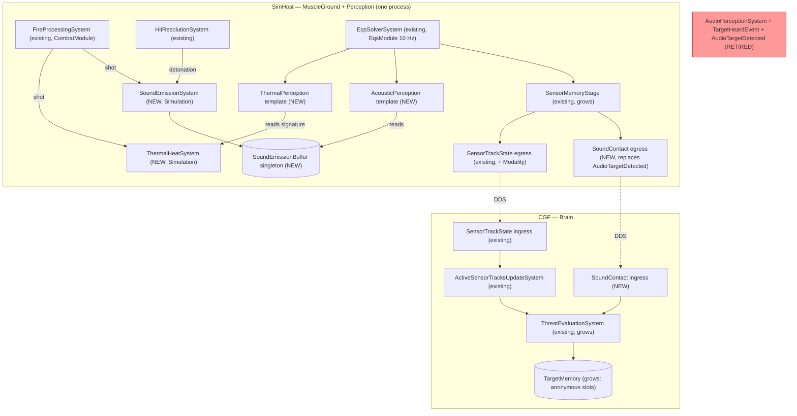

*What the picture shows that prose hid:* every producer sits in the same process as the sensors that read it, so the only new
wire is the RESULT (`SoundContact`), never the stimulus. The red box has no edge in or out — it is retired, not rewired. The
editor (CGF == editor, one world) composes the same SimHost-side systems through its perception capability, so the picture
holds there with the DDS edges collapsed.

## 3a. Perception on ANOTHER node *(🔒 user, `2026-10-05`: "may be distributed in the future (like perception on different node) so pls count with some kind of distribution of the inputs for the sensors from their producers")*

⭐ **Rule: heat and sound are DERIVED where the sensor solves, from inputs that are already published — nothing new is
published for them.** `ThermalHeatSystem` and `SoundEmissionSystem` are composed by the PERCEPTION capability
(`EqsSolverStartup.PopulateSystems`), not by the Muscle, so they follow the solver to whichever node it runs on.

| input | on a Perception-only node | code | design |
|---|---|---|---|
| positions (→ measured speed for running heat and movement sound) | ✅ every entity replicates, and remote entities are dead-reckoned EVERY tick on every node, so the per-tick distance is smooth | `NedReplicationModule.cs:469` | ✅ `docs/DESIGN_Dead_Reckoning.md` R1 / §5.1 |
| shots (→ firing heat, shot sound) | ⛔ **GAP**: the Muscle publishes `WeaponFire`, but only the IG ingests it back into `WeaponFireNotification` | `NedIgTranslators.cs:36`; Perception group adds only EQS translators (`SimHostAuxiliaryTranslatorPack.cs`) | ⛔ searched, none found ⇒ `CE-3065` |
| detonations (→ detonation sound) | ⛔ **GAP**: `MunitionDetonation` ingress is on the IG and on MuscleGround only | `SimHostAuxiliaryTranslatorPack.cs:90`, `NedIgTranslators.cs:38` | ⛔ ⇒ `CE-3065` |
| TKB signatures (heat / audible ranges) | ✅ stamped by `SignatureTkbTranslator` on every node that registers the components | `TkbTranslatorSet.Base()` | — |

⇒ `CE-3065`: add the `WeaponFire` and `MunitionDetonation` ingress for a node that is Perception WITHOUT MuscleGround (with it, the
local events already exist — ingesting them too would count each shot twice). ⭐ Both arrive `IsRemote = true`; heat and sound
accept remote events (only `DamageCalculationSystem` skips them).

⛔ **SUPERSEDED `2026-10-17` by [Node Roles §3.5](DESIGN_Node_Roles_And_Policies.md) (CE-1148 S2, R-3015):** the shot / burst / mark pairs are in the shared pack on EVERY node and the ingress drops the node's own samples by `SourceNodeId`; no role branch or exclusion remains. The text below is the prior as-built.

⭐ **As-built `CE-3065` (`2026-10-05`)** — `SimHostAuxiliaryTranslatorPack`: Perception && !MuscleGround ⇒ `WeaponFireIngressTranslator`
+ `MunitionDetonationIngressTranslator`; ⚠ **one correction found while building it:** the heard-contact EGRESS
(`AudioTargetDetectedEgressTranslator`) sat behind the MuscleGround gate, but its producer is the memory stage, which runs with the
SOLVER — it now sits beside `EqsResultEventEgressTranslator` (Perception || MuscleGround). Detonations need no extra rule: they exist
only for a hit on an entity (`HitResolutionSystem`), and the ingress keeps exactly those. Rail: `SimHostAuxiliaryTranslatorPackTests`.
⚠ **Known limit:** a node that is Perception AND MuscleGround reads no `WeaponFire`, so it does not hear shots of units simulated on
ANOTHER MuscleGround node (two SimHosts). ⛔ Not built: no such topology exists, and reading its own samples back would heat each
local shooter twice. **What would change it:** a second MuscleGround node — then the ingress skips shooters this node fires for
(an authority check, as `EqsResultIngressTranslator`'s echo rule does) instead of keying on the role.

⛔ **Rejected: publishing `ThermalState` from the Muscle.** A continuous per-entity topic for a value every node can compute from
what it already receives. ⚠ **What would change it:** a heat source that is NOT observable from published data — engine load,
a running generator, a weapon's barrel temperature beyond shots fired. Then that one input gets published (or folded into an
existing state topic), and the rest stays derived.

## 4. Classes

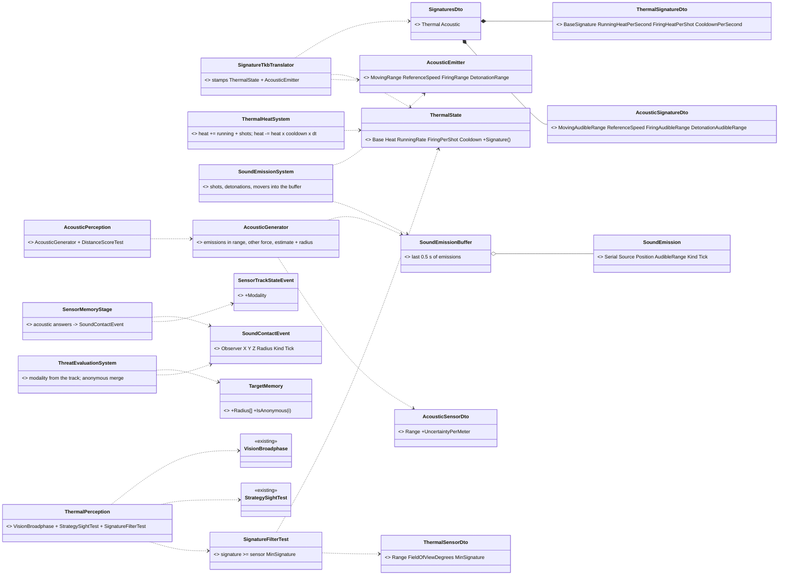

*What the picture shows that prose hid:* the only existing types that change are the memory stage, the track event, the
threat system and `TargetMemory` — the sensor child, its factory, the solver and the reader API are untouched.

## 5. Sequences

### 5.1 A shot is heard from the north, then the shooter is seen

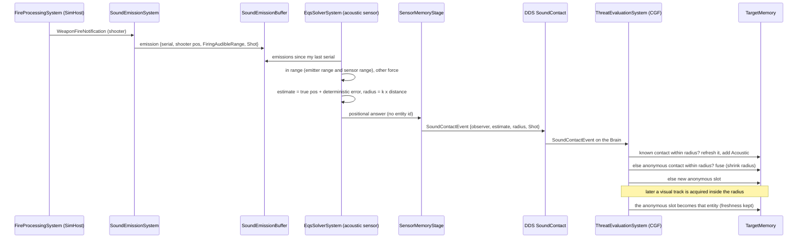

*What the picture shows that prose hid:* the identity never crosses the wire — the Brain learns only "something at about
here". Merging is spatial on the Brain, so it is honest: a second shooter nearby merges into the same contact, exactly as a
listener would hear it.

### 5.2 Heat

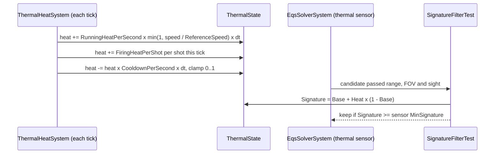

## 6. Decisions — why

| # | decision | why | rejected |
|---|---|---|---|
| **A** | retire `AudioPerceptionSystem`, `AudioStimulusEvent`, `TargetHeardEvent`, the `AudioTargetDetected` translators; the descriptor id 84 is reused for `SoundContact` | nothing in production feeds or reads them (§2); AQ82 ruling I: one pipeline per sense | keeping it beside the sensor form — two hearing pipelines |
| **B** | hearing is a TEMPLATE whose generator reads a 0.5 s emission buffer, each sensor remembering the last serial it heard | AQ82 ruling E (push stimuli feed the memory stage) inside the one solver; the window covers a sensor the budget defers by a tick or more (§5.3 of the sensors design) | a push system writing memory directly — a second path around the budget and the memory stage |
| **C** | sources: shots, detonations, and every entity moving faster than 0.5 m/s, range scaled by `speed / ReferenceSpeed`; audible ranges in the TKB (`AcousticSignatureDto`) | 🔒 user: *"Moving entity also makes sound. Hearability params to be added to the tkb."* | engine sound — no engine data exists; movement speed stands in for it |
| **D** | ⚠ *amended by §6.1a K3 (R-207): it also carries a coarse source class* — a heard contact is ANONYMOUS: position estimate + uncertainty radius; error and radius grow with distance; deterministic (hash of emission serial and listener), so replay is exact | 🔒 user: *"I want Shot from north realism."* (G6) | the shooter's id — "omniscient hearing"; random noise — breaks determinism |
| **D′** | the Brain merges spatially: refresh a known contact inside the radius, else fuse with an anonymous one (radius shrinks), else a new slot; a sighting inside the radius absorbs it | the identity never crosses the wire, so only position can merge it | a hidden true id carried for merging — the AI would act on knowledge it does not have |
| **D″** | anonymous slots live in `TargetMemory` (a reserved id range + a new `Radius[]`); the readers that need an ENTITY (aim, fire, entity reads) skip them, the ones that need a POSITION (face, move, flee, squad share) use them | one memory, one freshness rule (R-194); the 7 readers in §2 split cleanly into those two kinds | a second "anonymous memory" component — two memories for every reader to merge |
| **E** | heat: `heat += running + shots`, `heat -= heat × cooldown × dt`, `Signature = Base + Heat × (1 − Base)`; parameters in the TKB (`ThermalSignatureDto`) | 🔒 user: *"Hot when running or firing - pls implement some simple heat accumulation and cooldown."* | a temperature simulation — no heat model to feed it |
| **F** | thermal = vision's broadphase + sight + the signature filter, its own template reading the thermal sensor's range and FOV | reuse; the only difference from sight is what makes a target detectable | weather / night attenuation — not asked |
| **G** | the track carries its MODALITY (event + IDL); memory ORs the real one in; ROE `ReturnFire` answers a Hit or a **NearMiss** (a bullet passing within 3 m of a unit of ANOTHER SIDE than the shooter, from the ballistics step — ⚠ corrected `2026-10-05`: the first wording said "a unit it was not aimed at", which wrongly excluded the missed target itself) — this is `CE-2096`, approved as R-206 | without modality a thermal or heard contact reads as "in sight" (§2); a near miss is the "shot at" a unit can actually tell | ReturnFire on any heard shot — a unit would return fire at a distant firefight |

⚠ **What would change it:** if heard contacts must ALSO carry a direction-only form (bearing, no range), D grows a bearing
field; the radius already covers "about here", which is what "from the north" needs for movement and facing.

### 6.1 Behaviors-lane review of D″ and the `CE-3063` frame *(`2026-10-05`, behaviors; answered by the user in §6.1a)*

⭐ **The reader inventory is larger than the frame's seven.** Measured: grep of `EntityIds[` over production, plus every
production file naming `TargetMemory` (54 files). ⚠ The list comes from grep: the graph's `search_code` returned 0 hits for this pattern on a fresh index, and
`check_index_coverage` is not reachable through the CLI.

| reader | kind | what D″ asks of it |
|---|---|---|
| `UtilityScorer.cs:243` (candidate gather) — feeds `ThreatRankingDecision`, the `RankCandidates` node and `EqsTacticsNodes.TopThreat` | ENTITY | skip anonymous slots |
| `ThreatMatrixAssignmentSystem.cs:84,108` | ENTITY | skip anonymous slots (`:122` is an id match, safe) |
| `TargetMemoryTranslator.cs:52` (scenario save: `new Entity((ulong)id)` + remap) | ENTITY | ⚠ **missing from the frame.** Backend ① decides: lean is to **not save** anonymous slots (a heard sound is transient) |
| `InsurgentNodes.cs:84`, `UrbanCombatNewScenario.cs:769` (examples, `EntityIds[0]`) | ENTITY | skip anonymous slots |
| `StandardInputs.cs:161,183`, `CgfNodes.cs:437`, `HillAttackTankNodes.cs:145,234`, `EqsTacticsNodes.cs:176` | id match | safe by construction (a negative id never equals a real target) |
| `SquadPerceptionMergeSystem.cs:76` | POSITION | copy anonymous slots, merging them by position (frame ②) |
| `Accurate/CheapLineOfSightTest.cs` (`ThreatScores[0]` gate), `MissionDirectorSystem.cs:176`, `TrafficBrainSystem.cs:57`, `LineOfSightGizmo`, `TargetMemoryOverlaySource`, `PerceptionMapLayer` | POSITION / score | may use anonymous slots unchanged (the overlays should draw the radius) |

⛔ **Two gaps the frame does not cover:**

1. **K3 needs the sound KIND in memory.** ① adds `Radius[]` only, and `Modalities[]` says "acoustic", not shot / detonation /
   movement. ⇒ a danger table per `SoundKind` cannot be read at read time (R-201). Lean: ① also stores one byte per slot
   (`SoundKinds[]`, 0 on identified slots; a fused slot keeps the loudest kind).
2. **③ needs EQS to take a POSITION as its threat.** The SOP's contact rows fire on `SensedFresh(FirstThreat)`
   (`BasicInfantrySop.btree.json`) and run `TakeCover` / `FallBack` (`DESIGN_Eqs_Consuming_Behaviours.md` §2), which point the
   sensor's `ContextSlot1` at the top threat's ENTITY. The cover tests read that entity's `SimTransform`
   (`AccurateLineOfSightTest.cs:87`). With K2 = yes, a unit that only HEARD a shot gets `FirstThreat`, the ranking finds no entity,
   and `TakeCover` returns Success at once, so the unit does nothing. Lean: `EqsSensor` gains a context POINT used when slot 1 is
   null, the cover / exposure tests read it, and `TopThreat` falls back to the freshest anonymous slot's position. The behaviors
   lane builds this as part of ③, as a named cross-lane edit to EQS.

⛔ SUPERSEDED (same day, by the user's answers below): *"K1 agree (negative ids) · K2 agree with gap 2 · K3 agree with gap 1
(a fixed danger per `SoundKind`) · K4 agree."*

#### 6.1a The user's answers *(`2026-10-05`, R-207)*

| # | 🔒 user | ⇒ what it means |
|---|---|---|
| **K1** | *"would a new flag hurt? why encoding a property into id?"* | ✅ **A FLAG — approved** (🔒 user, follow-up: *"K1 flag approved"*). It costs 16 bytes (`MaxTrackedTargets` = 16). `TargetMemory` is not replicated (no reference under `Hrot/Network`), and the only serializer is `TargetMemoryTranslator`. The id field still holds a stable synthetic serial per heard contact, because a behaviour follows ONE contact across ticks (`EqsTacticsState.Threat`) and `TopChanged` compares ids. A negative serial is kept only as a backstop, so a reader that forgets the flag still never matches a real entity. `IsAnonymous` reads the flag |
| **K2** | *"yes hide from a point is OK. we could also think about switching the entity state to 'alerted'."* | ✅ K2 = yes, with gap 2 (an EQS context point) approved. ⭐ "Alerted" is filed as `CE-2104`; its design home already exists: `DESIGN_Decision_Layer.md` §4 level ② (an HSM SOP with relaxed / alert / engaged modes) and the reaction urgency `Alert` (§4, `CE-2078`). 🔒 **User, follow-up:** *"i think alerted is more an AI-internal flag, not published as unit state to others"* ⇒ AI-private: it lives in the Brain's behaviour state, with no network or IG field. ⭐ **Measured `2026-10-05`: it needs no new flag** — it is the `Alert` state of an HSM SOP, entered on `Sensor.FirstThreat` (a heard contact raises it, `ThreatEvaluationSystem.cs:177`) and left on `Sensor.AllClear` (`:179`), delivered by `CE-3040` |
| **K3** | *"no, the vehicle engine or human steps or shot sounds usually carry at least some kind-like identification, it is almost never a completely anonymous - and allows to estimate danger level"* | ⛔ **overturns D's "position + radius only"** (§6 D). A heard contact carries a COARSE SOURCE CLASS (e.g. footsteps · wheeled engine · tracked engine · small arms · heavy weapon · explosion), never an identity. ⇒ ① the TKB authors the class (`AcousticSignatureDto` for movement, the weapon for its shot), the estimate and `SoundContactEvent` carry it, memory keeps one byte per slot. Danger is read per class at read time (R-201). ⭐ The class also guards merging: footsteps never fuse with a tank engine, and a sighting absorbs only a compatible class. Gap 1 grows from "store the kind" into this |
| **K4** | *"your choice"* | ✅ `CE-3054` B–D first (behaviors), then ① (backend) and ②③ (behaviors) |

## 7. Build order *(backend unless noted)*

⭐ **As-built `CE-3060` (`2026-10-05`):** the memory stage keeps, per target, the OR of the KINDS of the unit's sensors holding it
and re-publishes an Acquired when that set changes on a target still held (no Lost); `SensorTrackStateEvent.Modality`, DDS
`SensorTrackState.Modality` (byte), `ActiveSensorTracks.Modalities[]`, and `ThreatEvaluationSystem` writes the real kinds into
memory. A 0 kind (an older writer) reads as Visual. Rails: `EqsModuleTests.S7_TheTrackCarriesTheKindsHoldingIt_AndAKindChangeIsRepublished_CE3060`,
`SensorChangedEventTests.TheTrackKeepsItsKinds_AndTheMemoryTakesThem_CE3060`; the S4 union rail now also asserts the kind.

⭐ **As-built `CE-3061` (`2026-10-05`)**, matching §4 / §5.2 with three precisions:
- **speed is MEASURED** as distance moved per tick (`ThermalState.LastX/Y/Z`), not read from `SimVelocity` — not every kinematics
  path writes it, distance moved counts every mover. `ReferenceSpeed` lives on `ThermalSignatureDto` too (0 ⇒ 5 m/s).
- **vision's generator is shared, not copied**: `VisualSensorGenerator` takes an optional optics function; thermal passes
  `ThermalPerception.Optics` (the thermal sensor's own range / FOV). The template is `SignatureFilterTest` + `StrategySightTest`
  + `DistanceScoreTest`; a target with no `ThermalState` is cold (never seen).
- **one composition point**: `EqsSolverStartup.PopulateSystems` adds `ThermalHeatSystem` to the main loop and every perception
  capability calls it (SimHost, editor, Stride); `EqsSolverStartup.Register` registers `ThermalState` (Stride's mode 2 registers
  only a muscle subset); `ThermalPerception` is registered beside `VisualPerception` in `EqsModule.ForTerrainHost`;
  `SignatureTkbTranslator` is in `TkbTranslatorSet.Base()`. Component ids 330 / 331 (a gap after 317 — no lane blocks in that table).
Rails: `ThermalHeatSystemTests` (3: at rest = base · running builds heat then it cools · each shot heats the shooter only),
`EqsModuleTests.S7_TheThermalSensor_SeesATargetOnlyOnceItIsHotEnough_CE3061`.

⭐ **As-built `CE-3062` (`2026-10-05`) — ⚠ ONE DEVIATION from §3–§5.1: there is NO `SoundEmissionBuffer`.** The solver runs on a
background SNAPSHOT (`EqsModule`, `SlowBackground(10)`), so a shared managed list written by the main loop and read by the solver
would be a data race. ⇒ the sound state lives ON EACH EMITTER (`AcousticEmitter`, unmanaged, id 331): `CurrentMovingRange`
(from measured speed), `ShotTimeLeft` + where it was fired, `DetonationTimeLeft` + where it burst — `SoundEmissionSystem`
writes them on the main loop, the 0.5 s linger replaces the buffer window. The generator (`AcousticSensorGenerator`) walks the
other-force entities near the unit with `VisionBroadphase` (all round, no line of sight) and answers one POSITIONAL estimate per
audible sound (entity id 0, kind in flag bits 8–9, the uncertainty radius carried exactly in `Score` — the template has no score
test). The memory stage turns an acoustic sensor's answers into `SoundContactEvent`s (no `SensorContactList`, no track — the
identity never leaves the solver). On the wire, `AudioTargetDetected` (id 84 kept) lost `SourceEntityIndex` and gained `Radius` +
`Kind`; the IG ingress (unread) is retired and the Brain gets `SimHost/AudioTargetDetectedIngressTranslator`. Retired:
`AudioPerceptionSystem`, `AudioStimulusEvent` (4001), `TargetHeardEvent` (4004) — ids reserved, not reused. The stale "terrain
occlusion" claims (Engine Guide §12.2, `Fdp.Toolkits.md`) and the NED / network-stack tables are corrected.
⚠ So §3's `BUF` box and §5.1's `B` participant read "the emitter's own sound state". Rails: `SoundEmissionSystemTests` (3),
`EqsModuleTests.S7_TheAcousticSensor_HearsAnonymousEstimates_NotIdentities_CE3062`, `AudioTargetDetectedEgressTranslatorTests` (3, new shape).

⭐ **As-built `CE-3063` SENSOR HALF (`2026-10-05`, backend; the memory half waits for `CE-3054` B–D per K4)** — the coarse
source class of §6.1a K3, end to end up to the Brain:
- **TKB:** `SoundSourceClass` (`Unknown 0 · Footsteps · WheeledEngine · TrackedEngine · SmallArms · HeavyWeapon · Explosion`, in
  `SignaturesDto.cs`); `AcousticSignatureDto` gains `MovingClass`, `FiringClass`, `DetonationClass` (unset ⇒ `Explosion`).
  ⚠ **Deviation from K3's "the weapon for its shot":** the firing class is per ENTITY TYPE, not per weapon mount — a tank's coax
  reads as its main gun. ⇒ follow-up when a mixed-weapon platform needs it (a per-mount class on `WeaponMountDto`, looked up by
  `WeaponFireNotification.WeaponIndex`).
- **Emitter → answer → event → wire:** `AcousticEmitter.{Moving,Firing,Detonation}Class` (stamped by `SignatureTkbTranslator`);
  the generator writes the class in answer flag bits 10–12 (`AcousticPerception.ClassShift/ClassMask`); the memory stage copies it
  into `SoundContactEvent.SourceClass`; DDS `AudioTargetDetected.SourceClass`, both translators carry it. `Unknown` is compatible
  with every class when the memory merges (the memory half's rule).
- Rails: `SoundEmissionSystemTests.TheTkbAuthorsTheSourceClass_AndADetonationDefaultsToAnExplosion_CE3063`; the S7 acoustic rail
  asserts the class; `AudioTargetDetectedEgressTranslatorTests` asserts it crosses the wire.
- ⚠ **Finding:** no shipped TKB data authors `SignaturesDto` yet (searched the repo for `AcousticSignatureDto` / `MovingAudibleRange`:
  code and tests only) ⇒ in every shipped scenario units are silent and cold until their types get signatures.
⭐ **As-built `CE-3063` MEMORY HALF (`2026-10-05`, backend, after `CE-3054` B–D landed — K4)** — ① of the frame, matching §5.1 /
§6 D′–D″ / §6.1a:
- **Storage (`TargetMemory`):** per slot `Anonymous` (the K1 flag), `Radius`, `SourceClass`; `AnonymousSerial` gives each heard
  contact a stable synthetic NEGATIVE id (a behaviour follows ONE contact across ticks; a reader that forgets the flag still never
  matches a real entity). ⭐ `TargetMemory.IsAnonymous(in mem, i)` is THE rule every reader calls. `Sort` / `Forget` carry the new
  fields (sort extracted into one `Sort`).
- **Merge (`TargetMemory.HearContact`, called by `ThreatEvaluationSystem` for each `SoundContactEvent` of the unit):** an
  identified contact inside the radius is refreshed (nearest, Acoustic kind added) · else a compatible-class anonymous contact
  whose circle meets the estimate is FUSED (inverse-variance mean, `1/r² = 1/r₁² + 1/r₂²` — the radius shrinks) · else a new slot.
  Boost per heard contact `PerceptionConstants.HeardBoostPerContact` = 50 × 0.1 s (continuous hearing = continuous sight; one
  shot ≈ 40 s of "something there").
- **Absorb (`TargetMemory.AbsorbBySighting`, before each track's refresh):** a sighting inside a compatible anonymous circle
  BECOMES that contact (id replaced, flag cleared, class kept; if the entity already had a slot, the anonymous one merges in).
  Compatibility = the slot's class matches one of the target's `AcousticEmitter` classes, or either is unknown.
- **Forget:** an anonymous slot is never "dead" — it fades by freshness only. **K2:** a first heard contact raises `FirstThreat`
  (it is a memory entry like any other).
- **Danger (K3, R-201):** `ThreatDanger.OfSlot(view, self, mem, i)` — identified → `Of(entity)`; anonymous → `OfClass(class)`
  (first cut: unknown 1, footsteps / wheeled 0.6, small arms 0.8, tracked / heavy / explosion 1). ⚠ `Of` on an anonymous slot's
  synthetic id reads "unknown = armed" (1) — safe, but readers iterating memory should move to `OfSlot` (behaviors ②).
- **Save:** anonymous slots are not saved (`TargetMemoryTranslator`; §6.1 lean — a heard sound is transient).
Rails (`ThreatEvaluationSystemTests`, the feature suite): `AHeardShot_IsOneAnonymousContact_AndRepeatsShrinkIt_CE3063` (acceptance
1), `ASightingInsideTheCircle_AbsorbsTheHeardContact_CE3063` (acceptance 2), `IncompatibleClasses_DoNotFuse_CE3063`,
`AHeardContact_FadesButIsNotDead_AndIsAFirstThreat_CE3063`, `TheDangerOfAHeardSlot_ComesFromItsClass_CE3063`.
⏳ **Left for the behaviors lane (② / ③, unchanged):** entity readers skip `IsAnonymous` slots and call `OfSlot`; the squad
share copies anonymous slots merging by position (`HearContact` is the merge to reuse); the EQS context POINT for TakeCover /
FallBack from a heard contact.

| row | slice | depends on |
|---|---|---|
| `CE-3060` | modality on the track (event + `SensorTrackState` IDL + ingress + `ThreatEvaluationSystem` stops stamping Visual) | — |
| `CE-3061` | heat: `ThermalSignatureDto` / `SignaturesDto` / `SignatureTkbTranslator`, `ThermalState`, `ThermalHeatSystem`, `ThermalPerception` + `SignatureFilterTest` | `CE-3060` |
| `CE-3062` | sound: `AcousticSignatureDto`, `AcousticEmitter`, `SoundEmissionSystem` + buffer, `AcousticPerception`, `SoundContactEvent` + DDS `SoundContact`; retire the old pipeline | `CE-3060` |
| `CE-3063` | anonymous contacts in `TargetMemory` (`Radius[]`, reserved ids, spatial merge, sighting absorbs) + the readers split (⚠ **cross-lane**: the AI readers are the behaviors lane's and `CE-3054` B–D is rewriting them — agree the `IsAnonymous` rule with them first) | `CE-3062` |
| `CE-3064` | NearMiss from the ballistics step + `SensorChange.NearMiss`; the ROE guard answers Hit or NearMiss (closes `CE-2096`) | `CE-3060` |

⭐ **As-built `CE-3064` (`2026-10-05`, R-206):** `BallisticsSystem` checks each round's swept segment against the unit grid the
raycast solver already uses (`SpatialGridData`): every unit within `CombatConstants.NearMissRadius` (3 m) of the segment, other than
the shooter and the shooter's own force, gets ONE `NearMissEvent { Unit, closest point }` per pass (`BallisticProjectile.LastNearMiss`);
no shooter is carried (⭐ `CE-3262`, 2026-10-19: the round's ORIGIN — its muzzle — is, for DA-14's counter-sniper bearing; still no
shooter identity). Egress `NearMissEgressTranslator` (MuscleGround) → DDS `NearMiss` (descriptor 85, BestEffort) →
`NearMissIngressTranslator` (Brain) → the same event, remote. On the Brain `NearMissSensingSystem` (registered in `CgfLogicPack`
beside the threat system) turns it into `SensorChange.NearMiss` (= 7); `RecentSenses` records it, the HSM built-in event
`Sensor.NearMiss` (id 0xFF07) exists, and `AimAndFireExecutor.RoePermitsFire` lets `ReturnFire` fire within the 5 s window after a
Hit OR a NearMiss. ⚠ A round that HITS a unit also near-misses it — both mean "fired upon". ⚠ Cross-lane (behaviors) files touched:
`RecentSenses.cs`, `BuiltInHsmEvents.cs`, `AimAndFireExecutor.cs`. Rails: `BallisticsSystemTests.ARoundPassingClose_ReportsOneNearMiss_ForAnotherSideOnly_CE3064`,
`SensorChangedEventTests.ANearMiss_IsTheUnitsNearMissEdge_CE3064`, `AimAndFireExecutorTests.AimAndFire_ReturnFire_AnswersANearMiss_CE3064`;
`BrainTickSystemHsmArmTests.CE3040_TheBuiltInNames_MatchTheRuntimeEnum` pins the new name.

## 8. `CE-3063` ② / ③ — the AI readers, and hiding from a heard shot *(behaviors, `2026-10-05`; build-state: BUILT)*

⭐ **Design basis:** §6.1 (the reader table and gap 2), §6.1a K2 (🔒 *"hide from a point is OK"*), K3 (danger per class), and
backend ①'s as-built (`IsAnonymous`, `OfSlot`, `HearContact`, §7). ⚠ **Cross-lane, named:** the EQS context point touches
`EqsSensor`, the `EqsSensorConfig` DDS topic and both NED translators (engine / backend files), as §6.1 gap 2 planned.

**INVENTORY** *(`2026-10-05`)*: grep `EntityIds[` and `ContextSlot1` over production, cross-checked with the graph's
`search_code` (`ContextSlot1`: 93 results, 19 production files, same set as grep; `EntityIds`: the same memory readers, and the
graph misses `TargetMemoryTranslator.cs:54`, a pointer read already handled by ①). ⚠ `check_index_coverage` is not reachable
through the CLI. The readers and what each one does with a heard slot:

| reader | as built | why |
|---|---|---|
| `UtilityScorer.cs:243` candidate gather (feeds `ThreatRankingDecision`, `RankCandidates`, `TopThreat`) | skips anonymous slots | a candidate is an ENTITY the readers read components from |
| `ThreatMatrixAssignmentSystem.cs:84,108` | skips anonymous targets (score 0, never assigned) | an assignment names an entity to fire at |
| `StandardInputs.EnemyStrengthRatio` · `SensorNodes.ThreatsAtLeast` | danger from `ThreatDanger.OfSlot` | a heard tank counts (K3) |
| `StandardInputs.HaveLiveTarget` | identified slots only | it gates Advance / Suppress, which FIRE at an entity |
| `SquadPerceptionMergeSystem` | anonymous slots are pooled and FUSED by position (circles that meet), flagged `SquadContact.AnonymousFlag` (bit 15 of `Flags`) | two members hearing one shot are one contact; the 32-byte `SquadContact` keeps its layout — radii live on the stack during the merge |
| `EqsTacticsNodes.TopThreat` (TakeCover, FallBack, CombatPosture) | the ranking's top entity, else the FRESHEST anonymous slot's position | K2: hide from a point |
| examples `InsurgentNodes.cs:84`, `UrbanCombatNewScenario.cs:769` | the first IDENTIFIED slot | they read `EntityIds[0]` as an entity |
| id matches (`StandardInputs.cs:184,200`, `CgfNodes.cs:437`, `HillAttackTankNodes.cs:145,234`, `SquadInputs`) | unchanged | a synthetic negative id never equals a real target |

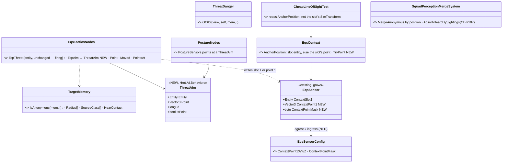

*What the picture shows that prose hid:* the point travels in the SAME sensor the entity did — one config, one wire sample,
one resolver (`EqsContext`) — so every test that already asks `AnchorPosition` hides from a heard shot without knowing it; only
the line-of-sight test, which reached past the resolver for the slot's transform, changes.

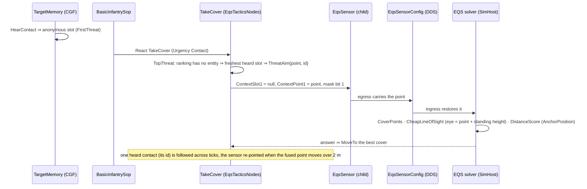

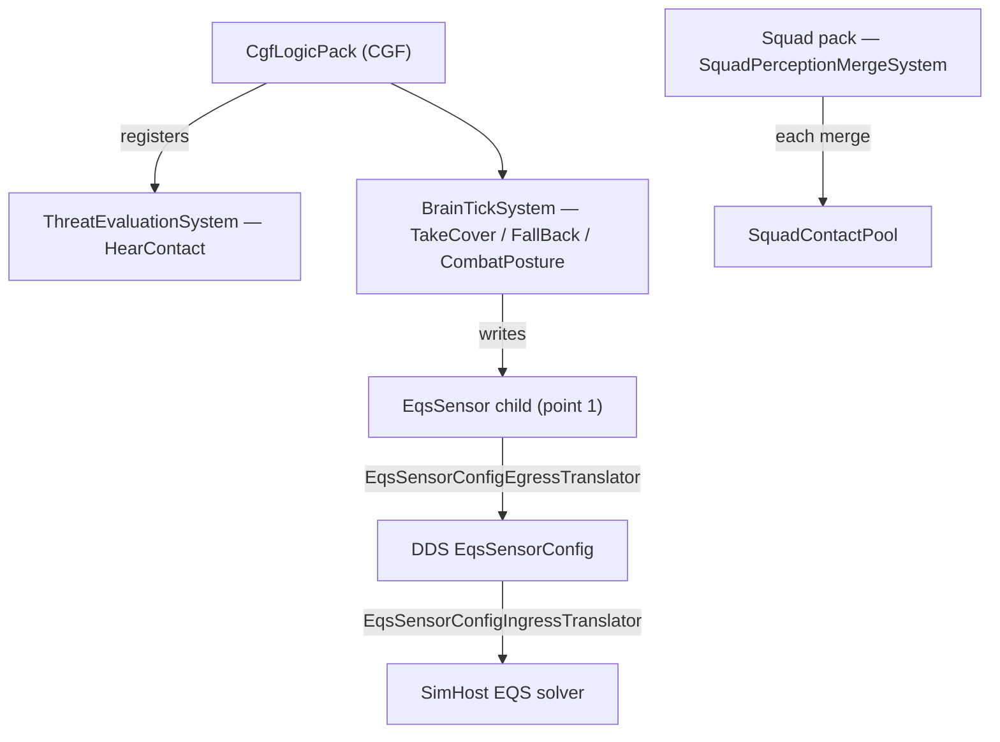

| decision | why | rejected |
|---|---|---|
| a point BESIDE the slot (`ContextPoint1` + a mask bit), used only when slot 1 is null | the slot stays an entity everywhere it is read; one optional field | a synthetic "point entity" (a fake placed entity per heard contact: lifecycle, replication, cleanup) |
| `TopThreat` returns `ThreatAim` (entity or point + the memory id) | one call site for three behaviours; the id keeps ONE contact across ticks | a second "TopHeardThreat" call in each behaviour |
| `HaveLiveTarget` stays identified-only | it gates firing postures; a point cannot be shot (the weapon channel takes an entity) | counting heard contacts (Advance would then aim at nothing) |
| squad fusion with stack-held radii | the pool is rebuilt each merge; `SquadContact` stays 32 bytes | growing `SquadContact` (a 512-byte layout documented as such) |
| the BTree / blueprint `SpawnEqsSensor` nodes get no point pin now | no authored behaviour hides from a point yet | — (round-out when one does) |

⭐ **AS-BUILT (`2026-10-05`)** — the diagrams above are the as-built (two boxes corrected in place, below). Where the build differs:

| as built | where | differs because |
|---|---|---|
| `TopThreat` keeps its entity-only signature; a new `TopAim` returns the `ThreatAim` | `EqsTacticsNodes.cs` | `PostureNodes.Engage` / `AdvanceAndAttack` FIRE at `TopThreat`'s entity — only the sensor pointers (TakeCover, FallBack, PostureSensors) take a point. ⛔ The design drew one call |
| no `AnchorEye`: `CheapLineOfSightTest` reads `AnchorPosition`, and `EqsTerrainSight.Mount(view, Entity.Null)` already gives the default mount | `CheapLineOfSightTest.cs`, `EqsContext.TryPoint` | the eye height needed no new seam |
| `TargetMemory.FirstIdentified(mem)` | `PerceptionComponents.cs` (cross-lane, one helper beside `IsAnonymous`) | the two examples' "first entity" reads |
| the node states keep `Threat` and gain `HeardId` + `HeardPoint`; the point stored is the one the sensor was POINTED at | `EqsTacticsState`, `PostureSensorsState` | a slowly drifting heard contact re-points once it has moved `RepointMetres` (2 m) in all; ⛔ no field rename (a Roslyn-only operation here) |
| the generated goldens do not move | `*.Registrar.g.cs.txt` take `Unsafe.SizeOf<…State>()` | — |

✅ **CE-2107 BUILT `2026-10-12` (was "not built"):** a member's HEARD contact IS absorbed by another member's SIGHTING in the squad pool — `SquadPerceptionMergeSystem.AbsorbHeardBySightings`, after the members are merged and before the sort, the squad twin of `TargetMemory.AbsorbBySighting` (①): a pooled heard contact whose circle holds an identified pooled contact that can sound like it (`ThreatEvaluationSystem.ClassesOf`, now `internal` and shared — no copy; an unknown class on either side matches) folds into it (higher score, both members' bits, the heard modalities; the sighting keeps its position; the nearest wins). ⭐ Demand: S2's `SquadEnemyStrengthRatio` counts a heard pooled contact as one armed enemy, so the duplicate counted one enemy twice. Rails `SquadPerceptionMergeSystemTests.CE2107_AShotOneMemberHears_AndAnotherSees_IsOnePooledContact` (red-proved: the pass removed ⇒ 2 contacts) · `CE2107_AHeardContactStays_WhenTheSightingCannotMakeIt_OrLiesOutsideTheCircle`. ⚠ **Still recorded:** the live acceptance (a rifleman on `test-town` hiding from a heard shot) waits for shipped TKB data to author acoustic signatures (§7 finding — today every shipped unit is silent) → `CE-2106`.

Rails (each feature's own suite; each red-proved by removing its mechanism): `CoverGeneratorAndLosTests.CE3063_CheapLineOfSight_JudgesFromTheContextPoint_WhenSlotOneIsEmpty` ·
`StandardInputReaderTests.CE3063_AHeardContact_CountsAsStrength_ButIsNotALiveTarget` · `SensorNodesTests.CE3063_ThreatsAtLeast_CountsAHeardContactByItsClass` ·
`SquadPerceptionMergeSystemTests.CE3063_TwoMembersHearingOneShot_AreOnePooledContact` · `TacticsTreesTests.CE3063_TakeCover_FromAHeardShot_PointsTheSensorAtThePoint_AndMoves` ·
the wire: `EqsTranslatorTests.EqsTranslators_T8_ConfigReplicatesBrainToMuscle` now asserts the point crosses CGF → SimHost.

### 8.1 `CE-2106` — shipped units hear and make sound *(behaviors, `2026-10-05`; 🔒 user: "feel free to extend the sound data")*

📐 **The gap, measured:** no shipped TKB template authored a `SignaturesDto` (every unit silent, §7 finding), and no unit had
EARS: an acoustic sensor exists only as a `SensorEntryDto` in a template's sensor list, the shipped templates list none, and
`SensorCapabilitiesDto.HearingRange` — authored on every hearing type (soldier 200 m, civilian 100 m, BDC `SensorRange × 1.5`) —
was read by nothing since `CE-3062` retired the old audio pipeline.

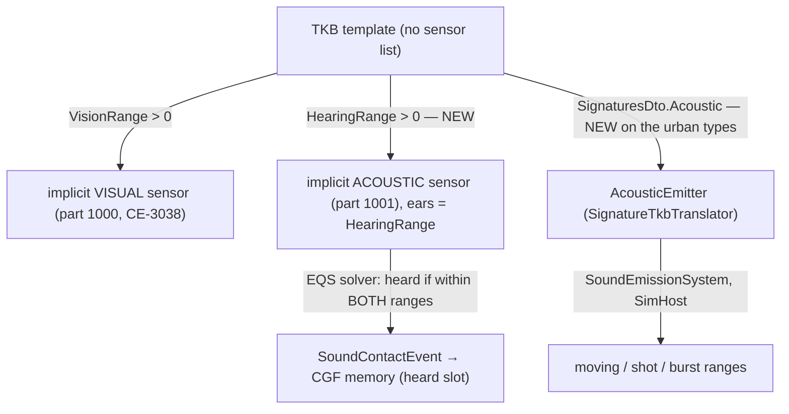

*What the picture shows that prose hid:* the two implicit sensors are one rule applied twice — a template that lists no sensors
gets one sensor per sense it authors a range for; a template that lists sensors gets exactly its list.

⭐ **`2026-10-19` (backend, `CE-3273`):** a WEAPON SYSTEM's shot is stamped on the weapon's own emitter (the round's shooter, WS-3), so
every weapon type now authors its report (~~mortars 1.5–2.5 km, guns 4–5 km~~ ⛔ SUPERSEDED `2026-10-20` by §8.5's real carries; `HeavyWeapon`; HMG 1 km; hand weapons `SmallArms`). ⭐ The
"heard if within BOTH ranges" rule above now holds for QUIET classes only — a loud one carries past the ear (§8.2, R-3023).

| decision | why | rejected |
|---|---|---|
| an implicit acoustic sensor, the twin of `CE-3038`'s implicit visual one | `HearingRange` already says how far each type hears; the rule needs no new authoring | listing explicit sensors on the shipped soldiers (⛔ a listed visual entry reads the TKB, not the live receptor a Brain retunes — it would change how their vision is tuned) |
| first-cut sound ranges on `UrbanCombatTkbCatalog` (footsteps 25 m, car 80 m, APC 300 m, rifle shot 400 m, RPG shot 500 m / burst 800 m) and classes per type | the types the test-town recipes use | — (tuning is data; BDC / FDP-example catalogs stay silent until authored) |
| ⚠ every hearing unit now listens (one more sensor per unit) | it is what `HearingRange` always claimed | — |

**As built (`2026-10-05`, build-state: BUILT).** `AcousticPerception.ImplicitEntry` + `PerceptionTkbTranslator` (part 1001,
`Implicit = 1`; a unit that only hears gets `TargetMemory` too); `UrbanCombatTkbCatalog.Sounds(…)` on the five urban types;
recipe `tt-heard-shot` (a rifleman south of the Tower, a hostile north of it firing at a decoy it can see).

🔴 **Finding — the wire dropped what the rifleman heard (cross-lane, NED, named).** `AudioTargetDetected` was
`KeepLast 1` with no `[DdsKey]`, so it was ONE instance: one acoustic solve writes a sample per heard sound for every
listener in the same frame, and each overwrote the one before. 📐 Measured live: SimHost raised the rifleman's
`SoundContactEvent`s, but CGF received only the decoy's (written last). ⇒ `HistoryDepth = 64`, bounded because the topic
is Volatile / BestEffort and only one solve's burst has to fit. Same failure as `CE-3023`'s `SysOpStatus`. ⚠ The other
unkeyed event topics with depth 1 were not audited here (`NearMiss` is depth 8).

| rail | proves | red-proof |
|---|---|---|
| `AudioTargetDetectedWireTests.SameFrameBurst_ForTwoListeners_AllReachTheReader_CE2106` | three sounds for two listeners, written in one burst, all arrive | depth 1 ⇒ *"only 1 of 3 heard sounds arrived"* |
| `EqsModuleTests.CE2106_TheImplicitAcousticSensor_IsBuiltOnlyForAHearingUnitWithNoSensorList` | the implicit-ears rule (built, ears = `HearingRange`; none when deaf or the TKB lists sensors) | implicit acoustic block disabled ⇒ red |
| `HeardShotScenarioTests.CE2106_ARiflemanHearsAHiddenShooter_AndTakesCoverFromWhereTheShotsCameFrom` | live on `test-town`: the shooter fires, the rifleman gets a HEARD slot, its SOP takes cover with the sensor pointed at a point within 40 m of the shooter, and it moves while staying hidden | red before the QoS fix (never heard) |

### 8.2 `CE-3276` — a LOUD sound carries past the listener's ear range *(backend, `2026-10-19`; R-3023; build-state: BUILT)*

🔒 **User, `2026-10-19`:** *"go with your lean on the hearing cap"* — the lean of [`CE-3276`](blueprints/Blueprint_Issues_Tracker.md).

📐 **The gap:** §8.1's rule hears a sound only *"within BOTH ranges"* (`AcousticPerception.Hear`: `d > carries || d > range`), and the
ear range is also the broadphase radius ⇒ a soldier (200 m urban, 750 m BDC) never hears an 81 mm launch (2 km, `CE-3273`) at 1.2 km.

| rule | a QUIET class (footsteps, engines, small arms, rotor) | a LOUD class (`HeavyWeapon`, `Explosion`) |
|---|---|---|
| heard when | `d ≤ carries` **and** `d ≤ ear range` *(unchanged)* | `d ≤ carries × weather` — the ear range does not cap it |
| found by | the broadphase within the ear range | ⭐ the broadphase within the ear range **plus** the tick's LOUD list beyond it |

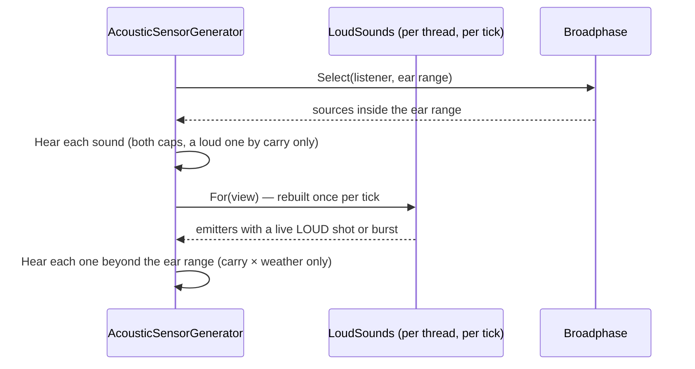

*What the picture shows that prose hid:* the loud list is built ONCE per tick and per thread (the `BroadphaseCache` pattern), so a
thousand listeners scan one short list — never a wider broadphase each.

| decision | why | rejected |
|---|---|---|
| ⭐ **the rule (Q95 B, approved `2026-10-20`):** a loud sound is heard by **distance × weather wherever its source stands — on the terrain or off it** (never by the high-resolution terrain's size); a quiet one within its carry and the ear | 🔒 user: *"The hearing should not be limited by inner (high resolution) terrain size, but by the distance."* — the ring (§8.3) reads every source, no grid | ⛔ a terrain big enough to hold the guns |
| loud = `HeavyWeapon` and `Explosion` | the two classes a doctrine expects heard kilometres away (a tube, a gun, a burst) | ⛔ every class past the ear — a footstep at 25 m would ignore a deaf listener's range |
| the weather scales the loud carry | the ear's own weather factor (R-3017) would otherwise drop out for exactly these sounds | ⛔ unscaled — a storm would not mask a distant gun |
| a per-tick list, not a wider broadphase | cost: one pass over emitters per tick, then O(loud) per listener | ⛔ raise every ear range — the broadphase radius grows for every listener every tick |

⚠ **The step toward [`DESIGN_World_Query_Seam.md`](DESIGN_World_Query_Seam.md) WQ-E** (approved, not built): its loudness model reads every
TKB range as *"the distance where the sound falls to the hearing threshold"* — the source's carry governs, walls subtract dB. Under it the
ear range becomes a SENSITIVITY, and this loud-class exception folds into the general rule.

⭐ **`2026-10-20` — measured live (uc-request-chain, behaviors' note):** a BURST is stamped on its shooter's emitter, so a weapon whose
round bursts must state `DetonationAudibleRange` — BR-14 had left it 0 (fixed, `CE-3278`). ⚠ Open: the EQS module times out
intermittently on a 541-entity scene (`CE-3279`); a sound that lingers 0.5 s is lost with a skipped solve — §6 B's *"last serial it
heard"* (not built) is the robust form.

### 8.3 `CE-3282` — the LOSSLESS RING: a short sound is never missed *(backend, `2026-10-20`; Q95 C, approved; build-state: BUILT)*

🔒 **User, `2026-10-20`:** *"Short loud sounds might need different hear sensor machinery (hearing module might need to buffer sound related
events — it is not acceptable to miss those)."* — [Q95](blueprints/Architect_Question_95_Sound_Signatures_And_Lossless_Hearing.md) C, §6 B's
buffer built after all. ⛔ The 0.5 s linger stops feeding HEARING (it stays on the emitter for the map's hearing gizmo only).

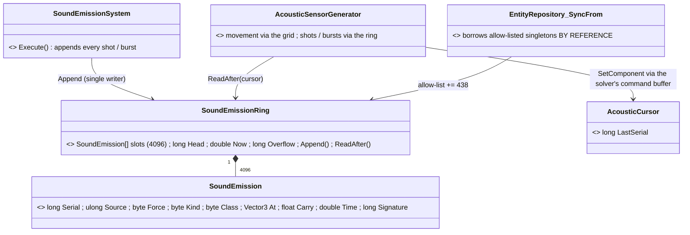
*What the picture shows that prose hid:* the snapshot does NOT copy the ring — `SyncSingletonById` hands the background solver the LIVE
table by reference (`EntityRepository.Sync.cs`). So the race Q95 C expected the snapshot to remove is still there; a per-slot sequence
number (the writer blanks it, writes the slot, then stamps it) lets a reader detect a slot torn or overwritten under it, and count it.

> ⚠ **As-built correction `2026-10-22` (CE-3301, backend):** the ring is created WITH THE SOLVER (`EqsSolverStartup.Register`), not lazily on
> `SoundEmissionSystem`'s first step. 📐 Measured: a solve that ran before the ring existed planted no `AcousticCursor`, so a FIRST load's hearing
> sensors got their cursor a solver slot late (steps 6–10) while a reload — the ring outlives a load — planted it at step 2: two loads of one
> scenario, two timelines (`DeterminismRails.A_reload_rebuilds_the_same_authored_world`, red until then).

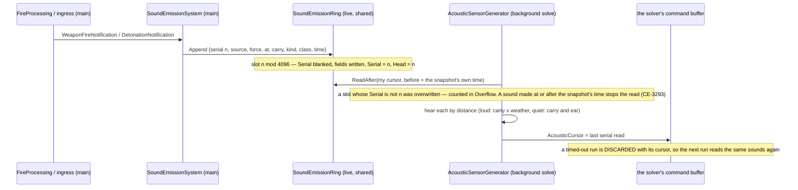
*What the picture shows that prose hid:* the cursor travels with the solve's own output — the ModuleHost discards a timed-out run's buffer,
and with it the cursor, so a skipped or discarded solve re-reads instead of losing.

| decision | why | rejected |
|---|---|---|
| a managed singleton holding a preallocated array | the table is borrowed by reference either way (managed or unmanaged); an array avoids copying a 256 KB struct | ⛔ an unmanaged InlineArray singleton — every `SetSingletonUnmanaged` / default would copy 256 KB on a stack |
| a seqlock per slot, ONE writer (the main thread) | lock-free, no allocation per shot; the reader detects a torn read | ⛔ a lock — the solver would block the main loop |
| the cursor is a component written through the command buffer | a discarded solve loses its cursor too ⇒ lossless | ⛔ a cursor table inside the ring — a discarded run would still advance it |
| a new sensor starts at the current Head | it does not "hear" the minutes before it existed | ⛔ from 0 |
| ⭐ **a read is AS OF the reader's own time** *(`CE-3293`, `2026-10-21`)*: only sounds made before the snapshot's clock are read, and the cursor stops at the first that is not | 📐 the writer goes on appending the DISPATCHING step's sounds while the background solve runs, so whether those were heard depended on the threads — measured live, four loads of `ua-tank-ammo` 15 Hz stepped: one run heard a burst at 18.40 s, the other three at 18.53 s (one solve later). Every sound before the snapshot's own time was written before the snapshot was taken ⇒ fixed. Cost: a sound is heard by the solve AFTER the step that made it (≤ one step). A view with no clock reads everything, as before | ⛔ copying the ring into the snapshot — 256 KB per dispatch · ⛔ a head captured at sync time — Fdp.Core would have to know the ring's type |
| N = 4096 entries, T = 30 s | 4096 / 10 s (the circuit's worst skip) ≈ 400 shots / s sustained; T stops a long-silent sensor hearing old news | — the overflow counter tells when N is too small |

### 8.4 `CE-3283` — a SIGNATURE per weapon, and what the ear can tell *(backend, `2026-10-20`; Q95 A, approved; build-state: BUILT)*

🔒 **User, `2026-10-20`:** *"Basically each gun type could have its own sound signature, not just artillery."* — the class stays (R-207);
a heard sound ALSO carries what made it, as far as the listener's ear can tell.

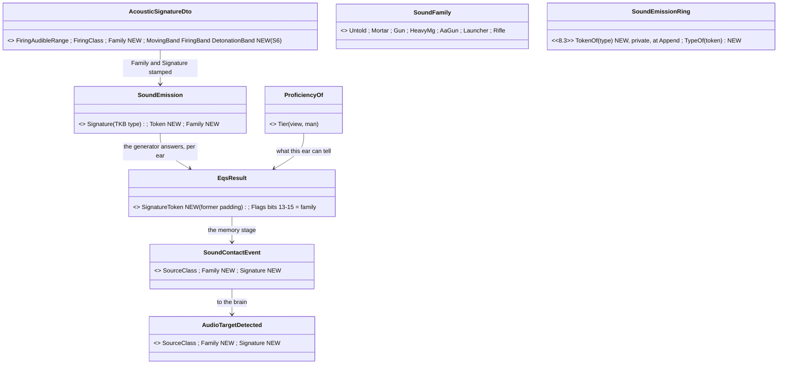
*What the picture shows that prose hid:* identification is decided ONCE, at the ear (the generator knows the listener), so everything
downstream carries only what that man could tell — the anonymity rule (§6 D) holds by construction.

| decision | why | rejected |
|---|---|---|
| the signature rides a new `ushort EqsResult.SignatureToken` in the struct's LAST two padding bytes; the ring maps token ↔ TKB type (append-only, per node), and the memory stage turns it back into the 64-bit type in the same solve | a field (the handoff), and the struct stays **32 bytes** — two rails pin that (`EqsComponentLayoutTests`, `EqsFlagsMeaningfulTests`: *"a jump to 40 … is the regression this guards"*) and recordings hold it (CE-3135 put `Stance` / `Kind` in padding for the same reason) | ⛔ a 64-bit `Tag` (32 → 40: both pins, the recordings); ⛔ a negative `EntityId` — the egress reads non-zero as an entity |
| the family rides `Flags` bits 13–15 | bits 0–7 are the tests', 8–9 the kind, 10–12 the class: 13–15 ~~are FREE~~ ⛔ **bit 15 was NOT free** — it is the SOLVER's `AccurateLineOfSightTest.FlagPendingRay`, read on every template ⇒ a family ≥ 4 (AA gun, launcher, **rifle**) parked the hearing solve as awaiting raycasts and nothing was heard (`CE-4039`, below) | — |
| what the ear tells, by `ProficiencyOf.Tier` | below Regular: the class only · Regular: + the family · Veteran / Elite: + the type (Q95 A) | ⛔ everyone the type — omniscient |
| the family is TKB data (`AcousticSignatureDto.Family`) | a ZU-23 is a 23 mm machine gun by category and an AA gun by role: only data says which | ⛔ derived from `WeaponCategory` |
| ⚠ the family's members are `Untold` and `Rifle`, never `Unknown` / `SmallArms` | the TKB DTOs are generated to DDS IDL, where every enumerator shares ONE scope: `SoundSourceClass` already owns `Unknown` and `SmallArms` (📐 the codegen refused: *"Declaration 'Unknown' collides"*) | — |
| the token table is append-only, 4096 types per node, `0` = none | a node meets a few dozen weapon types; a full table answers `0` (the class and family still travel) | ⛔ a token per emission — the answer would need the ring slot, which may be overwritten by then |

**As built (`2026-10-20`).** `SoundEmissionRing.Append` stamps the token (`TokenOf`), `AcousticPerception.Sound` puts the family in the
flags when the ear `Identifies ≥ 1` and the token when `≥ 2` (`IdentificationOf(ProficiencyOf.Tier)`), `SensorMemoryStage.HearAll`
fills `SoundContactEvent.Family` / `.Signature`, and `AudioTargetDetected` carries both to the brain. The catalogues author `Family` and
the three bands on every firing weapon (`BdcTkbCatalog`, `UrbanCombatTkbCatalog`; a hand weapon defaults to `Rifle`).

| rail | proves | red-proof |
|---|---|---|
| `EqsModuleTests.CE3283_TheEar_TellsTheClass_TheFamily_OrTheType_ByItsProficiency` (Militia / Regular / Veteran) | the class always; the family from Regular; the TKB type from Veteran | ✅ measured: `IdentificationOf` returning 2 for every tier ⇒ the Militia AND Regular rows red, Veteran green |
| `AudioTargetDetectedEgressTranslatorTests` | family and signature cross the wire | — (field mapping) |
| `NedTkbBuilderCombatTests` (BR-14 rail) | every firing weapon has a family and a firing band; the ZU-23 is an `AaGun` | — (data) |

**`CE-4039` (`2026-10-21`) — a Regular ear went DEAF to small arms.** 📐 `SoundFamily.Rifle = 6` sets `Flags` bits 14–15; bit 15 is
`FlagPendingRay`, and `EqsSolverSystem` checked it on EVERY template's answers, so a hearing solve with a rifle (or AA gun, or launcher)
in it returned "awaiting raycasts": never observed, never published — and the generator had already moved the ring cursor past the
sound. Every civilian (no proficiency ⇒ Regular) stopped fearing gunfire (`PostureScenarioTests` CE2235/2236/2237 red), and every
Regular+ soldier stopped hearing rifles. ⭐ **Fix: the solver reads `FlagPendingRay` only on a template that runs an
`AccurateLineOfSightTest`** — a flag bit means something only to the test that writes it. ⛔ Rejected: moving the family to another
field — the struct is pinned at 32 bytes, and any other high bit would meet the same reader. Rail:
`EqsModuleTests.CE4039_ARegularEar_HearsEveryFamily_ThroughTheSolver` (all six families through the real solver).

### 8.5 `CE-3284` / `CE-3285` — the REAL carries, and a band per sound *(backend, `2026-10-20`; Q95 B1 / B3, approved; build-state: BUILT)*

🔒 Q95 B1 (R-3024): *"each signature's carry is its real one. A 155 mm can carry 15–20 km."* Nothing in the hearing changes — only the
data (`BdcTkbCatalog` reports); a loud sound is heard by distance × weather (§8.2) and the estimate's radius grows with distance as before.

| weapon | carry (shot = burst) | was (`CE-3273`) | source |
|---|---|---|---|
| 60 mm mortar | **4 km** | 1.5 km | 1B19 sound-ranging kit: mortars ≤ 81 mm detected at 4–5 km ([valka.cz](https://en.valka.cz/topic/view/71991) — ⚠ a hobby archive, approximate) |
| 81 mm mortar | **5 km** | 2 km | same, top of the band — ⭐ and the urban `MortarTeam` (an 81 mm crew; it reused the RPG's 500 m) |
| 120 mm mortar | **7 km** | 2.5 km | 1B19: mortars ≤ 120 mm 6–8 km |
| 105 mm howitzer | **12 km** | 4 km | 1B19: guns ≤ 90 mm and howitzers ≤ 105 mm 12–15 km |
| 155 mm (M109) | **18 km** | 5 km | the handoff's 15–20 km; 1B19 gives 20–25 km above 155 mm; Adams MSRA detects artillery at 20 km, mortars 12 km ([adamsengg.com](https://adamsengg.com/msra-2/)) |

| decision | why | rejected |
|---|---|---|
| the low end of each instrument's band | the sources are SOUND-RANGING kits (microphone arrays, a quiet post); a man in a firefight hears less — the weather factor still scales it | ⛔ the top of each band — a 120 mm heard at 8 km by every rifleman |
| the burst carries as far as the shot | the shell is the same charge order of magnitude as the gun's report; one figure per weapon keeps the data honest until WQ-E's dB model | ⛔ a separate burst table with no source |
| the band is three fields (`MovingBand` / `FiringBand` / `DetonationBand`), from the class by `SoundBands.Of` unless authored | one signature makes three sounds (engine, report, burst) and they differ (an M109's tracks are `Mid`, its report and burst `Low`) | ⛔ one `Band` per type — the M109 would need two answers |
| ⛔ nothing reads the band yet | WQ-E Q3's wall loss reads it (Q95 B3); until then every band is heard alike | — |

⚠ **The demo terrains are 0.8–1 km across, so every soldier on them now hears every tube and gun.** That is the ruling (distance, not
terrain) and the reason Q95 asked for it; a scenario that wanted a launch NOT heard must stand its guns past the carry.

| rail | proves |
|---|---|
| `NedTkbBuilderCombatTests` (BR-14 rail) | each carry inside its sourced band, ordered 60 < 81 < 120 < 105 < 155; every firing weapon has a family and a band |
| `EqsModuleTests.BR14_…` / `CE3276_…` | an 81 mm launch heard at 1.2 km and not at 6 km (past its 5 km) — by a post and by a soldier |

### 8.6a `CE-2348` ③ — a heard BURST is placed where it LANDS *(backend, `2026-10-21`; measured; build-state: RULED (R-2071), design of the build next)*

📐 **Measured live** (`uc-urban-battle`, `--mode all`, behaviors note ③ — *"own-side shots become enemy contacts 33 m off"*): ⛔ **no
own-side sound was heard.** The ear's own-force filter (`e.Force == ourForce`, in the ring read and in the movement broadphase) dropped
every friendly shot, burst and footstep. ⭐ **The phantom contacts were the ENEMY's bursts**, heard where they landed — the RPG impacts
at (643, 161), 2–24 m from the convoy's own men. Row **C** makes a detonation a source and **K3** gives it the `Explosion` class, so an
enemy round bursting among us places an "enemy, about here" contact ON us, and it stays in memory for the decay time after the ambush.

| | lean | why | rejected |
|---|---|---|---|
| ⭐ **lean** | a heard **burst** is a DANGER POINT, not an enemy position: memory keeps it (K2 *"hide from a point is OK"*), but the readers that ask *"is an enemy here?"* (contact in range, strength ratio, keep-in-contact) skip `Explosion`-class anonymous slots; the shooter is placed by his **shot's** report, which K3 already carries | a burst says where the round landed, never where the shooter is — the convoy's only true contact is the RPG's firing point | ⛔ dropping bursts from hearing — loses "hide from a burst" (§8 ③) · ⛔ dropping bursts near the listener — a burst 30 m off is just as much not-an-enemy |
| ⚠ what would change it | a doctrine that wants "explosions near us" to keep a unit in contact on its own | | |

⇒ ✅ **RULED `2026-10-22` (R-2071)** — the lean, and more. 🔒 **User, verbatim:** *"i think such an nearby explosion should somehow alert the soldiers if they were calm before, it could also make them beight freightened (under heavy bombardment -> some of them with lower discipline can panic or collapse psychically maybe) - but it should definitely not be an enemy position (this is still unknown and can not be told from a detonation). I think it does not need to create a new dangerous area unless the explosions are repeated there as that might be blocking them in movements"*

| # | ruled | what it means here |
|---|---|---|
| E-1 | a heard burst is **never an enemy position** | the "is an enemy here?" readers skip `Explosion`-class anonymous slots (behaviors' half) |
| E-2 | a burst nearby **alerts** a calm soldier | Calm → Alert, the way a heard shot does |
| E-3 | it **frightens**; under heavy bombardment a man of low discipline can **panic or collapse** | fear rises with each near burst; past a threshold, discipline decides |
| E-4 | **no danger area** from one burst — only where bursts **repeat** | a repeatedly shelled spot becomes an area movement avoids |

⏭ behaviors designs the build (inventory of the readers, the fear owner, the repeat rule) before building it.

### 8.7 `CE-2349` — the M1 and the Bradley carry a THERMAL sight *(behaviors, `2026-10-22`; cross-lane: `Hrot.Core`'s TKB catalog; build-state: MACHINERY BUILT, CARRIAGE WITHDRAWN)*

⛔ **`2026-10-22`, later the same day — the catalogue no longer gives the M1 / Bradley a `ThermalRange`.** 📐 A/B live on `ua-hill-attack`
(same build, only the two ranges changed): with the sight **4 tanks on the slope at once, 4 checks red**; without it **2 at once, all green**
— twice deterministic. The sight saw nothing (no `ThermalState` exists without `SignaturesDto.Thermal`), so the change came from carrying
the extra sensor child, not from a detection. ⚠ **Mechanism NOT found**: the listed eyes and ears are identical to the implicit ones
(same entries, eyes tagged `Implicit`, `SearchRadius`, index 0/1) and thermal registers vision's LOS strategy — the one structural
difference is the third sensor child. ⇒ the builder path, `FromReceptor` and the translator tag below stay; the rail now builds its own
test vehicles. ⏭ Re-carry with the signatures slice, after the hill-attack difference is understood. Everything below describes the
withdrawn carriage as built.

📐 **Measured:** `ThermalPerception` (CE-3061) and its weather cap were built, but no TKB template listed a sensor, so every unit ran
the implicit visual + acoustic pair (§8.1) and no demo could show a thermal sight (CE-4035 G-10). ⭐ The open question — does listing a
`Thermal` entry drop the implicit pair? — **yes**: `PerceptionTkbTranslator` builds both only for a TKB that lists NO sensors.

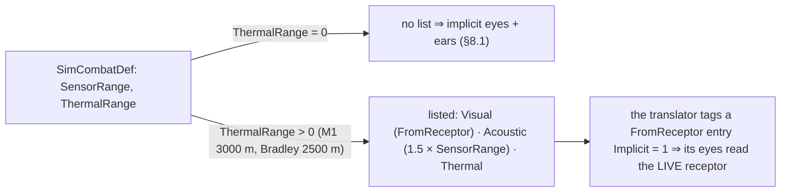

*What the picture shows that prose hid:* a listed visual entry would read the TEMPLATE's range — §8.1's rejected alternative ("it would
change how their vision is tuned"). 📐 Measured: `hill-attack`, `hill-attack-close`, `mission-demo-bp` and `tt-nav-los` narrow their M1s'
`PerceptionReceptor` (100 m, 180°); listed plainly, those tanks would have seen 8000 m. ⇒ `SensorEntryDto.FromReceptor` keeps the listed
eyes on the receptor, as the implicit ones are.

| ⭐ as built | why | rejected |
|---|---|---|
| `SimCombatDef.ThermalRange` (0 = none); `BdcTkbBuilder` lists Visual + Acoustic + Thermal when it is set | a listed TKB gets no implicit sensors | a translator rule "add the implicit pair beside a list" — it flips CE-3038's "listed means exactly these" for every listed unit (radar sites, test rigs) |
| `SensorEntryDto.FromReceptor` → `SensorTag.Implicit = 1` | the listed eyes keep reading the live receptor | listing the eyes plainly — the measured 8000 m regression above |
| thermal FOV 360° | the commander's independent viewer turns with the turret; one sensor stands for the gunner's and the commander's sights | a 40° gunner's sight — one cone would need the turret's bearing, which perception does not read |

✅ Rail `EqsModuleTests.CE2349_TheM1AndBradley_CarryAThermalSight_AndStillSeeAndHear` (all three sensors, the ranges, the listed eyes on
the receptor), red with the builder ignoring `ThermalRange` and with the translator not tagging `FromReceptor`; SimHost suite 1840/1840.
⛔ **Measured after the build: no catalogue template carries a heat signature** (`SignaturesDto.Thermal` is never set), so the sight has nothing to see yet. ⏳ Next: `ThermalSignatureDto` values per type (lean: a person ~0.5 base, a vehicle ~0.2 base + running heat), then G-10's thermal half.

### 8.6 `CE-3281` — the BUILT-IN catalogue is heard: tanks, the Bradley, the HMMWV, every aircraft, every BDC person *(backend, `2026-10-20`; 🔒 user: "CE-3281 approved"; build-state: BUILT)*

📐 Measured (rail `NedTkbBuilderCombatTests.CE3281_EveryBuiltInTypeThatMovesOrFires_IsHeard`, red first — it IS the inventory): 41 silences in
`HrotEnvironment.CreateTkb()` — the M1, T-72, Bradley, HMMWV; persons 200–211 (moving and firing); the UH-60 (both), F-16, C-130, A-10 (and its
Mk-82 bursts), AH-64; the security men's stun grenades and baton launcher (CE-3223); plus three FALSE positives the rail now names (the hands
mount, the FPV drone's warhead, a static obstacle car) and SUMO traffic, kept silent (user, `2026-10-20`).

| type | moving | firing (burst = the firing figure unless stated) | why this figure | source |
|---|---|---|---|---|
| M1, T-72 | tracked, 300 m | main gun **12 km**, burst 12 km, family Gun | a gun over 90 mm is at least the 1B19 band's floor for guns ≤ 90 mm / howitzers ≤ 105 mm (12–15 km, §8.5) | §8.5's 1B19 table; an M1 main gun recorded at 5 km ([AWM](https://www.awm.gov.au/collection/C1426361)); Fort Knox tank fire heard ~48 km away ([WDRB](https://www.wdrb.com/news/boom-fort-knox-tank-training-can-be-heard-miles-away/article_c63f374c-36b4-11e9-83f0-bb5a828e4e09.html)) — ⚠ anecdote, the upper end |
| Bradley | tracked, 300 m | 25 mm: the ZU-23's 1.5 km, burst 600 m, family AaGun (an autocannon) | the catalogue's own autocannon figure (BR-14) | — |
| HMMWV | wheeled, 100 m | — (its M2 is a weapon system with its own report, BR-14) | the technicals' figure | — |
| UH-60, AH-64 | **Rotor, 3 km** | AH-64: its Hydra-70 as the ATGM's (800 m, burst 800 m, Launcher) | below the detector figure for heavy military helicopters | Sandia passive detector: ~1 km small civil → ~5 km heavy military ([INMM](https://resources.inmm.org/node/37016)) |
| F-16, A-10, C-130 | **Rotor class, 15 km** ⚠ | A-10: the GAU-8 as the autocannon figure (1.5 km); its burst **10 km** (a Mk-82) | the low end of a jet's 15–25 km; the larger of its two bursts | ⚠ a non-authoritative guide ([sky-lens](https://sky-lens.com/guide/sound-propagation)); a 1 000 kg bomb heard ~10 km, a 250 kg one 2.5 km ([Times of Israel](https://www.timesofisrael.com/unexploded-1000-kilogram-wwii-bomb-is-detonated-in-england/)) — ⚠ news reports |
| persons 200–211 | footsteps, 25 m | the rifle's 400 m; an LMG (M249, PKM) 600 m | the urban catalogue's CE-2106 figures | CE-2106 |
| security (CE-3223) | footsteps (as before) | baton launcher 200 m (the pistol's); a stun / gas grenade's burst **400 m** | a flash-bang is as loud as a rifle shot or louder | ⚠ an estimate, no source |

| decision | why | rejected |
|---|---|---|
| ⚠ a fixed-wing engine is heard as class **`Rotor`** ("an aircraft overhead") — ✅ 🔒 user, `2026-10-20`: *"Jets ok"* | the 3-bit class is full (`Rotor` = 7, the last value); `OfClass(Rotor)` = 1 is the right danger for an unknown aircraft; data only, cheap to change | ⛔ a new class — a wire and `Flags` layout change (bits 13–15 hold the family, CE-3283) for one label |
| one figure per type: the loudest weapon's report, the largest burst | a signature has ONE firing and ONE detonation range (§8.4) | ⛔ per-mount signatures — a schema change no reader needs yet |
| the hands mount (Grenade, no round), a static obstacle, a warhead whose burst is heard (the FPV drone) are NOT silences | a throw makes no report (CE-3248); an obstacle never moves; a drone IS its warhead | — |
| ✅ **SUMO traffic (`TrafficCar` 8851) stays silent** | hundreds of background cars as sound sources is load and noise the AI ears never had; the traffic programme (R-4040) owns that call | 🔒 user, `2026-10-20`: *"sumo not heard ok"* |

⚠ **Behaviour changes in every scenario using these types**: BDC soldiers' shots, tanks' guns and aircraft are now heard — a soldier who hears a
shot reacts (CE-2106). Told behaviors ([note](blueprints/batches/NOTE_Backend_To_Behaviors_Catalogue_Heard.md)).
