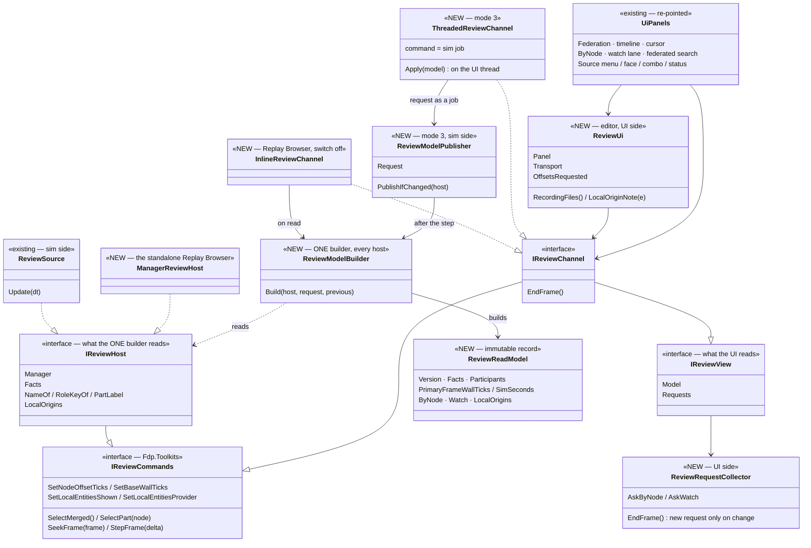
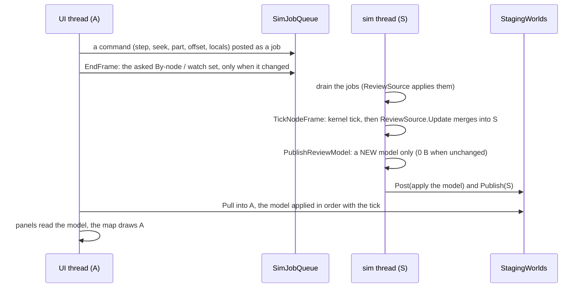
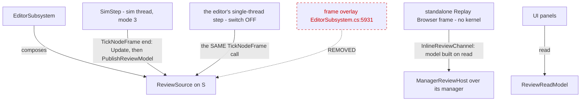

<!--STATUS
state: LIVE
build-state: BUILT
updated: 2026-11-13
current-answer: §1 (AS BUILT — the diagrams are the as-built, CE-4495…CE-4499 on exp/threaded-review), §2 rules, §3 acceptance, §4 what the build changed
stale-below: the HISTORY heading at the end (the pre-build class list — superseded by §1.1)
known-rot: none
known-conflict: none
related-designs:
  - UX/DESIGN_Review_Perspective.md — OWNS the review feature (one AAR, the source decided by the files, Merged / part, offsets, By node, the watch); this file owns only WHICH THREAD runs it
  - DESIGN_Threaded_Simulation_Presentation.md — OWNS the threaded editor (S / A, the staging, the readout pattern D-9); its §14.8 lists the review source as open — this answers it
  - DESIGN_Threaded_Work_Inventory.md — §8 the decision list; R-4215 one implementation for every host
  - designs/replay-browser-frankenstein/DESIGN.md — OWNS Federation (FederatedReplayManager) and the standalone Replay Browser host, which runs inline (no kernel)
-->

# DESIGN — the review source in the threaded editor (R-4220)

🔒 User, `2026-11-13`: *"yes, write the design and the handoff for the other backend VM lane"* — approving the lean below.

**The problem (measured on `exp/threaded-build`, grep):** in mode 3 (`HROT_THREADED_KERNEL=3`) the review source — a cluster recording opened in
the editor, Merged or one node's part — runs on the UI thread from a frame overlay (`EditorSubsystem.cs:5931`) and merges into `_world`, which
is A (`:2173`). The editor's OWN-run replay fills S on the sim thread and reaches A through the staging. ⇒ two ways to fill the world in one AAR;
the staging pull copies S (empty during a group review) over A; and UI panels read the manager's per-node sandbox worlds live
(`FederationPanel`, `ReplayTimelinePanel`, `ReplicaViews` via `ByNodeSection` / `ReplicaWatchLane`, `FileReview`).

**Status:** ✅ BUILT `2026-11-13` (CE-4495…CE-4499, [status](blueprints/batches/STATUS_Threaded_Review_Source.md)); one live-session check is open (status OPEN-1).

**Decision:** the review source is SIMULATION-side, like the own-run replay: it merges into S on the sim thread; the UI reads a published,
immutable **review read model** and changes it only through sim jobs. The standalone Replay Browser builds the same model inline.

## INVENTORY *(2026-11-13)*

| query | total | what it found |
|---|---|---|
| `scripts/cbm.sh search_graph '{"name_pattern":".*(Federat\|ReviewSource\|Readout).*","label":"Class"}'` | 13 | ⚠ the graph indexes `coordinator`, which lacks the review code: `FederatedReplayManager`, `FederationPanel` + `FederationPanelViewModel` (a panel that already builds a view model — the precedent R-1 follows), `FederationWindow`, `FederatedGuidResolver`, `MapCursorReadout`; ⛔ no existing review read model |
| grep `FederatedReplayManager` over `exp/threaded-build` (production, no tests) | 19 files | the Federation toolkit (manager, merger, `ReplicaViews`, ownership, inventory, priming, builder) · the UI readers: `FederationPanel`, `FederationWindow`, `ReplayTimelinePanel`, `ByNodeSection`, `ReplaySearchPanel`, `ITimelineCursor`, `FileReview`, `ReplicaWatchLane` · the hosts: `ReviewSource`, `ReplayBrowserSubsystem` (+ DebugSurface), `ReplayDirectorHost` |
| grep `ReviewSourceOf` over `exp/threaded-build` | 3 sites | `EditorSubsystem.cs:421` (built), `:438` (picker notes), `:5875` (composition; `:5931` the frame-overlay `Update`) |

⚠ Coverage could not be checked (`check_index_coverage` is not in the CLI); `ReplayDirectorHost` and the Replay Browser's debug surface are the
manager's other host-side users — R-2 re-points only the UI readers and leaves those hosts on the live manager.

## 1. The design

### 1.1 Classes *(AS BUILT)*


*What it shows that prose hid: ONE builder behind both channels, so the standalone Replay Browser, the switch-off editor and mode 3 cannot draw different
things; the hosts differ only in `IReviewHost`; and every UI type points at a channel, none at `FederatedReplayManager` (railed, §3 ④).*

### 1.2 One frame in mode 3 *(AS BUILT)*


*What it shows: the merge rides the same pull as any replayed state, and the model the panels read is built from that same tick — the UI never touches
the source or its manager; a command costs one job and lands one tick later.*

### 1.3 Who calls it each frame


*What it shows: ONE call site in the editor, after the kernel tick, in both kernel modes (by construction, not by each mode remembering); the
frame overlay that calls it from the UI thread today is removed (red, dashed). The standalone Replay Browser keeps its inline step.*

## 2. Rules

| | |
|---|---|
| ⭐⭐ **every write of the review is on S's thread** | load (incl. the world clear — `NewScenario(S)`), merge, part seek / step, the Source switch, offsets, locals — sim jobs in mode 3 |
| ⭐⭐ **the panels read only the model** | ⛔ no panel holds `FederatedReplayManager`, a context or a sandbox world; `ReplicaViews` is called only by the builder |
| ⭐ **the request rides UP only when it changes** | the selected net id, the By-node component types shown, the watch items |
| ⭐ **0 B per steady frame** | the model is rebuilt only when its Version key changes (frame, kind, offsets, locals, request, a merge) — the `ReadIfChanged` precedent (overnight D-14) |
| ⭐ **file-only work stays where it is** | the picker notes (`RecordingGroupInventory.Scan`), the search over files and `ScanWatchSpans` read FILES (immutable) — they take the participant paths and offsets FROM THE MODEL, never the live manager |
| ⭐ **UI-only events stay UI** | `OffsetsRequested` (opens the Offsets window) |
| ⭐ **the recording-opened branch runs where the cluster state does** | in mode 3 the editor logic is sim-side (overnight D-7) ⇒ `OnRecordingOpened` is a direct sim-side call |

## 3. Acceptance

1. Mode 3, a multi-participant recording opened in the editor: opens Merged; step, scrub, ▶ / rate, the Source switch to a part and back, an
   offset change, a locals toggle, By node on a selected unit, a watch item, a search hit seek — every one correct, strict world guard 0 hits,
   0 job faults; the merged world is NOT erased by the pull (a rail asserts A holds the merged entities after N pulls).
2. Switch OFF: the same session, identical behaviour (the review's own rails green).
3. The standalone Replay Browser: its Federation / timeline / By-node rails green, its panels on the model.
4. A rail: no type under `Fdp.Presentation/.../ReplayBrowser` or the editor's review UI references `FederatedReplayManager` (a reflection /
   source scan).
5. 0 B per steady frame with a group open and paused.

## 4. ⭐ AS BUILT — what the build changed *(CE-4495…CE-4499, `2026-11-13`)*

| the design said | as built | why |
|---|---|---|
| `IReviewCommands` carries `Load / Close / Play / Pause / SetRequest` | the eight review commands only; a group opens through the ONE recording-opened branch (sim-side, D-7); ▶ and the rate are the toolbar's time facade; the request rides up through `ReviewRequestCollector` + `EndFrame` | one control per choice: open / close and ▶ already have owners; the request is per-frame UI state, not a command |
| the builder reads `ReviewSource` | it reads `IReviewHost` (extends `IReviewCommands`), implemented by `ReviewSource` and `ManagerReviewHost` (the standalone Replay Browser) | the Replay Browser has no `ReviewSource`; the panels (Fdp.Presentation) cannot see Hrot.Editor ⇒ the model, builder and channels live in Fdp.Toolkits |
| the editor's surfaces read the source | `ReviewUi` (UI side) owns the ONE Federation panel, the transport, the file list, the *local to* note and the *Offsets…* event | in mode 3 the source is the sim thread's; UI objects and UI events cannot live there |
| — | the model also carries the primary's per-frame wall ticks + sim seconds and a snapshot of the merge's local origins (`MergeTarget.LocalVersion` / `CopyLocalOrigins`) | the transport's clock and Details' *local to* tag without reading the playback or the merger across threads |
| the Offsets window is re-registered per group | registered once, on the first *Offsets…* | the panel reads the model, so one panel serves every group |
| — | the merge into S relies on the kernel ticking S every node frame (`ModuleHostKernel.cs:596`) | measured: without that tick a merge after the first never reaches A (the staging copies changed chunk versions) |

## ⛔ HISTORY

### the pre-build class list *(superseded by §1.1 AS BUILT)*

#### (was) 1.1 Classes

```text
classDiagram
  class ReviewSource {
    <<existing — moves to the sim side>>
    world() : S
    Update(dt)
    Load / Close / SelectMerged / SelectPart
    SeekFrame / StepFrame
  }
  class FederatedReplayManager {
    <<existing>>
    Contexts : per-node sandbox worlds
    SetNodeOffset / SetBaseWallTicks
    SetLocalEntitiesShown / SetLocalEntitiesProvider
    StepForwardAll / StepBackwardAll / SeekAll
  }
  class BinaryMerger {
    <<existing>>
    Merge(manager, S)
  }
  class ReplicaViews {
    <<existing>>
    Compute(manager, netId, type) ReplicaView
    ComputeItem(manager, netId, item) ReplicaView
  }
  class ReviewReadModel {
    <<NEW — immutable record>>
    Version
    Kind / IsOpen / IsPending / Failure / ExerciseId
    Participants : node, label, roleKey, path
    CurrentFrame / TotalFrames / IsPlaying
    BaseWallTicks / NodeOffsets
    LocalShown / LocalProvider
    StatusText / FaceLabel
    ByNode : ReplicaView per requested key
    Watch : ReplicaView per watch item
  }
  class ReviewViewRequest {
    <<NEW — immutable record>>
    SelectedNetId
    ByNodeTypes
    WatchItems
  }
  class ReviewModelBuilder {
    <<NEW — ONE builder, both hosts>>
    Build(source, request, previous) ReviewReadModel
  }
  class IReviewView {
    <<NEW interface — what the UI reads>>
    Model : ReviewReadModel
  }
  class IReviewCommands {
    <<NEW interface — what the UI asks>>
    Load / Close / SelectMerged / SelectPart
    Seek / Step / Play / Pause
    SetOffset / SetBaseWall / SetLocalShown / SetLocalProvider
    SetRequest(ReviewViewRequest)
  }
  class ThreadedReviewChannel {
    <<NEW — mode 3>>
    commands = sim jobs (SimJobs.Run)
    view = the model carried by the staging
  }
  class InlineReviewChannel {
    <<NEW — standalone Replay Browser / switch off>>
    commands applied at once
    view = Build each frame
  }
  class UiPanels {
    <<existing — re-pointed>>
    FederationPanel · ReplayTimelinePanel
    ByNodeSection · ReplicaWatchLane · FileReview
    ReviewSourceToolbarCombo · ReviewSourceStatusSection
  }
  ReviewSource --> FederatedReplayManager
  ReviewSource --> BinaryMerger
  ReviewModelBuilder ..> ReviewSource : reads
  ReviewModelBuilder ..> ReplicaViews : computes ByNode / Watch
  ReviewModelBuilder --> ReviewReadModel : builds
  ThreadedReviewChannel ..|> IReviewView
  ThreadedReviewChannel ..|> IReviewCommands
  InlineReviewChannel ..|> IReviewView
  InlineReviewChannel ..|> IReviewCommands
  ThreadedReviewChannel ..> ReviewModelBuilder : sim side, after the step
  InlineReviewChannel ..> ReviewModelBuilder : same thread
  UiPanels --> IReviewView
  UiPanels --> IReviewCommands
```
*What it shows that prose hid: the panels lose every reference to `FederatedReplayManager` — they see only an immutable model and a command
interface; ONE builder makes the model for both hosts, so the threaded editor and the standalone Replay Browser cannot draw different things.*

