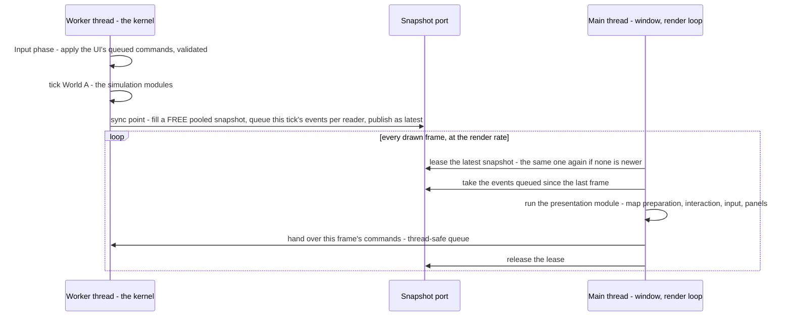
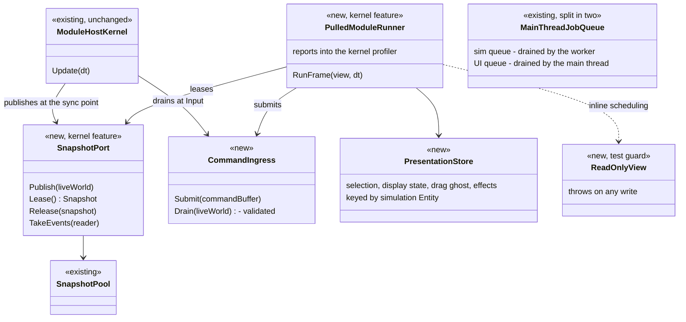
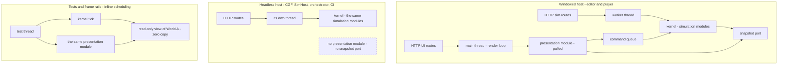
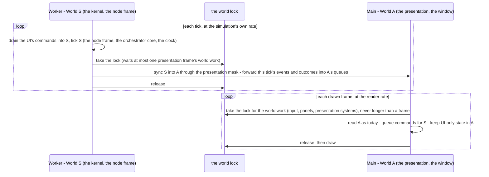
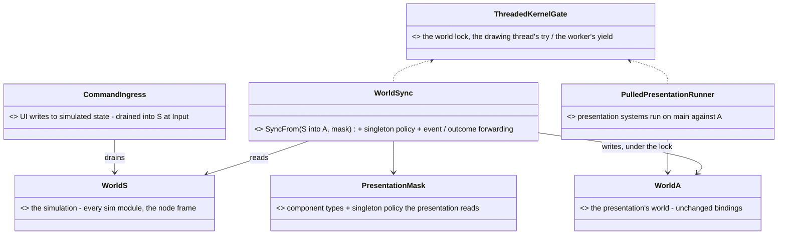

<!--STATUS
state: LIVE
build-state: DESIGN — ✅ the concept APPROVED (R-4205, `2026-11-11`); next S-0 (the architect question for the details + a FDP-DES-012 section) before any build; a proof of concept exists (§7)
updated: 2026-11-12 (§12 — the experiment, behaviors lane, exp/threaded-kernel)
current-answer: ⭐ §12 the overnight experiment's answer (invert the worlds — measured, prototyped; the user to rule) · §11 THE CRITICAL REVIEW (23 findings; the cost is large; S-0b first) · §2 the decision · §3 the diagrams · §4 the rules · §5 working memory · §6 pros and cons · §7 the measurements · §8 verification · §9 slices · §10 open
stale-below: nothing
known-rot: none
known-conflict: FDP/Engine/Fdp.ModuleHost/docs/UserGuide/06_SimulationViewsAndExecutionModes.md shows a two-replica swap in DoubleBufferProvider — the code syncs ONE replica in place (DoubleBufferProvider.cs:63-66); this design does not rely on it
related-designs:
  - blueprints/Architect_Question_111_Threaded_Kernel_Details.md — S-0: the nine details to settle before building (snapshot content, publish cadence, stale commands, run controls, HTTP default, inline view, where the pieces live, the store, who builds)
  - DESIGN_Evaluation_Cost_And_Cadence.md — §11h ui's Windows measurement of the editor's preview frame (CE-4433) — the numbers this design answers; its §13 now points here
  - ../FDP/Engine/docs/FDP-GDB-SoD-unified.md — FDP-DES-012, the kernel's snapshot model (World A / replicas / commands) this design extends with a self-paced reader
  - blueprints/DESIGN_Time_Architecture.md — §17 stepped mode waits for background jobs (not the preview's mode); the worker must keep §17's determinism
  - blueprints/DESIGN_Paused_And_Stepped_Execution.md — tick modes, the event window; what runs on a paused frame
  - UX/DESIGN_Edit_Mode_Undo.md — edit steps and undo capture, which move to the command apply
  - DESIGN_Scenario_Regression.md — the nightly scenario regression this design's verification runs in both schedulings
  - blueprints/batches/STATUS_Threaded_Kernel_Experiment.md — §12's measurements (X-1 publish, X-2 inventory, X-4 prototype, X-5 verdict)
-->

# DESIGN — the simulation on a worker thread, the presentation on the main thread from a published snapshot

## 0. The request

🔒 User, `2026-11-11`: *"in the editor at 1000 man scenario a big 3d map frame rate drop when i unpaused"* · *"Same with the UI. Unresponsive when
complex sim running."* · *"I am not talking about deterministic mode … In the preview"* · *"There is a worker thread that ticks the kernel. The kernel
owns the world A … a snapshot at the synchronization point … used by the presentation thread, which is the main application thread … the systems that
prepare the gizmo stuff are running on an asynchronous module … if there is no new snapshot, it runs again with the old one … This might be a new
Kernel strategy"* · *"having a second kernel would mean that everything there will be twice … Is that necessary?"* · *"the Windows run cannot tell …
how cheap it is for 5000 or 10,000 … Can we try making an experimental proof of concept?"*

## 1. INVENTORY *(`2026-11-11`)*

Queries: `scripts/cbm.sh search_graph` `.*(SnapshotProvider|SnapshotPool|DoubleBuffer|OnDemandProvider).*` (11), `.*(MainThreadJobQueue|PresentationShell|FrameStats|KernelFrameTimings).*`
(4 — ⚠ the index predates ui's `KernelFrameTimings`), `.*(InspectableSession|RepositoryAdapter|EntityComponentWriter|EntityWriteRouter).*` (5); grep for every count below.
⚠ Coverage could not be checked (`check_index_coverage` is not in the CLI).

| what | where | role here |
|---|---|---|
| the kernel, one per node | `HrotNodeBuilder.cs:140`; the editor's node `EditorNodeBootstrapper.cs:203-209` | moves to the worker, unchanged |
| the windowed loop: `orchestrator.Update` → `DrawWorldAll` → `rlImGui` panels, ONE thread | `Program.cs:703-722` | splits: the kernel's update to the worker, the rest stays |
| window, GL context, ImGui on the main thread | `RaylibPresentationShell.cs:35, :139` | stay together on the main thread |
| snapshot providers `DoubleBufferProvider` (one replica, synced in place), `OnDemandProvider`, `SharedSnapshotProvider` (ref-counted), `SnapshotPool` | `Fdp.ModuleHost/Providers/` | the pool is reused; a new LEASED publisher is added |
| `EntityRepository.SyncFrom` (dirty-chunk copy), `CopyClockFrom` | `EntityRepository.Sync.cs:23, :166` | the publish |
| `EventAccumulator` — its read windows are a reused buffer "valid until the next capture" | `EventAccumulator.cs:396-412` | read on the worker only |
| `EntityCommandBuffer.Playback` | `EntityCommandBuffer.cs:331` | the UI's write path |
| the HTTP debug API's `MainThreadJobQueue` — 77 `RunOnMainThread` routes, drained by the editor (`EditorSubsystem.cs:2732`) and the runner (`Program.cs:672, :788`) | `Hrot.Editor/DebugApi/` | splits into a sim queue and a UI queue |
| the brain writes World A in place (~100 `GetComponentRW`), refuses a snapshot | `BrainTickSystem.cs:146-149` | stays on the simulation side, untouched |

## 2. The decision *(✅ the concept approved by the user `2026-11-11` — R-4205: "Approved the concept.")*

**Decision: tick the ONE kernel on a worker thread; run the presentation — map preparation, interaction, input, the ImGui panels — on the main
thread as a PULLED module on the latest published snapshot; the UI writes back only through commands.** Basis: §7 (the PoC: the UI stays at 93 fps
with a 408 ms tick, where today's shape falls to 2.5 fps) and Evaluation Cost §11h (ui: 63 of the 98.8 ms preview frame is simulation on the drawing
thread; brains are only 10 of it).

| rejected | the one fact that ruled it out |
|---|---|
| (a) interleaving soldiers' brains (Evaluation Cost §3 D6) | saves ~4 of 63 ms (§11h P-4), and a slowed brain gets one frame's dt, so HSM timers run slow |
| (b) cutting the named non-brain costs alone | a long tail (~25 systems of 0.4–7 ms; the 8.3 ms of background snapshot copies cannot convoy as built, `ModuleHostKernel.cs:2089`) — 30–40 % for weeks; a bigger scenario brings the freeze back. ⭐ Its cheap items are still worth doing meanwhile |
| holding a deterministic step instead of waiting | the preview runs CONTINUOUS (`MasterSyncController.cs:189-192`); stepped mode's wait (Time Architecture §17) is not the cause |
| moving the brains to a background module | the brain writes ~100 sites in place and reads them back in the same tick — a rewrite of the AI's write model |
| a second kernel for the presentation | everything twice — monitoring, diagnostics, registration (user); the presentation is a module of the ONE kernel |
| drawing from a snapshot while the kernel stays on the main thread (§13.2 of Evaluation Cost, withdrawn) | superseded by the user's shape: the kernel's owner thread simply becomes the worker |

Design docs checked: FDP-DES-012 — applies (World A on one thread, readers on replicas, writes as commands; it already names UI a replica consumer);
Time Architecture §17 — does not apply to the preview, must keep holding on the worker; Evaluation Cost §3 — applies to (a); Scale Rig C-1 / G-1 —
headless nodes, unchanged.

## 3. The design in diagrams

### 3.1 The two threads

*What the picture shows that prose hid:* the main thread never waits for the worker and never writes World A — the only two crossings are the
published snapshot (worker → main) and the command queue (main → worker); the events travel with the READER, not with a snapshot (§4 R-4).

### 3.2 The classes

*What it shows:* the new pieces are a publisher, a command queue, a runner and a store — all around the UNCHANGED kernel; the presentation module is an
ordinary `IEcsModule` whose systems are ordinary `IEcsModuleSystem`s, run by the runner instead of the kernel's dispatcher.

### 3.3 Who runs what, per host

*What it shows:* ONE simulation code path and ONE presentation code path everywhere; hosts differ only in WHICH thread ticks the kernel and WHETHER a
presentation is attached. The dashed box is the edge that never exists: a headless host registers no presentation, so no snapshot is ever published.

## 4. The rules

| # | rule | why — measured |
|---|---|---|
| R-1 | **one code path, two schedulings** — the presentation ALWAYS reads `ISimulationView` and writes commands; the HOST chooses inline (tests, rails, headless, CI) or threaded (the windowed editor and player) | PoC `--mode single` / `threaded` run the same modules |
| R-2 | ⛔ never switch by entity count or measured load | two behaviours to keep right; the threaded one exercised only at scale ⇒ its bugs surface late |
| R-3 | **headless hosts register no presentation module ⇒ no snapshot port** — by construction, not by a mode flag | the warning against a second architecture is about two PRESENTATION paths; headless has none |
| R-4 | ⭐ **events queue per READER, never ride on a snapshot** | PoC T-2: when two publishes fall between two frames only the newest is leased — the skipped one's events were lost (8–45 of ~5 000); per reader: 6 432 / 6 432 |
| R-5 | events are read from the accumulator on the WORKER only | its windows are a reused buffer valid until the next capture (`EventAccumulator.cs:396-412`) |
| R-6 | a snapshot is never written while it is the latest or leased; the worker fills a FREE pooled one | ⇒ 2 copies when the sim is slower than the frames, 3 at peak (one latest, one leased, one being filled), never 4 — the main thread leases one at a time |
| R-7 | **the UI writes only commands**, validated before they apply (DES-012 §3.3: a target that died in between is refused, not thrown) | PoC T-6: a stale command threw in `Playback` |
| R-8 | the drag / rotate / group previews draw a GHOST; only the release becomes a command | an edit lands one tick later (PoC drag → visible ≈ 1–1.5 ticks) |
| R-9 | the HTTP job queue splits: simulation routes drain on the worker (they answer at the tick's rate), UI routes (map layers, camera, film, screenshots) on the main thread — each of the 77 routes labelled once | `MainThreadJobQueue` already marshals to "the main/simulation thread" |
| R-10 | presentation queries are re-bound per snapshot (a query is bound to ONE repository) | PoC T-4 — an allocation per publish, not per frame |
| R-11 | the presentation's per-system timings feed the kernel's ONE profiler | user: no duplicated monitoring / diagnostics |
| R-12 | the threaded scheduling must keep stepped mode's determinism (Time Architecture §17) | ⏭ not yet proven (§10) |

## 5. Working memory — where the gizmos' and UI's state lives

| today | examples | in this design |
|---|---|---|
| ① components on World A entities | `SelectionStateComponent` (6 writes), `MapDisplayComponent` (2) | the `PresentationStore`, keyed by entity — a snapshot is read-only |
| ② World A singletons the presentation writes | `CanvasContextMenuState`, `IOrderForm` | the store |
| ③ ⚠ side tables keyed by the WORLD OBJECT — `ConditionalWeakTable<EntityRepository, …>` in **21 files** (`MapUiStates.cs:16-21`: rubber band, RTS mode, canvas, hat arbiter; `MissionPresentationGizmo`, `KillFeed`, `PlayerMessages`, `ViewTelemetry`, `EntityFacts`, `GameScore`, `AuthoredRules` …) | "presentation state, never replicated, saved or recorded … keyed by the world both are given" (`MapUiStates.cs:8-12`) | ⛔⛔ **the silent trap**: the view is a different pooled snapshot each publish ⇒ the state would reset or flip between 2–3 copies with no error ⇒ re-key to the host's PRESENTATION CONTEXT |
| ④ fields on the gizmo and system objects | the drag gizmo's `_isDragging`, cached arrays | unchanged (created once with the host) |

**The UI's write side today:** ~96 bus publishes (already commands) · ~69 calls through the routed paths (`Edits.Submit`, `IEntityComponentWriter`,
`RequestEntityCreation`, JSON patch — their direct branch is queued, one change per path) · the Details forms through ONE seam
(`IInspectableSession.SetComponent` → `RepositoryAdapter`, queued there) · **~24 direct simulation writes in ~15 files** to convert (the previews of
`SimTransform` / `VehicleState`, `TerrainBlockOps`, route / polyline gizmos, `ParamUsage`, `MacroArgs`, `WeatherEdit`, `BrainSettings`, `PlayableOps`,
`OccurrenceSlotWriter`, one `DestroyEntity`, the debug API's generic write, the verifier) · **~40 UI-only writes** moving to the store (①②).
⚠ During the move: check that no simulation or egress code READS the UI state of ① — else moving it changes every host alike.

## 6. Pros and cons

| ✅ pros | evidence |
|---|---|
| ⭐ the UI and the camera stop depending on the simulation — today every input waits a 100 ms frame, often two | PoC: a 408 ms tick, UI at 93 fps (today's shape 2.5); §11h P-3 |
| ⭐ it scales with the scenario — more entities slow the simulation, not the editor | PoC 1 000 → 50 000: UI 218 → 69 fps (that fall is the drawing), today's shape 128 → 4.9 |
| the simulation gets the cores the drawing used to interleave | PoC: the tick costs the same in both modes |
| the kernel needs no change to run off the main thread | PoC T-1: no thread-affinity checks anywhere |
| one code path, two schedulings; headless hosts unchanged | R-1, R-3 |
| it follows the kernel's own model (DES-012) | §2 |

| ⛔ cons and costs | size |
|---|---|
| ⭐ an edit lands one simulation tick later — a pending / ghost state is drawn | PoC: 14 ms at 1 000 entities, ~0.5 s at a 408 ms tick |
| ⭐ the UI's writes all become commands — 3 seams, ~24 direct writes, ~40 UI states, 21 side tables | §5 |
| a full-world snapshot per tick on the worker — cheap in the PoC (~1 ms at 10 000), heavier for real HROT (ui: ~6.5 ms per background module's mask at 1 000 men) ⇒ likely ~10 ms per tick | ⏭ measure (§10) |
| 2–3 copies of the world in memory (plus World A) | R-6; reducible with a component mask |
| new kernel pieces: the leased publisher, the per-reader event queue, the pulled runner, command validation | §3.2 |
| the HTTP API splits; what the UI shows is one tick old | R-9 |

## 7. The measurements

**The proof of concept** — branch [`poc/threaded-kernel`](https://github.com/pjanec/HROT/tree/poc/threaded-kernel), project
`FDP/Examples/Fdp.Examples.ThreadedKernel` (README there): the REAL kernel with a stand-in simulation (busy-work brains, movement, a 512 B payload per
entity, a `Bounce` event) on a worker; the snapshot port; a presentation module pulled by the render loop; drags as command buffers. `--mode single`
runs the same modules in today's shape. Cloud VM, 4 cores, software GL (the drawing is not representative; the threading is).

| entities | brain work | threaded UI fps (p50 ms) | today's shape UI fps (p50 ms) | sim tick | publish | drag → visible (threaded / single) |
|---|---|---|---|---|---|---|
| 1 000 | 200 | **218** (3.8) | 128 (7.4) | 3.6 ms | 0.08 ms | 14 / 8 ms |
| 5 000 | 200 | **131** (7.1) | 38 (25.9) | 17 ms | 0.36 ms | 31 / 27 ms |
| 10 000 | 200 | **84** (11.2) | 21 (47.1) | 32 ms | 1.0 ms | 61 / 51 ms |
| 20 000 | 200 | **76** (13.7) | — | — | 1.8 ms | — |
| 50 000 | 200 | **69** (14.9) | 4.9 (203) | 191 ms | 3–7 ms | 311 / 202 ms |
| 10 000 | 2 000 | **93** (12.0) | 2.5 (391) | 408 ms | 1.4 ms | 528 / 396 ms |

PoC findings: T-1 the kernel runs off the main thread unchanged · T-2 events lost riding on a snapshot (→ R-4) · T-3 the accumulator is
kernel-thread-only (→ R-5) · T-4 queries bound to one repository (→ R-10) · T-5 the double buffer overwrites in place (→ the leased publisher) · T-6 a
stale command throws (→ R-7) · T-7 2–3 copies (→ R-6).

**The real editor on the user's machine** — Evaluation Cost §11h (ui, CE-4433, `KernelFrameTimings`): 1 000 men, preview playing 98.8 ms vs paused
32.4 ms; the 63 ms of simulation on the drawing thread attributed: the synchronous sim 38 (brains 9.8, weapons 7.3, stress 5.7, callouts 3.7, ~25 small),
PostSimulation 9.5, the background modules' snapshot copies 8.3.

## 8. Verification — how we know it still works

⭐ The simulation does not care who ticks it, and the UI's writes are commands applied at a tick's start in BOTH schedulings ⇒ inline and threaded must
produce the SAME simulation.

| step | what proves it | exists? |
|---|---|---|
| ① **missed writes fail LOUDLY, before threading is on** | the presentation's view is read-only in BOTH schedulings (inline: a wrapper over World A that throws on any write); a Debug-build owner-thread check on World A's write paths | ⛔ new (small) |
| ② **migrate in INLINE mode first** | every step of §5 lands with threading OFF and ① ON — the existing suites prove the migration before any thread changes | the suites |
| ③ **the existing suites, unchanged** | feature rails (CLAUDE.md T-1); 71 kernel test files; 118 frame-rail files under `xvfb-run -a`; `scripts/run-system-tests.sh`, `DeterminismRails`, `ClusterConformanceRails`; the nightly `scripts/scenario-regression.sh` (`checks.json` + `golden.json`) | ✅ |
| ④ ⭐ **inline vs threaded equivalence** | the same scenario and the same scripted UI actions over HTTP in both — compare the world entity by entity (`scripts/determinism-probe.py --compare`) and the recordings | ✅ the probe; ⛔ a scheduling switch |
| ⑤ **the scenario regression in threaded mode** | every `checks.json` passes and every `golden.json` matches as inline | ✅ the script; the switch |
| ⑥ **rails for what is new** | never written while leased (a stress rail with random delays on both threads); events exactly once when publishes are skipped (R-4); a stale command refused (R-7); the 21 side tables survive several publishes (§5); 0 B per steady presentation frame; every one of the 77 HTTP routes labelled (R-9) | ⛔ new |
| ⑦ **the property we are buying** | inject a 500 ms tick — the main frame stays < 50 ms, input → draw bounded | ⛔ new |
| ⑧ **the real thing** | ui's CE-4433 harness re-run threaded on the user's machine at 1 000 / 5 000 / 10 000 men — target **playing ≈ paused** (today 98.8 vs 32.4 ms); a hand check of the user's stories (drag, place, delete + undo, Details edits, the OSM wizard, replay) | ✅ the harness |

**Rollout:** the threaded scheduling is a per-host switch, default OFF, until ③–⑤ are green in both modes and ⑧ meets its target — then ON for the
windowed editor and player; headless hosts never change. ⛔ Not a long-lived flag: once ON is proven, inline remains only as the tests' scheduling (R-1).

## 9. Slices *(once ruled)*

| slice | what | owner (lean) | done when |
|---|---|---|---|
| S-0 | the architect question + a FDP-DES-012 section (the self-paced reader, the leased publisher, the per-reader events) | coordinator | ruled |
| S-1 | the guards (§8 ①) + the scheduling switch, inline only | backend | the existing suites green with the read-only view on |
| S-2 | the kernel pieces: `SnapshotPort` (leased publisher, per-reader events), `CommandIngress` (validated), `PulledModuleRunner` (profiler-fed) | backend | §8 ⑥ rails red-proved |
| S-3 | the presentation's migration (§5): the 3 seams, ~24 writes, ~40 states into the store, 21 side tables re-keyed — inline | ui | §8 ②③ green |
| S-4 | the HTTP queue split (R-9) | ui + backend | every route labelled; the debug API's tests green in both schedulings |
| S-5 | threaded ON in the editor behind the switch; §8 ④⑤⑦ | backend + ui | equivalence and the regression green threaded |
| S-6 | the Windows measurement (§8 ⑧) and the user's hand check | ui (Windows) | playing ≈ paused at 1 000 / 5 000 / 10 000 men |
| meanwhile | (b)'s cheap items from §11h (the background snapshot copies, the top non-brain systems) | backend | measured gains |

## 10. Open — to measure or decide

| question | why it matters |
|---|---|
| the REAL publish cost: the drawn world's component mask at 1 000 / 5 000 / 10 000 men | it lands on every tick (ui measured ~6.5 ms per background module's mask) |
| stepped / deterministic mode and the time controller's ACKs with the kernel on the worker | R-12 — the run-to and step features rely on them |
| does any simulation or egress code read the presentation's ① state? | §5 — else moving it changes every host |
| which of the 77 HTTP routes are UI-side | R-9 |
| managed (Tier 2) components read by the presentation | a snapshot copies their references shallowly — immutability is already the rule (CLAUDE.md), to be audited for the presentation's reads |

## 11. ⛔ Critical review `2026-11-11` — gaps and flaws *(three independent reviews — kernel concurrency, the user's workflows, performance and hosts — and the coordinator; ✔ = re-checked in code)*

🔒 User, `2026-11-11`: *"Approved. Please take a fresh, critical look at the idea from various perspective, find gaps and flaws."*

⭐ **Verdict: no finding kills the concept — but its cost is much larger than §5 / §6 said, and three approved details (R-4206 Q111-B, -E, -F) need revising.**
The PoC ran a toy world: no singletons, no managed tables, no editor frame around the kernel. The real editor has all three.

### 11.1 The findings, grouped, most severe first

| # | finding | evidence | consequence | remedy |
|---|---|---|---|---|
| F-1 | ⛔ **the snapshot would be missing much of what the editor reads** — `SyncFrom` copies only 12–13 singletons hand-picked for EQS; the presentation reads ~83 singleton sites (`NetworkEntityMap` ~25, `ITkbDatabase` ~12, traces, `IOrderForm`, `LiveTerrainBakeInfo`, `ScenarioDescriptionResident`, `UnitDebugSettings` …); and mutable classes default to `NoPreview` (never snapshotted) — `EffectAnchor`, `EffectFlight`, `RoutePlan`, `ActiveMissionPlan` | ✔ `EntityRepository.Sync.cs:112-129`; ✔ `EntityRepository.cs:899` | silent blanks: no network-id lookups, no TKB names, no traces, no effects, no routes — every `HasSingleton` guard just returns false | a PRESENTATION copy policy: a declared singleton set (structs by value, services pinned per publish), the `NoPreview` types the presentation reads made immutable / clone-snapshotted |
| F-2 | ⛔ **borrowed singletons are the LIVE table** — `TerrainWorld`, `ICoverProvider`, `SpatialGridData` (rebuilt every tick), `EqsResultPool`, `RaycastBatchData`, `ReplayState`; terrain residency swaps them in place | `Sync.cs:177-190`; `TerrainResidency.cs:344-375` | torn reads; a frame with tick N's positions and tick N+1's terrain | the presentation's publish never borrows: copy or pin per publish |
| F-3 | ⛔ **the worker must own the WHOLE node frame, not `kernel.Update`** — `TickNodeFrame` runs the cluster translator / load phases, the kernel, the afterKernel hooks (hot-reload callbacks, `BrainObservation`, regeneration), `StepTimeline`, `SwapBuffers`; then the main thread runs `_orchestratorCore.Tick` (process managers calling the time controller), `_timeTransport`, `_editorLogic`, `PollAcks`, the rename modal's drain; and **`MasterSyncController` has NO locks** | `EditorSubsystem.cs:2799-2868`; `HrotNodeContext.cs:56-68`; ✔ `MasterSyncController.cs` (0 locks) | the clock races the orchestrator; load phases commit into World A from the wrong thread | the worker runs the node frame + the orchestrator core + the Run-to evaluator; Q111-D names them all |
| F-4 | ⛔ **UI bus publishes are NOT "already commands"** — the native event stream's `Write` is lock-free, `Swap` locks a lock `Write` never takes | ✔ `NativeEventStream.cs:89-97, :149-160` | a UI event published during the worker's swap is lost or garbage | every UI → World A interaction through the command ingress; ⛔ no main-thread publish to World A's bus |
| F-5 | ⛔ **the publish cost is a FULL copy, not a diff** — any `GetRefRW` stamps its whole 64 KB chunk; 1 000 men sit in 1–8 chunks per table ⇒ nearly every written table is dirty every tick; the entity index is copied whole; and `SnapshotPool.Return` → `SoftClear` decommits every chunk ⇒ each reuse is cold | `NativeChunkTable.cs:158-178, :290-300`; ✔ `SnapshotPool.cs` (SoftClear on Return); `EntityIndex.cs:382-420` | the PoC's ~1 ms (5 component types, no managed tables) does not transfer to HROT's ~338 types; the "~10 ms" was a guess | MEASURE the real publish at 1 000 / 5 000 / 10 000 men before S-2; never `SoftClear` a port snapshot; consider letting the EQS / navigation readers lease the SAME snapshot (one copy per tick, not three) |
| F-6 | ⛔ **paused / Edit mode has no worker cadence** — a pause is a zero delta and creation is a multi-frame pipeline of `EveryFrame` systems; "one tick later" with no ticks means never — or the worker spins on dt = 0 | `CreateEntityRequestSystem.cs:66` … `GhostPromotionSystem.cs:63`; Paused_And_Stepped "pause = a zero delta" | in Edit mode a placed unit never appears | the worker runs dt = 0 frames paced to the render rate (or woken by the queue); the Input phase always drains |
| F-7 | ⛔ **undo breaks** — `EditSteps` / `WorldUndoRecorder` capture and restore World A on the main thread; an undo pressed before the edit applied undoes the previous step; `EditSteps.Begin(snapshot)` is a silent no-op | ✔ `WorldUndoRecorder.cs:50-73`; `RepositoryAdapter.cs:80-86`; `EditOp.cs:143-157` | wrong undo, races, lost grouping | edit steps and undo / redo become commands applied on the worker; a placeholder step pushed at submit |
| F-8 | ⛔ **live-writing widgets go stale** — `DragFloat3`, `SliderFloat`, `InputText` write every frame from the snapshot's (old) value | `QuaternionEulerFieldDrawer.cs:25`; `ComponentEditDrawer.cs:619, :646, :658` | a dragged value crawls, jumps back, lurches; typing resets | a pending overlay in the store while a widget is active; commit on deactivate |
| F-9 | ⛔ **in-place mutation of shared managed objects from the UI** — the snapshot shares references; `ParamUsage` rewrites a `BindableNode` tree in place ("rewriting it in place IS the edit") | ✔ `ParamUsage.cs:121`; `EntityBindContext.cs:46-58` | a main-thread write INTO World A that no read-only guard catches | commands carry deltas; ban in-place managed mutation in the presentation (a rail) |
| F-10 | **toggle commands cancel** — Pause is `if (!IsPaused) TogglePlayPause()` | ✔ `EditorSubsystem.cs:1653`; `OwnPartReplayTransport.cs:50-51` | a double click keeps it running | absolute, idempotent commands (`SetPaused(true)`) |
| F-11 | **Run-to, the director and stills count rendered frames as ticks** — Run-to turbo-loops `TickNodeFrame` and tests its condition between steps; stills settle by frame counts; Q111-B may skip publishing the tick a still needs | `RunToController.cs:153-173`; `DirectorStills.cs:41-45` | overshoot; stills of the wrong moment; equivalence (§8 ④) fails | Run-to's evaluator and the director's step on the worker; tick-tagged snapshots ("wait for tick ≥ N"); ⚠ revises Q111-B — publish every tick while filming |
| F-12 | **presentation work still inside the kernel** — `MapCullingSystem`, `StyleResolutionSystem`, `MapLayerAssignmentSystem` write World A; `MapCameraViewport` written by main, read by the kernel; the debug-draw buffer is not in the snapshot | `MapCullingSystem.cs:152`, `StyleResolutionSystem.cs:117`, `MapLayerAssignmentSystem.cs:102`; `EditorSubsystem.cs:2280-2285, :2765-2770` | culling and styling lag the camera by a tick; races | move them into the pulled module and the store; publish the debug primitives |
| F-13 | **44 world-keyed side tables, not 21** — incl. `EditOutcomeLog.Of(repo)` (the channel Q111-C reports through) and `EditSteps` | `EditOutcomeLog.cs:18-32`; `EditNotificationOverlay.cs:113` | refusals invisible; undo grouping lost | inventory all 44; outcome logs get a per-reader feed like events |
| F-14 | **World A bound at construction** — 51 `EntityRepository` fields, 142 `Func<EntityRepository>` getters, 37 `as EntityRepository` casts in Presentation / Editor | grep counts | under Q111-F's read-only wrapper the casts return null ⇒ features silently OFF in the mode the tests run | ⚠ revises Q111-F: a read-only SNAPSHOT TYPE (not a wrapper over World A), the casts removed, views supplied per frame |
| F-15 | **the HTTP API** — routes coupled to the main thread (`PollClusterStateIs` drives `IEditorLogic.Update`; the ACK gate assumes one thread; panel routes drain before `ClearCaptured`); scripts read back right after a write | `DebugApiService.cs:1170-1176, :1526-1540` | "simulation-side by default" breaks some routes; agents read stale state | ⚠ revises Q111-E: label every route by what it touches; read-only GETs from the leased snapshot; a write→read barrier (`?afterSeq=`) |
| F-16 | **shared UI state without locks** — `BrainObservation._seen` mutated by drawing and by the afterKernel; `UnitDebugSettings.ResetUnit` in place; hot reload's Compile mutates the registry the worker ticks | `BrainObservation.cs:25-70`; `EntityBrainView.cs:470, :808`; `EditorSubsystem.cs:4740, :4865` | "collection modified", torn registries | commands / store state; hot-reload apply on the worker |
| F-17 | **possession** — the newest control frame wins per tick, so a trigger tap between ticks is lost; the camera follows snapshot positions at the tick rate | `Possession.cs:66, :80`; `EntityOrders.cs:248` | a missed shot; a juddering camera | latch input edges until the tick; interpolate the possessed body |
| F-18 | **commands' shape** — multi-entity commands (a group drag of 50) have no atomicity; a delete then an edit floods "refused"; bind / rename send whole values built from stale reads | `GroupTransform.cs`; `EntityBindContext.cs:46-58` | broken formations, lost edits, noise | one atomic command per user action, one outcome; deltas not whole values |
| F-19 | **save without the pending edits** | `ScenarioFileService.cs:94`; `ScenarioNewAssetService.cs:128-132` | the last edit missing from the file | save is a worker command after the queue drains |
| F-20 | **pacing, threads, profiler** — the worker's rate is unspecified (recording keyframes every 60 TICKS; egress per tick); on 4 cores the worker's `Parallel.For` bursts take the main thread's core (no thread priorities anywhere); `KernelFrameTimings` is static and unlocked | `RecorderTickSystem.cs:21, :142`; `RaycastSolverSystem.cs:156`; `KernelFrameTimings.cs:16-22` | bloated recordings; UI stutter on small machines; corrupted timings | a capped 60 Hz worker; a parallelism budget (cores − 2) and thread priorities; per-thread timing buffers merged at the sync point |
| F-21 | **hosts** — `--mode all` ticks several node KERNELS serially in one process; the Replay Browser has NO kernel (it rebinds its own repository); Stride ticks inside its own loop | `SubsystemOrchestrator.cs:236-240`; `ReplayBrowserSubsystem.cs:388-399` | "windowed = threaded" does not fit them | a stated policy per host: `--mode all` one worker for all kernels (or inline); the Replay Browser and Stride inline |
| F-22 | **the verification hides stale-read bugs** — inline is exactly one tick per frame | §8 ② | F-8, F-10, F-11 never show in tests | an inline SLOW-TICK mode for the rails (one tick every k frames) |
| F-23 | **allocations per publish** — LINQ in `GetSnapshotableTypeIds` under the registry lock; reflection registration; `EditablePolyline` deep-cloned per dirty chunk; 17 world-cached queries rebuilt | `ComponentType.cs:241-249`; `ManagedComponentTable.cs:373-386` | GC against the no-allocation rule (R-2084) | cache the mask, pre-register the schema, a query per pooled snapshot |

### 11.2 What it changes

| | before the review | after |
|---|---|---|
| the size | "moderate, mostly mechanical" (§5) | ⛔ **large**: a presentation copy policy (F-1, F-2), the whole node frame + orchestrator + clock on the worker (F-3), every UI interaction incl. bus publishes, undo, edit steps, saves and hot reload as commands (F-4, F-7, F-16, F-19), editor-widget semantics (F-8, F-9, F-18), 44 side tables + 51 fields + 142 getters + 37 casts (F-13, F-14) |
| the publish cost | ~1 ms (PoC) / "~10 ms" (guess) | ⚠ **unknown and likely a full copy per tick** (F-5) — the first thing to measure |
| R-4206 | approved | ⚠ revise **Q111-B** (publish every tick while filming — F-11), **Q111-E** (label by what a route touches — F-15), **Q111-F** (a read-only snapshot type, not a wrapper over World A — F-14) |
| S-0 | the AQ + the FDP-DES-012 section | + ⭐ **S-0b: measure the real publish** (F-5) and **write the full inventory** (F-1, F-3, F-12, F-13, F-14, F-16) — before any build |

⭐ **Recommendation:** keep the concept; do S-0b first (a measurement plus an inventory — no production change) so the build is sized on numbers;
meanwhile take (b)'s cheap items from Evaluation Cost §11h, which help both shapes. If the real publish turns out large (tens of ms per tick at
1 000 men), the fallback inside the same concept is a NARROW published view (only what the map and panels draw), not the whole world.

## 12. ⭐ The experiment's answer to §11 *(behaviors lane, overnight `2026-11-11/12`, branch `exp/threaded-kernel`; [status](blueprints/batches/STATUS_Threaded_Kernel_Experiment.md))*

⭐ **Proposal: invert the worlds. The PRESENTATION keeps World A — the object every panel, gizmo, side table and HTTP read is already bound to —
and the SIMULATION moves to a second repository, World S, ticked on the worker. At each tick's end the worker syncs S → A (a dirty-chunk copy through
a declared PRESENTATION mask) under one short world lock. The UI's writes to simulated state become commands drained into S.** It keeps R-4205's
concept (the kernel on a worker, the presentation never waits for a tick, the UI writes commands) and overturns its mechanism (the presentation does
NOT read a different leased snapshot each frame).

### 12.1 The picture

*What the picture shows that the prose hid:* A is ONE object for the presentation's whole life ⇒ the 44 world-keyed side tables, ~650 bindings and
33 casts (§11 F-13 / F-14) need NO migration; the drawing thread waits at most for one SYNC (a copy, ~7–14 ms), never for a TICK (63–170 ms).

*What it shows:* the new pieces sit at the two crossings (sync S→A, commands A→S); nothing in between changes.

### 12.2 The decisions

| # | decision | claim — code (how it is) | claim — design (how it was meant) |
|---|---|---|---|
| D-1 | ⭐ **the presentation keeps World A; the simulation gets World S** — overturns §3.2's leased-snapshot reader | ✔ 44 side tables keyed by the world object, ~650 bindings, 33 casts (X-2); ✔ the prototype ran the existing editor UI against A unchanged | FDP-DES-012 names the UI a replica consumer — a replica that is always the SAME object is still a replica; ⛔ searched, no design requires the replica to be a pooled object |
| D-2 | ⭐ **a PRESENTATION mask in two parts**, declared once: the **map-wide** types (drawn for every unit — 86 tables) copied whole; the **panel-only** types (a unit's journal, decision log, squad cognition, blackboards … — 38 tables) copied for the SELECTED / watched units' rows only | ✔ X-1b (1 000 men, playing, warm, 2 samples): ALL types **12.1 ms · 108 MB**; everything the presentation reads 5.9 ms · 65 MB; ⭐ **map-wide 1.6 ms · 16 MB · 7 MB dirty per tick**; panel-only 4.5 ms · 50 MB as whole tables, ~0 for a handful of rows; the brains' memory nobody draws 6.1 ms · 43 MB | §11 F-5's remedy "a narrow published view" — by mask, not by a new view type |
| D-3 | **UI-only state stays in A, outside the mask** — selection, map display, canvas menu, the effects' entities | ✔ `SelectionStateComponent`, `MapDisplayComponent`, `CanvasContextMenuState`, `SortedHierarchyData` (X-2 writes) | §5 ① ② wanted a separate store; ⭐ outside the mask A IS that store, with no re-keying. ⚠ entities A creates (effects) need an id range the sync never overwrites — a cost (12.4) |
| D-4 | **singletons by policy:** immutable services shared (TKB, templates, geo), per-tick values copied (`GlobalTime`, traces, `WorldEpoch`), maps rebuilt from A's own components (`NetworkEntityMap`) | ✔ 16 singleton types read, 10 not in `SyncFrom`'s list (X-2) | §11 F-1 / F-2 |
| D-5 | **`NoPreview` records are in the mask** (shallow references) | ✔ all 11 managed types read are `record`s; CLAUDE.md: a managed component is immutable and replaced whole | `NoPreview` exists for the preview's RESTORE, not for reads (`ComponentType.cs:196-201`) |
| D-6 | **the sync runs on the WORKER, under the lock, at the tick's end**; the drawing thread never copies | ✔ X-1: 13–17 ms per copy on the VM, ~6.5 ms on Windows (§11h) — a fifth of the tick, affordable there, never on the drawing thread | R-6 (never write what is read) — the lock gives it without a pool: ONE copy target, 107 → ~40 MB (12.4) instead of 2–3 × 107 |
| D-7 | **the whole node frame, the orchestrator core, the clock and Run-to's evaluator run on the worker** (F-3) | ✔ the prototype ran `TickNodeFrame` (slave, kernel, afterKernel hooks, timeline, bus swap, orchestrator core, time transport) on a worker with 0 faults | §11 F-3's remedy, confirmed |
| D-8 | **paused / Edit: the worker keeps ticking with the frame's dt** (the clock decides pause, exactly as today) | ✔ the prototype's worker took every frame's dt; the clock held the world still while paused | F-6 dissolves: the cadence never stopped, only the clock |
| D-9 | **the UI writes simulated state ONLY as commands into S** (absolute, idempotent, one per user action, a delta not a whole value); UI-only state written into A directly | ✔ ~100 publishes on three buses, 20 `Edits.Submit` that write locally, ~15 direct writes (X-2) | R-7, F-4, F-10, F-18 |
| D-10 | **reads of A happen only under the lock** — the drawing thread holds it for its world work, the worker for the sync | ✔ X4-1: `EffectLayer.Draw` queried A during a tick and crashed the process | R-6 |
| D-11 | **undo captures S on the worker** (a command), edit steps open at command apply | ✔ `WorldUndoRecorder` captures the whole world on the main thread today | F-7 |
| D-12 | **HTTP: GET routes read A on the main thread as today; writes become commands** | ✔ 84 GET routes on the main thread, 16 more already off it (X-2) | revises Q111-E: ⭐ most routes need NO relabel — A is the main thread's |
| D-13 | **headless hosts: S only, no A** (no presentation ⇒ no sync) | R-3 kept | |

### 12.3 Rejected — one line each

| alternative | the fact that ruled it out |
|---|---|
| the presentation leases a pooled snapshot each frame (§3, R-4205 as written) | it is a different object every publish ⇒ 44 side tables and ~650 bindings must be re-keyed / re-bound (F-13, F-14) |
| a full-world snapshot | 65 % of 107 MB dirty per tick, the top costs the brains' own memory (X-1) |
| the presentation draws only from published gizmo primitives (a dumb terminal locally too) | ✔ X4-1: map layers query the world in `Draw`; the panels read it everywhere |
| a lock around the kernel's whole tick with the UI between ticks | the UI would wait a whole tick — today's shape with extra steps |

### 12.4 Cost and what is still open

| item | size |
|---|---|
| composition: build the node on S and the presentation on A in the editor and the player (one place each) | the main build item; every `_world` handed to the node vs to the presentation must be chosen once |
| the presentation mask + singleton policy + a rail that every type the presentation reads is in it | small; the X-2 list is the seed |
| commands for the ~15 direct writes, the 20 `Edits.Submit`, the drag / rotate previews (a ghost in A) | S-3 of §9 as before — the WRITE half of the migration remains |
| A's own entities (effects) vs the entity-index sync | ⚠ open: an id range, or effects in a store |
| events and edit outcomes forwarded S → A per tick | ⚠ open: the per-reader queue of R-4 becomes "copy into A's bus at the sync" |
| ✅ the presentation mask's copy measured (X-1b) | map-wide **1.6 ms / 16 MB** per tick on the VM (~0.8 ms est. on the user's machine) — the sync is cheap enough to hold the lock for |
