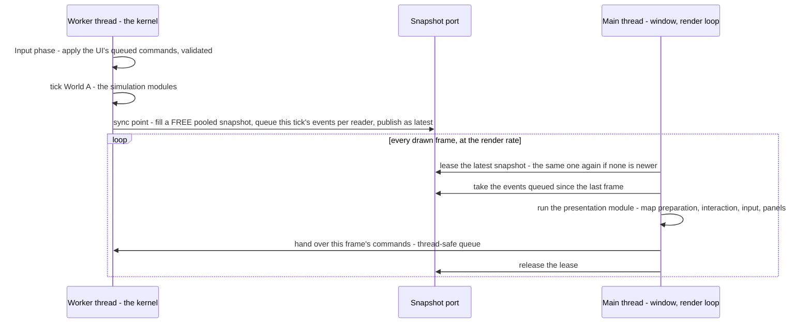
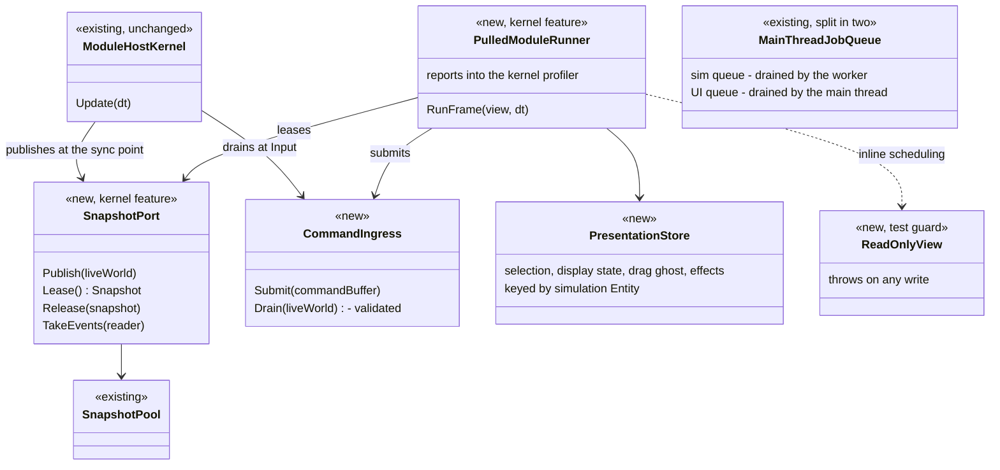
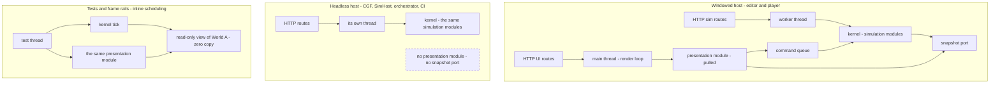

<!--STATUS
state: LIVE
build-state: DESIGN — not ruled; lean (c) agreed by the coordinator and ui, for the USER to rule (§2); a proof of concept exists (§7)
updated: 2026-11-11
current-answer: §2 the decision (lean) · §3 the diagrams · §4 the rules · §5 working memory · §6 pros and cons · §7 the measurements · §8 verification · §9 slices · §10 open
stale-below: nothing
known-rot: none
known-conflict: FDP/Engine/Fdp.ModuleHost/docs/UserGuide/06_SimulationViewsAndExecutionModes.md shows a two-replica swap in DoubleBufferProvider — the code syncs ONE replica in place (DoubleBufferProvider.cs:63-66); this design does not rely on it
related-designs:
  - DESIGN_Evaluation_Cost_And_Cadence.md — §11h ui's Windows measurement of the editor's preview frame (CE-4433) — the numbers this design answers; its §13 now points here
  - ../FDP/Engine/docs/FDP-GDB-SoD-unified.md — FDP-DES-012, the kernel's snapshot model (World A / replicas / commands) this design extends with a self-paced reader
  - blueprints/DESIGN_Time_Architecture.md — §17 stepped mode waits for background jobs (not the preview's mode); the worker must keep §17's determinism
  - blueprints/DESIGN_Paused_And_Stepped_Execution.md — tick modes, the event window; what runs on a paused frame
  - UX/DESIGN_Edit_Mode_Undo.md — edit steps and undo capture, which move to the command apply
  - DESIGN_Scenario_Regression.md — the nightly scenario regression this design's verification runs in both schedulings
-->

# DESIGN — the simulation on a worker thread, the presentation on the main thread from a published snapshot

## 0. The request

🔒 User, `2026-11-11`: *"in the editor at 1000 man scenario a big 3d map frame rate drop when i unpaused"* · *"Same with the UI. Unresponsive when
complex sim running."* · *"I am not talking about deterministic mode … In the preview"* · *"There is a worker thread that ticks the kernel. The kernel
owns the world A … a snapshot at the synchronization point … used by the presentation thread, which is the main application thread … the systems that
prepare the gizmo stuff are running on an asynchronous module … if there is no new snapshot, it runs again with the old one … This might be a new
Kernel strategy"* · *"having a second kernel would mean that everything there will be twice … Is that necessary?"* · *"the Windows run cannot tell …
how cheap it is for 5000 or 10,000 … Can we try making an experimental proof of concept?"*

## 1. INVENTORY *(`2026-11-11`)*

Queries: `scripts/cbm.sh search_graph` `.*(SnapshotProvider|SnapshotPool|DoubleBuffer|OnDemandProvider).*` (11), `.*(MainThreadJobQueue|PresentationShell|FrameStats|KernelFrameTimings).*`
(4 — ⚠ the index predates ui's `KernelFrameTimings`), `.*(InspectableSession|RepositoryAdapter|EntityComponentWriter|EntityWriteRouter).*` (5); grep for every count below.
⚠ Coverage could not be checked (`check_index_coverage` is not in the CLI).

| what | where | role here |
|---|---|---|
| the kernel, one per node | `HrotNodeBuilder.cs:140`; the editor's node `EditorNodeBootstrapper.cs:203-209` | moves to the worker, unchanged |
| the windowed loop: `orchestrator.Update` → `DrawWorldAll` → `rlImGui` panels, ONE thread | `Program.cs:703-722` | splits: the kernel's update to the worker, the rest stays |
| window, GL context, ImGui on the main thread | `RaylibPresentationShell.cs:35, :139` | stay together on the main thread |
| snapshot providers `DoubleBufferProvider` (one replica, synced in place), `OnDemandProvider`, `SharedSnapshotProvider` (ref-counted), `SnapshotPool` | `Fdp.ModuleHost/Providers/` | the pool is reused; a new LEASED publisher is added |
| `EntityRepository.SyncFrom` (dirty-chunk copy), `CopyClockFrom` | `EntityRepository.Sync.cs:23, :166` | the publish |
| `EventAccumulator` — its read windows are a reused buffer "valid until the next capture" | `EventAccumulator.cs:396-412` | read on the worker only |
| `EntityCommandBuffer.Playback` | `EntityCommandBuffer.cs:331` | the UI's write path |
| the HTTP debug API's `MainThreadJobQueue` — 77 `RunOnMainThread` routes, drained by the editor (`EditorSubsystem.cs:2732`) and the runner (`Program.cs:672, :788`) | `Hrot.Editor/DebugApi/` | splits into a sim queue and a UI queue |
| the brain writes World A in place (~100 `GetComponentRW`), refuses a snapshot | `BrainTickSystem.cs:146-149` | stays on the simulation side, untouched |

## 2. The decision *(lean — for the user to rule)*

**Decision (lean): tick the ONE kernel on a worker thread; run the presentation — map preparation, interaction, input, the ImGui panels — on the main
thread as a PULLED module on the latest published snapshot; the UI writes back only through commands.** Basis: §7 (the PoC: the UI stays at 93 fps
with a 408 ms tick, where today's shape falls to 2.5 fps) and Evaluation Cost §11h (ui: 63 of the 98.8 ms preview frame is simulation on the drawing
thread; brains are only 10 of it).

| rejected | the one fact that ruled it out |
|---|---|
| (a) interleaving soldiers' brains (Evaluation Cost §3 D6) | saves ~4 of 63 ms (§11h P-4), and a slowed brain gets one frame's dt, so HSM timers run slow |
| (b) cutting the named non-brain costs alone | a long tail (~25 systems of 0.4–7 ms; the 8.3 ms of background snapshot copies cannot convoy as built, `ModuleHostKernel.cs:2089`) — 30–40 % for weeks; a bigger scenario brings the freeze back. ⭐ Its cheap items are still worth doing meanwhile |
| holding a deterministic step instead of waiting | the preview runs CONTINUOUS (`MasterSyncController.cs:189-192`); stepped mode's wait (Time Architecture §17) is not the cause |
| moving the brains to a background module | the brain writes ~100 sites in place and reads them back in the same tick — a rewrite of the AI's write model |
| a second kernel for the presentation | everything twice — monitoring, diagnostics, registration (user); the presentation is a module of the ONE kernel |
| drawing from a snapshot while the kernel stays on the main thread (§13.2 of Evaluation Cost, withdrawn) | superseded by the user's shape: the kernel's owner thread simply becomes the worker |

Design docs checked: FDP-DES-012 — applies (World A on one thread, readers on replicas, writes as commands; it already names UI a replica consumer);
Time Architecture §17 — does not apply to the preview, must keep holding on the worker; Evaluation Cost §3 — applies to (a); Scale Rig C-1 / G-1 —
headless nodes, unchanged.

## 3. The design in diagrams

### 3.1 The two threads

*What the picture shows that prose hid:* the main thread never waits for the worker and never writes World A — the only two crossings are the
published snapshot (worker → main) and the command queue (main → worker); the events travel with the READER, not with a snapshot (§4 R-4).

### 3.2 The classes

*What it shows:* the new pieces are a publisher, a command queue, a runner and a store — all around the UNCHANGED kernel; the presentation module is an
ordinary `IEcsModule` whose systems are ordinary `IEcsModuleSystem`s, run by the runner instead of the kernel's dispatcher.

### 3.3 Who runs what, per host

*What it shows:* ONE simulation code path and ONE presentation code path everywhere; hosts differ only in WHICH thread ticks the kernel and WHETHER a
presentation is attached. The dashed box is the edge that never exists: a headless host registers no presentation, so no snapshot is ever published.

## 4. The rules

| # | rule | why — measured |
|---|---|---|
| R-1 | **one code path, two schedulings** — the presentation ALWAYS reads `ISimulationView` and writes commands; the HOST chooses inline (tests, rails, headless, CI) or threaded (the windowed editor and player) | PoC `--mode single` / `threaded` run the same modules |
| R-2 | ⛔ never switch by entity count or measured load | two behaviours to keep right; the threaded one exercised only at scale ⇒ its bugs surface late |
| R-3 | **headless hosts register no presentation module ⇒ no snapshot port** — by construction, not by a mode flag | the warning against a second architecture is about two PRESENTATION paths; headless has none |
| R-4 | ⭐ **events queue per READER, never ride on a snapshot** | PoC T-2: when two publishes fall between two frames only the newest is leased — the skipped one's events were lost (8–45 of ~5 000); per reader: 6 432 / 6 432 |
| R-5 | events are read from the accumulator on the WORKER only | its windows are a reused buffer valid until the next capture (`EventAccumulator.cs:396-412`) |
| R-6 | a snapshot is never written while it is the latest or leased; the worker fills a FREE pooled one | ⇒ 2 copies when the sim is slower than the frames, 3 at peak (one latest, one leased, one being filled), never 4 — the main thread leases one at a time |
| R-7 | **the UI writes only commands**, validated before they apply (DES-012 §3.3: a target that died in between is refused, not thrown) | PoC T-6: a stale command threw in `Playback` |
| R-8 | the drag / rotate / group previews draw a GHOST; only the release becomes a command | an edit lands one tick later (PoC drag → visible ≈ 1–1.5 ticks) |
| R-9 | the HTTP job queue splits: simulation routes drain on the worker (they answer at the tick's rate), UI routes (map layers, camera, film, screenshots) on the main thread — each of the 77 routes labelled once | `MainThreadJobQueue` already marshals to "the main/simulation thread" |
| R-10 | presentation queries are re-bound per snapshot (a query is bound to ONE repository) | PoC T-4 — an allocation per publish, not per frame |
| R-11 | the presentation's per-system timings feed the kernel's ONE profiler | user: no duplicated monitoring / diagnostics |
| R-12 | the threaded scheduling must keep stepped mode's determinism (Time Architecture §17) | ⏭ not yet proven (§10) |

## 5. Working memory — where the gizmos' and UI's state lives

| today | examples | in this design |
|---|---|---|
| ① components on World A entities | `SelectionStateComponent` (6 writes), `MapDisplayComponent` (2) | the `PresentationStore`, keyed by entity — a snapshot is read-only |
| ② World A singletons the presentation writes | `CanvasContextMenuState`, `IOrderForm` | the store |
| ③ ⚠ side tables keyed by the WORLD OBJECT — `ConditionalWeakTable<EntityRepository, …>` in **21 files** (`MapUiStates.cs:16-21`: rubber band, RTS mode, canvas, hat arbiter; `MissionPresentationGizmo`, `KillFeed`, `PlayerMessages`, `ViewTelemetry`, `EntityFacts`, `GameScore`, `AuthoredRules` …) | "presentation state, never replicated, saved or recorded … keyed by the world both are given" (`MapUiStates.cs:8-12`) | ⛔⛔ **the silent trap**: the view is a different pooled snapshot each publish ⇒ the state would reset or flip between 2–3 copies with no error ⇒ re-key to the host's PRESENTATION CONTEXT |
| ④ fields on the gizmo and system objects | the drag gizmo's `_isDragging`, cached arrays | unchanged (created once with the host) |

**The UI's write side today:** ~96 bus publishes (already commands) · ~69 calls through the routed paths (`Edits.Submit`, `IEntityComponentWriter`,
`RequestEntityCreation`, JSON patch — their direct branch is queued, one change per path) · the Details forms through ONE seam
(`IInspectableSession.SetComponent` → `RepositoryAdapter`, queued there) · **~24 direct simulation writes in ~15 files** to convert (the previews of
`SimTransform` / `VehicleState`, `TerrainBlockOps`, route / polyline gizmos, `ParamUsage`, `MacroArgs`, `WeatherEdit`, `BrainSettings`, `PlayableOps`,
`OccurrenceSlotWriter`, one `DestroyEntity`, the debug API's generic write, the verifier) · **~40 UI-only writes** moving to the store (①②).
⚠ During the move: check that no simulation or egress code READS the UI state of ① — else moving it changes every host alike.

## 6. Pros and cons

| ✅ pros | evidence |
|---|---|
| ⭐ the UI and the camera stop depending on the simulation — today every input waits a 100 ms frame, often two | PoC: a 408 ms tick, UI at 93 fps (today's shape 2.5); §11h P-3 |
| ⭐ it scales with the scenario — more entities slow the simulation, not the editor | PoC 1 000 → 50 000: UI 218 → 69 fps (that fall is the drawing), today's shape 128 → 4.9 |
| the simulation gets the cores the drawing used to interleave | PoC: the tick costs the same in both modes |
| the kernel needs no change to run off the main thread | PoC T-1: no thread-affinity checks anywhere |
| one code path, two schedulings; headless hosts unchanged | R-1, R-3 |
| it follows the kernel's own model (DES-012) | §2 |

| ⛔ cons and costs | size |
|---|---|
| ⭐ an edit lands one simulation tick later — a pending / ghost state is drawn | PoC: 14 ms at 1 000 entities, ~0.5 s at a 408 ms tick |
| ⭐ the UI's writes all become commands — 3 seams, ~24 direct writes, ~40 UI states, 21 side tables | §5 |
| a full-world snapshot per tick on the worker — cheap in the PoC (~1 ms at 10 000), heavier for real HROT (ui: ~6.5 ms per background module's mask at 1 000 men) ⇒ likely ~10 ms per tick | ⏭ measure (§10) |
| 2–3 copies of the world in memory (plus World A) | R-6; reducible with a component mask |
| new kernel pieces: the leased publisher, the per-reader event queue, the pulled runner, command validation | §3.2 |
| the HTTP API splits; what the UI shows is one tick old | R-9 |

## 7. The measurements

**The proof of concept** — branch [`poc/threaded-kernel`](https://github.com/pjanec/HROT/tree/poc/threaded-kernel), project
`FDP/Examples/Fdp.Examples.ThreadedKernel` (README there): the REAL kernel with a stand-in simulation (busy-work brains, movement, a 512 B payload per
entity, a `Bounce` event) on a worker; the snapshot port; a presentation module pulled by the render loop; drags as command buffers. `--mode single`
runs the same modules in today's shape. Cloud VM, 4 cores, software GL (the drawing is not representative; the threading is).

| entities | brain work | threaded UI fps (p50 ms) | today's shape UI fps (p50 ms) | sim tick | publish | drag → visible (threaded / single) |
|---|---|---|---|---|---|---|
| 1 000 | 200 | **218** (3.8) | 128 (7.4) | 3.6 ms | 0.08 ms | 14 / 8 ms |
| 5 000 | 200 | **131** (7.1) | 38 (25.9) | 17 ms | 0.36 ms | 31 / 27 ms |
| 10 000 | 200 | **84** (11.2) | 21 (47.1) | 32 ms | 1.0 ms | 61 / 51 ms |
| 20 000 | 200 | **76** (13.7) | — | — | 1.8 ms | — |
| 50 000 | 200 | **69** (14.9) | 4.9 (203) | 191 ms | 3–7 ms | 311 / 202 ms |
| 10 000 | 2 000 | **93** (12.0) | 2.5 (391) | 408 ms | 1.4 ms | 528 / 396 ms |

PoC findings: T-1 the kernel runs off the main thread unchanged · T-2 events lost riding on a snapshot (→ R-4) · T-3 the accumulator is
kernel-thread-only (→ R-5) · T-4 queries bound to one repository (→ R-10) · T-5 the double buffer overwrites in place (→ the leased publisher) · T-6 a
stale command throws (→ R-7) · T-7 2–3 copies (→ R-6).

**The real editor on the user's machine** — Evaluation Cost §11h (ui, CE-4433, `KernelFrameTimings`): 1 000 men, preview playing 98.8 ms vs paused
32.4 ms; the 63 ms of simulation on the drawing thread attributed: the synchronous sim 38 (brains 9.8, weapons 7.3, stress 5.7, callouts 3.7, ~25 small),
PostSimulation 9.5, the background modules' snapshot copies 8.3.

## 8. Verification — how we know it still works

⭐ The simulation does not care who ticks it, and the UI's writes are commands applied at a tick's start in BOTH schedulings ⇒ inline and threaded must
produce the SAME simulation.

| step | what proves it | exists? |
|---|---|---|
| ① **missed writes fail LOUDLY, before threading is on** | the presentation's view is read-only in BOTH schedulings (inline: a wrapper over World A that throws on any write); a Debug-build owner-thread check on World A's write paths | ⛔ new (small) |
| ② **migrate in INLINE mode first** | every step of §5 lands with threading OFF and ① ON — the existing suites prove the migration before any thread changes | the suites |
| ③ **the existing suites, unchanged** | feature rails (CLAUDE.md T-1); 71 kernel test files; 118 frame-rail files under `xvfb-run -a`; `scripts/run-system-tests.sh`, `DeterminismRails`, `ClusterConformanceRails`; the nightly `scripts/scenario-regression.sh` (`checks.json` + `golden.json`) | ✅ |
| ④ ⭐ **inline vs threaded equivalence** | the same scenario and the same scripted UI actions over HTTP in both — compare the world entity by entity (`scripts/determinism-probe.py --compare`) and the recordings | ✅ the probe; ⛔ a scheduling switch |
| ⑤ **the scenario regression in threaded mode** | every `checks.json` passes and every `golden.json` matches as inline | ✅ the script; the switch |
| ⑥ **rails for what is new** | never written while leased (a stress rail with random delays on both threads); events exactly once when publishes are skipped (R-4); a stale command refused (R-7); the 21 side tables survive several publishes (§5); 0 B per steady presentation frame; every one of the 77 HTTP routes labelled (R-9) | ⛔ new |
| ⑦ **the property we are buying** | inject a 500 ms tick — the main frame stays < 50 ms, input → draw bounded | ⛔ new |
| ⑧ **the real thing** | ui's CE-4433 harness re-run threaded on the user's machine at 1 000 / 5 000 / 10 000 men — target **playing ≈ paused** (today 98.8 vs 32.4 ms); a hand check of the user's stories (drag, place, delete + undo, Details edits, the OSM wizard, replay) | ✅ the harness |

**Rollout:** the threaded scheduling is a per-host switch, default OFF, until ③–⑤ are green in both modes and ⑧ meets its target — then ON for the
windowed editor and player; headless hosts never change. ⛔ Not a long-lived flag: once ON is proven, inline remains only as the tests' scheduling (R-1).

## 9. Slices *(once ruled)*

| slice | what | owner (lean) | done when |
|---|---|---|---|
| S-0 | the architect question + a FDP-DES-012 section (the self-paced reader, the leased publisher, the per-reader events) | coordinator | ruled |
| S-1 | the guards (§8 ①) + the scheduling switch, inline only | backend | the existing suites green with the read-only view on |
| S-2 | the kernel pieces: `SnapshotPort` (leased publisher, per-reader events), `CommandIngress` (validated), `PulledModuleRunner` (profiler-fed) | backend | §8 ⑥ rails red-proved |
| S-3 | the presentation's migration (§5): the 3 seams, ~24 writes, ~40 states into the store, 21 side tables re-keyed — inline | ui | §8 ②③ green |
| S-4 | the HTTP queue split (R-9) | ui + backend | every route labelled; the debug API's tests green in both schedulings |
| S-5 | threaded ON in the editor behind the switch; §8 ④⑤⑦ | backend + ui | equivalence and the regression green threaded |
| S-6 | the Windows measurement (§8 ⑧) and the user's hand check | ui (Windows) | playing ≈ paused at 1 000 / 5 000 / 10 000 men |
| meanwhile | (b)'s cheap items from §11h (the background snapshot copies, the top non-brain systems) | backend | measured gains |

## 10. Open — to measure or decide

| question | why it matters |
|---|---|
| the REAL publish cost: the drawn world's component mask at 1 000 / 5 000 / 10 000 men | it lands on every tick (ui measured ~6.5 ms per background module's mask) |
| stepped / deterministic mode and the time controller's ACKs with the kernel on the worker | R-12 — the run-to and step features rely on them |
| does any simulation or egress code read the presentation's ① state? | §5 — else moving it changes every host |
| which of the 77 HTTP routes are UI-side | R-9 |
| managed (Tier 2) components read by the presentation | a snapshot copies their references shallowly — immutability is already the rule (CLAUDE.md), to be audited for the presentation's reads |
