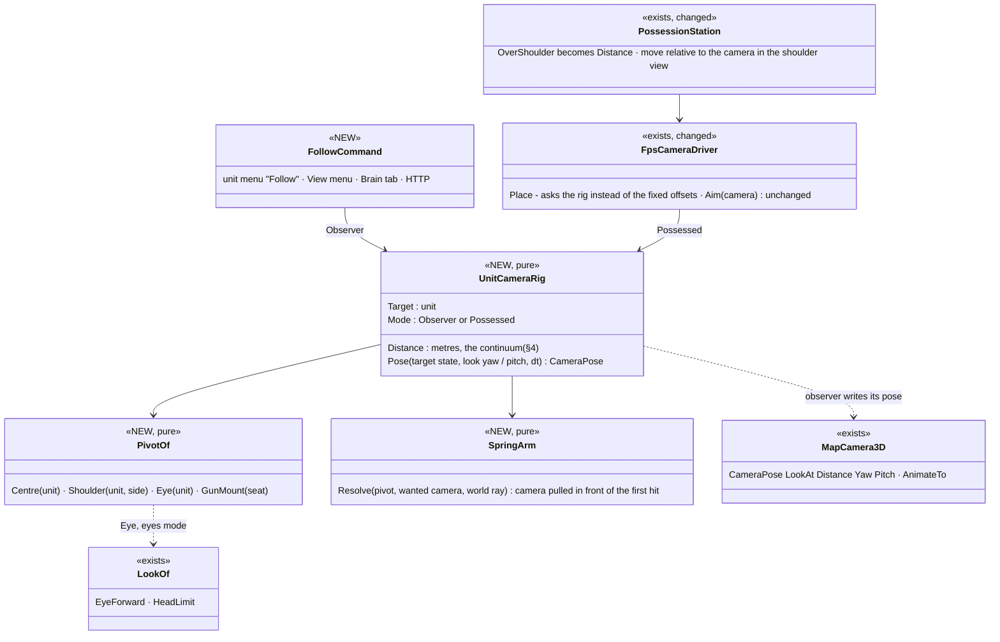
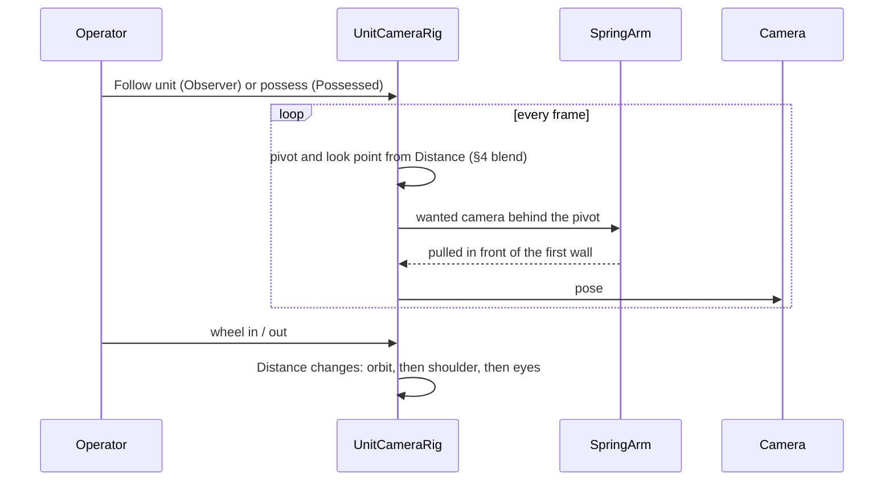
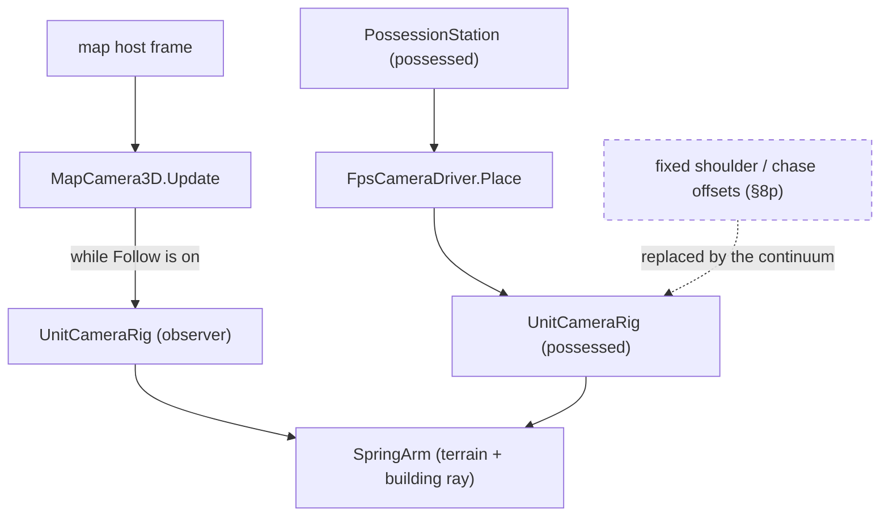

<!--STATUS
state: LIVE
updated: 2026-10-23
build-state: BUILT — C1–C4 2026-10-23 (§8 as-built); C0 (CE-1294) closed — not a defect
current-answer: §8 AS-BUILT · §1 what each use needs · §2 INVENTORY + claim table · §3 diagrams · §4 the camera continuum · §5 control in the shoulder view · §6 decisions with leans · §7 slices
stale-below: nothing
known-rot: none
known-conflict: docs/DESIGN_Entity_Control.md §8p (OS-1…OS-6, built overnight, not yet confirmed) — OS-2's fixed offset and OS-4's fixed chase camera become points on §4's continuum; nothing there is reverted
related-designs:
  - docs/DESIGN_Entity_Control.md — OWNS the FPS station (PossessionStation, FpsCameraDriver): §8p the shoulder view as built, §8l the free look (neck ±70°, torso twist, DragBody), §8n seats, §8o crew eyes, §8j zoom / lean keys
  - docs/DESIGN_Map_3D_Mode.md — OWNS MapCamera3D (the map's orbit camera: LookAt, Distance, Yaw, Pitch) the observer follow camera rides on, and the body drawing (torso twist, head turn)
  - docs/designs/look-direction/DESIGN_Look_Direction_And_FOV.md — OWNS where a unit's eyes sit and point (LookOf.EyeForward, the neck, the vision cone) — the "through his eyes" diagnostic view reads it
  - docs/DESIGN_Behaviour_Debugging.md — the observer camera is part of watching a debugged unit (DBG-1: everything follows the debugged unit)
  - docs/DESIGN_Director_Timeline_Editor.md — the director's camera keys (fly / cut) may use the follow camera as a shot type
  - docs/DESIGN_Agent_Shared_View.md — OWNS the /view route family (R-1029) that POST /view/follow (UC-10) joins, and the per-world view store it mirrors
-->

# Unit camera — one camera that follows a unit, from far away to its eyes *(CE-1293)*

🔒 **User, `2026-10-23`:** *"designing the over-the-shoulder view for first-person shooter for characters as well as for vehicles to
make it somehow practical for first-person shooter gameplay, and as a secondary but maybe more important as a diagnostic tool which is
used to monitor the happening on the scene from the first person. Maybe in this case something like the orbit view will apply much
better … I just saw that the body movements and aiming and torso turning to the direction of the aim looks really cool … Maybe the
over-the-shoulder view might resolve the issue that still the view is blocked by something … I need your experience from different
games."* — and earlier the same day (CE-1293): orbit far away, over the shoulder close, wheel zoom, follow any selected unit; the shoulder
view to replace the gunner and driver views.

## 1. What each use needs — and what games do for it

| use | what it needs | what the genre does *(experience, not measured here)* |
|---|---|---|
| **A. watch a unit** (diagnostic, the more important) | keep the unit in view while it moves; see its surroundings AND, on demand, what IT sees | spectator / observer cameras (ARMA's spectator and Zeus, Squad's admin camera, esports observers): **free · follow (orbit a target, wheel = distance) · the target's own first-person view** — three modes on one key, the follow mode is the workhorse |
| **B. play a soldier** | aim precisely; move and use cover; see your own body when that helps | tactical shooters split: first person only (Squad, Ready or Not) vs third person with first-person aiming (ARMA, PUBG, Ghost Recon). ⭐ The hybrid is the common answer: **move and look from over the shoulder, aim down the sights from the eyes**. Pure third-person aiming (The Division, Gears) needs camera collision and a shoulder swap to work |
| **C. drive / gun a vehicle** | see the vehicle and the road; a gunner sees the target over the hull | almost every game with vehicles (Battlefield, ARMA, GTA): **driver = chase camera with a free look that re-centres**, **gunner = camera behind the gun, the mouse is the turret, aim converges on the crosshair**, the sight (first person) on aim |
| **the "view is blocked" problem** | nothing between the camera and what you look at | the shoulder camera fixes the vehicle hull blocking a crew eye (§8o); it creates a new block (a wall behind you) that games solve with **camera collision** (the camera slides in towards the shoulder when something is between) and a **shoulder swap** for corners |

⭐ **The answer to *"can FPS gameplay use the shoulder view at all?"*: yes — as the default for MOVING, with the eyes for AIMING.** The
torso turning to the aim is exactly what makes it look alive (and we already draw it); precision stays in first person (right mouse button).

## 2. INVENTORY and claim table *(2026-10-23 — `scripts/cbm.sh search_graph .*(Camera|Orbit|Follow|Spectat|Chase).*` (Class, 21 non-test results), then reads; `check_index_coverage` is not reachable through the CLI)*

| what exists | where | reused as |
|---|---|---|
| the map's 3-D camera IS an orbit camera: `CameraPose(LookAt, Distance, Yaw, Pitch)`, `AnimateTo`, wheel and fly input | `MapCamera3D` (`FDP/Engine/Fdp.Presentation/Vis3D/MapCamera3D.cs:13,189`) | ⭐ the follow camera = this camera with `LookAt` pinned to the unit each frame — no second camera |
| the FPS camera: placed from the eye (person: drawn head; crew: §8o; seat: MS-5); the shoulder offset 2.2 / 0.55 / 0.2 m; chase 9 / 2.5 m (flyer 18 / 4.5) | `FpsCameraDriver.Place`, `ShoulderCamera` (`PossessionStation.cs`) | the possessed end of the continuum |
| the aim converges: a ray from the CAMERA's centre, the round from the muzzle to its hit | `FpsCameraDriver.Aim(camera)` | ⭐ unchanged in every mode |
| free look: the eyes move ±70° (the neck), the torso twists ≤ 75°, the body follows past the neck (`DragBody`) | §8l.5, `LookOf.HeadLimit` | ⭐ the "torso turns to the aim" behaviour of §5 |
| where a unit's eyes sit and point | `TerrainWorldLosStrategy.EyeOf`, `LookOf.EyeForward`, the vision cone | the observer's **eyes** mode |
| keys taken by the station | O shoulder · Q/E lean · V free look · G seat · F use · R round · T wheel · Tab · M map · I select · B binoculars · RMB zoom | §6 adds none for play (UC-6 reuses Q/E) |

| the lean rests on | code — how it IS | design — how it was MEANT |
|---|---|---|
| a follow camera needs no new camera class | ✅ `MapCamera3D` pose is orbit-shaped | ✅ Map 3-D M-design (one map camera) |
| the shoulder view already aims right | ✅ `Aim(camera)` from the viewport centre | ✅ Entity Control §8p OS-3 |
| nothing stops the shoulder camera at a wall | ✅ §8p.5: *"the camera does not stop at a wall"* | ⛔ searched, none |
| the body already turns to the aim with a lag past the neck | ✅ `DragBody` (§8l.5) in free look; ⚠ in LOCKED look the body = the look (no lag) | §8l LK-2 |
| why the shoulder view stutters when walking (CE-1294) | ⛔ **not measured** — hypotheses: the eye it is placed from bobs with the gait and is amplified 2.2 m back; or the move reads the camera, not the body | — CE-1294 measures first |

## 3. Diagrams

*What the picture shows that prose hid:* ONE rig serves both uses — watching (it writes the map camera's pose) and playing (the FPS driver
asks it where to stand); the aim, the brain and the round never see which mode is on.

## 4. The camera continuum — one wheel from far away to the eyes

| distance (person; a vehicle ×4) | the camera stands | it looks at | the mouse |
|---|---|---|---|
| **far** > 12 m | on an orbit round the unit's centre | ⭐ the unit (always in the middle) | orbits (yaw, pitch); the unit keeps its own heading |
| **mid** 3 – 12 m | the pivot slides from the centre to the right shoulder, the look point slides from the unit forward along the camera's yaw | a blend | orbits |
| **shoulder** 1.5 – 3 m | behind the shoulder | ⭐ where the camera points (the crosshair) | Observer: looks round; Possessed: aims |
| **eyes** (wheel past the shoulder) | the unit's eye | Observer: ⭐ **where the unit's eyes point** (`LookOf.EyeForward`), its vision cone drawn; Possessed: the aim | Observer: offsets the look while held, springs back; Possessed: aims |

*Why a continuum:* the user's own words — *"far: look at the entity all the time; close: switch into the over-the-shoulder view"* — are
two ends of one zoom; one wheel crosses them without a mode key. The blend (the pivot and the look point sliding) is the standard
"spring arm with a socket offset" of third-person cameras.

## 5. Control in the shoulder view (possessed person)

| | ⭐ lean |
|---|---|
| movement | **relative to the camera**: W forward along the camera's yaw, A/D strafe, S back — as every shoulder shooter |
| the body | the **upper body twists to the aim at once** (≤ 75°, drawn already); the **legs and hips turn to the aim with a lag** — when the aim is more than ~45° off them, or as soon as he moves (turn-in-place) — the "torso turns to where we aim" look the user liked, kept from §8l's `DragBody` |
| aiming | **RMB = aim from the eyes** (first person, the zoom of §8j) — release returns to the shoulder. ⭐ precision in first person, awareness over the shoulder (UC-11) |
| the wheel | **weapons**, as today (UC-11); the camera distance is Alt + wheel |
| corners | **Q / E lean also swaps the shoulder** (lean left ⇒ camera on the left shoulder) — no new key |
| walls | the spring arm pulls the camera in front of a wall, out again slowly |
| the fire | unchanged — from the muzzle to the crosshair point; when the muzzle is blocked but the crosshair is not, the crosshair says so (a small mark where the round would really hit) |

## 6. Decisions — ✅ APPROVED `2026-10-23` (R-1032; UC-11 R-1033)

🔒 **User, `2026-10-23`:** *"Accepting your suggestion, mouse wheel should switch weapons as this is the usual way in first-person shooters."*

🔒 **User, `2026-10-23`, after playing the build (R-1034, supersedes UC-11's wheel):** *"The new camera is amazing. Just the mouse wheel needs to be tied to camera distance even for fps, and left weapon switching to numeric keys only. That way it feels the most intuitive for both observer and possessed mode."*

🔒 **User, `2026-10-23`:** *"UC leans approved, start with CE-1294."*

| id | decision | ⭐ lean | rejected — one line each |
|---|---|---|---|
| **UC-1** | one camera or several | ⭐ ONE `UnitCameraRig` with a distance continuum (§4) for both watching and playing; the map camera and the FPS driver ask it | an orbit camera AND a shoulder camera AND a chase camera — three to keep consistent; the user's own description is one zoom |
| **UC-2** | watching a unit (the diagnostic use) | ⭐ **Follow** on the unit menu, the View menu, the Brain tab (the debugged unit) and HTTP; Esc or a map drag ends it; the wheel moves along §4; the **eyes** end shows the unit's own gaze and vision cone | follow only in possession — the diagnostic use needs no possession · a separate "spectator window" — one more place |
| **UC-3** | the default for play | ⭐ after CE-1294 is fixed and UC-4 built: **the shoulder view is the default for a person**, RMB aims from the eyes; O still toggles; the choice is remembered | first person as the default — loses the body the user liked · pure third-person aiming — needs a parallax rule for every weapon and is less precise |
| **UC-4** | walls | ⭐ a spring arm (one ray, pivot → camera, terrain + buildings) — in before the frame draws, out over ~0.3 s | fade the wall — needs per-building transparency in the renderer; no ray is cheaper |
| **UC-5** | body and legs in the shoulder view | ⭐ §5: camera-relative strafe; the torso twists at once, the legs follow past ~45° or on moving | the body locked to the camera — no twist to see · free look's A/D turning — tank controls feel slow in a shooter |
| **UC-6** | corners | ⭐ Q / E lean also swaps the shoulder | a separate swap key — one more key |
| **UC-7** | a vehicle driver | ⭐ chase camera on the continuum (×4 distances), looking along the vehicle; the mouse looks round and re-centres after ~1.5 s idle | the mouse steers — W/A/S/D already steer |
| **UC-8** | a gunner | ⭐ the camera behind the gun mount (the pivot is the mount), the mouse is the turret (as today), RMB = the gun's sight in first person; replaces today's crew-eye gunner view as the default | the crew eye — the hull blocks it (the reason for §8o's drawing) |
| **UC-9** | the muzzle is blocked | ⭐ a small second mark where the round from the muzzle would hit, shown only when it differs from the crosshair point | ignore — the shot hits a wall the player cannot see coming |
| **UC-10** | the HTTP side | ⭐ `POST /view/follow {entity, distance}` (Agent Shared View family, R-1029) | — |
| **UC-11** *(R-1033, user 2026-10-23; ⛔ the wheel half SUPERSEDED by R-1034 the same day: the wheel is the camera distance when playing too, weapons are 1–4 only)* | the inputs while PLAYING vs WATCHING | ⭐ **playing (possessed):** ~~the plain **wheel and 1–4 switch weapons** (unchanged)~~ ⇒ R-1034: **1–4** switch weapons, the **wheel** is the distance; **O** switches eyes ⇄ shoulder; **RMB held** = the scope zoom of §8j Z-1 — in the eyes view as today, in the shoulder view the camera goes to the eyes AND zooms (aim down the sights), release returns to the shoulder; **Alt + wheel** = the fine camera distance (eyes … a short chase), rarely needed. **watching (Follow):** the plain wheel is the §4 distance continuum (no weapons there) | the plain wheel as the camera distance while playing — every weapon switch would move the camera, and the wheel switching weapons is the shooter convention |

## 7. Slices *(order = the lean)*

| slice | rows | |
|---|---|---|
| **C0** | CE-1294 | measure and fix the shoulder-view stutter first — it decides UC-3 |
| **C1** | CE-1293 UC-1, UC-2, UC-4 | the rig, the spring arm, Follow on any unit (the diagnostic use) |
| **C2** | UC-3, UC-5, UC-6, UC-9 | the shoulder view as the person's default |
| **C3** | UC-7, UC-8 (CE-1293's vehicle part) | driver and gunner |
| **C4** | UC-10 | HTTP + the catalog |

🔒 **User, `2026-10-23`:** *"let's go directly to implementing the new design of camera, and let's fix the issues once this is
implemented"* — ⇒ C0 (CE-1294, measured but not reproduced) is deferred until after C1–C4; the slices are built in the order C1 → C4 → C2/C3.

## 8. AS-BUILT *(2026-10-23, ui)*

| slice | built as | ⚠ deviation from §3 / §6 |
|---|---|---|
| **C1** the rig (UC-1, UC-4) | `Hrot.Presentation/Map3D/UnitCameraRig.cs` — pure statics: `Pivot`, `Camera(orbitPitch)`, `SpringArm(firstHit)`, `EaseArm`, `NearBlend`, the per-kind `DefaultDistance` / `MaxPlayDistance` / `ScaleOf` | ⚠ §3's `PivotOf` and `SpringArm` classes are **methods on the one static rig**, not classes — nothing holds state but the drivers. ⚠ the spring arm's ray is `WorldQuery.Trace(Sight)`, stopping at a closed barrier or a crossing that lets through less than half the light (`ArmOpaque`) — glass does not stop it |
| **C1** playing (UC-5, UC-6, UC-11) | `FpsCameraDriver.Place` asks the rig at `PossessionStation.ShoulderDistance(scheme)` (per kind, the wheel by `DistanceStep` 0.5 m, to zero = the eyes — ⚠ Alt + wheel until R-1034; weapons on 1–4 only, the hold-F list keeps its wheel); Q / E set `ShoulderSide` (sticky); the body lags the aim (`ShoulderLag` 45° standing, `BodyTurnRate` 540°/s moving); W/A/S/D turned into the body's frame | ⚠ `ShoulderCamera` (§8p) kept as a pure entry that delegates to the rig at the default distance — its CE-1201 rail stays as a pin of the old offsets |
| **C1** watching (UC-2) | `FollowCameraDriver` (an `ICameraDriver` on `MapCamera3D`): the plain wheel walks the continuum (×1.2 per notch, in below 0.8 m ⇒ his eyes, out from the eyes ⇒ 1.5 m), far it looks at his centre, at 0 his eye along `LookOf.EyeForward`; RMB orbits (at the eyes it offsets the look and springs back); W/A/S/D, Esc, a middle-button drag or his end hand the camera back. The unit menu's **"Follow with the camera"** (`GlobalActionIds.FollowUnit` 476 → `FollowUnitEvent` 8066) and the Brain tab's **Follow** both reach `MapViewModeLayer.FollowUnit` | ⚠ **no View-menu entry** — the unit menu and the Brain tab cover it; a View item would need a target picker. ⚠ **not built:** UC-2's vision cone at the eyes — the follow camera only looks along the gaze |
| **C4** HTTP (UC-10) | `POST /view/follow {entity, distance?}` → `ViewControl.Of(world)` (the map's view-mode layer, keyed by world like `ViewTelemetry`) → the same `FollowUnit`; `GET /view` adds `following` / `followDistance`; MCP `follow_unit`, catalog + SKILL regenerated (R-1030) | ⚠ a second per-world store (`ViewControl`) because `ViewTelemetry` is a read-only snapshot. 409 headless or while possessing |

| **C2** the default (UC-3) | `PossessionStation.OverShoulder` defaults **on** (a station setting, so O's choice stays for the next possession in this run) | ⚠ "remembered" is per run, not across restarts. ⚠ built before CE-1294 (the slow walk), on the user's call — ✅ CE-1294 closed: not a defect, the walk is a walk (user, `2026-10-23`) |
| **C2** the muzzle-blocked mark (UC-9) | `PossessionStation.BlockedShot(w, unit, mount, aimAt)` — from `ShotOrigin.From` (the barrel, or his eye) to the crosshair's point through `TerrainPenetration.Carry`, the one penetration rule; a red X where it stops, when that is more than `BlockedMargin` 0.5 m short | — |
| **C2/C3** the arm's start | the first frame stands at full length; after a wall it eases out at `ArmOutRate` × `ScaleOf(kind)` (a vehicle 16 m/s) | ⚠ found by the C3 rail: easing from zero, a vehicle's 9 m chase camera took 2 s to slide out of the driver's eye |
| **C3** the driver (UC-7) | `FpsCameraDriver.Recentres` — a ground vehicle, hull not locked, the chase camera on: a look left alone `RecentreAfter` 1.5 s eases back at `RecentreRate` 90°/s | ⚠⚠ **not for an armed turret**: §8p OS-4 — the look IS the turret's order, so re-centring would swing the gun back to the front. ⇒ only when the selected weapon lays no turret (a truck, a car) |
| **C3** a man in a seat (UC-8) | `FpsCameraDriver.RigScheme` — aboard, the camera is the **vehicle's** chase camera (its distance, ×4; a flyer ×8) hung from his seat eye; the wheel sets the vehicle's distance | ⚠ the pivot is his **seat eye** — a gunner sits at his gun, so the camera stands behind the gun; no separate gun-mount point was needed |

⭐ Rails: `PossessionStationTests.CE1293_*` (continuum, spring arm, playing controls, Follow continuum + let-go, menu → layer → camera + the possession refusal, the default + the car's chase camera + re-centre / not an armed turret's, a man in a seat on the vehicle's chase camera, the round stopping short at a test-town wall — ✅ 7 mutations red; one first stayed green and showed the on-the-wall check passing for another reason, now aimed 0.3 m past the face) — ✅ red-proved: 6 mutations on the rig/station, 5 on Follow; `TheBrainAndViewRoutesAnswerTests.FollowUnit_IsRefusedHeadless_FollowsOnAMap_AndLetsGo`.

⭐ **AS-BUILT `2026-10-25` (ui) — three follow fixes from use:** `CE-1338` a wall pulling the arm in lifts the camera toward 0.6 m over his eyes
(`UnitCameraRig.AboveHeadWhenSqueezed` — the pivot sits between feet and eyes, so a short arm used to bring the camera to his belly) ·
`CE-1339` Esc / W / a map drag leave the free camera exactly where the follow was (`MapCamera3D.Driver`'s setter matches its look-at XY, so
the relief re-pin no longer drops the eye) · `CE-1342` Ctrl+M switches 2-D ↔ 3-D centred on the selected unit (`MapViewModeLayer.HandleKeyInput`
→ `MapViewSwitch.Toggle(centreOn)`; going 2-D lets a follow go). Rails `PossessionStationTests.CE1338_*`, `CE1339_*`, `CE1342_*`.
