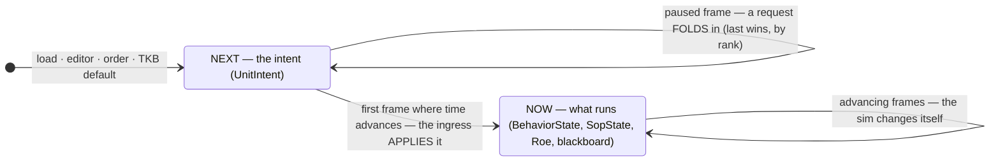
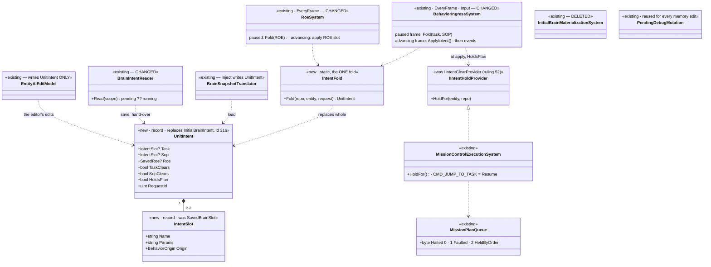
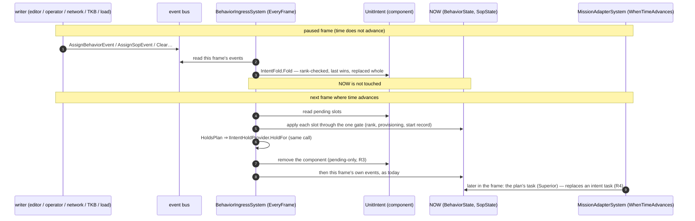
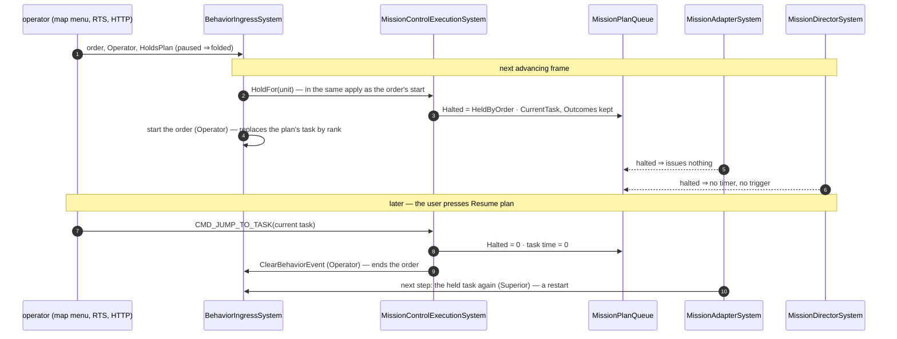

<!--STATUS
state: LIVE
build-state: DESIGN (2026-11-22 — written; §9 independent review folded in; the open decisions in §8 wait for the user)
updated: 2026-11-22 (created — backend; CE-3494, R-3114…R-3117)
current-answer: §1 the rules · §2–§4 the diagrams · §5 the mockups · §6 the build order · §8 the open decisions · §9 the review and how it changed the design
stale-below: nothing — new document.
known-rot: none.
known-conflict:
  - UX/UX_RESUME_INTERACTION.md ruling 50 ("the plan is DISCARDED, not paused") — SUPERSEDED by R-3115 here once built; its "one operation, not two" atomicity is KEPT (§1 R5).
  - blueprints/RULINGS.md R-4137 ("applied at once while paused") — for a unit's AI (task, SOP, ROE) the start now lands at the first step (R-3114); every other initial-state row of R-4137 is unchanged and filed as CE-3496.
  - DESIGN_Sensors_And_Doctrine.md §7.5 (InitialBrainIntent is Transient, deleted after one frame) and §7.6 (paused edits apply at once) — both SUPERSEDED by §1 here once built.
  - blueprints/DESIGN_Paused_And_Stepped_Execution.md §10 F2 / Appendix A (BehaviorIngressSystem and RoeSystem run every frame SO THAT a unit loaded while paused has its AI before the first step) — the systems stay EveryFrame, but on a paused frame they now only FOLD into the intent (§3.1).
related-designs:
  - DESIGN_Sensors_And_Doctrine.md — §7.5 owns the scenario shape {Name, Params, Origin} per slot (R-192), §7.6 the editor's AI section, §7.6b the ONE params form, §7.7 the hand-over reader (BrainIntentReader)
  - blueprints/DESIGN_Paused_And_Stepped_Execution.md — owns EveryFrame vs WhenTimeAdvances and the step window; this design is its rule "nothing takes effect on a paused frame" applied to the AI
  - blueprints/DESIGN_Staged_Live_Write.md — owns the staged live write (yellow, drained at the next advancing tick); §1 R7 here reuses it for every memory edit
  - blueprints/DESIGN_Variable_Details_And_Editing.md — §4a/§6 own the yellow pending display and the "never write the live repo while paused" rule (R-63)
  - blueprints/DESIGN_Behaviour_Fault_And_Teardown.md — §1 D3 / §4b own the halted plan and CMD_JUMP_TO_TASK as its retry; §4 here adds a second halt reason
  - UX/DESIGN_Mission_Plan_Editor.md — owns the Orders tab and the plan runtime (§5.9–§5.10); §5c here adds its held / failed rows and warnings
  - UX/UX_RESUME_INTERACTION.md — rulings 50–52 (the order cancels the plan as one operation; the clear-provider registry) that §4 changes from cancel to hold
  - DESIGN_Entity_Brain_View.md — §12a (R-1036) puts every AI surface on the Brain tab; §12g (R-1041) the live params write; §5 here places the intent section on that tab
  - DESIGN_Decision_Layer.md — §4.1/§4.9a own PausedTask (a reaction / possession pauses and resumes a task); §4 here explains why a held PLAN does not reuse it
  - DESIGN_Entity_Control.md — C-4 (possession resumes the paused task; an operator order replaces it and clears the plan) — the "clears the plan" half changes to "holds" (R-3115)
  - DESIGN_Rules_View_UI.md — RV-3a / §8.3: rules start their behaviour from BehaviorStartRecord; S4 here moves them onto the intent
  - designs/llm-commander/DESIGN_LLM_Commander.md — §5a-2 the think-pause: the seat's orders given while the clock is held fold into the intent (§3.4)
-->

# Unit intent — what a unit does NEXT, and nothing takes effect on a paused frame

> 🔒 **User, `2026-11-22`, verbatim:** *"i cant imagine how an order could take effect on paused world where no simulation should be running. at most
> it could be placed to some queue to be executed the first frame after the pause."* · *"Can't we somehow edit the intents INDEPENDENTLY on the
> current state? Even if paused in the middle of a live run, we should be MONITORING the current state and editing INTENTS"* · *"My desire is
> simplicity and consistency."* · *"there is no point in editing the current behavior actually, and that page should be just the monitoring, because
> what we are editing is only the intent, always."* · *"switch ruling 50 from discarding to pausing the plan and resume only by the user"* · *"maybe
> the queuing is the right choice for any memory edit."*

## 0. The model in one picture

*What the picture shows that prose hid:* there is exactly **one** arrow into NOW, and it only fires on a frame where time advances. Every writer
(load, editor, operator, network, commander, TKB default) enters at NEXT.

## 1. The rules

| # | rule | 🔒 basis |
|---|---|---|
| **R1** | ⭐⭐⭐ **NOTHING the AI does takes effect on a paused frame.** A request to change the task, the SOP or the ROE that arrives on a paused frame is stored in the unit's **intent** (`UnitIntent`) and applied on the **next frame where time advances** — the same rule on every such frame, no "first frame" case. | user, quoted above; `DECISIONS_Backend.md` CE-3445 B; **R-3114** |
| **R2** | ⭐⭐ **One intent per unit, one value per slot** — task (behaviour or order + params), SOP, ROE. A newer request **replaces** the pending one in its slot if it ranks at least as high (`BehaviorOriginRank.Admits`), else it is dropped with the gate's own refusal. ⛔ No queue of tasks: sequencing is the mission plan's job. | user: *"it does not make sense to request multiple behaviors … For order sequencing there are mission plans"*; R-3114 |
| **R3** | ⭐⭐ **The intent is PENDING-ONLY**: a slot holds a value only until it is applied; then the slot empties. ⇒ the intent page shows *pending ?? what runs* (§5). | §9 F-3; rejected alt in §7 |
| **R4** | ⭐⭐ **Order of application on an advancing frame: intent first, then the plan's tick.** The ingress (Input phase) applies the intent; the mission adapter (Simulation phase) runs after it. ⇒ a plan's task replaces an intent's task at the first step; **SOP and ROE come only from the intent** (plans carry none). | user: *"SOP and ROE … should be applied before mission plan tick. Stay consistent with the priorities"*; **R-3117** |
| **R5** | ⭐⭐⭐ **An operator order HOLDS the mission plan — it no longer discards it.** The hold happens **inside the same apply** that starts the order (ruling 50's atomicity kept, ruling 52's provider seam reused). The held task's progress is kept; nothing resumes on its own. | user: *"switch ruling 50 from discarding to pausing the plan and resume only by the user"*; **R-3115** |
| **R6** | ⭐⭐ **Only the user resumes a held plan**, with **Resume plan** (Orders tab, debug API). Resume **restarts** the held task from where the unit stands. | user: *"agreed with restarting the paused task"*; R-3115 |
| **R7** | ⭐⭐ **No general edit queue.** Only two kinds of edit are queued, because only for them is a direct write WRONG: ① **the AI's task / SOP / ROE** — a request the sim reacts to ⇒ the intent (R1); ② **any edit while a breakpoint has rewound the world** — the world is a copy that Continue overwrites (R-63) ⇒ the staged live write that already exists. Every other edit on a paused frame (a gizmo move, a Details form, the component inspector on an ordinary pause, placing a unit) **writes the world directly, as today** — on a frozen world that is the same result one step earlier. The blackboard / variable edit **keeps its built staged path** (Staged Live Write §1, user-ruled `2026-08-21`) — ⛔ not rebuilt. | user: *"Can it be generalized? Wouldn't it mean that we need to rewrite the whole editor?"* · *"If this turns out not to be practical, then let's edit the memory directly."*; R-63; **R-3116** |
| **R8** | ⭐⭐ **Edit mode (scenario not yet run): a unit's task comes from its intent OR its mission plan, never both.** The editor refuses the second (with the reason) and warns on a file that has both (§5c). Live: an order on a planned unit HOLDS the plan (R5) — no dialog, the hold destroys nothing. | user: *"making the mission plan and the intent mutually exclusive in the editor is a great idea"*; R-3117 |
| **R9** | ⭐⭐ **The intent is SAVED and RECORDED.** The save writes, per slot, *the pending value, else the running AI in the scenario's own rule* (`BrainIntentReader`, `Ordered`). The intent is an immutable `record`, replaced whole (CLAUDE.md "NEW COMPONENTS"); it changes only on a request, i.e. rarely. | user: *"Recording saves intents i hope the same way as other components"*; R-192 kept for the shape |
| **R10** | ⭐ **The Brain tab MONITORS; the intent section EDITS.** The only edit left on the monitoring part is the low-level memory (blackboard) edit, marked as such. | user: *"that page should be just the monitoring"* · *"edit the blackboard … quite low level"* |

## 2. INVENTORY *(measured `2026-11-22`; graph via `scripts/cbm.sh` + grep; ⚠ `check_index_coverage` is not available through the CLI, so no
negative claim below is proven complete)*

**Queries run:** `search_graph name_pattern=".*(Intent|Halt|PausedTask|Pending|Resume).*" label=Class` → **165** (2 pages, read in full) · grep for every
`new AssignBehaviorEvent|AssignBehaviorHashEvent|AssignSopEvent|SetRoeEvent|ClearBehaviorEvent|AssignTacticalIntentEvent` outside tests ·
grep `BehaviorStartRecord|SopStartRecord` in Presentation / Editor · two read-only sweeps (UI surfaces; `docs/` + `.dev/`).

| what | exists — where | ⇒ here |
|---|---|---|
| the scenario's AI shape | `InitialBrainIntent` (id 316, managed, `{get;set;}`, **Transient**) `FDP/Toolkits/Fdp.Toolkits/Behavior/Components/InitialBrainIntent.cs:41` | ⭐ **becomes `UnitIntent`** — same slots, a record, recorded + saved (R9) |
| load → AI | `BrainSnapshotTranslator.Inject` → `InitialBrainMaterializationSystem` (EveryFrame, publishes 3 events, **removes** the component next frame) `Hrot/Engine/Hrot.EcsNode/Systems/InitialBrainMaterializationSystem.cs:36-58` | ⛔ **the materializer is deleted** — the ingress applies the intent (§3.1) |
| the one reader | `BrainIntentReader.Read(…, Ordered | Running)` `FDP/…/Behavior/BrainIntentReader.cs:32` — save (Ordered), hand-over egress (Running) | ⭐ **kept**; both scopes merge the pending intent first (§3.3) |
| the hand-over replica | `ReplicatedBrainIntent` (317, Transient) + `BrainIntentEgress/IngressTranslator` (`dtBrainIntent`) | unchanged shape; ⚠ must carry the pending value (§9 F-6) |
| the gate | `BehaviorIngressSystem` (**EveryFrame**, Input) `FDP/…/Behavior/Systems/BehaviorIngressSystem.cs:40`; `RoeSystem` (**EveryFrame**) `…/RoeSystem.cs:15` | ⭐ both **fold on paused frames, apply on advancing ones** (§3.1) |
| order → behaviour | `TacticalIntentResolutionSystem` (**EveryFrame**) calls `IntentClearRegistry.ClearFor` **on the frame it reads the order** `Hrot/Subsystems/Hrot.CGF/Systems/TacticalIntentResolutionSystem.cs:120` | ⛔ that is a plan change on a paused frame ⇒ the hold moves to the ingress's apply (§4) |
| the plan clear | `MissionControlExecutionSystem.ClearFor` empties the plan (ruling 50) `Hrot/Engine/Hrot.Common/Systems/MissionControlExecutionSystem.cs:101-111` | ⭐ becomes **Hold** (§4) |
| operator orders | `EntityOrders` sets `ClearsPriorIntent`, Operator `Hrot/Engine/Hrot.Common/Orders/EntityOrders.cs:301`; callers: `MenuOrders`, `RtsCommands`, `CommandWheel`, `PossessionStation`, Gameplay, the debug API | unchanged callers — they now hold, not clear |
| the halt | `MissionPlanQueue.Halted` (0/1); the director skips a halted plan (**timers stop**) `FDP/…/MissionDirectorSystem.cs:125`; the adapter re-issues nothing `MissionAdapterSystem.cs:81-85`; `CMD_JUMP_TO_TASK` clears it and zeroes the task's time `MissionControlExecutionSystem.cs:258-280` | ⭐ a **reason** is added (Faulted / HeldByOrder); Resume = the jump (§4) |
| the halt on the wire | `eTaskState` has **no HELD/HALTED** `Hrot/Network/Hrot.Network.NED/MissionDescriptors.cs:12`; a halt decodes only from a FAILED task followed by PLANNED `MissionProgressWire.cs:44-62` | 🔴 **a held plan (task not failed) decodes as COMPLETE on another node** ⇒ add `TASK_HELD` (§4, §9 F-4) |
| resume UI | Orders tab offers **Jump** only on Planned rows; a Halted row shows an amber dot and no button `Hrot/Editor/Hrot.Editor.AiShared/Shell/OrdersTab.cs:195-197, :526`; debug API `POST /missions/{id}/run` restarts from task 0 `DebugApiService.Missions.cs:152` | ⭐ add **Resume plan / Retry** (§5c) and `POST /missions/{id}/resume` |
| exact resume of a task | `PausedTask` (one deep; an operator order DROPS it) `FDP/…/Components/PausedTask.cs:16` | ⛔ not reused for a held plan (R6, §7) |
| the editor's AI section | `EntityAiDetailsView` ("Assign: task, SOP, ROE", a Brain-tab section) `Hrot/Subsystems/Hrot.Editor/Scenario/EntityAiDetailsView.cs:25`; model `EntityAiEditModel` — **paused ⇒ applies at once through the ingress's pipeline** `Hrot/Editor/Hrot.Editor.AiShared/Scenario/EntityAiEditModel.cs:192-247` | ⭐ becomes the **intent section**; the model writes `UnitIntent` only (§3.2) |
| ⚠ a likely live bug | at a breakpoint the world is the rewound pre-tick copy, and `EntityAiEditModel`'s direct apply writes into it — Continue restores the post-tick snapshot over it (`DataBreakpointManager.cs:569-597, :680, :720`) | 🔴 **inferred, not run** — filed **CE-3495**; S1 removes the direct write anyway |
| the one params form | `BehaviorParamsForm` (static) `Hrot/Engine/Hrot.Presentation/Behavior/BehaviorParamsForm.cs:24` — callers: `OrdersTab`, `EntityAiDetailsView`, `RuleDetails`, `OrderForm`, `ActionListFieldDrawer` | ✅ **ONE editor already** (CE-1023) — the intent section and the plan editor share it |
| the staged memory edit | `DataBreakpointManager.StageFieldMutation` → `PendingDebugMutation` (field writes, ruling 14) → drained by `ResumeAndDrainSystem` at the next advancing tick; yellow via `StagedWriteView` | ✅ variables stage in every run state already; kept as built |
| other editor writes | the component inspector and its edit window stage **only while the breakpoint manager is paused** (`IMutationInterceptor.IsPaused` = `DataBreakpointManager.IsPaused`; `ComponentReflector.cs:73`, `ComponentEditWindow`); on an ordinary pause they — and gizmos, Details forms, placement — write directly | ✅ R7 keeps this split; ⚠ whether gizmos / Details forms stage at a **breakpoint** is **not measured** — S1 measures it (CE-3495) |
| who reads the running AI BEFORE the first step | `RulesModel` / `RuleSentence` / `AuthoredRules` / `RuleDetails` (rules read `BehaviorStartRecord`), `ScenarioVerification`, `DebugApiService.Orders`, `OccurrenceSlotWriter` | ⚠ each must read the intent before the first step (§9 F-2) |
| warning helpers | `RowMarks.WarningLine/ErrorLine` (NodeEditor.Core `RowMarks.cs:35-45`), `IconPalette` tokens, `Icons` `form/warning|pending|error`, `task/*`; ⚠ `OrdersTab` and `EntityBrainView` hard-code amber (`OrdersTab.cs:194, :248`, `EntityBrainView.cs:484/949`) | ⭐ every new line uses `RowMarks` + `IconPalette`; the two hard-coded ambers fold over when touched |

## 3. Classes and the paths

### 3.0 Class diagram

*What the picture shows that prose hid:* the fold is ONE static helper both readers call (so ROE and task cannot fold by different rules), and the
plan hold hangs off the APPLY, never off the order's arrival — that is what keeps a paused frame clean.

### 3.1 The ingress: fold on a paused frame, apply on an advancing one

*What the picture shows:* the paused frame writes only `UnitIntent`; the advancing frame is the only place NOW changes, and the plan runs after the
intent in the same frame — the priority R4 needs, by phase order, not by a check.

⚠ **The bus is double-buffered** (an event published in frame N is read in N+1). The intent is applied by the ingress **directly** (its internal
apply functions, the materializer's events' own path), never re-published — re-publishing would cost a frame and reopen ruling 50's ordering hazard.

### 3.2 The editor writes the intent only

`EntityAiEditModel.ApplyTask / ApplySop / ApplyRoe / ClearTask / ClearSop` (`EntityAiEditModel.cs:192-247`) stop branching on `running`: **every edit
publishes its event** (origin per §8 O2) and the ingress folds it. ⛔ The paused direct apply (`AssignNow`, `AssignSopNow`, `RoeSystem.Apply`) is
deleted — it is the R1 violation and the CE-3495 breakpoint loss in one.

### 3.3 Save, record, hand-over

| | reads | rule |
|---|---|---|
| scenario save | `BrainIntentReader.Read(Ordered)` | per slot: **pending intent value** (unless its origin is `Sop`/`Unmarked` — a template default, R-192), else the running AI as today |
| recording / checkpoint | `UnitIntent` as a component | recorded (managed, rare changes — R9); a checkpoint restore at a paused frame keeps the pending edit |
| hand-over egress | `Read(Running)` | per slot: pending ?? running ⇒ a Brain move during a pause keeps the operator's pending order (§9 F-6) |
| load | `BrainSnapshotTranslator.Inject` | writes `UnitIntent` (was `InitialBrainIntent`); the file shape is **unchanged** (`"Behavior"/"Sop"/"Roe"`) |

### 3.4 Who changes on the outside — consequences, not changes

- **The commander seat's think-pause** (LLM commander §5a-2): orders the seat gives while it holds the clock fold and start at the resume; an
  order's verdict *given* arrives one step later than today. Its rails assert on the step, not the frame (S1 gate).
- **The TKB default SOP at spawn** (`BehaviorTkbTranslator.cs:107-128`, origin Sop): folds like any request ⇒ a unit placed while paused shows
  its type's SOP as *pending* until the first step (R-4137's "at once" no longer holds for the AI — CE-3496 for the other rows).
- **Edit mode's Brain tab** is empty until the first step (nothing runs) — it says so (§5a), and the intent section shows what will start.

## 4. The mission plan: hold and resume

*What the picture shows:* the hold is a property of the plan (`Halted`), not of the behaviour — which is why the order can run for an hour and the
plan is still exactly where it was. Resume is the existing jump plus the order's end; ⚠ the order's clear and the restarted task land one step
apart, so the unit's SOP holds it for one step.

| piece | change |
|---|---|
| `MissionPlanQueue.Halted` | `1` = Faulted (as today), **`2` = HeldByOrder**; every reader that tests `!= 0` is unchanged |
| `IIntentClearProvider` (ruling 52) | renamed **`IIntentHoldProvider.HoldFor`** (Roslyn rename); `MissionControlExecutionSystem.HoldFor` sets the halt instead of `EmptyPlan` |
| the call | moves from `TacticalIntentResolutionSystem.cs:120` (the order's arrival) to the ingress's apply (the order's start) — carried as `HoldsPlan` on the folded task (`ClearsPriorIntent` renamed `HoldsPlan`) |
| the wire | ⭐ `eTaskState.TASK_HELD` appended; `MissionProgressWire.StateOf/Decode` carry it ⇒ another node decodes a held plan as held, not complete |
| Resume | Orders tab **Resume plan** (held) / **Retry** (faulted) on the current row; debug API **`POST /missions/{id}/resume`** — both send `CMD_JUMP_TO_TASK` to the CURRENT task; for `HeldByOrder` the handler also publishes the Operator clear |
| `CMD_ABORT_ALL` | unchanged — *Stop the plan* still discards |

## 5. What the user sees — mockups

📄 **[`docs/UX/unit-intent-mockup.svg`](UX/unit-intent-mockup.svg)** — generated by `scripts/gen-unit-intent-mockup.py` over `scripts/mockup_kit.py`.
⛔ **Scope:** the intent section, the pending marks, the Brain tab's not-started line and pending chips, the staged-edit warning, the Orders tab's
held / failed rows and both-set warning, the order menu's notice. Everything else drawn is **context, unchanged** (the Brain tab's other sections,
the Orders tab's list, the map menu) — R-4151.

| panel | state | what it specifies |
|---|---|---|
| **A** | edit mode, unit with no plan | the intent section first on the Brain tab: Task (picker + the one params form), SOP, ROE; *"Starts at the first step"*; the monitoring part reads *"Not started — nothing runs before the first step"* |
| **B** | edit mode, unit WITH a plan | the Task row locked: *"Driven by the mission plan — edit its first task on the Orders tab"*; SOP / ROE editable |
| **C** | paused mid-run | a pending task edit (amber hourglass, *"applies at the next step"*), the notice *"This order holds the mission plan (task 3, Hold at bridge)"*; the monitoring part with a *"next step: Attack"* chip on **Doing**; a staged blackboard value in yellow with *"the next step restarts the behaviour — this staged edit will be lost"* |
| **D** | the Orders tab | live: the held row (pause glyph, amber, *"Held by your order Attack at 00:04:12"*, **Resume plan**); a faulted row (red, **Retry**); edit mode: the both-set warning *"This unit's intent also sets a task (Patrol) — the plan replaces it at the first step"* |
| **E** | the map order menu | live: the order form's line *"Holds Alpha's mission plan — resume it on the Orders tab"*; edit mode on a planned unit: the order items disabled with that reason as tooltip |

## 5b. The fidelity check (R-4138, R-4146)

The builder renders each panel's state through a frame rail (`HROT_RAIL_SHOTS`) and matches the mockup; layout is asserted on item rectangles (the
intent rows share one control x; the status slot is fixed); the glyphs and colours named above are asserted by token, never a stand-in.

## 6. Build order *(cross-lane: behaviors' ingress, ui's Brain / Orders tabs — each commit says so)*

| slice | what | the gate *(T-1 suites first)* | scenario (R-4277) |
|---|---|---|---|
| **S1** | `UnitIntent` record (316, recorded + saved), `IntentFold`, ingress + `RoeSystem` fold/apply, the materializer deleted, `BrainIntentReader` merges pending, `EntityAiEditModel` events only, the rule entities' readers (§9 F-2) | `BehaviorIngressSystemTests`, `BrainSnapshotTranslatorTests`, `BrainIntentTranslatorTests`, `InitialBrain*`, the commander rails; ⭐ rails: *a paused-frame order changes nothing until the step*, *save writes the pending value*, *a checkpoint at a paused frame keeps it*; `HROT_PARALLEL_SIM=1 HROT_READ_CHECK=1` | `intent-order-while-paused`: expect the ordered behaviour **absent before** the first step and **running at** step 1 |
| **S2** | the hold: `Halted = 2`, `IIntentHoldProvider` (Roslyn rename), the call moved to the apply, `TASK_HELD` on the wire, Resume (`CMD_JUMP_TO_TASK` + clear), `POST /missions/{id}/resume` | `MissionControlExecutionSystemTests`, `MissionAdapterSystemTests`, `MissionProgressWireTests`, `SplitAuthority*` (the wire), `DebugApiMissions*` | `plan-held-by-order`: expect plan task 2 **held** while the order runs, **task 2 running** after resume, task 3 after its trigger |
| **S3** | the editor: intent section, pending marks, not-started line, chips, staged-edit warning, Orders rows + Resume / Retry + both-set warning, order menu notice / disable | the Brain / Orders / order-form frame rails under `xvfb-run -a`; the fidelity check §5b | — (UI) |
| **S4** | rules: rule entities start from the intent (`BehaviorStartRecord` before the run → the intent's task slot), `RulesModel` reads pending | `RulesModel*`, `RuleDetails*`, the rule scenarios | the existing rule scenarios stay green |
| **S5** | CE-3445: the 1-vs-4-thread stepped pairs again | `scripts/stepped-hash.py --threads 1,4,8` × 5 pairs | — |

## 7. Rejected

- **The ingress as `WhenTimeAdvances` (the step window delivers paused events at the step)** — no component holds them, so the editor cannot show
  them, the save cannot write them and a checkpoint loses them; two mechanisms for one rule.
- **A persistent intent ("the last thing asked")** — it goes stale the moment the sim changes the AI itself (a behaviour ends, a plan moves on);
  the page would show a lie during a run (R3).
- **Reusing `PausedTask` to resume the plan exactly** — one deep by design, and an operator order already drops it; a held plan's task restarts (R6).
- **Automatic resume when the order finishes** — many orders never finish (Hold, Defend), and it reopens ruling 50's *"the mission overrides the
  operator 20 s later"*.
- **A yes/no dialog on an order to a planned unit** — the hold destroys nothing, so there is nothing to confirm (R8).
- **Queue EVERY edit to the next step** — it would route every editor write (gizmos, forms, the inspector, placement) through a new path, i.e.
  rework the editor, for edits whose direct write on a frozen world already gives the same result; only the AI (the sim reacts) and the
  breakpoint (the world is a copy) need it (R7).
- **Re-publishing the intent as events at the step** — the double-buffered bus costs a frame and splits the clear from the assign (ruling 50).

## 8. Open — the user decides *(each with a lean)*

| # | question | ⭐ lean | what would change it |
|---|---|---|---|
| **O1** | the intent section: first expander of the **Brain tab** (R-1036), or its own **Intent** tab? | **Brain tab, first expander, visually split from the monitoring part** — R-1036 put every AI surface there, and the pending chips need both on one page | if you want the intent editable without the Brain tab's cost on a non-brain node |
| **O2** | a live intent edit in the editor — origin **Superior** (R-193: editor = superior) or **Operator** (it is a human's direct order, holds the plan)? | **Operator while a run is live, Superior in edit mode** — live it is exactly the operator's order of R5; in edit mode it is authoring | if the editor should never outrank a commander |
| **O3** | R-4137's other initial-state rows (carry mode, weapon posture, held item…) — also "at the first step"? | **yes, same rule, separate item (CE-3496)** — the AI is what CE-3445 measured | if any of them must be visible on the paused editor world before the run (posture probably is: it is drawn) |

## 9. Independent review — findings and what changed

*(filled in by the review pass, §9 table; each row: finding · verdict · how the design changed)*
