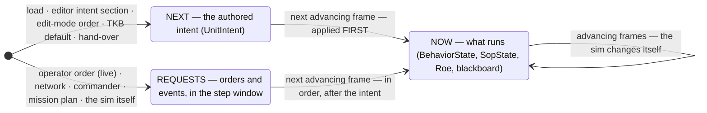
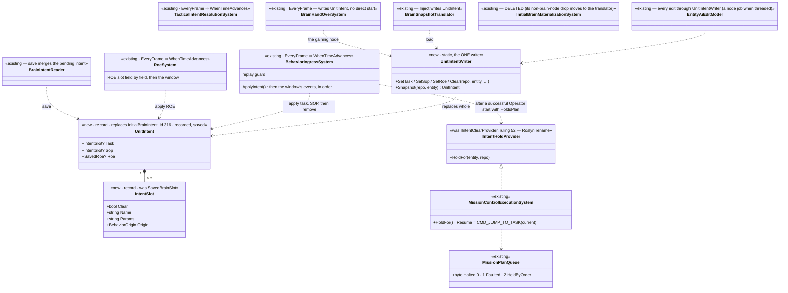
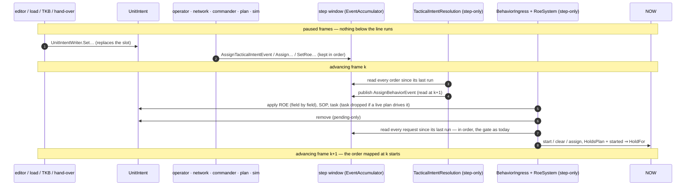
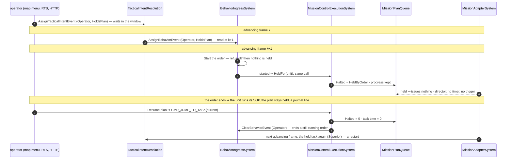
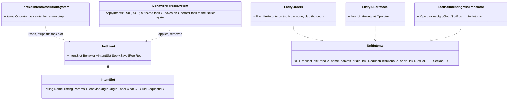
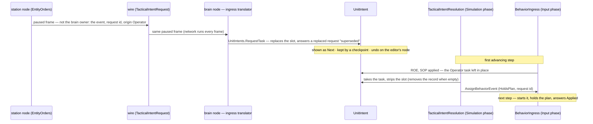
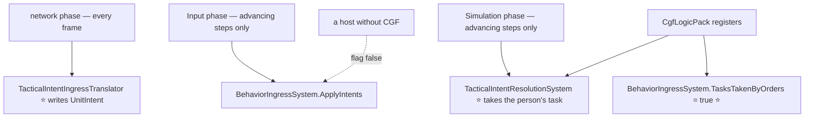

<!--STATUS
state: LIVE
build-state: READY-TO-BUILD (2026-11-23 — §8 O1–O3 approved by the user as leaned, R-3118; §9 independent review folded in)
updated: 2026-11-23 (§10 every person's request is the intent — R-3119) · 2026-11-23 (§8 O1–O3 APPROVED — R-3118) · 2026-11-22 (§9 review: 7 red, 9 amber, 4 notes — all folded) · 2026-11-22 (created — backend; CE-3494, R-3114…R-3117)
current-answer: ⭐ §10 — a PERSON'S request is the unit's intent in every mode (R-3119, supersedes R2's live split and §3.2's live row) · §1 the rules · §2–§4 the diagrams · §5 the mockups · §6 the build order · §8 the open decisions · §9 the review and how it changed the design
stale-below: nothing — new document.
known-rot: none.
known-conflict:
  - UX/UX_RESUME_INTERACTION.md ruling 50 ("the plan is DISCARDED, not paused") — SUPERSEDED by R-3115 here once built; its "one operation, not two" atomicity is KEPT (§1 R5).
  - blueprints/RULINGS.md R-4137 ("applied at once while paused") — for a unit's AI (task, SOP, ROE) the start now lands at the first step (R-3114); every other initial-state row of R-4137 is unchanged and filed as CE-3496.
  - DESIGN_Sensors_And_Doctrine.md §7.5 (InitialBrainIntent is Transient, deleted after one frame) and §7.6 (paused edits apply at once) — both SUPERSEDED by §1 here once built.
  - blueprints/DESIGN_Paused_And_Stepped_Execution.md §10 F2 / Appendix A (BehaviorIngressSystem and RoeSystem run every frame SO THAT a unit loaded while paused has its AI before the first step) — SUPERSEDED once built: they, TacticalIntentResolutionSystem and the hand-over's apply become WhenTimeAdvances (R1); the loaded AI waits in the intent.
  - DESIGN_Entity_Brain_View.md §12g (R-1041, in-place params write, no restart) — KEPT for the running behaviour (monitoring part); the intent section's edit is a new task (R10).
related-designs:
  - designs/devices/DESIGN_Simulated_Devices.md — simulated devices: a device runs its own brain on the device entity
  - DESIGN_Sensors_And_Doctrine.md — §7.5 owns the scenario shape {Name, Params, Origin} per slot (R-192), §7.6 the editor's AI section, §7.6b the ONE params form, §7.7 the hand-over reader (BrainIntentReader)
  - blueprints/DESIGN_Paused_And_Stepped_Execution.md — owns EveryFrame vs WhenTimeAdvances and the step window; this design is its rule "nothing takes effect on a paused frame" applied to the AI
  - blueprints/DESIGN_Staged_Live_Write.md — owns the staged live write (yellow, drained at the next advancing tick); §1 R7 here reuses it for every memory edit
  - blueprints/DESIGN_Variable_Details_And_Editing.md — §4a/§6 own the yellow pending display and the "never write the live repo while paused" rule (R-63)
  - blueprints/DESIGN_Behaviour_Fault_And_Teardown.md — §1 D3 / §4b own the halted plan and CMD_JUMP_TO_TASK as its retry; §4 here adds a second halt reason
  - UX/DESIGN_Mission_Plan_Editor.md — owns the Orders tab and the plan runtime (§5.9–§5.10); §5c here adds its held / failed rows and warnings
  - UX/UX_RESUME_INTERACTION.md — rulings 50–52 (the order cancels the plan as one operation; the clear-provider registry) that §4 changes from cancel to hold
  - DESIGN_Entity_Brain_View.md — §12a (R-1036) puts every AI surface on the Brain tab; §12g (R-1041) the live params write; §5 here places the intent section on that tab
  - DESIGN_Decision_Layer.md — §4.1/§4.9a own PausedTask (a reaction / possession pauses and resumes a task); §4 here explains why a held PLAN does not reuse it
  - DESIGN_Entity_Control.md — C-4 (possession resumes the paused task; an operator order replaces it and clears the plan) — the "clears the plan" half changes to "holds" (R-3115)
  - DESIGN_Rules_View_UI.md — RV-3a / §8.3: rules start their behaviour from BehaviorStartRecord; S4 here moves them onto the intent
  - designs/llm-commander/DESIGN_LLM_Commander.md — §5a-2 the think-pause: the seat's orders given while the clock is held fold into the intent (§3.4)
-->

# Unit intent — what a unit does NEXT, and nothing takes effect on a paused frame

> 🔒 **User, `2026-11-22`, verbatim:** *"i cant imagine how an order could take effect on paused world where no simulation should be running. at most
> it could be placed to some queue to be executed the first frame after the pause."* · *"Can't we somehow edit the intents INDEPENDENTLY on the
> current state? Even if paused in the middle of a live run, we should be MONITORING the current state and editing INTENTS"* · *"My desire is
> simplicity and consistency."* · *"there is no point in editing the current behavior actually, and that page should be just the monitoring, because
> what we are editing is only the intent, always."* · *"switch ruling 50 from discarding to pausing the plan and resume only by the user"* · *"maybe
> the queuing is the right choice for any memory edit."*

## 0. The model in one picture

*What the picture shows that prose hid:* NOW is reached only on a frame where time advances, by **two** inputs with **one** order: the authored intent
first, then every request since the last step, in the order it was made. Nothing on the left is applied on a paused frame. ⚠ The first draft had
ONE input (every event folded into the intent); the review proved that wrong (§9 F-2) — the sim's own events must keep their order.

## 1. The rules

| # | rule | 🔒 basis |
|---|---|---|
| **R1** | ⭐⭐⭐ **NOTHING the AI does takes effect on a paused frame.** The systems that turn requests into AI — `TacticalIntentResolutionSystem`, `BehaviorIngressSystem`, `RoeSystem`, `BrainHandOverSystem` — become **`WhenTimeAdvances`**: on each advancing frame they apply the intent, then **every request since their last run, in order** (the step window, `EventAccumulator`). ⇒ a stepped run and a continuous run apply the same requests in the same order — the property CE-3445 needs. | user; CE-3445 B; Paused & Stepped §1 (the window); **R-3114** |
| **R2** | ⚠ **Widened by §10 (R-3119): every request a PERSON gives is the intent too, in every mode; only the SIMULATION's own requests stay the stream.** ⭐⭐ **The intent (`UnitIntent`) holds what is AUTHORED, never a copy of the request stream:** the scenario load, the editor's intent section, an order given in **edit mode**, the unit type's defaults at spawn, a Brain hand-over. One value per slot; the writer replaces its slot. ⛔ No rank folding — an authored value is not a competing order. | §9 F-2, F-3; R-3114 |
| **R3** | ⭐⭐ **The intent is pending-only**: applied at the next advancing frame, then removed. A slot is `{Assign(name, params, origin) | Clear}` — never both. | §9 F-19 |
| **R4** | ⭐⭐ **The task slot has one owner: a unit with a live (not held) mission plan takes its task from the plan.** Applying the intent, the ingress **drops the intent's task** when `DrivenByMissionPlan` — the plan's first task arrives through the request chain. **SOP and ROE come only from the intent** and apply first. | user: *"the mission plan will override the intent of the behavior on the first simulation tick"*; §9 F-1; **R-3117** |
| **R5** | ⭐⭐⭐ **An operator order HOLDS the mission plan, never discards it** — and only **if the order actually starts**: the hold runs inside the ingress's apply, **after** `Start` succeeded (ruling 50's atomicity kept; ruling 52's provider seam reused). Held progress is kept. | user; §9 F-8; **R-3115** |
| **R6** | ⭐⭐ **Only the user resumes a held plan** (Resume plan / `POST /missions/{id}/resume`), and Resume **restarts** the held task. A hold survives a save, a reload and a live plan edit that keeps any task (§4). When the operator's order ends, the plan stays held and the journal says so. | user; §9 F-7, F-20; R-3115 |
| **R7** | ⭐⭐ **No general edit queue.** Queued: the AI request (R1) and any edit while a breakpoint has rewound the world (R-63, the staged live write). Every other paused edit writes the world directly, as today; the blackboard / variable edit keeps its built staged path. Exempt with reason: the **plan's own edits** (authored data — its effect comes only through the step-only adapter), **hot reload** (a code swap, not a sim change). | user: *"let's edit the memory directly"*; **R-3116** |
| **R8** | ⭐⭐ **Edit mode: a unit's task comes from its intent OR its plan, never both.** Ordering a planned unit is refused with the reason; adding a plan's first task to a unit whose intent sets a task removes that task (one undo step, a notice says so); a file with both warns in both editors and the load drops the intent's task (R4). Live: an order on a planned unit HOLDS the plan (R5) — no dialog. | user; R-3117 |
| **R9** | ⭐⭐ **Save and record.** The intent is recorded (an immutable `record`, rare changes). The save writes per slot *the pending intent, else the running AI* (`BrainIntentReader`, `Ordered`); a pending **Clear** saves no slot. A held plan saves its hold and the running order (§4). | R-192 shape kept; §9 F-7, F-19 |
| **R10** | ⭐ **The Brain tab MONITORS; the intent section EDITS** "what the unit does next" — an edit there is a NEW task (a restart). The in-place params write of the RUNNING behaviour (R-1041, no restart) stays where it is, in the monitoring part, as the low-level edit, staged. | user; §9 F-15 |
| **R11** | ⭐ **Nothing applies or removes the intent while a replay is active** (CE-3329 P2: the recording owns the world), and a node that does not run the unit's brain drops a loaded intent, as the materializer does today. | §9 F-5, F-12 |

## 2. INVENTORY *(measured `2026-11-22`; graph via `scripts/cbm.sh` + grep; ⚠ `check_index_coverage` is not available through the CLI, so no
negative claim below is proven complete)*

**Queries run:** `search_graph name_pattern=".*(Intent|Halt|PausedTask|Pending|Resume).*" label=Class` → **165** (2 pages, read in full) · grep for every
`new AssignBehaviorEvent|AssignBehaviorHashEvent|AssignSopEvent|SetRoeEvent|ClearBehaviorEvent|AssignTacticalIntentEvent` outside tests ·
grep `BehaviorStartRecord|SopStartRecord` in Presentation / Editor · two read-only sweeps (UI surfaces; `docs/` + `.dev/`).

| what | exists — where | ⇒ here |
|---|---|---|
| the scenario's AI shape | `InitialBrainIntent` (id 316, managed, `{get;set;}`, **Transient**) `FDP/Toolkits/Fdp.Toolkits/Behavior/Components/InitialBrainIntent.cs:41` | ⭐ **becomes `UnitIntent`** — same slots, a record, recorded + saved (R9) |
| load → AI | `BrainSnapshotTranslator.Inject` → `InitialBrainMaterializationSystem` (EveryFrame, publishes 3 events, **removes** the component next frame) `Hrot/Engine/Hrot.EcsNode/Systems/InitialBrainMaterializationSystem.cs:36-58` | ⛔ **the materializer is deleted** — the ingress applies the intent (§3.1) |
| the one reader | `BrainIntentReader.Read(…, Ordered | Running)` `FDP/…/Behavior/BrainIntentReader.cs:32` — save (Ordered), hand-over egress (Running) | ⭐ **kept**; both scopes merge the pending intent first (§3.3) |
| the hand-over replica | `ReplicatedBrainIntent` (317, Transient) + `BrainIntentEgress/IngressTranslator` (`dtBrainIntent`) | unchanged shape; ⚠ must carry the pending value (§9 F-6) |
| the gate | `BehaviorIngressSystem` (**EveryFrame**, Input) `FDP/…/Behavior/Systems/BehaviorIngressSystem.cs:40`; `RoeSystem` (**EveryFrame**) `…/RoeSystem.cs:15` | ⭐ both **fold on paused frames, apply on advancing ones** (§3.1) |
| order → behaviour | `TacticalIntentResolutionSystem` (**EveryFrame**) calls `IntentClearRegistry.ClearFor` **on the frame it reads the order** `Hrot/Subsystems/Hrot.CGF/Systems/TacticalIntentResolutionSystem.cs:120` | ⛔ that is a plan change on a paused frame ⇒ the hold moves to the ingress's apply (§4) |
| the plan clear | `MissionControlExecutionSystem.ClearFor` empties the plan (ruling 50) `Hrot/Engine/Hrot.Common/Systems/MissionControlExecutionSystem.cs:101-111` | ⭐ becomes **Hold** (§4) |
| operator orders | `EntityOrders` sets `ClearsPriorIntent`, Operator `Hrot/Engine/Hrot.Common/Orders/EntityOrders.cs:301`; callers: `MenuOrders`, `RtsCommands`, `CommandWheel`, `PossessionStation`, Gameplay, the debug API | unchanged callers — they now hold, not clear |
| the halt | `MissionPlanQueue.Halted` (0/1); the director skips a halted plan (**timers stop**) `FDP/…/MissionDirectorSystem.cs:125`; the adapter re-issues nothing `MissionAdapterSystem.cs:81-85`; `CMD_JUMP_TO_TASK` clears it and zeroes the task's time `MissionControlExecutionSystem.cs:258-280` | ⭐ a **reason** is added (Faulted / HeldByOrder); Resume = the jump (§4) |
| the halt on the wire | `eTaskState` has **no HELD/HALTED** `Hrot/Network/Hrot.Network.NED/MissionDescriptors.cs:12`; a halt decodes only from a FAILED task followed by PLANNED `MissionProgressWire.cs:44-62` | 🔴 **a held plan (task not failed) decodes as COMPLETE on another node** ⇒ add `TASK_HELD` (§4, §9 F-4) |
| resume UI | Orders tab offers **Jump** only on Planned rows; a Halted row shows an amber dot and no button `Hrot/Editor/Hrot.Editor.AiShared/Shell/OrdersTab.cs:195-197, :526`; debug API `POST /missions/{id}/run` restarts from task 0 `DebugApiService.Missions.cs:152` | ⭐ add **Resume plan / Retry** (§5c) and `POST /missions/{id}/resume` |
| exact resume of a task | `PausedTask` (one deep; an operator order DROPS it) `FDP/…/Components/PausedTask.cs:16` | ⛔ not reused for a held plan (R6, §7) |
| the editor's AI section | `EntityAiDetailsView` ("Assign: task, SOP, ROE", a Brain-tab section) `Hrot/Subsystems/Hrot.Editor/Scenario/EntityAiDetailsView.cs:25`; model `EntityAiEditModel` — **paused ⇒ applies at once through the ingress's pipeline** `Hrot/Editor/Hrot.Editor.AiShared/Scenario/EntityAiEditModel.cs:192-247` | ⭐ becomes the **intent section**; the model writes `UnitIntent` only (§3.2) |
| ⚠ a likely live bug | at a breakpoint the world is the rewound pre-tick copy, and `EntityAiEditModel`'s direct apply writes into it — Continue restores the post-tick snapshot over it (`DataBreakpointManager.cs:569-597, :680, :720`) | 🔴 **inferred, not run** — filed **CE-3495**; S1 removes the direct write anyway |
| the one params form | `BehaviorParamsForm` (static) `Hrot/Engine/Hrot.Presentation/Behavior/BehaviorParamsForm.cs:24` — callers: `OrdersTab`, `EntityAiDetailsView`, `RuleDetails`, `OrderForm`, `ActionListFieldDrawer` | ✅ **ONE editor already** (CE-1023) — the intent section and the plan editor share it |
| the staged memory edit | `DataBreakpointManager.StageFieldMutation` → `PendingDebugMutation` (field writes, ruling 14) → drained by `ResumeAndDrainSystem` at the next advancing tick; yellow via `StagedWriteView` | ✅ variables stage in every run state already; kept as built |
| other editor writes | the component inspector and its edit window stage **only while the breakpoint manager is paused** (`IMutationInterceptor.IsPaused` = `DataBreakpointManager.IsPaused`; `ComponentReflector.cs:73`, `ComponentEditWindow`); on an ordinary pause they — and gizmos, Details forms, placement — write directly | ✅ R7 keeps this split; ⚠ whether gizmos / Details forms stage at a **breakpoint** is **not measured** — S1 measures it (CE-3495) |
| who reads the running AI BEFORE the first step | `RulesModel` / `RuleSentence` / `AuthoredRules` / `RuleDetails` (rules read `BehaviorStartRecord`), `ScenarioVerification`, `DebugApiService.Orders`, `OccurrenceSlotWriter` | ⚠ each must read the intent before the first step (§9 F-2) |
| the step window | `EventAccumulator` (`FDP/Engine/Fdp.Core/EventAccumulator.cs:28`): a ring of 256 slots / 65 536 events; a long pause merges frames into one slot; `SnapAndPause` (load, Stop) **forgets it** | ⭐ R1 reuses it for requests; ⛔ it cannot hold authored values (R2) |
| the hand-over | `BrainHandOverSystem` (**EveryFrame**) writes the ROE and starts task / SOP **directly** through a private ingress (`BrainHandOverSystem.cs:22, :37, :71, :83-95`) | ⭐ writes the intent instead (§3.3) |
| the plan in a save | `DrivenByMissionPlan` = tasks left (`BrainIntentReader.cs:106-111`); `MissionPlanTranslator.Inject` resets progress (`:113-122`) | ⭐ held plans saved and restored (§4) |
| warning helpers | `RowMarks.WarningLine/ErrorLine` (NodeEditor.Core `RowMarks.cs:35-45`), `IconPalette` tokens, `Icons` `form/warning|pending|error`, `task/*`; ⚠ `OrdersTab` and `EntityBrainView` hard-code amber (`OrdersTab.cs:194, :248`, `EntityBrainView.cs:484/949`) | ⭐ every new line uses `RowMarks` + `IconPalette`; the two hard-coded ambers fold over when touched |

## 3. Classes and the paths

### 3.0 Class diagram

*What the picture shows that prose hid:* every AUTHORED write goes through one writer, and every APPLY sits in a step-only system — the two arrows
into NOW are both in `WhenTimeAdvances` code, so no paused frame can reach it. The hold hangs off a successful start, not off the order's arrival.

### 3.1 One advancing frame — the order of application

*What the picture shows:* the same chain runs in a stepped and a continuous run — an operator order starts **two advancing frames** after it is
given (map at k, apply at k+1), exactly as it does today while running; the editor's authored intent starts at the **first** advancing frame. The
mockups say *"when time next advances"*, not *"at the next step"*, because the chain is two frames (§9 F-13).

### 3.2 The editor

| | |
|---|---|
| **edits** | `EntityAiEditModel` → `UnitIntentWriter` only (no event, no direct start); on the threaded node as a node job (the world guard) |
| **undo** | snapshots the `UnitIntent` record before the edit and restores it (⛔ not today's `Read()` of the running AI — in edit mode nothing runs) |
| **feedback** | an edit shows *pending* (amber, R-130); a refusal by rank is shown **after** the step, from the gate's outcome — ⛔ the synchronous "ROE refused" text goes |
| **edit-mode orders** | the map's order menu / form in edit mode writes the intent (authoring the start — origin Superior, R-193); ⛔ ~~live it sends the order as today~~ — SUPERSEDED by §10: live it writes the intent too, at origin Operator |
| **cluster** | S3 builds the intent section on the node that runs the brain (the editor's own node; R-1036's rule). A station on another node is CE-3498 — today only `AssignTacticalIntentEvent` / `SetRoeEvent` cross nodes (`TacticalIntentEgressTranslator.cs:64-168`) |

### 3.3 Save, record, hand-over, replay

| | rule |
|---|---|
| scenario save | per slot: the pending intent (a template default — origin `Sop`/`Unmarked` — is not saved, R-192), else the running AI as today; a pending `Clear` ⇒ no slot |
| recording / checkpoint | `UnitIntent` is recorded; a checkpoint at a paused frame keeps the authored edit. ⚠ Requests still in the step window are **not** kept by a checkpoint or a `SnapAndPause` — the same as every other in-flight event today (R-3041, accepted) |
| hand-over | the gaining node writes the published intent (`Running` scope) into its `UnitIntent`; applied at its next advancing frame (⛔ no direct start on a paused frame — §9 F-6) |
| replay | the ingress, `RoeSystem` and the hand-over neither apply nor remove the intent while `ReplayState.IsActive` |
| non-brain nodes | the load translator does not write `UnitIntent` where the brain events are unregistered (today's materializer behaviour) |

### 3.4 What else reads the running AI before the first step *(each reads the intent first until the first step)*

`EntityEditorLabelGizmo.cs:62-82` (the behaviour name on the map) · `RulesModel` / `RuleSentence` / `AuthoredRules` / `RuleDetails` (rules read
`BehaviorStartRecord`, S4) · `ScenarioVerification` · `DebugApiService.Orders` · the Brain tab (shows *"Not started"*). ⚠ The list is from grep;
coverage is not proven (CLI gap) — S1 re-greps `BehaviorState` / `SopState` / `Roe` readers in Presentation and Editor.

### 3.5 Consequences outside (not changes)

- **The commander seat's think-pause:** its orders are requests (Q); they start two advancing frames after the resume. Its rails assert on steps.
- **The TKB default SOP at spawn** (`BehaviorTkbTranslator.cs:107-128`) writes the intent's SOP slot (origin Sop) — a unit placed while paused shows
  its type's SOP as pending until the first step.
- **`OccurrenceSlotWriter`** (the R-1041 live params write) rewrites `BehaviorStartRecord` directly on a paused frame and drops its `RequestId` —
  lost at a breakpoint and an existing bug ⇒ CE-3497 (stage it; keep the id).

## 4. The mission plan: hold and resume

*What the picture shows:* the hold is a property of the PLAN — the order can run for an hour or finish and the plan is exactly where it was; and
the hold exists only if the order really started.

| piece | change |
|---|---|
| `MissionPlanQueue.Halted` | `1` Faulted · **`2` HeldByOrder**; `LatestOutcome` (`MissionComponents.cs:192`) reads the last *ended* task for a held plan; `OrdersPlanModel.StateOf` (`:85`) splits **Held** from **Halted** |
| the flag | `ClearsPriorIntent` → **`HoldsPlan`** on `AssignTacticalIntentEvent`, **and new on `AssignBehaviorEvent`**; every tactical mapper forwards it |
| the provider | `IIntentClearProvider` → **`IIntentHoldProvider.HoldFor`** (Roslyn rename), invoked by the ingress after a successful start; ⛔ the two private ingress instances (`BrainHandOverSystem.cs:37`, `EntityAiEditModel.cs:255-260`) go away with the direct starts — any that remains gets the registry passed (silent-default rule) |
| the wire | `eTaskState.TASK_HELD` **appended** (IDL regenerates); `MissionProgressWire.StateOf` emits it, `Decode` sets `Halted = 2` |
| save / load | `DrivenByMissionPlan` is **false for a held plan** (the order is saved); `MissionPlanTranslator` saves and restores `Halted` and the current task (⛔ today Inject resets progress, `:113-122`) |
| a live plan edit | `CarryProgress` (`MissionControlExecutionSystem.cs:373-381`) keeps `Halted = 2` while any task remains — a removed held task holds on the next one |
| Resume / Retry | Orders tab button on the current row; `POST /missions/{id}/resume`; both `CMD_JUMP_TO_TASK(current)`; for `HeldByOrder` the handler also publishes the Operator clear. ⚠ The clear and the restarted task land one advancing frame apart (the SOP holds the unit for that frame) |
| the notices | *"This order holds the mission plan (task 3, Hold at bridge)"* is described by the node that knows (rulings 55 / 56): the hold provider's describer, same `AspectId`; ⛔ never computed by a station from the replicated plan |
| unchanged | `CMD_ABORT_ALL` (*Stop the plan*) still discards; a Superior commander order to a held unit is a normal order (it does not hold again, the plan is already held) |

## 5. What the user sees — mockups

📄 **[`docs/UX/unit-intent-mockup.svg`](UX/unit-intent-mockup.svg)** — generated by `scripts/gen-unit-intent-mockup.py` over `scripts/mockup_kit.py`.
⛔ **Scope:** the intent section, the pending marks, the Brain tab's not-started line and *next* chip, the staged-edit warning, the Orders tab's held /
failed rows, Resume / Retry and the both-set warning, the order form's notice and the edit-mode menu. Everything else drawn is **context, unchanged**
(the Brain tab's other sections, the Orders list, the map menu) — R-4151.

| panel | state | what it specifies |
|---|---|---|
| **A** | edit mode, no plan | the intent section first on the Brain tab: Task (picker + the one params form), SOP, ROE; *"Starts when time first advances"*; the monitoring part reads *"Not started"* |
| **B** | edit mode, WITH a plan | the Task row locked *"driven by the mission plan"* + *Open Orders*; SOP / ROE editable |
| **C** | paused mid-run | a pending task edit (amber hourglass, *"applies when time next advances"*), the hold notice; the monitoring part with a *next: Attack* chip on **Doing**; a staged blackboard value (yellow) with *"the next step starts Attack — this staged edit will be lost"* |
| **D** | the Orders tab | the held row (*"Held by your order Attack (00:04:12)"*, **Resume plan**), a faulted row (**Retry**); edit mode: *"This unit's intent also sets a task (Patrol) — the plan's first task replaces it; it never starts"* + *Remove the intent task* |
| **E** | the map order form / menu | live: *"Holds Bravo's mission plan — resume it on the Orders tab"*; edit mode on a planned unit: order items disabled, the reason as tooltip |

### 5b. The fidelity check (R-4138, R-4146)

The builder renders each panel's state through a frame rail (`HROT_RAIL_SHOTS`) and matches the mockup; layout is asserted on item rectangles (the
intent rows share one control x; the status slot is fixed); glyphs and colours are asserted by token.

## 6. Build order *(cross-lane: behaviors' ingress, ui's Brain / Orders tabs — each commit says so)*

| slice | what | the gate *(T-1 suites first)* | scenario (R-4277) |
|---|---|---|---|
| **S1** | `UnitIntent` + `UnitIntentWriter`; TIR, ingress, `RoeSystem` → `WhenTimeAdvances` (ingress applies the intent first, ROE field by field, task dropped under a live plan); replay guard; hand-over writes the intent; the materializer deleted; save merge; `EntityAiEditModel` through the writer (undo, feedback); the readers of §3.4 | `BehaviorIngressSystemTests`, `RoeSystemTests`, `TacticalIntentResolutionSystemTests`, `BrainSnapshotTranslatorTests`, `BrainIntentTranslatorTests`, `BrainHandOver*`, the commander rails; ⭐ rails: *a paused order changes nothing until time advances*, *stepped == continuous order of application*, *save writes the pending value*, *a replay never applies an intent*; `HROT_PARALLEL_SIM=1 HROT_READ_CHECK=1` | `intent-order-while-paused`: the order **absent while paused**, **running within two advancing frames** |
| **S2** | the hold: `Halted = 2`, `HoldsPlan` on both events + mappers, `IIntentHoldProvider` (Roslyn rename), hold after start, `TASK_HELD`, save/load of the hold, `CarryProgress`, Resume, `/missions/{id}/resume`, the journal line | `MissionControlExecutionSystemTests`, `MissionAdapterSystemTests`, `MissionProgressWireTests`, `SplitAuthority*`, `DebugApiMissions*` | `plan-held-by-order`: task 2 **held** while the order runs, **running** after Resume, task 3 after its trigger; a save mid-hold reloads **held** |
| **S3** | the editor: intent section, pending marks, not-started line, chip, staged-edit warning, Orders rows + Resume / Retry + both-set warning, order form notice / edit-mode disable, R8's plan-add removal | the Brain / Orders / order-form frame rails under `xvfb-run -a`; §5b | — (UI) |
| **S4** | rules: rule entities start from the intent; `RulesModel` reads pending | `RulesModel*`, `RuleDetails*`, the rule scenarios | the rule scenarios stay green |
| **S5** | CE-3445: the 1-vs-4-thread stepped pairs | `scripts/stepped-hash.py --threads 1,4,8` × 5 | — |

## 7. Rejected

- **Fold every request into the intent (the first draft)** — the sim's own events would be folded last-wins on a stepped run and applied in order
  on a continuous one; the fold also drops `Urgency`, `RequestId`, the gate's answers and the clear-then-assign order (§9 F-2–F-4, F-10).
- **Only the step window, no component** — an edit-mode order would wait for a run that has not started, invisible, unsaved, and a `SnapAndPause`
  (load, Stop) forgets the window — so authored values need a component.
- **A persistent intent ("the last thing asked")** — stale the moment the sim changes the AI itself (R3).
- **Reusing `PausedTask` to resume the plan exactly** — one deep by design; an operator order drops it (R6).
- **Automatic resume when the order finishes** — Hold / Defend never finish; it reopens ruling 50's *"the mission overrides the operator"*.
- **A yes/no dialog on an order to a planned unit** — the hold destroys nothing (R8).
- **Queue every edit** — rework of the editor for edits whose direct write on a frozen world gives the same result (R7).

## 8. Decided — ✅ O1–O3 APPROVED as leaned *(user, `2026-11-23`: "i agree with your leans" — R-3118)*

| # | question | ✅ decided (the lean) | what would change it |
|---|---|---|---|
| **O1** | the intent section: first expander of the **Brain tab** (R-1036), or its own **Intent** tab? | **Brain tab, first expander, split from the monitoring part** — R-1036, and the *next* chip needs both on one page | wanting it on a node that does not run the brain (CE-3498) |
| **O2** | the intent section's live edit — origin **Superior** (R-193) or **Operator** (holds the plan)? | **Operator live, Superior in edit mode** — live it is the operator's direct order of R5 | if the editor should never outrank a commander |
| **O3** | R-4137's other initial-state rows — also at the first step? | **case by case (CE-3496)**; posture is drawn on the paused world, so probably stays | — |

## 8b. As built — S1 *(`2026-11-23`, CE-3494; deviations from §3 named, the rest as drawn)*

| design said | built | why |
|---|---|---|
| the hand-over writes the gaining node's `UnitIntent` (§3.3) | `BrainHandOverSystem` is **`WhenTimeAdvances`** and keeps its direct replace; it **removes** any stale loaded `UnitIntent` it supersedes | the replace (end, then start at the published origin, bypassing rank) is the hand-over's own contract; running it only when time advances already satisfies R1 — the intent would have had to grow a "replace" mode |
| a non-brain node drops a loaded intent (R11) | it **keeps** it (never applied — no ingress there) until a hand-over removes it | the load translator cannot tell a brain node from a staging repository; the cost is one small recorded record per unit on IG-class nodes |
| the TKB default SOP writes the intent (§3.5) | it stays an event (`BehaviorTkbTranslator`), applied from the step window at the first advancing frame | an event already waits correctly; only AUTHORED values need a component (R2) |
| `GlobalComponentIds.UnitIntent` | the id constant keeps its catalogue name `InitialBrainIntent` (316) | the Roslyn rename of the constant applied nothing; one attribute reads it — left, commented |
| `EntityAiEditModel` through `UnitIntentWriter` | the model writes the record itself (`Author` / `SetIntent`); no separate writer class yet | the editor is the only authored writer besides the load; a shared writer comes with S3/S4 if a second appears |

### 8c. As built — S2 and S3 (part) *(`2026-11-23`)*

| design said | built | why |
|---|---|---|
| `IIntentClearProvider` renamed `IIntentHoldProvider` | the name is KEPT; `ClearFor` now holds (documented on the method) | a rename is cosmetic; the wire flag `ClearsPriorIntent` keeps its name too (a wire rename regenerates IDL for every node) |
| a save keeps the hold (§4 save / load row) | ⛔ **a save is a STARTING state**: a held plan saves as the plan (it reloads from task 0); the operator's order is not saved | progress is not saved either (Sensors §7.5) — saving only the hold would be inconsistent. A checkpoint / recording keeps the hold (`MissionPlanQueue` is recorded) |
| the journal line when the order ends while held | not built yet | S3 rest |
| the notice computed by the knowing node (rulings 55 / 56) | the Orders tab reads the plan's own `Halted` on the brain node (the editor is the brain node); a station elsewhere is CE-3498 | — |

### 8d. Evidence *(`2026-11-23`, the real product over HTTP — `--mode editor --headless`)*

| check | result |
|---|---|
| **an order while paused** — `ua-posture` loaded LIVE (paused, t = 0); `POST /entities/1000/order {kind:hold}` | the unit ran NOTHING while paused (read 3×; the loaded intent too); **step 1** ⇒ the scenario's intent (`CombatPosture`, Superior); **step 2** ⇒ the order (`PersonHold`, Operator) — R1, R4, §3.1's two hops |
| **the hold** — `ua-attack-approach`, the Hidden Hostile on its plan (`MoveToLocation`); ordered Hold | `MissionPlanQueue.Halted = 2`, the task's timer frozen at 0.067 s over 230 steps, the order running; `POST /missions/1001/resume` ⇒ `Halted 0` at once, the order ended the next step, `MoveToLocation` (Superior) the step after — R5, R6 |
| **no file change** — load (edit) + save of `bw-crossbow`, `ua-posture`, `agg-platoon-duel`, `llm-platoon-attack` | every unit's `Behavior` / `Sop` / `Roe` identical to the original for three; `bw-crossbow`'s two differences (the ROE's default fields, the target's `{NetworkId, Ref}` form) are written **identically by the pre-S1 build** (`5f7e6e485`, same load + save). ⭐ The pre-S1 save ALSO wrote five empty `BlueprintAssignments` the post-S1 save does not: the AI used to start on a paused frame in edit mode and leave state in the saved file |
| **the scenario sample** — `scripts/scenario-regression.sh` (stepped, judged by checks) on `bw-crossbow`, `an-rabbit-bolts`, `ua-posture`, `ac-attack-evades`, `agg-platoon-duel`, `bt-doors`, `llm-platoon-attack` | **6 / 7 pass**; `ac-attack-evades` fails its *"the truck is destroyed after the defence"* check **identically on the ui lane without S1** (`c8c66cd5d`) — pre-existing (the air lane's CE-10002, *"scenarios partly green"*) |

### 8e. As built — S3, S4 *(`2026-11-23`)*

| design said | built | why / evidence |
|---|---|---|
| §5 D — held row: hourglass, *"Held by your order …"*, **Resume plan**; faulted: **Retry** | ✅ `OrdersTab` — the row's glyph follows the state (hourglass held, cross faulted); *"Held by an operator's order"* or *"Held — the operator's order has ended; the unit runs its SOP"* (F-20); a red *"Failed — the behaviour faulted"* line with **Retry** | ⚠ the faulted row's DOT stays amber — `U3_EachTaskStateHasItsColour…` pins it (an earlier ruling), so the red is the line under it. Frame rail `CE3494_AHeldPlan_ShowsTheHeldRow_WithResumePlan` (xvfb, `orders-held.png`) compared with the mockup: the hourglass deviation was found and fixed |
| §5 D — both-set warning + *Remove the intent task* | ✅ edit mode, a plan and an intent task | — |
| §5 A–C — the intent section | ✅ heads *"Intent — what the unit does next"*, amber *pending* line, the task row locked under a plan in edit mode (*"Driven by the mission plan …"*), a live note *"An order here HOLDS the unit's mission plan"* | ✅ F2 (`36d6c7a8b`): the Brain tab's **Doing** section shows *Next* (the pending intent) and, while a staged memory edit waits, *"⚠ When time advances, X starts — staged memory edits to the running behaviour will be lost"* (`EntityBrainView`, the staged queue passed in by both hosts). Frame rail `CE3494_APendingTask_ShowsNext_AndWarnsAStagedEditWillBeLost` |
| §5 E — the map order form's notice / edit-mode disable | ✅ F1 (`8c602982e`): the order form shows *"⏳ Holds this unit's mission plan — resume it on the Orders tab."* for a planned unit (built once per form, no per-frame allocation). In EDIT mode an order through `EntityOrders` authors the unit's intent (Superior) and Release un-authors it; a planned unit is refused `DrivenByPlan` (409). ⚠ The map menu's edit-mode grey-out was NOT built: orders are offered only while Running (D15), so it would be dead code | rails `MenuOrdersTests.CE3494_*` |
| S4 — rules on the intent | ✅ `RuleSentence.ParamsOf` (the ONE reader) reads the pending intent first; `RulesModel` lists intent-only rules; `ClockPins` uses the reader; the Rules window watches `UnitIntent`; a new rule is created as a `UnitIntent` (Rules View §8.3) | rail `CE3494_AnAuthoredRuleThatIsOnlyAnIntent_HasARow…`; Presentation Rules 186/186 |
| §6 — feature scenarios `intent-order-while-paused`, `plan-held-by-order` | ✅ F3: the checks grammar's `do` takes `order` (a `POST /orders` item) and `resume` (Scenario Regression §3); the verifier applies an action BETWEEN steps, which is the paused frame. `scenarios/tests/intent-order-while-paused` (sampled every 0.02 s: the order's task runs within 0.1 s (2.05 s measured), never before) and `scenarios/tests/plan-held-by-order` (`Halted == 2` from the order until Resume, north while held, `Halted == 0` after Resume, the plan's point reached) both PASS | `scripts/scenario-regression.sh intent-order-while-paused,plan-held-by-order`; rail `ScenarioChecksTests.CE3494_ADoGivesAnOrderAndResumesAPlan_ThroughTheWorldsServices` |

## 10. A person's request is the unit's intent — in every mode, on every node *(R-3119, user `2026-11-23`; build-state: BUILT — §10.4)*

> 🔒 **User, `2026-11-23`:** *"I am pushing just for consistency because it makes everything simple and predictable. So I need a good reasons for
> not using the same mechanism for every case where suitable."* · *"yes, go ahead and build it autonomously."*

📌 **Why this section exists.** S1 built the LIVE edit of the intent section as an order EVENT, against R2 and §3.2, and never recorded it. A live edit
therefore showed no *Next*, did not trip the staged-edit warning, had no undo, and a checkpoint taken on the paused frame lost it — while the same
edit in edit mode did all four. Map / HTTP orders had the same loss. ⇒ the line is moved from *edit mode vs live* to *who asks*.

| rule | |
|---|---|
| **P1** | ⭐⭐⭐ **Every request a PERSON gives a unit's AI — task, release, SOP, ROE; from the Brain tab, the map's order menu, the order routes; in edit mode or live; on the brain's node or forwarded to it — becomes that unit's `UnitIntent` on the node that runs its brain.** Origin **Superior** in edit mode (authoring, R-193), **Operator** live (R-3118 ②). A person is origin Operator — measured: every `BehaviorOrigin.Operator` producer is a person's path (`EntityOrders`, the editor's live edit, the rules' live edit, the sector route, Resume) |
| **P2** | ⭐⭐ **The simulation's own requests stay the stream** (commanders, the LLM commander seat, squad leaders, triggers, the mission plan) — §9 F-2: folding them makes a stepped run differ from a continuous one, and the AI reads each request's answer |
| **P3** | ⭐⭐ **A slot is `Assign`, `Clear` (a live release) or empty; the newer request REPLACES the slot** and the replaced one is answered *refused — superseded by a later order* (its station is told). One pause, two orders ⇒ only the last runs |
| **P4** | ⭐⭐ **The request id travels in the slot** (`IntentSlot.RequestId`), so the brain's owner answers the station exactly as the event path did (edit framework F5) |
| **P5** | ⭐⭐ **A person's TASK keeps the order path's timing and rules**: the tactical system takes it from the intent at the start of its own step (same step as the event it replaces — §9 F-13's two-frame chain unchanged), resolves it per class, and HOLDS the plan once it starts (R5). ⛔ Not re-published by the ingress — that would add a step. A host with no tactical system: the ingress publishes it (as F1's edit-mode order) |
| **P6** | ⭐ **Forwarding:** a node that does not own the brain sends the request as today (`TacticalIntentRequest`, origin + kind + request id + flags already on the wire); the brain owner's ingress writes it as the intent. SOP from a person is edited only on the brain's node (the editor) — no wire change |
| **P7** | ⭐ **Save:** a pending person's slot is saved like an authored one, without its request id; a pending Clear saves no task. ⭐ **Checkpoint:** the intent is recorded, so a checkpoint on the paused frame keeps the request and the restored run applies it at its next advancing step |
| ⛔ out of scope | the sector (`SetEngagementAreaEvent`) and reporting requirements a person sets: unit settings, not AI slots of the intent — stay events (a row if a person needs them kept by a checkpoint) |

### 10.1 Classes *(existing = plain, changed = ⭐)*

*What the picture shows that prose hid:* four writers, one writer class — the editor, the orders, and the network ingress no longer each decide how a
person's request is stored.

### 10.2 One order given on a paused frame, from a node without the brain

*What it shows:* the forwarding and the timing are the ones the event had; only the paused-frame storage changed.

### 10.3 Who runs what, every frame

*What it shows:* the hand-over between the two systems is a flag the pack that registers the tactical system sets — a host without it keeps the
ingress applying the task, so no host can lose a person's task silently (the silent-default rule: a forwarding rail asserts the pack sets it).

### 10.4 As built *(`2026-11-23`)*

| design said | built | evidence |
|---|---|---|
| P1 the one writer | ✅ `UnitIntents` (`RequestTask` · `RequestClear` · `RequestSop` · `RequestRoe` · `Replace` · `Pending`); the editor's `Author` / undo store through `Replace` | — |
| P3 replace + answer | ✅ `Replace` answers a replaced task slot that carried a request id *superseded*; ROE merges field by field (the rule `RoeSystem.Apply` keeps) | `CE3494_TheLaterRequestReplacesTheSlot_AReleaseReplacesAnOrder_RoeMerges` |
| P4 the request id | ✅ `IntentSlot.RequestId`, `IntentSlot.Clear` — both omitted from JSON when default; the save strips the id | `CE3494_APendingPersonsOrderIsSavedWithoutItsRequestId_APendingReleaseSavesNoTask` |
| P5 same-step take | ✅ `TacticalIntentResolutionSystem.TakePersonsTasks` (cached query, scratch lists — no steady allocation) before the step's events; `BehaviorIngressSystem.TasksTakenByOrders` (set by `CgfLogicPack`, forwarding rail extended) leaves a person's task to it, else publishes the order itself | `CE3494_APersonsTask_IsTakenFromTheIntent_SameStep_AndHoldsThePlan` · `…WithoutTheTacticalSystem_TheIngressSendsAPersonsTaskAsTheOrder` · `CgfLogicPackTests.CE3494_TheIngress_HoldsThePacksRegistry` |
| P6 forwarding | ✅ `EntityOrders` writes the intent when this node owns the brain (`HasAuthority<BehaviorState>` — the tactical system's own test), else the event as before; `TacticalIntentIngressTranslator` writes a person's assign / release / ROE as the intent on the brain's node, the simulation's own stay events | `CE3494_APersonsForwardedOrder_IsTheIntentOnTheBrainNode_TheSimulationsStaysAnEvent` · `MenuOrdersTests.CE3494_Live_APersonsOrderIsTheIntentOnTheBrainsNode_AnEventElsewhere` |
| P7 checkpoint | ✅ a pending person's order survives a keyframe capture / apply and the restored run takes it; a keyframe with no intent clears a pending one | `CE3494_APausedFramesOrder_SurvivesACheckpoint_AndRunsAfterTheRestore` · `CE3494_ACheckpointWithNoIntent_ClearsAPendingOneOnRestore` |
| the editor | ✅ live edits are the intent at Operator, undoable; a live clear is a release; *Next* names a pending release | `EntityAiSectionTests.CE3494_Live_AnEditIsTheIntentAtOperator_AReleaseIsAClear` |
| ⚠ correction | the F2 Brain-tab rail committed earlier (`36d6c7a8b`) never compiled — its reported pass was a stale binary; fixed in `a7fd8db31` and now runs (AiShared 33/33) | — |
| ⚠ correction | my earlier claim *"behaviour orders are not forwarded"* was wrong: `EntityOrders.Behavior` goes through the same tactical event and IS forwarded; only the editor's old live SOP / behaviour events did not cross (and the editor runs the brain) | `TacticalIntentEgressTranslator.cs`, `EntityOrders.cs` |
| ⚠ found by the cluster rail `EntityOrdersAcrossNodesTests.CE3167_AnOrderIssuedOnTheMuscleNode` (3 defects, all fixed) | ① the brain node's ingress may not write the world directly — the forwarded request now goes through the ingress command buffer (`9c7008632`, `df6a72947`); ② `OwnsBrain` threw on a node with no `BehaviorState` table (SimHost) inside the edit framework's send — the order vanished while answered *accepted* (`d2da25328`); ③ ⭐ **F1's edit-mode branch authored the intent on ANY node** — SimHost's own view of the cluster still read *Edit* when the order came, so it wrote the intent where no brain reads it: an edit-mode order is now authored only where the brain runs, elsewhere forwarded (`91736f4e1`) | the rail passes; the diagnosis was hop-by-hop prints (send · egress · ingress · take), removed |
| ⚠ not covered | a pending person's order on a unit whose brain then MOVES to another node is dropped by the hand-over (it removes a stale intent, R11) — the station is not answered | a row if it matters |

## 9. Independent review — findings and what changed *(`2026-11-22`, a fresh reviewer reading the code, not this design's reasoning)*

| # | finding (verified against code) | sev | ⇒ change |
|---|---|---|---|
| F-1 | the plan's task reaches the ingress two frames after the adapter (`MissionAdapterSystem.cs:31,131` → TIR → ingress; the bus swaps per frame) ⇒ the intent's task would start first and run | 🔴 | R4: the apply **drops** the intent's task under a live plan; D's text fixed |
| F-2 | folding the sim's own events makes stepped ≠ continuous; the fold lacks `Urgency`, `Cause`, `IsResume`, `RequestId` (a Guid), the by-name / by-hash dedupe | 🔴 | **the model changed**: requests go through the step window in order (R1); the intent holds authored values only (R2) |
| F-3 | rank folding drops a Superior assign after a pending Operator clear; a `Self` event would wipe a pending order | 🔴 | gone with F-2 — no folding |
| F-4 | `SetRoeEvent` is a partial update; `Self` resolves at apply; a replica forwards | 🔴 | ROE applied field by field from the intent; events stay events |
| F-5 | the ingress has no replay guard; the intent is recorded | 🔴 | R11 |
| F-6 | `BrainHandOverSystem` (EveryFrame) starts directly; with pending-in-egress it would start an order on a paused frame | 🔴 | the hand-over writes the intent (§3.3) |
| F-7 | a held plan is "driven" ⇒ the save drops the order; load resets progress; `CarryProgress` clears the hold | 🔴 | §4 save / load / live-edit rows |
| F-8 | hold before a refused start; `HoldsPlan` missing on `AssignBehaviorEvent`; private ingress instances lack the registry | 🟠 | R5 hold after start; §4 flag + provider rows |
| F-9 | edit model writes vs publishes; undo re-reads the running AI; synchronous refusal text | 🟠 | §3.2 |
| F-10 | folded-away requests never answered | 🟠 | gone with F-2 (every request reaches the gate) |
| F-11 | editor events never cross nodes; Brain tab full only on the brain's node | 🟠 | §3.2 cluster row; CE-3498 |
| F-12 | the intent would linger on non-brain nodes | 🟠 | R11 |
| F-13 | an order is two hops ⇒ "at the next step" is false | 🟠 | §3.1 states two advancing frames; mockups say "when time next advances" |
| F-14 | the plan's own commands, hot reload, `OccurrenceSlotWriter`, edit-mode instance params also write on paused frames | 🟠 | R7 exemptions; CE-3497 for the slot writer |
| F-15 | R-1041 (in-place params, no restart) not declared | 🟠 | R10 keeps it in the monitoring part |
| F-16 | the hold notice must come from the knowing node (rulings 55 / 56) | 🟠 | §4 notices row |
| F-17 | the edit-mode map label reads the running behaviour | 🟠 | §3.4 |
| F-18 | `LatestOutcome`, `OrdersPlanModel`, `Decode` assume one halt meaning | note | §4 rows |
| F-19 | slot semantics (clear + task), pending clear in save, adding a plan to an intent task | note | R3, R8, R9 |
| F-20 | a held plan after its order ends says nothing | note | R6 journal line; D's row |
