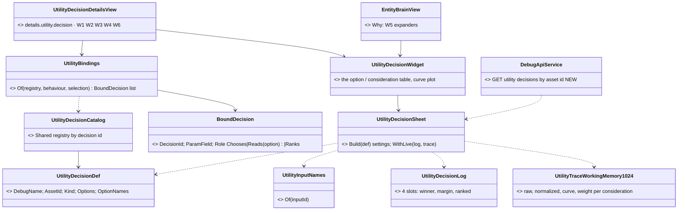
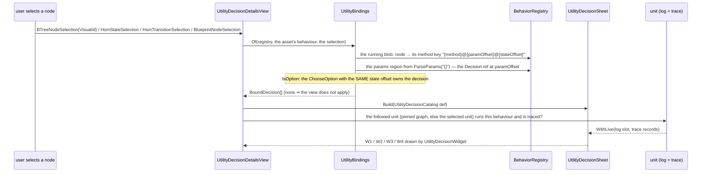
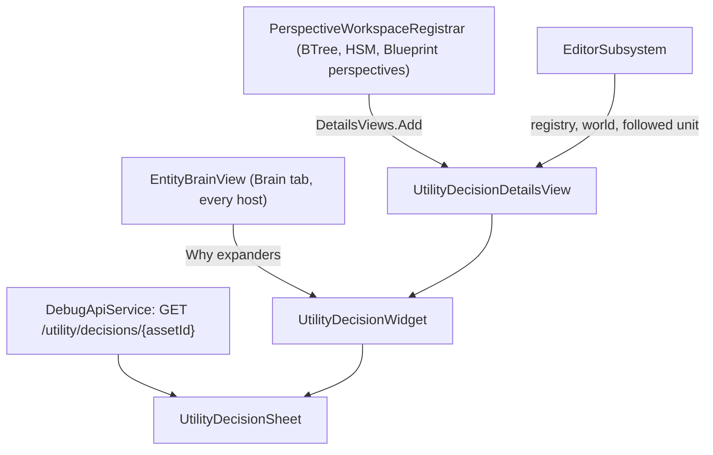
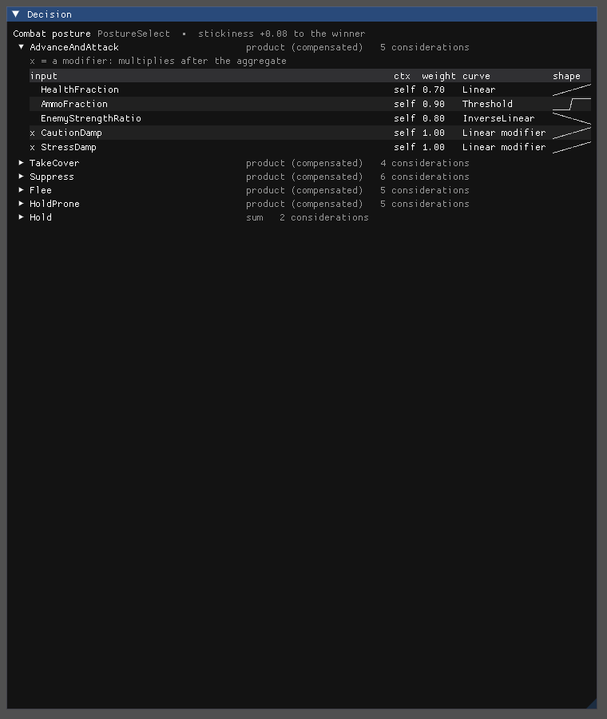
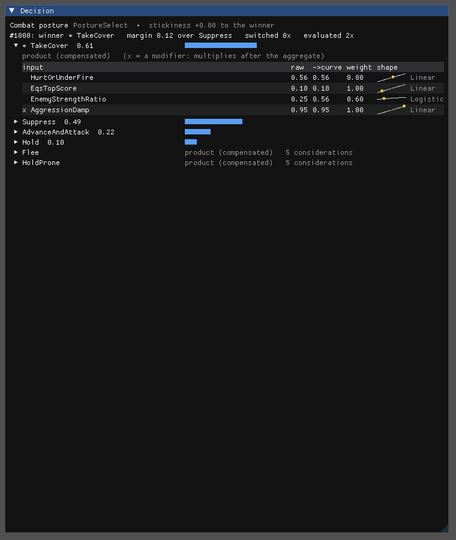

<!--STATUS
state: LIVE
updated: 2026-10-25
build-state: BUILT 2026-10-25 (§5 as-built) — the lean APPROVED 2026-10-25; the wireframes (§2) APPROVED 2026-10-25 ("approved, record this to design. merge behaviors and build this"); UML §4
current-answer: §5 as built · §1 when it shows · §2 the wireframes (approved) · §3 the data sources · §4 UML
stale-below: nothing
known-rot: none
known-conflict: none
related-designs:
  - docs/designs/utility-ai/Utility_AI_Editor_Design_v1_2.md — §9.2 the decision inspector INSIDE the standalone decision editor (Hrot.Utility.Editor, built, unwired); this view is the read-only form on a selected graph node, and reuses its curve widget
  - docs/designs/utility-ai/Utility_AI_Design_v1_1.md — §9 OWNS UtilityDecisionLog and the per-consideration trace (the live columns)
  - docs/DESIGN_Decision_Layer.md — §3.3 OWNS how a node binds a decision (a UtilityDecisionRef in its params; ChooseOption / IsOption / RankCandidates)
  - docs/DESIGN_Entity_Brain_View.md — OWNS the Brain tab; its "Why" section grows the expander (§2 W5)
  - docs/DESIGN_Behaviour_Debugging.md — the debugging workflow ("why that, and not something else?", question ②)
  - docs/designs/utility-ai/Runtime_Tuning_Console_and_AI_Overlays_Design_v1_0.md — global tuning; not per node
-->

# The utility decision view — what a node's decision IS, and what it is doing now *(CE-1325)*

🔒 **User, `2026-10-25`:** *"I am not able to find a way how to display the details of the utility decision, the settings, what kind of
inputs, what kind of curves, what kind of aggregation function is used … give the user some kind of insight into how the behaviors are
constructed, not just by drawing the graph."* → lean approved: *"approved, but need clarification when and how the data is shown. best as
ASCII art wireframes."* → on the wireframes: *"approved, record this to design. merge behaviors and build this"* (`2026-10-25`).

## 1. When it shows — one view, four ways in

| you select / open | the view shows | live values when |
|---|---|---|
| a **graph node** that runs a decision — `ChooseOption`, `ChooseOptionOnce`, `RankCandidates`, a custom action whose params hold a decision, a blueprint `ScoreDecision` | **W1** the decision's settings | the graph is PINNED to a unit, or the selected unit runs this behaviour (**W2**) |
| an HSM **state** whose activity is `ChooseOption` | **W1** / **W2** | as above |
| an **`IsOption` guard** (a BTree branch condition or an HSM transition) | **W3** — the decision, with THIS branch's option opened | as above |
| a unit's **Brain tab ▸ Why** | **W5** — every decision the unit ran, each an expander with **W2** inside | always (the tab arms the unit's traces) |

⭐ The settings come from the RUNNING definition (`UtilityDecisionDef`, the C# `[UtilityDecision]` class) — the same for a C#-built
behaviour with no asset as for an authored one. ⭐ Live values are the unit's own (`UtilityDecisionLog` + the per-consideration trace).
⛔ Read-only: changing a decision is the decision editor's job (`Hrot.Utility.Editor`, not wired yet).

## 2. Wireframes

**W1 — a node selected, no unit: the settings**
```
┌ Details ───────────────────────────────────────────────────────────────────┐
│ [Node] [Decision] [Runtime]                                                │
│ ── Decision ────────────────────────────────────────────────────────────── │
│ Combat posture                      PostureSelect · Tactical/Posture       │
│ bound by  ChooseOption (param Choose)        stickiness +0.08 to the winner│
│ ▸ shared with  IsOption ×6 (the branches)                                  │
│                                                                            │
│ ▼ Advance and attack            product (compensated)                      │
│     input                  ctx     weight  curve              shape        │
│     HealthFraction         self    0.70    Linear            ╱             │
│     AmmoFraction           self    0.90    Threshold         ┌─            │
│     EnemyStrengthRatio     self    0.80    InverseLinear     ╲             │
│   × CautionDamp            self    1.00    Linear  modifier  ╱             │
│   × StressDamp             self    1.00    Linear  modifier  ╱             │
│ ▶ Take cover                    product (compensated)   4 considerations   │
│ ▶ Suppress                      product (compensated)   6 considerations   │
│ ▶ Flee                          product (compensated)   5 considerations   │
│ ▶ Hold                          sum                     2 considerations   │
│                                                                            │
│ (no unit: pin this graph to a unit, or select one, to see its values)      │
└────────────────────────────────────────────────────────────────────────────┘
```
*`×` marks a modifier (multiplies after the aggregate; 1.0 changes nothing). The shape column is a 40×12 px plot of the curve.*

**W2 — the same with a unit: live values (the graph pinned to #1007, or #1007 selected)**
```
│ Combat posture  ·  unit #1007                  evaluated 0.2 s ago, 412×   │
│ winner ★ Take cover   margin 0.12 over Suppress     switched 3× this run   │
│                                                                            │
│ ▼ ★ Take cover      0.61 ██████████████████▌                               │
│     input                   raw     →curve   ×weight  shape                │
│     HurtOrUnderFire         1.00    1.00     1.00     ╱    ●               │
│     EqsTopScore(cover)      0.74    0.74     0.74     ╱  ●                 │
│     EnemyStrengthRatio      1.30    0.82     0.89     ⌒   ●                │
│   × AggressionDamp          1.00    1.00     1.00     ╱    ●               │
│ ▶   Suppress        0.49 ██████████████▋                                   │
│ ▶   Advance and attack                                                     │
│                     0.22 ██████▌                                           │
│ ▶   Hold            0.10 ███                                               │
│ ▶   Flee            0.00  (AmmoFraction… no: HealthFraction Threshold = 0) │
```
*The dot on each shape is where the raw value sits on the curve. Options are sorted by score; a zeroed option names the consideration
that zeroed it. Not traced (a unit on another node, or tracing off):*
```
│ Live values: off — #1007 is not traced.            [Trace this unit]       │
```

**W3 — an `IsOption` guard selected (a branch, or an HSM transition)**
```
│ ── Decision ────────────────────────────────────────────────────────────── │
│ This branch runs while  Combat posture  picks  ▸ Take cover ◂              │
│ (the decision is scored by ChooseOption in the parent; this only reads)    │
│                                                                            │
│ ▼ Take cover        …its considerations, as W1 / W2…                       │
│ ▶ the other 5 options                                                      │
```

**W4 — a ranking (`RankCandidates`, e.g. threat ranking) with a unit**
```
│ Threat ranking  ·  unit #1007                    evaluated 0.2 s ago       │
│ one scoring, applied to each candidate      product (compensated)          │
│     input                  ctx        weight  curve                        │
│     DistanceToCandidate    candidate  1.00    InverseLinear                │
│     CandidateThreat        candidate  0.80    Linear                       │
│ ── ranked ───────────────────────────────────────────────────────────────  │
│   1  #2031 Rifleman        0.71 ████████████████▉                          │
│   2  #2044 MG team         0.55 █████████████▏                             │
│   3  #2012 Rifleman        0.31 ███████▍                                   │
```

**W5 — the Brain tab's Why**
```
│ ▼ Why                                                                      │
│   ▶ Combat posture      → Take cover    margin 0.12   3 switches           │
│   ▶ Attack approach     → Flank         margin 0.05   1 switch             │
│   ▶ Threat ranking      → #2031         0.71                               │
```
*Each row opens W2 / W4 for this unit. (Today the section prints the decision id, the winner and the margin only.)*

**W6 — a node whose params hold TWO decisions (a custom action)**
```
│ ── Decision ────────────────────────────────────────────────────────────── │
│ This node uses 2 decisions:  ( Squad contact response ) ( Squad crossing ) │
│ …the chosen one, as W1 / W2…                                               │
```

**Curve detail — click a consideration row**
```
┌ HealthFraction → Threshold ──────────────────────┐
│ 1.0 ┤            ┌──────────────                 │
│     │            │                               │
│ 0.0 ┼────────────┘                               │
│     0          0.5          1.0   raw            │
│ slope 1.0  exponent 1.0  shift 0.5               │
│ ● #1007: raw 0.40 → 0.00  (this zeroes Flee)     │
└──────────────────────────────────────────────────┘
```

**The same over the API** — `GET /utility/decisions/{assetId}` returns W1 as JSON; `GET /entities/{id}/utility` (exists) returns W2's live
part; the graph read names each node's bound decision(s).

## 3. The data, and where each piece comes from

| shown | source | note |
|---|---|---|
| name, kind, category, stickiness, option names | `UtilityDecisionCatalog` → `UtilityDecisionDef` (`DebugName`, `Kind`, `OptionNames`), the `[UtilityDecision]` attribute | registered at start from the C# classes |
| per option: aggregation · considerations (input, context, weight, curve kind + slope / exponent / shift, modifier) | `UtilityOption.Mode`, `UtilityConsideration` | input NAME: the id is a hash of the `[UtilityInput("Name")]` name — the reverse map is built once by hashing every declared input (the API's `InputName` already does) |
| which decision a node binds | authored node: its params' `Decision` (asset id) · C# node: the method key `{method}@{paramOffset}@…` → the behaviour's params field at that offset → its `UtilityDecisionRef` (the unit's live params, else the behaviour's defaults) · blueprint: `ScoreDecision.AssetId` · a custom action: every `UtilityDecisionRef` field in its param slice | ONE resolver, shared by the view and the API |
| winner, margin, switches, ranked | `UtilityDecisionLog` (per unit, 4 decisions) | while traced |
| raw → curve → weighted per consideration | `UtilityTraceWorkingMemory1024` | while traced |

## 4. UML *(drawn after the inventory: `scripts/cbm.sh search_graph` `.*Utility.*` Class → ~60, `.*Project.*` Class; grep the scorer callers and `UtilityDecisionRef`; `check_index_coverage` not reachable through the CLI)*


*What it shows that prose hid: the view, the Brain tab and the API share ONE sheet (settings + live) and ONE binding resolver — nothing
is drawn from a document, so a C#-built behaviour and an authored one take the same path.*


*What it shows that prose hid: the node is resolved through the RUNNING blob by its VisualId, not through the document — the method key's
param offset is what names the decision, and an `IsOption` finds its decision through the shared state offset.*


*What it shows that prose hid: the details view is registered per perspective (drawn only where a graph is selected); the Brain tab's
expanders draw on every host, the CGF / IG included.*

## 5. AS BUILT *(`2026-10-25`, ui)*

| piece | where | matches §4 / deviates |
|---|---|---|
| `UtilityDecisionSheet` — `Build(decisionId)` (the running def: option names, aggregation, inputs by name, weight, curve, modifier) · `WithLive(world, unit)` (the log slot: winner, runner-up, margin, switches, evaluations, every option's score, ranked candidates; the newest traced pass MATCHED to this decision by its option and input ids — the ring carries no decision id) · `ToJson` | `Hrot.Editor.AiShared/Utility/UtilityDecisionSheet.cs` | ✅ — ⚠ the trace ring holds 31 records: a decision with more considerations than fit shows "-" for the rows that scrolled out |
| `UtilityBindings` — BTree node (by VisualId in the RUNNING blob), HSM state (activity) and transition (guard), through the method key's param offset into the behaviour's DEFAULT block (`ParseParams("{}")`, else `BakeDefaults`; cached per definition); `IsOption` → the `ChooseOption` with the same state offset; a custom action → every `UtilityDecisionRef` in its params field | `Hrot.Editor.AiShared/Utility/UtilityBindings.cs` | ✅ — ⚠ the decision bound is the behaviour's DEFAULT; an authored params override that names another decision is not seen (none exists today) · ⚠ blueprint `ScoreDecision` not resolved yet (its node is a blueprint document object) |
| `UtilityDecisionWidget` — W1 / W2 / W3 (an option opened) / W4 (ranked candidates), a curve plot from the running `ResponseCurve.Evaluate` with the unit's raw value as a dot | `UtilityDecisionWidget.cs` | ✅ |
| the **Decision** tab (`details.utility.decision`, rank 19), every AI perspective; W6 picks among a node's decisions; W3 says which option the branch stands for; "Trace this unit" arms a followed unit | `UtilityDecisionDetailsView.cs`, `PerspectiveWorkspaceRegistrar`, `EditorSubsystem` (`UtilityDecisionHost`: registry, world, the pin-else-selection unit, trace, label) | ✅ |
| Brain tab ▸ Why — each decision by name and winner, an expander drawing the widget for this unit (⛔ SUPERSEDED: "Decision <id>: winner <number>") | `EntityBrainView` | ✅ W5 |
| API: `GET /utility/decisions`, `GET /utility/decisions/{key}?networkId=`, `GET /behaviours/{name}/decisions`; `UtilityInputNames` moved to the toolkit (the API's one table) | `DebugApiService.Decisions.cs`, `DebugApiHost`, route docs, skill §C0 | ✅ |

Rails: `Hrot.Editor.AiShared.Tests` `UtilityDecisionViewTests` (4; red-proofs 3/3: the modifier flag · the pass matching · the IsOption state offset) ·
E2E `Hrot.SystemTests` `UtilityDecisionViewTests` ✅ — the C#-built `CombatPosture` (no asset) names `Choose` → Combat posture, `Approach` →
Attack approach, an IsOption reading TakeCover; the decision's settings read back; a wrong key is a 404.

📷 W1 and W2 (`UtilityDecisionViewTests.CE1325_TheDecision_Draws`):




