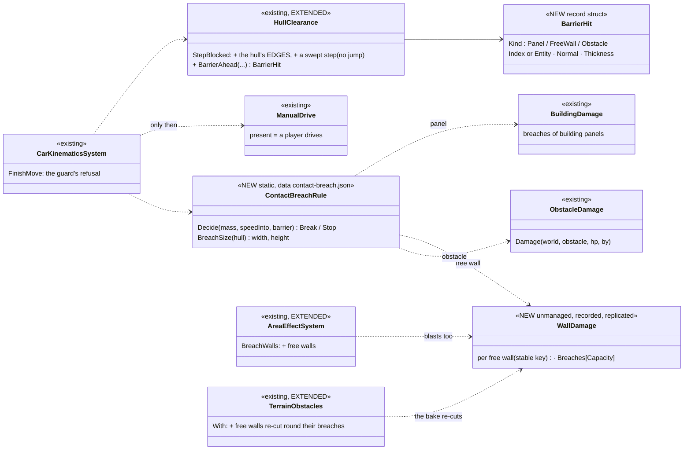
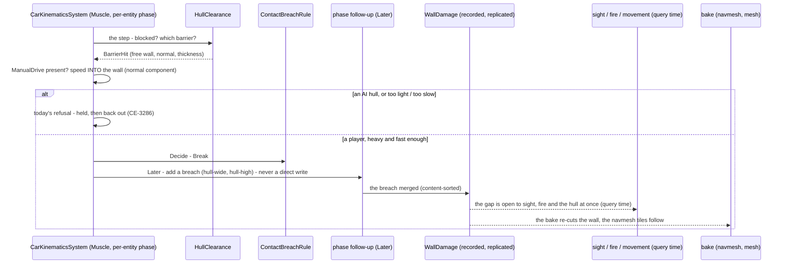
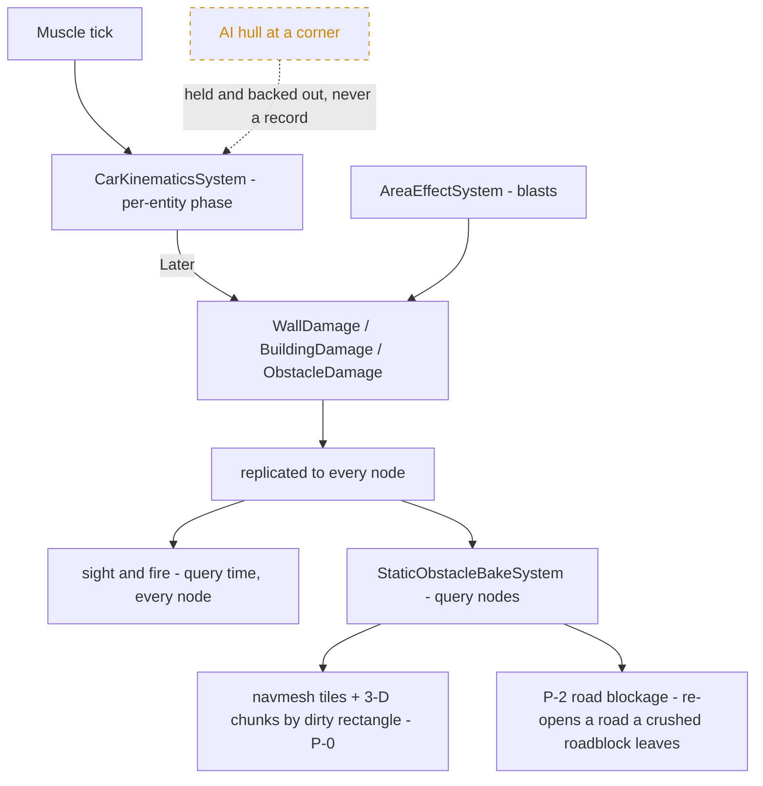

<!--STATUS
state: LIVE
build-state: READY-TO-BUILD after the ground-patch design's P-0 (dirty rectangles on every host, a bake latency cap) — B-1 first (reproduce the slip-through)
updated: 2026-11-14
current-answer: the whole file — §1 the request, §2 INVENTORY, §3 the diagrams, §4 decisions, §5 slices, §6 acceptance
stale-below: nothing
known-rot: none
known-conflict: none
related-designs:
  - designs/motion-models/DESIGN_Motion_Domains.md — §5f OWNS the hull guard (`HullClearance`, a hull never enters a building, hold and back out, R-3025); this design adds the possessed-only break-through at the guard's refusal and closes its thin-wall holes
  - DESIGN_Terrain_Import_UTM.md — §8 OWNS destruction (breaches and collapses, `BuildingDamage`, the bake, save, seek); the free-wall record here is its sibling
  - DESIGN_Ground_Patches_And_Road_Blockage.md — OWNS P-0 (dirty rectangles everywhere, a latency cap), R-4232 (truth at QUERY time, the bake a cache) and P-2 (roads rebuilt from the blocker set) that this design builds on
  - DESIGN_Terrain_Combat_Tuning.md — §3 OWNS material resistance (`ResistanceMmRhaPerMetre`) the break rule reads
  - DESIGN_Entity_Control.md — §8b OWNS a player's driving (`ManualDrive`) — the only trigger of a break
  - designs/group-maneuvers/DESIGN_City_Battle_Showcase.md — blasts now breach garden walls and fences: more gaps, more movement (§3a)
-->

# DESIGN — a player's heavy vehicle breaks through weak barriers; blasts breach garden walls *(CE-4595)*

## 1. The request

🔒 User, `2026-11-14`: *"a heavy tank running over a small wall or running into a building … should basically create holes in the walls … the light
vehicles should stop there"* · *"no vehicle usually wants to break into a wall intentionally. So this should be reserved for cases when the vehicles
are possessed by players."* · *"the AI-controlled vehicle is hiding behind a corner … it may happen that the vehicle breaks into a wall for a while,
but now it is pushed out … and it still should be. Such a movement shouldn't create a hole."* · (a) and (c) *"Looks okay"* · *"Yes, please write
the breaching design."* Tracker: [CE-4595](blueprints/Blueprint_Issues_Tracker.md).

## 2. INVENTORY *(2026-11-14, `coordinator`)*

| query | found |
|---|---|
| grep `ram\|crush\|run over\|drive through` over the toolkits, engine, subsystems | ⛔ nothing — no vehicle damages what it meets |
| `HullClearance.StepBlocked` + its callers | ONE production caller, `CarKinematicsSystem.FinishMove` (`:720-745`): a vehicle step is refused when the CENTRE or a CORNER ① meets a surface that RISES like a wall (rise > `VehicleMaxStepM` and > the climb slope × the step) or ② ENTERS a closed barrier (a building panel, a closed door); refused ⇒ pose kept, speed 0, `held` ⇒ hold and back out (`HullRecovery`, CE-3286) |
| the operator's drive | `ManualDrive` → `ManualMotion.Vehicle` → the SAME `FinishMove` (`CarKinematicsSystem.cs:233-266`) ⇒ a possessed vehicle is guarded too |
| ⚠ the user's "drives through" | 🔒 user, `2026-11-14`: *"I only saw the player possessed vehicles going through the garden walls, not the AI ones"* ⇒ B-1 reproduces the `ManualDrive` path FIRST. SUSPECTED, not reproduced: the guard probes only the centre + 4 corners (a thin wall between the front corners passes) and compares the ground BEFORE and AFTER a step (a step longer than a thin wall jumps it) |
| what breaches today | `AreaEffectSystem.BreachWalls` → `BuildingDamage` (building PANELS only, `:436-440` via `BuildingPanels.Near`) — replicated, saved, seek-safe, sight / fire read it at query time (UTM §8.3 #6), the bake re-expands the panel with gaps (`TerrainBuildingExpander.ExpandPanelPieces`) |
| ⛔ free-standing walls | a `TerrainPrism { Kind = Wall, Footprint, BaseZ, TopZ, Label, Material }` (`TerrainWorld.cs:10, 23-45`) — walls, fences, hedges from features and imports; NO damage record: not even a bomb breaches one |
| obstacles | sandbags, concrete blocks, cars: `StaticObstacle` + `Health`; `ObstacleDamage.Damage` (the bulldozer's push, CE-7012) → `ObstacleRemovalSystem` at 0 |
| inputs | `VehicleParametersDto.Mass` (TKB); `TerrainMaterials` `ResistanceMmRhaPerMetre`, `BlocksMovement` |
| `scripts/cbm.sh search_graph '{"name_pattern":".*(Breach\|Crush\|Ramming\|WallDamage\|BarrierDamage\|BuildingDamage).*","label":"Class"}'` (total 3) + grep | the graph: `BreachDoorBehavior` (+ its blackboard, params) only — the structs and static classes of the breach family are not `Class` nodes; grep finds `BreachRule`, `BreachTable`, `BuildingDamage` (+ `Table`, `System`, `Save`), `WallBreach`; ⛔ no crush / ramming / free-wall damage type (a first query with `Ram` matched 631 `…Param…` names — dropped) |
⚠ Graph coverage not checkable through the CLI.

| the proven solution | adopted / adapted — why |
|---|---|
| vehicle-vs-obstacle breaching by mass and speed against a resistance class (armoured-vehicle simulators) | ✅ adapted: only for a PLAYER's vehicle (the user), only the speed INTO the barrier counts |
| destruction as a replicated record read at query time | ✅ the breach path, proven (UTM §8) |

## 3. The design

### 3.1 Classes

*What it shows that prose hid: ONE decision at the ONE place a hull meets a barrier, three existing outlets for three barrier kinds — and the one
new record (`WallDamage`) also serves blasts, closing "a bomb cannot breach a garden wall".*

### 3.2 A player's tank meets a garden wall

*What it shows: the AI path is untouched by construction (the branch reads `ManualDrive` first); the effect is immediate where the simulation reads
it (R-4232's rule) and only the navmesh and the drawing wait for the bake.*

### 3.3 Who runs what

*What it shows: the only new writer is the follow-up of a player's break and a blast; the dashed edge is the user's acceptance — an AI hull
never reaches a damage record.*

## 4. Decisions — ✅ approved (CE-4595, user `2026-11-14`) unless marked lean

| # | decision | why | rejected |
|---|---|---|---|
| **B-D1** ✅ | **only a hull with a player's `ManualDrive` at that tick can break** (the one AI exception: the bulldozer's clearing task, B-D11); an AI hull keeps today's refusal and back-out (CE-3286) | the user: no vehicle breaks a wall on purpose; an AI corner hold makes no hole | an AI that plans through barriers |
| **B-D2** ✅ | **only the speed INTO the barrier counts** (the step's component along the barrier's normal) | scraping along a corner is not a ram | total speed |
| **B-D3** ✅ (revised `2026-11-14`) | **two kinds of break, by barrier**: ① SMALL barriers — fences, hedges, garden walls, sandbags, small blocks — a heavy ARMOURED vehicle (tank ~60 t: all of them; IFV ~25 t: fences, hedges, sandbags) breaks and DRIVES THROUGH; wheeled vehicles: nothing. ② a BUILDING wall — only a possessed TANK, by a small BUMP (B-D4). Each row a minimum mass and a minimum speed INTO the barrier (`contact-breach.json`); barrier strength = material resistance × thickness × height (`TerrainMaterials`). 🔒 User, `2026-11-14`: *"tanks can breach because they can just do a small bump. They do not need to drive through the breach, which would damage their sensors … The tank can breach a building wall if possessed by players, but it cannot go through. who should be able to go through is the infantry. For small walls and sandbags, the breaching might work without any damage for heavier armored vehicles. And also the shooting and visibility checking, it should pass through the holes … Bulldozer takes no damage, and as you say, it breaches on order."* | tunable; the inputs exist; the user's realism: a bump, not a drive-through | hard-coded classes · tanks driving through houses |
| **B-D4** ✅ (revised `2026-11-14`) | **a tank's bump opens a building wall for INFANTRY, never for the tank**: a `BuildingDamage` breach of kind **`Passage`** (a man passes; sight and fire pass — measured: `BreachKind.Passage` vs `Hole`, `BuildingDamage.cs:8-14`), door-sized and up to the hull's front width; the tank is held at the wall as today (R-3025 stays — it never enters) | infantry gain an entry; the tank keeps its sensors (no drive-through) | a hull-wide hole the tank drives into |
| **B-D5** lean | **outlets by barrier kind**: an obstacle ⇒ `ObstacleDamage.Damage` to destruction (the bulldozer's path); a building panel ⇒ a `BuildingDamage` breach (the existing record); a free wall ⇒ a **`WallDamage`** breach | one outlet per kind, all existing but one | a crush system of its own |
| **B-D6** lean | **`WallDamage`**: unmanaged, recorded, replicated, saved, seek-safe — the `BuildingDamage` shape (capacity 16, content-sorted union), ONE entity per (free wall, deciding node), keyed by the wall's stable key; the bake re-cuts the wall prism round its breaches (the panel's `ExpandPanelPieces` rule) and ⭐ **`WallDamage` joins the bake's input hash AND `DirtyRegions`** (old and new breach rectangles) — otherwise the incremental navmesh reuses the wall's tiles and nobody walks through (the crater's V-4 trap); a breach a vehicle DROVE through is vehicle-wide, so vehicles route through it too | the proven breach path | re-using `BuildingDamage` with a fake building index |
| **B-D7** lean | **blasts breach free walls too**: `AreaEffectSystem.BreachWalls` also asks the free walls near a burst (a cell index of wall prisms, like `BuildingPanelGrid`), by the same `BreachRule` and `breaches.json` | today a bomb cannot breach a garden wall — the same record closes it | — |
| **B-D8** lean | **sight / fire read a free-wall breach at QUERY time** — 📐 measured: building-wall breaches ALREADY pass sight and fire (`TerrainWorld.CrossingBreached`, called by the blocked, sight and fire traces `:596, :755, :891`; red-proved in `BuildingBreachTests.cs:289`) — the free wall's record gets the same; only the navmesh and the 3-D mesh wait for the bake | R-4232's rule; a shot through the new hole must not wait for a wall-clock bake | the bake as truth |
| **B-D9** lean | **the slip-through holes closed** (B-1, reproduced first): the guard also probes the hull's EDGES (front, sides at the hull's spacing), and the step is SWEPT (a segment test against wall prisms, not before / after samples) | otherwise a thin wall is crossed whatever the rule says | — |
| **B-D11** ✅ | **the BULLDOZER is the one AI exception** (🔒 user, `2026-11-14`: *"the bulldozer could create such an opening … the bulldozer is the exception. It is an AI-driven vehicle which is allowed to create breaches"*) — ⭐ lean on its shape: it breaches **only while running a clearing task AIMED at that barrier**: `ClearObstacle` (CE-7012, `ClearObstacleBehavior.cs`) learns a second target — a wall POINT (a free wall's key or a building panel + the point) beside today's obstacle entity; it drives to the face and, while the blade is in contact, PUSHES a breach (blade-wide, hull-high) through the same outlets (`WallDamage` / `BuildingDamage`; an obstacle as today) — the push model, seconds of blade contact (`PushSeconds`), not the ram; a building wall is opened but never entered (B-D4); ordered by the company's support call (CE-7003's bulldozer tasking), a scenario order or the instructor | the existing push path, already parallel-safe (its damage rides the batch buffer); a bulldozer merely DRIVING (a corner hold) breaches nothing — the user's corner rule holds for it too | any bulldozer contact breaching (an accidental hole at every corner) |
| **B-D12** ✅ (revised `2026-11-14`: **NO damage in v1**) | **breaking costs nothing in v1**: a heavy armoured vehicle through a small barrier takes no damage; a tank's bump on a building wall takes none; the bulldozer takes none (it breaches on ORDER, B-D11). The first ruling (a Health cost per break, the same day) is SUPERSEDED: the realistic cost — a modern tank's sights and sensors swept off by driving THROUGH — is avoided by the bump rule (B-D4) instead. ⭐ The hook stays: `contact-breach.json` carries a cost column (0), and when ground-vehicle compartment damage lands (Hit Location S2 — measured: `BodyPlan.TrackedVehicle` exists, its part ids do not) a cost can go to the OPTICS part if a later ruling wants it. 🔒 User, `2026-11-14`: *"tanks can breach because they can just do a small bump. They do not need to drive through the breach, which would damage their sensors … The tank can breach a building wall if possessed by players, but it cannot go through. who should be able to go through is the infantry. For small walls and sandbags, the breaching might work without any damage for heavier armored vehicles. And also the shooting and visibility checking, it should pass through the holes … Bulldozer takes no damage, and as you say, it breaches on order."* | the user's realism; nothing to tune now | a Health cost per break (superseded) |
| **B-D10** lean | **the Muscle decides; the write is a phase follow-up** (`BatchContext.Later`), never a direct write from the per-entity phase (CLAUDE.md "behaviour code runs in parallel") | the parallel rule | — |

⚠ To measure in B-1: whether every free wall has a STABLE key (an overlay feature's `<guid>/i` does; an imported wall's `Label` may be absent) —
if not, B-2 gives imported walls one at import (D-4 of the ground-patch design: a re-import is a new version anyway).

## 5. Slices

| slice | builds |
|---|---|
| **B-0** | depends on the ground-patch design's **P-0** (dirty rectangles on every host, a bake latency cap) |
| **B-1** | reproduce the slip-through (a possessed vehicle at speed into a 0.3 m wall and a sandbag row, both frame rates); close it (B-D9); measure the free walls' stable keys |
| **B-2** | `WallDamage` + the bake's re-cut + query-time sight / fire + save / seek (B-D6, B-D8) + blasts breach free walls (B-D7) |
| **B-3** | the contact rule (B-D1…B-D5, B-D10; B-D12: no cost, the column kept at 0): `BarrierHit`, `ContactBreachRule` + `contact-breach.json`, the three outlets |
| **B-4** | the bulldozer's breach (B-D11): `ClearObstacle` aimed at a wall point; the push breach through the same outlets; its order from the support call (with CE-7003) |

## 6. Acceptance

1. **The AI corner** (the user's case): an AI tank held against a building corner for its hold time backs out; every damage record unchanged (a rail).
2. A possessed M1 at 8 m/s into a brick garden wall breaks it and drives through, undamaged; at 1 m/s it stops; scraping along it at 8 m/s does not break (rails).
3. A possessed HMMWV into the same wall stops and holds; into a sandbag row too; a possessed IFV breaks the sandbags (rails).
4. A possessed M1 bumps a building wall: a door-sized `Passage` breach, the hull holds at it (never inside); a rifleman then walks through it, sees and fires through it (rails).
5. A Mk-82 beside a garden wall breaches it (blasts, B-D7); a rifleman sees and fires through the gap at once (query time); the navmesh opens it
   within one bake; a seek before the blast restores the wall; a scenario saved after reloads the gap.
6. 🔒 user, `2026-11-14`: *"the holes made by the vehicles should behave the same. So the infantry can go in or go through the breach in garden walls. I just want to make sure that this is included."* — **every breach is walkable**: after a tank's bump on a building wall, a vehicle driving through a garden wall, a blast in a garden wall and the bulldozer's cut, an infantry path planned across the wall goes THROUGH the gap (the navmesh rebuilt — as the charge breach in `bd-destruction` act ① already proves for building walls), and a vehicle path goes through a gap a vehicle made (rails).
7. A crushed roadblock across a road re-opens it for SUMO and our road graph (the ground-patch design's P-2).
8. **The bulldozer** (B-D11): ordered to clear a garden wall at a point, it opens a blade-wide gap and infantry and vehicles route through it; the same bulldozer driving past and holding at a corner breaches nothing (a rail).
9. **No cost** (B-D12): every break above leaves the breaking vehicle's Health unchanged (a rail).
10. `HROT_PARALLEL_SIM=1` + `HROT_READ_CHECK=1` on every rail; the 1 / 4 / 8-thread stepped hash equal on a breach scenario.
