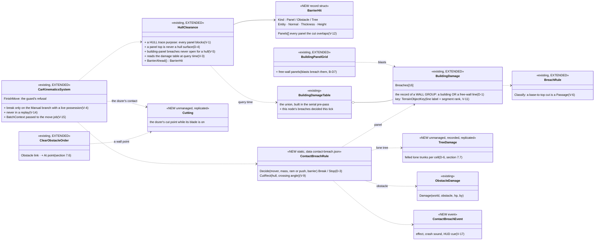
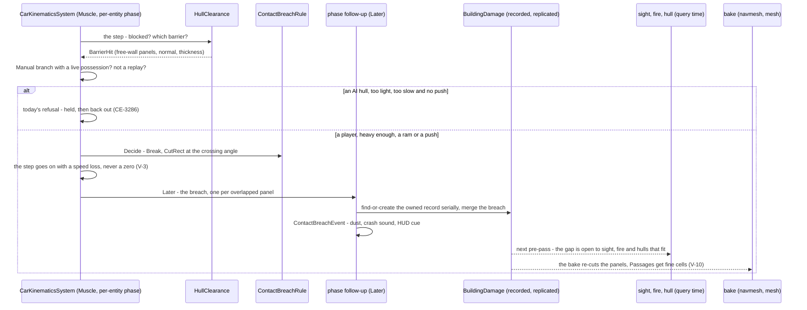
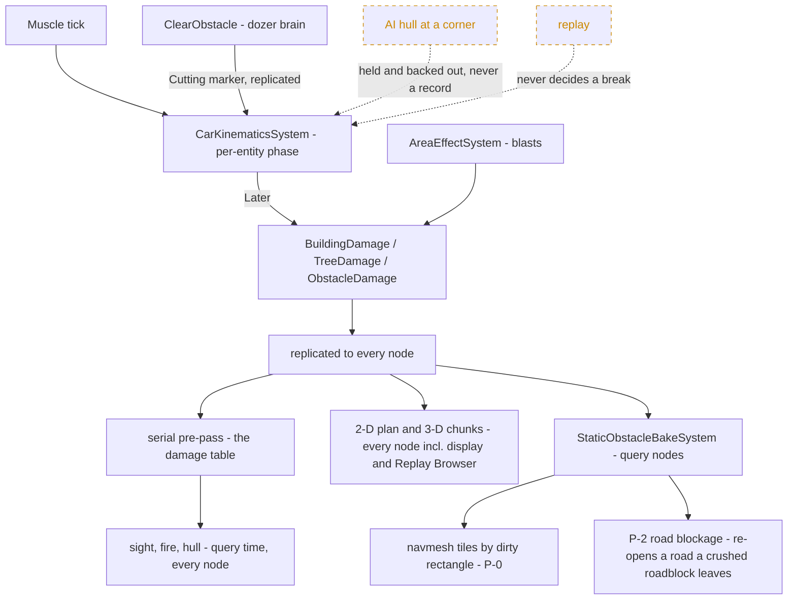
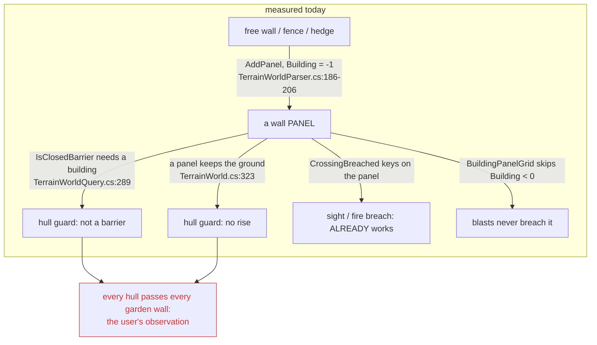
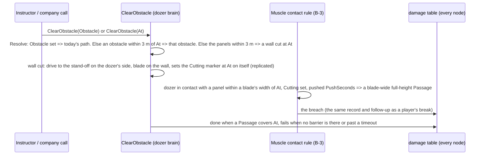
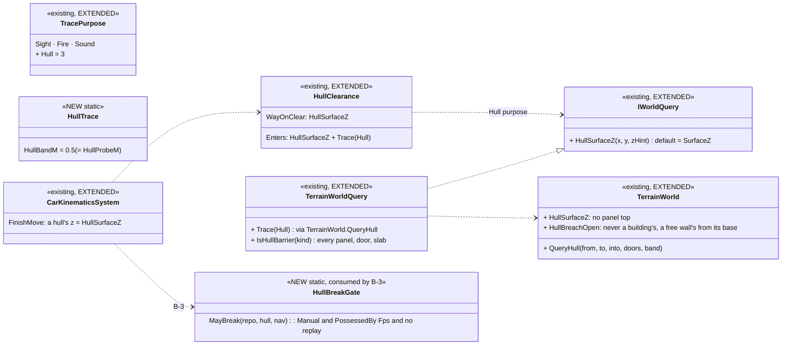
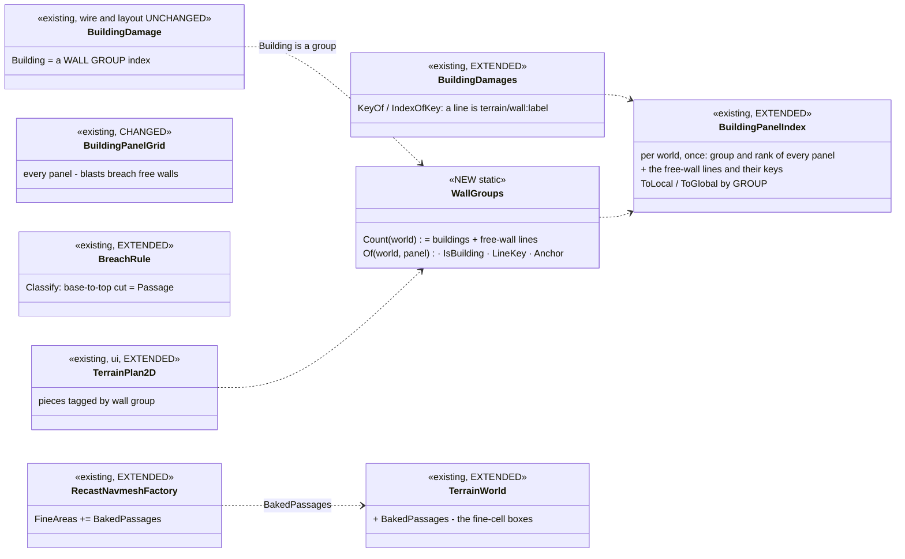
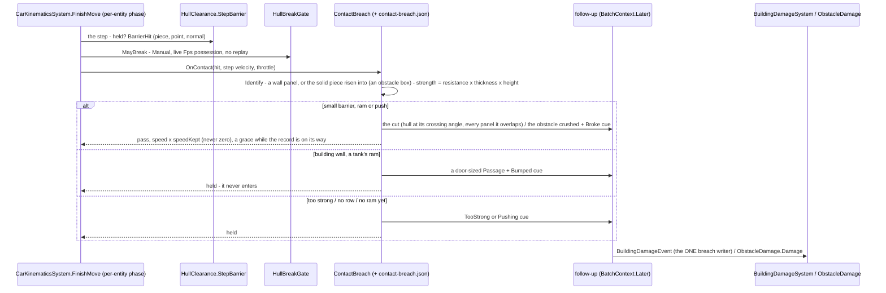
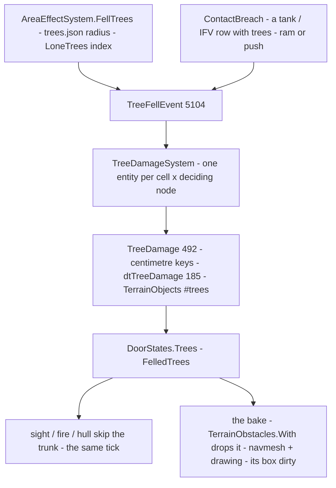
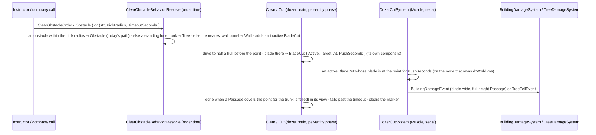

<!--STATUS
state: LIVE
build-state: READY-TO-BUILD — every decision ruled 2026-11-14 (§7.3, §7.6, §7.7: R-4236…R-4243); the tasks are in PLAN_Dynamic_Terrain.md (B-1…B-6, after the ground-patch design's P-0); mockup docs/UX/vehicle-breaching.svg
updated: 2026-11-14
current-answer: §7 FIRST (the review and its rulings — it overrides what it names), §3 (redrawn to §7), then §1, §4 and §6 where §7 leaves them standing; the tasks: PLAN_Dynamic_Terrain.md
stale-below: §5 slices — replaced by §7.4; §4 rows marked ⛔ SUPERSEDED
known-rot: (§3 was redrawn to §7 on 2026-11-14 and is current) · §2's "free-standing walls" row (they are wall PANELS with no building, not prisms — §7 V-2) and "⚠ the user's drives through" row (the cause is not the corner probes — §7 V-1) · §3.2's "open to the hull at once" (§7 V-3) · B-D5/B-D6/B-D7 `WallDamage` (§7 V-2) · B-D9 (§7 V-1) · B-D1's gate "a player's ManualDrive" (§7 V-4) · B-D11's order shape and deciding node (§7 V-13)
known-conflict: none
related-designs:
  - designs/motion-models/DESIGN_Motion_Domains.md — §5f OWNS the hull guard (`HullClearance`, a hull never enters a building, hold and back out, R-3025); this design adds the possessed-only break-through at the guard's refusal and closes its thin-wall holes
  - DESIGN_Terrain_Import_UTM.md — §8 OWNS destruction (breaches and collapses, `BuildingDamage`, the bake, save, seek); the free-wall record here is its sibling
  - DESIGN_Ground_Patches_And_Road_Blockage.md — OWNS P-0 (dirty rectangles everywhere, a latency cap), R-4232 (truth at QUERY time, the bake a cache) and P-2 (roads rebuilt from the blocker set) that this design builds on
  - DESIGN_Terrain_Combat_Tuning.md — §3 OWNS material resistance (`ResistanceMmRhaPerMetre`) the break rule reads
  - DESIGN_Entity_Control.md — §8b OWNS a player's driving (`ManualDrive`) — the only trigger of a break
  - designs/group-maneuvers/DESIGN_City_Battle_Showcase.md — blasts now breach garden walls and fences: more gaps, more movement (§3a); §6c the bulldozer's ClearObstacle, which §7.6 extends with a point
  - PLAN_Dynamic_Terrain.md — OWNS the programme's task list (this design's B-1…B-6 and the ground-patch design's P-0…P-6)
  - UX/vehicle-breaching.svg — the mockup (the driver's contact cue, the bump, the drive-through gap, the bulldozer's point order)
-->

# DESIGN — a player's heavy vehicle breaks through weak barriers; blasts breach garden walls *(CE-4595)*

## 1. The request

🔒 User, `2026-11-14`: *"a heavy tank running over a small wall or running into a building … should basically create holes in the walls … the light
vehicles should stop there"* · *"no vehicle usually wants to break into a wall intentionally. So this should be reserved for cases when the vehicles
are possessed by players."* · *"the AI-controlled vehicle is hiding behind a corner … it may happen that the vehicle breaks into a wall for a while,
but now it is pushed out … and it still should be. Such a movement shouldn't create a hole."* · (a) and (c) *"Looks okay"* · *"Yes, please write
the breaching design."* Tracker: [CE-4595](blueprints/Blueprint_Issues_Tracker.md).

## 2. INVENTORY *(2026-11-14, `coordinator`)*

| query | found |
|---|---|
| grep `ram\|crush\|run over\|drive through` over the toolkits, engine, subsystems | ⛔ nothing — no vehicle damages what it meets |
| `HullClearance.StepBlocked` + its callers | ONE production caller, `CarKinematicsSystem.FinishMove` (`:720-745`): a vehicle step is refused when the CENTRE or a CORNER ① meets a surface that RISES like a wall (rise > `VehicleMaxStepM` and > the climb slope × the step) or ② ENTERS a closed barrier (a building panel, a closed door); refused ⇒ pose kept, speed 0, `held` ⇒ hold and back out (`HullRecovery`, CE-3286) |
| the operator's drive | `ManualDrive` → `ManualMotion.Vehicle` → the SAME `FinishMove` (`CarKinematicsSystem.cs:233-266`) ⇒ a possessed vehicle is guarded too |
| ⚠ the user's "drives through" ⛔ *(superseded — §7 V-1: the cause is a guard blind to free walls)* | 🔒 user, `2026-11-14`: *"I only saw the player possessed vehicles going through the garden walls, not the AI ones"* ⇒ B-1 reproduces the `ManualDrive` path FIRST. SUSPECTED, not reproduced: the guard probes only the centre + 4 corners (a thin wall between the front corners passes) and compares the ground BEFORE and AFTER a step (a step longer than a thin wall jumps it) |
| what breaches today | `AreaEffectSystem.BreachWalls` → `BuildingDamage` (building PANELS only, `:436-440` via `BuildingPanels.Near`) — replicated, saved, seek-safe, sight / fire read it at query time (UTM §8.3 #6), the bake re-expands the panel with gaps (`TerrainBuildingExpander.ExpandPanelPieces`) |
| ⛔ free-standing walls ⛔ *(superseded — §7 V-2: they are wall PANELS with no building)* | a `TerrainPrism { Kind = Wall, Footprint, BaseZ, TopZ, Label, Material }` (`TerrainWorld.cs:10, 23-45`) — walls, fences, hedges from features and imports; NO damage record: not even a bomb breaches one |
| obstacles | sandbags, concrete blocks, cars: `StaticObstacle` + `Health`; `ObstacleDamage.Damage` (the bulldozer's push, CE-7012) → `ObstacleRemovalSystem` at 0 |
| inputs | `VehicleParametersDto.Mass` (TKB); `TerrainMaterials` `ResistanceMmRhaPerMetre`, `BlocksMovement` |
| `scripts/cbm.sh search_graph '{"name_pattern":".*(Breach\|Crush\|Ramming\|WallDamage\|BarrierDamage\|BuildingDamage).*","label":"Class"}'` (total 3) + grep | the graph: `BreachDoorBehavior` (+ its blackboard, params) only — the structs and static classes of the breach family are not `Class` nodes; grep finds `BreachRule`, `BreachTable`, `BuildingDamage` (+ `Table`, `System`, `Save`), `WallBreach`; ⛔ no crush / ramming / free-wall damage type (a first query with `Ram` matched 631 `…Param…` names — dropped) |
⚠ Graph coverage not checkable through the CLI.

| the proven solution | adopted / adapted — why |
|---|---|
| vehicle-vs-obstacle breaching by mass and speed against a resistance class (armoured-vehicle simulators) | ✅ adapted: only for a PLAYER's vehicle (the user), only the speed INTO the barrier counts |
| destruction as a replicated record read at query time | ✅ the breach path, proven (UTM §8) |

## 3. The design

### 3.1 Classes *(redrawn `2026-11-14` to the approved §7 — the first drawing, with a separate `WallDamage`, is withdrawn)*

*What it shows that prose hid: ONE decision where a hull meets a barrier, ONE breach record for every wall (a building or a garden wall — they are
the same panels), and the one new record is for trees, which are not panels. The bulldozer reaches the same rule through a marker, so there is
one breach writer.*

### 3.2 A player's tank meets a garden wall

*What it shows: the AI path is untouched by construction (the gate is the Manual branch plus a live possession, not a component that outlives
it); the hull is never held by a barrier it has just broken, because the guard skips it in the same tick and reads the record at query time
after; only the navmesh and the drawing wait for the bake.*

### 3.3 Who runs what

*What it shows: the only writers are the Muscle's contact follow-up and blasts; the brain never writes a breach (the dozer only sets a marker);
drawing reads the replicated record on every node, so display nodes and the Replay Browser show the gap without baking (V-16). Dashed: the two
paths that must never reach a record.*

## 4. Decisions — ✅ approved (CE-4595, user `2026-11-14`) unless marked lean

| # | decision | why | rejected |
|---|---|---|---|
| **B-D1** ✅ (gate refined: §7 V-4) | **only a hull with a player's `ManualDrive` at that tick can break** (the one AI exception: the bulldozer's clearing task, B-D11); an AI hull keeps today's refusal and back-out (CE-3286) | the user: no vehicle breaks a wall on purpose; an AI corner hold makes no hole | an AI that plans through barriers |
| **B-D2** ✅ | **only the speed INTO the barrier counts** (the step's component along the barrier's normal) | scraping along a corner is not a ram | total speed |
| **B-D3** ✅ (revised `2026-11-14`) | **two kinds of break, by barrier**: ① SMALL barriers — fences, hedges, garden walls, sandbags, small blocks — a heavy ARMOURED vehicle (tank ~60 t: all of them; IFV ~25 t: fences, hedges, sandbags) breaks and DRIVES THROUGH; wheeled vehicles: nothing. ② a BUILDING wall — only a possessed TANK, by a small BUMP (B-D4). Each row a minimum mass and a minimum speed INTO the barrier (`contact-breach.json`); barrier strength = material resistance × thickness × height (`TerrainMaterials`). 🔒 User, `2026-11-14`: *"tanks can breach because they can just do a small bump. They do not need to drive through the breach, which would damage their sensors … The tank can breach a building wall if possessed by players, but it cannot go through. who should be able to go through is the infantry. For small walls and sandbags, the breaching might work without any damage for heavier armored vehicles. And also the shooting and visibility checking, it should pass through the holes … Bulldozer takes no damage, and as you say, it breaches on order."* | tunable; the inputs exist; the user's realism: a bump, not a drive-through | hard-coded classes · tanks driving through houses |
| **B-D4** ✅ (revised `2026-11-14`) | **a tank's bump opens a building wall for INFANTRY, never for the tank**: a `BuildingDamage` breach of kind **`Passage`** (a man passes; sight and fire pass — measured: `BreachKind.Passage` vs `Hole`, `BuildingDamage.cs:8-14`), door-sized and up to the hull's front width; the tank is held at the wall as today (R-3025 stays — it never enters) | infantry gain an entry; the tank keeps its sensors (no drive-through) | a hull-wide hole the tank drives into |
| **B-D5** ⛔ SUPERSEDED by §7 V-2 / D-1 (one record; no `WallDamage`) | **outlets by barrier kind**: an obstacle ⇒ `ObstacleDamage.Damage` to destruction (the bulldozer's path); a building panel ⇒ a `BuildingDamage` breach (the existing record); a free wall ⇒ a **`WallDamage`** breach | one outlet per kind, all existing but one | a crush system of its own |
| **B-D6** ⛔ SUPERSEDED by §7 D-1, V-6, V-9, V-11 (the record is `BuildingDamage` for a wall group; the rest of this row's bake / dirty-region point stands) | **`WallDamage`**: unmanaged, recorded, replicated, saved, seek-safe — the `BuildingDamage` shape (capacity 16, content-sorted union), ONE entity per (free wall, deciding node), keyed by the wall's stable key; the bake re-cuts the wall prism round its breaches (the panel's `ExpandPanelPieces` rule) and ⭐ **`WallDamage` joins the bake's input hash AND `DirtyRegions`** (old and new breach rectangles) — otherwise the incremental navmesh reuses the wall's tiles and nobody walks through (the crater's V-4 trap); a breach a vehicle DROVE through is vehicle-wide, so vehicles route through it too | the proven breach path | re-using `BuildingDamage` with a fake building index |
| **B-D7** ✅ by §7 V-2 (the grid indexes every panel; no new index) | **blasts breach free walls too**: `AreaEffectSystem.BreachWalls` also asks the free walls near a burst (a cell index of wall prisms, like `BuildingPanelGrid`), by the same `BreachRule` and `breaches.json` | today a bomb cannot breach a garden wall — the same record closes it | — |
| **B-D8** ✅ (already true for every panel — §7 V-2) | **sight / fire read a free-wall breach at QUERY time** — 📐 measured: building-wall breaches ALREADY pass sight and fire (`TerrainWorld.CrossingBreached`, called by the blocked, sight and fire traces `:596, :755, :891`; red-proved in `BuildingBreachTests.cs:289`) — the free wall's record gets the same; only the navmesh and the 3-D mesh wait for the bake | R-4232's rule; a shot through the new hole must not wait for a wall-clock bake | the bake as truth |
| **B-D9** ⛔ SUPERSEDED by §7 V-1 (the cause is a guard blind to free walls) | **the slip-through holes closed** (B-1, reproduced first): the guard also probes the hull's EDGES (front, sides at the hull's spacing), and the step is SWEPT (a segment test against wall prisms, not before / after samples) | otherwise a thin wall is crossed whatever the rule says | — |
| **B-D11** ✅ (order shape and deciding node: §7.6, V-13) | **the BULLDOZER is the one AI exception** (🔒 user, `2026-11-14`: *"the bulldozer could create such an opening … the bulldozer is the exception. It is an AI-driven vehicle which is allowed to create breaches"*) — ⭐ lean on its shape: it breaches **only while running a clearing task AIMED at that barrier**: `ClearObstacle` (CE-7012, `ClearObstacleBehavior.cs`) learns a second target — a wall POINT (a free wall's key or a building panel + the point) beside today's obstacle entity; it drives to the face and, while the blade is in contact, PUSHES a breach (blade-wide, hull-high) through the same outlets (`WallDamage` / `BuildingDamage`; an obstacle as today) — the push model, seconds of blade contact (`PushSeconds`), not the ram; a building wall is opened but never entered (B-D4); ordered by the company's support call (CE-7003's bulldozer tasking), a scenario order or the instructor | the existing push path, already parallel-safe (its damage rides the batch buffer); a bulldozer merely DRIVING (a corner hold) breaches nothing — the user's corner rule holds for it too | any bulldozer contact breaching (an accidental hole at every corner) |
| **B-D12** ✅ (revised `2026-11-14`: **NO damage in v1**) | **breaking costs nothing in v1**: a heavy armoured vehicle through a small barrier takes no damage; a tank's bump on a building wall takes none; the bulldozer takes none (it breaches on ORDER, B-D11). The first ruling (a Health cost per break, the same day) is SUPERSEDED: the realistic cost — a modern tank's sights and sensors swept off by driving THROUGH — is avoided by the bump rule (B-D4) instead. ⭐ The hook stays: `contact-breach.json` carries a cost column (0), and when ground-vehicle compartment damage lands (Hit Location S2 — measured: `BodyPlan.TrackedVehicle` exists, its part ids do not) a cost can go to the OPTICS part if a later ruling wants it. 🔒 User, `2026-11-14`: *"tanks can breach because they can just do a small bump. They do not need to drive through the breach, which would damage their sensors … The tank can breach a building wall if possessed by players, but it cannot go through. who should be able to go through is the infantry. For small walls and sandbags, the breaching might work without any damage for heavier armored vehicles. And also the shooting and visibility checking, it should pass through the holes … Bulldozer takes no damage, and as you say, it breaches on order."* | the user's realism; nothing to tune now | a Health cost per break (superseded) |
| **B-D10** ✅ + §7 V-15 | **the Muscle decides; the write is a phase follow-up** (`BatchContext.Later`), never a direct write from the per-entity phase (CLAUDE.md "behaviour code runs in parallel") | the parallel rule | — |

⚠ To measure in B-1: whether every free wall has a STABLE key (an overlay feature's `<guid>/i` does; an imported wall's `Label` may be absent) —
if not, B-2 gives imported walls one at import (D-4 of the ground-patch design: a re-import is a new version anyway).

## 5. Slices ⛔ *(superseded by §7.4 — kept for history)*

| slice | builds |
|---|---|
| **B-0** | depends on the ground-patch design's **P-0** (dirty rectangles on every host, a bake latency cap) |
| **B-1** | reproduce the slip-through (a possessed vehicle at speed into a 0.3 m wall and a sandbag row, both frame rates); close it (B-D9); measure the free walls' stable keys |
| **B-2** | `WallDamage` + the bake's re-cut + query-time sight / fire + save / seek (B-D6, B-D8) + blasts breach free walls (B-D7) |
| **B-3** | the contact rule (B-D1…B-D5, B-D10; B-D12: no cost, the column kept at 0): `BarrierHit`, `ContactBreachRule` + `contact-breach.json`, the three outlets |
| **B-4** | the bulldozer's breach (B-D11): `ClearObstacle` aimed at a wall point; the push breach through the same outlets; its order from the support call (with CE-7003) |

## 6. Acceptance

1. **The AI corner** (the user's case): an AI tank held against a building corner for its hold time backs out; every damage record unchanged (a rail).
2. A possessed M1 at 8 m/s into a brick garden wall breaks it and drives through, undamaged; at 1 m/s it stops; scraping along it at 8 m/s does not break (rails).
3. A possessed HMMWV into the same wall stops and holds; into a sandbag row too; a possessed IFV breaks the sandbags (rails).
4. A possessed M1 bumps a building wall: a door-sized `Passage` breach, the hull holds at it (never inside); a rifleman then walks through it, sees and fires through it (rails).
5. A Mk-82 beside a garden wall breaches it (blasts, B-D7); a rifleman sees and fires through the gap at once (query time); the navmesh opens it
   within one bake; a seek before the blast restores the wall; a scenario saved after reloads the gap.
6. 🔒 user, `2026-11-14`: *"the holes made by the vehicles should behave the same. So the infantry can go in or go through the breach in garden walls. I just want to make sure that this is included."* — **every breach is walkable**: after a tank's bump on a building wall, a vehicle driving through a garden wall, a blast in a garden wall and the bulldozer's cut, an infantry path planned across the wall goes THROUGH the gap (the navmesh rebuilt — as the charge breach in `bd-destruction` act ① already proves for building walls), and a vehicle path goes through a gap a vehicle made (rails).
7. A crushed roadblock across a road re-opens it for SUMO and our road graph (the ground-patch design's P-2).
8. **The bulldozer** (B-D11): ordered to clear a garden wall at a point, it opens a blade-wide gap and infantry and vehicles route through it; the same bulldozer driving past and holding at a corner breaches nothing (a rail).
9. **No cost** (B-D12): every break above leaves the breaking vehicle's Health unchanged (a rail).
10. `HROT_PARALLEL_SIM=1` + `HROT_READ_CHECK=1` on every rail; the 1 / 4 / 8-thread stepped hash equal on a breach scenario.

## 7. Critical review *(2026-11-14 — three independent reviewers: distribution/replay/threads · geometry/navmesh/movement · people/AI/scale; the surprising claims re-measured by the coordinator)*

### 7.1 What the review changed — the picture

*What it shows that §2 hid: a garden wall is already a wall panel. The hull guard is blind to it on both of its tests, so the cause of "possessed
vehicles drive through garden walls" is not the corner probes (B-D9). And everything a breach needs (the record, the query-time pass, the
re-cut) already exists for panels; only the building key and one grid filter shut free walls out.*

### 7.2 Findings — most severe first *(C = confirmed in code, S = suspected)*

| # | finding | evidence | fix |
|---|---|---|---|
| **V-1** C | ⭐⭐ **the hull guard does not see free walls at all** — any hull, AI included, passes any garden wall, fence or hedge whose chord it cuts; AI hulls rarely do only because the vehicle navmesh routes them round | `IsClosedBarrier` = panel **with a building** (`TerrainWorldQuery.cs:289-290`); `SurfaceZ`: a panel never takes the ground (`TerrainWorld.cs:323-324`); every guard rail tests buildings (`CarKinematicsSystemTests.cs:793-985`) | a HULL barrier meaning: any panel blocks a hull (its own trace purpose — ⛔ not the blast meaning W-7′). B-D9's edge probes and swept step are not the cause; drop them unless B-1 then still reproduces a slip |
| **V-2** C | ⭐⭐ **`WallDamage` would duplicate a working mechanism** — `WallBreach` keys on the global panel, `CrossingBreached` and the bake's re-cut (`TerrainObstacles.With`, `StaticObstacles.cs:124-138`) group by panel and never filter on the building | `BuildingDamage.Building` is the only building-keyed part (`BuildingDamageSystem.cs:99`); `BuildingPanelGrid.cs:80` skips `Building < 0` | ONE record: the damage record of a **wall group** — a building OR a free-wall line (§7.3 D-1); the grid indexes every panel ⇒ B-D7 becomes one deleted filter |
| **V-3** C | ⭐⭐ **after a break the hull is held for the bake's latency, and the hash cannot match** — the guard reads the baked `TerrainWorld` (replaced on commit, `TerrainResidency.cs:626`) after a 0.5 s WALL-CLOCK quiet period; `SurfaceZ` has no damage input; a sandbag's prism stays until removal ⇒ dispose ⇒ rebake; the refusal zeroes the speed (`CarKinematicsSystem.cs:740-747`) | `StaticObstacleBake.cs:52, 166-167`; `HullClearance.cs:73-85` | R-4232 for the hull: the guard reads the breach table at QUERY time (the `DoorStates.Damage` table, built in the serial pre-pass, plus the breaches this node decided this tick); an obstacle with `Health ≤ 0` or in teardown is skipped; a break costs speed, never a zero |
| **V-4** C | **"has `ManualDrive`" ≠ "a player drives"** — release leaves the component on the hull ⇒ a once-possessed AI tank breaches at every corner hold | `Possession.LetGoOfManual` keeps `ManualDrive` (`Possession.cs:323`), only the mode returns to `None` | gate on the Manual branch (`CarKinematicsSystem.cs:235`) AND a live possession; a rail: possess → release → corner hold ⇒ no record |
| **V-5** C | **the tank can drive into its own bump** — the hull trace uses `TracePurpose.Fire`, which skips breached panel crossings | `HullClearance.cs:83`; `TerrainWorld.cs:891` | the hull purpose (V-1) ignores breaches in BUILDING panels (R-3025: a hull never enters); it honours free-wall breaches it is wide enough for |
| **V-6** C | **a garden-wall breach is never walkable** — `Passage` needs ≥ 1.8 m high; hedge 1.5, fence 1.6, garden walls ~1 m ⇒ always a `Hole`; the bake re-cuts Passages only ⇒ acceptance 6 fails by construction | `BreachRule.cs:121`, `breaches.json:10`, `FeatureKinds.cs:16`, `StaticObstacles.cs:125` | `Classify`: a cut from the panel's base to its TOP is a Passage at the minimum width, whatever the wall's height |
| **V-7** C | **walls up to 0.5 m are climbed, not met** — a panel top within reach becomes the surface; `VehicleMaxStepM` 0.5 and the probe at 0.5 m pass over it | `TerrainWorld.cs:330`; `CarKinematicsSystem.cs:948, 952` | §7.3 D-4 |
| **V-8** C | **a hull resting against a wall can never break it** — each refused step zeroes the speed ⇒ creep up, then floor it: the speed into the wall stays ≈ accel × dt | `CarKinematicsSystem.cs:744` | §7.3 D-3 (ram OR push) |
| **V-9** C | **a hull-wide cut is narrower than the vehicle navmesh routes** (agent radius 1.8 m ⇒ ≥ 3.6 m + cells; an M1 is 3.66 m) and too narrow for a crossing at an angle (the jambs hold it) | `RecastNavmeshBaker.cs:79-88`; `VehicleParams.cs:35` (`Width` is the only width) | cut = the hull footprint's projection on the panel at the crossing angle + a margin, and ≥ 2 × the vehicle radius + 2 cells for a drive-through |
| **V-10** S | a narrow free-wall breach bakes at the coarse 0.3 m cell (fine cells only over buildings and doors; CE-3111 measured a 0.8–0.9 m opening failing) — `bd-destruction` proves building walls only | `RecastNavmeshFactory.cs:210-221` | every Passage's rectangle joins `FineAreas` |
| **V-11** C | **no stable key per free wall** — a line's segments share one label (`key/0`), imports may have none; panel indices renumber on overlay re-sort | `FeatureKinds.cs:69`, `TerrainWorldParser.cs:204-206` | key = (line label, segment rank); a label given at import; the commit-time remap `BuildingDamage` already has |
| **V-12** S | a cut at a joint or corner touches two panels; `BarrierHit` returns one | — | `BarrierHit` returns every panel the cut rectangle overlaps; one clipped breach each |
| **V-13** C | **B-D11's bulldozer would decide destruction on the Brain**, and its order cannot name a wall — `ClearObstacleBehavior` runs in the CGF brain; destruction is Muscle-only (UTM §8.2 B-12, R-4196); the order is an `EntityLink` (`ClearObstacleBehavior.cs:136`); the push is Health-based (`:93`) and walls have none | — | the order gains a world POINT; the brain drives to it; the Muscle's contact step decides the cut (the same contact rule as a player, by a "cutting" flag the task sets); success = a Passage at the point |
| **V-14** C | **no replay gate** — `CarKinematicsSystem` has none (`ObstacleRemovalSystem.cs:33`, `BuildingDamageSystem.cs:86` do) ⇒ a replayed possession could re-decide breaches | grep: no `ReplayState` in `CarKinematicsSystem.cs` | the break decision and its follow-up gate on replay; a rail |
| **V-15** C | **B-D10's follow-up has nowhere to go** — `MoveJob.Execute` drops the `BatchContext` | — | pass it through; the follow-up finds-or-creates the owned record SERIALLY (two hulls, one wall, one tick ⇒ one entity); the in-phase read is the pre-pass table (D-26) |
| **V-16** C | **display nodes, the player and the Replay Browser keep drawing the wall whole** — the re-cut is in the bake, which applies damage only where a navmesh factory exists | `TerrainResidency.cs:562` | the CE-4392 analogue: the 3-D chunk and the 2-D plan draw from the record on every node |
| **V-17** C | **the player gets no feedback** — no impact sound (`SoundSources`), no effect, no HUD cue; "held" and "broke it" look the same until the mesh rebuilds; nothing says which walls a vehicle can break; AI hearing gets nothing | — | a `ContactBreachEvent` ⇒ dust effect + crash sound (heard by AI) + a HUD contact cue: *breaking / too strong for this vehicle* |
| **V-18** C | **no way to forbid breaching per scenario** — `contact-breach.json` is per deployment | City Battle §4b precedent (`SetSkillAmplifier` via a trigger verb) | §7.3 D-5 |
| **V-19** S | **infantry do not know a tank's Passage is an entry** — clearing enters by `EntryDoor`; `BuildingLayoutCache.Invalidate` has no production caller; a running clearing never re-plans; EQS cover (`ICoverProvider`) is rebuilt only on a bake | `ClearBuildingBehavior.cs:67` (a `Gap` portal exists as a concept) | slice B-5: breach ⇒ layout invalidated ⇒ a `Gap` portal; a rail: `ClearBuilding` with no door picks the tank's breach |
| **V-20** C | **a barrage**: one record per wall group hit, every breach resets the bake's quiet period (starvation until P-0's cap); acceptance 5 is one Mk-82 | `StaticObstacleBake.cs:165-167` | an acceptance row: a barrage on the showcase town — entity count, bake latency, frame budget |
| **V-21** S | a straddle at an angle: the edge probes meet the stub, the speed is below the threshold, and the Manual path has no `HullRecovery` ⇒ stuck; reversing and the barrel's overhang are unspecified | — | a stub touching the hull's own fresh breach breaks at any speed; contact by the hull's REAR counts for small barriers (never the building bump); the barrel is drawn, never tested |
| **V-22** C | **UTM §8 T-4 (proposal) has any heavy or fast vehicle fell lone trees, AI included** — contradicts B-D1; trees are missing from the barrier list | `DESIGN_Terrain_Import_UTM.md` §8 T-4 | §7.3 D-6 |
| — | ✅ **non-issue: two nodes cannot decide one break** — a hull moves only on the node owning its `SimTransform` (`CarKinematicsSystem.cs:186`); several Muscles each own their record and every node reads the union (the `BuildingDamage` precedent); player input reaches the Muscle one hop late (acceptable) | | |

### 7.3 Decisions — ✅ approved (user `2026-11-14`: *"Approved."*), D-5 revised

| # | question | ⭐ lean | why / what would change it |
|---|---|---|---|
| **D-1** | one damage record or two (V-2) | ⭐ **ONE** — `BuildingDamage` becomes the record of a **wall group** (a building or a free-wall line, its `TerrainObjectKey` the label); `WallDamage` withdrawn | free walls are already panels; two records = two re-cuts, two wire types, two save sections. Renamed (if at all) by Roslyn, never by text |
| **D-2** | free walls block AI hulls too once the guard sees them (V-1) — an AI behaviour change | ⭐ **yes** — an AI hull is held and backs out at a garden wall like at a building | it was a defect; the navmesh already routes them round, so it is rare. The AI corner rule (no record) is unchanged |
| **D-3** | how the speed into a wall is measured (V-8) | ⭐ **ram OR push**: a ram = the attempted step's speed into it ≥ the row's minimum; a push = full throttle held in contact for the row's seconds (the bulldozer's model). A tank's building BUMP is a ram only | a hull resting against a wall could otherwise never break it |
| **D-4** | walls ≤ 0.5 m (V-7) | ⭐ **a panel top is never a hull's surface** — a low wall is met: wheeled vehicles hold, armour breaks it by the rule | a HMMWV hopping onto a sandbag wall is wrong; climbing a KERB (ground, not a panel) is unchanged |
| **D-5** ✅ (revised) | forbid breaching per scenario (V-18) | ⛔ **no switch in v1 — the same rules everywhere** | 🔒 user, `2026-11-14`: *"Instructor toggling the breaching per scenario is not necessary. Might come later, but not for now. I think it could be easier if the rules are the same everywhere."* |
| **D-6** | lone trees (V-22) | ⭐ **trees follow B-D1**: a possessed heavy vehicle fells a lone tree (a tank, an IFV); AI hulls route round; the bulldozer on order — UTM §8 T-4 amended and linked both ways | one rule for "a vehicle breaks what it meets" |

⭐ **Mockup: [UX/vehicle-breaching.svg](UX/vehicle-breaching.svg)** (`2026-11-14`, R-4143) — V-17's contact cue in three states (*BREAKING — hold
throttle* with the push bar, *TOO STRONG for this vehicle*, *BREACHED*), drawn in the slot under the crosshair where *OUT OF ARC* shows today
(`PossessionStation.cs:500-526`); the bump's Passage with the tank held outside (V-5); a drive-through gap at its crossing angle on the 2-D map
and a display node (V-9, V-16); the bulldozer's order form with the new `At` row and the resolver's verdict (§7.6) — the point field reuses the
existing *Pick Map* drawer (`ReferenceLeafDrawers.cs:497-507`), nothing new to build there.

### 7.4 Slices — replace §5

| slice | builds |
|---|---|
| **B-0** | the ground-patch design's **P-0** (dirty rectangles on every host, a bake latency cap) |
| **B-1** | the hull SEES free panels (V-1, D-2, D-4); the hull purpose ignores building-panel breaches (V-5); the gate = Manual + live possession (V-4); replay gate (V-14). Rails: possessed and AI hulls held at a garden wall; possess → release → corner ⇒ no record; a tank at its own bump stays out |
| **B-2** | one record for wall groups (D-1): free-wall lines keyed (V-11), the grid indexes every panel (blasts breach free walls, B-D7), the Passage rule for low walls (V-6), Passages in `FineAreas` (V-10), multi-panel cuts (V-12), drawing on every node (V-16) |
| **B-3** | the contact rule: ram or push (D-3), the cut's size (V-9), the query-time guard and no speed zero (V-3), `BatchContext` plumbing and serial find-or-create (V-15), the straddle and rear contact (V-21), feedback event / sound / HUD cue (V-17, mockup `UX/vehicle-breaching.svg`) — ⛔ no scenario switch (D-5); trees are B-6 |
| **B-4** | the bulldozer: §7.6 — the order gains a point, the Muscle decides (V-13) |
| **B-5** | the AI uses a breach: layout invalidation ⇒ a `Gap` portal, clearing re-plans, cover refreshed (V-19) |
| **B-6** | lone trees felled (D-6, §7.7): `TreeDamage`, query-time skip, the bake and the drawing; blasts per UTM T-4 |

### 7.5 Acceptance — added to §6

11. An AI hull and a possessed HMMWV meet a garden wall and hold; neither leaves a record (V-1, D-2).
12. A possessed IFV creeping onto sandbags then held at full throttle breaks them by push; a ram at speed loses speed but is never zeroed, and the guard opens in the same tick (V-3, V-8).
13. A possessed M1 bumping a building wall at any angle never enters the breach it made (V-5).
14. A 1.0 m garden-wall breach and a 1.5 m hedge breach are walkable (V-6); a drive-through gap routes vehicles (V-9).
15. Possess → release → the AI holds at a corner ⇒ no record (V-4); a replay of a possessed break writes nothing (V-14).
16. A barrage on the showcase town: record count, bake latency and frame budget stated and met (V-20).
17. A display node and the Replay Browser draw the gap (V-16); the player hears and sees the break, and the HUD says *too strong* at a wall it cannot break (V-17).

### 7.6 The bulldozer's order — one order, an entity OR a point *(✅ approved, user `2026-11-14`: "Approved." — R-4242)*

🔒 User, `2026-11-14`: *"Would you change the clearing command for the bulldozer to point to a world location instead of an entity? What would be the solution here?"*

| claim | code — how it is | design |
|---|---|---|
| the order names an entity only | `ClearObstacleOrder.Obstacle` is an `EntityLink` (`ClearObstacleBehavior.cs:136`) | City Battle §6c (as built) |
| success and the push are entity-shaped | done = the entity gone or `Health ≤ 0`; the push = `Health.Max / PushSeconds` per second (`:78-100`) | §6c, R-7004 |
| the company's call already holds the roadblock ENTITY | `C->>B: Order: ClearObstacle(roadblock)` | City Battle §6c sequence |
| walls are not entities and must not become ones | a wall is a panel of the terrain world; a breach is a record per wall group (D-1) | UTM §8, D-1 |
| destruction is decided on the Muscle, the brain only drives | R-4196, UTM §8.2 B-12 | V-13 |

*What it shows: the brain only drives and sets a marker; the Muscle cuts with the same contact rule a player's tank uses, so there is one breach
writer. A point that lands on an obstacle becomes today's entity order, so one click "clear here" works for both.*

| | |
|---|---|
| **Decision** ✅ | ⭐ **keep ONE order and ADD a point**: `ClearObstacleOrder` gains `At` (a world point) beside `Obstacle`. An entity given ⇒ today, unchanged (the company's roadblock call keeps working). Only a point given ⇒ the resolver looks there: an obstacle within 3 m ⇒ that obstacle; else a lone trunk within 3 m ⇒ it is felled (§7.7); else the wall panels within 3 m ⇒ a wall cut at that point. The dozer sets a replicated `Cutting { At }` marker while its blade is on; the Muscle's contact rule (B-3, D-3's push) cuts blade-wide and full-height (a Passage, V-6) after `PushSeconds`; success = a Passage covers the point |
| Rejected: point only | the company's call holds the entity, and "the roadblock is gone" is an exact success test; a point would lose both |
| Rejected: a second behaviour `CutWall` | two drive-to-face-and-push implementations of one task (the shared-and-unified rule) |
| Rejected: walls as entities | thousands of entities for one rare order; the breach record (D-1) already names the wall |
| Rejected: the brain writes the breach | destruction is Muscle-only (V-13) |
| Open | the 3 m pick radius and a timeout (lean 60 s) are tunables in the order, 0 = default |

### 7.7 Lone trees — felled by the same rule *(D-6; ✅ R-4241, the record's shape ruled with it)*

🔒 User, `2026-11-14`, approving D-6 ("Approved."): a possessed heavy vehicle fells a lone tree; AI hulls go round; the bulldozer on order.

| claim | code — how it is | design |
|---|---|---|
| a lone trunk is a terrain piece of kind `Tree`, not a panel | `TerrainPrismKind.Tree` (`TerrainWorld.cs:10`, CE-4369) | UTM §9.6 T-1 |
| nothing fells one today | grep `Fell`, `TreeDamage`: no production hit | UTM §9.6 T-4 (approved, R-4190 — not built) |
| it was already a tracked task | CE-3426 (backend) — its felling half moves to CE-4603 (B-6); its fragments-in-woods half stays | Terrain World §11 |
| T-4 had ANY heavy or fast vehicle fell a trunk | — | ⛔ narrowed here to B-D1's gate (UTM T-4 amended, linked both ways) |
| trees inside a wood are not individual | — | UTM T-4 (unchanged: a tank in a wood pays the area's cost) |

| | |
|---|---|
| **Decision** | ⭐ **`TreeDamage`**: unmanaged, recorded, replicated, saved, seek-safe — the `GroundDamage` shape: ONE entity per (deciding node × 64 m cell), its entries the felled trunks' positions quantised to centimetres (a position IS a trunk's stable key: trunks never move), capacity 16, content-sorted. The serial pre-pass builds the felled set; sight, fire and the hull skip a `Tree` piece in it at QUERY time; the bake removes the trunk from the navmesh's obstacles; every node's drawing hides the tree. **Who fells:** a possessed tank or IFV by the contact rule (D-3; `contact-breach.json` row *lone tree*); a blast within a mass-scaled radius (T-4, T-6, `trees.json`); the bulldozer when its point order resolves to a trunk (§7.6). ⛔ An AI hull never |
| Rejected: a felled tree as a log on the ground | UTM T-4's own later item |
| Rejected: the trunk's index as its key | piece indices renumber when the overlay re-sorts (V-11) |
| Rejected: one record with the walls | a trunk is not a panel; a cell-keyed point set is the shape that fits it (the crater precedent) |

### 7.8 As built — B-1 *(`terrain` lane, `2026-11-14`, CE-4598)*

*What it shows that prose hid: the guard's two tests (the rise and the barrier line) both moved to the hull's own meaning, in the ONE world-query seam;
the blast meaning (`ClosedBarrier` for Fire / Sight / Sound) is untouched, so blasts still diffract round garden walls. `QueryHull` is the fire
query's own loop with two switches, not a second geometry walk.*

| claim | code — as built | design |
|---|---|---|
| every panel blocks a hull, a free wall's too | `TerrainWorldQuery.IsHullBarrier` (`kind is slab/ramp/door/panel`), `TracePurpose.Hull` | V-1, D-2, R-4237 |
| a low wall is met, never climbed | `TerrainWorld.HullSurfaceZ` skips panel tops; `QueryHull` meets a panel up to `HullBandM` under the line | D-4, R-4239 |
| a building's breach never opens for a hull | `TerrainWorld.HullBreachOpen` returns false for `Building ≥ 0` | V-5, R-3025 |
| the break gate | `HullBreakGate.MayBreak` — Manual branch, `PossessedBy.Mode == Fps` on the hull, `ReplayState` not active | V-4, V-14 |
| walkers unchanged | a bent walker's step still traces `Fire` (a man shoved at a garden wall is not stopped by it — the navmesh keeps him off it) | ⛔ searched §7, none — out of B-1's scope |

⭐ **Lane decisions (for the user's review):** [R-5000](blueprints/RULINGS.md) the hull band = the probe height (any panel whose top is above the
wheels meets the hull — a 10 cm decorative edging panel holds a car too); [R-5001](blueprints/RULINGS.md) a free-wall breach opens for a hull only
when open from the wall's base (a raised hole never), with no per-trace width test — the cut's size is B-3's (V-9); [R-5002](blueprints/RULINGS.md)
the gate reads `PossessedBy` on the HULL (a station driving a vehicle holds the vehicle in `Fps`; a `Riding` soldier is not its driver).

⭐ **CE-6014, fixed with it (found by B-1):** once the guard saw free walls, `RoadblockBlastScenarioTests`' IFV — swerving round a man down — was
HELD at the wall beside the gate and never arrived (before B-1 it drove through the wall). ⇒ **avoidance never steers a hull into a wall**: when
avoidance bent a vehicle's step and continuing ~1 s (≥ 2 m) along the swerved heading meets the hull guard, the path's own step is taken
(`CarKinematicsSystem`, `SwerveLookaheadSeconds` / `SwerveLookaheadMinM`). A one-step check was measured too late (the swerve had already turned the
hull). [R-5004](blueprints/RULINGS.md). ⭐ And the swerve's cause, traced in the run: the charge man's BODY lay inside the gate at its jamb, ~2 m clear
of the IFV's hull — so **a vehicle swerves for a man down only when he lies in its hull's way** (`InHullsWay`: within half its width + 0.5 m of its
line); a standing man is avoided as before. [R-5005](blueprints/RULINGS.md).

Rails: `CarKinematicsSystemTests.CE4598_*` (an AI hull held at a brick wall, a fence and a hedge-high wall; a 0.4 m wall met, never climbed; a
possessed car at full throttle held; a tank at a building's breach stays out; the gate), `BuildingBreachTests.Hull_*` (the trace meanings, a
free-wall breach opens / a building's never / a raised hole never, 0 B steady).

### 7.9 As built — B-2 *(`terrain` lane, `2026-11-14`, CE-4599)*

*What it shows that prose hid: ONE record (D-1) by renaming nothing — a free-wall line becomes a wall GROUP numbered after the buildings, and every consumer
that already went through the group key and rank (the wire, the save, the load, the remap, the drawing) carries free walls with no new path. The
fields of `BuildingDamage` and `EntityBuildingDamage` did not change.*

| claim | code — as built | design |
|---|---|---|
| one record for every wall | `BuildingDamage.Building` = `WallGroups` index; `KeyOf` gives `<terrain>/wall:<label>` for a line | D-1, R-4236 |
| a free-wall line has a stable key | consecutive free panels, same label, end-to-start continuous = one line; key `wall:<label>`, `#n` for a later same-label line, `wall@<x>,<y>` (cm, first post) unlabelled; panels ranked within it | V-11 |
| blasts breach free walls | `BuildingPanelGrid` indexes every panel; `AreaEffectSystem.BreachWalls` publishes the group; gates that were "has buildings" are "has panels" | B-D7, V-2 |
| a garden wall's breach is walkable | `BreachRule.Classify`: a cut from base to TOP ≥ the passage width is a Passage | V-6 |
| narrow gaps resolve in the navmesh | `TerrainObstacles.With` records `BakedPassages`; `FineAreas` bakes them fine | V-10 |
| every node draws the gap | `DamagedBuildings.Touched`, the 3-D chunks' group map and `TerrainPlan2D` key by wall group | V-16 |
| a line never collapses | `ApplyCollapse` only for buildings; remap and load clear `Collapsed` off a line | — |
| one cut across two panels | ⛔ not here — B-3's `BarrierHit` makes such cuts; blasts decide each panel already | V-12 |

⭐ **Lane decisions (for the user's review):** [R-5006](blueprints/RULINGS.md) the record's field and wire are NOT widened — a group index in the existing
`Building` field (the reversible, smaller choice; the handoff allowed widening); [R-5007](blueprints/RULINGS.md) a line's key is derived from its
content (label + occurrence, else its first post) instead of a label written at import — no importer change, no re-import; [R-5008](blueprints/RULINGS.md)
V-12 moves to B-3.

Rails: `BuildingDamageSystemTests.CE4599_ACharge_BreachesAGardenWall_OnATerrainWithNoBuilding` (acceptance §6 item 5's blast, on the record and sight at
once), `BuildingBreachTests.CE4599_*` (keys and ranks, remap and load across renumbering, the Passage rule incl. a 1.5 m hedge-high wall),
`BuildingDamageBakeTests.CE4599_AGardenWallAndAHedgeGap_AreWalkable_AfterTheBake` (§7.5 item 14), `EntityBuildingDamageTranslatorTests.CE4599_*` (the
wire), `TheBuildingDamagePlanTests.CE4599_*` (the 2-D drawing). ⚠ Save → reload of a free-wall breach is covered at the load's resolve and the save's
group filter, not by a scenario file round-trip; the 3-D chunk redraw has no new frame rail.

### 7.10 As built — B-3 core: the contact rule *(`terrain` lane, `2026-11-14`, CE-4600)*

*What it shows that prose hid: the contact rule writes NOTHING itself — it hands the existing breach writer and the existing obstacle-damage path an
event in a follow-up, so a player's break, a blast and (B-4) the bulldozer reach one record by one path; the AI path never reaches `OnContact`.*

| claim | code — as built | design |
|---|---|---|
| the hull says what held it | `HullClearance.StepBarrier` → `BarrierHit`; `TraceCrossing.Piece` (opaque, the terrain's index); `TerrainWorld.SolidUnder` for a rise | §3.1 BarrierHit |
| who breaks what | `contact-breach.json` rows (tracked + mass): tank 40 t+ small ≤ 2000 + building bump; IFV 15 t+ small ≤ 150; wheeled none | B-D3, R-4243 |
| ram or push | ram = the step's speed INTO the barrier ≥ 1.5 m/s; push = |throttle| ≥ 0.9 in contact for 2.5 s | D-3, B-D2, V-8 |
| the cut | the hull's extent along the wall at its crossing angle + 0.5 m each side, ≥ 4.2 m, base to top (a Passage), on every free panel it overlaps | V-9, V-12, V-6 |
| no speed zero; the record's lag | speed × 0.6 on a break; a 3 s grace lets the hull pass the barrier it broke until the record lands; a stub of it breaks at any speed | V-3, V-21 |
| a building | a tank's ram only: a 1.2 × 2.2 m Passage from the floor; held (one bump per wall while it stays) | B-D4, V-5 |
| obstacles | crushed: one `ObstacleDamage.Damage` of its whole Health; the hull stays on the ground through the dying box | B-D3 |
| the write | a follow-up (`ParallelReadCheck.CurrentBatch.Later`) when in the per-entity phase, else at once | V-15, B-D10 |
| no cost | `costHealth` 0, not applied | B-D12 |
| feedback: dust, crash sound heard by the AI, the driver's HUD cue | ⛔ **B-3b** — the `ContactBreachEvent` (Broke / Bumped / TooStrong / Pushing + bar) is published; its consumers are not built | V-17, mockup |
| a barrage's numbers | ⛔ measured with P-4 (the bake cap is P-0's) | §7.5 item 16 |

⭐ **Lane decisions (for the user's review):** [R-5015](blueprints/RULINGS.md) the starting values in `contact-breach.json` (strength thresholds 2000 /
150, ram 1.5 m/s, push 2.5 s, kept 0.6, cut ≥ 4.2 m, bump 1.2 × 2.2 m); [R-5016](blueprints/RULINGS.md) a hull's push / grace / last-cue state is
per-hull process state, not a recorded component (a replay never decides a break, so nothing to restore); [R-5017](blueprints/RULINGS.md) V-17's
consumers are split into B-3b.

Rails: `CarKinematicsSystemTests.CE4600_*` — a possessed tank breaks a brick garden wall and drives through (a ≥ 4.2 m base-to-top Passage, never a
zero); a creeping tank and a possessed car stop (the car told *too strong* once); a tank resting at the wall breaks it by push; a tank bumps a
building open and stays out, an IFV is told *too strong*; an IFV breaks a hedge and a fence, not a brick wall; an IFV crushes sandbags through the
obstacle-damage path — red-proved (the hook off ⇒ 7 of 8 red). The kinematics suite is 110 / 0 under `HROT_PARALLEL_SIM=1 HROT_READ_CHECK=1`.

### 7.11 As built — B-6: lone trees felled *(`terrain` lane, `2026-11-14`, CE-4603)*

*What it shows that prose hid: the crater's path (P-4) carries a second record kind unchanged — the same writer shape, the same view seam, the same bake
cache — so the only NEW decisions are who fells (the fellers on the left) and the key (a position, never a piece index).*

| claim | code — as built | design |
|---|---|---|
| the record keyed by position | `TreeDamage` (component 492, unmanaged, NoScenario): cell + up to 16 trunks as centimetre box centres (`TreeDamages.KeyOf`) — a piece index renumbers when the overlay re-sorts | D-6 |
| the query-time skip | `FelledTrees` on `DoorStates.Trees`; the three segment loops of `TerrainWorld` (sight, `QuerySight`, fire / hull) skip a felled `Tree` piece — the same tick, on every node | R-4232's rule |
| blasts | `AreaEffectSystem.FellTrees`: every lone trunk within `trees.json`'s radius (`LoneTrees.Near` — a per-world 16 m index, never a scan); none for a kinetic or non-lethal round | UTM T-4, T-6 |
| a player's hull | `ContactBreach`: `Identify` names a `Tree` piece; a row with `"trees": true` (tank, IFV) fells it by ram or push; the follow-up publishes `TreeFellEvent`; ⛔ an AI hull never reaches the rule (B-D1) | D-6 |
| the bake, every node | `StaticObstacleBakeSystem` adds `FelledTrees.Hash`; `TerrainObstacles.With(…, trees)` drops the trunks (navmesh obstacle and the drawing's tree go with it); `TerrainResidency.TreeDirt` dirties a 4 m box per trunk felled or standing again | §7.7 |
| wire, save, seek | `dtTreeDamage` (185) egress / ingress; `TerrainObjects["#trees"] = { "felled": [[xCm, yCm], …] }` (merge = union, load = one entity per cell, the loader's); a seek restores the records and the bake follows | §7.7 |
| ⚠ debt | the record writer and the view-table cache are a third copy of `BuildingDamage`'s / `GroundDamage`'s — filed as [CE-5000](blueprints/Blueprint_Issues_Tracker.md) | ruling 9 |

⭐ **Lane decisions (for the user's review):** [R-5022](blueprints/RULINGS.md) `trees.json` starting values; [R-5023](blueprints/RULINGS.md) a row's `trees` flag fells a trunk (not its wood
strength). Rails: `TreeFellingTests` (the same-tick skip, a bomb's radius, the contact rule's rows, the save) and `TreeFellingBakeTests` (the bake drops the trunk, its box is dirty, a seek
restores it; the ordinal pinned; the wire round-trips) — red-proved (the skip, the `FellTrees` call).

### 7.12 As built — B-4: the bulldozer clears at a point *(`terrain` lane, `2026-11-14`, CE-4601)*

*What it shows that prose hid: the brain never decides destruction — it sets ONE marker on itself; the Muscle cuts through the same event the player's break and a
blast use, so the record writers stay single.*

| claim | code — as built | design |
|---|---|---|
| one order, an entity or a point | `ClearObstacleOrder` gains `At`, `PickRadius` (0 = 3 m), `TimeoutSeconds` (0 = 60 s); an entity given ⇒ unchanged | §7.6, R-4242 |
| the resolver | `Resolve`: an obstacle's face within the radius ⇒ that obstacle; else a standing lone trunk (`LoneTrees`, not felled in the view) ⇒ a fell; else `DozerCutSystem.NearestPanel` ⇒ a wall cut; nothing ⇒ Failure on the first tick | §7.6 |
| the brain marks, the Muscle cuts | `BladeCut` (component 491, Brain group, `dtBladeCut` 186) set by the brain's `Cut` once its blade is within reach; `DozerCutSystem` (in `DamageAssessmentModule`, on the node owning `dtWorldPos`) counts the blade's time at the point and publishes the cut | V-13, B-D11 |
| success | `DozerCutSystem.PassageAt`: the nearest wall open at the point just above its base and at a man's height in the brain's view (a collapse counts); a trunk felled in the view | §7.6 |
| parallel-safe | the resolver adds the marker inactive at order time; the per-entity tick only SETS its own component (no structural change in the phase); runs green under `HROT_PARALLEL_SIM=1 HROT_READ_CHECK=1` | R-4212 |
| ⚠ deviation | the cut is NOT the hull guard's contact rule (§7.6's diagram said "the Muscle's contact rule (B-3)"): an AI hull at its arrival stops stepping into the wall, so the contact never fires — the Muscle cuts from the marker and the blade's position instead. One writer still: the same breach / fell events | R-5024 |
| ⚠ a zero `At` | is "no point" (the order DTO's zero-default rule): a point exactly at the terrain's origin cannot be ordered | R-5025 |

⭐ **Lane decisions (for the user's review):** [R-5024](blueprints/RULINGS.md), [R-5025](blueprints/RULINGS.md). Rails: `ClearObstacleBehaviorTests.CE4601_*` (a wall point:
drive, mark, the Muscle cuts, success, the mark cleared, the gap open and the rest standing; a trunk felled; open ground fails; a point by a roadblock is the roadblock) — red-proved
(no `Mark` ⇒ both red); `BladeCutWireTests` (the ordinals, the round trip).
