<!--STATUS
state: LIVE
build-state: BUILDING — ALL leans VE-A..VE-M APPROVED (U3, U5, 2026-10-10); E1–E3 BUILT 2026-10-11 (§6a); E4 BUILT 2026-10-11 (§6b). ⭐ §7 wrecks / bodies / burning / Lifespan APPROVED 2026-10-11 (U6–U8, R-269 (ui)); W1–W4 BUILT 2026-10-11 (§7.5). ⭐ §8 projectiles: P1 + P2 (tracers) BUILT 2026-10-11 (CE-1051); PR-D / PR-E DECIDED (R-271) — §8.5 lightweight replicated rounds, LR-1..LR-4 BUILT 2026-10-11 (§8.5.5). ⭐ §10 impacts on every surface BUILT 2026-10-16 (CE-1128 / CE-1129). Programme index: PLAN_3D_World_And_Realism.md.
updated: 2026-10-20 (§11 charges BUILT — CE-1231/1232, as built §11.3; every damage-0 burst now sized by its explosive) · 2026-10-20 (§11 charges: the IED / vest burst and the placed IED — leans APPROVED R-1016) · 2026-10-19 (§10 impact marks sized by their round — CE-1199)
current-answer: §12 an inert round never explodes (CE-4145, BUILT) · §11 charges (BUILT — §11.3 as built) · §1 what the user asked · §2 inventory · §3 diagrams · §4 decisions with leans · §6 slices · §6a E1–E3 as-built · §6b E4 (`Muzzle.Of`) · §6c CE-1070 (the flash at the drawn rifle, blooming out of the barrel) · §7 wrecks, dead bodies, flames and smoke, `Lifespan` (approved; W1–W4 as-built in §7.5) · §8 projectiles (P1/P2 as-built §8.4; §8.5 lightweight replicated rounds — the R-271 design, as-built §8.5.5) · §9 decoys · §10 impacts on every surface a round meets (entry, exit, stop; wall / roof marks — VE-I step 2).
stale-below: nothing.
known-rot: VE-B's "not recorded" — SUPERSEDED by §7 VE-R (U8, R-269 (ui)): effect entities are RECORDED (still never saved to a scenario).
known-conflict: none.
related-designs:
  - docs/DESIGN_Node_Roles_And_Policies.md — §3.5 (CE-1148 S2): the RoundImpact pair is on every node with an own-sample skip; supersedes §10's MuscleGround exclusion.
  - docs/DESIGN_Civilians_And_Crowd_Control.md — §8 U-4 (CE-1165): tear-gas / smoke clouds (AreaEffectCloud) drawn by EffectLayer, like the chaff cloud
  - DESIGN_Entity_Control.md — §8g OWNS the operator's fire modes (SIGHT / LOCK) and the crosshair on the body parts asked in the same exchange as §10
  - DESIGN_World_Query_Seam.md — OWNS TraceCrossing; §10 IM-4 adds the entry / exit normals to it
  - docs/designs/weather/DESIGN_Weather_And_Time.md — S3: smoke drifts on the real wind instead of W3's fixed breeze
  - designs/audio/DESIGN_FPS_Audio.md — the SOUND twin of this pattern: sound types in the TKB (SoundTkbCatalog 7201+), the munition → sound set with a calibre default, from the same fire / detonation events (AU-5)
  - designs/brain-split/BS-1-DESIGN.md — OWNS the fire event these effects are made from; §5.4b (CE-1111, R-1002) gives it the fired round, origin, velocity and quantity, and carries flare / chaff releases
  - DESIGN_Injury_States.md — OWNS the injury states (CE-2155); an incapacitated figure is a later presentation item
  - DESIGN_Weapon_Layers.md — the weapon muscle owns TurretPose (W-9), which Muzzle.Of poses the barrel from.
  - PLAN_3D_World_And_Realism.md — the programme index: where these slices sit among the 3-D map, turret, aircraft and sound work.
  - DESIGN_Map_3D_Mode.md — the 3-D renderer of these effects (its S3 effects wait for this design; §6c U27); the muzzle point
    comes from its §3.11 articulated turret (M23–M26).
  - DESIGN_Map_Rendering_And_Interaction.md — owns MapCanvas and its layers; the effect layers are two more layers attached by
    MapInteractionPack.AttachMapLayers.
  - DESIGN_Building_Interiors.md — owns warheads (§3k, CE-1032): the detonation that an explosion and a decal visualise.
  - DESIGN_Body_Geometry_And_Ground_Contact.md — the same "the TKB type defines it" pattern for bodies; decals drape on the ground.
  - designs/replay-and-modules/DESIGN.md — §2.1m: the replay gate IN PLACE (a late-read Func<bool> IsReplayActive) that W1's effect
    systems reuse; it links mgmt-1 §8.5/§8.10, the ruling that state-deriving systems stand down during replay.
  - DESIGN_Operations_Behaviour_Catalogue.md — §10.1 D1: vehicle damage states (destroyed / mobility / firepower kill) and human injury
    states; §7's "destroyed" reads Health ≤ 0 until those land, then only `WreckState.IsDestroyed` changes.
-->

# DESIGN — visual effects: muzzle fire, explosions, impact decals

## 1. What the user asked — `2026-10-10`

| # | verbatim |
|---|---|
| **U1** | *"each effect entity has its TKB type of course defining the effect"* |
| **U5** | *"VE-J to VE-M approved. pls presetn the plan even beyond the effects and make sure it is saved as compaction will come in few iterations"* — ✅; the plan is `PLAN_3D_World_And_Realism.md` |
| **U4** | *"how the muzzle effect will be bound to the barrel? what is expected from the shot effect entity regarding its parenting or location?"* — §4b, leans VE-J..VE-M |
| **U3** | *"VE leans approved. pls explain 'The old effect gizmo is retired once the 2-D effect layer replaces it.' What are old effect gizmos? Some gizmos like the firing line from the shooter entity to the target point still makes sense even in 3d to indicate the firing target whenever shot is made."* — ✅ approved; §4a answers which gizmo retires and which stay |
| **U2** | *"some kind of simple fire effect (from the barrel, multiple size based on ammo type) and explosion effect (at hit position, multiple sizes based on ammo type), decal effect (at hit position, multiple sizes to be mapped to ammo type) - this adds a lot to the realism and should be cheap with todays possibilities. all those effect could be special types of temporary entities (counting their lifetime so the render can show them in proper phase) that are rendered in their special way and removed once their lifetime expired; so no gizmos as such - pls add those to the plan, many might require design steps."* |

## 2. INVENTORY — measured `2026-10-10` (graph `search_graph` `.*(Effect|Detonation|Muzzle|Decal|Impact|Explosion|FireTrace).*`, Class — 32 hits; grep)

| what exists | where | note |
|---|---|---|
| effect entities: `VisualEffectState { EffectType Type (Explosion, Tracer), Duration, ElapsedTime, RGBA, Scale }` + `TracerTarget` | `Hrot.Core/Components/Map/VisualEffectState.cs:34` | ⭐ the lifetime model the user describes already exists — ⚠ but the LOOK is a hard-coded enum + constants, **no TKB type** |
| spawner `EventToEffectSystem` (from `DetonationNotification`, `WeaponFireNotification`) + `VisualEffectCleanupSystem` | `Hrot.IG/Systems/EventToEffectSystem.cs:35,135` | one constant explosion size; the tracer starts at the shooter's ORIGIN, not the muzzle |
| who runs them | `EventEffectModule` on IG (`IgCapabilities.cs:86`) and the Editor (`EditorSubsystem.cs:1831`); `StrideNodeBootstrapper.cs:342` | 🔴 **not CGF, SimHost or ReplayBrowser** — "not on all hosts" (R-254) |
| the 2-D drawing: `EffectPresentationGizmo` (a stateless gizmo projector) | `Hrot.Presentation/Gizmos/EffectPresentationGizmo.cs:13` | ⚠ U2: "no gizmos as such" |
| `DetonationNotification { Shooter, Target, HitX/Y/Z, Penetration, Damage, Ammo }` | `Fdp.Toolkits/Combat/DetonationNotification.cs:24` | ⭐ already carries the AMMO type ⇒ the size can follow the ammo |
| `WeaponFireNotification { Shooter, Target, WeaponIndex, IsRemote }` | `Fdp.Toolkits/Combat/…` | ⭐ the weapon index ⇒ the mount ⇒ its ammo (`CombatTkb.MountOf`) |
| replicated: `MunitionDetonation { ShooterEntityId, HitEntityId, HitX/Y/Z, MunitionType }` | `Hrot.Network.NED/FireInteractionMessages.cs:93` | every node gets the events, so every node can make its own effects |
| debug gizmos `FireTraceGizmo`, `DetonationGizmo` | `Hrot.Presentation/ScenarioEditor/Gizmos/` | analysis overlays (rays, fragments) — NOT the realism effects; unchanged |
| the host-scheduling check `MapInteraction.RequiredSystems` + `Unserviceable` | `MapInteraction.cs:233` | ⭐ the mechanism that makes "every host runs the effect systems" checkable |

## 3. THE ARCHITECTURE

### 3.1 Modules — every map host, by construction

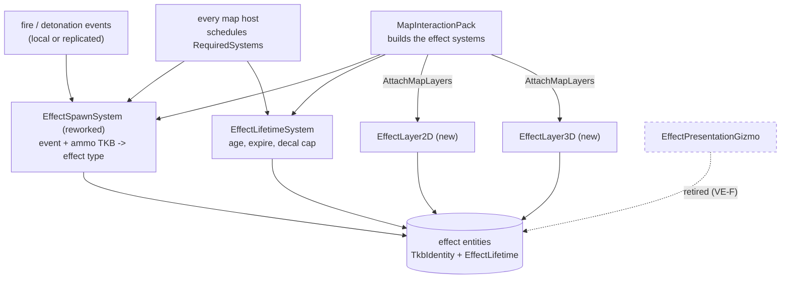

*What the picture shows that prose hid:* the effects stop being an IG/Editor module and become part of the shared map
construction — the pack builds the two systems and the two layers, every host schedules the systems it declares, and the
existing `Unserviceable` check reports a host that does not. The gizmo projector is the dead edge.

### 3.2 Classes

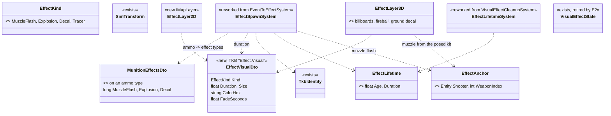

*What it shows:* the look lives in the TKB (one descriptor per EFFECT type, one mapping per AMMO type); the entity carries only
its type, its age and — for a muzzle flash — what it is attached to.

### 3.3 Sequence — one shot, from fire to decal

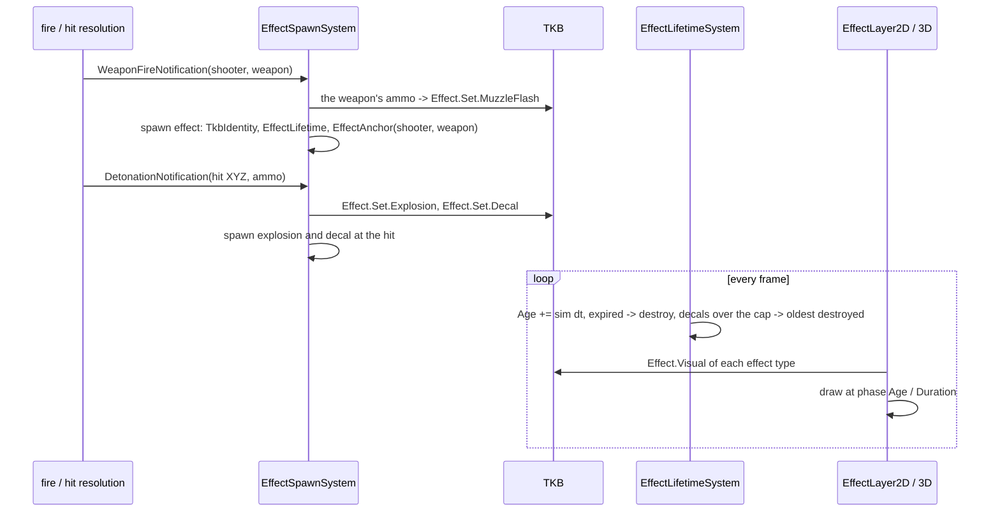

## 4. DECISIONS — ✅ APPROVED `2026-10-10` (U3)

| # | decision | ⭐ lean | rejected — one line each |
|---|---|---|---|
| **VE-A** | where effects are made | ⭐ **on every map host, locally, from the fire / detonation events** (which already reach every node); the pack BUILDS the two systems, every host schedules them, `RequiredSystems` declares them so `Unserviceable` reports a host that does not (R-254) | replicating effect entities — the events already cross the wire; an effect is presentation · keeping it an IG/Editor module — the measured "not on all hosts" |
| **VE-B** | what an effect entity is (U1) — ⚠ *"not recorded" and `EffectLifetime` SUPERSEDED by §7 VE-Q/VE-R (U7/U8)* | ⭐ `TkbIdentity` (the effect type) + `SimTransform` + `EffectLifetime { Age, Duration }`; not saved, not recorded | the current `VisualEffectState` enum + colours on the entity — the look would live in code, not the TKB |
| **VE-C** | what an effect looks like | ⭐ TKB `Effect.Visual { Kind, Duration, Size, ColorHex, FadeSeconds }` on built-in effect types: muzzle flash, explosion and decal in **small / medium / large** (nine), plus the tracer | one effect type with a scale parameter — the decal art and durations differ by size, not just scale |
| **VE-D** | which effect an ammo makes (U2: "multiple sizes based on ammo type") | ⭐ TKB `Effect.Set { MuzzleFlash, Explosion, Decal }` on the AMMO type (references to effect types); an ammo with none uses a default by its calibre class | sizing from damage or penetration — a HEAT round and an APFSDS of the same gun look different |
| **VE-E** | where a muzzle flash is | ⭐ `EffectAnchor { Shooter, WeaponIndex }`: the RENDERER finds the muzzle each frame from the shooter's posed kit (§3.11 turret pose, M23–M26) — the flash follows the barrel; until the pose exists, the kit's neutral barrel | a fixed spawn position — wrong as soon as the vehicle or turret moves during the flash |
| **VE-F** | how they are drawn (U2: "no gizmos as such") | ⭐ two map layers attached by `AttachMapLayers`: **2-D** a star (flash), an expanding disc (explosion), a dark blot (decal); **3-D** additive camera-facing quads for flash and fireball, a fading ground quad draped on the terrain for the decal; `EffectPresentationGizmo` — and ONLY it — retired when the 2-D layer lands (route, not a second surface; §4a) | effects as gizmo primitives — the user ruled it out, and a 64-byte primitive per effect per frame is waste |
| **VE-G** | whose clock | ⭐ **simulation time**: a paused sim freezes an explosion mid-phase; a replay replays them from the replayed events | wall time — a paused fireball would finish, and a replay would not match |
| **VE-H** | decals live long | ⭐ minutes, fading at the end, and a **cap** (oldest removed first, e.g. 256) so a firefight cannot grow without bound | until the scenario resets — unbounded |
| **VE-I** | decal surface | ⭐ step 1: on the GROUND under the hit (draped, R-248); step 2: on the hit surface — a wall or a roof — once `IWorldQuery.Trace` reports the hit's surface normal | a decal floating at the hit point — visible as a card in 3-D |

### 4a. Which gizmo retires, and which stay *(U3)*

📐 Measured `2026-10-10`. Three different things draw "a shot" today; only the first is replaced.

| | what it draws | ⭐ fate |
|---|---|---|
| `EffectPresentationGizmo` (`Hrot.Presentation/Gizmos/EffectPresentationGizmo.cs:13`) | the CURRENT effect entities (`VisualEffectState`): an explosion as a flat circle at **z = 0**, a tracer as a 1-px line from the shooter's ORIGIN to the target's origin at **z = 0** (`:30-41`) | ⛔ **retired by E3** — it is the drawing half of the effect entities this design rebuilds; the new effect layers draw the same entities (and the tracer kind) from their TKB type, in both modes |
| `FireTraceGizmo` (`ScenarioEditor/Gizmos/FireTraceGizmo.cs:16`) — the **firing line** | each round fired: **muzzle → where it ended**, coloured by outcome (hit red, stopped by terrain orange, expired grey, in flight yellow), crossings marked, fading over seconds of sim time (`CE-3153`); recorded, so a replay shows it; the layer control's *FireTraces* bit | ✅ **stays** — an analysis layer, not a realism effect. It already emits real 3-D points (`s.Muzzle`, `s.End` are `Vector3`, `:80`), so the 3-D map draws it at its true heights once S3's gizmo triage lands |
| `DetonationGizmo` (`ScenarioEditor/Gizmos/DetonationGizmo.cs:16`) | a burst's fragment / blast radii and rays to every body point it rated | ✅ **stays** — analysis; 3-D in S3 |

⇒ in 3-D a shot shows as the **muzzle flash + tracer + explosion + decal** (realism, this design) and, when the operator turns
the layer on, the **outcome-coloured firing line** (analysis, S3). ⚠ The tracer kind and the firing line overlap in purpose; the
tracer is short and decorative, the firing line is the one that says what the round DID.

### 4b. Binding the muzzle flash to the barrel *(U4 — VE-J..VE-M ✅ APPROVED, U5)*

🔒 **User, `2026-10-10`:** *"how the muzzle effect will be bound to the barrel? what is expected from the shot effect entity
regarding its parenting or location?"*

📐 **Measured:**

| fact | code | design |
|---|---|---|
| the fire event and its wire message carry the shooter and the WEAPON INDEX — no position | `WeaponFireNotification`; `WeaponFire { ShooterEntityId, TargetEntityId, WeaponIndex }` (`FireInteractionMessages.cs:48-52`) | ⛔ searched, none |
| today the round starts at the shooter's ORIGIN + its stance/type eye height, then 1 m along the aim line — not at a barrel | `FireProcessingSystem.cs:109,115,172`; `CombatConstants.MuzzleOffsetMeters = 1.0` (`:65`) | the 1 m exists so a round does not spawn inside a squad-mate (`CE-3059`, comment at `:169`) |
| the shot log records that point as `Muzzle`, and the firing-line gizmo draws from it | `FireProcessingSystem.cs:208,221`; `FireTraceGizmo.cs:80` | `CE-3117` |
| the part link `PartMetadata` is a NETWORK-meaningful part (its `InstanceId` is reused as the descriptor instance) | `PartMetadata.cs:5-13` | `Q79` §0.10, R-255 (the turret is such a part) |

| # | decision | ⭐ lean | rejected — one line each |
|---|---|---|---|
| **VE-J** | what the flash entity carries | ⭐ `TkbIdentity` (its flash type) + `EffectLifetime` + **`EffectAnchor { Shooter, WeaponIndex }`** — no position of its own: the renderer finds the muzzle EVERY FRAME, so the flash rides the barrel while the hull drives and the turret slews; the shooter gone ⇒ the flash ends | a `PartMetadata` child of the shooter — parts are network-meaningful (instance ids, ownership, egress), an effect is local and lives 0.1 s · a fixed spawn position — wrong the moment the vehicle or turret moves |
| **VE-K** | where the muzzle IS — ONE answer | ⭐ `Muzzle.Of(view, shooter, weaponIndex)` in `Fdp.Toolkits`: the mount's TKB muzzle offset, relative to its turret's trunnion, posed by the turret part's `TurretPose` (M23), placed by the body; a mount on no turret: relative to the body; a person: today's stance eye height + the weapon's forward offset. ⭐ **The fire code spawns the round there too** (replacing the fixed 1 m; its "never past half way to the target" clamp stays), so the flash, the tracer, the round and the firing line all start at the same point | the renderer computing its own muzzle from the kit — two answers that drift (the flash beside where the round left) |
| **VE-L** | the drawn barrel | ⭐ when the TKB gives the turret and mount geometry (M25), the kit's turret and gun parts are placed FROM it — the barrel tip IS `Muzzle.Of`; a rail checks it to 5 cm (the `CE-1041` pattern: the TKB is the truth, the kit draws it) | a separate kit muzzle — the picture and the shot disagree |
| **VE-M** | explosion and decal | ⭐ **world-fixed** at the hit point, no parent; a decal only on the static world (ground; walls/roofs in step 2) — a hit on a vehicle makes an explosion and no decal | a decal parented to a moving vehicle — a damage look belongs to the vehicle's own state, not to a decal |

⚠ VE-K adds one field set to M25's TKB turret descriptor (per mount: which turret, muzzle offset) and changes where a round
spawns — a combat-lane change, hence a separate nod.

## 5. NOT VERIFIED

| claim | how it is settled |
|---|---|
| ⚠ every host's kernel has a slot the pack's effect systems can be scheduled in (CGF, SimHost, ReplayBrowser run no effects today) | E2 — `Unserviceable` must come back empty on all five |
| ⚠ the munition TKB has an ammo template per round the weapons fire (`AmmoWeaponBallisticsDto` per launcher) to hang `Effect.Set` on | E1 — enumerate `MunitionTkbCatalog` and the weapon suites |
| ⚠ software GL cost of additive blending with a few hundred live effects | E3 frame rail, then the Windows run |

## 6. SLICES

| slice | delivers | depends on |
|---|---|---|
| **E1** | TKB `Effect.Visual` + `Effect.Set`; nine built-in effect types + the tracer; `Effect.Set` on the built-in ammo | VE-B..VE-D approved |
| **E2** | `EffectSpawnSystem` / `EffectLifetimeSystem` reworked onto TKB types and sim time, built by the pack, declared in `RequiredSystems`, scheduled on all five hosts (rail) | E1 |
| **E3** | `EffectLayer2D` + `EffectLayer3D`; `EffectPresentationGizmo` retired; screenshot rail | E2 |
| **E4** | `Muzzle.Of` (VE-K) used by the fire code and the renderer; the flash at the posed barrel; the kit's barrel from the TKB (VE-L) | the turret build (3-D map §3.11, M23–M26) + VE-J..VE-M |

### 6a. E1–E3 — AS-BUILT `2026-10-11`

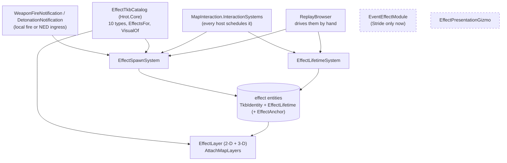

*What the picture shows that prose hid:* the effects ride the ONE scheduled set every map host already runs
(`InteractionSystems`), so no host can have the map without the effects; the replay browser — the one host that drives map
systems by hand and has no kernel — drives them too, and plays their commands back itself. The dashed edges are what retired:
the gizmo (deleted) and the IG/Editor effect module (Stride keeps it — "Stride untouched").

| built | where |
|---|---|
| `EffectKind`, `EffectVisualDto` (`"Effect.Visual"`), `MunitionEffectsDto` (`"Effect.Set"`, + a tracer reference) | `Fdp.Toolkits/Tkb/Domain/EffectDtos.cs` |
| the ten effect types (7101–7103 flash, 7111–7113 explosion, 7121–7123 decal, 7131 tracer), hidden from the palette; the grenade and the mortar name their sets; `EffectsFor` = the ammo's set, else the calibre class from damage per hit (small < 50 ≤ medium < 500 ≤ large — rifle / 25 mm, RPG / tank gun, ATGM); `VisualOf` falls back to the built-in table on a host with no TKB | `Hrot.Core/Tkb/EffectTkbCatalog.cs`, registered by `HrotEnvironment.CreateTkb` |
| `EffectLifetime` (124), `EffectAnchor` (125) — registered by `PresentationComponentRegistry.RegisterEffects` (from `RegisterAll` and the pack) | `Hrot.Core/Components/Map/EffectComponents.cs` |
| `EffectSpawnSystem` (fire ⇒ a flash attached to the weapon + a tracer toward the target when the round has one; hit ⇒ an explosion at the hit, a decal on the ground under it unless the round hit a live body) and `EffectLifetimeSystem` (age by the tick's dt, expire, shooter gone ⇒ end, decals capped at 256 oldest first) — in `MapInteraction.InteractionSystems` and `RequiredSystems` with `Unserviceable` reasons | `Hrot.Presentation/Effects/EffectSystems.cs`, `MapInteraction.cs` |
| `EffectLayer` — 2-D star / disc / blot / streak; 3-D additive spheres, a draped decal disc, a tracer streak; the look and phase from the TKB | `Hrot.Presentation/Effects/EffectLayer.cs`, attached by `AttachMapLayers` |
| retired: `EffectPresentationGizmo` (deleted with its two IG rails); `EventEffectModule` no longer registered on IG or the Editor | — |
| ⭐ kept out of everything durable (VE-B): `EffectLifetime` / `EffectAnchor` are `DataPolicy.Transient`; every effect entity carries `ScenarioIgnoreTag` — 📐 measured: the scenario save takes EVERY owned entity without that tag (`ScenarioSerializer.CollectSaveableEntities`), so the old `VisualEffectState` explosions were saveable too; the body layer gives an effect type no body (by its `Effect.Visual`, and by the catalog where there is no TKB), else a recorded effect would draw as an unknown box | `EffectComponents.cs`, `EffectSystems.cs`, `EntityBodyLayer3D.LookOf` |

⚠ **Deviations, argued:** ONE `EffectLayer` with both passes, not two classes (one query, one muzzle, one TKB lookup, as the gizmo
layer). · The **muzzle** is the front of the shooter's drawn box in its upper half until E4's `Muzzle.Of`. · The replay browser
ages effects by the **replayed** time it stepped (paused ⇒ frozen); the other hosts by the interaction module's dt — 📐 the
kernel's per-module accumulated delta (`ModuleHostKernel.cs:689`), which is the same delta every other module gets.
· Effect sets live on the AMMO type (VE-D) and only two built-in ammo types exist; every other mount resolves by calibre class.
**Gates:** `EffectTests` (Hrot.Presentation.Tests) · frame rail shot ⑧ `map3d-8-effects.png` · IG module rails updated.

### 6b. E4 — `Muzzle.Of`: the round, the flash, the tracer and the drawn barrel tip from ONE point *(✅ built `2026-10-11` as drawn; VE-J..VE-L)*

E4 is split: **E4a** = `Muzzle.Of` and its three readers (the fire code, the flash, the tracer); **E4b** = the kit's turret and gun
placed FROM the TKB, so the drawn barrel tip IS `Muzzle.Of` (VE-L, a 5 cm rail).


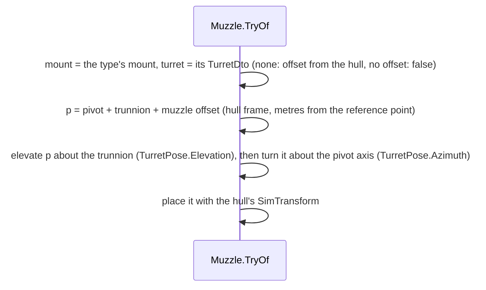

*What the pictures show that prose hid:* `Muzzle.TryOf` applies the SAME two rotations, in the same order, as the kit's
`KitPart.BodyTransform` does to the gun part (elevation about the trunnion, then azimuth about the turret axis), so once E4b places the
kit from the same numbers the drawn tip and the computed muzzle cannot disagree. A type with no muzzle data answers false, and every
reader keeps its present behaviour — a rifleman's round still starts at his eye + 1 m.

| choice | why | rejected — one line each |
|---|---|---|
| the trunnion is a TKB offset from the pivot (`TrunnionX/Z`), default 0 | a gun elevates about a point FORWARD of the turret axis (the kit already draws it so) | trunnion = pivot — the drawn barrel would swing about the turret centre |
| the round's aim point is still chosen from the EYE (`AimPoint.For`, what the shooter sees); only its launch point moves | the sight question is the shooter's, the flight starts at the barrel | aiming from the muzzle — a hull-down tank would "see" over a crest with its gun |
| "never past half way" kept: when the barrel is more than half way to the target, the round starts as today | CE-3059 — a round must not spawn beyond / inside a close target | dropping the clamp — point-blank shots would start past the target |
| `BallisticAim` keeps solving from the pivot | the trunnion–pivot parallax (~1.5 m) is below the 0.5° on-target tolerance beyond ~170 m | moving it now — touches WL-2's rails for no visible gain |

⚠ **As built (E4):** `Muzzle.Of` is `Muzzle.TryOf(world, shooter, weaponIndex, out point)` — false for a type with no muzzle data, so
every reader keeps its old answer for it (riflemen, unknown types). The kit draws the barrel of the FIRST mount on turret 0 with a
forward offset (mount 0 on a tank, the 25 mm on the Bradley); the TOW is not drawn, but its rounds and flashes leave from its own
offset. Gates: `FireProcessingSystemTests.E4_*` (2), `Map3DTests.E4b_TheDrawnBarrelTip_IsTheMuzzle_Within5cm` (3 types).

### 6c. CE-1070 — the flash out of the weapon: a rifleman's at his drawn rifle, every flash blooming forward *(✅ built `2026-10-14`, ui)*

🔒 *User, 2026-10-14: "the muzzle flash for the soldier is shown as bright sphere above soldier's head, could it be at the end of
the rifle? same for tanks cannons..."*

📐 **Measured with a frame rail first** (`Map3DFrameRail.CE1070_MuzzleFlashes_AtTheWeapons`, "before" shots):
- **Rifleman:** he has no TKB muzzle (E4's `Muzzle.TryOf` is false for him, by design), so the flash took the interim box-front point. That is 0.55 m in front of his PICK box at 1.35 m: above a crouched man's eye (1.1 m), and nowhere near the rifle he is drawn holding (chest-low when ready, shoulder when aimed).
- **Tank:** E4 put the flash exactly at the barrel tip, but drew the 4 m `MuzzleFlashLarge` as a ball CENTRED there. Half of it sat back over the barrel and turret front, and it stood 2 m above the gun, so it read as "above the tank".

| decision | ⭐ lean | rejected (one line each) |
|---|---|---|
| a rifleman's muzzle | the END OF THE RIFLE THE 3-D FIGURE DREW this frame (`EntityBodyLayer3D.TryGetWeaponTip`: the figure's Metal part's far end, posture, stance, lean and aim included); order: TKB muzzle → drawn weapon → box front → 1.5 m up | a TKB muzzle offset for the rifleman (a rifle's muzzle moves with posture, stance, lean and aim; no fixed offset is right) · moving the ROUND's launch point too (the sim keeps eye + 1 m; this is the picture) |
| where the fireball sits | centred `FlashForwardOfMuzzle` (0.8) × its radius ALONG THE WEAPON from the muzzle: it blooms out of the barrel; the weapon's direction comes from the same pose as the muzzle (`Muzzle.TryOf(…, out forward)`, the drawn rifle's axis) | a smaller flash (the 120 mm fireball is about that big) · the target direction `EffectAnchor.Toward` (it is zero with no target, and a turret can lag its aim) |
| 2-D | unchanged: the star at the muzzle point (now the drawn rifle's tip when the 3-D map drew one) | — |

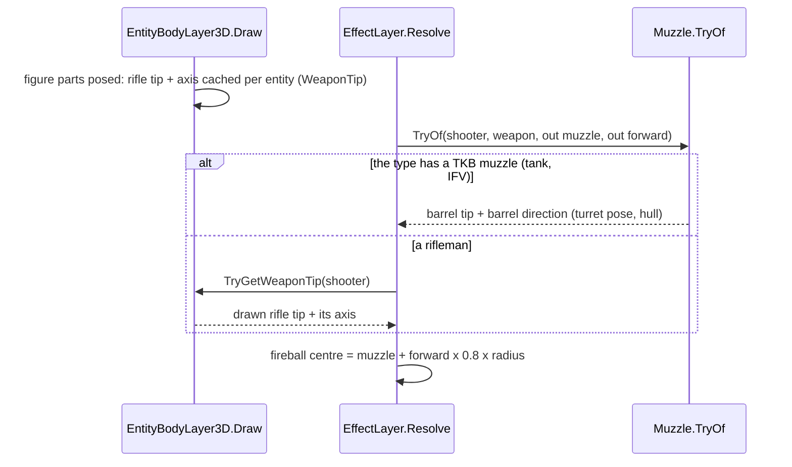
*What the picture shows that prose hid:* the flash takes its point from the same place the weapon is drawn, through two paths:
- the TKB muzzle for a gun, which E4b already placed the drawn barrel from (within 5 cm);
- the drawn rifle itself for a figure.

So the flash and the weapon cannot disagree. Because the rifle path reads the cache the body layer fills while drawing, the flash
is at most one frame behind a moving rifle.

⚠ **Left, named:**
- In 2-D, with no 3-D figure drawn, a rifleman's flash still uses the box front (seen from above it is one point).
- The round still leaves a rifleman's eye + 1 m (FireProcessingSystem): the fire trace and the flash start apart by a few decimetres.
- A vehicle type with a kit gun but no TKB muzzle (none built in today) would fall back to its box front.

**Rails:**
- `Map3DTests.CE1070_ARiflemansMuzzle_IsTheEndOfTheRifleHeIsDrawnHolding` and `CE1070_ATankFlash_BloomsForwardOfItsMuzzle_AlongTheBarrel`.
- `Map3DFrameRail.CE1070_MuzzleFlashes_AtTheWeapons`, before and after shots.

## 7. Wrecks, dead bodies, flames and smoke — and one generic `Lifespan` *(✅ APPROVED `2026-10-11`, U6–U8, R-269 (ui); W1–W4 built — §7.5)*

| # | verbatim |
|---|---|
| **U6** | *"The destroyed entities (vehicle wrecks, soldier bodies) should be rendered differently — vehicles could become fully black and we could add a time limited (auto removal) flames/smoke entity attached to them, generating some simple particle effect. Dead soldiers could take special dead laying pose."* · on the leans: *"Durations ok. X symbol OK in 2d."* |
| **U7** | *"Timed effect could have component stating its lifespan and time of creation (simtime) so some garbage collection system removes those. Maybe this could be a generic component and maybe it already exists?"* |
| **U8** | *"Why not recorded? If recorded, replay will show effects properly after jump in time."* · *"Approved. Local effect entities not significant in recording, no need to measure."* |

### 7.1 INVENTORY — measured `2026-10-11`

Graph `search_graph` `.*(Lifetime|Lifespan|Expir|TimeToLive|Ttl|Despawn|AutoRemov|Corpse|Timed).*` (Struct 0, Class 7 — only
`EffectLifetime` / `EffectLifetimeSystem` are entity lifetimes) + grep; corpus sweep of `docs/` and `.dev/` by topic.

| what exists | where | what §7 does with it |
|---|---|---|
| dead entities STAY in the world (Health 0, capabilities stripped) | `HealthApplicationSystem.cs:90-104`, `DamageSystem.cs:74-83` · ruling 2026-09-13 (`RUNBOOK_Cluster_Debugging_Over_Http.md:360`), CE-272 | the wreck / body is that entity, drawn differently |
| "destroyed" = `Health.Current ≤ 0`, Health received on EVERY node | `CombatLife.cs:21`, `ThreatDanger.cs:32`; `EntityDamage` in `SharedTranslatorPack.cs:82` | `WreckState.IsDestroyed` — the one test |
| vehicle damage states / human injury states | ⛔ not built — D1 decided (`DESIGN_Operations_Behaviour_Catalogue.md:290-296`) | later the source of "destroyed"; only `IsDestroyed` changes |
| `EffectLifetime { Age, Duration }` (age summed per frame, effects only) + `EffectLifetimeSystem` | `EffectComponents.cs:16`, `EffectSystems.cs:96` | ⭐ replaced by the generic `Lifespan` (VE-Q) |
| bullet timeout `BallisticProjectile.SpawnTick` | `BallisticsSystem.cs:134` | left (combat code); named as the next `Lifespan` user |
| effect kinds MuzzleFlash / Explosion / Decal / Tracer; no smoke, fire, particles | `EffectDtos.cs:7`; `EffectLayer.cs:157-219` | + `Fire` and `Smoke` kinds, a stateless particle draw |
| `EffectAnchor { Shooter, WeaponIndex, Toward }` — muzzle only | `EffectComponents.cs`, `EffectLayer.cs:77-82` | + a BODY anchor (the wreck's top) |
| person figure per stance (Standing / Crouched / Prone), blended | `ShapeKit.cs:318-346` (`BlockFigure`), `EntityBodyLayer3D.cs:147` | + a `Dead` figure posture |
| 2-D condition bits Damaged / Immobile from Health | `EntityPresentationGizmo.cs:120-130` | + Destroyed → the 2525 X |
| the replay browser re-spawns effects from replayed events by hand | `ReplayBrowserSubsystem.cs:458-466` | ⭐ stops: the recording holds the effects (VE-R) |
| `DataPolicy` keeps "not recorded" (`NoReplay`) and "not saved" (`NoScenario`) apart | `DataPolicyAttribute.cs` | effect components: `NoScenario` (+ `NoPreview`), RECORDED |

### 7.2 Diagrams

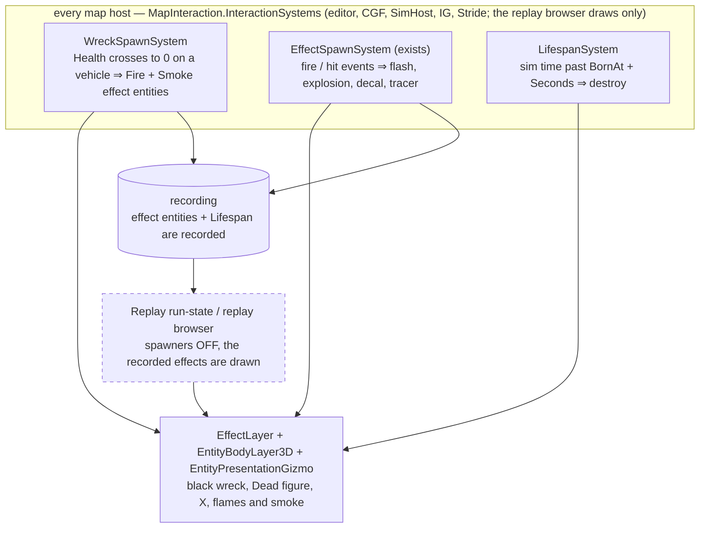

*What the picture shows that prose hid:* the spawners run where the map's systems already run on every host — and are OFF in replay,
where the recording already holds the effects (U8); running them there too would draw every effect twice. The garbage collector is
one system for every timed entity, not a per-feature timer.


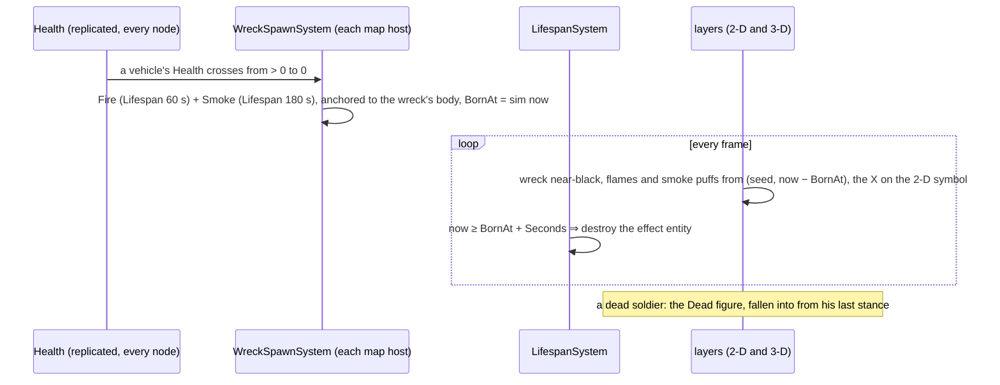

### 7.3 Decisions — ✅ approved (U6–U8)

| # | decision | ⭐ approved | rejected — one line each |
|---|---|---|---|
| **VE-N** | what "destroyed" is | `Health.Current ≤ 0` through ONE helper, `WreckState.IsDestroyed` — D1's damage states replace its body later | a new replicated destroyed flag — Health already reaches every node |
| **VE-O** | the wreck's look | the whole 3-D body near-black (every part, the Dark / Glass / Metal roles too), the turret where it last pointed; 2-D: the MIL-STD-2525 destroyed condition — an X through the symbol (U6: *"X symbol OK"*) | a darkened 2-D symbol — not the standard marking |
| **VE-P** | flames and smoke | effect entities of two new kinds, `Fire` (≈ 60 s) and `Smoke` (≈ 180 s, fading) (U6: *"Durations ok"*), made by each map host when a VEHICLE's Health crosses to 0, anchored to the wreck's body; a stateless particle draw (each puff from the entity's seed and its age — no particle entities); a 2-D smoke/flame mark; soldiers do not burn; ⭐ `CE-1198` (`2026-10-19`, user: *"weapons are usually non-flammable"*) nor do WEAPON SYSTEMS — they only go dark; a wreck loaded already dead does not burn | a particle entity per puff — thousands of entities; a burn decal on the wreck — VE-M ⭐ `2026-10-21` (CE-1146 PR-2): the smoke column drifts on the WORLD'S wind, not a fixed breeze — [Map 3-D §6aa.PR-2](DESIGN_Map_3D_Mode.md) |
| **VE-Q** | timed removal | ⭐ ONE generic `Lifespan { BornAtSimSeconds, Seconds }` + ONE `LifespanSystem` (U7); every effect uses it, `EffectLifetime` retires, the phase comes from the sim clock (VE-G kept) | a timer per feature (today's `EffectLifetime` and the bullets' `SpawnTick`) — the bullets move later, in the combat code's lane |
| **VE-R** | recording | ⭐ effect entities ARE RECORDED (U8), never saved to a scenario (`NoScenario`); in replay the spawners are OFF and the recorded effects are drawn — a jump lands on the right fire and smoke | ⛔ SUPERSEDED: VE-B "not recorded" — a jump lost every long effect |
| **VE-S** | the dead soldier | a `Dead` figure posture in `BlockFigure` (on the back, limbs spread), fallen into over ~0.6 s from his last stance; drawn because he is destroyed, NOT a stance | a `Dead` value in `StanceId` — the stance is the animation contract shared with the Muscle; death is a health fact |

### 7.4 Slices

| slice | builds | shows |
|---|---|---|
| **W1** | `Lifespan` + `LifespanSystem`; effects moved onto it; `EffectLifetime` retired; effect components `NoScenario` + recorded; spawners off in replay, the replay browser's hand-spawning removed | today's effects unchanged live; correct after a replay jump |
| **W2** | `WreckState`; black wrecks in 3-D; the 2-D X | a killed tank is a black hull with an X |
| **W3** | `Fire` / `Smoke` kinds + catalog types; `WreckSpawnSystem`; body anchor; stateless particles; the 2-D mark | the wreck burns ~60 s and smokes ~3 min, then they are gone |
| **W4** | the `Dead` figure + the fall | a killed soldier lies on his back |

### 7.5 W1 — AS-BUILT `2026-10-11`

| what | where | ⚠ vs §7.2–7.4 |
|---|---|---|
| `Lifespan` (id **356**) + `LifespanSystem`, generic | `FDP/Toolkits/Fdp.Toolkits/Time/Lifespan.cs`, `LifespanSystem.cs` | as drawn. ⚠ 355 is the backend lane's `CombatTemperament` |
| every effect stamped `Lifespan.Starting(sim now, Duration)`; the layer's phase and fade read `SimClock` | `EffectSystems.cs` `Spawn`, `EffectLayer.Resolve` | as drawn — VE-G now holds by construction (no stored age to forget to freeze) |
| `EffectLifetime` + `EffectLifetimeSystem` retired | `EffectComponents.cs`, `EffectSystems.cs` (tombstones) | as drawn; ⭐ **deviation:** its orphan-anchor (VE-J) and decal-cap (VE-H) rules moved into `EffectSpawnSystem.Housekeep`, so `LifespanSystem` stays effect-blind |
| `EffectAnchor` and `Lifespan` recorded, `NoScenario` + `NoPreview` | `EffectComponents.cs`, `Lifespan.cs` | as drawn (VE-R) |
| ⭐ **the replay gate** — `MapInteractionContext.IsReplayActive` → `MapInteraction.IsReplayActive` → both systems, read each frame | `MapInteractionContext.cs`, `MapInteraction.cs`, `MapInteractionPack.cs` | ⭐ not drawn before: §7.2 said "spawners OFF in replay" without the WHO. The mechanism is replay-and-modules §2.1m's (gate in place). **SimHost** passes the ELM's gate (`HrotNodeContext.BaseModules[0]`, wired by `NodeBootstrapper` to the record/replay controller); **CGF** passes `rrController`; the **replay browser** passes `() => true`; the **editor** passes nothing (its replay is an isolated sandbox, `ReplayBrowserContext`); **IG** passes nothing (listen-only: it holds no recording, so it keeps making its own from the events it receives) |
| the replay browser's hand-spawning and its private replayed-dt clock removed | `ReplayBrowserSubsystem.cs` | ⭐ **deviation:** it still TICKS both systems (gated off) so its declared run-set stays the map's whole set and `Unserviceable` raises no false alarm |
| rails | `EffectTests.W1_*`, `E2_*` moved onto sim time | — |

*NOT verified:* a real record → replay → seek round trip that shows a recorded decal after a jump (the rails pin the policy flags and the
gates, not the recorder). ⚠ The recorder must see `Lifespan`/`EffectAnchor` registered on the recorded world — `RegisterEffects` does it
on every map host's world.

### 7.6 W2–W4 — AS-BUILT `2026-10-11`

| slice | what | where | ⚠ vs §7.2–7.4 |
|---|---|---|---|
| W2 | "destroyed" = `CombatLife.IsDestroyed` (exists, has `Health`, `Current ≤ 0`) | `FDP/Toolkits/Fdp.Toolkits/Combat/CombatLife.cs` | ⭐ **deviation:** no new `WreckState` class — `CombatLife` already owns *"is this unit still in the fight"* (CE-466), so the one test lives beside `IsAlive` (seam law: one home per rule) |
| W2 | 2-D X: `EntityShapeCondition.Destroyed` (bit 4), set by `EntityPresentationGizmo`; drawn by `PerspectiveShapeRenderer.DrawDestroyedCross` for ANY profile, and on the no-profile fallback box | GizmoMap `Shapes/`, `Rendering/DebugPrimitiveRenderer2D.cs` | ⚠ measured: no shape profile uses the condition elements (`ShowWhen` has zero data users), so the renderer draws the X itself. ⚠ A dead SOLDIER's symbol gets the X too — he is destroyed by the same test |
| W2 | 3-D wreck: `EntityBodyLayer3D.PartColour` near-black for every role and the aircraft gear; a wrecked helicopter's rotor stands | `Map3D/EntityBodyLayer3D.cs` | as drawn; the turret keeps its last `TurretPose` (nothing drives it once dead) |
| W3 | `EffectKind.Fire` / `Smoke`; catalog `Fire 7141` (60 s), `Smoke 7151` (180 s) | `EffectDtos.cs`, `EffectTkbCatalog.cs` | ⚠ "default per vehicle family" became ONE pair for every vehicle, **scaled by the wreck's drawn footprint** (0.4–2 × a 7 m tank) — no per-family TKB descriptor (new vocabulary not needed yet) |
| W3 | `WreckSpawnSystem` — only a CROSSING burns (memory per entity, dropped on a world change and while replaying); a person / bodiless unit / unknown type never burns | `EffectSystems.cs`; scheduled through `MapInteraction.InteractionSystems` on every host, declared in `RequiredSystems` | as drawn |
| W3 | `EffectAnchor.Kind` (`Muzzle` / `Body`); the layer puts a body-anchored effect at the top of the drawn box (`EffectLayer.BodyTopOf`) | `EffectComponents.cs`, `EffectLayer.cs` | as drawn; the wreck deleted ⇒ the flames end (the spawner's orphan rule, W1) |
| W3 | stateless particles `EffectLayer.Puffs` — fire tongues (0.8 s loop, dying down over the last 30 %), smoke puffs (6 s loop, rising 6 sizes, drifting on a fixed breeze); 2-D draws the same puffs from above | `EffectLayer.cs` | ⚠ the breeze is a constant until weather exists |
| W4 | `BlockFigure.Dead` (on the back, legs apart, arms flung out, rifle dropped) + `BlockFigure.Fall`; `DeathFall` remembers when each death was SEEN (sim time) — a body first seen dead, or a death found across a jump (> 0.5 s since last seen alive), just lies | `Map3D/ShapeKit.cs`, `EntityBodyLayer3D.FigurePose` | as drawn; `Blend` and `Fall` share one interpolation (now with yaw/pitch) |
| rails | `EffectTests.W2_*`, `W3_*`; `EntityPresentationGizmoTests.Draw_WhenDestroyed_*`; `Map3DTests.W4_*`; `MapSelfCheckTests` pinned counts | | — |

⭐ **Verified on GL `2026-10-11`** — `Map3DFrameRail.W_DestroyedEntities_*` renders the story under Xvfb (Mesa) and writes six
screenshots (`wreck-1…6-*.png`): three wrecks killed through the production `WreckSpawnSystem`, the riflemen dead / falling / alive,
the fire dying at 52 s, smoke alone at 150 s, and the 2-D symbols with the X. ⚠ **Tuned from those shots:** the first flames were
ADDITIVE yellow puffs that saturated to a white ball ⇒ now ALPHA-blended orange → red → soot tongues spread over the hull (16 puffs,
Fire size 3.2 m); the first X was heavier than the outline and overshot the corners ⇒ now corner to corner at the outline's weight;
in 2-D the smoke hid the flames ⇒ flames draw last there, at least 3 px. Run it:
`HROT_RAIL_SHOTS=<dir> xvfb-run -a -s "-screen 0 1280x800x24" dotnet test Hrot/Engine/Hrot.Presentation.Tests --filter "FullyQualifiedName~Map3DFrameRail"`.


## 8. Projectiles in flight and on the ground — grenades, bombs, rockets, missiles *(P1 + P2 built `2026-10-11`; PR-D/PR-E decided by R-271 — §8.5 LR built `2026-10-11`)*

| # | verbatim |
|---|---|
| **U9** | *"Backend lane allowed throwing grenades today, i need you render the grenade when it flies and when it lays on ground before exploding. You can render basically any other projectile which is represented by its own entity, like missiles and rockets and bombs. If they have no entity and ballistic/flight model and no 3d model, lets think how to solve that."* |

| **U11** | 🔒 *"Every ammo needs its tkb type, always. Big stuff like arty shells, grenades, mortar rounds, bombs, rockets as well as small bullets with tracers need to be network replicated from the muscle node who is the only one knowing the flight trajectory, no local simulation, so any dumb viewer knows about them. Projectiles need to be lightweight so their entiries should not use any lifecycle management and acks. they need just entity master and worldposition."* (R-271) |
| **U10** | *"Rifle bullets if they have tracers (special tkb type switch) migh deserve its own entity to be visualizable, otherwise ordinary bullets does not need entity."* |

### 8.1 INVENTORY — measured `2026-10-11`

Graph `search_graph` `.*(Projectile|Grenade|Munition|Missile|Rocket|Ballistic).*`, Class — **26, `has_more: false`**; production hits:
`BallisticProjectile`, `BallisticsSystem`, `BallisticAim`, `AmmoWeaponBallisticsDto`, `MunitionEffectsDto`, `MunitionTkbCatalog`,
`MunitionDetonation` (+ its two translators), `ProjectilePresentationGizmo`. Corpus sweep of `docs/` + `.dev/` by topic.

| what exists | where | what §8 does with it |
|---|---|---|
| every round is its OWN entity: `SimTransform` + `SimVelocity` + `BallisticProjectile` + `PhysicsCollider`; no `TkbIdentity`, no `NetworkIdentity` | `FireProcessingSystem.cs:186-243`; `designs/dds-to-ecs/DESIGN.md:864` | drawn from those components |
| the round knows its MUNITION type (`Ammo`) and warhead bits — `Arc`, `TimeFuze`, `Landed` (lying, fuze burning), `Spent` — and `FuzeRemaining` | `CombatComponents.cs:73-148`; `DESIGN_Building_Interiors.md` §3k (W-4, W-8) | the look comes from the munition type; `Landed` + `FuzeRemaining` draw the lying grenade |
| rounds live ONLY on the node running combat (the Muscle, or the editor as one node) — never on the wire; only the fire / detonation EVENTS cross | `designs/brain-split/BS-1-DESIGN.md` §2.1, §5.4a; `DESIGN_Weapon_Layers.md:641` | ⚠ the open question PR-D |
| the `WeaponFire` wire event carries ONLY shooter, target, weapon index — no launch point, velocity or munition; `MunitionDetonation` carries the munition type and hit point | `FireInteractionMessages.cs:55-64, 93-115` | PR-D's lean extends it |
| munition types: only `M67` (6001) and `81 mm HE` (6002) — warhead + `Effect.Set`, no look; every other mount fires `Ammo = 0` | `MunitionTkbCatalog.cs`; `UrbanCombatTkbCatalog.cs:183,199` | + `Munition.Visual` on the two; ⚠ PR-E for the rest |
| `ProjectilePresentationGizmo` — a 1-frame yellow streak (previous → current position) per round on the 2-D map | `Gizmos/ProjectilePresentationGizmo.cs` | ⭐ extended, not duplicated: a lying grenade (zero-length streak, invisible today) gets a marker and its fuze countdown |
| no flight model for rockets / missiles: straight line at muzzle velocity, gravity only on arc rounds; ATGM "guidance" is the brain holding fire for the estimated flight | `DESIGN_Building_Interiors.md:1138,1286`; `DESIGN_Weapon_Layers.md` W-12c | drawn as flown (straight), smoke trail from the muzzle |

### 8.2 Diagrams

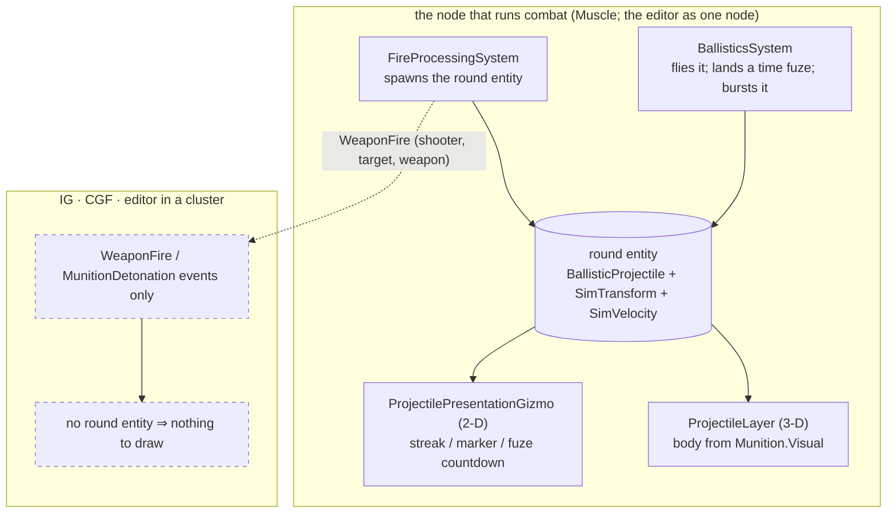

*What the picture shows that the prose hid:* a round can be drawn only where it EXISTS. On every other host the dashed path ends in
nothing — the events that do cross carry no launch point or velocity, so no host can fly a copy. That is PR-D, not a renderer gap.

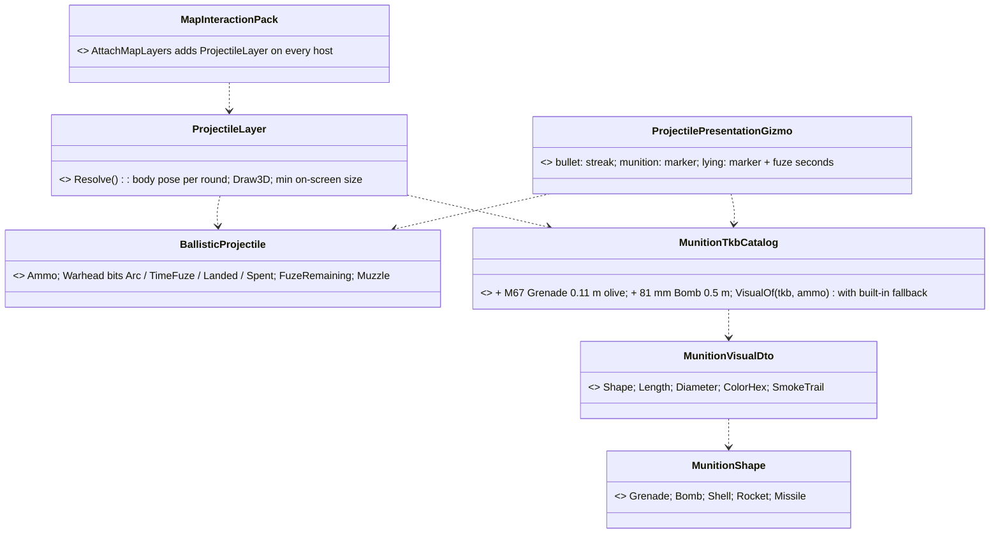

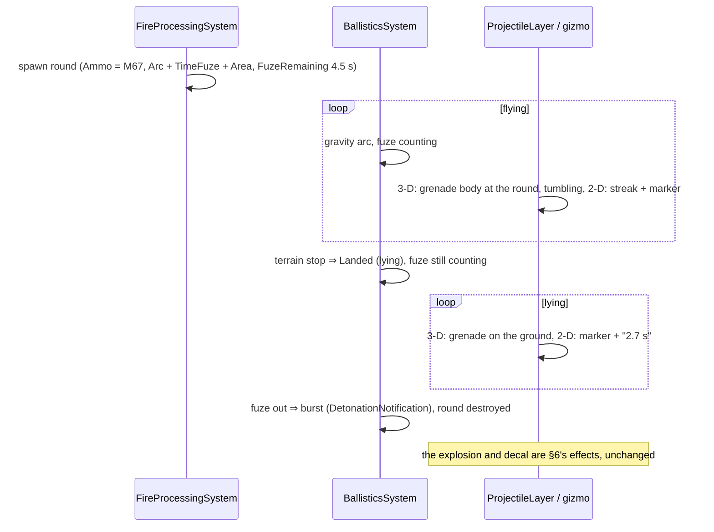

### 8.3 Decisions

| # | decision | lean | rejected — one line each |
|---|---|---|---|
| **PR-A** | where a round's look comes from | ⭐ its MUNITION type: a new optional `Munition.Visual` descriptor (shape, length, diameter, colour, smoke trail), the "the TKB type defines it" pattern of VE-C; built-in looks for M67 and 81 mm, so a host with no TKB (the replay browser) still draws them. A round with no munition look (`Ammo = 0`, every bullet) draws no body — its tracer is the effect | a look per weapon CATEGORY — the round does not carry its mount, and a category is not a munition |
| **PR-B** | the 3-D body | ⭐ one `ProjectileLayer` on every host (`AttachMapLayers`): the body at the round, long axis along its velocity, a grenade tumbling (stateless spin from seed and sim time), a lying round flat on the ground; drawn at least ~6 px so a 6 cm grenade is visible at map distance; a rocket / missile trails stateless smoke back to its muzzle | drawing it in `EffectLayer` — a round is not an effect and has its own lifetime owner (combat) |
| **PR-C** | the 2-D mark | ⭐ EXTEND `ProjectilePresentationGizmo` (the one 2-D projector of rounds): bullets keep the streak; a munition round adds a small filled marker in its colour; a LYING time-fuzed round adds its fuze countdown in seconds | a second 2-D projector — two implementations of one concept (ruling 9) |
| **PR-D** | ✅ **DECIDED by U11 (R-271) — option (a): the muscle REPLICATES the visible rounds as LIGHTWEIGHT network entities** — `EntityMaster` + `WorldPos` only, no lifecycle, no acks; no local simulation on the viewers. Design: §8.5. ⛔ SUPERSEDED lean below — kept for the record | ⛔ **SUPERSEDED lean (b): extend `WeaponFire` with the launch point, launch velocity and munition type; every host flies a local VISUAL copy** (gravity for arc rounds, straight otherwise), lands it on its own terrain, and ends it on `MunitionDetonation` (which already carries the munition and the burst point). ~28 bytes per shot on an existing reliable topic; exact for unguided rounds | (a) replicate rounds as network entities — exact, but a new descriptor per round at fire rate, and the brain-split design keeps rounds muscle state · (c) nothing remote — IG is the operator's view, and grenades would be invisible there |
| **PR-F** | ⭐ **tracers** (U10) | ⭐ **a TRACER is a switch on the munition's look** (`Munition.Visual.Tracer`, + `TracerColorHex`; shape `Bullet` = no body): the layer burns a streak along the round's REAL flight (the last 0.03 s, ≤ 25 m, never past its muzzle) — a miss shows where it went. ⚠ **Measured: every bullet is ALREADY an entity — on the combat node only** (`FireProcessingSystem.cs:186`), because its hit is a swept raycast per round (`BallisticsSystem`); so U10's *"ordinary bullets do not need an entity"* holds for **every other host**: ⇒ the rule becomes **PR-D's filter** — only rounds whose munition has a look (tracers included) are drawn or sent; an ordinary bullet never crosses the wire. ⚠ The decorative effect tracer (7131, muzzle → target in 0.25 s, VE-C) is a SECOND tracer concept: it retires once PR-D lands and tracer munitions exist (until then remote hosts have only it); a mount's tracer MIX (*"1 in 5"*) is the combat lane's, with PR-E's munition types | ⛔ one entity per tracer on every host — that IS PR-D (a), rejected there · a tracer flag on the MOUNT — a belt is a munition, and the look already lives on the munition |
| **PR-E** | ✅ **DECIDED by U11 (R-271) — EVERY ammo has its TKB type, always** (rifle ball, tracer, shells, rockets, missiles, bombs). ⚠ The penetration caution below stands: the combat lane sets the numbers when it adds the types | ⭐ **was the lean: the combat lane gives those mounts munition types** (RPG rocket, ATGM missile, 125 mm round…) with a `Munition.Visual` — ⚠ NOT neutral: measured `ParameterResolver.MountPenetration` (`ParameterResolver.cs:226-250`) looks the AMMO NAME up in the reference library when the mount's own penetration is 0, so a new type can change armour penetration — the combat lane must set/verify the numbers. No flight model is needed to DRAW them: they fly straight, and the layer draws what flies. A guided flight model is a separate combat feature (and makes PR-D (a) necessary for that munition) | infer "missile" from speed / damage — a guess the TKB should state |

### 8.4 P1 — AS-BUILT `2026-10-11`

| what | where |
|---|---|
| `MunitionVisualDto` (`Munition.Visual`) + `MunitionShape` | `FDP/Toolkits/Fdp.Toolkits/Tkb/Domain/MunitionVisualDto.cs` |
| looks for M67 (grenade, 0.11 m × 0.06 m, olive) and 81 mm (bomb, 0.5 m × 0.081 m); `MunitionTkbCatalog.VisualOf` with built-in fallback | `Hrot/Engine/Hrot.Core/Tkb/MunitionTkbCatalog.cs` |
| `ProjectileLayer` (3-D), attached on every host by `AttachMapLayers` | `Hrot/Engine/Hrot.Presentation/Effects/ProjectileLayer.cs` |
| `ProjectilePresentationGizmo` extended (marker, fuze countdown) | `Hrot/Engine/Hrot.Presentation/Gizmos/ProjectilePresentationGizmo.cs` |
| rails + GL frame rail `P_Projectiles_*` (grenade flying, grenade lying, mortar bomb, a test missile type) | `EffectTests.P1_*`, `Map3DFrameRail` |

| ⭐ **P2 (PR-F)** — `Munition.Visual.Tracer` / `TracerColorHex`, `MunitionShape.Bullet`; `ProjectileLayer.TracerOf` (additive streak, ≥ 2.5 px wide); the 2-D projector draws a tracer bullet's streak wider in its glow, no marker; an ordinary bullet still draws only the 1-frame streak (2-D) and nothing in 3-D | `MunitionVisualDto.cs`, `ProjectileLayer.cs`, `ProjectilePresentationGizmo.cs`; rails `EffectTests.P2_*`, the frame rail's tracer burst |

| ⭐ **`CE-1190` (thrown blades, [NOTE](blueprints/batches/NOTE_Backend_To_Ui_Thrown_Blade_Shapes.md))** — the appended `MunitionShape.Axe` / `Spear` / `Star` (TKB 6044–6046) are drawn: **Axe** = a thin haft, a head block and a cross blade at the nose end, TUMBLING end over end in flight (`TumbleTurnsPerSecond`, as a grenade); **Spear** = a long shaft with a metal point leading along the velocity, no tumble; **Star** = two crossed thin arms and a hub, SPINNING flat about the vertical in flight (`SpinTurnsPerSecond`). A lying blade rests flat on the ground (nose horizontal, no turning). `SolidsOf` has a `default:` that draws the grenade lump, so a shape appended later is never invisible. Rails: `EffectTests.CE1190_EveryMunitionShapeDrawsSomething_NoneInvisible`, `EffectTests.CE1190_ThrownBlades_AxeTumbles_SpearPointsAlongFlight_StarSpins_LyingOnesAreFlat` |

⚠ **Tuned from the Xvfb shots (`rounds-1…3`):** at 7 px the bodies read as specks ⇒ `MinPixels` 10; the 2-D marker first took the
munition's PAINT (olive) and vanished on the grey/green map ⇒ it shows STATE — bright yellow flying, red-orange armed (lying, fuze
burning); the fuze text "2.7 s" rendered as "27 s" (the map's default font drops the decimal point at that size) ⇒ whole seconds
rounded up, "3 s"; the smoke trail of evenly spaced equal puffs read as beads ⇒ denser (0.9 m), jittered and spreading.

### 8.5 Lightweight replicated rounds (LR) — the R-271 design *(✅ LR-1..LR-4 BUILT `2026-10-11` — as-built in §8.5.5; the diagrams below are the AS-BUILT)*

⭐ U11: every ammo has a TKB type; the visible rounds — artillery, mortar, grenades, bombs, rockets, missiles, tracer bullets — are
REPLICATED by the muscle (the only node that knows the trajectory); viewers simulate nothing; a round is LIGHTWEIGHT: `EntityMaster` +
`WorldPos`, no lifecycle, no acks.

#### 8.5.1 INVENTORY — measured `2026-10-11`

Graph `.*(EntityMaster|GhostCreation|Geo.*Translator|NetworkTransform|Ghost.*System).*`, Class — **24, `has_more: false`**; corpus sweep.

| what exists | where | LR does |
|---|---|---|
| `EntityMaster { EntityId, TkbType, DisType, Flags }`; `Flags` has ONE bit, `WaitForAcks` | `GenericDescriptors.cs:16-20, 89-121` | + a `Lightweight` bit |
| `WorldPos { Time (sim stamp), Pos, Ori, Vel, Acc, RotVel }`, BestEffort / TransientLocal / KeepLast(1); egress on a 1 cm / 0.5° change, 10 s heartbeat | `GeoSpatialEgressTranslator.cs:121-240`; `Hrot.Network.NED.md:616` | reused as is: a flying round moves every tick ⇒ a sample every tick |
| every node DEAD-RECKONS a remote entity from the last sample: `LastPosition + Vel × (simNow − stamp)` — a pure function of replicated data, not a simulation | `DESIGN_Dead_Reckoning.md` Headline, R2/R4/R7 | ⭐ applies unchanged — it is the muscle's state extrapolated, which U11's *"no local simulation"* does not forbid |
| ingress: ANY descriptor with an unknown id makes a GHOST (`GhostCreationSystem.CreateGhost` ⇒ lifecycle `Ghost`), promoted by `GhostPromotionSystem` through the ELM (Constructing → local module acks → Active); `WaitForAcks` adds the cross-node barrier | `GhostCreationSystem.cs`; `EntityMasterIngressTranslator.cs:80-110`; `DESIGN_Cross_Node_Construction_Barrier.md:45-58` | ⭐ a `Lightweight` master skips ALL of it: the entity is created `Active` on the first sample |
| ⛔ no ELM-free path is built: `GhostCreationSystem.BypassLifecycle` is set by 3 sites and read by none (the replay intent) | `replay-and-modules/DESIGN.md` §2.1k; `mgmt-1/DESIGN.md` §8.10 | the per-entity bypass LR needs is NEW (per entity, by the master's flag — not the global replay switch) |
| BDC replicated with `BDC_EntityMaster` + `BDC_WorldPos` only — a precedent for the shape (still through the ghost path); ⛔ the stack was removed 2026-10-28 (R-4095), so the precedent is historical | *(its doc and translator were deleted with the stack)* | the precedent for "master + world position" |
| network ids: pooled allocator, chunks of 100, a LOCAL dequeue per id | `DESIGN_Deterministic_Network_Ids.md:197-199` | cheap enough per round |
| ⚠ `NetworkEntityMap` grows with ephemeral entities unless disposals are processed | `REPL-DESIGN.md` §3, §3.3 | a round's dispose MUST unmap it on every node |
| a viewer's position ingress writes `SimTransform` + `SimVelocity` (heading-only rotation) | `GeoSpatialIngressTranslator.cs:73-100` | the viewer orients the round by its VELOCITY, not the rotation |

#### 8.5.2 Diagrams

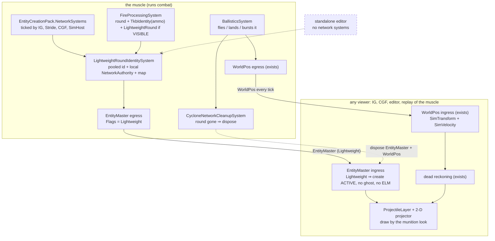

*What the picture shows that prose hid:* nothing on the viewer side reaches the ELM or the ghost promotion — the `Lightweight` flag
is the only fork, at the one place an entity is born on a viewer; position and dead reckoning are the existing paths, unchanged.
⭐ As-built: the identity is given by a NETWORK system (`LightweightRoundIdentitySystem`, registered by `EntityCreationPack` and ticked
only by the four networked hosts' `NetworkSystems` loops) — so the combat code knows nothing of the network (R-134), and on the
**standalone editor** (dashed — never reached) a round is tagged but never identified: it stays local, which is right, there is no
viewer to send it to. The dispose is not the ELM's `DestructionOrder` (a round has none): the cleanup system notices the round is gone.

```mermaid
classDiagram
  class EntityMasterFlags { <<exists, NED>> WaitForAcks; + Lightweight }
  class MunitionTkb { <<LR-1, combat lane>> a munition type for EVERY mount; Munition.Visual on the visible ones }
  class FireProcessingSystem { <<exists, combat>> + tracer mix (every Nth round) + MarkIfVisible: TkbIdentity(ammo) + LightweightRound }
  class LightweightRound { <<LR-2, tag id 357, Fdp.Toolkits Replication>> replicated without lifecycle; never saved, never previewed }
  class LightweightRoundIdentitySystem { <<LR-2, new, PostSimulation>> pooled id + NetworkAuthority(local) + NetworkEntityMap }
  class EntityMasterEgressTranslator { <<exists>> + Flags Lightweight for a LightweightRound }
  class EntityMasterIngressTranslator { <<exists>> + Lightweight: Active, drop GhostStateTracker, LightweightRound; dispose: destroy }
  class CycloneNetworkCleanupSystem { <<exists>> + a tracked LightweightRound no longer alive ⇒ dispose its samples + unmap }
  class ProjectileLayer { <<exists, LR-3>> + draws a LightweightRound by TkbIdentity's look, oriented by SimVelocity }
  class LightweightRoundGizmo { <<LR-3, new 2-D projector>> ProjectilePresentationGizmo.DrawRound }
  class EffectSpawnSystem { <<exists, LR-4>> the decorative tracer retires (the real tracer round replaces it) }
  FireProcessingSystem ..> LightweightRound
  LightweightRoundIdentitySystem ..> LightweightRound
  EntityMasterEgressTranslator ..> EntityMasterFlags
  EntityMasterIngressTranslator ..> EntityMasterFlags
  EntityMasterIngressTranslator ..> LightweightRound
  CycloneNetworkCleanupSystem ..> LightweightRound
  ProjectileLayer ..> LightweightRound
  LightweightRoundGizmo ..> LightweightRound
  FireProcessingSystem ..> MunitionTkb
```

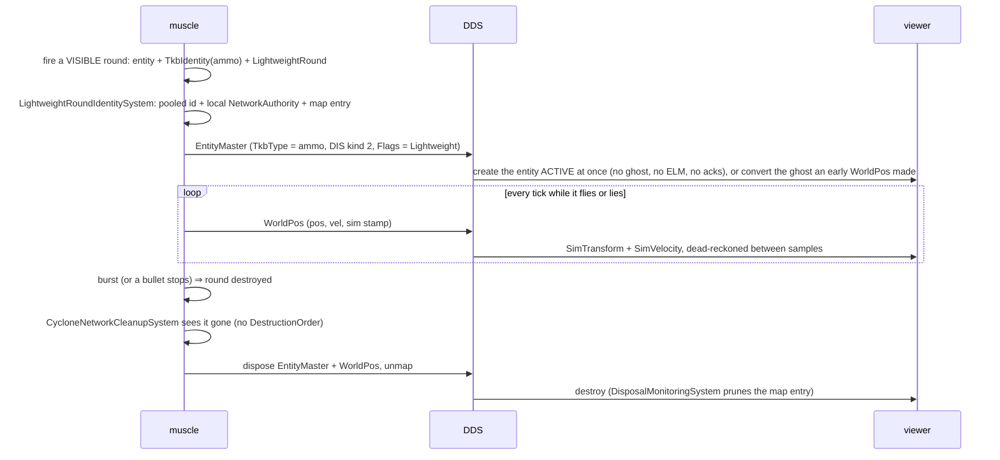

#### 8.5.3 Decisions inside LR

| # | question | ⭐ lean | rejected — one line each |
|---|---|---|---|
| **LR-A** | which rounds replicate | ⭐ every round whose munition has a `Munition.Visual` (U11's list: shells, mortar, grenades, bombs, rockets, missiles, TRACER bullets); an ordinary bullet stays an entity on the muscle only (it IS the hit test) | every round — a rifle burst would put ~10 entities/s per rifleman on the wire for nothing a viewer draws |
| **LR-B** | where "no lifecycle" lives | ⭐ a `Lightweight` bit on `EntityMaster.Flags` (the field built for "entity-type specific flags") + a local `LightweightRound` tag; the ingress creates the entity `Active` and `GhostPromotionSystem` skips it | honouring the global `BypassLifecycle` — that is the replay switch and would bypass every entity |
| **LR-C** | what a viewer knows of a lying grenade | ⭐ only what `WorldPos` says (U11: master + position): it lies still; the FUZE countdown stays on the muscle's 2-D map. A later tiny "munition state" descriptor is possible if wanted | adding fuze state to `WorldPos` — not U11's shape |
| **LR-D** | send rate | ⭐ the existing egress rule — a moving round sends every tick, a lying one only its heartbeat; dead reckoning smooths between; measure an MG burst before tuning | a dedicated rate limiter now — no measurement yet |
| **LR-E** | the fire-event extension (old PR-D lean) and the decorative effect tracer | ⭐ both retire: the round itself crosses the wire; the effect tracer is replaced by the real tracer round (LR-4) | keeping both — two tracers per shot |

#### 8.5.4 Slices

| slice | builds | owner (lean) |
|---|---|---|
| **LR-1** | a munition TKB type for EVERY mount (rifle ball + tracer, MG, autocannon, tank gun, RPG, ATGM, mortar, grenade); `Munition.Visual` on the visible ones; ⚠ penetration numbers stated explicitly (the name lookup, PR-E) | combat lane (backend) |
| **LR-2** | `EntityMasterFlags.Lightweight`; `LightweightRound`; muscle egress (id from the pooled allocator, master + `WorldPos`, dispose on burst); viewer ingress `Active` with no ghost / ELM, destroy + unmap on dispose; `GhostPromotionSystem` skips it | network lane (backend) |
| **LR-3** | viewers draw it: `ProjectileLayer` and the 2-D projector read a `LightweightRound` (look from `TkbIdentity`, nose from `SimVelocity`, lying = at rest); body layer and unit-symbol gizmo ignore munition types | ui lane |
| **LR-4** | the decorative effect tracer retires once tracer munitions replicate | ui lane |

⭐ Built end to end by the ui lane (user `2026-10-11`: *"you will [do] it end to end, no handoffs"*), not split across the combat and
network lanes as the owner column leaned.

#### 8.5.5 LR-1..LR-4 — AS-BUILT `2026-10-11`

| slice | as built | where |
|---|---|---|
| **LR-1** | seven new munition types `6003`–`6009` (5.56 ball, 5.56 tracer, 25 mm APDS-T, 120 / 125 mm APFSDS, TOW, RPG-7), DIS kind 2; a look on all but the ball. Every built-in mount loads one (`WeaponMount.AmmoTkb` in the BDC catalog, `AmmoGuid` in the urban one). ⭐ The rifles MIX tracers: `WeaponMountDto.TracerAmmoGuid` + `TracerEvery` (5), counted by a new `ShotOrdinal.Fired` — ⚠ kept apart from `ShotOrdinal.Count`, which drives the hit model's deflection sequence and so must not move | `MunitionTkbCatalog.cs`; `WeaponSuiteDto.cs`; `FireProcessingSystem.cs` |
| **LR-1 neutrality** | ⭐ no combat number moved, by construction AND by rail: every mount states its penetration (it wins before the by-name library pair) and no new name matches an explosive reference entry — RPG / TOW deliberately do NOT carry the library names "PG-7V HEAT" / "TOW-2 HEAT" (a real HEAT warhead is the combat lane's call). Pinned by `EffectTests.LR1_EveryBuiltInMountLoadsAMunitionType_AndNoCombatNumberMoved` | — |
| **LR-2 muscle** | `FireProcessingSystem.MarkIfVisible` tags a round whose munition has a `Munition.Visual` (`TkbIdentity` + `LightweightRound` + DIS type + `ScenarioIgnoreTag`); ⭐ DEVIATION: the network identity is NOT given by the fire path (the class diagram's first draft) but by a new network system, `LightweightRoundIdentitySystem`, in `EntityCreationPack`'s network systems — the combat code stays network-free (R-134). Egress sets `EntityMasterFlags.Lightweight` (`1 << 1`) | `LightweightRoundIdentitySystem.cs`; `EntityCreationPack.cs`; `EntityMasterEgressTranslator.cs` |
| **LR-2 dispose** | ⭐ DEVIATION: a round has no ELM `DestructionOrder`, which is the only thing `CycloneNetworkCleanupSystem` disposed on — so it now also TRACKS `LightweightRound` entities and disposes the samples of one that is no longer alive | `CycloneNetworkCleanupSystem.cs` |
| **LR-2 viewer** | the ingress makes a `Lightweight` master's entity `Active` at once, removes the `GhostStateTracker` (⭐ DEVIATION: no change in `GhostPromotionSystem` was needed — it queries lifecycle `Ghost` only, `GhostPromotionSystem.cs:296`, so an `Active` round is never seen), adds `LightweightRound` + `ScenarioIgnoreTag`; an early-`WorldPos` ghost is converted; its own round seen through loopback (local authority) is left alone. Its dispose DESTROYS the entity directly instead of publishing a teardown command | `EntityMasterIngressTranslator.cs` |
| **LR-3** | `ProjectileLayer` resolves a `LightweightRound` without `BallisticProjectile` (look from `TkbIdentity`, nose from `SimVelocity`, at rest = lying, the trail / tracer run back along the flight); the 2-D drawing became `ProjectilePresentationGizmo.DrawRound`, shared with a new `LightweightRoundGizmo`; the body layer never draws a `LightweightRound` (query + pick box) nor a munition type — also a built-in one on a host whose TKB lacks it (`MunitionTkbCatalog.IsBuiltIn`; ⚠ found by the Xvfb frame rail `LR_AViewerDrawsReplicatedRounds…`: every replicated round drew as an unknown purple box) — and the unit marker skips a `LightweightRound` | `ProjectileLayer.cs`; `ProjectilePresentationGizmo.cs`; `EntityBodyLayer3D.cs`; `EntityPresentationGizmo.cs` |
| **LR-4** | `EffectSpawnSystem` spawns no tracer effect; type `7131` stays registered so older recordings still draw theirs | `EffectSystems.cs` |

⚠ **Known limits, not built:** a viewer knows no fuze (LR-C — a lying grenade is drawn lying, not counting); a `WorldPos` sample that
arrives AFTER the dispose makes a ghost the 60 s ghost timeout removes; the send rate is unmeasured for an MG burst (LR-D).


## 9. Decoys — flares and chaff drawn from the fire *(CE-1115, ui, `2026-10-15`; build-state: BUILT)*

🔒 **User, `2026-10-15`:** *"Once they push, you pls add visual effect"* · backend's split: *"Ui lane will only add rendering the effect, you do
all the rest"* ([BS-1 §5.4c](designs/brain-split/BS-1-DESIGN.md), R-1002). The interface is §5.4c's table — this section is only its drawing.

**INVENTORY** (backend `8a5f327d0` merged; grep / `search_graph` over `Countermeasures.cs`, `EffectSystems.cs`, `EffectTkbCatalog.cs`):

| the design rests on | code — how it is | design basis |
|---|---|---|
| a release is an ordinary `WeaponFireNotification` with an expendable `AmmoGuid` (6034 flare / 6035 chaff), `Origin`, `Velocity`, `Quantity` 1, `FiredAt` | ✅ `WeaponFireEvents.cs`, `CountermeasureSystem` | BS-1 §5.4c, R-1002 |
| the decoy's path is ONE function the SimHost's seeker also uses | ✅ `DecoyFlight.At(origin, velocity, sinkMps, t)` with `ExpendableDto { LifeSeconds, SinkMps }` (`Countermeasures.cs`) | §5.4c F6 |
| every map host spawns effects from the fire, locally, recorded, never saved | ✅ `EffectSpawnSystem` (VE-A, VE-R) | §4 VE-A, §7 VE-R |
| it drew the SLOT's default round, not the fired one | ✅ `EffectSystems.cs:68-69` reads `mount.AmmoGuid` | BS-1 §5.4b F3 — the drawing reader is ui's |
| an effect never moves: world-fixed or anchored | ✅ `EffectAnchor` (muzzle / body); no velocity anywhere | — |

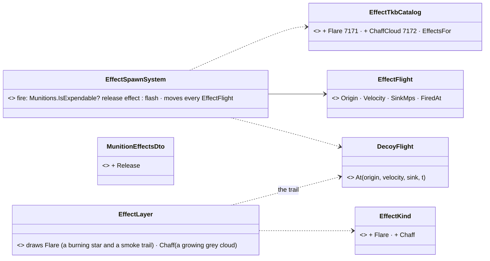

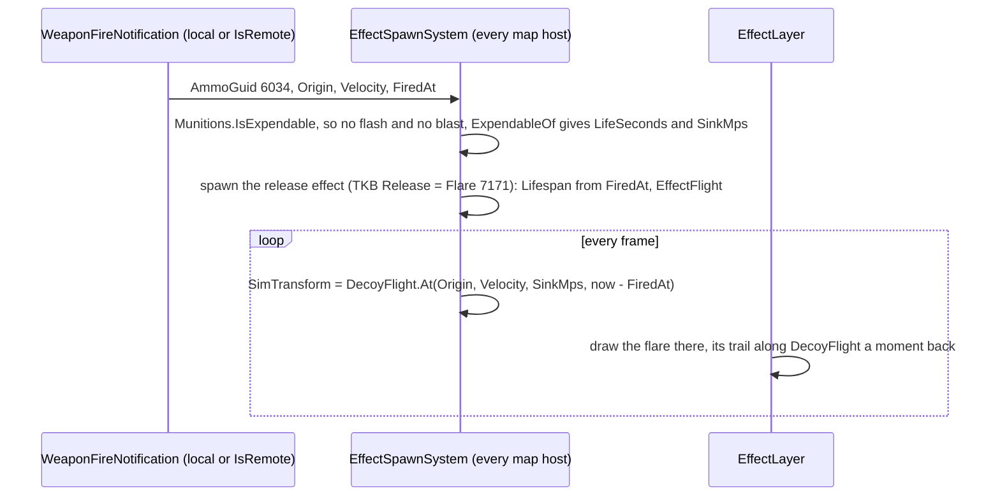

*Caption:* nothing new crosses the wire and nothing new is simulated on a viewer — the drawn flare stands where the seeker sees it because
both call the one function with the one event's numbers.

| decision | rule |
|---|---|
| **DV-1 which effect** | the munition's TKB `MunitionEffectsDto.Release` (flare → 7171, chaff → 7172), registered by `EffectTkbCatalog.RegisterAll` like every set (VE-D) |
| **DV-2 born at the release** | `Lifespan` starts at `FiredAt` (not this frame) and lives `ExpendableDto.LifeSeconds` — a late viewer draws the same flare at the same age, or nothing once burnt out |
| **DV-3 it moves** | `EffectFlight` (recorded, never saved) holds the release; the spawn system writes the effect's `SimTransform` from `DecoyFlight.At` every frame, so a replay replays the motion (the system is off in replay, VE-R) |
| **DV-4 the look** | a flare: a bright white-orange star with a short grey trail behind it along its own path; chaff: a grey cloud growing to ~15 m and fading; in 2-D a small dot |
| **DV-5 the fired round** | every fire's flash and blast use `fire.AmmoGuid` (the round actually fired), the mount's only when it is 0 (an older sender) |

**Rejected — one line each:** *stream each decoy* — §5.4c: the path is a function of the event; *an anchored effect* — a decoy leaves the
aircraft, it does not ride it; *a new effect layer* — `EffectLayer` already draws every effect kind in both modes (VE-F).

**As-built `2026-10-15`** — matches the diagrams. `EffectKind.Flare` / `Chaff` and `MunitionEffectsDto.Release` (Fdp.Toolkits, the effect
domain this design owns); `EffectFlight` (Hrot.Core, id 389, registered with the effects); `EffectTkbCatalog.Flare` 7171 / `ChaffCloud` 7172
and the 6034 / 6035 sets; `EffectSpawnSystem.SpawnRelease` / `MoveDecoys`; `EffectLayer` draws the flare (additive star, hot core, a trail of
8 puffs 0.12 s apart back along `DecoyFlight.At`) and the chaff (10 hashed puffs blooming over 1.5 s), 2-D a dot and a disc.
⭐ **Found by the frame:** the rail's TKB (the body catalogue only) had no 6034 — `Munitions.IsExpendable` said no and the release drew a
MUZZLE FLASH at the aircraft. ⇒ the rail uses the host's full TKB, and ⚠ a host whose TKB lacks the expendables would draw the same flash;
every production host builds its TKB from `HrotEnvironment.CreateTkb` (which registers them). Rails `EffectTests.CE1115_*` ×2 (the moving
flare, chaff, a burnt-out release drawing nothing; the FIRED round's flash), frame rail `Map3DFrameRail.CE1115_V`:

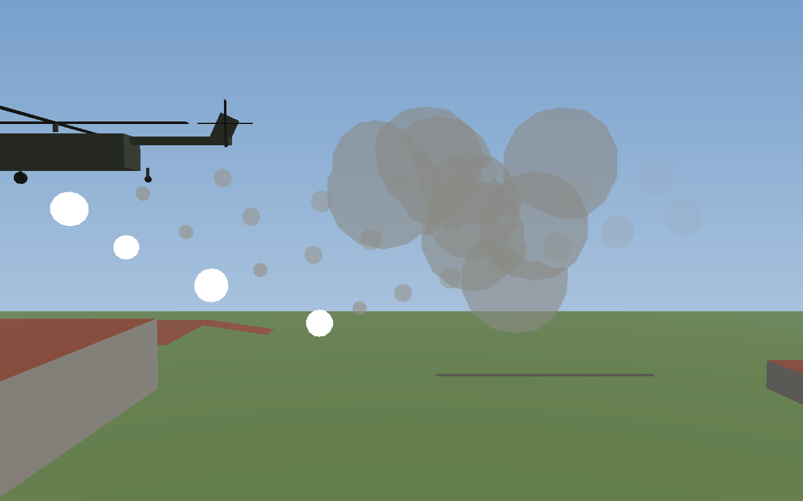


## 10. Impacts on every surface a round meets — entry and exit, walls and roofs (VE-I step 2) *(`CE-1128` · `CE-1129`, ui, designed `2026-10-16`; build-state: BUILT `2026-10-16`)*

🔒 **User, `2026-10-16`:** *"the round that penetrates an obstacle through should continue - this is what allows shooting through thin fences and
similar weak obstacles. (independent on aim - generic rule) Every surface pierced should get a decal and particle effect on the entry side (maybe
also in the exit side if that is not a bigger problem.)"* · *"Explosive rounds: of course ground scorch yes"* · (a lock) *"the shot goes to that
point and leaves a decal there"*. The fire modes asked in the same exchange are `DESIGN_Entity_Control.md` §8g.

📐 **INVENTORY** *(graph `search_graph` Class `.*Impact.*` → `DroneImpactSystem` only; `.*Decal.*` → 0; grep `DetonationNotification` consumers → 13 production files)*:

| the lean rests on | code — how it IS | design — how it was MEANT to be |
|---|---|---|
| a round that PASSES a crossing continues, its damage × the chance, its penetration less the resistance | ✅ `TerrainPenetration.Carry` / `Cross` (`TerrainPenetration.cs:39-73`), called every segment (`BallisticsSystem.cs:171`) | ✅ Building Interiors §3d P2, R-217 — ⇒ the user's generic rule is ALREADY BUILT; only its picture is missing |
| a non-explosive round that STOPS ends silently (a shot-log record, no event) | `BallisticsSystem.cs:104-121` | ⛔ searched `docs/` + `.dev/`, no design asks for silence; audio's design already expects *"a ricochet off the world"* (`DESIGN_FPS_Audio.md` §impacts, `SoundSources.cs:179`) |
| a bullet aimed at FLAT ground never stops: the fire query does not count the ground, so it flies on below it and `Expired` | `TerrainWorld.QueryFire` doc (`:524`), `BallisticsSystem.cs:149`; only a WARHEAD round checks the ground (`:186-200`) | ⛔ searched, none — a defect |
| decals exist only under a detonation, draped on the ground | `EffectSpawnSystem` (`EffectSystems.cs:122-127`), `EffectLayer.DrawDrapedDisc` | VE-I step 1; step 2 *"once `IWorldQuery.Trace` reports the hit's surface normal"* |
| a crossing knows where the round enters and its path inside, not the surface's normal | `TraceCrossing(T, PathMetres, …)` (`IWorldQuery.cs:24`); `FireCrossing` (`TerrainWorld.cs:511`) | World Query Seam WQ-A; ⛔ no normal planned |
| the stand-in KNOWS the face crossed: a prism side (footprint edge), its top or base, a slab's triangle | `TerrainWorld.QueryFire` (`:566-604`) | — |
| `DetonationNotification` is a COMBAT event: area effect, damage, heat, and the brain's 64-burst memory the fire-mission observer reads (`RecentDetonations.Capacity`) | `AreaEffectSystem`, `DamageCalculationSystem`, `SoundEmissionSystem`, `RecentDetonations` (`IndirectFireBehaviors.cs:545`) | Indirect Fire §3.8 (IF-3) — ⇒ a rifle strike on it would flush the observer's memory |
| effects are made on every map host from events that cross the wire; an ordinary bullet is NOT replicated | `MunitionDetonation*Translator`; §8.5 LR-A | VE-A; LR-A |
| a small-arms puff (7111) and a bullet mark (7121) already exist in the catalogue | `EffectTkbCatalog.cs:74,77` | VE-C |

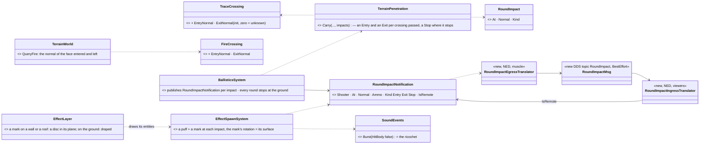

*What the picture shows that prose hid:* the impact is its OWN event beside the detonation — no combat consumer of `DetonationNotification`
learns of it — and the normal is born where the face is known (the terrain query), so neither the round nor the renderer guesses a wall's facing.

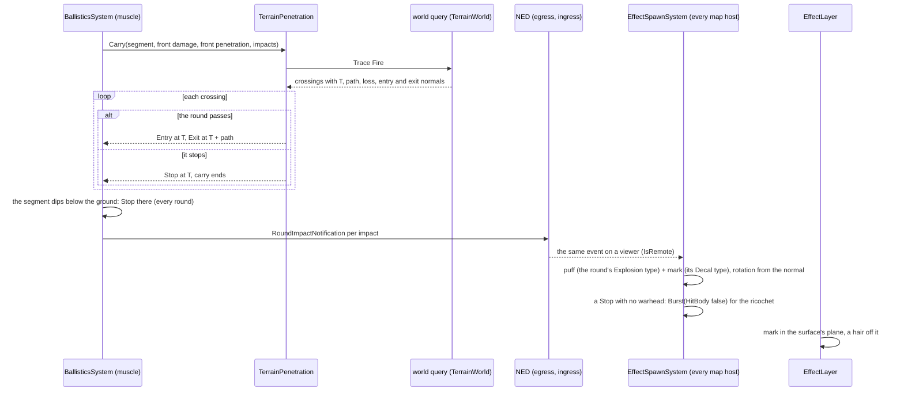

```mermaid
graph TD
    MUS[CombatModule, muscle] --> BS[BallisticsSystem, PostSimulation]
    BS -->|local event| EG[RoundImpactEgressTranslator, MuscleGround branch]
    EG --> DDS[(RoundImpact topic)]
    DDS --> IG1[RoundImpactIngress, IG translators]
    DDS --> IG2[RoundImpactIngress, Perception-only branch]
    DDS --> IG3[RoundImpactIngress, Brain-only branch]
    IG1 --> ESS[EffectSpawnSystem, MapInteractionPack, every map host]
    IG2 --> ESS
    IG3 --> ESS
    BS -->|same world: one-world host| ESS
    classDef dead fill:#fdd,stroke:#c00
    MM[a MuscleGround host viewing ANOTHER muscle's rounds]:::dead
```

⛔ **SUPERSEDED `2026-10-17` by [Node Roles §3.5](DESIGN_Node_Roles_And_Policies.md) (CE-1148 S2, R-3015):** the shot / burst / mark pairs are in the shared pack on EVERY node and the ingress drops the node's own samples by `SourceNodeId`; no role branch or exclusion remains. The text below is the prior as-built.

*Caption:* the ingress sits beside every existing `MunitionDetonationIngressTranslator` EXCEPT the MuscleGround branch, where its own samples
would loop back and draw every impact twice. ⚠ The red box is the known gap that leaves: a muscle node that is also a map host draws its OWN
rounds' impacts only — a cluster with two muscles would not show the other's. Accepted for v1 (every built cluster has one muscle per area).

| # | decision | rule |
|---|---|---|
| **IM-1** | penetration | ⭐ already the rule (R-217): a round passing a crossing continues with less damage and penetration, whatever fired it and however it was aimed. ⛔ Nothing changes in the combat numbers |
| **IM-2** | what marks a surface | ⭐ every crossing PASSED gives an Entry impact (at T) and an Exit impact (at T + path / length); the crossing that STOPS a round gives a Stop impact; a round meeting the GROUND (any round — a bullet no longer flies on below it) stops there with a Stop impact |
| **IM-3** | its own event | ⭐ `RoundImpactNotification` (5010) and a `RoundImpact` DDS topic, **BestEffort** (a lost puff is cosmetic) — ⛔ never `DetonationNotification` (IF-3's 64-burst memory, the area effect, heat) |
| **IM-4** | the normal | ⭐ the terrain query reports the face entered and left: a prism's side = the footprint edge's outward normal, its top / base = ±Z, a slab = its triangle's, the ground = +Z. Zero = unknown ⇒ the mark faces back along the travel |
| **IM-5** | what is drawn | ⭐ at each impact the round's set: its `Explosion` type as the puff and its `Decal` type as the mark (7111 / 7121 for small arms, VE-D). A WARHEAD round's Stop draws nothing here: its burst (`DetonationNotification`) already draws the explosion and the ground scorch (VE-I step 1 — kept). Exit impacts draw the mark and a smaller puff |
| **IM-6** | a mark on a wall or a roof | ⭐ the decal entity's rotation turns +Z onto the normal; the 3-D layer draws a disc in that plane, 2 cm off the surface; on the ground (normal ≈ +Z) it stays DRAPED. VE-H's cap (256) covers them |
| **IM-7** | sound | ⭐ a non-warhead Stop adds `SoundEvents.Burst(HitBody: false)` — the ricochet the audio design already plays |
| **IM-8** | a bullet into a unit | ⛔ unchanged: `HitResolutionSystem`'s detonation, no mark (VE-M) |

**Rejected — one line each:**
- *Bullet strikes on `DetonationNotification`* — a few MG bursts would flush the fire-mission observer's 64-burst memory and wake the area effect.
- *Each viewer re-tracing every round from the fire event* — a second ballistics that drifts from the muscle's (dispersion, units in the way).
- *Replicating every bullet* — LR-A rejected it for bandwidth; one impact sample is cheaper than a round's flight.
- *Facing a wall mark back along the travel only* — an oblique hit would stand the mark off the wall; the query knows the face.
- *Reliable delivery* — a backlog of puffs is worse than a lost one.

**AS-BUILT `2026-10-16`** — the three diagrams hold. Details, and where the build differs:

| as-built | why |
|---|---|
| ⚠ DEVIATION from IM-5: an exit's puff is the SAME type as the entry's, not smaller | an effect has no per-entity scale (the TKB type IS the look, VE-C); a second puff type for one case was not worth a type |
| ⭐ `CE-1194` (`2026-10-19`, found live) — a THROWN stone or blade landing raised the burst set's explosion and ground scorch (its `DetonationNotification` fell to the calibre default). Now `EffectSpawnSystem.IsInertHandItem` — a hand item (`HandItemDto`) whose warhead SAYS `Kinetic` or `Blunt` (none stated is not inert — the M67 states none and bursts) — lands as the small impact puff (dust) only: no scorch, no burst sound. A hand grenade (Fragmentation) still bursts. Rail `EffectTests.CE1194_AThrownStoneLandsAsDust_AGrenadeStillBursts` | ⚠ the smoke / tear-gas canisters keep today's burst (their clouds are their look) |
| ⭐ `CE-1199` (`2026-10-19`, found live) — 🔴 every impact passed damage 0 to `EffectsFor`, so a round with no `Effect.Set` of its own always got the SMALL puff and mark — a tank shell's mark was a bullet's. Now `EffectSpawnSystem.ImpactDamage`: the shooter's mount that fires that ammo (`CombatTkb.RoundOf` — a tank's 120 mm round carries no damage of its own, its gun does), else the round's own number ⇒ VE-D's small / medium / large by calibre. Rail `EffectTests.CE1199_AnImpactMark_IsTheSizeOfItsRound_ATankShellsIsLarge_ABulletsSmall` | the impact (`RoundImpactNotification`) carries the shooter and the ammo, not the damage |
| the ground stop (IM-2) applies only WITH a world query, to non-warhead rounds | a world-less test or host behaves as before; a warhead round has its own ground check (W-3), which still bursts it |
| `RoundImpactNotification` carries the TRAVEL too | the mark's fallback facing (IM-4) when a face is unknown, on any node |
| `TerrainPenetration.Carry(…, impacts)`: a crossing that starts AT the segment's start (the round was already inside) is not marked again | the segment that entered it marked both faces |
| the ground's crossing (a hill) faces +Z; the slab's faces are its triangle's normal, toward the shooter | IM-4 |
| ⚠ known limits | a mark may appear on a wall behind a man struck in front of it within one segment (the hit resolves 3 ticks later); a piece spanning a segment boundary gets its exit where the segment ends; a MuscleGround node that is also a map host draws only its own rounds' marks (the red box above) |

Rails: `StaticObstacleTests.CE1128_TheFireQuery_GivesTheFacesNormals_*`, `BallisticsSystemTests.CE1128_*` (fence both sides + the stopping
fence; the ground, and a warhead stop left to its burst), `RoundImpactTranslatorTests.CE1128_*` (the sample → a remote event; the muscle
writes, viewers read, never both), `EffectTests.CE1129_*` (puff + mark; a wall mark in its plane, a ground mark draped, a roof mark on the roof).

## CE-1146 — the effects keep their brightness at night (`2026-10-16`, ui)

🔒 User: *"weapon flashes and flares and explosions and similar light emitting stuff should stay bright no matter the ambient light level"*.
⭐ Held **by construction**, not by a rule to remember: the effect layer draws without `LitShader`, and only the lit shader takes the weather's
light ([Map 3D §6aa](DESIGN_Map_3D_Mode.md) WS-5). ⚠ Whatever is added to the effects must keep drawing unlit; an effect that lights its
SURROUNDINGS at night (a flare lighting the ground) is not built — CE-1146's open discussion.


## 11. Charges — the IED / suicide-vest / car-bomb burst, and the placed IED itself *(`CE-1231` · `CE-1232`, ui, `2026-10-20`; build-state: ✅ BUILT `2026-10-20` — leans APPROVED, R-1016; as built §11.3)*

🔒 **User, `2026-10-20`:** *"do we have any vsualization of ICD explosion? I ahevnt seen any. Also nothing for suicide bomber explosion. adn
visualization of the OCD itself - i sam just the entity label"* · on the leans below: *"the explosions leans accepted, record as tracked item."*

**How it is** *(measured `2026-10-20`)*:

| claim | code — how it IS | design — how it was MEANT |
|---|---|---|
| a charge (vest, IED, car bomb) bursts as one `DetonationNotification` carrying its round (ammo 6043) | ✅ `Charges.Detonate` (`Fdp.Toolkits/Combat/Charges.cs`) | ✅ Civilians AW-12: one charge type, three placements |
| that burst is drawn as the SMALLEST explosion (0.35 s, 0.8 m dust puff + a bullet mark) | ✅ 6043 has no `MunitionEffectsDto` ⇒ `EffectTkbCatalog.EffectsFor` sizes by damage; the charge mount has no `DamagePerHit` and its ammo is the mount's own ⇒ `RoundOf` = 0 ⇒ `CalibreClass.Small` | ⛔ searched this file and Civilians: no look for a charge |
| the placed IED shows only its label | ✅ 2-D: its class chain reaches `LandPlatform` ⇒ a ground-VEHICLE outline at its ~30 cm size (sub-pixel); 3-D: `WeaponKits.Charge` is a 0.30 × 0.20 × 0.12 m box | ⛔ none; AW-12 / BM-2 keep the WORN vest hidden (what observers can tell, not the map) |
| the burst's SOUND is small too | ⛔ not measured (`SoundEvents.Burst` gets damage 0) | ⛔ not searched |

| id | ✅ APPROVED lean *(R-1016)* | rejected — one line each |
|---|---|---|
| **CH-1** *(`CE-1231`)* | a round with no per-hit damage is sized by its warhead's EXPLOSIVE MASS (`WarheadDto`); a new look **"Explosion huge"** (≈ 2 s, ≈ 20 m, orange core in a grey-brown cloud) + the crater decal from 5 kg up — fixes the IED, the vest, the car bomb and any later damage-0 area round, all in `EffectTkbCatalog`; check the sound and the Mk-82 with it | a one-off look for 6043 only — every other damage-0 area round stays a puff · raising the charge's `DamagePerHit` — that number is combat damage (backend's), not a look |
| **CH-2** *(`CE-1232`)* | a PLACED charge gets a fixed-pixel 2-D marker (a small diamond reading "IED", side-coloured) through its class (`ExplosiveChargeWeaponSystem`), not the ground-vehicle outline; a WORN vest stays unmarked (the bomber is a person — AW-12); a car bomb is its car | a symbol on the bomber — AW-12 rules the vest hidden until it goes off |
| **CH-3** *(`CE-1232`)* | in 3-D the charge keeps its true size but reads as what it is: two shells bundled with a wire (`WeaponKits.Charge`); from map height its label and the 2-D marker find it | a minimum on-screen size in 3-D — a 30 cm thing drawn metres wide lies about the scene |

### 11.1 INVENTORY *(`2026-10-20`; graph CLI `search_graph` over `EffectTkbCatalog|Charges|DetonationNotification|WarheadDto|SoundEvents|WeaponKits`,
then `git grep "new DetonationNotification"` and `git grep EffectsFor` for the call sites — the graph does not model event publishes; `check_index_coverage`
is not reachable through the CLI)*

**Every production publisher of `DetonationNotification`, and the damage it carries** — 🔴 the finding: the damage-0 burst is NOT the IED's alone.

| publisher | when | `Damage` on the event |
|---|---|---|
| `HitResolutionSystem` (FDP Physics) | a round met a body | ✅ the round's |
| `DroneImpactSystem` (FDP Motion) | an FPV drone meets the ground or a body | ✅ `RoundOf` its mount |
| `Charges.Detonate` (FDP Combat) | a vest / IED / car bomb is set off | ⛔ **0** — the charge mount has no `DamagePerHit` |
| `BallisticsSystem.Detonate` (FDP Combat) | **every off-target burst** — a grenade, a mortar or howitzer shell, a bomb, a rocket that missed, a lying grenade's fuze | ⛔ **0 — never set** |
| `MunitionDetonationIngressTranslator` (NED) | **another node's** burst, on every node | ⛔ **0 — not on the wire** |

⇒ ⭐ every off-target burst and every REMOTE burst reaches `EffectsFor` with damage 0 and draws the 0.8 m puff — unless its ammo names an
effect set (only the M67 grenade and the 81 mm bomb do). 📐 The reference library's explosive masses (`ammo.json`): 23 mm HEI 0.013 kg ·
40 mm HEDP 0.045 · M67 0.24 · Igla 0.39 · 60 mm 0.4 · PG-7V 0.73 · 81 mm 0.95 · Stinger 1.0 · 70 mm rocket 1.04 · 120 mm HEAT 1.6 · 105 mm 2.1 ·
120 mm mortar 3.0 · TOW-2 3.1 · 125 mm HE 3.4 · **155 mm 6.6 · the charge 8.0 · Mk-82 94**.

**Every reader of `EffectTkbCatalog.EffectsFor`** — `EffectSpawnSystem` ×4 (fire flash, detonation, impact, release) · `SoundTkbCatalog.ShotFor` ·
`SoundTkbCatalog.DetonationFor` (the bang, from the explosion it picks — so the sound follows the look with no change of its own).
**The placed charge's drawing:** 2-D `EntityPresentationGizmo` → `EntityClassShapeLibrary` (class chain ⇒ `LandPlatform` ⇒ a ground-vehicle outline);
3-D `EntityBodyLayer3D` → `WeaponKits.KindOf` (`ExplosiveChargeWeaponSystem` ⇒ `WeaponKind.Charge`) → `WeaponKits.Charge` (a box).
A WORN charge: 3-D `DrawCarried` skips a concealed station (`CarryStations.IsConcealed`); a car's cargo charge is an enclosed passenger
(`PhysicalPresence.IsEnclosedPassenger`) — no symbol of its own in either view.

### 11.2 Diagrams

```mermaid
classDiagram
  class EffectTkbCatalog {
    <<exists, changed>>
    ExplosionHuge 7114 : new look
    CalibreClass : Small, Medium, Large, Huge (new)
    ClassOfExplosive(kg) : new
    EffectsFor(tkb, ammo, damage) : damage 0 and a warhead ⇒ burst and mark by its mass
  }
  class ParameterResolver { <<exists, FDP>> Warhead(tkb, ammo) : the ONE warhead lookup }
  class WarheadDto { <<exists>> ExplosiveKg }
  class SoundTkbCatalog { <<exists, changed>> ExplosionHuge 7314 : new; DetonationFor maps the huge burst }
  class SoundSynth { <<exists, FDP, changed>> ExplosionHuge : appended }
  class SoundSources { <<exists, changed>> BurstRangeHuge }
  class EntityPresentationGizmo { <<exists, changed>> a PLACED charge: the IED marker instead of the outline }
  class ChargeMarker { <<new>> IsPlaced(view, e) by class; Draw: a side-coloured diamond reading IED, fixed pixels }
  class WeaponKits { <<exists, changed>> Charge : two shells bundled with a wire }
  class EntityClassTable { <<exists>> Chain(dis) : ExplosiveChargeWeaponSystem }
  EffectTkbCatalog ..> ParameterResolver
  ParameterResolver ..> WarheadDto
  SoundTkbCatalog ..> EffectTkbCatalog : DetonationFor
  SoundSources ..> SoundTkbCatalog
  EntityPresentationGizmo ..> ChargeMarker
  ChargeMarker ..> EntityClassTable
  WeaponKits ..> EntityClassTable
```
*What the picture shows that prose hid:* one change in `EffectsFor` reaches the look AND the bang (the sound reads the explosion it picks), so
CH-1 has no second sizing rule to keep in step; the marker and the kit both key on the CLASS, the way the rest of the map does.

```mermaid
sequenceDiagram
  participant T as trigger man / timer
  participant C as Charges.Detonate (owner node)
  participant B as bus
  participant N as NED (other nodes)
  participant E as EffectSpawnSystem (every map host)
  participant K as EffectTkbCatalog
  participant S as SoundSources
  T->>C: DetonateChargeEvent
  C->>B: DetonationNotification (ammo 6043, damage 0)
  B-->>N: MunitionDetonation (no damage on the wire)
  N->>E: DetonationNotification (damage 0) on each node
  B->>E: (own node)
  E->>K: EffectsFor(tkb, 6043, 0)
  K->>K: no set, damage 0 ⇒ Warhead(6043) = 8 kg ⇒ Huge
  K-->>E: Explosion huge 7114 + crater 7123
  E->>S: Burst(point, 6043, 0)
  S->>K: DetonationFor ⇒ ExplosionHuge ⇒ 7314, range 6 km
```
*What the picture shows that prose hid:* the REMOTE node never sees a damage, so sizing by damage could never have been right there — the
munition's warhead is the only size every node can look up.

```mermaid
graph TD
  MIP["MapInteractionPack (every map host)"] -->|registers, scheduled each frame| ESS[EffectSpawnSystem]
  AL["AttachMapLayers: AudioLayer"] -->|each frame| SS[SoundSources]
  MIP -->|reflection registrar| EPG[EntityPresentationGizmo]
  AL2["AttachMapLayers: EntityBodyLayer3D"] -->|each 3-D frame| WK[WeaponKits.Charge]
  ESS --> EF[EffectTkbCatalog.EffectsFor]
  SS --> EF
```
*What the picture shows that prose hid:* every host that has a map runs all four — nothing here is per host, so nothing needs wiring.

### 11.3 As built *(`2026-10-20`, ui — the diagrams above are the as-built; where it goes past or beside the leans)*

| | as built | why |
|---|---|---|
| CH-1 | `EffectsFor`: no set and damage 0 ⇒ the burst and the mark by `ClassOfExplosive(kg)` — **medium from 0.01 kg, large from 1 kg, huge from 5 kg** — the flash and tracer stay the damage class's. The mass comes from `ParameterResolver.Warhead` (the TKB's `WarheadDto`, else the reference library by name: the charge is "8 kg demolition charge") | ⭐ the thresholds make a round that HITS (damage-sized) and the SAME round that MISSES (mass-sized) look alike: 25 mm HEI medium, PG-7V medium, 120 mm HEAT and TOW large (measured classes in the rail). ⚠ The lean said only "huge from 5 kg"; the lower bands are needed because the inventory (§11.1) found every off-target and every remote burst arrives with damage 0 — not just the charge |
| CH-1 look | `ExplosionHuge` 7114: 2.2 s, 20 m, `#F07028`; mark: the crater (`DecalLarge`). ⭐ A burst of 15 m and up raises a **grey-brown dust cloud** under its core (`EffectLayer.RaisesDust` / `Dust`, 2-D disc and 3-D sphere), the core drawn at 0.6 of the size — the lean's "orange core in a grey-brown cloud" | the explosion look has ONE colour (`EffectVisualDto`), so the cloud is the layer's, keyed on size, not a second descriptor |
| CH-1 sound | `SoundTkbCatalog.ExplosionHuge` 7314 (`SoundSynth.ExplosionHuge`, appended to the FDP enum), heard to 6 km (`SoundSources.BurstRangeHuge`); `DetonationFor` maps it — the bang follows the look with no rule of its own | — |
| CH-1 Mk-82 | 94 kg ⇒ huge (and the 155 mm shell, 6.6 kg). ⛔ Was: both the puff | "check the Mk-82 with it" |
| CH-2 | `ChargeMarker`: a charge by CLASS (`ExplosiveChargeWeaponSystem`) that is not carried (`IsEmbarkedTag`) draws a 7 px diamond in its side's colour (2-D only, `Map2D \| FlatOnly`) and "IED" beside it, in place of the outline; its pick box is in screen pixels too (`EmitPickBox` gained `sizeMode`) so it is clickable at every zoom. A worn vest keeps today's drawing (no marker); a car bomb is an enclosed passenger (nothing of its own) | ⚠ `DrawText` has no view target, so the "IED" letters also show in 3-D beside the true-size kit — harmless, and they help find it from map height |
| CH-3 | `WeaponKits.Charge`: two shells (a body and an ogive cone each) side by side, two turns of wire round both, a detonator between them, its wire off the back — at the old 0.30 × 0.20 × 0.12 m. ⭐ The boxes a round meets are the drawn parts (`CE-3214`): `VehicleBody.WeaponKits.g.cs` (FDP) regenerated (`HROT_GEN_VEHICLE_BODY=1`) — the Charge kit only, 2 boxes → 8 | the parity rail `CE3214_TheBoxesTheRoundsMeet…` holds the two equal |
| ⚠ not done | a WORN vest still has its own entity card and a sub-pixel outline in 2-D (not new; AW-12 governs observers, not the operator's map) — out of CH-2's scope, named here so it is not lost | — |

## 12. An INERT round never explodes — kinetic impacts are dust and a hole (`CE-4145`, coordinator, `2026-10-31`; build-state: BUILT)

✅ **As built, `2026-10-31`:** K-1..K-3 exactly — `EffectTkbCatalog.IsKinetic` / `KineticFor`, ids 7115 / 7116 / 7124 / 7125 in `BuiltIn`; rail `EffectTests.CE4145_AnInertRound_DrawsDustAndAHole_NeverAnExplosion`. Two knock-ons: ① `SoundTkbCatalog.DetonationFor` maps the two puffs to the small bang (an unmapped explosion id would be silent); ② `CE1199_AnImpactMark_…` now expects the tank's APFSDS mark to be `DecalGouge` (30 cm), not the 4.5 m `DecalLarge` crater — still the tank's size class, still larger than the bullet's.

🔒 **User, `2026-10-31`:** *"the hit effect from M2 on humvee machine gun hit looks like explosive ammo (orange ball) and does very big decal (as
big as a window), there should be just dust puffs and way smaller decals (8cm)"*.

📐 **Measured:** the M2 fires `TkbHmgAp` (6019, no `WarheadDto`, damage 60). It has no `Effect.Set`, so `EffectTkbCatalog.EffectsFor` falls
back to `ClassOf(60)` = **Medium** ⇒ `ExplosionMedium` (7112: 0.9 s, **5 m, orange #FF8A30**) and `DecalMedium` (7122: **1.8 m**) — a grenade's
look. The same fallback gives every hard-hitting INERT round an explosive's look: the 25 mm APDS-T, the GAU-8 API, the 120/125 mm APFSDS
(Large ⇒ a 12 m fireball and a 4.5 m crater). ⚠ That is the sizing VE-D REJECTED (*"sizing from damage or penetration — a HEAT round and an
APFSDS of the same gun look different"*); the damage default was meant only for a round the TKB cannot describe.

```mermaid
classDiagram
    direction LR
    class EffectTkbCatalog { <<existing, grows>> EffectsFor(tkb, ammo, damage) · +KineticFor(CalibreClass) · +IsKinetic(tkb, ammo) · +ImpactPuffMedium 7115 · +ImpactPuffLarge 7116 · +DecalHoleMedium 7124 · +DecalGouge 7125 }
    class MunitionEffectsDto { <<existing>> MuzzleFlash · Explosion · Decal · Tracer }
    class ParameterResolver { <<existing>> Warhead(tkb, ammo) — the one warhead lookup }
    class EffectSpawnSystem { <<existing, unchanged>> hit + impact + muzzle call EffectsFor }
    EffectTkbCatalog ..> ParameterResolver : explosive kg
    EffectTkbCatalog ..> MunitionEffectsDto : returns
    EffectSpawnSystem ..> EffectTkbCatalog : EffectsFor
```

```mermaid
sequenceDiagram
    participant S as EffectSpawnSystem
    participant C as EffectTkbCatalog.EffectsFor
    S->>C: (ammo 6019, damage 60)
    C->>C: the ammo's own Effect.Set? none
    C->>C: IsKinetic: ammo KNOWN to the TKB and its warhead has no explosive? yes
    C-->>S: flash/tracer by damage class (Medium) · Explosion = ImpactPuffMedium (dust) · Decal = DecalHoleMedium (8 cm)
    Note over C: an ammo the TKB does not know (0, unregistered) keeps today's damage default
```

*What the pictures show that prose hid:* one function decides, every caller (the hit, the wall/roof impact, the muzzle) already goes through
it — so the fix is in ONE place and nothing new is registered.

| # | decision | ⭐ rule |
|---|---|---|
| **K-1** | which rounds | ⭐ a round whose ammo type the TKB KNOWS and whose warhead carries **no explosive** (`ExplosiveKgOf` = 0) is KINETIC. Its impact is dust and a hole, never an explosion — whatever its damage. An explosive round is unchanged (its set, else its explosive mass, CH-1); an unknown ammo (0 / unregistered) keeps the damage default |
| **K-2** | the looks, by the damage class | ⭐ Small (rifle): unchanged — `ExplosionSmall` 7111 (0.8 m dust) + `DecalSmall` 7121 (~6 cm). **Medium** (12.7 mm, 25 mm AP): **`ImpactPuffMedium` 7115** — a dust puff 0.45 s, 1.4 m, the same dust colour #C8B89A + **`DecalHoleMedium` 7124 — 8 cm** (the user's figure). **Large** (APFSDS): **`ImpactPuffLarge` 7116** — dust 0.7 s, 3 m, #B8A88A + **`DecalGouge` 7125 — 30 cm** |
| **K-3** | flash and tracer | ⭐ unchanged: still by the damage class (an M2's muzzle flash is a medium one) |

**Rejected:** an `Effect.Set` on each inert ammo type — every new round would have to remember it (the silent-default trap), and VE-D's
"sets on the ammo" stays available for a round that wants its own look · lowering `MediumDamageFrom` above 60 — moves the line, keeps the
bug for the next round past it · a decal sized by penetration — VE-D rejected it.

