<!--STATUS
state: LIVE
build-state: BUILDING — ALL leans VE-A..VE-M APPROVED (U3, U5, 2026-10-10); E1–E3 BUILT 2026-10-11 (§6a); E4 BUILT 2026-10-11 (§6b). ⭐ §7 wrecks / bodies / burning / Lifespan APPROVED 2026-10-11 (U6–U8, R-269 (ui)); W1–W4 BUILT 2026-10-11 (§7.5). ⭐ §8 projectiles: P1 BUILT 2026-10-11 (CE-1051); PR-D / PR-E open for the user. Programme index: PLAN_3D_World_And_Realism.md.
updated: 2026-10-11
current-answer: §1 what the user asked · §2 inventory · §3 diagrams · §4 decisions with leans · §6 slices · §6a E1–E3 as-built · §6b E4 (`Muzzle.Of`) · §7 wrecks, dead bodies, flames and smoke, `Lifespan` (approved; W1–W4 as-built in §7.5) · §8 projectiles (P1 as-built §8.4; PR-D / PR-E open, §8.3).
stale-below: nothing.
known-rot: VE-B's "not recorded" — SUPERSEDED by §7 VE-R (U8, R-269 (ui)): effect entities are RECORDED (still never saved to a scenario).
known-conflict: none.
related-designs:
  - DESIGN_Weapon_Layers.md — the weapon muscle owns TurretPose (W-9), which Muzzle.Of poses the barrel from.
  - PLAN_3D_World_And_Realism.md — the programme index: where these slices sit among the 3-D map, turret, aircraft and sound work.
  - DESIGN_Map_3D_Mode.md — the 3-D renderer of these effects (its S3 effects wait for this design; §6c U27); the muzzle point
    comes from its §3.11 articulated turret (M23–M26).
  - DESIGN_Map_Rendering_And_Interaction.md — owns MapCanvas and its layers; the effect layers are two more layers attached by
    MapInteractionPack.AttachMapLayers.
  - DESIGN_Building_Interiors.md — owns warheads (§3k, CE-1032): the detonation that an explosion and a decal visualise.
  - DESIGN_Body_Geometry_And_Ground_Contact.md — the same "the TKB type defines it" pattern for bodies; decals drape on the ground.
  - designs/replay-and-modules/DESIGN.md — §2.1m: the replay gate IN PLACE (a late-read Func<bool> IsReplayActive) that W1's effect
    systems reuse; it links mgmt-1 §8.5/§8.10, the ruling that state-deriving systems stand down during replay.
  - DESIGN_Operations_Behaviour_Catalogue.md — §10.1 D1: vehicle damage states (destroyed / mobility / firepower kill) and human injury
    states; §7's "destroyed" reads Health ≤ 0 until those land, then only `WreckState.IsDestroyed` changes.
-->

# DESIGN — visual effects: muzzle fire, explosions, impact decals

## 1. What the user asked — `2026-10-10`

| # | verbatim |
|---|---|
| **U1** | *"each effect entity has its TKB type of course defining the effect"* |
| **U5** | *"VE-J to VE-M approved. pls presetn the plan even beyond the effects and make sure it is saved as compaction will come in few iterations"* — ✅; the plan is `PLAN_3D_World_And_Realism.md` |
| **U4** | *"how the muzzle effect will be bound to the barrel? what is expected from the shot effect entity regarding its parenting or location?"* — §4b, leans VE-J..VE-M |
| **U3** | *"VE leans approved. pls explain 'The old effect gizmo is retired once the 2-D effect layer replaces it.' What are old effect gizmos? Some gizmos like the firing line from the shooter entity to the target point still makes sense even in 3d to indicate the firing target whenever shot is made."* — ✅ approved; §4a answers which gizmo retires and which stay |
| **U2** | *"some kind of simple fire effect (from the barrel, multiple size based on ammo type) and explosion effect (at hit position, multiple sizes based on ammo type), decal effect (at hit position, multiple sizes to be mapped to ammo type) - this adds a lot to the realism and should be cheap with todays possibilities. all those effect could be special types of temporary entities (counting their lifetime so the render can show them in proper phase) that are rendered in their special way and removed once their lifetime expired; so no gizmos as such - pls add those to the plan, many might require design steps."* |

## 2. INVENTORY — measured `2026-10-10` (graph `search_graph` `.*(Effect|Detonation|Muzzle|Decal|Impact|Explosion|FireTrace).*`, Class — 32 hits; grep)

| what exists | where | note |
|---|---|---|
| effect entities: `VisualEffectState { EffectType Type (Explosion, Tracer), Duration, ElapsedTime, RGBA, Scale }` + `TracerTarget` | `Hrot.Core/Components/Map/VisualEffectState.cs:34` | ⭐ the lifetime model the user describes already exists — ⚠ but the LOOK is a hard-coded enum + constants, **no TKB type** |
| spawner `EventToEffectSystem` (from `DetonationNotification`, `WeaponFireNotification`) + `VisualEffectCleanupSystem` | `Hrot.IG/Systems/EventToEffectSystem.cs:35,135` | one constant explosion size; the tracer starts at the shooter's ORIGIN, not the muzzle |
| who runs them | `EventEffectModule` on IG (`IgCapabilities.cs:86`) and the Editor (`EditorSubsystem.cs:1831`); `StrideNodeBootstrapper.cs:342` | 🔴 **not CGF, SimHost or ReplayBrowser** — "not on all hosts" (R-254) |
| the 2-D drawing: `EffectPresentationGizmo` (a stateless gizmo projector) | `Hrot.Presentation/Gizmos/EffectPresentationGizmo.cs:13` | ⚠ U2: "no gizmos as such" |
| `DetonationNotification { Shooter, Target, HitX/Y/Z, Penetration, Damage, Ammo }` | `Fdp.Toolkits/Combat/DetonationNotification.cs:24` | ⭐ already carries the AMMO type ⇒ the size can follow the ammo |
| `WeaponFireNotification { Shooter, Target, WeaponIndex, IsRemote }` | `Fdp.Toolkits/Combat/…` | ⭐ the weapon index ⇒ the mount ⇒ its ammo (`CombatTkb.MountOf`) |
| replicated: `MunitionDetonation { ShooterEntityId, HitEntityId, HitX/Y/Z, MunitionType }` | `Hrot.Network.NED/FireInteractionMessages.cs:93` | every node gets the events, so every node can make its own effects |
| debug gizmos `FireTraceGizmo`, `DetonationGizmo` | `Hrot.Presentation/ScenarioEditor/Gizmos/` | analysis overlays (rays, fragments) — NOT the realism effects; unchanged |
| the host-scheduling check `MapInteraction.RequiredSystems` + `Unserviceable` | `MapInteraction.cs:233` | ⭐ the mechanism that makes "every host runs the effect systems" checkable |

## 3. THE ARCHITECTURE

### 3.1 Modules — every map host, by construction

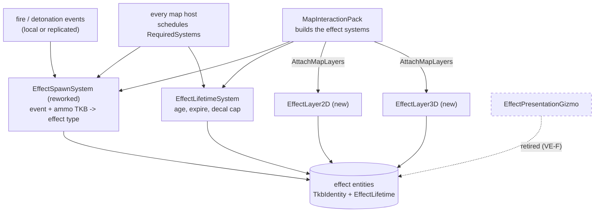

*What the picture shows that prose hid:* the effects stop being an IG/Editor module and become part of the shared map
construction — the pack builds the two systems and the two layers, every host schedules the systems it declares, and the
existing `Unserviceable` check reports a host that does not. The gizmo projector is the dead edge.

### 3.2 Classes

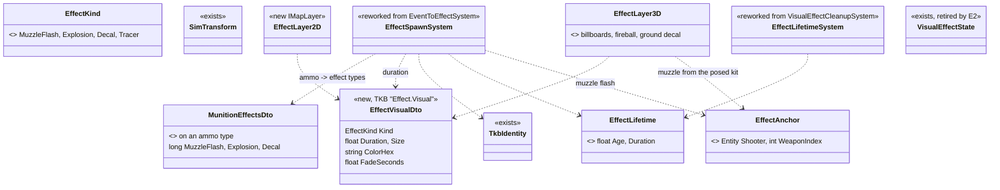

*What it shows:* the look lives in the TKB (one descriptor per EFFECT type, one mapping per AMMO type); the entity carries only
its type, its age and — for a muzzle flash — what it is attached to.

### 3.3 Sequence — one shot, from fire to decal

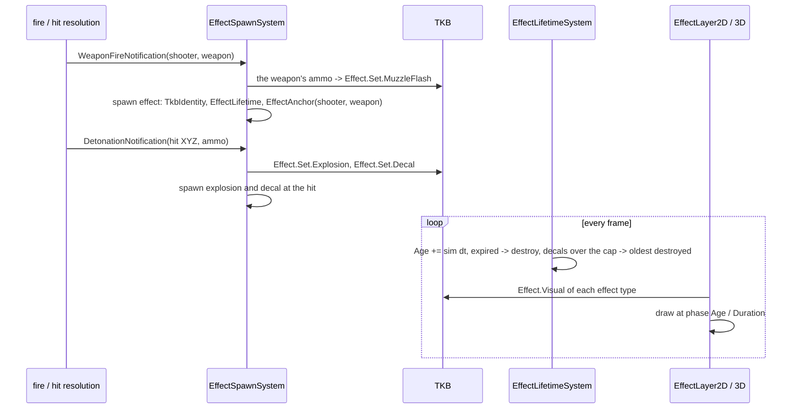

## 4. DECISIONS — ✅ APPROVED `2026-10-10` (U3)

| # | decision | ⭐ lean | rejected — one line each |
|---|---|---|---|
| **VE-A** | where effects are made | ⭐ **on every map host, locally, from the fire / detonation events** (which already reach every node); the pack BUILDS the two systems, every host schedules them, `RequiredSystems` declares them so `Unserviceable` reports a host that does not (R-254) | replicating effect entities — the events already cross the wire; an effect is presentation · keeping it an IG/Editor module — the measured "not on all hosts" |
| **VE-B** | what an effect entity is (U1) — ⚠ *"not recorded" and `EffectLifetime` SUPERSEDED by §7 VE-Q/VE-R (U7/U8)* | ⭐ `TkbIdentity` (the effect type) + `SimTransform` + `EffectLifetime { Age, Duration }`; not saved, not recorded | the current `VisualEffectState` enum + colours on the entity — the look would live in code, not the TKB |
| **VE-C** | what an effect looks like | ⭐ TKB `Effect.Visual { Kind, Duration, Size, ColorHex, FadeSeconds }` on built-in effect types: muzzle flash, explosion and decal in **small / medium / large** (nine), plus the tracer | one effect type with a scale parameter — the decal art and durations differ by size, not just scale |
| **VE-D** | which effect an ammo makes (U2: "multiple sizes based on ammo type") | ⭐ TKB `Effect.Set { MuzzleFlash, Explosion, Decal }` on the AMMO type (references to effect types); an ammo with none uses a default by its calibre class | sizing from damage or penetration — a HEAT round and an APFSDS of the same gun look different |
| **VE-E** | where a muzzle flash is | ⭐ `EffectAnchor { Shooter, WeaponIndex }`: the RENDERER finds the muzzle each frame from the shooter's posed kit (§3.11 turret pose, M23–M26) — the flash follows the barrel; until the pose exists, the kit's neutral barrel | a fixed spawn position — wrong as soon as the vehicle or turret moves during the flash |
| **VE-F** | how they are drawn (U2: "no gizmos as such") | ⭐ two map layers attached by `AttachMapLayers`: **2-D** a star (flash), an expanding disc (explosion), a dark blot (decal); **3-D** additive camera-facing quads for flash and fireball, a fading ground quad draped on the terrain for the decal; `EffectPresentationGizmo` — and ONLY it — retired when the 2-D layer lands (route, not a second surface; §4a) | effects as gizmo primitives — the user ruled it out, and a 64-byte primitive per effect per frame is waste |
| **VE-G** | whose clock | ⭐ **simulation time**: a paused sim freezes an explosion mid-phase; a replay replays them from the replayed events | wall time — a paused fireball would finish, and a replay would not match |
| **VE-H** | decals live long | ⭐ minutes, fading at the end, and a **cap** (oldest removed first, e.g. 256) so a firefight cannot grow without bound | until the scenario resets — unbounded |
| **VE-I** | decal surface | ⭐ step 1: on the GROUND under the hit (draped, R-248); step 2: on the hit surface — a wall or a roof — once `IWorldQuery.Trace` reports the hit's surface normal | a decal floating at the hit point — visible as a card in 3-D |

### 4a. Which gizmo retires, and which stay *(U3)*

📐 Measured `2026-10-10`. Three different things draw "a shot" today; only the first is replaced.

| | what it draws | ⭐ fate |
|---|---|---|
| `EffectPresentationGizmo` (`Hrot.Presentation/Gizmos/EffectPresentationGizmo.cs:13`) | the CURRENT effect entities (`VisualEffectState`): an explosion as a flat circle at **z = 0**, a tracer as a 1-px line from the shooter's ORIGIN to the target's origin at **z = 0** (`:30-41`) | ⛔ **retired by E3** — it is the drawing half of the effect entities this design rebuilds; the new effect layers draw the same entities (and the tracer kind) from their TKB type, in both modes |
| `FireTraceGizmo` (`ScenarioEditor/Gizmos/FireTraceGizmo.cs:16`) — the **firing line** | each round fired: **muzzle → where it ended**, coloured by outcome (hit red, stopped by terrain orange, expired grey, in flight yellow), crossings marked, fading over seconds of sim time (`CE-3153`); recorded, so a replay shows it; the layer control's *FireTraces* bit | ✅ **stays** — an analysis layer, not a realism effect. It already emits real 3-D points (`s.Muzzle`, `s.End` are `Vector3`, `:80`), so the 3-D map draws it at its true heights once S3's gizmo triage lands |
| `DetonationGizmo` (`ScenarioEditor/Gizmos/DetonationGizmo.cs:16`) | a burst's fragment / blast radii and rays to every body point it rated | ✅ **stays** — analysis; 3-D in S3 |

⇒ in 3-D a shot shows as the **muzzle flash + tracer + explosion + decal** (realism, this design) and, when the operator turns
the layer on, the **outcome-coloured firing line** (analysis, S3). ⚠ The tracer kind and the firing line overlap in purpose; the
tracer is short and decorative, the firing line is the one that says what the round DID.

### 4b. Binding the muzzle flash to the barrel *(U4 — VE-J..VE-M ✅ APPROVED, U5)*

🔒 **User, `2026-10-10`:** *"how the muzzle effect will be bound to the barrel? what is expected from the shot effect entity
regarding its parenting or location?"*

📐 **Measured:**

| fact | code | design |
|---|---|---|
| the fire event and its wire message carry the shooter and the WEAPON INDEX — no position | `WeaponFireNotification`; `WeaponFire { ShooterEntityId, TargetEntityId, WeaponIndex }` (`FireInteractionMessages.cs:48-52`) | ⛔ searched, none |
| today the round starts at the shooter's ORIGIN + its stance/type eye height, then 1 m along the aim line — not at a barrel | `FireProcessingSystem.cs:109,115,172`; `CombatConstants.MuzzleOffsetMeters = 1.0` (`:65`) | the 1 m exists so a round does not spawn inside a squad-mate (`CE-3059`, comment at `:169`) |
| the shot log records that point as `Muzzle`, and the firing-line gizmo draws from it | `FireProcessingSystem.cs:208,221`; `FireTraceGizmo.cs:80` | `CE-3117` |
| the part link `PartMetadata` is a NETWORK-meaningful part (its `InstanceId` is reused as the descriptor instance) | `PartMetadata.cs:5-13` | `Q79` §0.10, R-255 (the turret is such a part) |

| # | decision | ⭐ lean | rejected — one line each |
|---|---|---|---|
| **VE-J** | what the flash entity carries | ⭐ `TkbIdentity` (its flash type) + `EffectLifetime` + **`EffectAnchor { Shooter, WeaponIndex }`** — no position of its own: the renderer finds the muzzle EVERY FRAME, so the flash rides the barrel while the hull drives and the turret slews; the shooter gone ⇒ the flash ends | a `PartMetadata` child of the shooter — parts are network-meaningful (instance ids, ownership, egress), an effect is local and lives 0.1 s · a fixed spawn position — wrong the moment the vehicle or turret moves |
| **VE-K** | where the muzzle IS — ONE answer | ⭐ `Muzzle.Of(view, shooter, weaponIndex)` in `Fdp.Toolkits`: the mount's TKB muzzle offset, relative to its turret's trunnion, posed by the turret part's `TurretPose` (M23), placed by the body; a mount on no turret: relative to the body; a person: today's stance eye height + the weapon's forward offset. ⭐ **The fire code spawns the round there too** (replacing the fixed 1 m; its "never past half way to the target" clamp stays), so the flash, the tracer, the round and the firing line all start at the same point | the renderer computing its own muzzle from the kit — two answers that drift (the flash beside where the round left) |
| **VE-L** | the drawn barrel | ⭐ when the TKB gives the turret and mount geometry (M25), the kit's turret and gun parts are placed FROM it — the barrel tip IS `Muzzle.Of`; a rail checks it to 5 cm (the `CE-1041` pattern: the TKB is the truth, the kit draws it) | a separate kit muzzle — the picture and the shot disagree |
| **VE-M** | explosion and decal | ⭐ **world-fixed** at the hit point, no parent; a decal only on the static world (ground; walls/roofs in step 2) — a hit on a vehicle makes an explosion and no decal | a decal parented to a moving vehicle — a damage look belongs to the vehicle's own state, not to a decal |

⚠ VE-K adds one field set to M25's TKB turret descriptor (per mount: which turret, muzzle offset) and changes where a round
spawns — a combat-lane change, hence a separate nod.

## 5. NOT VERIFIED

| claim | how it is settled |
|---|---|
| ⚠ every host's kernel has a slot the pack's effect systems can be scheduled in (CGF, SimHost, ReplayBrowser run no effects today) | E2 — `Unserviceable` must come back empty on all five |
| ⚠ the munition TKB has an ammo template per round the weapons fire (`AmmoWeaponBallisticsDto` per launcher) to hang `Effect.Set` on | E1 — enumerate `MunitionTkbCatalog` and the weapon suites |
| ⚠ software GL cost of additive blending with a few hundred live effects | E3 frame rail, then the Windows run |

## 6. SLICES

| slice | delivers | depends on |
|---|---|---|
| **E1** | TKB `Effect.Visual` + `Effect.Set`; nine built-in effect types + the tracer; `Effect.Set` on the built-in ammo | VE-B..VE-D approved |
| **E2** | `EffectSpawnSystem` / `EffectLifetimeSystem` reworked onto TKB types and sim time, built by the pack, declared in `RequiredSystems`, scheduled on all five hosts (rail) | E1 |
| **E3** | `EffectLayer2D` + `EffectLayer3D`; `EffectPresentationGizmo` retired; screenshot rail | E2 |
| **E4** | `Muzzle.Of` (VE-K) used by the fire code and the renderer; the flash at the posed barrel; the kit's barrel from the TKB (VE-L) | the turret build (3-D map §3.11, M23–M26) + VE-J..VE-M |

### 6a. E1–E3 — AS-BUILT `2026-10-11`

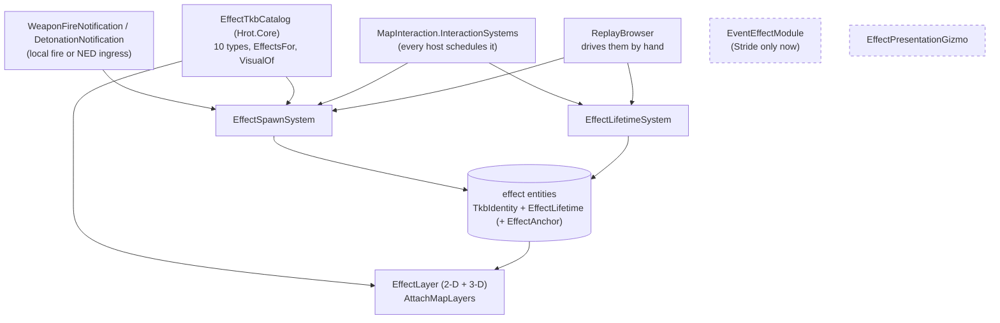

*What the picture shows that prose hid:* the effects ride the ONE scheduled set every map host already runs
(`InteractionSystems`), so no host can have the map without the effects; the replay browser — the one host that drives map
systems by hand and has no kernel — drives them too, and plays their commands back itself. The dashed edges are what retired:
the gizmo (deleted) and the IG/Editor effect module (Stride keeps it — "Stride untouched").

| built | where |
|---|---|
| `EffectKind`, `EffectVisualDto` (`"Effect.Visual"`), `MunitionEffectsDto` (`"Effect.Set"`, + a tracer reference) | `Fdp.Toolkits/Tkb/Domain/EffectDtos.cs` |
| the ten effect types (7101–7103 flash, 7111–7113 explosion, 7121–7123 decal, 7131 tracer), hidden from the palette; the grenade and the mortar name their sets; `EffectsFor` = the ammo's set, else the calibre class from damage per hit (small < 50 ≤ medium < 500 ≤ large — rifle / 25 mm, RPG / tank gun, ATGM); `VisualOf` falls back to the built-in table on a host with no TKB | `Hrot.Core/Tkb/EffectTkbCatalog.cs`, registered by `HrotEnvironment.CreateTkb` |
| `EffectLifetime` (124), `EffectAnchor` (125) — registered by `PresentationComponentRegistry.RegisterEffects` (from `RegisterAll` and the pack) | `Hrot.Core/Components/Map/EffectComponents.cs` |
| `EffectSpawnSystem` (fire ⇒ a flash attached to the weapon + a tracer toward the target when the round has one; hit ⇒ an explosion at the hit, a decal on the ground under it unless the round hit a live body) and `EffectLifetimeSystem` (age by the tick's dt, expire, shooter gone ⇒ end, decals capped at 256 oldest first) — in `MapInteraction.InteractionSystems` and `RequiredSystems` with `Unserviceable` reasons | `Hrot.Presentation/Effects/EffectSystems.cs`, `MapInteraction.cs` |
| `EffectLayer` — 2-D star / disc / blot / streak; 3-D additive spheres, a draped decal disc, a tracer streak; the look and phase from the TKB | `Hrot.Presentation/Effects/EffectLayer.cs`, attached by `AttachMapLayers` |
| retired: `EffectPresentationGizmo` (deleted with its two IG rails); `EventEffectModule` no longer registered on IG or the Editor | — |
| ⭐ kept out of everything durable (VE-B): `EffectLifetime` / `EffectAnchor` are `DataPolicy.Transient`; every effect entity carries `ScenarioIgnoreTag` — 📐 measured: the scenario save takes EVERY owned entity without that tag (`ScenarioSerializer.CollectSaveableEntities`), so the old `VisualEffectState` explosions were saveable too; the body layer gives an effect type no body (by its `Effect.Visual`, and by the catalog where there is no TKB), else a recorded effect would draw as an unknown box | `EffectComponents.cs`, `EffectSystems.cs`, `EntityBodyLayer3D.LookOf` |

⚠ **Deviations, argued:** ONE `EffectLayer` with both passes, not two classes (one query, one muzzle, one TKB lookup, as the gizmo
layer). · The **muzzle** is the front of the shooter's drawn box in its upper half until E4's `Muzzle.Of`. · The replay browser
ages effects by the **replayed** time it stepped (paused ⇒ frozen); the other hosts by the interaction module's dt — 📐 the
kernel's per-module accumulated delta (`ModuleHostKernel.cs:689`), which is the same delta every other module gets.
· Effect sets live on the AMMO type (VE-D) and only two built-in ammo types exist; every other mount resolves by calibre class.
**Gates:** `EffectTests` (Hrot.Presentation.Tests) · frame rail shot ⑧ `map3d-8-effects.png` · IG module rails updated.

### 6b. E4 — `Muzzle.Of`: the round, the flash, the tracer and the drawn barrel tip from ONE point *(✅ built `2026-10-11` as drawn; VE-J..VE-L)*

E4 is split: **E4a** = `Muzzle.Of` and its three readers (the fire code, the flash, the tracer); **E4b** = the kit's turret and gun
placed FROM the TKB, so the drawn barrel tip IS `Muzzle.Of` (VE-L, a 5 cm rail).

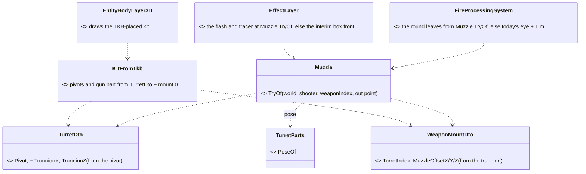

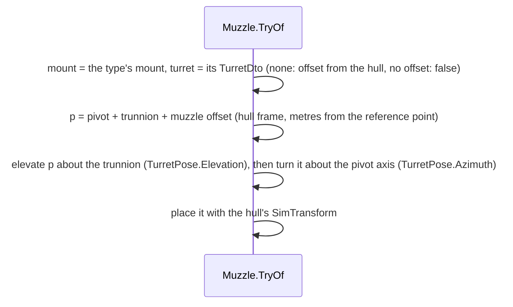

*What the pictures show that prose hid:* `Muzzle.TryOf` applies the SAME two rotations, in the same order, as the kit's
`KitPart.BodyTransform` does to the gun part (elevation about the trunnion, then azimuth about the turret axis), so once E4b places the
kit from the same numbers the drawn tip and the computed muzzle cannot disagree. A type with no muzzle data answers false, and every
reader keeps its present behaviour — a rifleman's round still starts at his eye + 1 m.

| choice | why | rejected — one line each |
|---|---|---|
| the trunnion is a TKB offset from the pivot (`TrunnionX/Z`), default 0 | a gun elevates about a point FORWARD of the turret axis (the kit already draws it so) | trunnion = pivot — the drawn barrel would swing about the turret centre |
| the round's aim point is still chosen from the EYE (`AimPoint.For`, what the shooter sees); only its launch point moves | the sight question is the shooter's, the flight starts at the barrel | aiming from the muzzle — a hull-down tank would "see" over a crest with its gun |
| "never past half way" kept: when the barrel is more than half way to the target, the round starts as today | CE-3059 — a round must not spawn beyond / inside a close target | dropping the clamp — point-blank shots would start past the target |
| `BallisticAim` keeps solving from the pivot | the trunnion–pivot parallax (~1.5 m) is below the 0.5° on-target tolerance beyond ~170 m | moving it now — touches WL-2's rails for no visible gain |

⚠ **As built (E4):** `Muzzle.Of` is `Muzzle.TryOf(world, shooter, weaponIndex, out point)` — false for a type with no muzzle data, so
every reader keeps its old answer for it (riflemen, unknown types). The kit draws the barrel of the FIRST mount on turret 0 with a
forward offset (mount 0 on a tank, the 25 mm on the Bradley); the TOW is not drawn, but its rounds and flashes leave from its own
offset. Gates: `FireProcessingSystemTests.E4_*` (2), `Map3DTests.E4b_TheDrawnBarrelTip_IsTheMuzzle_Within5cm` (3 types).

## 7. Wrecks, dead bodies, flames and smoke — and one generic `Lifespan` *(✅ APPROVED `2026-10-11`, U6–U8, R-269 (ui); W1–W4 built — §7.5)*

| # | verbatim |
|---|---|
| **U6** | *"The destroyed entities (vehicle wrecks, soldier bodies) should be rendered differently — vehicles could become fully black and we could add a time limited (auto removal) flames/smoke entity attached to them, generating some simple particle effect. Dead soldiers could take special dead laying pose."* · on the leans: *"Durations ok. X symbol OK in 2d."* |
| **U7** | *"Timed effect could have component stating its lifespan and time of creation (simtime) so some garbage collection system removes those. Maybe this could be a generic component and maybe it already exists?"* |
| **U8** | *"Why not recorded? If recorded, replay will show effects properly after jump in time."* · *"Approved. Local effect entities not significant in recording, no need to measure."* |

### 7.1 INVENTORY — measured `2026-10-11`

Graph `search_graph` `.*(Lifetime|Lifespan|Expir|TimeToLive|Ttl|Despawn|AutoRemov|Corpse|Timed).*` (Struct 0, Class 7 — only
`EffectLifetime` / `EffectLifetimeSystem` are entity lifetimes) + grep; corpus sweep of `docs/` and `.dev/` by topic.

| what exists | where | what §7 does with it |
|---|---|---|
| dead entities STAY in the world (Health 0, capabilities stripped) | `HealthApplicationSystem.cs:90-104`, `DamageSystem.cs:74-83` · ruling 2026-09-13 (`RUNBOOK_Cluster_Debugging_Over_Http.md:360`), CE-272 | the wreck / body is that entity, drawn differently |
| "destroyed" = `Health.Current ≤ 0`, Health received on EVERY node | `CombatLife.cs:21`, `ThreatDanger.cs:32`; `EntityDamage` in `SharedTranslatorPack.cs:82` | `WreckState.IsDestroyed` — the one test |
| vehicle damage states / human injury states | ⛔ not built — D1 decided (`DESIGN_Operations_Behaviour_Catalogue.md:290-296`) | later the source of "destroyed"; only `IsDestroyed` changes |
| `EffectLifetime { Age, Duration }` (age summed per frame, effects only) + `EffectLifetimeSystem` | `EffectComponents.cs:16`, `EffectSystems.cs:96` | ⭐ replaced by the generic `Lifespan` (VE-Q) |
| bullet timeout `BallisticProjectile.SpawnTick` | `BallisticsSystem.cs:134` | left (combat code); named as the next `Lifespan` user |
| effect kinds MuzzleFlash / Explosion / Decal / Tracer; no smoke, fire, particles | `EffectDtos.cs:7`; `EffectLayer.cs:157-219` | + `Fire` and `Smoke` kinds, a stateless particle draw |
| `EffectAnchor { Shooter, WeaponIndex, Toward }` — muzzle only | `EffectComponents.cs`, `EffectLayer.cs:77-82` | + a BODY anchor (the wreck's top) |
| person figure per stance (Standing / Crouched / Prone), blended | `ShapeKit.cs:318-346` (`BlockFigure`), `EntityBodyLayer3D.cs:147` | + a `Dead` figure posture |
| 2-D condition bits Damaged / Immobile from Health | `EntityPresentationGizmo.cs:120-130` | + Destroyed → the 2525 X |
| the replay browser re-spawns effects from replayed events by hand | `ReplayBrowserSubsystem.cs:458-466` | ⭐ stops: the recording holds the effects (VE-R) |
| `DataPolicy` keeps "not recorded" (`NoReplay`) and "not saved" (`NoScenario`) apart | `DataPolicyAttribute.cs` | effect components: `NoScenario` (+ `NoPreview`), RECORDED |

### 7.2 Diagrams

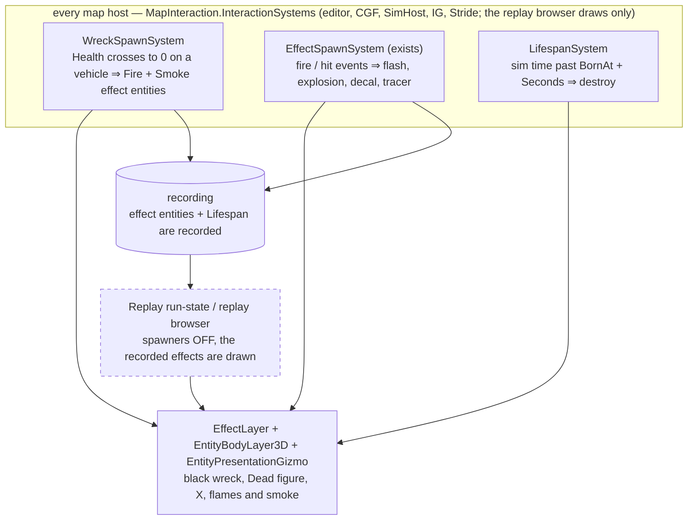

*What the picture shows that prose hid:* the spawners run where the map's systems already run on every host — and are OFF in replay,
where the recording already holds the effects (U8); running them there too would draw every effect twice. The garbage collector is
one system for every timed entity, not a per-feature timer.

```mermaid
classDiagram
  class Lifespan { <<BUILT W1, Fdp.Toolkit.Time, id 356, NoScenario + NoPreview, RECORDED>> double BornAtSimSeconds; float Seconds; Age(now); Phase(now); IsOver(now) }
  class LifespanSystem { <<BUILT W1, Fdp.Toolkit.Time>> destroys an entity once now ≥ BornAt + Seconds, or now < BornAt after a jump back; IsReplayActive ⇒ stands down }
  class EffectLifetime { <<RETIRED W1 — struct and system gone, id 124 reserved>> }
  class EffectSpawnSystem { <<exists, W1>> stamps Lifespan.Starting(now, Duration); IsReplayActive ⇒ stands down; Housekeep: orphaned anchor, decal cap 256 }
  class MapInteractionContext { <<exists, W1>> + IsReplayActive — SimHost: the ELM's gate · CGF: rrController · replay browser: always · editor, IG: null }
  class WreckState { <<BUILT W2 as CombatLife.IsDestroyed — exists, has Health, Current ≤ 0 (later D1's destroyed state)>> }
  class WreckSpawnSystem { <<BUILT W3, Hrot.Presentation Effects>> a vehicle's Health crossing to 0 ⇒ Fire + Smoke anchored to its body; IsReplayActive ⇒ off, forgets }
  class EffectAnchor { <<exists, W3>> + Kind: Muzzle or Body (the body's top centre, every frame) }
  class EffectKind { <<exists TKB, W3>> + Fire = 4; + Smoke = 5 }
  class EffectTkbCatalog { <<exists, W3>> + Fire 7141 (60 s, fades 15 s), Smoke 7151 (180 s, fades 60 s); sized for a tank, scaled by the wreck }
  class EffectLayer { <<exists, W3>> + BodyTopOf; + Puffs(r): puff i of n from (entity seed, age), stateless }
  class EntityBodyLayer3D { <<exists, W2/W4>> PartColour: a destroyed vehicle near-black on every part and its gear; a dead person the Dead figure via DeathFall }
  class BlockFigure { <<exists, W4>> + Dead(soldier) (on the back, limbs spread, rifle dropped); + Fall(from, t) }
  class DeathFall { <<BUILT W4, Map3D>> when each dead man fell (sim time); a body first seen dead just lies }
  class EntityPresentationGizmo { <<exists, W2>> + Destroyed condition bit ⇒ PerspectiveShapeRenderer draws the MIL-STD-2525 X }
  LifespanSystem ..> Lifespan
  EffectLifetime ..> Lifespan : replaced by
  EffectSpawnSystem ..> Lifespan
  MapInteractionContext ..> EffectSpawnSystem : IsReplayActive
  MapInteractionContext ..> LifespanSystem : IsReplayActive
  WreckSpawnSystem ..> WreckState
  WreckSpawnSystem ..> EffectAnchor
  WreckSpawnSystem ..> Lifespan
  EffectLayer ..> EffectKind
  EntityBodyLayer3D ..> WreckState
  EntityBodyLayer3D ..> BlockFigure
  EntityBodyLayer3D ..> DeathFall
  EntityPresentationGizmo ..> WreckState
```

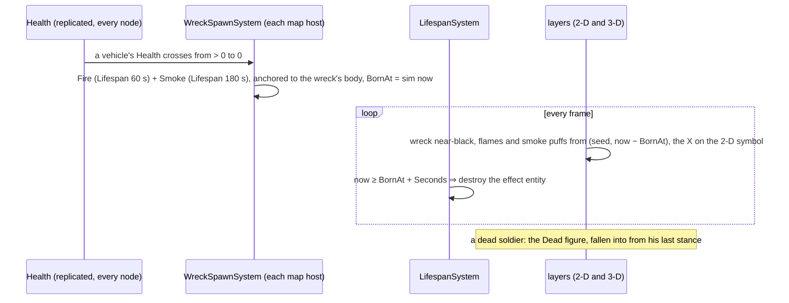

### 7.3 Decisions — ✅ approved (U6–U8)

| # | decision | ⭐ approved | rejected — one line each |
|---|---|---|---|
| **VE-N** | what "destroyed" is | `Health.Current ≤ 0` through ONE helper, `WreckState.IsDestroyed` — D1's damage states replace its body later | a new replicated destroyed flag — Health already reaches every node |
| **VE-O** | the wreck's look | the whole 3-D body near-black (every part, the Dark / Glass / Metal roles too), the turret where it last pointed; 2-D: the MIL-STD-2525 destroyed condition — an X through the symbol (U6: *"X symbol OK"*) | a darkened 2-D symbol — not the standard marking |
| **VE-P** | flames and smoke | effect entities of two new kinds, `Fire` (≈ 60 s) and `Smoke` (≈ 180 s, fading) (U6: *"Durations ok"*), made by each map host when a VEHICLE's Health crosses to 0, anchored to the wreck's body; a stateless particle draw (each puff from the entity's seed and its age — no particle entities); a 2-D smoke/flame mark; soldiers do not burn; a wreck loaded already dead does not burn | a particle entity per puff — thousands of entities; a burn decal on the wreck — VE-M |
| **VE-Q** | timed removal | ⭐ ONE generic `Lifespan { BornAtSimSeconds, Seconds }` + ONE `LifespanSystem` (U7); every effect uses it, `EffectLifetime` retires, the phase comes from the sim clock (VE-G kept) | a timer per feature (today's `EffectLifetime` and the bullets' `SpawnTick`) — the bullets move later, in the combat code's lane |
| **VE-R** | recording | ⭐ effect entities ARE RECORDED (U8), never saved to a scenario (`NoScenario`); in replay the spawners are OFF and the recorded effects are drawn — a jump lands on the right fire and smoke | ⛔ SUPERSEDED: VE-B "not recorded" — a jump lost every long effect |
| **VE-S** | the dead soldier | a `Dead` figure posture in `BlockFigure` (on the back, limbs spread), fallen into over ~0.6 s from his last stance; drawn because he is destroyed, NOT a stance | a `Dead` value in `StanceId` — the stance is the animation contract shared with the Muscle; death is a health fact |

### 7.4 Slices

| slice | builds | shows |
|---|---|---|
| **W1** | `Lifespan` + `LifespanSystem`; effects moved onto it; `EffectLifetime` retired; effect components `NoScenario` + recorded; spawners off in replay, the replay browser's hand-spawning removed | today's effects unchanged live; correct after a replay jump |
| **W2** | `WreckState`; black wrecks in 3-D; the 2-D X | a killed tank is a black hull with an X |
| **W3** | `Fire` / `Smoke` kinds + catalog types; `WreckSpawnSystem`; body anchor; stateless particles; the 2-D mark | the wreck burns ~60 s and smokes ~3 min, then they are gone |
| **W4** | the `Dead` figure + the fall | a killed soldier lies on his back |

### 7.5 W1 — AS-BUILT `2026-10-11`

| what | where | ⚠ vs §7.2–7.4 |
|---|---|---|
| `Lifespan` (id **356**) + `LifespanSystem`, generic | `FDP/Toolkits/Fdp.Toolkits/Time/Lifespan.cs`, `LifespanSystem.cs` | as drawn. ⚠ 355 is the backend lane's `CombatTemperament` |
| every effect stamped `Lifespan.Starting(sim now, Duration)`; the layer's phase and fade read `SimClock` | `EffectSystems.cs` `Spawn`, `EffectLayer.Resolve` | as drawn — VE-G now holds by construction (no stored age to forget to freeze) |
| `EffectLifetime` + `EffectLifetimeSystem` retired | `EffectComponents.cs`, `EffectSystems.cs` (tombstones) | as drawn; ⭐ **deviation:** its orphan-anchor (VE-J) and decal-cap (VE-H) rules moved into `EffectSpawnSystem.Housekeep`, so `LifespanSystem` stays effect-blind |
| `EffectAnchor` and `Lifespan` recorded, `NoScenario` + `NoPreview` | `EffectComponents.cs`, `Lifespan.cs` | as drawn (VE-R) |
| ⭐ **the replay gate** — `MapInteractionContext.IsReplayActive` → `MapInteraction.IsReplayActive` → both systems, read each frame | `MapInteractionContext.cs`, `MapInteraction.cs`, `MapInteractionPack.cs` | ⭐ not drawn before: §7.2 said "spawners OFF in replay" without the WHO. The mechanism is replay-and-modules §2.1m's (gate in place). **SimHost** passes the ELM's gate (`HrotNodeContext.BaseModules[0]`, wired by `NodeBootstrapper` to the record/replay controller); **CGF** passes `rrController`; the **replay browser** passes `() => true`; the **editor** passes nothing (its replay is an isolated sandbox, `ReplayBrowserContext`); **IG** passes nothing (listen-only: it holds no recording, so it keeps making its own from the events it receives) |
| the replay browser's hand-spawning and its private replayed-dt clock removed | `ReplayBrowserSubsystem.cs` | ⭐ **deviation:** it still TICKS both systems (gated off) so its declared run-set stays the map's whole set and `Unserviceable` raises no false alarm |
| rails | `EffectTests.W1_*`, `E2_*` moved onto sim time | — |

*NOT verified:* a real record → replay → seek round trip that shows a recorded decal after a jump (the rails pin the policy flags and the
gates, not the recorder). ⚠ The recorder must see `Lifespan`/`EffectAnchor` registered on the recorded world — `RegisterEffects` does it
on every map host's world.

### 7.6 W2–W4 — AS-BUILT `2026-10-11`

| slice | what | where | ⚠ vs §7.2–7.4 |
|---|---|---|---|
| W2 | "destroyed" = `CombatLife.IsDestroyed` (exists, has `Health`, `Current ≤ 0`) | `FDP/Toolkits/Fdp.Toolkits/Combat/CombatLife.cs` | ⭐ **deviation:** no new `WreckState` class — `CombatLife` already owns *"is this unit still in the fight"* (CE-466), so the one test lives beside `IsAlive` (seam law: one home per rule) |
| W2 | 2-D X: `EntityShapeCondition.Destroyed` (bit 4), set by `EntityPresentationGizmo`; drawn by `PerspectiveShapeRenderer.DrawDestroyedCross` for ANY profile, and on the no-profile fallback box | GizmoMap `Shapes/`, `Rendering/DebugPrimitiveRenderer2D.cs` | ⚠ measured: no shape profile uses the condition elements (`ShowWhen` has zero data users), so the renderer draws the X itself. ⚠ A dead SOLDIER's symbol gets the X too — he is destroyed by the same test |
| W2 | 3-D wreck: `EntityBodyLayer3D.PartColour` near-black for every role and the aircraft gear; a wrecked helicopter's rotor stands | `Map3D/EntityBodyLayer3D.cs` | as drawn; the turret keeps its last `TurretPose` (nothing drives it once dead) |
| W3 | `EffectKind.Fire` / `Smoke`; catalog `Fire 7141` (60 s), `Smoke 7151` (180 s) | `EffectDtos.cs`, `EffectTkbCatalog.cs` | ⚠ "default per vehicle family" became ONE pair for every vehicle, **scaled by the wreck's drawn footprint** (0.4–2 × a 7 m tank) — no per-family TKB descriptor (new vocabulary not needed yet) |
| W3 | `WreckSpawnSystem` — only a CROSSING burns (memory per entity, dropped on a world change and while replaying); a person / bodiless unit / unknown type never burns | `EffectSystems.cs`; scheduled through `MapInteraction.InteractionSystems` on every host, declared in `RequiredSystems` | as drawn |
| W3 | `EffectAnchor.Kind` (`Muzzle` / `Body`); the layer puts a body-anchored effect at the top of the drawn box (`EffectLayer.BodyTopOf`) | `EffectComponents.cs`, `EffectLayer.cs` | as drawn; the wreck deleted ⇒ the flames end (the spawner's orphan rule, W1) |
| W3 | stateless particles `EffectLayer.Puffs` — fire tongues (0.8 s loop, dying down over the last 30 %), smoke puffs (6 s loop, rising 6 sizes, drifting on a fixed breeze); 2-D draws the same puffs from above | `EffectLayer.cs` | ⚠ the breeze is a constant until weather exists |
| W4 | `BlockFigure.Dead` (on the back, legs apart, arms flung out, rifle dropped) + `BlockFigure.Fall`; `DeathFall` remembers when each death was SEEN (sim time) — a body first seen dead, or a death found across a jump (> 0.5 s since last seen alive), just lies | `Map3D/ShapeKit.cs`, `EntityBodyLayer3D.FigurePose` | as drawn; `Blend` and `Fall` share one interpolation (now with yaw/pitch) |
| rails | `EffectTests.W2_*`, `W3_*`; `EntityPresentationGizmoTests.Draw_WhenDestroyed_*`; `Map3DTests.W4_*`; `MapSelfCheckTests` pinned counts | | — |

⭐ **Verified on GL `2026-10-11`** — `Map3DFrameRail.W_DestroyedEntities_*` renders the story under Xvfb (Mesa) and writes six
screenshots (`wreck-1…6-*.png`): three wrecks killed through the production `WreckSpawnSystem`, the riflemen dead / falling / alive,
the fire dying at 52 s, smoke alone at 150 s, and the 2-D symbols with the X. ⚠ **Tuned from those shots:** the first flames were
ADDITIVE yellow puffs that saturated to a white ball ⇒ now ALPHA-blended orange → red → soot tongues spread over the hull (16 puffs,
Fire size 3.2 m); the first X was heavier than the outline and overshot the corners ⇒ now corner to corner at the outline's weight;
in 2-D the smoke hid the flames ⇒ flames draw last there, at least 3 px. Run it:
`HROT_RAIL_SHOTS=<dir> xvfb-run -a -s "-screen 0 1280x800x24" dotnet test Hrot/Engine/Hrot.Presentation.Tests --filter "FullyQualifiedName~Map3DFrameRail"`.

## 8. Projectiles in flight and on the ground — grenades, bombs, rockets, missiles *(P1 built `2026-10-11`; PR-D/PR-E open)*

| # | verbatim |
|---|---|
| **U9** | *"Backend lane allowed throwing grenades today, i need you render the grenade when it flies and when it lays on ground before exploding. You can render basically any other projectile which is represented by its own entity, like missiles and rockets and bombs. If they have no entity and ballistic/flight model and no 3d model, lets think how to solve that."* |

### 8.1 INVENTORY — measured `2026-10-11`

Graph `search_graph` `.*(Projectile|Grenade|Munition|Missile|Rocket|Ballistic).*`, Class — **26, `has_more: false`**; production hits:
`BallisticProjectile`, `BallisticsSystem`, `BallisticAim`, `AmmoWeaponBallisticsDto`, `MunitionEffectsDto`, `MunitionTkbCatalog`,
`MunitionDetonation` (+ its two translators), `ProjectilePresentationGizmo`. Corpus sweep of `docs/` + `.dev/` by topic.

| what exists | where | what §8 does with it |
|---|---|---|
| every round is its OWN entity: `SimTransform` + `SimVelocity` + `BallisticProjectile` + `PhysicsCollider`; no `TkbIdentity`, no `NetworkIdentity` | `FireProcessingSystem.cs:186-243`; `designs/dds-to-ecs/DESIGN.md:864` | drawn from those components |
| the round knows its MUNITION type (`Ammo`) and warhead bits — `Arc`, `TimeFuze`, `Landed` (lying, fuze burning), `Spent` — and `FuzeRemaining` | `CombatComponents.cs:73-148`; `DESIGN_Building_Interiors.md` §3k (W-4, W-8) | the look comes from the munition type; `Landed` + `FuzeRemaining` draw the lying grenade |
| rounds live ONLY on the node running combat (the Muscle, or the editor as one node) — never on the wire; only the fire / detonation EVENTS cross | `designs/brain-split/BS-1-DESIGN.md` §2.1, §5.4a; `DESIGN_Weapon_Layers.md:641` | ⚠ the open question PR-D |
| the `WeaponFire` wire event carries ONLY shooter, target, weapon index — no launch point, velocity or munition; `MunitionDetonation` carries the munition type and hit point | `FireInteractionMessages.cs:55-64, 93-115` | PR-D's lean extends it |
| munition types: only `M67` (6001) and `81 mm HE` (6002) — warhead + `Effect.Set`, no look; every other mount fires `Ammo = 0` | `MunitionTkbCatalog.cs`; `UrbanCombatTkbCatalog.cs:183,199` | + `Munition.Visual` on the two; ⚠ PR-E for the rest |
| `ProjectilePresentationGizmo` — a 1-frame yellow streak (previous → current position) per round on the 2-D map | `Gizmos/ProjectilePresentationGizmo.cs` | ⭐ extended, not duplicated: a lying grenade (zero-length streak, invisible today) gets a marker and its fuze countdown |
| no flight model for rockets / missiles: straight line at muzzle velocity, gravity only on arc rounds; ATGM "guidance" is the brain holding fire for the estimated flight | `DESIGN_Building_Interiors.md:1138,1286`; `DESIGN_Weapon_Layers.md` W-12c | drawn as flown (straight), smoke trail from the muzzle |

### 8.2 Diagrams

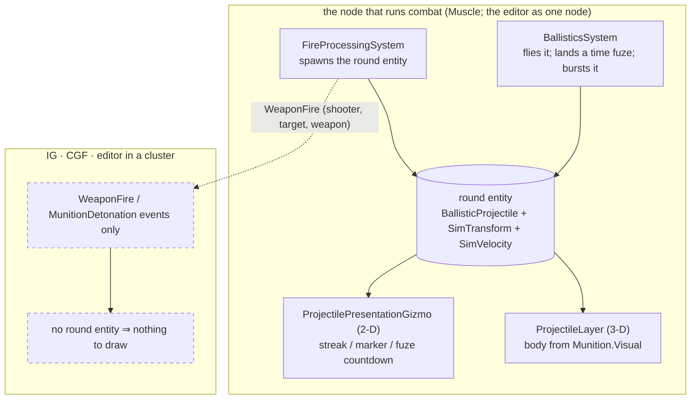

*What the picture shows that the prose hid:* a round can be drawn only where it EXISTS. On every other host the dashed path ends in
nothing — the events that do cross carry no launch point or velocity, so no host can fly a copy. That is PR-D, not a renderer gap.

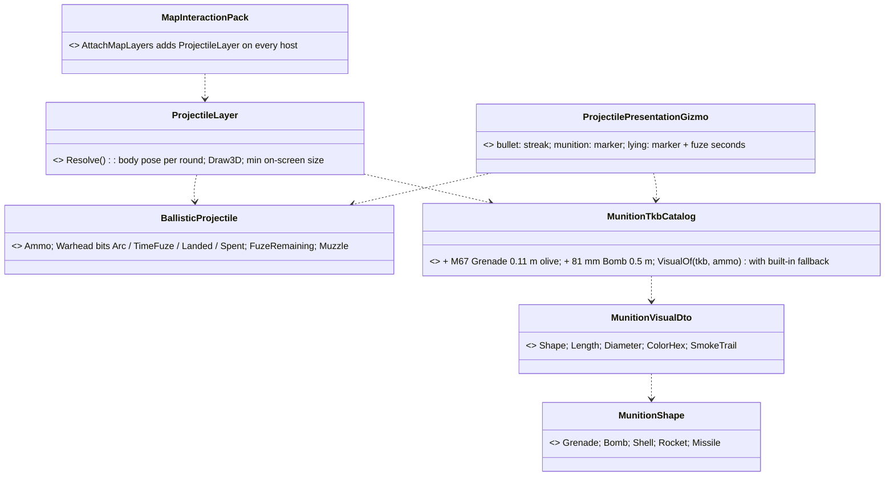

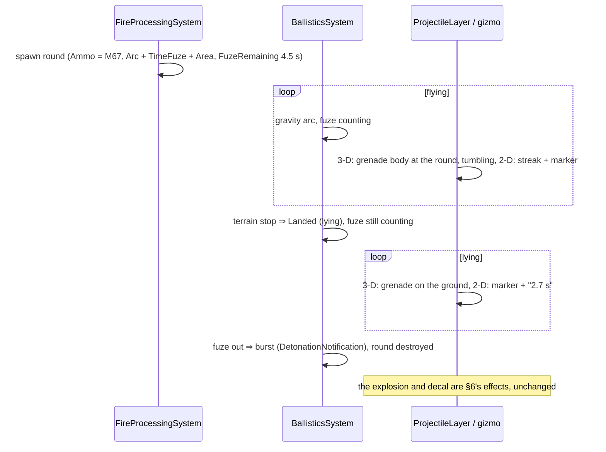

### 8.3 Decisions

| # | decision | lean | rejected — one line each |
|---|---|---|---|
| **PR-A** | where a round's look comes from | ⭐ its MUNITION type: a new optional `Munition.Visual` descriptor (shape, length, diameter, colour, smoke trail), the "the TKB type defines it" pattern of VE-C; built-in looks for M67 and 81 mm, so a host with no TKB (the replay browser) still draws them. A round with no munition look (`Ammo = 0`, every bullet) draws no body — its tracer is the effect | a look per weapon CATEGORY — the round does not carry its mount, and a category is not a munition |
| **PR-B** | the 3-D body | ⭐ one `ProjectileLayer` on every host (`AttachMapLayers`): the body at the round, long axis along its velocity, a grenade tumbling (stateless spin from seed and sim time), a lying round flat on the ground; drawn at least ~6 px so a 6 cm grenade is visible at map distance; a rocket / missile trails stateless smoke back to its muzzle | drawing it in `EffectLayer` — a round is not an effect and has its own lifetime owner (combat) |
| **PR-C** | the 2-D mark | ⭐ EXTEND `ProjectilePresentationGizmo` (the one 2-D projector of rounds): bullets keep the streak; a munition round adds a small filled marker in its colour; a LYING time-fuzed round adds its fuze countdown in seconds | a second 2-D projector — two implementations of one concept (ruling 9) |
| **PR-D** | ⚠ **OPEN — rounds on hosts that do not run combat** (IG, CGF, the editor in a cluster) | ⭐ **lean (b): extend `WeaponFire` with the launch point, launch velocity and munition type; every host flies a local VISUAL copy** (gravity for arc rounds, straight otherwise), lands it on its own terrain, and ends it on `MunitionDetonation` (which already carries the munition and the burst point). ~28 bytes per shot on an existing reliable topic; exact for unguided rounds | (a) replicate rounds as network entities — exact, but a new descriptor per round at fire rate, and the brain-split design keeps rounds muscle state · (c) nothing remote — IG is the operator's view, and grenades would be invisible there |
| **PR-E** | ⚠ **OPEN — rockets, missiles, tank shells have no munition type** | ⭐ **lean: the combat lane gives those mounts munition types** (RPG rocket, ATGM missile, 125 mm round…) with a `Munition.Visual` — ⚠ NOT neutral: measured `ParameterResolver.MountPenetration` (`ParameterResolver.cs:226-250`) looks the AMMO NAME up in the reference library when the mount's own penetration is 0, so a new type can change armour penetration — the combat lane must set/verify the numbers. No flight model is needed to DRAW them: they fly straight, and the layer draws what flies. A guided flight model is a separate combat feature (and makes PR-D (a) necessary for that munition) | infer "missile" from speed / damage — a guess the TKB should state |

### 8.4 P1 — AS-BUILT `2026-10-11`

| what | where |
|---|---|
| `MunitionVisualDto` (`Munition.Visual`) + `MunitionShape` | `FDP/Toolkits/Fdp.Toolkits/Tkb/Domain/MunitionVisualDto.cs` |
| looks for M67 (grenade, 0.11 m × 0.06 m, olive) and 81 mm (bomb, 0.5 m × 0.081 m); `MunitionTkbCatalog.VisualOf` with built-in fallback | `Hrot/Engine/Hrot.Core/Tkb/MunitionTkbCatalog.cs` |
| `ProjectileLayer` (3-D), attached on every host by `AttachMapLayers` | `Hrot/Engine/Hrot.Presentation/Effects/ProjectileLayer.cs` |
| `ProjectilePresentationGizmo` extended (marker, fuze countdown) | `Hrot/Engine/Hrot.Presentation/Gizmos/ProjectilePresentationGizmo.cs` |
| rails + GL frame rail `P_Projectiles_*` (grenade flying, grenade lying, mortar bomb, a test missile type) | `EffectTests.P1_*`, `Map3DFrameRail` |

⚠ **Tuned from the Xvfb shots (`rounds-1…3`):** at 7 px the bodies read as specks ⇒ `MinPixels` 10; the 2-D marker first took the
munition's PAINT (olive) and vanished on the grey/green map ⇒ it shows STATE — bright yellow flying, red-orange armed (lying, fuze
burning); the fuze text "2.7 s" rendered as "27 s" (the map's default font drops the decimal point at that size) ⇒ whole seconds
rounded up, "3 s"; the smoke trail of evenly spaced equal puffs read as beads ⇒ denser (0.9 m), jittered and spreading.
