<!--STATUS
state: LIVE
updated: 2026-10-11
build-state: BUILDING (WL-1a §5a, WL-1b §5b, WL-2a §5c, WL-2b §5d, WL-3 §5e built; WL-4 §5f building — backend) — ⭐ HANDED to the backend / behaviors lane 2026-10-11 (blueprints/batches/HANDOFF_Weapon_Layers_To_Backend_Or_Behaviors.md); the ui lane builds no more of it — W-1..W-9 approved (U-W2), §6 ambient fire approved as revised (U-W5), W-10 turret dead reckoning noted (U-W5: design only, no implementation yet); W-11 approved (U-W6): the task lives on the turret part
current-answer: §1 the three layers (module diagram) · §2 classes · §3 sequences · §4 decisions W-1..W-9 (APPROVED), W-11 (APPROVED, supersedes W-2 per-mount), W-12 APPROVED · §5f WL-4 (backend, BUILDING — the grenade at a hidden target, end to end) · §5 slices · §6 ambient fire
stale-below: nothing yet
known-rot: none
known-conflict: DESIGN_Ownership_Groups_And_Grants.md F-6 says weapon-mount parts are never created — stale, CgfComponentRegistry.cs:38
  registers WeaponMountInfo and CombatTkbTranslator.cs:92-122 creates them on CGF. DESIGN_Decision_Layer.md :1330 calls
  AimAndFireExecutor "the only weapon-channel executor" — stale since FireAtPointExecutor (DESIGN_Building_Interiors.md §3k).
related-designs:
  - DESIGN_Map_3D_Mode.md — §3.11 M23–M26 (R-255): the turret is a part child with a TurretPose, the weapon side aims it, it
    replicates as a multi-instance descriptor. THIS file decides which weapon layer on which node does the aiming.
  - DESIGN_Visual_Effects.md — VE-J..VE-L: Muzzle.Of(shooter, weaponIndex) from the posed barrel, used by the round AND the flash.
  - DESIGN_Utility_AI_Demo_Scenarios.md — §12 W1–W9: weapon choice per shot inside the executor (Mount=Auto), mount children on
    CGF; §9 the one ArmorModel (R-212). The weapon brain here takes over that choice.
  - DESIGN_Peek_And_Fire.md — D3 aim time per weapon, D4 seen-now gate, D9 reload, B7 rounds: the gates the weapon brain keeps.
  - docs/designs/brain-split/BS-1-DESIGN.md — the Brain writes intents, the Muscle executes (WeaponFireRequest per shot).
  - blueprints/Architect_Question_80_Animation_Channel_Ownership_Split.md — the request (Brain) + status (Muscle) split channel,
    R-180: the precedent for the Brain → Muscle weapon task.
  - blueprints/Architect_Question_74_Blueprint_Channel_Lifecycle.md — channel claim / release / preemption, unchanged here.
  - DESIGN_Decision_Layer.md — §4.4 ROE enforced once (R-200).
  - DESIGN_World_Query_Seam.md — R-252: the brain makes no terrain assumptions — elevation is solved on the Muscle.
  - PLAN_3D_World_And_Realism.md — B1 (live turret) and B5 (Muzzle.Of) are built through this design.
  - DESIGN_Dead_Reckoning.md — the ONE dead-reckoning model (sample + rate + sim stamp, pure projection, R1–R8); W-10 applies it
    to TurretPose instead of inventing a second one.
-->

# Weapon layers — behaviour brain, weapon brain, weapon muscle

> 🔒 **User, `2026-10-11` (U-W1):** *"Turrets and barrels are articulated part that should travel as multi-instance (multi part)
> descriptor where the part id is the turret index. Weapon brain should be something out of usual higher level behavior, doing low
> level weapon logic based on weapon channel requests … Could be a hardcoded system customizable per weapon category … Brain should
> own higher level logic of the weapon, muscle owns ballistics which affects aiming (barrel elevation) so muscle is well suited for
> 'keep weapon aimed at target', 'aim and shoot' tasks while the higher level weapon brain on brain node selects suitable weapon and
> ammo per target type etc. Behavioral brain decides what targets to attack, requests attacking targets, or asks the weapon brain
> 'track target' etc. AimSeconds can stay for simplest weapon brains not modelling turrets and barrels at all, or weapons not having
> ones — could be part of the weapon brain customization."*

## INVENTORY — measured `2026-10-11`, branch `ui`

Graph `search_graph` over `.*(WeaponChannel|AimAndFire|FireAtPoint|Executor|Dispatcher|Magazine|Munition|Armor|Ballistic|Warhead|
HitResolution|FireProcessing|ChannelCommand|Channel|Turret|Articulat).*` (label Class: 196, both pages read) plus grep.
`check_index_coverage` is not available through the CLI, so no completeness check was run.

| what exists | where | what this design does with it |
|---|---|---|
| `WeaponChannel` + `WeaponDispatcherSystem` + `IActionExecutor` (Brain only) | `Behavior/Components/ChannelComponents.cs:26`, `Behavior/Systems/WeaponDispatcherSystem.cs:17`, registered `CgfLogicPack.cs:171-175` | ⭐ **kept** — the behaviour → weapon-brain request, unchanged for behaviours |
| `AimAndFireExecutor` — target alive · rounds · mount choice · ammo · seen-now + aim timer · cooldown · magazine · friendly line · ROE · `WeaponFireIntent` | `Combat/Executors/AimAndFireExecutor.cs:66-182` | ⭐ **split** — it is today's weapon brain AND gunner in one; §2 shows which half moves |
| `FireAtPointExecutor` (indirect, no aim gate) | `Combat/Executors/FireAtPointExecutor.cs:34` | kept as the indirect-fire profile |
| `WeaponChoice` / `WeaponSelectionDecision` / `ArmorModel` (R-212) | `Combat/WeaponChoice.cs:22`, `Utility/StarterPack/WeaponSelectionDecision.cs:17`, `Combat/ArmorModel.cs` | ⭐ **moved into the weapon brain** — no second chooser |
| `Magazine`, `WeaponState` (Brain group) | `Combat/Magazine.cs:14`, `CombatComponents.cs:13`, `HrotOwnershipGroups.cs:52` | stay Brain-owned (W-4) |
| mount part children (`WeaponMountInfo` + `PartMetadata`, CGF only) | `CombatTkbTranslator.cs:92-122` | reused as the weapon brain's per-mount state |
| `FireProcessingSystem` (aim point, deflection, muzzle 1 m, `ArcLaunch` for indirect only) | `Combat/Systems/FireProcessingSystem.cs:42-260` | ⭐ **reused** by the muscle's engage executor — the one place a round is born |
| `WeaponFireRequest` Brain → Muscle, one shot each | `Hrot.Network.NED/FireInteractionMessages.cs:32` | kept for the simplest profile (W-2) |
| multi-instance child config `EqsSensorConfigTopic{ParentNetworkId, LocalChildIndex}` | `Spatial/Eqs/EqsDdsTopics.cs:16-21`, translators `EqsSensorConfig*Translator.cs` | ⭐ **the wire pattern** for `WeaponTask` / `WeaponTaskStatus` / `TurretPose` (M26) |
| split request + status channel, Muscle dispatcher on a stack copy | `LookAtDispatcherSystem.cs:20,36`, `ReplicatedComponents.cs:30-91` (R-180, Q80) | ⭐ **the muscle-side pattern** for the weapon task dispatcher |
| `ArticulationPose` seam in the 3-D map (fed by nothing) | `Map3D/ShapeKit.cs:48`, `EntityBodyLayer3D.cs:33,97-105`, plug site `MapInteractionPack.cs:389` | fed from `TurretPose` |
| weapon CATEGORY | ⛔ **none** — searched FDP + Hrot; only implicit: `WarheadKind`, `WarheadDto.Indirect`, ammo `type`, `SoundSourceClass` | ⭐ new (W-5) |
| turret fields in the TKB (pivot, limits, rates, muzzle offset) | ⛔ **none** (`WeaponSuiteDto.cs:14-74`, `BodyGeometryDto`) | ⭐ new (M25) |
| anything on the Muscle that keeps a weapon aimed | ⛔ **none** — no turret angle anywhere | ⭐ new — the weapon muscle |

## 1. The three layers — who runs where

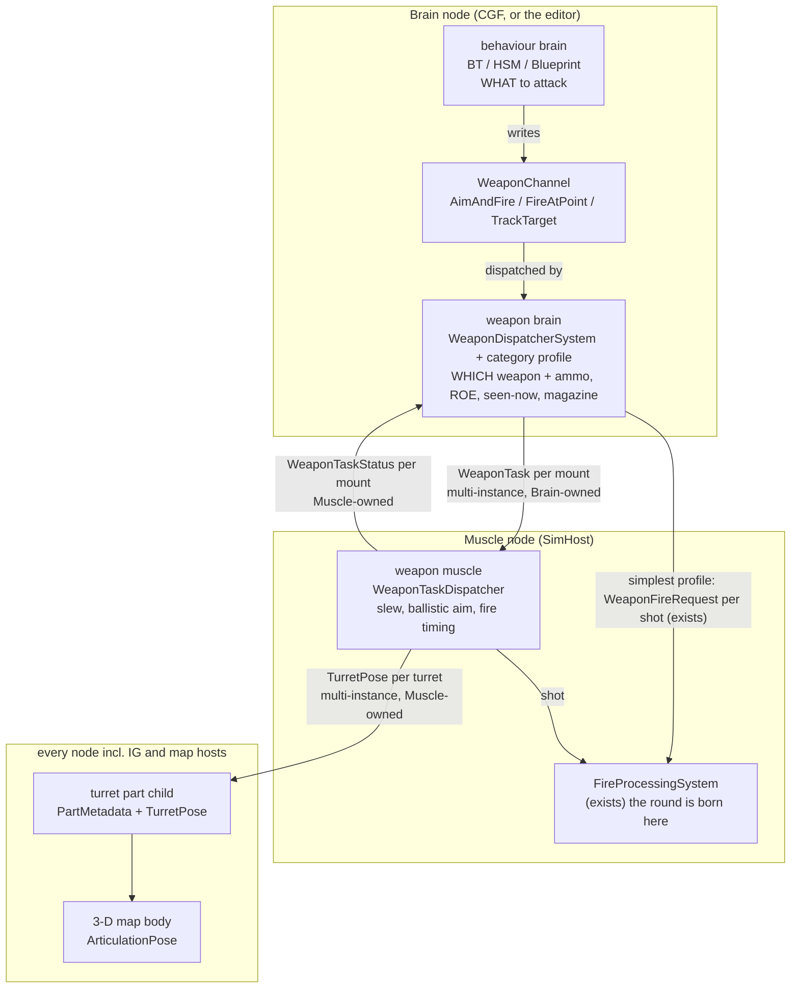

*What the picture shows that prose hid:* the weapon brain has TWO ways down. A turreted weapon gets a standing per-mount TASK that
the muscle keeps true every frame. The simplest profile keeps today's one-request-per-shot path with `AimSeconds`. And the
turret pose is written only by the muscle, because the muscle solves the elevation (ballistics), and it is read by every node.

## 2. Classes — what exists, what moves, what is new

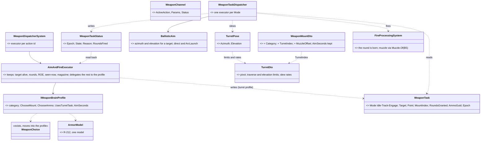

*What the picture shows that prose hid:* nothing that exists is duplicated. `WeaponChoice`, `ArmorModel`, `Magazine` and ROE stay
single, inside the weapon brain. `FireProcessingSystem` stays the only place a round is born, for both paths. The new types are
only the per-mount task and status pair, the muscle's slew-and-fire loop, and the turret's pose and TKB data.

## 3. Sequences

**Engage with a turreted weapon (the T-72's 125 mm):**

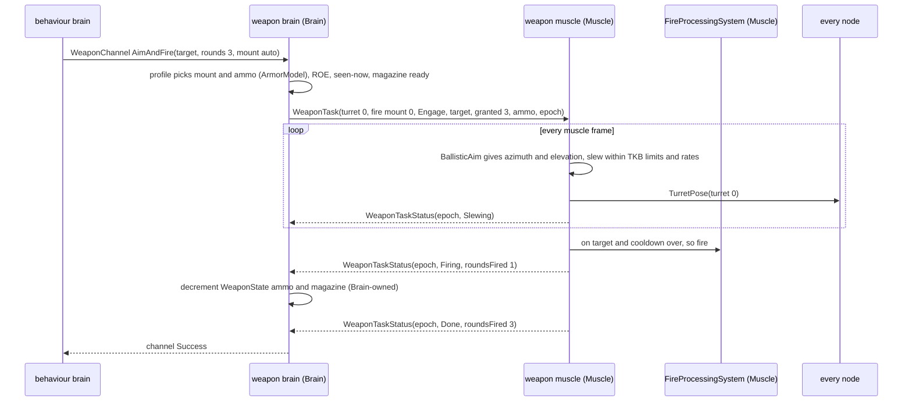

*What it shows:* the weapon brain never computes an angle (M24). The muscle never decides WHETHER to fight: it fires only the
rounds it was granted, so ROE, seen-now and ammo stay single and Brain-side. A lost sighting downgrades the task to Track (the
turret keeps following) instead of cancelling it.

**The simplest profile (a rifleman, no turret) is today's path, unchanged:** the profile's `UsesTurretTask` is false, the
executor runs its `AimSeconds` timer and publishes `WeaponFireIntent` per shot → `WeaponFireRequest` → `FireProcessingSystem`.

## 4. Decisions — ✅ ALL APPROVED `2026-10-11` (U-W2: *"approved."*)

| # | question | ⭐ lean | rests on (code · design) | rejected |
|---|---|---|---|---|
| **W-1** | the layer split | behaviour brain → `WeaponChannel` (unchanged) → **weapon brain** (Brain: weapon + ammo choice, ROE, seen-now, magazine, rounds) → **weapon muscle** (Muscle: slew, ballistic aim, fire timing) | `AimAndFireExecutor.cs:66-182` holds both halves today · U-W1, M24, R-180 | the brain computing angles — M24 / R-252 |
| **W-2** | what crosses Brain → Muscle | ⚠ *per mount SUPERSEDED by W-11 — per TURRET part, naming the mount* · a standing **`WeaponTask` per mount** (Idle / Track / Engage, target or point, rounds GRANTED, ammo, epoch), multi-instance keyed (parent, mount index), Reliable + TransientLocal + KeepLast 1; ⭐ the simplest profile keeps the existing per-shot `WeaponFireRequest` | `EqsSensorConfigTopic` pattern (`EqsDdsTopics.cs:16-21`) · M26, BS-1 | a per-shot request for turrets — the muscle could not keep the gun on target between shots |
| **W-3** | how the result returns | **`WeaponTaskStatus` per mount** (echoed epoch, Slewing / OnTarget / Firing / Done / Failed + reason, rounds fired), Muscle-owned; the executor turns it into the channel's Success / Failure / Running | `NavigationIntent` / `NavigationStatus` echo (`SimDescriptors.cs:148,196`) · R-180, R-241 (`ActionStatus`) | polling `TurretPose` for "on target" — needs ballistics on the Brain |
| **W-4** | who owns ammo and the magazine | the **Brain** (logistics is higher-level): it GRANTS rounds in the task; the muscle fires at most those and reports `RoundsFired`; the brain decrements | `WeaponState` in the Brain group (`HrotOwnershipGroups.cs:52`) · R-239 magazine model | moving `WeaponState` to the Muscle — re-homes every reader of ammo on the Brain (utility inputs, executors) |
| **W-5** | the weapon category | a new `WeaponCategory` on `WeaponMountDto` (SmallArms, MachineGun, Autocannon, TankGun, Atgm, Mortar, Grenade) selecting a **hardcoded `IWeaponBrainProfile`** (C# class per category, registered in one table); the default profile reproduces today's behaviour | ⛔ no category exists (searched) · U-W1 "hardcoded system customizable per weapon category" | profiles in data (a script per weapon) — no need yet |
| **W-6** | ammo per target type | the profile picks the ammo with the SAME `ArmorModel` it uses for the mount (R-212); v1 keeps one `AmmoGuid` per mount but the task already carries it, so switching rounds later changes no wire | R-217 *"switching later"* · `WeaponSuiteDto.cs:74` | a second effectiveness model for ammo — two models for one fact |
| **W-7** | the gates | ROE + seen-now on the Brain decide Engage vs Track (a lost sighting downgrades to Track); the **friendly-on-the-line** check runs at the moment of the shot, wherever that moment is decided — one shared function called by the executor (simple path) and the muscle (task path) | `AimAndFireExecutor` gate order · R-200 (ROE once), Peek D4 | the muscle reading `TargetMemory` — perception memory is Brain state |
| **W-8** | elevation | the muscle's `BallisticAim`: direct fire = the line to the aim point (`AimPoint.For`, as today — no gravity on direct rounds yet); indirect = `ArcLaunch`; limits clamp; a target outside the limits → `Failed(OutOfArc)` so the profile can try another mount or the behaviour can move | `FireProcessingSystem.cs:128-133, 249-260` · R-252 (no terrain assumption on the Brain) | elevation from the Brain — it has no ballistics |
| **W-9** | the turret and its pose | a turret part child per `TurretDto` on EVERY node (created by a TKB translator, derived — not saved), `TurretPose` Muscle-owned, replicated keyed (parent, turret index), BestEffort + KeepLast 1, sent when it changes; mounts name their turret (`TurretIndex`); with no task the turret holds its pose | M23, M25, M26 · ⚠ mount children exist on CGF only today (`CgfComponentRegistry.cs:38`) | the turret pose on the mount child — two mounts share one turret (Bradley: 25 mm + TOW) |
| **W-10** | turret moves without flooding the network *(U-W5: "the turret moves might need simple dead reckoning to avoid flooding the network. No implementation yet.")* | ⭐ the **same dead-reckoning model positions use** (`DESIGN_Dead_Reckoning.md`), applied to two angles: the `TurretPose` sample carries azimuth, elevation, their RATES and the cluster-synced **sim stamp**; receivers keep the sample read-only (R2) and project it FRESH every frame — `angle + rate × (simNow − stamp)`, clamped to the turret's limits (R3, R4); a pause freezes it with no guard (R5). The owner sends only when the projection would be off by more than a small threshold (a fraction of a degree), when a rate changes (start, stop, reversal), and on a slow heartbeat — so a steady slew or an ambient scan sweep costs one sample per change of motion, not one per frame | `DeadReckoningSyncSystem.cs` (the position model) · `DESIGN_Dead_Reckoning.md` R2–R6 | a separate turret smoothing scheme — two dead-reckoning models for one idea; sending every frame — the flood U-W5 names |

### W-11 — ✅ APPROVED `2026-10-11` (U-W6): the weapon task lives on the TURRET part, not per mount *(supersedes W-2's "per mount")*

> 🔒 **User, `2026-10-11` (U-W6):** *"Ad turret vs mounts. A movable mount on a turret is basically a sub-turret. I would ignore it
> now, accepting your lean."* ⇒ a movable mount on a turret (a sub-turret) is out of scope for now; when it comes it is another turret
> part, not a per-mount task.

W-2 keys `WeaponTask` / `WeaponTaskStatus` by (parent, **mount** index). Building WL-2 needs an entity on the Muscle to hold them, and
the measured shape argues for keying them by the **turret part** instead (the `TurretPose` key), with the task naming the mount that fires.

| the lean rests on | code — how it IS | design — how it was MEANT |
|---|---|---|
| two mounts share one turret | ✅ catalog Bradley: 25 mm and TOW both `TurretIndex = 0` (`BdcTkbCatalog.cs`) | ✅ W-9 "two mounts share one turret" |
| a turret aims at ONE point at a time | ✅ one azimuth + one elevation (`TurretPose.cs`) | ✅ M23 "the turret and its gun are ONE assembly" |
| per-part ownership needs a PART entity | ✅ `SyncPartClaims` walks `PartMetadata` entities only (`OwnershipRecomputeSystem.cs:125`) | ✅ Ownership G-3 (a multi-instance descriptor covers every instance) |
| turret parts exist on every node; mount children on CGF only, and mount 0 is the hull itself | ✅ `TurretTkbTranslator` in the base set; `CgfComponentRegistry.cs:38`; `CombatTkbTranslator.cs:90` | ⛔ searched `docs/` + `.dev/`: no design puts mount parts on the Muscle |

⭐ **Ruled: one task per TURRET part** — `WeaponTask { Mode, Target/Point, MountIndex, RoundsGranted, AmmoGuid, Epoch }` and
`WeaponTaskStatus` on the turret part, keyed (hull, `2000 + turret`) like `TurretPose`; a hull-fixed mount (`TurretIndex = −1`, the
rifleman) keeps the per-shot path (W-2's simple profile). Blast radius: the WL-2/3 wire and the Muscle's dispatcher only — nothing built
changes. What would change it: a weapon that must aim two mounts on one turret at two targets at once (none in the catalog).
Rejected: per-mount tasks — two tasks for one turret need a tie-break nobody owns, and the Muscle has no mount entities to hold them.

### W-12 — ✅ APPROVED `2026-10-11` (U-W8: *"Approved."*) — what each category's profile does differently (⏸ the hold is LIFTED `2026-10-11`: the reorganisation landed, CE-3164; WL-4 = §5f)

> 🔒 **User, `2026-10-11` (U-W8):** *"Approved. Note that backend lane is now reorganizing behaviors so we should wait with any behavior
> changes."* ⇒ W-12a–f are the approved leans; WL-4 (the profiles, `CloseToThrow`, `ua-grenade-or-rifle`) is built only after that
> reorganisation lands — merge `backend` first and re-check the executor and `AttackApproachDecision` homes.

| # | question | ⭐ lean | rests on | rejected — one line |
|---|---|---|---|---|
| **W-12a** | when the mount is chosen | **once per engagement** (action entry, new target), with the same `WeaponChoice` / `WeaponSelectionDecision`; re-chosen only when that mount fails (OutOfArc, out of ammo) | ⚠ WL-3's known limit (§5e: a per-frame flip loses an unaccounted round) · `WeaponChoice.cs` (called per shot today) | per shot as today — flips the task's epoch mid-burst |
| **W-12b** | which categories use the turret task | TankGun, Autocannon, Atgm, and a MachineGun **on a turret** (coax); SmallArms, Grenade, Mortar and a hull MachineGun keep the per-shot path | U-W1 *"AimSeconds can stay for simplest weapon brains"* · W-5 | every turret mount alike (today's default) — an ATGM needs its own rule (below) |
| **W-12c** | the ATGM | grant **one round at a time**; the next only after the previous round's flight ended (its detonation), so the turret stays on target while a guided round flies | the muscle already tracks while granted rounds are 0 (Track) | firing a salvo — a guided weapon cannot guide two |
| **W-12e** *(U-W7, below)* | rifle or grenade at a HIDDEN target | the weapon brain: target **seen now** ⇒ the rifle (today); **not seen**, last-known position fresh in `TargetMemory`, within the grenade mount's range ⇒ **throw at that position** (the existing at-point path, `ArcLaunch` low); beyond it ⇒ hold, as today | Grenadier 2004: rifle mount 0, M67 mount 1, range 25 m (`UrbanCombatTkbCatalog.cs:95,181`) · `TargetMemory.PositionsX/Y/Z` (`PerceptionComponents.cs:53`) · R-261 (weapon choice is the weapon brain's) | the behaviour issuing `FireAtPoint` itself — every behaviour would re-implement the choice; ⚠ `DESIGN_Building_Interiors.md:1272` left "WHEN the AI throws" to the behaviors lane BEFORE R-261 split weapon choice out |
| **W-12f** *(U-W7)* | getting close enough | the behaviour's **Attack approach** gains a 4th option, **CloseToThrow** — a covered spot within grenade range of the last-known position — scored only for a unit carrying an indirect hand weapon; it competes with Flank / FiringPosition, so a rifleman flanks to SEE and a grenadier may close to THROW | `AttackApproachDecision.cs:33-46` (Direct / Flank / FiringPosition) · `ua-attack-approach` + `CE3084_U4` (the flank already works) | a new behaviour just for grenades — the choice belongs beside Flank in the one approach decision |
| **W-12d** | ammo per target | **not in WL-4**: one `AmmoGuid` per mount (W-6) until a mount declares a second round; the task already carries `AmmoGuid`, so it lands with no wire change | `WeaponSuiteDto.cs:86` (one ammo per mount) · W-6 | inventing AP/HE rounds now — no TKB data to choose between |

> 🔒 **User, `2026-10-11` (U-W7):** *"for the weapon brain logic there could be some interesting sample scenario demonstrating the
> choice of a rifle vs grenade if the target is hidden behind an obstacle and the attacker dare to come close enough (or flanks) to
> throw a grenade"* ⇒ W-12e/f, and the WL-4 demo scenario **`ua-grenade-or-rifle`** (lean): `bt-range`, a hostile crouched behind a
> 1 m wall; a Rifleman and a Grenadier start ~60 m out on the posture behaviour. Expected: both lose sight; the Rifleman flanks and fires
> the rifle once he sees; the Grenadier closes to < 25 m and throws at the last-known position; the hostile is hurt behind the wall
> (`bt-grenade-posture` measured: standing ≥ 0.5 exposure, prone ≤ 0.1). Rails: the cluster test asserts each one's mount and the
> hit; ⚠ unmeasured: whether the low throw arc clears a 1 m wall at 20–25 m (the apex is ~1.9 m by hand calculation — to be measured
> before the scenario is fixed).

⚠ **New behaviour vocabulary (part of W-1):** `TrackTarget(target)` on the weapon channel — keep the gun on a target without
firing — beside `AimAndFire` and `FireAtPoint`; releasing the channel sets the task to Idle.

## 5. Slices

| slice | builds | shows |
|---|---|---|
| **WL-1** | TKB `TurretDto` + `WeaponMountDto.Category/TurretIndex/MuzzleOffset`; turret part children on every node; `TurretPose` + its multi-instance descriptor; the 3-D map's `poseOf` reads it | the drawn turret follows a pose set by hand on the Muscle |
| **WL-2** | `WeaponTask` / `WeaponTaskStatus` descriptors; the muscle's `WeaponTaskDispatcher` with **Track**; `BallisticAim` | a tank keeps its gun on a moving target |
| **WL-3** | **Engage** on the muscle through `FireProcessingSystem`; the executor split + the default profile; rounds granted / fired; `TrackTarget` on the channel | a tank slews, then fires 3 rounds; behaviours unchanged |
| **WL-4** | category profiles (tank gun, autocannon, ATGM, mortar, small arms); ammo choice | per-category gunnery |
| **B5** ✅ | `Muzzle.Of` from the posed barrel — the round, the flash and the tracer from one point (built, DESIGN_Visual_Effects §6b) | VE-K |

### 5a. As built — WL-1a *(2026-10-11)*

WL-1 was split: **WL-1a** = the TKB data, the turret part on every node, the 3-D drawing; **WL-1b** = the keyed wire message
(the pose leaves the Muscle). Until WL-1b, a pose set on a node draws on that node only.

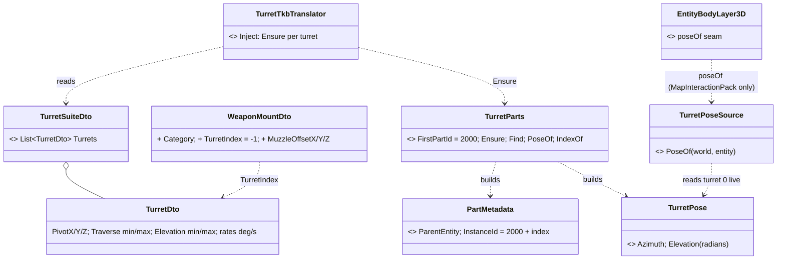

*What the picture shows that prose hid:* the turret child is built by the BASE translator set, so every node that spawns the unit has
it (unlike mount children, CGF only) — that is what lets WL-1b's ingress land on an existing entity. Part ids on one parent: mounts
`1…N`, TKB sensors `1000+`, turrets `2000+`. Every generic part consumer filters on its own component (`WeaponMountQuery`,
`UtilityScorer`, `StandardInputs` on `WeaponMountInfo`; `SubEntityCleanupSystem` destroys the child with its parent). The catalog's
M1, T-72 and Bradley carry one turret each (the Bradley's 25 mm and TOW share it) and every catalog weapon a category. The muzzle
offset is in the DTO but the catalog does not set it yet — B5 (`Muzzle.Of`) is its first reader.

### 5b. WL-1b — the turret pose on the wire *(✅ built 2026-10-11, as drawn)*

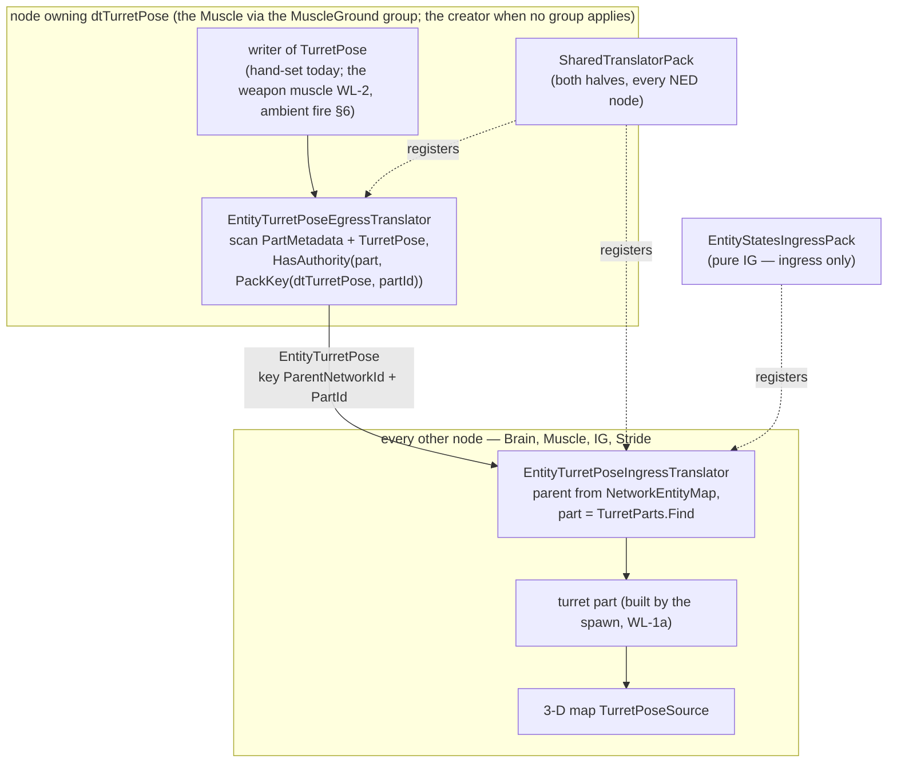

*What the picture shows that prose hid:* nothing new is called each frame by a host. Both translators ride the two packs every NED node
already ticks — the shared pack on Brain / Muscle / Stride, the IG ingress pack on a pure IG (the shared pack's ingress is skipped
there, `NedReplicationModule.cs:420-422`; the door, `EntityStatesIngressPack.cs:58`, is the precedent). The editor alone is one node
and needs no wire.

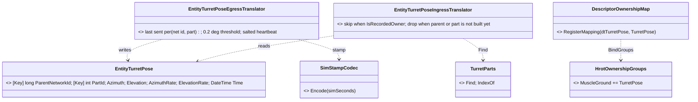

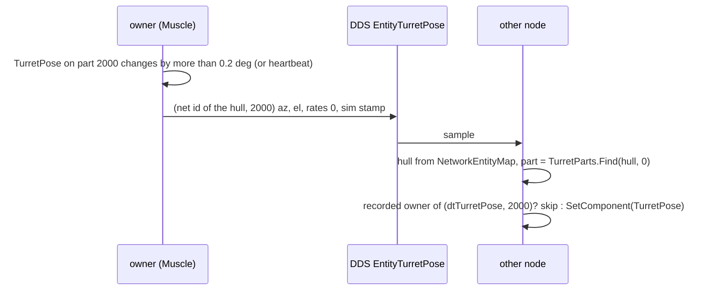

| choice | why | rejected — one line each |
|---|---|---|
| a **new descriptor** `dtTurretPose = 124`, mapped to `TurretPose` and put in the **MuscleGround** group | the same three steps every Muscle-owned report took (`dtNavigationStatus`, `dtStanceStatus`); `SyncPartClaims` then gives the part the claim from `(dtTurretPose, 0)` | the `TurretPose` bit with no descriptor — it would ride `dtWorldPos` (`BindGroups` anchor) and travel with no topic of its own |
| **hand-written translator pair**, the door's shape | the production pattern for every new replicated datum | `MultiInstanceCycloneTranslator` — tests-only, needs a `ChildMap` nothing in production builds |
| key = **(hull network id, part id)** | the EQS sensor key (`EqsSensorKey.Resolve`); the part id names the turret (`2000 + index`) | the turret index alone — the part id is what both sides already hold |
| **BestEffort, TransientLocal, KeepLast 1** (the `WorldPos` QoS) + a salted heartbeat (120 ticks, ~2 s) and a 0.2° change threshold | W-9; a lost sample is repaired by the next change or heartbeat, a late joiner gets the last sample | Reliable — a reliable history for a value that is superseded many times a second |
| **rates and sim stamp on the wire, written 0 / now** | W-10 fills them with no wire change; receivers do not project yet (U-W5: "no implementation yet") | adding them later — a wire-format change on every node |
| ingress **drops** a sample whose hull or turret part is not built yet | the spawn builds the part from the TKB; the next heartbeat lands on it | a pending queue (`EqsSensorConfigIngressTranslator`) — needed for config sent once, not for a value resent every ~2 s |

### 5c. WL-2a — the weapon muscle keeps the gun on a target (Track) *(✅ built 2026-10-11, as drawn; W-11 / R-267)*

WL-2 is split like WL-1: **WL-2a** = the task and status components on the turret part, the Muscle's dispatcher with **Track**,
`BallisticAim` and the slew — runnable on one node (the editor) by writing a task by hand; **WL-2b** = the task and status on the
wire (Brain → Muscle, Muscle → Brain), the `TurretPose` pattern twice.

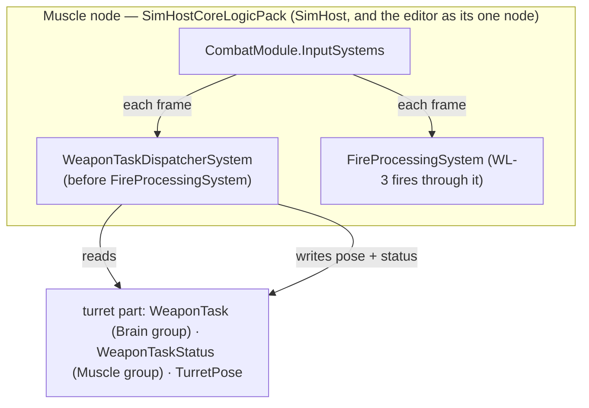

*What the picture shows that prose hid:* the dispatcher is reached each frame only where `CombatModule` is composed — the same
composition gate `FireProcessingSystem` relies on (`FireProcessingSystem.cs` CE-198 note: no authority gate, one node schedules it). A
Brain or IG never runs it, so it needs no runtime authority check of its own.

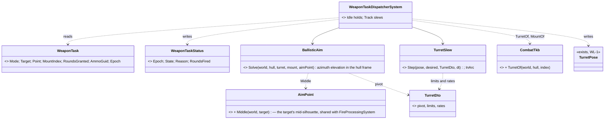

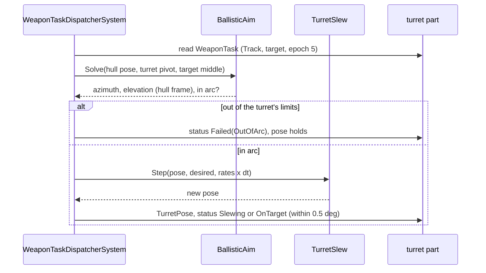

| choice | why | rejected — one line each |
|---|---|---|
| angles solved in the **hull frame** (inverse hull rotation) | a hull on a slope tilts its turret plane; `TurretPose` is relative to the hull (M23) | world bearing minus yaw — wrong on any slope (R-248) |
| direct fire = the line pivot → target middle; indirect (the mount's warhead `Indirect`) = `FireProcessingSystem.ArcLaunch` | W-8; the same arc the round will fly | a second ballistic model |
| aim point = `AimPoint.Middle` (one helper, `FireProcessingSystem` routed onto it) | the round and the gun aim at the same point | the dispatcher computing its own aim height |
| full-circle traverse wraps the short way; a limited arc slews inside it | `TurretDto` −180…180 = all round | always the short way — would swing a limited turret through its dead zone |
| out of limits ⇒ `Failed(OutOfArc)`, pose holds | W-8 — the profile tries another mount or the behaviour moves | clamping silently — the brain would think it is aimed |
| `OnTarget` within 0.5° of both angles | a status the Brain can gate the shot on (WL-3) | exact equality — never reached at a finite rate |

⚠ **As built (WL-2a):** `WeaponTaskFailure`'s zero member is `NoFailure`, not `None` — the DDS code generator emits one IDL scope
per file and two enums with a `None` member collide there. `FireProcessingSystem` now takes the target's middle from
`AimPoint.Middle` (the same three calls it inlined before), so the round and the turret aim at one point by construction.

### 5d. WL-2b — the task and its report on the wire *(✅ built 2026-10-11)*

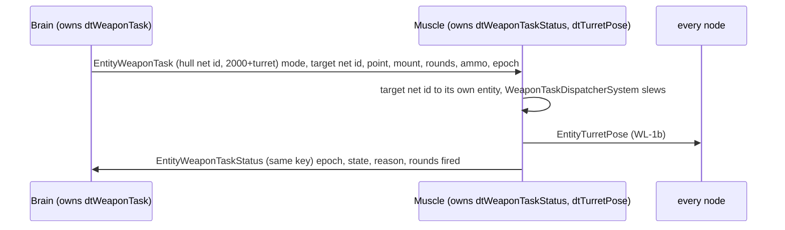

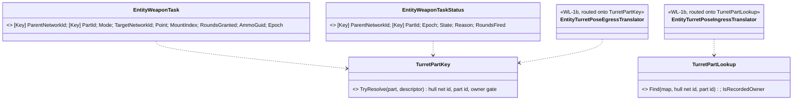

*What the picture shows that prose hid:* the three turret-part topics share ONE key rule (`TurretPartKey` out, `TurretPartLookup` in)
— the pose translators were routed onto it, so the key cannot drift between them. Ownership: `dtWeaponTask = 125` in the Brain group
(`WeaponTask`), `dtWeaponTaskStatus = 126` in the MuscleGround group (`WeaponTaskStatus`), both registered in `SharedTranslatorPack`
(Brain and Muscle both run it; a pure IG needs neither). A target the Muscle does not know arrives as `Entity.Null` with no point,
so the muscle reports `NoTarget` instead of aiming at the origin.

### 5e. WL-3 — Engage: the brain grants rounds, the muscle fires them *(✅ built 2026-10-11 — as drawn, plus the notes below)*

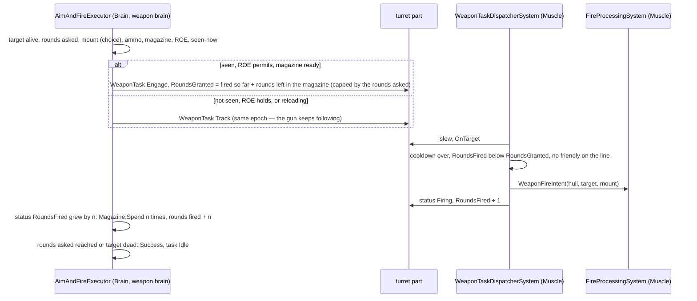

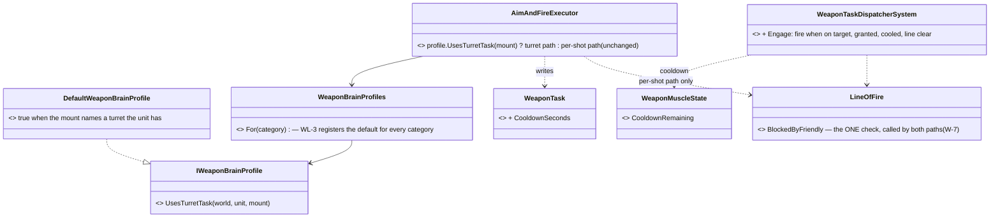

| choice | why | rejected — one line each |
|---|---|---|
| `RoundsGranted` is **cumulative per epoch**; a Track ↔ Engage switch keeps the epoch, a new target or mount bumps it | the brain accounts the DELTA of `RoundsFired`; the muscle never re-fires after a mode flip | a new epoch per grant — the counter resets and a round in flight is double-counted or lost |
| the grant = rounds left in the **magazine** (capped by the action's rounds) | W-4: logistics stay Brain-side; a reload withdraws the grant (Track) and re-grants after it | granting the whole ammo load — the muscle would fire through a reload it knows nothing of |
| the **cooldown** travels in the task (`CooldownSeconds`, the action's parameter); the muscle keeps the remaining time in a LOCAL `WeaponMuscleState` | fire timing is the muscle's (W-1); the number is the behaviour's, as today | a TKB rate of fire — not every mount declares one, and the action already carries it |
| seen-now / ROE / magazine gate **Engage vs Track** on the Brain; the friendly line is checked by the muscle at the shot (W-7) | the seen-now memory is Brain state; the shot's moment is the Muscle's | the muscle reading `TargetMemory` — W-7 rejected |
| no AimSeconds on the turret path — the slew is the aim | U-W1 *"AimSeconds can stay for simplest weapon brains not modelling turrets"* | both — a turreted gun would wait twice |
| `Failed(OutOfArc)` → the action fails (Failure); `NoTarget` with a dead target → Success | the behaviour moves or picks another target; WL-4's profiles may try another mount first | silently holding — a behaviour would wait forever |

⚠ **As built (WL-3):**
- the muscle's fire intent is marked `IsRemote = true` — it is already at the muscle, and the only reader of that flag on a fire intent
  (`WeaponFireIntentEgressTranslator`) must not forward it, or a Brain+Muscle node would fire the round twice;
- `TrackTargetExecutor` (`ActionIdTrackTarget = 3` on the weapon channel) is registered in `CgfLogicPack`; ⚠ **its BTree / Blueprint
  node is NOT built** — exposing it to behaviour authors is the behaviors lane's vocabulary (as `FireAtPoint` was, `FireAtPointBehavior`);
- two diagnostic reasons, `Slewing` and `OutOfArc`, appended to `ActionReason` (the gizmo shows "slewing" / "out of arc");
- ⚠ **known limit:** `Mount = Auto` re-chooses the mount every frame (`WeaponChoice`); a flip to a mount on the SAME turret starts a new
  epoch, and a round the muscle fired under the old one but the brain had not yet accounted is not spent on the brain. WL-4's
  profiles choose the mount once per engagement, which removes it.

### 5f. WL-4 — the grenade at a hidden target, end to end *(backend, `2026-10-11`; build-state: BUILDING)*

> 🔒 **User, `2026-10-11`:** *"Other lanes are on hold. We should take the grenade scenario end to end."* ⇒ the backend lane builds
> W-12a, W-12e, W-12f, the `TrackTarget` node and `ua-grenade-or-rifle` (handoff
> [`HANDOFF_Weapon_Layers_To_Backend_Or_Behaviors.md`](blueprints/batches/HANDOFF_Weapon_Layers_To_Backend_Or_Behaviors.md)).
> W-12b/c (turret task per category, ATGM one round at a time) are not needed by the scenario and stay open.

#### INVENTORY *(graph CLI + grep, `2026-10-11`)*

| query | result |
|---|---|
| graph `.*WeaponChoice.*`, `.*WeaponSelection.*`, `.*AimAndFire.*`, `.*FireAtPoint.*`, `.*TrackTarget.*` (Class) | `WeaponChoice` (`Combat/WeaponChoice.cs:13`, one per-shot caller: `AimAndFireExecutor.cs:94`) · `WeaponSelectionDecision` · `AimAndFireExecutor` · `FireAtPointExecutor` + `FireAtPointNodes` + `FireAtPointBehavior` · `TrackTargetExecutor` (action 3, CGF) — ⛔ no `TrackTarget` node |
| graph `.*Approach.*`, `.*Flank.*`, `.*Throw.*`, `.*Grenade.*` | `AttackApproachDecision` (`Approach` Direct 1 · Flank 2 · FiringPosition 3), `FindFlankingPosition`, `FindOpenFiringPosition`, `EqsTacticsNodes.Flank/FiringPosition`, `PostureNodes.ApproachSensors` · ⛔ no throw/grenade type (searched) |
| grep `TargetMemory` in `Combat/` | ⛔ none — nothing throws at a remembered position; the precedent for a remembered point is `PeekAndFireNodes`' blind burst (`:537-547`, `EqsTacticsNodes.ThreatPosition`) |
| grep `HasIndirect\|HandWeapon\|HasGrenade` | ⛔ none — no utility input says "carries a throwable" |
| walls on `bt-range` | 0.5 m Low Wall (100–120, 40) · 1.2 m sandbags (145–153, 40) · ⛔ no 1 m wall |

#### The low throw does NOT clear a wall at close range — measured *(the U-W7 open point)*

`ArcLaunch` low arc, 15 m/s (M67), aim point on the ground, height of the round above a wall standing **k m in front of the aim point**:

| throw distance | eye 1.7 m: k = 2 · 3 · 4 | eye 1.1 m (crouched): k = 2 · 3 · 4 |
|---|---|---|
| 12 m | 0.73 · 1.02 · 1.27 | 0.63 · 0.88 · 1.09 |
| 16 m | 0.87 · 1.23 · 1.55 | 0.81 · 1.14 · 1.42 |
| 20 m | 1.10 · 1.57 · 2.00 | 1.08 · 1.54 · 1.94 |

⇒ a man crouched 1–3 m behind a 1–1.2 m wall is **unreachable by the low arc** from 12–16 m — exactly where `CloseToThrow` takes the
thrower. A real thrower lobs. ⭐ Lean **L-1** below.

```mermaid
classDiagram
  class AimAndFireExecutor { <<exists, extended>> per-shot path · W-12a mount once · W-12e not seen ⇒ HiddenTargetThrow.TryThrow }
  class HiddenTargetThrow { <<NEW, Combat>> TryThrow(world, unit, target, dt) bool · ThrowableMount(world, unit, out mount) · LastKnown(world, unit, target, out point) }
  class WeaponChoice { <<exists>> Choose — now called once per engagement }
  class AimState { <<exists, extended>> + ChosenMount, HasChoice (its two padding bytes) }
  class FireAtPointExecutor { <<exists>> }
  class FireProcessingSystem { <<exists, extended>> L-1: low arc blocked ⇒ the high arc (lob) }
  class ThrowArc { <<NEW, Combat>> LowArcClear(terrain, from, to, speed) bool }
  class TargetMemory { <<exists>> PositionsX/Y/Z, Freshness }
  class ThreatFreshness { <<exists>> IsLive }
  class CarriesThrowable { <<NEW utility input>> 1 when an indirect hand mount has ammo }
  class AttackApproachDecision { <<exists, extended>> + Approach.CloseToThrow = 4 }
  class FindThrowingPosition { <<NEW EQS template>> donut around the LAST-KNOWN point, hidden from it, near it }
  class EqsTacticsNodes { <<exists, extended>> + CloseToThrow (anchored at the last-known point) }
  class PostureNodes { <<exists, extended>> ApproachSensors + a third sensor }
  class CombatPostureBehavior { <<exists, extended>> + IsOption(CloseToThrow) branch }
  class TrackTargetNodes { <<NEW>> TrackTarget shared node + curated TrackTarget behaviour }
  class TrackTargetExecutor { <<exists, action 3>> }
  AimAndFireExecutor --> WeaponChoice : once
  AimAndFireExecutor --> HiddenTargetThrow : not seen
  HiddenTargetThrow ..> TargetMemory
  HiddenTargetThrow ..> ThreatFreshness
  HiddenTargetThrow ..> FireProcessingSystem : WeaponFireIntent AtPoint
  FireProcessingSystem --> ThrowArc
  AttackApproachDecision ..> CarriesThrowable
  AttackApproachDecision ..> FindThrowingPosition : EqsTopScore
  CombatPostureBehavior --> EqsTacticsNodes : CloseToThrow
  CombatPostureBehavior --> PostureNodes
  TrackTargetNodes ..> TrackTargetExecutor : weapon channel action 3
```
*What the picture shows that prose hid: the throw is decided in ONE place (the weapon brain), the arc in ONE place (the muscle), and
the behaviour only moves the thrower — no behaviour issues `FireAtPoint` for a grenade.*

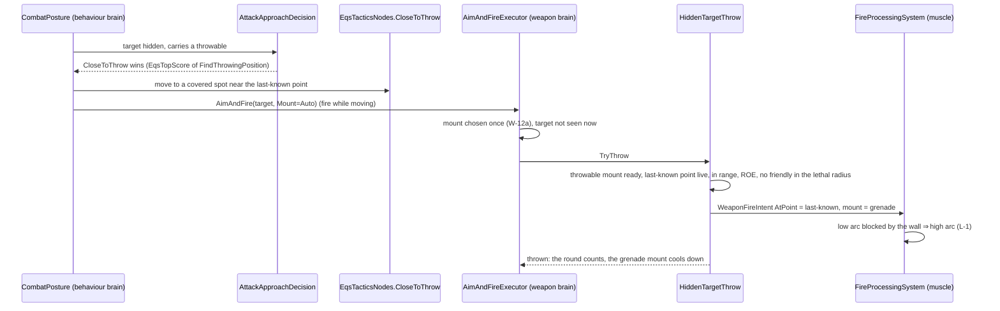

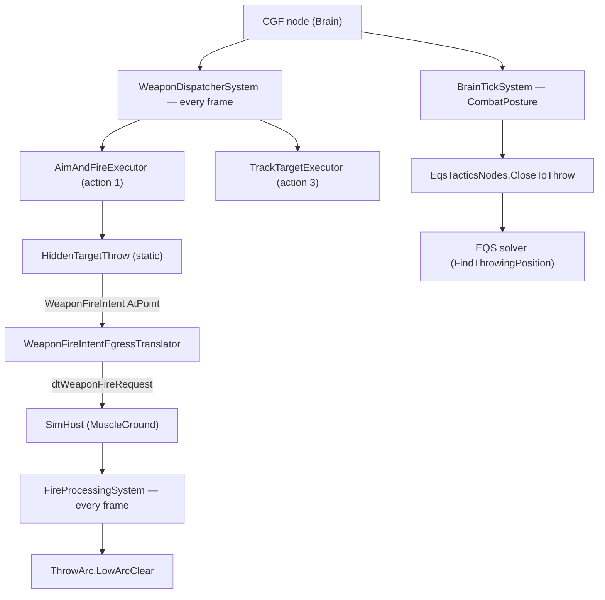
*Who calls it each frame: the throw runs inside the weapon dispatcher on the Brain; the arc choice inside FireProcessingSystem on the
Muscle — on `--mode editor` both are the same world, on the cluster the request crosses the wire as every shot does today.*

#### Decisions *(within the approved W-12 leans)*

| # | question | ⭐ lean | rests on (code · design) | rejected — one line |
|---|---|---|---|---|
| **L-1** | the low throw cannot clear the wall | the **muscle** lobs: `FireProcessingSystem` samples the low arc against the terrain; blocked ⇒ the high arc (in reach whenever the low one is) | table above · W-8 *"elevation is the muscle's"* · `TerrainPenetration.Carry` already stops arc rounds (`BallisticsSystem.cs:156`) | always lob a hand throw — changes `bt-grenade-posture`'s measured flight for no reason; placing the thrower 20 m out — the EQS would need a 1-m band |
| **L-2** | W-12e's conditions | not seen now · a throwable mount (indirect warhead, hand speed < 40 m/s) with ammo and cooled · the target's slot in the unit's `TargetMemory` live (`ThreatFreshness.IsLive`, not anonymous) · flat distance ≤ the mount's `Range` and the arc's reach · ROE · **no friendly (and not the thrower) inside the warhead's lethal radius of the point** | `ThreatDanger.cs:89` · `WarheadDto.BlastLethalRadiusM` · R-200 (ROE once) | the friendly LINE check — exempt for indirect fire already (`FireAtPointExecutor.cs:64`); the danger is the burst, not the line |
| **L-3** | how often | one throw, then the grenade mount cools **6 s** (fuze 4.5 s + a look) — on the mount's own `WeaponState`, which the dispatcher already drains | `WeaponDispatcherSystem.cs:55` · R-239 | the action's `CooldownSeconds` — the rifle's 1 s would empty four grenades in four seconds |
| **L-4** | W-12a — where the choice lives | the chosen mount in `AimState`'s two padding bytes (the channel state is full at 32 B); re-chosen on a new target, an empty mount, or `OutOfArc` | `BehaviorConstants.ActionStateByteSIze = 32` · §5e known limit | a new component per unit — state of one action belongs in the action |
| **L-5** | the planner must not see through walls | `CloseToThrow`'s sensor is anchored at the **last-known point** (`ContextPoint1`), never the live entity | `EqsContext.cs:59-75` · W-7 (memory is Brain state) | the live entity — the thrower would walk to where the hidden man IS, which he cannot know; ⚠ `Flank` does this today — filed, not changed here |
| **L-6** | `CloseToThrow` scoring | `HaveLiveTarget` (Step) × `ThreatInSight` (Inverse) × `CarriesThrowable` (Step) × `EqsTopScore(FindThrowingPosition)`, the last with exponent 0.6 (weights are exponents in a weighted product, ≤ 1 by rule UT0131; v^0.6 > v) — so a grenadier with a reachable covered spot prefers to throw, a rifleman (score 0) flanks | W-12f · `AttackApproachDecision.cs:33-46` | a separate grenade behaviour — W-12f rejected it |
| **L-7** | the scenario wall | `bt-range`'s existing **1.2 m sandbags** (145–153, 40); the hostile crouched 2.5 m behind them (a crouched man's head is 1.1 m — hidden) | `bt-range.world.geojson` · premise "sandbags stop the rifle" | a new 1 m wall — a terrain change and new premises for a number the sandbags already give |
| **L-8** | `TrackTarget` vocabulary | a shared node `TrackTargetNodes.TrackTarget` + a curated `TrackTarget` behaviour (`Library/Basic`), the `FireAtPoint` precedent | `FireAtPointBehavior.cs` · §5e "its node is NOT built" | a Blueprint channel catalog entry now — palette goldens; left as `FireAtPoint` left it |

## 6. Ambient fire — the impression of distant combat, with no weapon model *(U-W3, revised by U-W4, ✅ approved U-W5: "Ok.")*

> 🔒 **User, `2026-10-11` (U-W3):** *"What about low fidelity high count 'ambient' entities where the complicated weapon control model
> is too much? … some entities never firing, having fixed turrets, or just making mechanical movement resembling target scans and
> firing in approximate direction of target just to create fire effect (and detonation on predetermined place, no ballistics at all,
> no real hit detection or target model …) … That requires no weapon brain, and the goal is to be simple, low resource, performant
> also in high amounts of entities."*
>
> 🔒 **User, `2026-10-11` (U-W4), on the first version:** *"approved partly, there needs to be usual fire and detonation notification
> events (not requiring anyone to calculate any ballistics or complex damage, just for visualization — the entities playing the
> ambient combat could have extremely simplified damage model, i think they still should handle the fake hit which is somehow derived
> from the fake shot) as well as turret position updates allowing the dumb viewer sw apps to still see the battle."*

📐 **Measured — what an ambient shot reuses:**
- The Muscle already SENDS every fire, detonation and damage verdict: `WeaponFireNotificationEgressTranslator`,
  `MunitionDetonationEgressTranslator` and `DamageAssessedEgressTranslator`, registered for the MuscleGround role
  (`SimHostAuxiliaryTranslatorPack.cs:85-93`). The Muscle also runs `DamageCalculationSystem`, which turns a
  `DetonationNotification` with a live target into a `DamageAssessedEvent` (today through `ArmorModel`).
- Every viewer (HROT map hosts, IG, external DIS / NED listeners) draws effects from those notifications
  (`EffectSystems.cs:42-63`). **So an ambient shot that publishes the ordinary events is seen by every viewer, dumb ones included.**

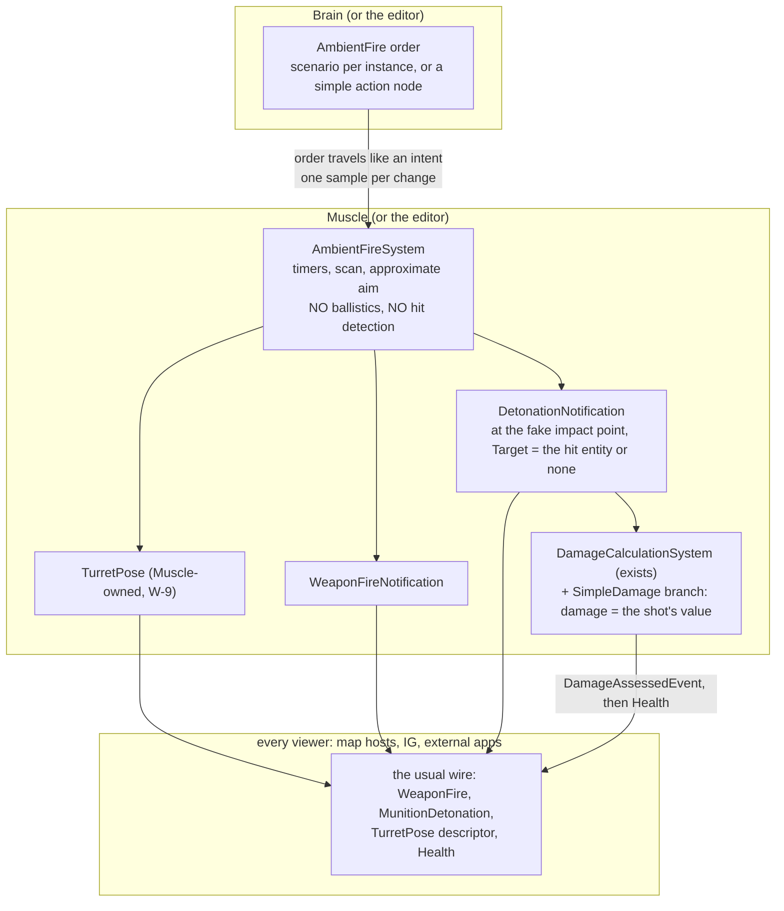

*What the picture shows that prose hid:* the ambient system sits where the real weapon muscle sits, so its shots, impacts, turret
movement and damage leave through the SAME senders as real combat. Nothing new appears on the wire, and a viewer cannot tell an
ambient shot from a real one. What it skips is everything expensive in between: the weapon brain, the turret limits and rates,
ballistics, projectile entities, raycasts, hit resolution and the armour model.

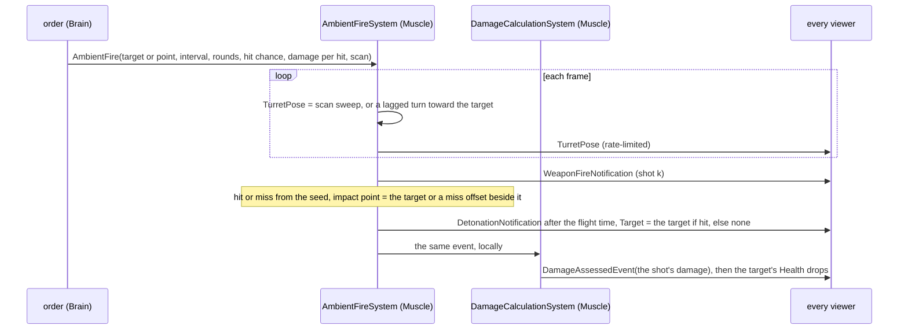

| # | question | ⭐ lean | rests on | rejected |
|---|---|---|---|---|
| **A-1** ✅ | where ambient fire lives | a **fourth path beside the three layers**: one `AmbientFire` order + one `AmbientFireSystem` (Fdp.Toolkits Combat); no weapon channel, no weapon brain, no weapon task | U-W3 (approved) | an "ambient" weapon-brain profile — it would still run the channel, the task and the muscle per entity |
| **A-2** ↻ | where it runs | ⭐ **on the Muscle** (the editor alone when it is one node), the node that already owns `TurretPose` (W-9), sends fire and detonation notifications and runs the damage step — so the ambient shot uses those senders unchanged; the order travels Brain → Muscle like an intent, one sample per change | `SimHostAuxiliaryTranslatorPack.cs:85-93` · BS-1 (Brain decides, Muscle executes) · U-W4 | ⛔ SUPERSEDED: computing the shots on every node with no wire traffic — dumb viewers would see nothing (U-W4) |
| **A-3** ↻ | the fake hit | the shot itself carries it: the system decides hit or miss from a seeded draw against the order's hit chance and publishes the ordinary `DetonationNotification` with `Target` = the hit entity (or none on a miss) and `Damage` = the order's damage per hit; the TARGET then handles it with an **extremely simplified damage model** — a `SimpleDamage` marker on entities playing ambient combat makes `DamageCalculationSystem` take the shot's damage as is (no armour, no penetration) | `DetonationNotification.Damage` exists (`DetonationNotification.cs:49`) · `DamageCalculationSystem` is the one damage step · U-W4 | ⛔ SUPERSEDED: the owner publishing a predetermined damage verdict with no detonation — the hit would not be visible as a hit |
| **A-4** ↻ | the turret | `TurretPose` written by the ambient system (a slow sweep in `Scan`, a lagged turn toward the target when firing; no limits, rates or ballistics) and **replicated through the ordinary turret-pose descriptor with dead reckoning (W-10)** — a sweep is one sample per reversal, so dumb viewers see it move. **Fixed turret** = no `TurretDto` in the TKB; **never fires** = no order | W-9 · U-W4 | ⛔ SUPERSEDED: skipping the pose egress for ambient entities |
| **A-5** ✅ | who sets the order | the **scenario** (per instance, saved) or a **simple action node** `AmbientEngage(target or point, duration)` any behaviour can call; an "ambient battle" generator is a behaviour handing out orders | approved | a weapon-channel request |
| **A-6** ↻ | what real AI makes of it | the events are the ordinary ones (U-W4), so real units hear and see ambient fire like any fire; ⭐ lean: no special flag on the wire (a dumb viewer could not use one either) — keeping real units out of a fake battle is a scenario matter (place, side, perception range) | U-W4 · R-207 hearing | ⛔ SUPERSEDED: an `IsAmbient` tag that hearing ignores — it would need a field on the wire messages |

⚠ **Cost at high count:** per entity per frame, one time compare and one pose update (sent at a capped rate). Per shot, the same two
wire messages a real shot sends (unavoidable if dumb viewers are to see it) and one cheap damage step on a hit. There are no
projectile entities, no raycasts, no ballistics and no armour model.
