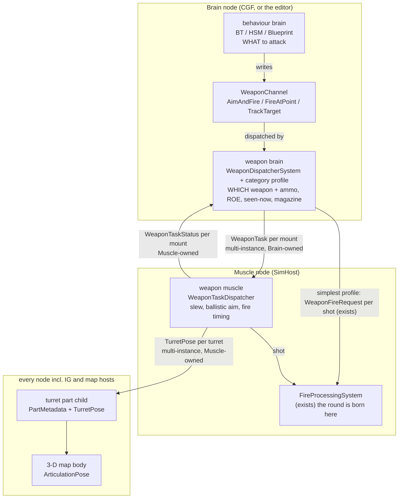
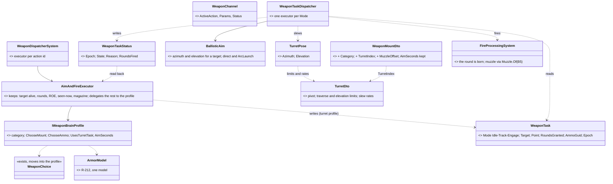
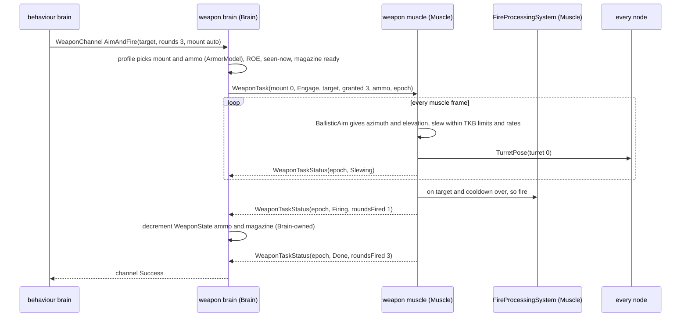
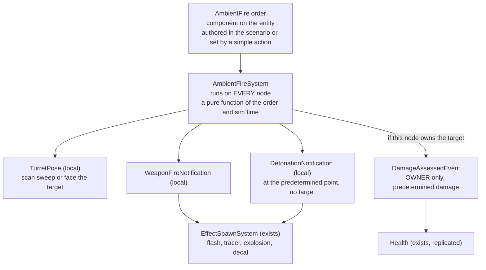
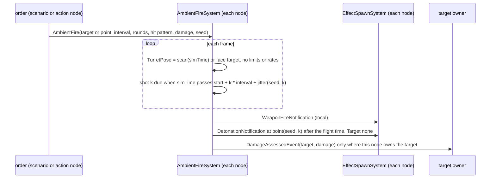

<!--STATUS
state: LIVE
updated: 2026-10-11
build-state: READY-TO-BUILD for W-1..W-9 (approved U-W2, 2026-10-11); §6 ambient fire A-1..A-6 carry leans, awaiting the user
current-answer: §1 the three layers (module diagram) · §2 classes · §3 sequences · §4 decisions W-1..W-9 (APPROVED) · §5 slices · §6 ambient fire
stale-below: nothing yet
known-rot: none
known-conflict: DESIGN_Ownership_Groups_And_Grants.md F-6 says weapon-mount parts are never created — stale, CgfComponentRegistry.cs:38
  registers WeaponMountInfo and CombatTkbTranslator.cs:92-122 creates them on CGF. DESIGN_Decision_Layer.md :1330 calls
  AimAndFireExecutor "the only weapon-channel executor" — stale since FireAtPointExecutor (DESIGN_Building_Interiors.md §3k).
related-designs:
  - DESIGN_Map_3D_Mode.md — §3.11 M23–M26 (R-255): the turret is a part child with a TurretPose, the weapon side aims it, it
    replicates as a multi-instance descriptor. THIS file decides which weapon layer on which node does the aiming.
  - DESIGN_Visual_Effects.md — VE-J..VE-L: Muzzle.Of(shooter, weaponIndex) from the posed barrel, used by the round AND the flash.
  - DESIGN_Utility_AI_Demo_Scenarios.md — §12 W1–W9: weapon choice per shot inside the executor (Mount=Auto), mount children on
    CGF; §9 the one ArmorModel (R-212). The weapon brain here takes over that choice.
  - DESIGN_Peek_And_Fire.md — D3 aim time per weapon, D4 seen-now gate, D9 reload, B7 rounds: the gates the weapon brain keeps.
  - docs/designs/brain-split/BS-1-DESIGN.md — the Brain writes intents, the Muscle executes (WeaponFireRequest per shot).
  - blueprints/Architect_Question_80_Animation_Channel_Ownership_Split.md — the request (Brain) + status (Muscle) split channel,
    R-180: the precedent for the Brain → Muscle weapon task.
  - blueprints/Architect_Question_74_Blueprint_Channel_Lifecycle.md — channel claim / release / preemption, unchanged here.
  - DESIGN_Decision_Layer.md — §4.4 ROE enforced once (R-200).
  - DESIGN_World_Query_Seam.md — R-252: the brain makes no terrain assumptions — elevation is solved on the Muscle.
  - PLAN_3D_World_And_Realism.md — B1 (live turret) and B5 (Muzzle.Of) are built through this design.
-->

# Weapon layers — behaviour brain, weapon brain, weapon muscle

> 🔒 **User, `2026-10-11` (U-W1):** *"Turrets and barrels are articulated part that should travel as multi-instance (multi part)
> descriptor where the part id is the turret index. Weapon brain should be something out of usual higher level behavior, doing low
> level weapon logic based on weapon channel requests … Could be a hardcoded system customizable per weapon category … Brain should
> own higher level logic of the weapon, muscle owns ballistics which affects aiming (barrel elevation) so muscle is well suited for
> 'keep weapon aimed at target', 'aim and shoot' tasks while the higher level weapon brain on brain node selects suitable weapon and
> ammo per target type etc. Behavioral brain decides what targets to attack, requests attacking targets, or asks the weapon brain
> 'track target' etc. AimSeconds can stay for simplest weapon brains not modelling turrets and barrels at all, or weapons not having
> ones — could be part of the weapon brain customization."*

## INVENTORY — measured `2026-10-11`, branch `ui`

Graph `search_graph` over `.*(WeaponChannel|AimAndFire|FireAtPoint|Executor|Dispatcher|Magazine|Munition|Armor|Ballistic|Warhead|
HitResolution|FireProcessing|ChannelCommand|Channel|Turret|Articulat).*` (label Class: 196, both pages read) plus grep.
`check_index_coverage` is not available through the CLI, so no completeness check was run.

| what exists | where | what this design does with it |
|---|---|---|
| `WeaponChannel` + `WeaponDispatcherSystem` + `IActionExecutor` (Brain only) | `Behavior/Components/ChannelComponents.cs:26`, `Behavior/Systems/WeaponDispatcherSystem.cs:17`, registered `CgfLogicPack.cs:171-175` | ⭐ **kept** — the behaviour → weapon-brain request, unchanged for behaviours |
| `AimAndFireExecutor` — target alive · rounds · mount choice · ammo · seen-now + aim timer · cooldown · magazine · friendly line · ROE · `WeaponFireIntent` | `Combat/Executors/AimAndFireExecutor.cs:66-182` | ⭐ **split** — it is today's weapon brain AND gunner in one; §2 shows which half moves |
| `FireAtPointExecutor` (indirect, no aim gate) | `Combat/Executors/FireAtPointExecutor.cs:34` | kept as the indirect-fire profile |
| `WeaponChoice` / `WeaponSelectionDecision` / `ArmorModel` (R-212) | `Combat/WeaponChoice.cs:22`, `Utility/StarterPack/WeaponSelectionDecision.cs:17`, `Combat/ArmorModel.cs` | ⭐ **moved into the weapon brain** — no second chooser |
| `Magazine`, `WeaponState` (Brain group) | `Combat/Magazine.cs:14`, `CombatComponents.cs:13`, `HrotOwnershipGroups.cs:52` | stay Brain-owned (W-4) |
| mount part children (`WeaponMountInfo` + `PartMetadata`, CGF only) | `CombatTkbTranslator.cs:92-122` | reused as the weapon brain's per-mount state |
| `FireProcessingSystem` (aim point, deflection, muzzle 1 m, `ArcLaunch` for indirect only) | `Combat/Systems/FireProcessingSystem.cs:42-260` | ⭐ **reused** by the muscle's engage executor — the one place a round is born |
| `WeaponFireRequest` Brain → Muscle, one shot each | `Hrot.Network.NED/FireInteractionMessages.cs:32` | kept for the simplest profile (W-2) |
| multi-instance child config `EqsSensorConfigTopic{ParentNetworkId, LocalChildIndex}` | `Spatial/Eqs/EqsDdsTopics.cs:16-21`, translators `EqsSensorConfig*Translator.cs` | ⭐ **the wire pattern** for `WeaponTask` / `WeaponTaskStatus` / `TurretPose` (M26) |
| split request + status channel, Muscle dispatcher on a stack copy | `LookAtDispatcherSystem.cs:20,36`, `ReplicatedComponents.cs:30-91` (R-180, Q80) | ⭐ **the muscle-side pattern** for the weapon task dispatcher |
| `ArticulationPose` seam in the 3-D map (fed by nothing) | `Map3D/ShapeKit.cs:48`, `EntityBodyLayer3D.cs:33,97-105`, plug site `MapInteractionPack.cs:389` | fed from `TurretPose` |
| weapon CATEGORY | ⛔ **none** — searched FDP + Hrot; only implicit: `WarheadKind`, `WarheadDto.Indirect`, ammo `type`, `SoundSourceClass` | ⭐ new (W-5) |
| turret fields in the TKB (pivot, limits, rates, muzzle offset) | ⛔ **none** (`WeaponSuiteDto.cs:14-74`, `BodyGeometryDto`) | ⭐ new (M25) |
| anything on the Muscle that keeps a weapon aimed | ⛔ **none** — no turret angle anywhere | ⭐ new — the weapon muscle |

## 1. The three layers — who runs where

*What the picture shows that prose hid:* the weapon brain has TWO ways down. A turreted weapon gets a standing per-mount TASK that
the muscle keeps true every frame. The simplest profile keeps today's one-request-per-shot path with `AimSeconds`. And the
turret pose is written only by the muscle, because the muscle solves the elevation (ballistics), and it is read by every node.

## 2. Classes — what exists, what moves, what is new

*What the picture shows that prose hid:* nothing that exists is duplicated. `WeaponChoice`, `ArmorModel`, `Magazine` and ROE stay
single, inside the weapon brain. `FireProcessingSystem` stays the only place a round is born, for both paths. The new types are
only the per-mount task and status pair, the muscle's slew-and-fire loop, and the turret's pose and TKB data.

## 3. Sequences

**Engage with a turreted weapon (the T-72's 125 mm):**

*What it shows:* the weapon brain never computes an angle (M24). The muscle never decides WHETHER to fight: it fires only the
rounds it was granted, so ROE, seen-now and ammo stay single and Brain-side. A lost sighting downgrades the task to Track (the
turret keeps following) instead of cancelling it.

**The simplest profile (a rifleman, no turret) is today's path, unchanged:** the profile's `UsesTurretTask` is false, the
executor runs its `AimSeconds` timer and publishes `WeaponFireIntent` per shot → `WeaponFireRequest` → `FireProcessingSystem`.

## 4. Decisions — ✅ ALL APPROVED `2026-10-11` (U-W2: *"approved."*)

| # | question | ⭐ lean | rests on (code · design) | rejected |
|---|---|---|---|---|
| **W-1** | the layer split | behaviour brain → `WeaponChannel` (unchanged) → **weapon brain** (Brain: weapon + ammo choice, ROE, seen-now, magazine, rounds) → **weapon muscle** (Muscle: slew, ballistic aim, fire timing) | `AimAndFireExecutor.cs:66-182` holds both halves today · U-W1, M24, R-180 | the brain computing angles — M24 / R-252 |
| **W-2** | what crosses Brain → Muscle | a standing **`WeaponTask` per mount** (Idle / Track / Engage, target or point, rounds GRANTED, ammo, epoch), multi-instance keyed (parent, mount index), Reliable + TransientLocal + KeepLast 1; ⭐ the simplest profile keeps the existing per-shot `WeaponFireRequest` | `EqsSensorConfigTopic` pattern (`EqsDdsTopics.cs:16-21`) · M26, BS-1 | a per-shot request for turrets — the muscle could not keep the gun on target between shots |
| **W-3** | how the result returns | **`WeaponTaskStatus` per mount** (echoed epoch, Slewing / OnTarget / Firing / Done / Failed + reason, rounds fired), Muscle-owned; the executor turns it into the channel's Success / Failure / Running | `NavigationIntent` / `NavigationStatus` echo (`SimDescriptors.cs:148,196`) · R-180, R-241 (`ActionStatus`) | polling `TurretPose` for "on target" — needs ballistics on the Brain |
| **W-4** | who owns ammo and the magazine | the **Brain** (logistics is higher-level): it GRANTS rounds in the task; the muscle fires at most those and reports `RoundsFired`; the brain decrements | `WeaponState` in the Brain group (`HrotOwnershipGroups.cs:52`) · R-239 magazine model | moving `WeaponState` to the Muscle — re-homes every reader of ammo on the Brain (utility inputs, executors) |
| **W-5** | the weapon category | a new `WeaponCategory` on `WeaponMountDto` (SmallArms, MachineGun, Autocannon, TankGun, Atgm, Mortar, Grenade) selecting a **hardcoded `IWeaponBrainProfile`** (C# class per category, registered in one table); the default profile reproduces today's behaviour | ⛔ no category exists (searched) · U-W1 "hardcoded system customizable per weapon category" | profiles in data (a script per weapon) — no need yet |
| **W-6** | ammo per target type | the profile picks the ammo with the SAME `ArmorModel` it uses for the mount (R-212); v1 keeps one `AmmoGuid` per mount but the task already carries it, so switching rounds later changes no wire | R-217 *"switching later"* · `WeaponSuiteDto.cs:74` | a second effectiveness model for ammo — two models for one fact |
| **W-7** | the gates | ROE + seen-now on the Brain decide Engage vs Track (a lost sighting downgrades to Track); the **friendly-on-the-line** check runs at the moment of the shot, wherever that moment is decided — one shared function called by the executor (simple path) and the muscle (task path) | `AimAndFireExecutor` gate order · R-200 (ROE once), Peek D4 | the muscle reading `TargetMemory` — perception memory is Brain state |
| **W-8** | elevation | the muscle's `BallisticAim`: direct fire = the line to the aim point (`AimPoint.For`, as today — no gravity on direct rounds yet); indirect = `ArcLaunch`; limits clamp; a target outside the limits → `Failed(OutOfArc)` so the profile can try another mount or the behaviour can move | `FireProcessingSystem.cs:128-133, 249-260` · R-252 (no terrain assumption on the Brain) | elevation from the Brain — it has no ballistics |
| **W-9** | the turret and its pose | a turret part child per `TurretDto` on EVERY node (created by a TKB translator, derived — not saved), `TurretPose` Muscle-owned, replicated keyed (parent, turret index), BestEffort + KeepLast 1, sent when it changes; mounts name their turret (`TurretIndex`); with no task the turret holds its pose | M23, M25, M26 · ⚠ mount children exist on CGF only today (`CgfComponentRegistry.cs:38`) | the turret pose on the mount child — two mounts share one turret (Bradley: 25 mm + TOW) |

⚠ **New behaviour vocabulary (part of W-1):** `TrackTarget(target)` on the weapon channel — keep the gun on a target without
firing — beside `AimAndFire` and `FireAtPoint`; releasing the channel sets the task to Idle.

## 5. Slices

| slice | builds | shows |
|---|---|---|
| **WL-1** | TKB `TurretDto` + `WeaponMountDto.Category/TurretIndex/MuzzleOffset`; turret part children on every node; `TurretPose` + its multi-instance descriptor; the 3-D map's `poseOf` reads it | the drawn turret follows a pose set by hand on the Muscle |
| **WL-2** | `WeaponTask` / `WeaponTaskStatus` descriptors; the muscle's `WeaponTaskDispatcher` with **Track**; `BallisticAim` | a tank keeps its gun on a moving target |
| **WL-3** | **Engage** on the muscle through `FireProcessingSystem`; the executor split + the default profile; rounds granted / fired; `TrackTarget` on the channel | a tank slews, then fires 3 rounds; behaviours unchanged |
| **WL-4** | category profiles (tank gun, autocannon, ATGM, mortar, small arms); ammo choice | per-category gunnery |
| **B5** | `Muzzle.Of` from the posed barrel — the round, the flash and the tracer from one point | VE-K |

## 6. Ambient fire — the impression of distant combat, with no weapon model *(U-W3, leans awaiting the user)*

> 🔒 **User, `2026-10-11` (U-W3):** *"What about low fidelity high count 'ambient' entities where the complicated weapon control model
> is too much? … some entities never firing, having fixed turrets, or just making mechanical movement resembling target scans and
> firing in approximate direction of target just to create fire effect (and detonation on predetermined place, no ballistics at all,
> no real hit detection or target model, the hit is predetermined including the damage inflicted …) … That requires no weapon brain,
> and the goal is to be simple, low resource, performant also in high amounts of entities."*

📐 **Measured — what an ambient shot can reuse as is:**
- Effects come only from two local events, read by `EffectSpawnSystem` on every map host: `WeaponFireNotification`
  (muzzle flash and tracer, `EffectSystems.cs:42-54`) and `DetonationNotification` (explosion and decal at `Hit`, `:58-63`).
- A detonation with no target does no damage: `DamageCalculationSystem` needs a live target.
- A predetermined hit can publish the damage VERDICT, `DamageAssessedEvent { HitEntity, TotalDamage }`
  (`Combat/Events/DetonationEvents.cs:26`), which the owner's `DamageSystem` applies to `Health` with no armour model.

*What the picture shows that prose hid:* the ambient path never touches the weapon brain, the weapon muscle, `FireProcessingSystem`,
`BallisticsSystem` or hit resolution. Nothing per shot crosses the network either. Every node computes the same shots from the
same order and the same synchronised sim time; only the predetermined damage is applied once, by the target's owner, and
reaches the others as the ordinary replicated `Health`.

| # | question | ⭐ lean | rests on | rejected |
|---|---|---|---|---|
| **A-1** | where ambient fire lives | a **fourth path beside the three layers**: one `AmbientFire` order component + one `AmbientFireSystem` (Fdp.Toolkits Combat); no weapon channel, no weapon brain, no muscle task | U-W3 · the effects / damage seams above | an "ambient" weapon-brain profile (W-5) — it would still drive the channel, the task and the muscle per entity |
| **A-2** | where it runs | on **every node**, as a deterministic function of (order, sim time, seed): shot times, scan pose and impact points come out identical everywhere with **zero wire traffic per shot** | sim time is synchronised across the cluster; the rotor already animates from `GlobalTime.TotalTime` (S4) | running it on one node and replicating fire, detonation and pose — network cost grows with the entity count |
| **A-3** | the predetermined hit | the order names a hit pattern per shot (hit / miss offset from the target, seeded) and a fixed damage; the **target's owner alone** publishes `DamageAssessedEvent`, so damage happens exactly once and replicates as `Health` | `DamageAssessedEvent` → `DamageSystem` (exists) · ownership gate as everywhere | detonation-with-target — the armour model would recompute the damage on the Muscle |
| **A-4** | the turret | `TurretPose` written LOCALLY by the system (a slow sweep in `Scan`, a lagged turn toward the target in `Engage`); no limits, no rates, no ballistics; ⚠ its egress is skipped for ambient entities (every node already has the same pose). **Fixed turret** = no `TurretDto` in the TKB (the pose stays neutral); **never fires** = no order | W-9's part + pose, reused | replicating the ambient pose — the same numbers sent to nodes that already computed them |
| **A-5** | who sets the order | the **scenario** (per instance, saved, like any authored component) or a **simple action node** (`AmbientEngage(target or point, duration)`) any behaviour can call; an "ambient battle" generator is just a behaviour that hands out orders | R-138 (any node may create) · the order is plain authored state | a channel request — channels arbitrate real actions, an order needs none |
| **A-6** | what real AI makes of it | ambient fire is **presentation-first**: the events it publishes are local, so real perception on the Brain hears the Brain's own copy — ⭐ lean: tag ambient events (`IsAmbient`) so hearing ignores them by default, a per-scenario switch can let real units react | `SoundSourceClass` hearing (R-207) | silently letting real units engage fake fire — changes the simulation |

⚠ **Cost at high count:** per entity per frame, one time compare and one pose update. Per shot, two local events. No raycasts, no
projectile entities, no network messages. The order rides the ordinary per-instance component path, so it costs one descriptor
sample per change, not per shot.
