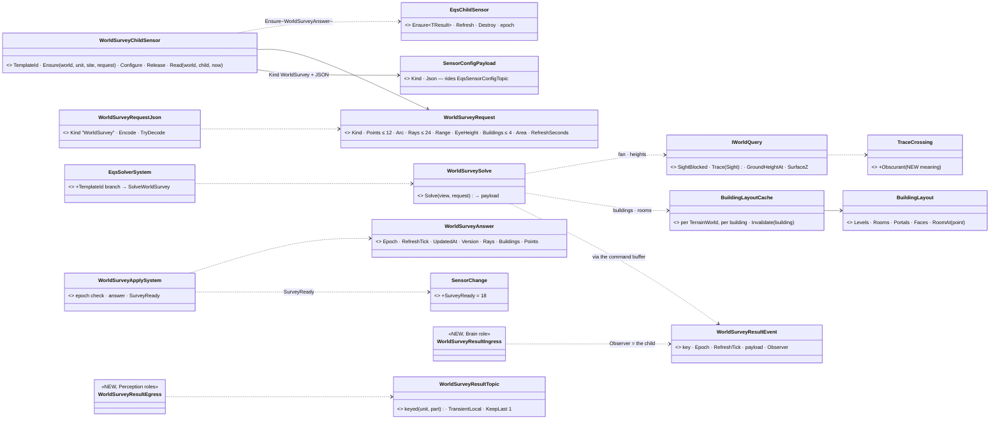
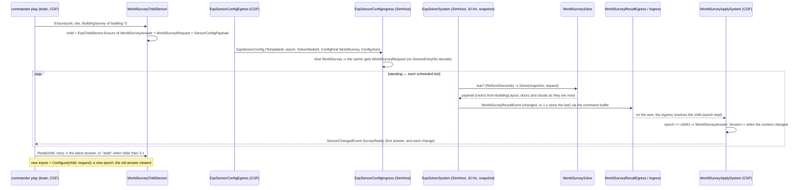
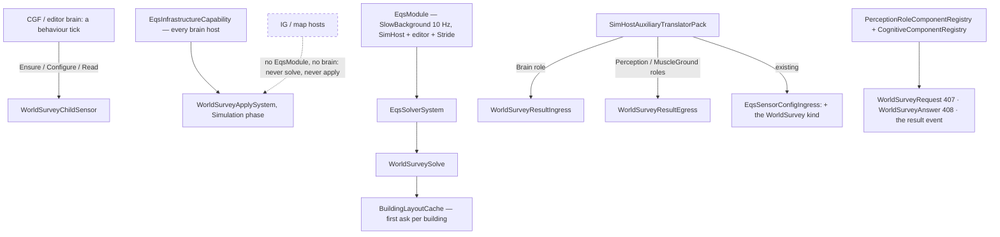
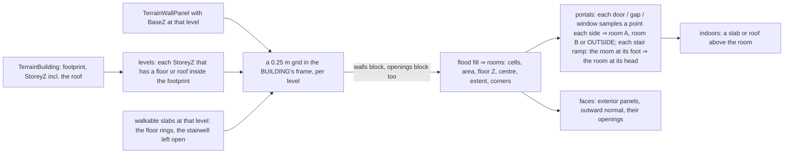

<!--STATUS
state: LIVE
updated: 2026-10-18
build-state: BUILT 2026-10-18 — S1…S5 (§8); designed the same day from behaviors' frame (BR-12, R-2037 / R-2038, DA-25 approved)
current-answer: §8 as built FIRST (what deviated), then §2 classes · §3 sequence · §4 modules · §5 decisions WS-1…WS-11 · §6 the room derivation · §7 slices
stale-below: nothing.
known-rot: none.
known-conflict: docs/DESIGN_World_Query_Seam.md row "rooms derived from walls — inside the stand-in's sound solver only; never in the interface" (written before R-2038). Reconciled here (WS-3): the IWorldQuery interface still carries no rooms; the rooms reach the brain only as a SURVEY ANSWER, derived on the muscle by the one BuildingLayout that sound v2 (WQ-E) and blast confinement (W-7v2) will reuse.
related-designs:
  - docs/designs/group-maneuvers/DESIGN_Defend_And_Attack_Position.md — §13b OWNS the requirement: R-2037 (the brain never reads world geometry), DA-25 (the WorldSurvey sensor, standing, three shapes) and the inventory of brain-side geometry reads (CE-2286 / CE-2287)
  - docs/designs/group-maneuvers/DESIGN_Building_Clearing.md — the main consumer: §3's RoomGraph box (BR-1) is THIS sensor's BuildingSurvey answer now; §5b reports carry a building id + a point in the room
  - docs/designs/group-maneuvers/DESIGN_Platoon_Attack_Defend_Clear.md — §6a sensors, sectors and the roof (the roof is a room, reached by the stair house)
  - docs/designs/eqs-2/EQS_Design_v1.3_final.md — OWNS the child-sensor road this rides (EqsChildSensor, epoch, the 10 Hz banded solver, R-179 solver placement)
  - docs/DESIGN_Utility_AI_Demo_Scenarios.md — §10 the danger-area sensor (CE-3072): the one earlier non-template sensor on the road; this design copies its shape
  - docs/DESIGN_World_Query_Seam.md — OWNS IWorldQuery (R-250 / R-252); the fan and the point survey are answered through it; WS-6 adds one engine-neutral meaning to TraceCrossing
  - docs/DESIGN_Building_Interiors.md — OWNS the building model (panels, openings, storeys, doors) the room derivation reads; its planned room/portal graph (sound v2, W-7v2, B-8) is §6's BuildingLayout
  - docs/designs/structure-damage/DESIGN_Structure_Damage.md — OWNS wall destruction (not built); WS-5 is the hook a breach plugs into
-->

# The `WorldSurvey` sensor — the brain asks the muscle for geometry *(backend, `CE-3249`, behaviors' BR-12)*

🔒 **User, `2026-10-18` (R-2037):** *"The line of sight must always be a sensor or raycast query which goes to the muscle and returns back
as a result."* · (R-2038) *"sensors on the simhost … might keep working and providing the data on the background … The room graph is
probably something also the EQS query or the sensor can create on its own based on the building geometry. It shouldn't be something the
scenario or terrain needs to provide."*

## 1. INVENTORY *(2026-10-18 — codebase-memory CLI `search_graph` Class `.*Eqs.*`, `.*(Room|Portal|Storey|Opening|Panel|Stair).*`; grep for
`EqsChildSensor`, `DangerAreaChildSensor`, `SensorConfigPayload`, `ConfigJson`, `SensorChange`, `TerrainBuilding`, `StoreyZ`; two read-only
sweeps, every answer opened at the file. `check_index_coverage` NOT run — CLI only)*

| need | exists | where | missing |
|---|---|---|---|
| a child sensor of a unit, epoch, run-owned, destroyed with the run | ✅ `EqsChildSensor.Ensure<TResult>` / `Refresh` / `Destroy` | `Spatial/Eqs/EqsChildSensor.cs` | a clear branch for a new answer family in `Apply` |
| a non-template sensor on that road | ✅ ONE: the danger-area sensor (its `TemplateId` branch in the solver, its own result event / topic / apply system) | `Squad/DangerArea/*`, `EqsSolverSystem.SolveDangerArea`, `DangerAreaSensorSystem` | — (the pattern to copy) |
| a per-kind config on the wire | ✅ `SensorConfigPayload {Kind, Json}` on the brain's child → `EqsSensorConfigTopic.ConfigKind/ConfigJson` | `Perception/Components/SensorComponents.cs`; `EqsSensorConfigEgressTranslator` | the ingress decodes only `SensorEntryDto` (`SensorConfigCodec`) — a survey kind needs its branch |
| the solver: 10 Hz, banded, oldest first, counted budget, on a snapshot; a publish goes through the command buffer | ✅ | `EqsSolverSystem.Execute` / `RunSensor`; `EqsModule` (SlowBackground 10) | a `TemplateId` branch |
| a "ready" notification | ⛔ none — `SensorChange` 1…17, query sensors are polled (`IsReady`) | `Perception/Events/SensorChangedEvent.cs` | `SurveyReady` |
| sight with doors and clouds, per view | ✅ `WorldQuery.Of(view)` → `TerrainWorldQuery` (`SightBlocked`, `Trace(Sight)` into a caller's list) | `World/WorldQuery.cs`, `Terrain/TerrainWorldQuery.cs` | a meaning for "an obscurant stopped it" (R-252: no branching on `Kind`) |
| heights | ✅ `GroundHeightAt`, `SurfaceZ`, `SurfacesAt` on `IWorldQuery` | `World/IWorldQuery.cs` | — |
| buildings | ✅ `TerrainBuilding` (footprint, `StoreyZ` incl. the roof), `TerrainWallPanel` (A, B, thickness, `BaseZ`/`TopZ`, storey, openings with sill / head, door key), stairs as `Ramp` walkables, `DoorStates.Of(view)` | `Terrain/TerrainBuildings.cs`, `TerrainBuildingExpander.cs`, `TerrainObjects.cs` | ⛔ **no room, no portal, no storey-of-a-point** (searched names Room / Portal / Storey / Stair / Facade: none); the `TerrainBuilding` comment expects "room / portal queries" |
| wall destruction | ⛔ none — only a door breaks (`Destroyed`); `TerrainWorld` is immutable | `AreaEffectSystem.BreachDoors`; Structure Damage (requirements only) | WS-5's hook |
| test buildings | ✅ `house-2f` (bt-range ×2); `house-1f`, `shop-1f` (demo-city) | `Recipes/Terrain/*/buildings/` | ⏳ `house-3f` (roof stair house + parapet) is ui's UI-2, not built yet |

## 2. Classes

*What the picture shows that prose hid:* every box on the road is the danger-area sensor's box with a new payload — the child sensor,
the config, the solver branch, the result event, the topic pair, the apply system. The only genuinely new MACHINERY is `BuildingLayout`
(rooms from walls), and it sits on the muscle beside the stand-in it reads, never on the brain.

## 3. Sequence — a commander asks once, then reads the latest

*What the picture shows that prose hid:* the brain WAITS only for the first answer of an input set; after that the solver keeps solving in
the background and the brain reads what is there. A change of inputs is the only re-ask, and the epoch is what keeps a late answer for
the old inputs out.

## 4. Modules — who registers it, who runs it each frame

*Caption: the dashed edge is real — an IG holds neither the solver nor a brain, so a survey created there would never be answered; a
survey is a BRAIN's sensor. In the editor both halves run in one world and the result event is applied without the wire.*

## 5. Decisions *(the frame's leans are approved — R-2037, R-2038, DA-25; these are the details; ⭐ = built as leaned unless §8 says otherwise)*

| id | decision | ⭐ lean | rejected — one line each |
|---|---|---|---|
| **WS-1** | the road | ⭐ the danger-area shape: a `TemplateId` branch in `EqsSolverSystem`, its own result event, topic, egress / ingress and apply system; the child is an ordinary `EqsChildSensor` carrying `WorldSurveyAnswer` | an EQS template — an answer is ≤ 16 ranked points, not a ray profile or a room graph · a raycast event per ray — hundreds of loose events per fan, no epoch |
| **WS-2** | the request on the wire | ⭐ a managed `WorldSurveyRequest` on the child, sent as `SensorConfigPayload {Kind "WorldSurvey", Json}` (the CE-3036 per-kind carrier); the SimHost ingress decodes that kind into the carrier's `WorldSurveyRequest` | new fields on `EqsSensorConfigTopic` — a fan's 12 origins do not fit the fixed struct, and every sensor would carry them |
| **WS-3** | where rooms come from | ⭐ **derived on the muscle from the building's current walls and openings** (§6), cached per building, given to the brain only inside the answer; the SAME `BuildingLayout` is what sound v2 / blast confinement reuse (Building Interiors W-7v2, World Query WQ-E) | rooms authored in the template or the scenario — R-2038 · rooms on `IWorldQuery` — the seam carries no stand-in structure (R-252) |
| **WS-4** | ids in the answer | ⭐ a building is its index in the terrain's building list (the same terrain file on every node ⇒ the same index); a room / portal is an index INSIDE ONE answer — never a wire id (re-derived after damage) | a stable room id — impossible once a wall can fall (behaviors' note: reports carry building + a point, and the receiver finds the room by PointSurvey) |
| **WS-5** | damage | ⭐ the layout cache is keyed by the `TerrainWorld` instance and per building; `BuildingLayoutCache.Invalidate(world, building)` is the hook a breach calls (Structure Damage is not built — ⛔ no wall can fall today); DOOR state is read live on every solve, never cached (a breached door is an open portal at once) | caching door state with the layout — a door changes far more often than a wall |
| **WS-6** | "what stopped the ray" | ⭐ a class, not a name: `None` · `Structure` (a `ClosedBarrier` crossing — wall, floor, closed door) · `Obscurant` (smoke / gas — ⭐ NEW engine-neutral meaning `TraceCrossing.Obscurant`, set by `TerrainWorldQuery` on a cloud crossing) · `Terrain` (anything else that blocked: ground, an open-structure prism); plus the stop's distance and height | the trace's `Kind` string — R-252 forbids branching on it |
| **WS-7** | cost and refresh | ⭐ solved only when DUE: `RefreshSeconds` per request (default 1 s; a fan 0.5 s), the solve's cost counted like other sensors (Sensor 100 + Sight 4 per ray step); the band is the request's (default Normal); an answer is PUBLISHED when its content changed or 1 s since the last (a heartbeat, so staleness is measurable) | solving every 10 Hz tick — a 12 × 24 fan is 288 traces; a survey changes rarely |
| **WS-8** | staleness | ⭐ `Read(child, now)` reports `Stale` when the answer is older than 3 s (3 × the heartbeat) — ⛔ never silently used (DA-25) | no staleness — a dead solver node would be invisible |
| **WS-9** | sizes | ⭐ fan ≤ 12 origins × ≤ 24 rays; BuildingSurvey ≤ 4 buildings per request (or every building whose footprint meets an area, max 4); ≤ 64 rooms, ≤ 128 portals, ≤ 64 faces per building; PointSurvey ≤ 16 points. Over a cap ⇒ truncated and `Truncated` set | unbounded — a city block in one answer |
| **WS-10** | the notification | ⭐ `SensorChange.SurveyReady` (18) on the first answer of an epoch and whenever `Version` moves (the content hash changed) | polling `IsReady` only — the frame asks for an announced answer |
| **WS-11** *(added while building)* | the answer's form | ⭐ ONE plain payload class (`WorldSurveyPayload`: rays, buildings, rooms, portals, faces, points) carried as **JSON** on the topic and in the result event, decoded once on the brain when its content hash moved; the brain's buffer is `WorldSurveyStatus` (unmanaged: tick, time, version, hash) + `WorldSurveyAnswer` (managed: the payload) | typed DDS structs per list — six wire structs and two mappings for an answer read at most a few times a second; the `EntityBrainIntent` / `TacticalIntentRequest` precedent already carries JSON |

## 6. The room derivation *(`BuildingLayout`, stand-in, muscle only)*

*What the picture shows that prose hid:* openings are closed for the FILL (so a doorway separates two rooms) and open for the PORTALS
(so the doorway joins them) — one pass gives both. Levels come from where floors ARE, not from storey numbers, so a roof with a stair
house is simply the top level: its parapet and the stair house's walls are panels standing on it, the stair house encloses its own
room, and its door is the portal between it and the roof room.

| rule | why |
|---|---|
| a cell is a room cell when a slab of that level covers it (the ground storey: the footprint) and no wall piece of that level covers it | a stairwell with no floor is not part of any room |
| a component under 1 m² is dropped | wall slivers, the grid's edge |
| a portal joins two rooms or a room and OUTSIDE (−1); a window portal is never walkable (`Walkable = false`) | the clearing needs both entries and windows |
| a door portal carries its door key and its LIVE state (open · closed · locked · destroyed) | WS-5 |
| corners = the room's extent corners in the building frame, 0.4 m inside | v1 rooms are rectilinear in the building's frame; a point of domination is a corner |
| indoors = a slab or the roof above the room's floor; the roof room is OUTDOORS, a roofed stair house is indoors | the platoon note's rail |
| ⭐ *(as built)* the LAST `StoreyZ` (the roof's height) is a level only when its slabs cover ≥ 50 % of the footprint | `house-3f`'s roof rings are the stair house's LID, not a walkable roof |
| ⭐ *(as built)* the roof level = the topmost level with a room open to the sky | a flat roof (`house-2f`) and a roof storey (`house-3f`) answer alike, with no storey numbers |

## 7. Slices and rails *(red-proved; the feature's suite is `WorldSurveyTests` / `BuildingLayoutTests`, created here — none existed)*

| slice | content | rail *(⭐ the one that proves it)* |
|---|---|---|
| **S1** | `BuildingLayout` + cache (§6) | ⭐ `house-2f`: two levels + the roof; ground storey = 2 rooms (west, east of the inner wall), the hall door their portal, front / back doors to OUTSIDE, the stair a portal ground-east → upper; windows on the faces; a point on the roof ⇒ roof room, outdoors; a point in the stairwell ⇒ no room; a breached door reads Destroyed |
| **S2** | `WorldSurveySolve`: fan · building · point; `TraceCrossing.Obscurant` | ⭐ a fan from inside `house-2f` through an open window sees the street (free distance ≫ wall), and after a cloud bursts in front of the window, does not — its stop is `Obscurant`; a closed door stops a ray as `Structure`, opened it does not; PointSurvey heights = `GroundHeightAt` / `SurfaceZ` |
| **S3** | child sensor, request / answer components, codec, apply system, `SurveyReady`, the solver branch, `EqsChildSensor.Apply` clear | ⭐ fused world (editor shape): Ensure → solver tick → answer applied, `SurveyReady` once; Configure ⇒ new epoch, old answer cleared, a late answer for the old epoch dropped; an answer older than 3 s reads Stale |
| **S4** | the topic, egress / ingress, the config-ingress kind, pack registration | ⭐ cluster (SimHost solves, CGF applies): the answer reaches a brain on another node with every field; IG builds nothing |
| **S5** | `house-3f` (after ui's UI-2) | the platoon note's rail: ground + upper rooms, the stair house and the roof room; the stair-house door the portal between them; PointSurvey on the roof ⇒ roof room, outdoors |

⛔ **Not in this item:** behaviors' own brain-side geometry reads (`CE-2286`) and backend's (`CE-2287`, R-2037's conformance allow-list) —
they move onto this sensor afterwards; a wall breach (Structure Damage).

## 8. As built *(`2026-10-18`, `CE-3249`)*

| # | as built | ⛔ the design above said |
|---|---|---|
| A1 | the brain's buffer is TWO components: `WorldSurveyStatus` (408, unmanaged — `EqsChildSensor.Ensure<TResult>` takes an unmanaged result) + `WorldSurveyAnswer` (409, managed payload); the request is `WorldSurveyRequest` (407) | §2: one managed `WorldSurveyAnswer` |
| A2 | the answer rides as JSON (WS-11, added) | §2: a typed topic |
| A3 | a child survey is solved only for a unit with a network id (`EqsSensorKey`: a child of a local-only parent is `None`) — as every sensor child; every unit in the editor and on a cluster has one | not stated |
| A4 | the solver's per-survey memo (epoch, solved at, published at, hash) is node-local in `EqsSolverSystem`; a not-due survey costs 1 unit | WS-7: "solved only when due" — the cost of the skip not stated |
| A5 | `BuildingLayout` reuses `PolygonMath.Contains` (no second point-in-polygon) and the walkables' triangles for floor cover; roof rules in §6 (two rows added) | — |
| A6 | `TraceCrossing.Obscurant` is set on the cloud crossings `TerrainWorldQuery.Trace(Sight)` adds | WS-6 as designed |
| A7 | ⚠ `Trace(Sight)` still allocates its crossings (`QuerySight` is the terrain's diagnostic form): a 12 × 24 fan is 288 small lists per solve, at most twice a second | not stated — measure before a fan-heavy demo (a non-allocating free-distance query is the fix, on the World Query seam) |

| rail | proves |
|---|---|
| `BuildingLayoutTests` ×6 (`Fdp.Toolkits.Tests`) | rooms / portals / faces of `house-2f` (House A, House B rotated 90°), the stairwell in no room, the cache; ⭐ `house-3f`: the roof room, the stair house, the `roof` door between them, the lid no level |
| `WorldSurveySolveTests` ×7 (`Fdp.Toolkits.Tests`) | a fan through a window and not through a wall; a smoke cloud in front of the window stops it as `Obscurant`; the locked door stops it until opened; door states live in the building survey; area survey; point survey; JSON round trip + stable hash |
| `WorldSurveySensorTests` ×3 (`Hrot.SimHost.Tests`) | fused world: answered, held, `SurveyReady` once; re-pointed ⇒ old answer dropped (`StaleEpochCount`), announced again; stale after 3 s |
| `EqsDistributedTests.CE3249_AWorldSurvey_AcrossHosts_TheSolverAnswersTheBrain` (cluster) | SimHost solves, CGF holds House A's rooms, stair, the locked front door |

⛔ **Not built here (§7 "not in this item"):** `CE-2286` / `CE-2287` (moving the brain-side geometry reads onto this sensor, and the
conformance allow-list) · a wall breach (Structure Damage) — `BuildingLayoutCache.Invalidate` is its hook.
