<!--STATUS
state: LIVE
updated: 2026-11-03 (settled the same day: RV-1…RV-9, RE-1…RE-10 + §7.4, PH-1…PH-7 approved, PH-8 amended to R-4115; the pass mark, CE-2378, step progress and the state-keeping live edit built (behaviors); the per-player score S7 built on leans P-1…P-9 (backend). Earlier: parts 4–10 added — coordinator)
current-answer: §1 the objective · §2 the trigger · §3 exercise control · §4 references and keys · §5 scenario macros · §6 scoring and evaluation · §7 the game profile · §8 messages and the end · §9 what people see · §10 switching it per node — each of §4–§10 has a status line and, where it applies, how it works / how it is authored / how it is presented. An EXPLAINER of the designs, not the designs themselves
stale-below: nothing — superseded revisions removed 2026-11-01; full history at commit de422e11b (`git show de422e11b:docs/EXPLAINER_Scenario_Evaluation_And_Direction.md`)
known-rot: §1–§3 use illustrative parameter names (the shipped ones are in DESIGN_Scenario_Rules.md §00.8–§00.9, e.g. `minMen`, `holdSeconds`, `deadlineSeconds`); the `Count` OBJECTIVE of §3.2 / §3.4 is, as built, the `Counter` measure (a pool moved by actions, §7) or S4's `Count` measure (events by the subject, §6); §3.3's rung 3 (`PressureController`) and rung 4 (`SideAmmoFraction`) are designed illustrations, not built; most SCREENS of §9 are designed and APPROVED but not yet built (each row says which);  not verified end to end: a `do` step's own `bind`
known-conflict: none
related-designs:
  - docs/DESIGN_Scenario_Rules.md — OWNS every decision explained here (SR-…, T1–T10, G-…, E-…, V-…); this file only explains them with examples
  - docs/DESIGN_Scenario_Macros.md — OWNS scenario macros (§5): the file, instance, bindings, expansion, relocation, placement, InsertMacro, variants, the director
  - docs/DESIGN_Macro_Authoring_Editor.md — OWNS the editor surfaces over macros, MA-1…MA-10 (§5.2)
  - docs/DESIGN_Scenario_Entity_Keys.md — the stable entity GUIDs references rest on (§4)
  - docs/DESIGN_Entity_Hierarchy_Views.md — the entity tree's Command / Structure / Scenario views, HV-1…HV-5 (§5.3, §9)
  - docs/DESIGN_Node_Features.md — the per-node feature switches, F-…, and the hud.* features (§10)
  - docs/DESIGN_Rules_View_UI.md — the instructor's rules view and mission summary, RV-1…RV-9 (§9.1) and the rule editor RE-1…RE-10 (§9.1a) — ✅ approved 2026-11-03
  - docs/DESIGN_Player_HUD_And_Debrief.md — the player's HUD, kill feed, debrief, PH-1…PH-8 (§9.2) — ✅ approved 2026-11-03, PH-8 amended (R-4115)
  - docs/designs/rules-view/README.md — the nine UI mockups (§9)
  - docs/OVERVIEW_Behaviour_Building_Blocks.md — the behaviours, orders and command chain objectives and triggers use
  - docs/SHOWCASE_Scenarios.md — two full scenarios (training + game) that use everything explained here, with their as-built measurements
  - docs/blueprints/batches/HANDOFF_Coordinator_To_Behaviors_Rules_S4_Scores.md — the designed-next scoring items of §6.2
  - docs/blueprints/batches/HANDOFF_Coordinator_To_Backend_Player_Score.md — the designed-next per-player game score of §7
-->

# EXPLAINER — **scenario evaluation and direction** *(objectives, triggers, …)*

> For a reader who does not know the code: HOW each feature works, HOW it is authored, HOW it is presented. The decisions and their reasons are in
> [`DESIGN_Scenario_Rules.md`](DESIGN_Scenario_Rules.md) and the designs listed above. **Status legend:** ✅ built (checked against a design's as-built block or the code) ·
> ⏳ designed, not built · ⚠ awaiting the user's approval.

| § | part | in one line | status |
|---|---|---|---|
| 1 | the objective | observes and reports a goal | ✅ |
| 2 | the trigger | when something happens, run a list of actions | ✅ |
| 3 | exercise control | pacing, difficulty, branches and the end, from the same pieces | ✅ data patterns · ⏳ a reusable control behaviour |
| 4 | references and keys | how one thing points at another, with no network ids in a file | ✅ |
| 5 | scenario macros | reusable parts, placed and expanded anywhere | ✅ · ⏳ preview of a runtime insert |
| 6 | scoring and evaluation | scores per person, squad, platoon | ✅ tree, measures, pass mark, required measures (CE-2378), role / standard means, score-history lane (S4 ①–⑥, live gate passed) |
| 7 | the game profile | capture points, tickets, respawn waves, per-player score | ✅ v1 · ✅ per-player score, awards, streaks, bounty (P-1…P-9 approved) |
| 8 | messages and the end | briefings to players, the closing of the exercise | ✅ |
| 9 | what people see | instructor, player, game master | ✅ data and entity tree · ⏳ most screens — designs approved, being built (ui) |
| 10 | switching it per node | features as the on/off for every presented element | ✅ · ⏳ the operator grid |

**The three roles, in one line each:**

| | does | example |
|---|---|---|
| **objective** | OBSERVES and REPORTS — *did it succeed, how well* | *"Hold the bridge for 10 minutes"* |
| **trigger** | REACTS — *when something happens, do something* | *"when the bridge is held, send the counter-attack"* |
| **mission plan** | DIRECTS one unit — *its ordered task list* | *"drive to the bridge, then hold it"* |

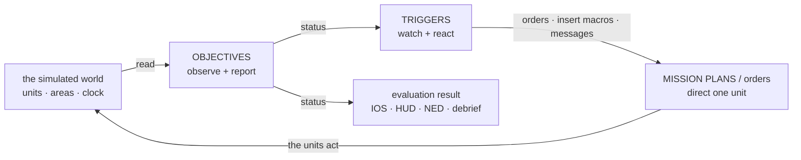

*Caption:* the loop — objectives READ the world and publish statuses; triggers READ statuses and ACT through orders and macros; units carry
the orders out and change the world, which the objectives read again.

---

## 1. The objective

> **Status:** ✅ built — slice S1 (`DESIGN_Scenario_Rules.md` §00.8.1), live on a cluster (`scenarios/sr-objectives-march`). Decisions SR-37, SR-47…SR-53, S1-a…S1-g. Parameter names below are illustrative (shipped: `minMen`, `holdSeconds`, `common{title, subject, parent, required, weight, deadlineSeconds}`); the clear-the-area kind is `ClearAreaObjective`.

### 1.1 What it is

An ordinary **entity** (usually created by a scenario macro) with four parts:

| part | in the example *"Hold the bridge"* |
|---|---|
| label + position | `EntityInfo` (title *"Hold the bridge"*, side Blue) · `SimTransform` at the bridge — only for drawing it on the map |
| its LINKS (`ObjectiveLinks`) | `Subject` = **Blue Platoon** (*whose* objective it is) · `Parent` = **Blue mission** (the objective it rolls up into) |
| its TASK slot = the evaluating behaviour | `HoldArea` with params `{area: "@Bridge", minUnits: 4, maxEnemy: 0, holdSeconds: 600, common: {deadline: "10:30", points: 100, weight: 40}}` |
| its RESULT (`ObjectiveStatus`, replicated to every node) | state · progress · value / target · score · points · when · reason |


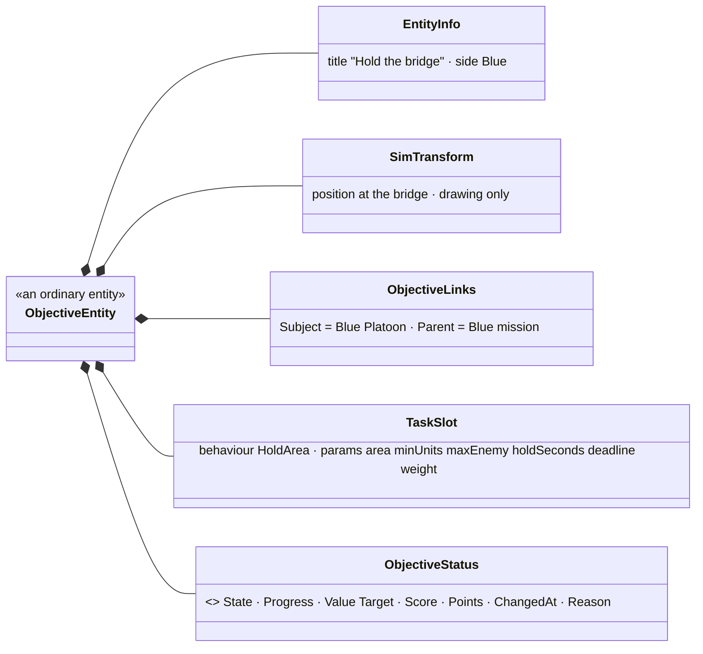

It runs on the **Brain node** (which owns it), in the normal brain tick — only while simulation time advances.

### 1.2 Where its data comes from — it only READS the world, through references

| it needs | from |
|---|---|
| the area polygon | `@Bridge` — the `RefKey` of an area entity → its `EditablePolyline` |
| *our* units | `Subject` = Blue Platoon → its members down the command chain (`UnitSubordinate`) |
| who is inside | each member's `SimTransform` tested against the polygon (the existing area test) |
| enemies inside | entities in the polygon whose side (`ForceId`) is Hostile |
| time | `ScenarioClock` — the deadline and the hold timer |

### 1.3 What its behaviour does each tick (`HoldArea`, a small state machine)

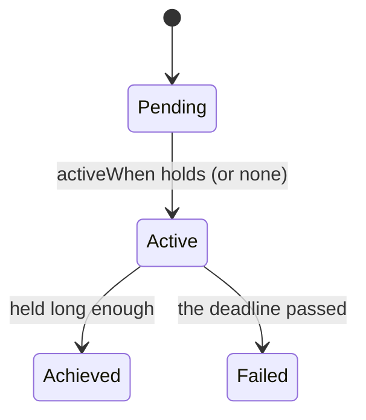


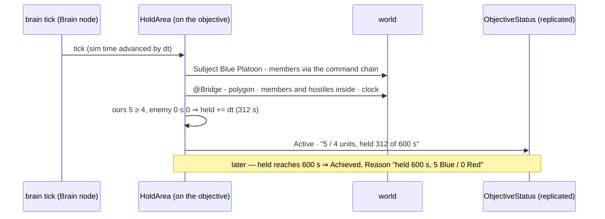

```
Active, every tick:
    ours   = members of Subject inside the area, alive
    enemy  = hostile units inside the area
    if ours >= 4 and enemy <= 0:  held += dt   else: held = 0        (held lives in its working state)
    status.Progress = "5 / 4 units, held 312 of 600 s"
    held >= 600          -> Achieved   (Reason "held 600 s, 5 Blue / 0 Red")
    clock > deadline     -> Failed     (Reason "deadline 10:30 passed, held only 140 s")
```

⭐ It **never changes the world** — it only writes its own status; every state change is journaled (so the debrief can say why).

### 1.4 How others use it — nobody calls it, everyone READS its status

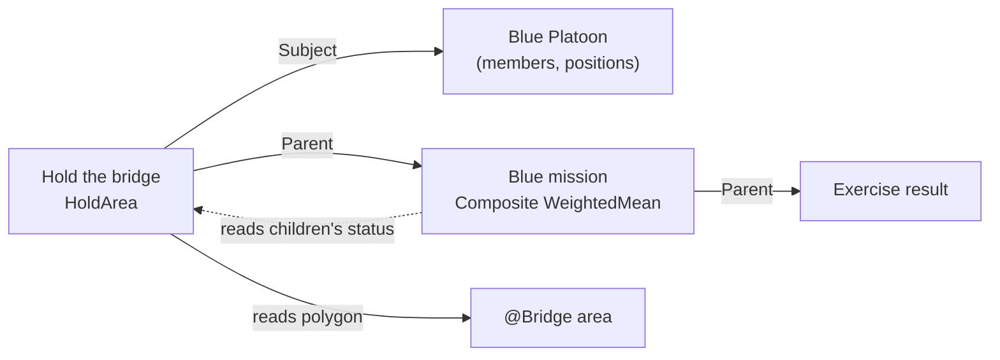

*Caption:* the solid arrows are LINKS the objective holds; the dotted arrow is the parent READING the child's status. A trigger, the
instructor station, the trainee's HUD and any NED frontend read the same replicated status.

- **The parent** *"Blue mission"* (a `Composite`, behaviour `WeightedMean`) finds its children by asking *"which objectives have `Parent` = me?"*,
  reads their statuses (*Hold the bridge* Achieved = 1.0 × weight 40, …) and writes its own score.
- ⭐ **In one sentence:** an objective is a small brain that OBSERVES (its subject, its areas, the clock) and REPORTS (its own status).
  Steering belongs to triggers and mission plans.

---

## 2. The trigger

> **Status:** ✅ built — slice S2 (§00.9, live `sr-triggers-march`), 38 proof-of-concept rails lifted into production. Decisions T1–T10, SR-88…SR-98, SR-108, S2-a…S2-f. An action's variable arguments travel as the step's nested `"params"` (not a `macroArgs` key).

### 2.1 What it is

Also an ordinary **entity** — a SUB-entity of what it concerns (`Subject`; shown nested under it) — with its own brain running the `Trigger`
behaviour in ITS task slot (⛔ never on the unit it steers: that unit's task slot belongs to its mission plan or orders).

| part | in the example *"Counter-attack"* |
|---|---|
| label | *"Counter-attack when the bridge is held"* |
| `Subject` | **Red HQ** (whose reaction it is) — or the World Environment entity for a scenario-wide trigger |
| its TASK slot = the `Trigger` behaviour with params | `when`: the status of `@HoldTheBridge` becomes **Active** · `delay`: 120 s · `once` · `do`: ① `InsertMacro(forces/RedQRF at @VillageEdge)` ② `Order(@RedQRF, Attack, area @Bridge)` ③ `Message(IOS, "Red counter-attack launched")` |
| its RESULT (`ObjectiveStatus`, not scored) | state · `FireCount` · `LastFired` · reason |

### 2.2 Where its data comes from

| it needs | from |
|---|---|
| its CONDITION | ⭐ written in the SAME JSON condition language data breakpoints and the Blueprint `When` node use (SR-95) — here *"`OnEntity @HoldTheBridge`: `ObjectiveStatus.State` equals Active"*; it reads the replicated `ObjectiveStatus` of the objective it watches (`@HoldTheBridge`) — ⭐ conditions ARE objective statuses; a condition you do not want scored is an objective with `scored: false` (e.g. *"Red reaches the ridge"* = a `ReachArea` objective, not scored) |
| time | `ScenarioClock` (the delay, the cooldown) |
| the targets of its actions | `RefKey`s (`@RedQRF`, `@VillageEdge`, `@Bridge`) resolved in the nearest scope |

### 2.3 What its behaviour does (the `Trigger` state machine — rules T1–T10)

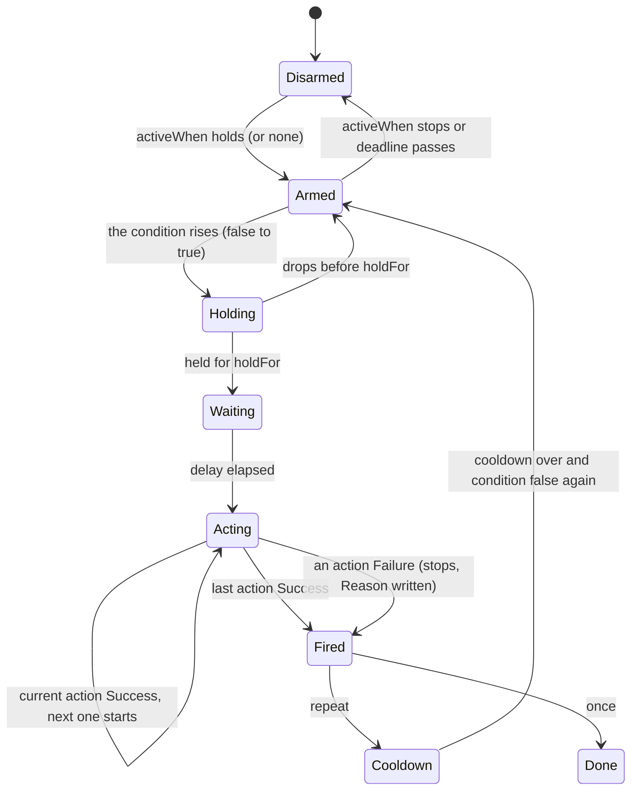

The example, on a timeline:

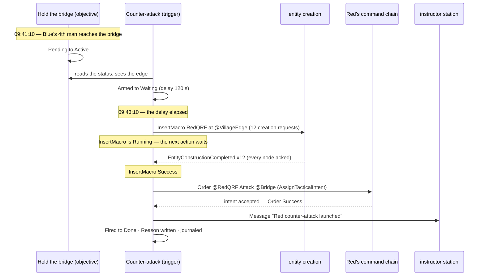

| rule | meaning |
|---|---|
| ⭐ the EDGE | it fires when the condition BECOMES true — not every tick while it is true |
| `holdFor` vs `delay` | `holdFor` = the condition must STAY true that long (debounce); `delay` = fire that long AFTER the edge, even if it drops |
| `once` / `repeat` | `repeat` re-arms only after the condition went false again, plus `cooldown` |
| time | simulation time only — paused ⇒ nothing fires |
| several in one tick | each is independent; up to one tick of latency; where order matters, CHAIN — a trigger's own `Fired` is a condition another can watch |
| actions | run in their listed order, each WAITED for — the next starts only when the previous succeeded; a failure stops the list and is written into `Reason` |
| the instructor | can fire, disarm or re-arm it by hand (journaled with who did it) |

### 2.5 What `do` is — a plain list of the SAME actions every behaviour uses (SR-93)

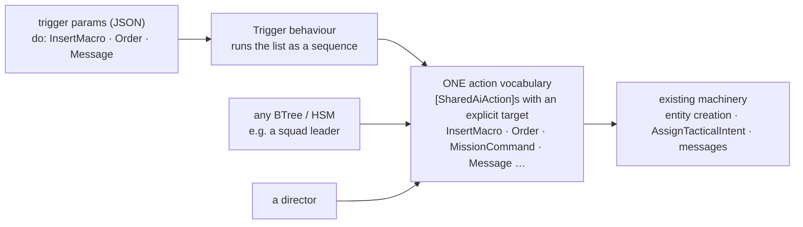

*Caption:* the verbs are not trigger-only handlers — they are ordinary shared actions that say WHO they act on, so a trigger, a squad
leader's tree or a director all call the same `InsertMacro`. Each one reports `Running` until it is really done (InsertMacro: until every
entity it asked for is constructed and acked on all nodes), so the list can wait for it. The `do` list itself is still just data — nothing is
compiled per scenario, and an unknown action or bad argument is refused when the scenario loads. `when` can be an objective's status OR the
scenario clock directly — both written in the existing condition language (SR-95).

Each `do` entry carries its own bindings to scenario parameters, so moving an entry moves them too (SR-94):

```json
{ "act": "InsertMacro",
  "args": { "macro": "RedQRF", "at": "@VillageEdge", "macroArgs": { "size": 12, "side": "Hostile" } },
  "bind": { "macro": "qrfMacro", "macroArgs.size": "qrfSize" } }
```

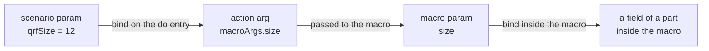

*Caption:* one binding principle at every level, each binding written next to the value it binds; all applied once, at load.

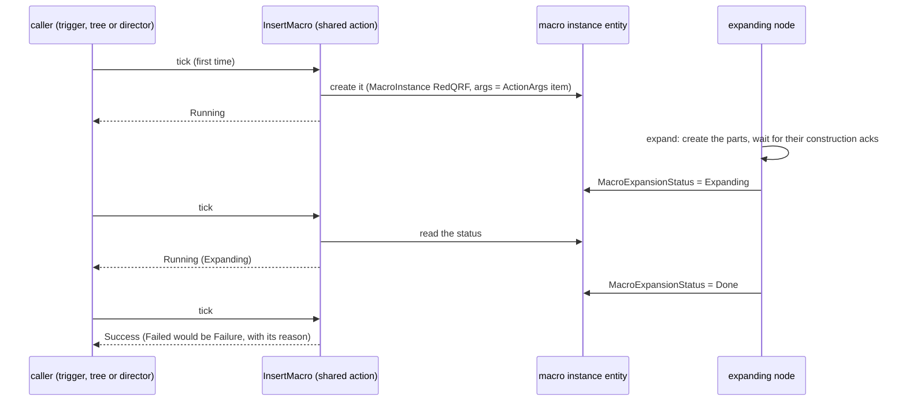

*Caption:* the macro expansion is its own process and reports ONE outcome on the instance entity (SR-96); the action just reads it and never
counts the parts. Because the outcome is STATE, any node can read it, and it survives save, restore and replay.

Where InsertMacro's variable `args` live (SR-97): an action's params are a fixed-size struct, so the struct holds only an index and the list
lives in one generic managed record on the calling entity:

```
InsertMacroParams { Macro="RedQRF", At=@VillageEdge, ArgsRef=0 }      // in the behaviour's block
ActionArgs.Items  = [ 0: {"size":12,"side":"Hostile"}, 1: "Red counter-attack launched" ]   // on the trigger entity
```

✅ **Built** (S2-d, `ActionCatalogue` + `StepRunner` in `Fdp.Toolkits`): actions are bound from data at runtime, the catalogue is shared runtime code, and a bad `do` list is refused when the
trigger is assigned. Verbs today: `Message` · `SetObjectiveActive` · `EndExercise` · `Order` · `MissionCommand` · `InsertMacro` · `SetSkillAmplifier` · `AddToCounter`. ⚠ A step's own `bind` (SR-94): the step is typed, but
its end-to-end application was not verified for this explainer. See [SR-93](DESIGN_Scenario_Rules.md).

### 2.4 How it fits with the others

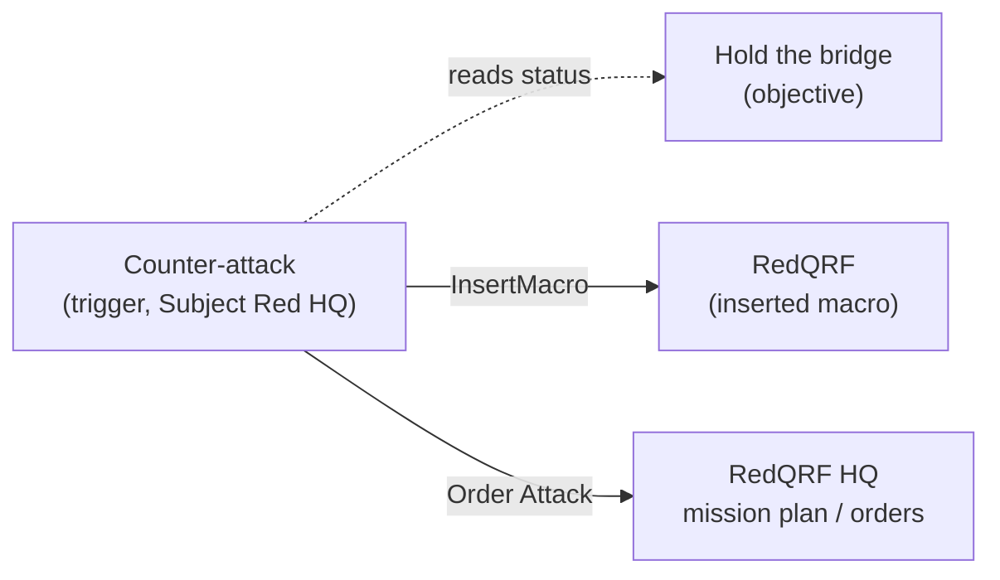

*Caption:* the trigger READS objectives and ACTS through the existing mechanisms — macro insertion (ordinary entity creation) and orders down
the command chain (which a unit's mission plan or brain then executes). ⭐ **In one sentence:** a trigger is a small brain that WATCHES statuses and,
on an edge, RUNS a list of actions.


## 3. Exercise control — steering the whole exercise

> **Status:** ✅ built as DATA — triggers + objectives, `SetSkillAmplifier`, the director as a macro (`macros/control/counter-attack`, §5), fire / disarm / re-arm by hand (the data path; the buttons are §9). ⏳ the rung-3 control behaviour and rung-4 input below are designed illustrations. Decisions SR-99…SR-102, R-4106.

**Exercise control** is everything that shapes the exercise as a whole rather than one unit: its pacing (*phase 2 starts when…*), its
difficulty (*Blue is struggling — ease off*), its branches (*Blue went north — reinforce the north*), its surprises (*a counter-attack*) and
its end. ⭐ There is **no director entity** for this (SR-99): it is built from the same objectives and triggers as parts 1 and 2, packed into a
reusable macro.

### 3.1 The building blocks

| the job | done by | example |
|---|---|---|
| ⭐ **watch** how the teams are doing | objectives and measures — each publishes `ObjectiveStatus` with a `Score` 0..1 | *"Blue platoon attack"* = 0.42 |
| ⭐ **decide** when to act | a trigger's `when`, in the existing condition language (SR-95) — any objective's state or `Score`, the scenario clock, several entities at once | `Score < 0.35` AND elapsed > 20 min |
| ⭐ **act** on the exercise, from outside the world | the trigger's `do` — the shared action vocabulary (SR-93) | `InsertMacro` · `Order` · `SetSkillAmplifier` · `Message` · `SetObjectiveActive` · `EndExercise` |
| **remember** what already happened | a trigger's own status (`Fired`, `FireCount`) and `maxFires`; a `Count` objective for a total shared by several triggers | *"at most 3 waves in total"* |
| **belong to no side** | the trigger's `Subject` is the World Environment entity | Red HQ stays an ordinary commander |
| **package and reuse** | a macro with params | `macros/control/AdaptivePressure {blue, red}` |

### 3.2 Patterns — how the usual wishes are built

| the wish | built as | the trick |
|---|---|---|
| ⭐ **phases** — *"phase 2 begins when the bridge is held, or at 09:45 at the latest"* | an objective per phase + one trigger: `when` = `@Phase1` Achieved OR scenario time ≥ 09:45 → `SetObjectiveActive(@Phase2)` + `Order(...)` | a phase is just an objective that is activated later |
| ⭐ **adaptive difficulty** | triggers on bands of `Score` (table below) | `holdFor` ignores a short dip; `repeat` + `cooldown` + `maxFires` make it gradual and bounded |
| ⭐ **branching** — *"if Blue takes the north route, reinforce the north"* | two `ReachArea` objectives (not scored) for the two routes + one trigger each, the two `when`s exclusive | the branch condition is an objective that is never scored, only watched |
| ⭐ **waves with a budget** — *"up to 3 waves, from any of the reinforcement triggers"* | a `Count` objective counting inserted waves; each wave trigger's `when` adds `Count < 3` | the shared memory is an objective everyone can read |
| ⭐ **surprise after a delay** | a trigger with `delay` (fires even if the condition drops meanwhile) | part 2's counter-attack |
| ⭐ **the end** | one trigger: all required objectives settled OR the time limit → `EndExercise` | the exercise ends like any other reaction |
| **the instructor steps in** | fire, disarm or re-arm any trigger by hand (T9); ⚠ running an action such as inserting a macro by hand is still to be designed (B5) — all journaled with who did it | the instructor uses the SAME triggers and actions — nothing separate |

The adaptive-difficulty example, as a reusable macro `macros/control/AdaptivePressure {blue: @BlueAttack, red: Red}`:

| trigger | when | do | rules |
|---|---|---|---|
| Counter-attack | `@BlueAttack/Hold` becomes Active | InsertMacro(RedQRF, @VillageEdge) → Order(@RedQRF, Attack @Bridge) | delay 120 s, once |
| Ease off | `@BlueAttack.Score < 0.35` AND elapsed > 20 min | SetSkillAmplifier(Red, −1) · Message(IOS, "Red eased") | holdFor 2 min, repeat, cooldown 10 min, maxFires 2 |
| Push harder | `@BlueAttack.Score > 0.8` AND elapsed < 30 min | InsertMacro(RedReserve) → Order(…) | holdFor 1 min, once |

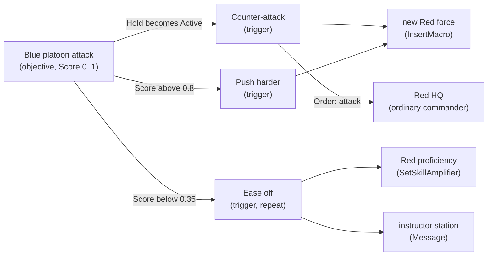

*Caption:* nothing in the picture is a director — the triggers belong to the scenario, so they are tied to no side; Red HQ only fights from
what it knows and simply receives orders for the new forces.

The same loop over time:

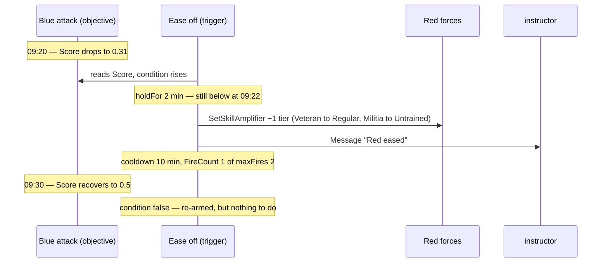

**The proficiency knob already exists** — `CombatProficiency` (Untrained · Militia · Regular · Veteran · Elite, 0..1), set per man, per unit
(it fills down to the men) or by the unit type; it changes aim spread, exposure, reaction time and fire discipline. `SetSkillAmplifier` sets a per-side amplifier in
tiers at runtime (R-4106, SR-100), so a veteran stays better than a militiaman, and forces inserted later are covered too.

### 3.3 When standalone triggers and objectives are not enough — the ladder

Climb only as far as the need; each rung costs more and keeps less of the simplicity.

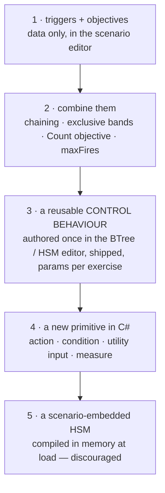

*Caption:* rungs 1–2 are pure data; rung 3 is still data per exercise (a named asset + params); only rung 4 is new code, and it is ordinary
development that every scenario then gets for free.

| rung | use it when | how | what it costs |
|---|---|---|---|
| **1** | one condition → one reaction | a trigger per reaction (parts 1–2) | nothing |
| **2** | reactions depend on each other or share a limit | ⭐ **chaining**: a trigger's own `Fired` is a condition another can watch · ⭐ **exclusive bands** on a `Score` · ⭐ a **`Count` objective** as shared memory · `maxFires` | a few more entities; still readable in the Objectives view |
| ⭐ **3** | you must **choose ONE best play** among several, weigh many inputs, or keep internal state richer than a counter | the same trigger-kind control entity runs a **reusable behaviour asset** in its task slot instead of `Trigger`: e.g. `PressureController` = `ChooseOption` over plays (*Counter-attack · Reinforce · Hold · Ease off*), each play a `RunActions` list; utility inputs read the `Score`s; `UtilityDecisionLog` explains every choice | someone authors the asset once (BTree / HSM editor), it ships, and every exercise uses it by name + params. ⛔ Never written for one exercise (R-4110) |
| **4** | the world has a quantity or an effect nothing can express yet — e.g. *"Blue's ammunition below 30 %"*, *"jam Blue's radios"* | a new `[SharedAiAction]`, `[SharedAiCondition]`, `[UtilityInput]` or measure | C# development, built once; then available to triggers, objectives and every behaviour alike (one vocabulary) |
| **5** | a genuinely one-off logic that no reusable asset should carry | an HSM authored in the editor and SAVED IN THE SCENARIO, compiled in memory at load, deterministically (SR-24) | the most power and the least reuse; ⚠ discouraged and not in the first slice |

**Rule of thumb:** if the logic reads as *"when X, do Y"*, it is a trigger. If it reads as *"keep judging which of these to do"*, it is a
control behaviour (rung 3). If it needs something the world cannot tell you yet, it is a new primitive (rung 4).

### 3.4 Worked example — one exercise climbing the ladder

*"Platoon attack on the village"* (part 2's scenario). The instructor's wishes grow; each one is met on the lowest rung that can carry it.

**Rung 1 — *"when Blue holds the bridge, send a counter-attack."*** One trigger (part 2):

| trigger | when | do |
|---|---|---|
| Counter-attack | `@BlueAttack/Hold` becomes Active | InsertMacro(RedQRF, @VillageEdge) → Order(@RedQRF, Attack @Bridge) |

**Rung 2 — *"send waves from the north or the south, whichever Blue is not watching; the next wave only once the previous one is destroyed;
three waves in total."*** Still triggers and objectives, combined:

| entity | kind | role |
|---|---|---|
| `Blue watches north` / `Blue watches south` | `HoldArea` objectives, ⛔ not scored | the branch condition — which side Blue covers |
| `Waves sent` | `Count` objective (counts `InsertMacro` of `RedQRF`), ⛔ not scored | the budget SHARED by both wave triggers |
| `Wave destroyed` | `DestroyTargets` objective on the last inserted wave, ⛔ not scored | the chain — *"the previous wave is gone"* |
| trigger `Wave north` | `Blue watches south` Active AND `Waves sent < 3` AND (`Waves sent = 0` OR `Wave destroyed` Achieved) | InsertMacro(RedQRF, @NorthEdge) → Order(...) |
| trigger `Wave south` | the mirror (`Blue watches north` Active, …) | InsertMacro(RedQRF, @SouthEdge) → Order(...) |

The `when`s are exclusive (Blue covers one side), so the two triggers never fire together, and the `Count` objective is the memory both of them
read.

**Rung 3 — *"every couple of minutes, weigh how Blue is doing, how strong each side is and how much time is left, and pick the best of:
reinforce north · reinforce south · hold · ease off."*** Bands of exclusive conditions stop scaling here — four plays, several inputs, and the
choice has to stick for a while instead of flickering. ⇒ a **control behaviour**, authored ONCE as an asset and shipped:

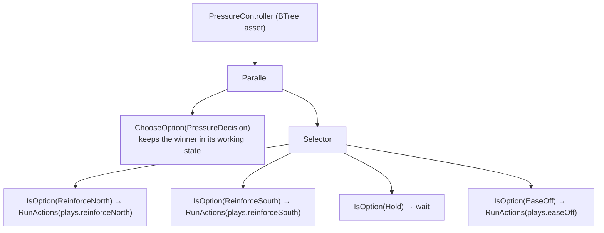

*Caption:* the decision and the plays are separate — `ChooseOption` scores the options and remembers the winner (with hysteresis, so it does not
flicker); each branch runs its play as an ordinary `RunActions` list — the SAME actions a trigger's `do` uses.

The utility decision `PressureDecision` (authored once, like the asset):

| option | scored up by | scored down by |
|---|---|---|
| ReinforceNorth | Blue `Score` high · Blue watches south | waves sent · little time left |
| ReinforceSouth | the mirror | the mirror |
| Hold | Blue `Score` in the middle band | — |
| EaseOff | Blue `Score` low · `EnemyStrengthRatio` against Blue high (an existing input, `StandardInputs.cs:289`) | proficiency already lowered twice |

What the scenario author places — ONE entity, a name and params, nothing compiled:

```json
{ "Name": "Pressure", "Subject": "World Environment",
  "Sop": { "Name": "PressureController",
           "Params": { "blue": "@BlueAttack", "red": "Red", "maxWaves": 3, "decideEvery": 120,
                       "plays": {
                         "reinforceNorth": [ { "act": "InsertMacro", "args": { "macro": "RedQRF", "at": "@NorthEdge" } },
                                             { "act": "Order", "args": { "unit": "@RedQRF", "intent": "Attack", "target": "@Bridge" } } ],
                         "reinforceSouth": [ { "act": "InsertMacro", "args": { "macro": "RedQRF", "at": "@SouthEdge" } },
                                             { "act": "Order", "args": { "unit": "@RedQRF", "intent": "Attack", "target": "@Bridge" } } ],
                         "easeOff":        [ { "act": "SetSkillAmplifier", "args": { "target": "Red", "delta": -1 } },
                                             { "act": "Message", "args": { "to": "IOS", "text": "Red eased" } } ] } } } }
```

The next exercise uses the same `PressureController` with other params (other edges, other macros, `maxWaves: 5`); the instructor sees in
`UtilityDecisionLog` *why* each play won.

**Rung 4 — *"also ease off when Blue is running out of ammunition."*** A man's own ammunition is already an input (`AmmoFraction`,
`Utility/Inputs/StandardInputs.cs:84`), but nothing yet sums it for a whole SIDE ⇒ one new primitive, in C#, built once, next to it:

```csharp
[UtilityInput("SideAmmoFraction")]   // 0..1 — the side's remaining ammunition over its loaded-out total
static float SideAmmoFraction(in UtilityInputCtx ctx) => …;
```

From then on `PressureDecision` scores `EaseOff` up by it, AND — through the same registry — it can be a measure (*"Blue's ammunition
discipline"*) and a trigger condition (*"Blue below 30 %"*; ⚠ that needs a utility-input leaf in the condition language — the SR-20 bridge,
not yet designed for SR-95). Every scenario gets it for free.

**Rung 5** is not needed here — nothing in this exercise is so one-off that a reusable asset should not carry it.

| wish | rung | new authoring | new code |
|---|---|---|---|
| a counter-attack | 1 | one trigger | none |
| north / south waves, chained, budget of 3 | 2 | 5 entities (3 watched objectives, 2 triggers) | none |
| keep choosing the best of four plays | 3 | one entity naming `PressureController` + params | none per exercise — the asset is authored once |
| react to ammunition | 4 | one input added to the decision | one `[UtilityInput]` |

### 3.5 What the instructor sees — the rules view

One window shows every objective and trigger of the exercise on the sim-time axis, with a NOW line: what already happened at its real
time, what is coming as a dashed bar AFTER the things it waits for (so nothing is tied to a clock and a slip just moves it), triggers pinned to
the scenario clock as diamonds, and the dependencies as connectors. Selecting a row opens its tabs in the Details panel — a trigger's
**When · Do · Rules · History**, an objective's **Status · Settings · Results · History** — and everything can be edited at any time, live
included, each edit journaled. It is a host of the ONE shared timeline panel, not a copy of it.
For the overview — *how is the mission going, at every level* — a separate, READ-ONLY **mission summary**: each side's score with its trend, the required objectives, forces, the items needing attention, and one table of scores by command chain (platoon ▸ squad ▸ person), by objective or by role, each row explaining *why* its score is what it is. It opens on a recording for the debrief too.
And for the PLAYER (→ §9.2): during play a HUD — in training his mission objectives, his standards and the messages; in a game the score bar, capture points, timer, kill feed and score pop-ups — and after it a debrief: in training GO / NO-GO per standard with *went well / work on* and a replay from his own eyes; in a game the scoreboard, awards and his best moment. One set of data, two profiles, each element a switchable feature.
📐 Mockup: [`docs/designs/rules-view/`](designs/rules-view/README.md) (standalone HTML, open in a browser) · decisions: SR-105, SR-109, SR-110, SR-111, SR-112 in [`DESIGN_Scenario_Rules.md`](DESIGN_Scenario_Rules.md).

⏳ The view is **designed and approved** (RV-1…RV-9, and its rule editor RE-1…RE-10, user `2026-11-03`) and is being built on `ui` — its data, the timeline panel's first extensions, step progress and the state-keeping live edit exist; what each screen shows and its build state is in §9.

---

## 4. References and keys — how one thing points at another

> **Status:** ✅ built — types, walker, `RefKey`, GUIDs in files (S0, CE-4153 S9′ + S8, `DESIGN_Scenario_Rules.md` §9.8.11, `DESIGN_Scenario_Entity_Keys.md` §00b).
> Decisions: SR-63…SR-66, SR-125…SR-143, SR-159, SR-188. The editor's reference leaf: CE-4206 (ui lane).

Everything in parts 1–3 points at something — a subject, an area, a target. Three forms exist, and a name is never one of them
(*"Entity name is by no means a stable identifier"* — SR-63).

### 4.1 How it works

| form | written | means | scope | decision |
|---|---|---|---|---|
| **Exact** | `"b41d6e00-…-0001"` (a GUID) | *this one entity* | whole file; stable across save / load / ownership change. A macro-made entity gets a DERIVED GUID: `Derive(instance GUID, "macro:<local id>")` | SR-63, SR-167, SR-187 |
| **Key** | `"@BlueHQ"` · qualified `"@PlatoonB/SL"` | *whatever entity this scenario gives that key* — the author sets a `RefKey` on the entity | lexical: the enclosing macro first, then outward; a qualified path names one exactly. **Duplicates are allowed — the FIRST match wins and the load warns**; a MISSING key fails loudly (*"no entity with key 'BlueHQ' here"*) | SR-64…SR-66, SR-188 |
| **Param** | `"^area"` | *the value comes from the enclosing macro's (or scenario's) parameter of that name* | one level: a binding refers only to the IMMEDIATE macro | SR-159, SR-28 |

A fourth, *query* (*"the squad leader of @Squad1"*), is named in SR-63 as a design idea; ⚠ I did not find it as a reference syntax in the code —
member selection by role lives in `MemberEvaluation` (§6), not in the reference types.

**Points and areas** are references too, with a literal alternative:

| type | literal | by reference | typical use |
|---|---|---|---|
| `EntityLink` | — | Exact · Key · Param | `subject`, `parent`, an order's target, a route's `HoldUnit` |
| `PointLink` | `[x, y, z]` metres, local | an entity's position | `InsertMacro … at` |
| `AreaLink` | `{circle: {center, radius}}` or a rectangle (size + heading) | an AREA entity — its outline polygon | an objective's `area` |
| `Bearing` · `WorldRotation` | compass degrees · a rotation | — | headings; both are turned when a macro is relocated |

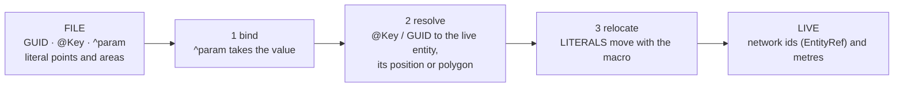

*Caption:* the order matters — a reference is resolved BEFORE the literals are relocated, so a point that came from a reference is never moved
(SR-131). That is the *"do not relocate this"* switch, with no flag. The FILE keeps the text form; only the live copy holds numbers.

**Why there are no network ids in a file.** A network id is allocated again on every load (SR-45, `DESIGN_Deterministic_Network_Ids.md` §11b), so a
number in a file would point at a different entity next time. ⇒ files carry GUIDs; `NetworkIdentity` is no longer saved (`NoScenario`); the six
translators that used to read it (`UnitSubordinate`, `TargetMemory`, `PassengerBuffer`, `PersonalRouteRef`, `IsEmbarkedTag`, `VisHierarchyNode`) now
build `EntityLink`s from GUIDs; a numeric link in a file is a load error; the content was migrated (S8 (B), S9′). The live form stays the network
id (orders, the wire, the debug API). The Watch window's pin was re-keyed on the GUID first (the S8 prerequisite).

```jsonc
// one value per form — simplified from scenarios/showcase-bridgehead and macros/control/counter-attack (the Params string is wrapped here for reading)
{ "RefKey": { "Value": "HoldCrossroads" },                                  // gives THIS entity the key @HoldCrossroads
  "Behavior": { "Name": "HoldArea", "Params": "{
      \"common\": { \"subject\": \"b41d6e00-0000-4000-8000-000000000001\",   // Exact — the Blue platoon's GUID
                    \"parent\":  \"@Bridgehead\" },                          // Key
      \"area\": { \"circle\": { \"center\": [198,182,0], \"radius\": 42 } }, // a literal area (moves with a macro)
      \"minMen\": 6, \"holdSeconds\": 600 }" } }

// inside a macro whose header declares a param "area":  \"area\": \"^area\"   // Param — fed by the instance's args
```

### 4.2 How it is authored

| gesture | writes | status |
|---|---|---|
| pick on the map in a reference field | Exact (the picked entity's GUID); inside a macro, Key | ✅ CE-4206, CE-4214 |
| give an entity a key | the `RefKey` component (a label is NOT a key) | ✅ component 468, saved |
| *Bind to parameter* on a reference field | `Form = Param`, `"^name"` | ✅ MA-2 (§5.2) |
| a missing, duplicate or mistyped reference | refused at load (missing) or a warning (duplicate) | ✅ SR-66, SR-188 |

### 4.3 How it is presented

The reference field shows its form (an Exact pick, a key, or the chip *bound to ^area*); a bound area that is a circle still acts and draws as a
circle. An ambiguous key logs *"@SL matches 3 entities; using Platoon A's"*. Objective rows name their subject and a click jumps to it (SR-56, §9).

---

## 5. Scenario macros — reusable parts of a scenario

> **Status:** ✅ built — the core (S3a: file, instance, params and bindings, expansion, relocation, placement, validator, reconcile, staging) and runtime
> (S3b: `InsertMacro`, run variants, skill amplifier, the director as a macro); ✅ editor authoring MA-1…MA-9 built; ⏳ MA-10 (preview of a runtime insert) waits for the `do`-list editor.
> Decisions: SR-27…SR-45, SR-57, SR-69/70, SR-94, SR-96, SR-99, SR-101, SR-144…SR-192, MA-1…MA-10, HV-1…HV-5 —
> [`DESIGN_Scenario_Macros.md`](DESIGN_Scenario_Macros.md) · [`DESIGN_Macro_Authoring_Editor.md`](DESIGN_Macro_Authoring_Editor.md) · [`DESIGN_Entity_Hierarchy_Views.md`](DESIGN_Entity_Hierarchy_Views.md).
> ⚠ Not verified end to end: a `do` step's own `bind` — the step is typed, but the authoring doc's own P4 note says a trigger's `do` list is not walked by the closure check.

A **macro** is a scenario-shaped file that a scenario, another macro or a running trigger inserts as ONE ordinary entity; wherever that entity is
created it expands into ordinary entities. A force, a unit, a prop, an evaluation, a director — one mechanism (SR-144: expansion is core
infrastructure, not part of the rules).

### 5.1 How it works

| piece | what it is |
|---|---|
| **the file** | `macros/<path>/scenario.json` — the SAME shape as a scenario (`$meta` · `header` · `entities`); the header says `Kind: "macro"`, declares `Params` `[{Name, TypeId, Default, Comment}]`, an `Anchor {Position, Heading}` (where it was built) and optional placement (`maxShift`, `relocatable`). A scenario with params IS a top-level macro (SR-41) |
| **the instance** | an ordinary entity, TKB 8813 `ScenarioMacro`: `MacroInstance {macro, args}` + a `SimTransform` (the anchor) + a replicated `MacroExpansionStatus` (Expanding · Done · Failed + reason). Moved, copied, deleted like any entity (SR-39a) |
| **the members** | ordinary TRANSIENT entities — own network id, authority and brain, never saved (`ScenarioIgnoreTag`), each stamped `MacroOrigin.Instance`. NOT sensor-style parts (SR-42′) |
| **params** | defaults in the header ▸ the instance's `args` (flat override, top-level keys only) |

**Where a binding lives** — three homes, one per kind of value, so no editor can drop it on save (SR-159…SR-163):

| value | home | written | example |
|---|---|---|---|
| a reference (entity, point, area) | inside the value | `"^area"` | `"area": "^area"` |
| a node of a predicate or a `do` entry | the node's own `Bind` map | `"Bind": {"Min": "minDelay"}` | a `ScenarioTime` leaf |
| a field of a params struct or component | the entity's `ParamBindings` component, path → param | `"Behavior.Params.when.fromSeconds": "delay"` | the director below |

One binder applies all three, after deserialising and only at expansion (SR-164); `ParamBindings` is an authoring instruction, never copied onto live
entities and never recorded (SR-165).

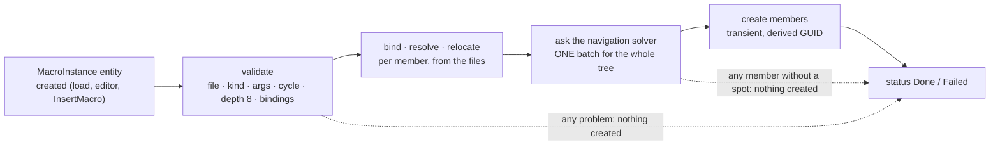

*Caption:* the expander is the creation path's child branch (the same road a TKB template's children take), so the load's existing readiness
checks wait for it by construction (SR-146, SR-147). Any node that may extract entities may expand; a node that only receives ghosts never does.

| topic | how it works | decisions |
|---|---|---|
| **relocation** | translate by the anchor difference, turn by the heading difference; the `Z` follows the anchors' height. Literal points, areas, rotations and bearings move; a reference does not. A macro that needs its exact place sets `relocatable: false` and is refused anywhere else | SR-127, SR-131, SR-152…SR-157 |
| **placement** | the creating node FLATTENS the whole tree from the files and sends ONE request to the navigation solver (it owns the navmesh). Each member gets the nearest spot that is **dry ground, outside building walls, not too steep, clear of other members and of existing entities** (within `maxShift`, default 30 m). **Whole or nothing:** one member without a spot ⇒ status `Failed`, naming it, and nothing is created. No solver in reach ⇒ a terrain-only check on the creating node, and the status says so | SR-180…SR-185, SR-190 |
| **nesting** | a member that is itself an instance is flattened into the same pass; transforms compose; depth ≤ 8; a cycle is refused | SR-155, SR-149 |
| **many instances** | each has its own GUID, so members never collide; duplicate `RefKey`s are allowed (first match, warning); `@PlatoonB/SL` names one exactly | SR-187, SR-188 |
| **edit / move** | reconcile by derived GUID: a kept member keeps its entity and id and gets values re-applied; new ones are created, vanished ones destroyed. References from outside survive | SR-150, SR-157 |
| **runtime insertion** | `InsertMacro` is a shared action (a trigger's `do`, a BTree, the instructor): it publishes ONE creation request at `at` + `heading`, args as the step's nested `params`, and stays `Running` until the instance's `MacroExpansionStatus` is Done or Failed — it never counts parts. The instance GUID derives from the inserter and the tick, so replay repeats it | SR-96, §16 of the macros design |
| **run variants** | the reserved arg `$variant` (one number, recorded with the run) drives `Presence: 0.6` on an entity or instance, `Macro: [a, b]` (one of N) and `Positions`; variant 0 = as authored. The roll is a hash of variant · instance GUID · entity key, so it does not depend on creation order. A live load with no `$variant` draws one (AQ108 D24, backend half) | SR-101, B2 |
| **the director as a macro** | no director entity (SR-99): `macros/control/counter-attack` is ONE trigger whose `delay` is bound to the macro's param by `ParamBindings`; two scenarios use it with 4 s and 9 s and it fired at 4.01 s and 9.02 s (measured live, `--mode all`) | SR-99, B3 |
| **staging** | the orchestrator copies the WHOLE `macros/` tree to every node as one package (we cannot know the dependency chain without expanding) | SR-80 |

### 5.2 How it is authored (in the editor)

| gesture | what it does | id | status |
|---|---|---|---|
| **File ▸ Load Scenario…** lists a *Macros* group; **Scenario ▸ New Macro…** | *Open macro* / *New macro* — the title reads *Macro: forces/RedQRF*; saving keeps the macro header (kind, params, anchor) | MA-6, MA-4 | ✅ |
| **Add Entity ▸ Macros** | place an instance at a click (TKB 8813 + `MacroInstance`); the edit world expands it at once | MA-7 | ✅ |
| the instance in **Details ▸ Macro tab** | expansion status, the macro (*Change…*), one typed row per declared param — default greyed until overridden, *reset*; a change writes a NEW immutable record and the members re-expand | MA-8 | ✅ |
| **⛓ on a field** (faint on every bindable row, solid chip when bound, red when it has a problem) ▸ *Bind to ▸ · New parameter… · Unbind* | feeds the field from a param; the drawer picks the home from the field (reference ⇒ `^name`; node ⇒ its `Bind`; anything else ⇒ `ParamBindings`) | MA-1, MA-2 | ✅ |
| **Scenario ▸ Parameters…** | declare, type, default, rename (follows every binding in all three homes, one undo step), remove (refused while bound) | MA-5 | ✅ (`.params.json` list not built) |
| **Scenario ▸ Save Selection as Macro…** | the selection becomes `macros/<path>`; a reference to an entity OUTSIDE it is listed and becomes a parameter (*Make parameters*) or the save is cancelled — a macro never keeps a dangling reference | MA-9 | ✅ |
| **Preview** on an `InsertMacro` step | a transient instance at the step's own anchor and args | MA-10 | ⏳ |

### 5.3 How it is presented

| what you see | where | id | status |
|---|---|---|---|
| a **marker** of its own (violet square frame with an M) on the map; pickable and draggable | map | SR-178, SR-70 | ✅ |
| **transient members dimmed** (fill at ≈ 55 % of the side colour, outline kept) so saved and live-only entities read apart; editor map only, a layer-panel toggle | map | SR-191 | ✅ |
| **thin violet lines** from the selected instance to its direct members; a failed expansion draws no lines and the reason over the marker | map | SR-192 | ✅ |
| the **entity tree's Scenario view**: members under their instance, two groups *Saved* / *Transient* — the ORBAT stays the command tree and refuses to drag a macro member under a commander | entity tree | HV-1…HV-5, SR-177 | ✅ |

---

## 6. Scoring and evaluation — who is doing how well

> **Status:** ✅ built — objectives, measures, composites and per-member evaluation (S1, S4 E-1…E-3 on `behaviors`, `DESIGN_Scenario_Rules.md` §00.8, §00.11);
> ✅ built — the pass mark (`Pass` on the status, `ObjectiveRules.PassOf`) and CE-2378 (*a required measure below its pass fails its composite*, lean accepted by the user `2026-11-03`);
> ✅ built — S4 ①–⑥ of `HANDOFF_Coordinator_To_Behaviors_Rules_S4_Scores.md`: role and standard means (`SelectionMean`), the score-history lane, the debrief's fields as reads; live gate passed on IG and SimHost (§00.11 *LIVE GATE*).
> Decisions: SR-19, SR-72, SR-72a, SR-75, SR-78, SR-81, SR-82, SR-83, SR-117, SR-118, SR-122, E-1…E-5.

### 6.1 How it works

| kind | does | ends? | examples |
|---|---|---|---|
| **objective** | a state machine over a goal | yes — Achieved / Failed | `ReachArea`, `HoldArea`, `ClearAreaObjective`, `DestroyTargets`, `Protect`, `NoHarm` |
| **measure** | a number against a target; `Score = clamp(Value / Target)`, inverted for *lower is better* | never — it scores | `HitRatio` · `Count` (shots, hits, kills, fratricide, civilians harmed, reports; for games also assists, team kills, deaths, captures, streak, best streak, bounty kills — §7) · `ReportLatency` · `TimeTo` · `Sample` (any registered utility input) |
| **composite** | its `Score` is computed from its CHILDREN | when its children are final | `WeightedMean` (pass mark 0.6) · `AllMustPass` · `Points` (Σ child `Value × points`, a game score — §7) |
| **award** | `Best`: among a group's measures of one title, the best `Value`; at the close Achieved with `Subject` = the winner | yes | *Top scorer*, *Most kills* (§7) |
| **`MemberEvaluation`** | an objective kind placed on a commander: for each member of his roster (or, `members: side`, every man of his side as he appears — respawns included) it inserts the evaluation macro that fits that man; `aggregate: mean` (training) or `points` (a team total) | — | §6.3, §7 |

Common to all: the `common` block (`title`, `subject`, `parent`, `required`, `scored`, `weight`, `points`, `deadlineSeconds`, `startActive`, `group`).
`Subject` = *whose* it is, `Parent` = *what it rolls up into* — two links, one tree (SR-47, SR-53). No evidence is never a pass: a measure with no
shots or no reports scores 0. ✅ **Pass mark:** a status carries `Pass`, so *GO / NO-GO = `Score ≥ Pass`* is a read, never a frontend rule; and a REQUIRED measure the exercise closed below its `Pass` fails its composite (CE-2378) — the measure itself stays a measure.

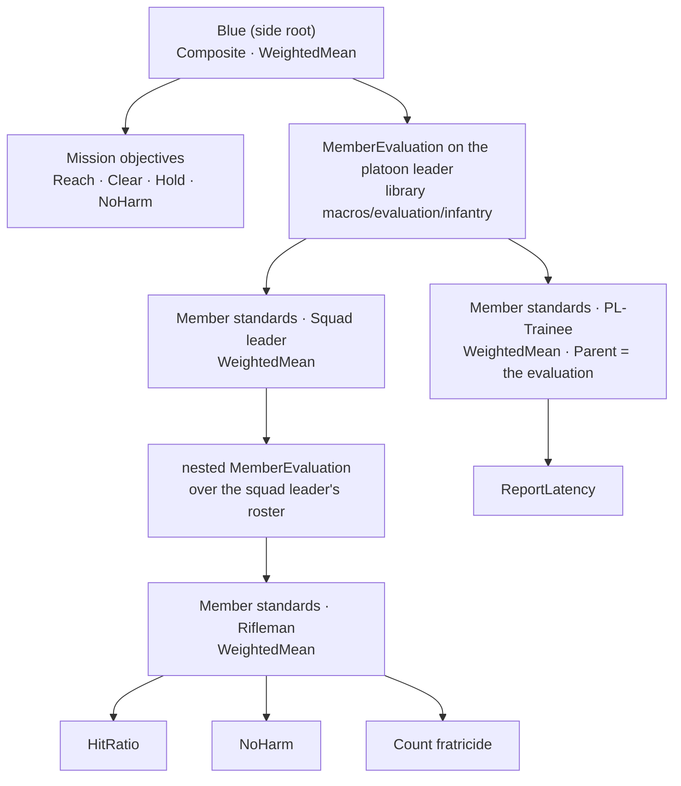

*Caption:* the roll-up up the command chain exists BY CONSTRUCTION — each man's *Member standards* root is a composite whose `Parent` is his
commander's evaluation, so squad and platoon scores are just the composites above him. Nothing aggregates twice (E-3).

| where | what |
|---|---|
| **computed** | on the **Brain node**, in the ordinary brain tick (only while simulation time advances); each kind is a small behaviour over ONE shared rule set (`ObjectiveRules`), so no kind can decide *achieved* differently |
| **stored** | as entities: `ObjectiveStatus` (state, progress, value / target, `Score`, points, reason, group, timing …) + `ObjectiveLinks {Subject, Parent}` — **replicated to every node** (topic 171), **recorded**, **never saved into the scenario** (`NoScenario`) |
| **history** | no new store: the recording holds every status over time; live, a frontend keeps its own small ring of the `Score`s it receives (E-4); replay does not tick brains, the recorded statuses are re-published |
| **the roll-up** | the tree by `Parent`; per-side headline = the root composites by their subject's side; at the end `ExerciseResult` carries per side `{Outcome, Points, Score}` (§8). A grade (A–F, %) is NOT computed by the engine — a frontend derives it (R-4105) |
| **attribution** | every damage names its source; a re-thrown grenade carries both `Source` (last thrower) and `OriginalSource`; a measure chooses `attribute: last \| original \| both` (default `last`) — SR-82, CE-4155 ✅ |

### 6.2 Means by role and by standard, and the score history *(✅ built, S4)*

| item | how it works | |
|---|---|---|
| **role / standard means** | kind **`SelectionMean`** `{ by: role \| standard, key, scope }` — a mean over a SELECTION of statuses, not over children: an objective has ONE `Parent` and a man's standards already belong to his commander's evaluation, so a second parent would count him twice. `by: role` = the men's roots under `scope` whose role is `key` (*All riflemen*); `by: standard` = every member's standard titled `key` (*Hit ratio* across the squad, its own men only). A casualty is remembered and keeps his result. `MemberEvaluation` inserts them (unscored) for `aggregate: mean` | `SelectionMeanBehavior.cs`, §00.11 |
| **score-history lane** | an indexed timeline lane of `Score` changes beside the rules lanes (RV-4) — the trend, *went well / work on*, the best moment | `ScenarioRulesTimelineLanes` |
| **the debrief's data** | every field PH-6 shows is a read of the tree (`Pass`, the means, the lane) | handoff item ⑤ |

### 6.3 How it is authored

| step | how |
|---|---|
| place the objectives | ordinary entities (an `Objective` TKB 8860 with a behaviour = the kind, its params through the existing params form — SR-10, SR-33), usually inside a macro. ⚠ SR-10's editor path is a lean; the shipped showcase scenarios are produced by generator scripts (`scripts/gen-showcase-*.py`), and §00.6 lists CE-4152 / CE-4154 as prerequisites for authoring objectives in the editor |
| per-member standards | place ONE `MemberEvaluation` on a commander with `library: "macros/evaluation/infantry"`. For each man it inserts the first file the node's macro library HAS, in this order: **his `RefKey`** (`@PL-Trainee`) → **his role** (`TacticalDesignation`: `SquadLeader`, `MachineGunner` …) → **his class** → **`Default`**. `overrides` maps a key or role to another macro. A reinforcement gets one; a casualty's instance stays and keeps its result |
| the library | a folder of macros — `macros/evaluation/infantry/Default` (root *Member standards* + `NoHarm` + `HitRatio` + `Count fratricide` + `ReportLatency`) and `SquadLeader` (the same plus a nested `MemberEvaluation` and a reports count). Swapping `library` swaps the whole set (`infantry-recruit` vs `infantry-veteran`); thresholds are macro params, overridden nearest-wins (SR-67) |
| weights | `weight` per child, and the aggregator is the composite's BEHAVIOUR (SR-78), so a custom one is a C# or Blueprint behaviour — no registry |
| external measurements | a device topic is RESERVED in the architecture, deliberately not in the demo (SR-76) |

### 6.4 How it is presented

| where | what | status |
|---|---|---|
| `GET /objectives` (`?tree=1`) | every status, the tree by `Parent`, trigger rows with their state, timing, links and live leaves | ✅ any node |
| the instructor's **mission summary** — scores by command chain / objective / role, trend, *why this score* | the data is all built (the tree, `Pass`, the §6.2 means and lane); the screen is ui's RV-8 (approved) | ⏳ (§9) |
| the rules view's **Results** tab (the composite tree, per member and role) | SR-109, RE-6 (approved) | ⏳ (§9) |
| the trainee's own standards on the HUD and in the debrief — GO / NO-GO is now a read (`Score ≥ Pass`) | SR-83, PH-3, PH-6 (approved) | ⏳ (§9) |

---

## 7. The game profile — tickets, capture points, respawn waves

> **Status:** ✅ built as v1 (S6, `DESIGN_Scenario_Rules.md` §00.12; `scenarios/showcase-crossfire`, measured live over two 900 s rounds) · ✅ the per-player
> score, awards, streaks and the bounty (S7, §00.13, `backend`; Crossfire round 4 measured) — ✅ P-1…P-9 approved by the user `2026-11-03`. Decisions: G-1…G-7 (✅ approved by the user `2026-11-03`), SR-84, SR-112, P-1…P-9, G-9 (✅ approved `2026-11-03`).

A game is the SAME machinery (§1–§3) with a few small additions — no ticket system, no game-mode code (R-4112):

| piece | how it works | id |
|---|---|---|
| **capture point** | a `HoldArea` with `capture` + `captureSeconds`: counts men by SIDE; the side with MORE men inside than every other, continuously for `captureSeconds`, becomes `Owner`; when another side outnumbers it the point is lost. `ProgressCur` = seconds of advantage | G-1 |
| **`Counter`** (tickets) | a measure whose `Value` starts at `start`; `deaths: [{side, per}]` adds `per` for every man of that side newly OUT of the fight (a revived man is not refunded); `floor` / `ceiling` clamp; `Target = start`, so score = tickets left / start | G-2 |
| **`AddToCounter(target, amount)`** | a shared action — the crate's +15, a drain's −1, an operator's hand edit | G-3 |
| **`whileTrue` repeats** | a repeating trigger whose condition is STILL true when its cooldown ends fires again (normally a repeat waits for the condition to drop first). *"Each held point drains 1 ticket / 10 s"* = `when A.Owner = Friend`, `repeat`, `cooldown 10`, `whileTrue` → `AddToCounter(@RedTickets, −1)` | G-4 |
| **bot respawn waves** as data | a trigger `when` fewer than N of the side's men are up, `whileTrue`, `cooldown` = the wave interval → `InsertMacro(game/bot, @<side>Base)` | G-5 |
| **domination end** | a trigger: all three points' `Owner` = the side, `holdFor 60` → `EndExercise` | G-6 |
| **comeback** | a third `Counter`, `Lead` (both sides' drains and deaths with opposite signs); triggers on `Lead ≥ 40` / `≤ −40`, `holdFor 30`, `cooldown 120` → `SetSkillAmplifier` for the losing side | G-7 |
| **supply crates** | four timed triggers insert `game/supply-crate` at a variant-chosen spot (`Positions`); ⏳ the crate's hold-for-tickets objective | §2.8 SHOWCASE |

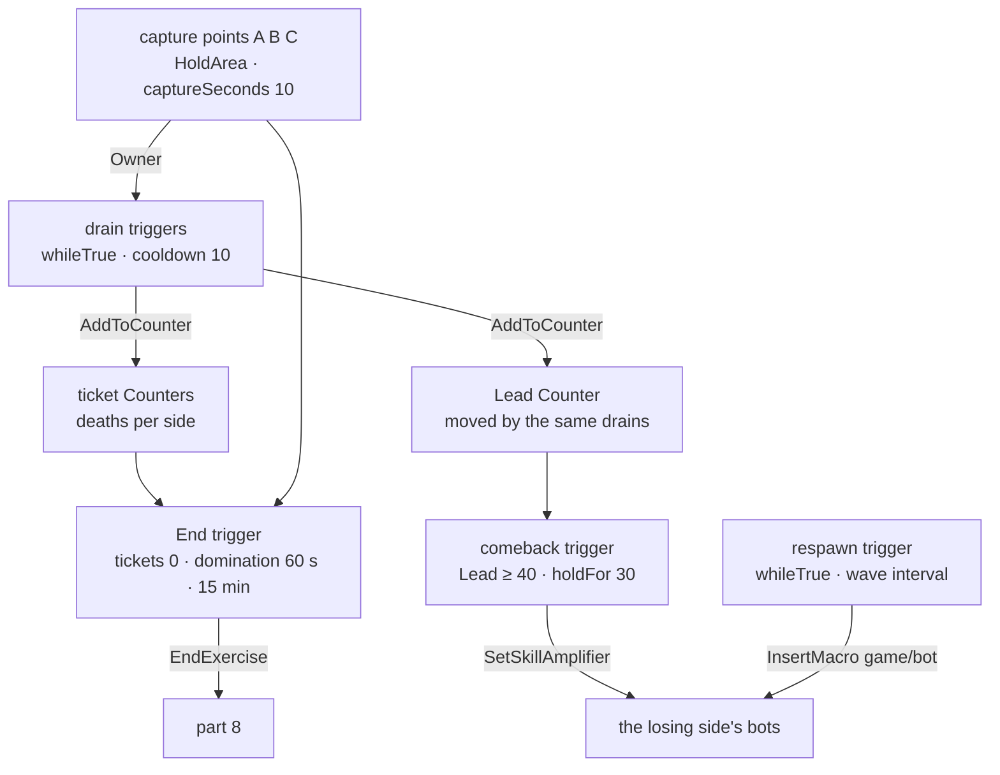

*Caption:* every arrow is a trigger reading a status or a shared action — ticket drain, comeback and end are DATA in the scenario, which is why a
second game needs only a different file.

**Authored:** as entities (objectives, counters, triggers) usually produced by a generator or macros — the Crossfire file comes from
`scripts/gen-showcase-crossfire.py`; no game-specific editor exists. **Presented:** the statuses are on every node (`GET /objectives`); the scores, awards and streaks too (§7.1); the game HUD, kill feed and
round summary are designed and approved (§9), not yet built. **Measured live:** Red took point C at ~220 s; Blue's tickets 150 → 74; the comeback raised Blue once; four crates at 180 / 360 / 540 / 720 s.

### 7.1 The per-player score *(✅ built, S7 — `DESIGN_Scenario_Rules.md` §00.13; P-1…P-9 approved)*

⭐ **The score is not a system — it is a MACRO per man** of ordinary measures under one summing composite, so it lives where every other score lives:
computed on the **Brain** node, on the status wire (`dtObjectiveStatus`), recorded, never saved into the scenario.

| piece | how it works | P- |
|---|---|---|
| **the score macro** | `macros/game/score/Default`: a root **`Points`** titled *Score* over `Count` measures of the man — kills ×100 · assists ×50 · captures ×150 · team kills ×−200; deaths and a hit ratio shown but unscored. Another table is another macro (`game/score-hardcore`), no code | P-1, P-2 |
| **who gets one** | a `MemberEvaluation` per team with `members: side` (every man of the side as he appears — a respawned bot is a new man) and `aggregate: points` (the team total = Σ its men's *Score*) | P-5, P-6 |
| **the inputs** | four new `Count` readings — **assists** (he harmed a hostile who went down within `assistSeconds`, default 10 s, while another man got the kill) · **team kills** (never a kill) · **deaths** · **captures** (a capture point publishes `ObjectiveCapturedEvent` naming the men inside) — all through the ONE evidence reader, and a kill is credited once from `ManDownedEvent` (CE-3364) with CE-4155's attribution (a rethrown grenade blames the rethrower) | P-3, P-4 |
| **awards** | kind **`Best`** in an instanced macro `macros/game/awards`: *Top scorer* · *Most kills* · *Point keeper* · *Sharpshooter* (≥ 0.4) · *Untouchable*; live it shows the leader, at the close Achieved with `Subject` = the winner | P-7 |
| **streaks and the bounty** | `Count streak` / `bestStreak` / `bountyKills` per man; a `Bounty` on a man with a streak of 5 stands while it lasts, a *Bounty announced* message names him (`{subject}`), killing him is worth 300; awards *Bounty hunter*, *Longest streak* | P-8 |
| **what the screens read** | already the wire: a *+100* pop-up = a child measure's `Value` rising × its `points`; the scoreboard = the men's *Score* roots; the best moment = the largest rise in the recording (the score-history lane, §6.2) | P-9 |

**Measured live** (Crossfire round 4): 10 credited downings for 11 men downed — kills reconcile after CE-3364; streaks live (best 3); no bounty arose, so the
bounty is proven by rails only (`ScenarioRulesTests.Score`). ⚠ v1 scores a PERSON ENTITY; a human player's score across lives waits for Player Join's respawn.

---

## 8. Messages and the end of the exercise

> **Status:** ✅ built (S2, `DESIGN_Scenario_Rules.md` §00.9) — `PlayerMessage`, `EndExercise`, `ExerciseResult`, pause-on-end; the player's subtitle and log (`hud.messages`) ✅ built by the ui lane
> (`DESIGN_Node_Features.md` §10, CE-1461). ⏳ the instructor's *what went to whom* and the End button. Decisions: SR-106, SR-9, SR-116…SR-118, SR-122.

### 8.1 How it works

**A message** — the `Message` action publishes a `PlayerMessageEvent {MessageId, OriginNodeId, ToKind, ToValue, Text, Seconds = 6, Priority, SentAt}`; the
event crosses the wire (topic 173) to every node. `ToKind` is `All`, `Side`, `Station`, `Unit` or `Instructor`. A text longer than 127 characters or an
unknown `toKind` is refused when the trigger is assigned, not when it fires.

**The end** — `EndExercise` takes several ticks on purpose:

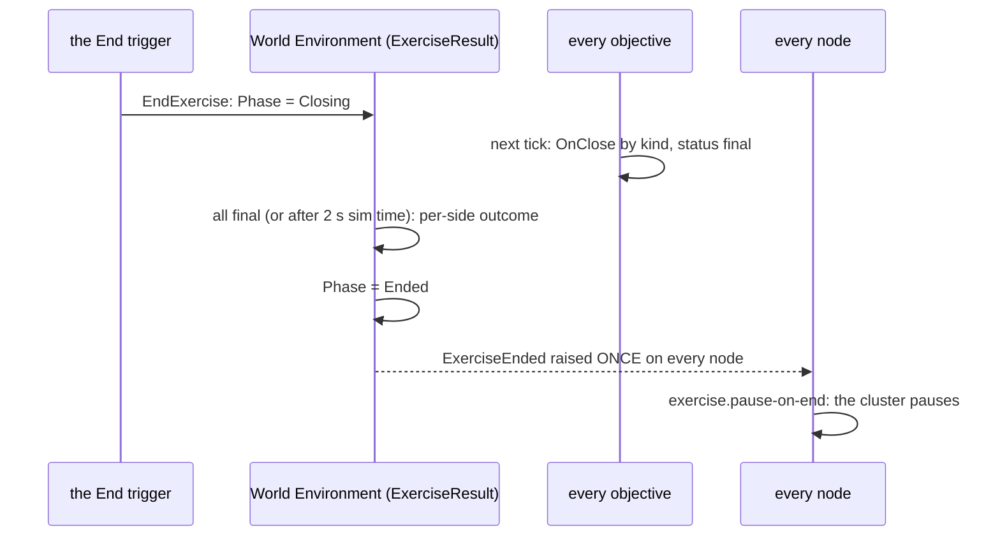

| OnClose rule (SR-117) | |
|---|---|
| `Protect`, `NoHarm` | judged at the end — Achieved if within limits, else Failed |
| any other Active objective | Failed, *"not achieved by the end"* |
| Pending / Inactive | `Skipped` — excluded from aggregation unless `required` (then it counts as failed) |
| measures | freeze their value |
| a capture point | freezes its `Owner` |

`ExerciseResult` (on the World Environment, replicated, recorded) holds `Phase`, `EndedAt`, `Reason` and per side `{Outcome Win / Lose / None, Points, Score}`:
**Win** when every REQUIRED root objective is Achieved. A trigger that is still running its action list finishes it before it closes.
📌 Measured live (`sr-triggers-march`): the End fired at 108.5 s, every status closed by 108.7 s, *Friend Win 0.75*, and the cluster stayed paused at 108.86 s.

### 8.2 How it is authored

| what | how |
|---|---|
| a message | a `do` step `{"act": "Message", "args": {"toKind": "All", "text": "Seize the crossroads …", "seconds": 12}}` — on a time trigger it is a timed briefing; on a status it is a prompt (*"Phase line RED — assault the crossroads"*) |
| the end | one trigger: `when` all required objectives settled OR the time limit → `EndExercise {reason}`; usually part of the evaluation or director macro |
| instructor's *End* button | designed: fires the evaluation macro's `instructor-end` trigger so it takes the same path (SR-116) — ⏳ |

### 8.3 How it is presented

| who | what | status |
|---|---|---|
| the **player** | a time-limited **subtitle** bottom-centre (up to two, higher priority first, fading over the last 0.5 s), and a **message log** on key **N** (newest first, 100 kept). A message is shown only if it is addressed to the possessed unit, its side or its station (the filter is applied when drawn, so switching units re-addresses the log). Feature `hud.messages` | ✅ |
| the **instructor** | *what went to whom* in the rules view; the end in the mission summary and on the AAR timeline | ⏳ (§9) |
| everyone | the pause at the end; the result on `ExerciseResult` | ✅ |

---

## 9. What people see — the views

> **Status per row below.** The DATA for every view is built and replicated to every node; most of the SCREENS are designed. Nothing here computes a score — every
> view only reads the statuses (R-4105). Mockups: [`designs/rules-view/`](designs/rules-view/README.md) (open the HTML in a browser; mockups, not specs — the design rows win).

```mermaid
graph LR
    ST["statuses on every node<br/>ObjectiveStatus 171 · ExerciseResult 172 · PlayerMessage 173 · RuleLeaves 174"]
    REC["the recording"]
    RULES["rules view<br/>mission summary"]
    HUD["training HUD · game HUD<br/>kill feed"]
    DEB["debrief · round summary"]
    GM["game-master controls<br/>fire · disarm · add · order"]
    ST --> RULES
    ST --> HUD
    ST --> DEB
    REC --> RULES
    REC --> DEB
    GM -- "attribute write to the owner" --> ST
```

*Caption:* ONE source feeds every screen — live from the nodes, afterwards from the recording — so the instructor and the player can never see two
different numbers. The designed `RulesReader` is the single reading layer all of them share (PH-1).

### 9.1 The instructor

| screen | what it shows | status | mockup |
|---|---|---|---|
| **statuses over HTTP** | `GET /objectives` (tree, trigger state, timing, links, leaves) | ✅ | — |
| **rules view** — objectives and triggers on a sim-time Gantt with a NOW line: past at actual times, future as dashed *expected* bars after what they wait for, connectors from each trigger's `when` / `do`, a *Coming up* strip; trigger tabs *When · Do · Rules · History*, objective tabs *Status · Settings · Results · History*; live edits last for THIS run only | the data: links, timing, expected time, live leaf values (feature `ui.rules-live-values`), runtime control ✅ (V-1…V-4). The shared timeline panel's extensions (item styles, tree rows, extent without a recording) ✅ built (R1). The window, the rules lanes provider, connectors, *Coming up* | ⏳ RV-1…RV-9 ✅ approved, being built (ui) | [`Main`](designs/rules-view/mockup/Main.html) · [`TriggerDetails`](designs/rules-view/mockup/TriggerDetails.html) · [`ObjectiveDetails`](designs/rules-view/mockup/ObjectiveDetails.html) · [`EditAtRuntime`](designs/rules-view/mockup/EditAtRuntime.html) |
| **mission summary** — read-only: headline score with trend and pass mark per side, required objectives n / N, forces, items needing attention, one table of scores by command chain (platoon ▸ squad ▸ person), by objective or by role, each row explaining *why*; opens on a recording too | RV-8 ✅ approved: the first half (counts, forces, result); the scores by level read §6.2's means ✅ | ⏳ | [`MissionSummary`](designs/rules-view/mockup/MissionSummary.html) |
| **entity tree** — one panel, three relations | **Command** (the ORBAT) · **Structure** (parts, riders) · **Scenario** (members under their macro, *Saved* / *Transient*) | ✅ HV-1…HV-5 | — |
| **macro surfaces** — marker, dimmed members, member lines, Macro tab | §5.3 | ✅ | — |
| **game-master runtime controls** — add an entity, order, the Brain tab, time control; *Add ▸ Macros* | exist ✅ (SR-104). Fire / disarm / re-arm / reset / activate any rule: the data path exists (`RuleControl` written to the owner, journaled with its origin; `POST /objectives/{id}/control`) ✅, the buttons ⏳ RV-5 (approved). An action palette (run any shared action by hand), a per-side skill slider, the MSEL panel | ✅ / ⚠ / ⏳ | [`EditAtRuntime`](designs/rules-view/mockup/EditAtRuntime.html) |

### 9.1a The rule editor — the trigger and objective tabs *(✅ RE-1…RE-10 approved with four amendments, `DESIGN_Rules_View_UI.md` §7; ⏳ being built on `ui`)*

⭐ **No new form:** a rule is an ordinary entity whose behaviour params ARE the rule, so the editor is the ONE params form split into tabs.

| tab (trigger · objective) | what you do there | built from |
|---|---|---|
| header on every tab | title, required, scored, points, group, visible to (`common`) | the params form |
| **When** (trigger) | build the condition: the replay search's predicate builder, made a standard leaf every host shares; *on entity* / *at scenario time* pick refs on the map. Live: ✓ / ✗ and the measured value beside each leaf (`RuleLeaves`) | the Replay Browser's builder, moved |
| **Do** (trigger) | the step list: *+ Add step* opens the one generic picker over the action catalogue (a refused action shown disabled), each step's args inline; drag to reorder. Live: the running step marked, *step 2 / 3* (✅ `StepCur` / `StepCount`) | a new standard list leaf |
| **Rules · Settings** | hold / delay / cooldown / repeat / max fires / while true; the objective kind's fields (area, men, seconds) | the same document |
| **History · Results · Status** | the rule's journal (instructor edits included, each a seek) · its children and *why this score* · the overview | Brain tab, RV-8 |

| how edits apply | |
|---|---|
| **Apply / Revert**, never per keystroke | edit mode: written to the scenario entity and saved; **live**: lasts THIS run only, through ✅ `RuleEdit` (433) — the rule keeps its state (armed, fire count), or the edit is refused with a reason |
| **+ Add** | a menu of rule kinds; creates the rule entity through the one entity-creation path; edit mode only — a live insert is a macro insertion (`InsertMacro`) |
| **drag to connect** | drop a row on a trigger: ANDs *that row is Achieved* (objective / measure) or *has Fired* (trigger) into its When |
| **a rule made by a macro** | read-only, *"from macro X — edit the macro or its args"*, with a jump to the instance (SR-43) |

### 9.2 The player

| screen | what it shows | status | mockup |
|---|---|---|---|
| **possession HUD** | hit marker, damage arc, kill cam, squad takeover, spread ring, near-miss shock; the message subtitle and log | ✅ (§10) | — |
| **training HUD** — *my mission objectives* with progress or time left; *my standards* (value vs target coloured by score); an optional live coaching hint (*"you are in the open"*, off by default) | ⏳ PH-3 approved; GO / NO-GO is a read of `Pass` ✅ (coaching also waits for the live-leaf signal) | ⏳ | [`HudTraining`](designs/rules-view/mockup/HudTraining.html) |
| **game HUD** — a top bar of tickets, capture points A B C and the round timer; a *Capturing B · 60 %* strip; **kill feed** (*killer → victim · distance*, the rethrower named) | ⏳ PH-4, PH-5 approved — all readable from existing statuses and `ManDownedEvent` | ⏳ | [`HudGame`](designs/rules-view/mockup/HudGame.html) |
| **trainee debrief** — GO / NO-GO per standard (a card with value, standard line, the squad's average), own score vs squad and platoon, *went well / work on*; available the moment the run ends and on any recording | ⏳ PH-6 approved; *replay from my eyes* and progress across runs later | ⏳ | [`TraineeDebrief`](designs/rules-view/mockup/TraineeDebrief.html) |
| **round summary** (game) — winner, scoreboard, awards, *your best moment* | ⏳ PH-7 approved — its data is built (§7.1: scores, awards, streaks, bounty); the screen is not | ⏳ | [`GameSummary`](designs/rules-view/mockup/GameSummary.html) |

Designs: [`DESIGN_Rules_View_UI.md`](DESIGN_Rules_View_UI.md) (the instructor) · [`DESIGN_Player_HUD_And_Debrief.md`](DESIGN_Player_HUD_And_Debrief.md) (the player) — ✅
**approved by the user `2026-11-03`** (RV-1…RV-9, RE-1…RE-10 with four amendments, PH-1…PH-7, PH-8 amended — §10); the decisions behind the screens SR-105, SR-107, SR-109…SR-112 stand.

---

## 10. Switching it per node — Node Features

> **Status:** ✅ built — the mechanism (S1), the first features and the HUD features (S2, S2b); ⏳ the operator's `FeatureGridPanel`; ⏳ the profile features of §9 are designed and approved (PH-8 amended).
> Decisions: F-1…F-26, R-4108, SR-112, SR-145. [`DESIGN_Node_Features.md`](DESIGN_Node_Features.md).

### 10.1 How it works

A **feature** is a named behaviour an operator wants on or off INDEPENDENTLY (`hud.kill-cam`), with a small JSON config whose minimum is `Enabled`
(`hud.kill-cam` could add `Seconds`). Every presented element of §9 is meant to be one.

| layer (later wins) | set by |
|---|---|
| type default | the feature's own config initialisers |
| role default | the node's role (the Player has `hud.kill-cam` on, the editor off) |
| node override | `--feature id=on\|off` or `id={json}`, repeatable |
| cluster override | the run settings (`POST /run-settings` `featureOverrides: [{feature, nodes, json}]`); the master refuses a node that does not advertise the feature |

* **Live or at-load:** a *Live* feature changes at once (a HUD element); an *AtLoad* one is frozen by the master's load payload and changes at the next load
  — anything that alters the outcome of the run.
* **The gate:** `[NodeFeature("id")]` on a system makes the scheduler skip it while off; inside a system, `NodeFeatures.On(id)` gates one element of several.
* **Recorded:** the effective configs are written to `RecordingMetadata.FeatureConfigsAtLoad`; a replay needs nothing, a branch to live re-applies them.
* **What is NOT a feature:** objectives and triggers are scenario CONTENT (SR-145, F-20) and macro expansion is core (SR-144, F-19) — present in the file ⇒ they work.

| feature | what | change | default |
|---|---|---|---|
| `map3d.in-load` | build the 3-D map during the load | AtLoad | on for the Player, off elsewhere |
| `hud.hit-marker` · `hud.damage-arc` · `hud.kill-cam` · `hud.squad-takeover-after-death` | the possession HUD elements | Live | on for the Player, off elsewhere |
| `hud.spread-ring` · `hud.near-miss` | spread ring, near-miss shock | Live | on everywhere |
| `hud.messages` | the subtitle + log of §8 | Live | on everywhere (the editor never draws it) |
| `exercise.pause-on-end` | pause the cluster when the exercise ends (§8) | Live | on for every role |
| `ui.rules-live-values` | the owner publishes each trigger's live leaf values at ≤ 2 Hz for the rules view | Live | off — switched on on demand |
| ⏳ designed and approved, not declared in code | `hud.objectives` · `hud.own-evaluation` · `hud.coaching` (training) · `game.tickets` · `game.capture-points` · `game.round-timer` · `hud.kill-feed` · `hud.score-popups` (game) | Live | ✅ PH-8 amended (R-4115): ON by default where installed; a scenario's feature preset switches the OTHER profile's elements off — a training scenario turns `game.*` off, a game scenario the training elements; `hud.messages` stays on everywhere |

### 10.2 How it is authored and presented

| | how | status |
|---|---|---|
| authored | per node on the command line; per run in the run settings (HTTP today); a *profile* = a feature set that a scenario or the run setup selects (SR-112) | ✅ CLI + run settings · ⚠ the scenario-selects-a-profile path is unmeasured (PH claim table) |
| presented | `GET /features` — per node, each feature's effective config and the layer it came from (`type default · role default · node · cluster · recording`); heartbeat `FeaturesOn` / `FeatureErrors` to the master | ✅ |
| presented | the `FeatureGridPanel` — nodes × features (not available / on / off), toggled through the run settings | ⏳ |
