<!--STATUS
state: LIVE
updated: 2026-11-01 (parts 1–2, diagrams added — coordinator)
current-answer: the whole file — an EXPLAINER of the design, not the design itself
stale-below: nothing
known-rot: none — ⚠ describes the DESIGN (nothing here is built yet); the decisions and their ids live in DESIGN_Scenario_Rules.md
known-conflict: none
related-designs:
  - docs/DESIGN_Scenario_Rules.md — OWNS every decision explained here (SR-…, T1–T10); this file only explains them with examples
  - docs/DESIGN_Scenario_Entity_Keys.md — the stable entity GUIDs references rest on
  - docs/OVERVIEW_Behaviour_Building_Blocks.md — the behaviours, orders and command chain objectives and triggers use
-->

# EXPLAINER — **scenario evaluation and direction** *(objectives, triggers, …)*

> For a reader who wants to understand HOW it works, with examples. The decisions and their reasons are in
> [`DESIGN_Scenario_Rules.md`](DESIGN_Scenario_Rules.md); ⚠ none of this is built yet.

**The three roles, in one line each:**

| | does | example |
|---|---|---|
| **objective** | OBSERVES and REPORTS — *did it succeed, how well* | *"Hold the bridge for 10 minutes"* |
| **trigger** | REACTS — *when something happens, do something* | *"when the bridge is held, send the counter-attack"* |
| **mission plan** | DIRECTS one unit — *its ordered task list* | *"drive to the bridge, then hold it"* |

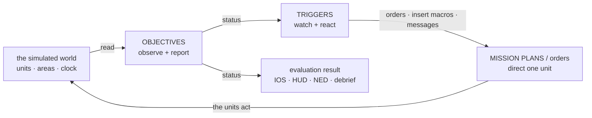

*Caption:* the loop — objectives READ the world and publish statuses; triggers READ statuses and ACT through orders and macros; units carry
the orders out and change the world, which the objectives read again.

---

## 1. The objective

### 1.1 What it is

An ordinary **entity** (usually created by a scenario macro) with four parts:

| part | in the example *"Hold the bridge"* |
|---|---|
| label + position | `EntityInfo` (title *"Hold the bridge"*, side Blue) · `SimTransform` at the bridge — only for drawing it on the map |
| its LINKS (`ObjectiveLinks`) | `Subject` = **Blue Platoon** (*whose* objective it is) · `Parent` = **Blue mission** (the objective it rolls up into) |
| its TASK slot = the evaluating behaviour | `HoldArea` with params `{area: "@Bridge", minUnits: 4, maxEnemy: 0, holdSeconds: 600, common: {deadline: "10:30", points: 100, weight: 40}}` |
| its RESULT (`ObjectiveStatus`, replicated to every node) | state · progress · value / target · score · points · when · reason |


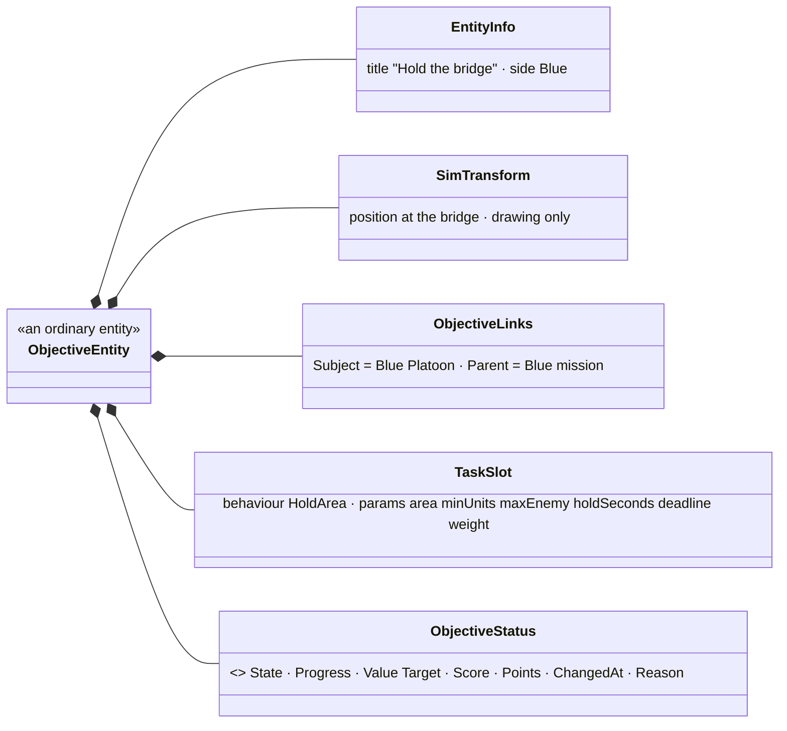

It runs on the **Brain node** (which owns it), in the normal brain tick — only while simulation time advances.

### 1.2 Where its data comes from — it only READS the world, through references

| it needs | from |
|---|---|
| the area polygon | `@Bridge` — the `RefKey` of an area entity → its `EditablePolyline` |
| *our* units | `Subject` = Blue Platoon → its members down the command chain (`UnitSubordinate`) |
| who is inside | each member's `SimTransform` tested against the polygon (the existing area test) |
| enemies inside | entities in the polygon whose side (`ForceId`) is Hostile |
| time | `ScenarioClock` — the deadline and the hold timer |

### 1.3 What its behaviour does each tick (`HoldArea`, a small state machine)

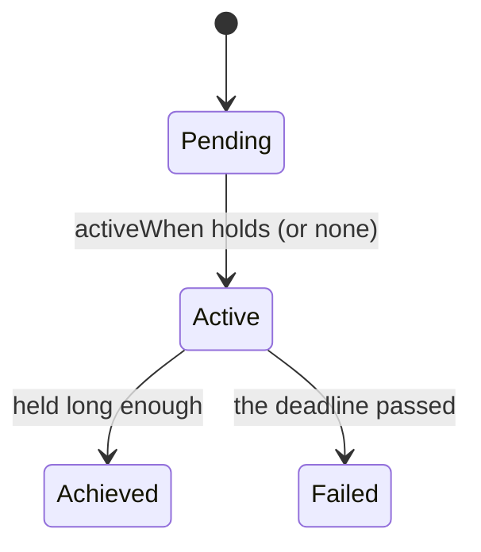


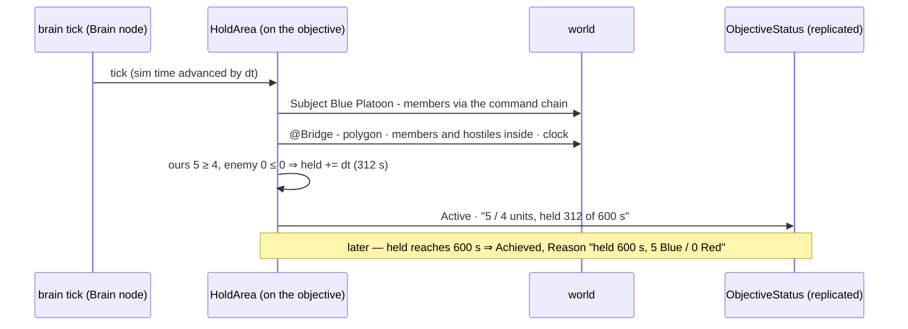

```
Active, every tick:
    ours   = members of Subject inside the area, alive
    enemy  = hostile units inside the area
    if ours >= 4 and enemy <= 0:  held += dt   else: held = 0        (held lives in its working state)
    status.Progress = "5 / 4 units, held 312 of 600 s"
    held >= 600          -> Achieved   (Reason "held 600 s, 5 Blue / 0 Red")
    clock > deadline     -> Failed     (Reason "deadline 10:30 passed, held only 140 s")
```

⭐ It **never changes the world** — it only writes its own status; every state change is journaled (so the debrief can say why).

### 1.4 How others use it — nobody calls it, everyone READS its status

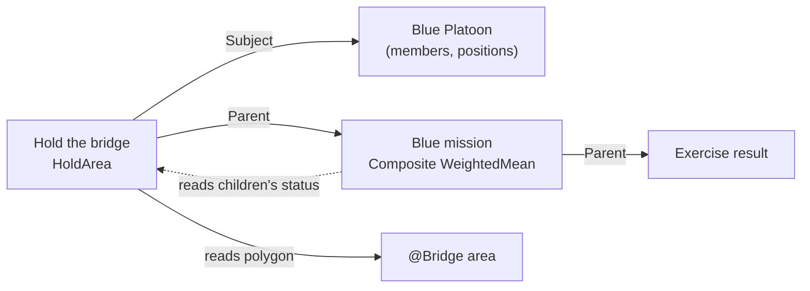

*Caption:* the solid arrows are LINKS the objective holds; the dotted arrow is the parent READING the child's status. A trigger, the
instructor station, the trainee's HUD and any NED frontend read the same replicated status.

- **The parent** *"Blue mission"* (a `Composite`, behaviour `WeightedMean`) finds its children by asking *"which objectives have `Parent` = me?"*,
  reads their statuses (*Hold the bridge* Achieved = 1.0 × weight 40, …) and writes its own score.
- ⭐ **In one sentence:** an objective is a small brain that OBSERVES (its subject, its areas, the clock) and REPORTS (its own status).
  Steering belongs to triggers and mission plans.

---

## 2. The trigger

### 2.1 What it is

Also an ordinary **entity** — a SUB-entity of what it concerns (`Subject`; shown nested under it) — with its own brain running the `Trigger`
behaviour in ITS task slot (⛔ never on the unit it steers: that unit's task slot belongs to its mission plan or orders).

| part | in the example *"Counter-attack"* |
|---|---|
| label | *"Counter-attack when the bridge is held"* |
| `Subject` | **Red HQ** (whose reaction it is) — or the World Environment entity for a scenario-wide trigger |
| its TASK slot = the `Trigger` behaviour with params | `when`: the status of `@HoldTheBridge` becomes **Active** · `delay`: 120 s · `once` · `do`: ① `InsertMacro(forces/RedQRF at @VillageEdge)` ② `Order(@RedQRF, Attack, area @Bridge)` ③ `Message(IOS, "Red counter-attack launched")` |
| its RESULT (`ObjectiveStatus`, not scored) | state · `FireCount` · `LastFired` · reason |

### 2.2 Where its data comes from

| it needs | from |
|---|---|
| its CONDITION | ⭐ written in the SAME JSON condition language data breakpoints and the Blueprint `When` node use (SR-95) — here *"`OnEntity @HoldTheBridge`: `ObjectiveStatus.State` equals Active"*; it reads the replicated `ObjectiveStatus` of the objective it watches (`@HoldTheBridge`) — ⭐ conditions ARE objective statuses; a condition you do not want scored is an objective with `scored: false` (e.g. *"Red reaches the ridge"* = a `ReachArea` objective, not scored) |
| time | `ScenarioClock` (the delay, the cooldown) |
| the targets of its actions | `RefKey`s (`@RedQRF`, `@VillageEdge`, `@Bridge`) resolved in the nearest scope |

### 2.3 What its behaviour does (the `Trigger` state machine — rules T1–T10)

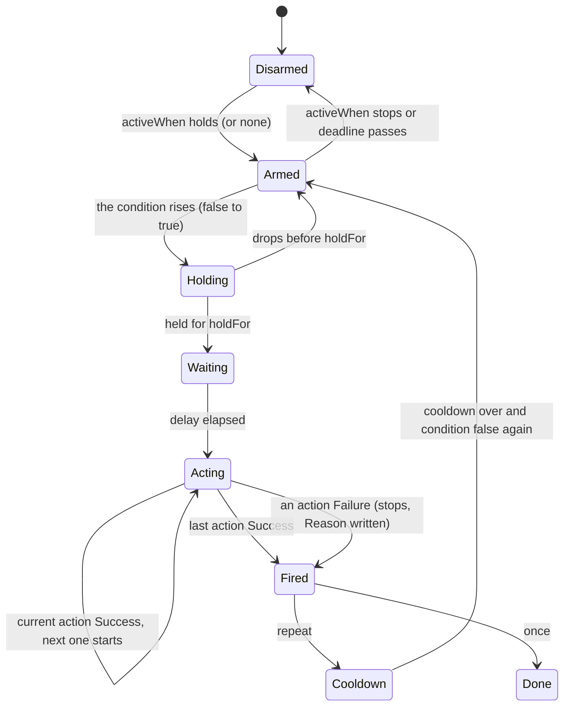

The example, on a timeline:

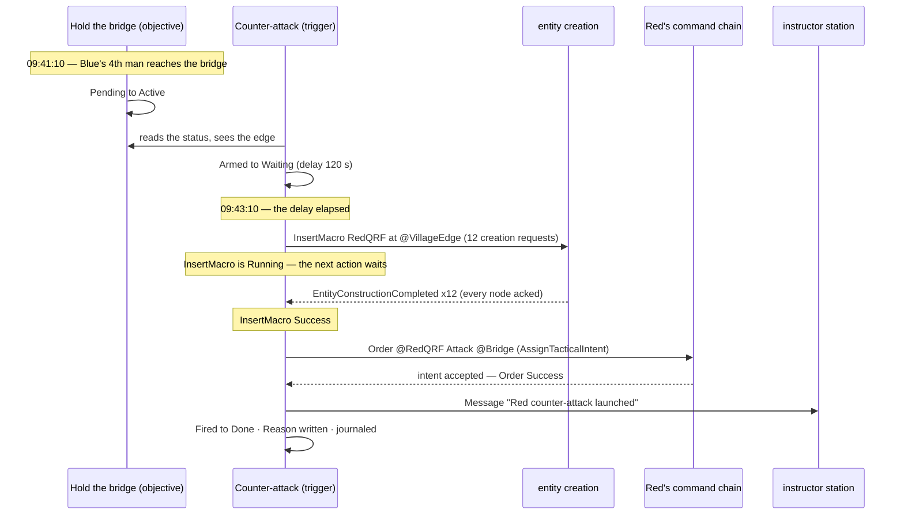

| rule | meaning |
|---|---|
| ⭐ the EDGE | it fires when the condition BECOMES true — not every tick while it is true |
| `holdFor` vs `delay` | `holdFor` = the condition must STAY true that long (debounce); `delay` = fire that long AFTER the edge, even if it drops |
| `once` / `repeat` | `repeat` re-arms only after the condition went false again, plus `cooldown` |
| time | simulation time only — paused ⇒ nothing fires |
| several in one tick | each is independent; up to one tick of latency; where order matters, CHAIN — a trigger's own `Fired` is a condition another can watch |
| actions | run in their listed order, each WAITED for — the next starts only when the previous succeeded; a failure stops the list and is written into `Reason` |
| the instructor | can fire, disarm or re-arm it by hand (journaled with who did it) |

### 2.5 What `do` is — a plain list of the SAME actions every behaviour uses (SR-93)

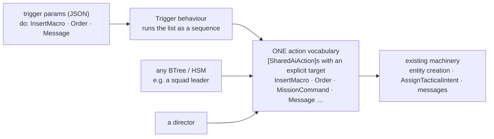

*Caption:* the verbs are not trigger-only handlers — they are ordinary shared actions that say WHO they act on, so a trigger, a squad
leader's tree or a director all call the same `InsertMacro`. Each one reports `Running` until it is really done (InsertMacro: until every
entity it asked for is constructed and acked on all nodes), so the list can wait for it. The `do` list itself is still just data — nothing is
compiled per scenario, and an unknown action or bad argument is refused when the scenario loads. `when` can be an objective's status OR the
scenario clock directly — both written in the existing condition language (SR-95).

Each `do` entry carries its own bindings to scenario parameters, so moving an entry moves them too (SR-94):

```json
{ "act": "InsertMacro",
  "args": { "macro": "RedQRF", "at": "@VillageEdge", "macroArgs": { "size": 12, "side": "Hostile" } },
  "bind": { "macro": "qrfMacro", "macroArgs.size": "qrfSize" } }
```

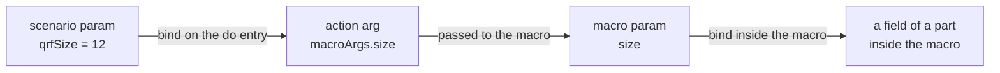

*Caption:* one binding principle at every level, each binding written next to the value it binds; all applied once, at load.

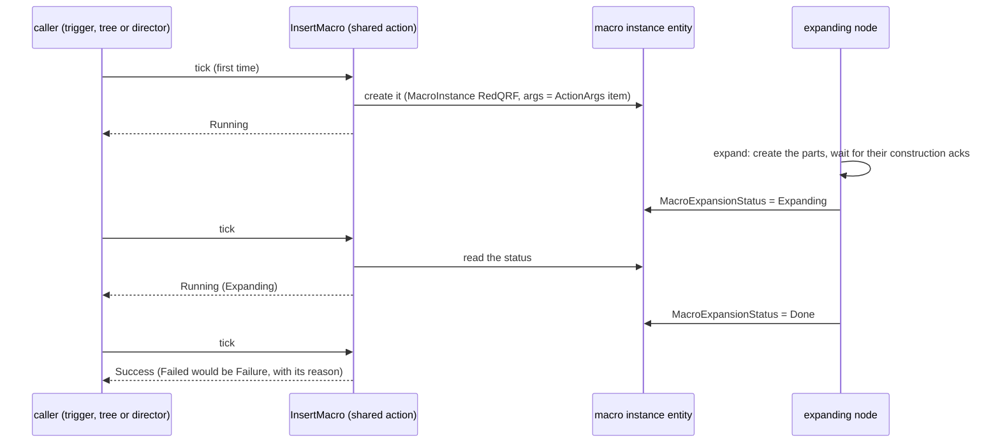

*Caption:* the macro expansion is its own process and reports ONE outcome on the instance entity (SR-96); the action just reads it and never
counts the parts. Because the outcome is STATE, any node can read it, and it survives save, restore and replay.

Where InsertMacro's variable `args` live (SR-97): an action's params are a fixed-size struct, so the struct holds only an index and the list
lives in one generic managed record on the calling entity:

```
InsertMacroParams { Macro="RedQRF", At=@VillageEdge, ArgsRef=0 }      // in the behaviour's block
ActionArgs.Items  = [ 0: {"size":12,"side":"Hostile"}, 1: "Red counter-attack launched" ]   // on the trigger entity
```

⛔ **Not yet buildable** — two things to measure first: binding an action from data at runtime (the binders exist; today only generated code
supplies their type arguments), and moving the action catalogue from the editor into shared runtime code so a cluster node can validate the
list. See [SR-93](DESIGN_Scenario_Rules.md).

### 2.4 How it fits with the others

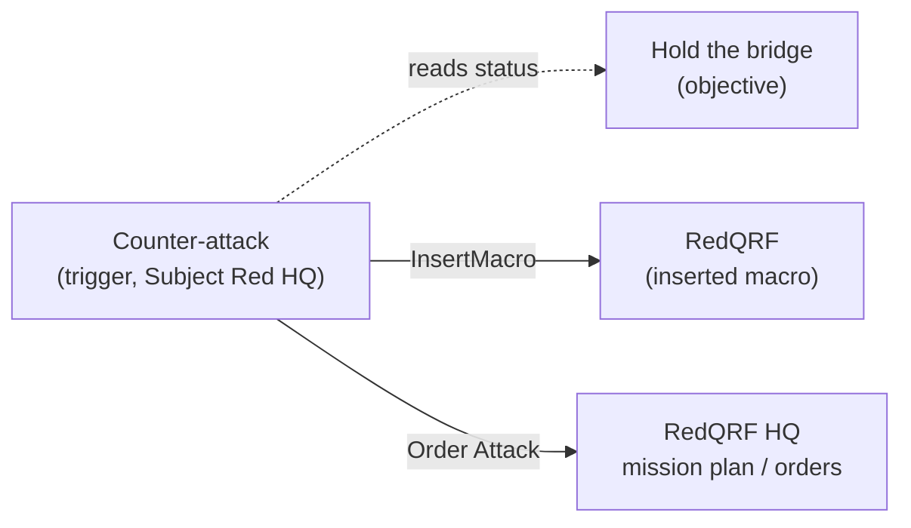

*Caption:* the trigger READS objectives and ACTS through the existing mechanisms — macro insertion (ordinary entity creation) and orders down
the command chain (which a unit's mission plan or brain then executes). ⭐ **In one sentence:** a trigger is a small brain that WATCHES statuses and,
on an edge, RUNS a list of actions.


## 3. The director — not a new kind of entity (SR-99)

A "director" — something that watches how the teams are doing and changes the conditions for them — is just a **macro of objectives and
triggers**. Objectives WATCH (a team's `Score`), triggers REACT, and their actions reach out of the world: insert new forces, change the
opponents' proficiency, tell the instructor.


*Caption:* nothing in the picture is a director — the triggers belong to the scenario (their subject is the World Environment), so they are
tied to no side; Red HQ stays an ordinary commander that only fights from what it knows, and simply receives orders for the new forces.

| trigger | when | do | rules |
|---|---|---|---|
| Counter-attack | `@BlueAttack/Hold` becomes Active | InsertMacro(RedQRF, @VillageEdge) → Order(@RedQRF, Attack @Bridge) | delay 120 s, once |
| Ease off | `@BlueAttack.Score < 0.35` AND elapsed > 20 min | AdjustProficiency(Red, −1 tier) · Message(IOS, "Red eased") | holdFor 2 min, repeat, cooldown 10 min, maxFires 2 |
| Push harder | `@BlueAttack.Score > 0.8` AND elapsed < 30 min | InsertMacro(RedReserve) → Order(…) | holdFor 1 min, once |

**The proficiency knob already exists** — `CombatProficiency` (Untrained · Militia · Regular · Veteran · Elite, 0..1), set per man, per unit
(it fills down to the men) or by the unit type, and it changes aim spread, exposure, reaction time and fire discipline. What a director adds is
a RELATIVE change for a whole side at runtime (SR-100), so a veteran stays better than a militiaman.

**When triggers are not enough** — choosing ONE best play among several — the same kind of entity runs a reusable behaviour instead of the
`Trigger` behaviour (a utility choice over plays, each play a `RunActions` list). Still no new entity type.
