<!--STATUS
state: LIVE
updated: 2026-11-01 (parts 1–3: objective, trigger, exercise control — coordinator)
current-answer: §1 the objective · §2 the trigger · §3 exercise control (the building blocks, patterns, the ladder, the worked example, the rules view) — an EXPLAINER of the design, not the design itself
stale-below: nothing — superseded revisions removed 2026-11-01; full history at commit de422e11b (`git show de422e11b:docs/EXPLAINER_Scenario_Evaluation_And_Direction.md`)
known-rot: none — ⚠ describes the DESIGN: objectives, triggers and the shared actions are not built yet (only the trigger PoC is, SR-108); the decisions and their ids live in DESIGN_Scenario_Rules.md
known-conflict: none
related-designs:
  - docs/DESIGN_Scenario_Rules.md — OWNS every decision explained here (SR-…, T1–T10); this file only explains them with examples
  - docs/DESIGN_Scenario_Entity_Keys.md — the stable entity GUIDs references rest on
  - docs/OVERVIEW_Behaviour_Building_Blocks.md — the behaviours, orders and command chain objectives and triggers use
  - docs/SHOWCASE_Scenarios.md — two full scenarios (training + game) that use everything explained here
-->

# EXPLAINER — **scenario evaluation and direction** *(objectives, triggers, …)*

> For a reader who wants to understand HOW it works, with examples. The decisions and their reasons are in
> [`DESIGN_Scenario_Rules.md`](DESIGN_Scenario_Rules.md); ⚠ none of this is built yet.

**The three roles, in one line each:**

| | does | example |
|---|---|---|
| **objective** | OBSERVES and REPORTS — *did it succeed, how well* | *"Hold the bridge for 10 minutes"* |
| **trigger** | REACTS — *when something happens, do something* | *"when the bridge is held, send the counter-attack"* |
| **mission plan** | DIRECTS one unit — *its ordered task list* | *"drive to the bridge, then hold it"* |

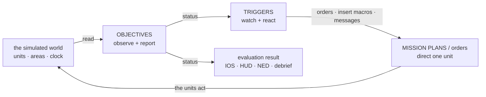

*Caption:* the loop — objectives READ the world and publish statuses; triggers READ statuses and ACT through orders and macros; units carry
the orders out and change the world, which the objectives read again.

---

## 1. The objective

### 1.1 What it is

An ordinary **entity** (usually created by a scenario macro) with four parts:

| part | in the example *"Hold the bridge"* |
|---|---|
| label + position | `EntityInfo` (title *"Hold the bridge"*, side Blue) · `SimTransform` at the bridge — only for drawing it on the map |
| its LINKS (`ObjectiveLinks`) | `Subject` = **Blue Platoon** (*whose* objective it is) · `Parent` = **Blue mission** (the objective it rolls up into) |
| its TASK slot = the evaluating behaviour | `HoldArea` with params `{area: "@Bridge", minUnits: 4, maxEnemy: 0, holdSeconds: 600, common: {deadline: "10:30", points: 100, weight: 40}}` |
| its RESULT (`ObjectiveStatus`, replicated to every node) | state · progress · value / target · score · points · when · reason |


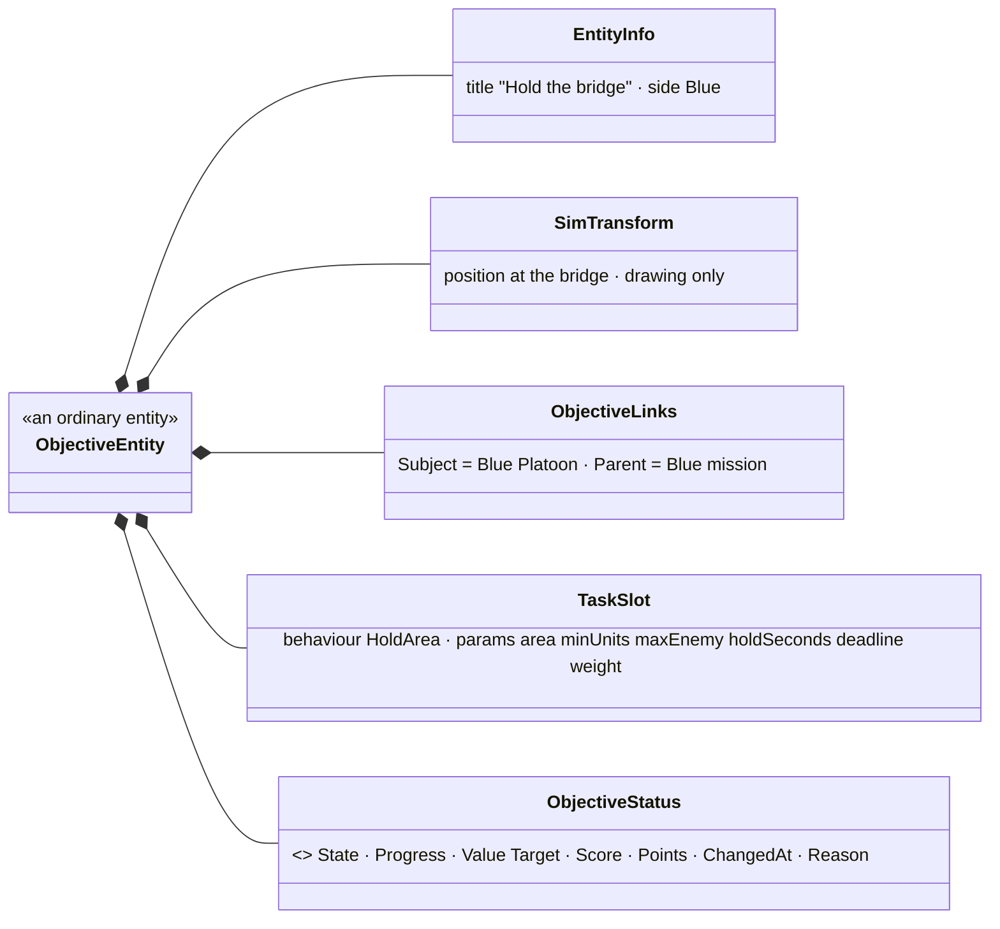

It runs on the **Brain node** (which owns it), in the normal brain tick — only while simulation time advances.

### 1.2 Where its data comes from — it only READS the world, through references

| it needs | from |
|---|---|
| the area polygon | `@Bridge` — the `RefKey` of an area entity → its `EditablePolyline` |
| *our* units | `Subject` = Blue Platoon → its members down the command chain (`UnitSubordinate`) |
| who is inside | each member's `SimTransform` tested against the polygon (the existing area test) |
| enemies inside | entities in the polygon whose side (`ForceId`) is Hostile |
| time | `ScenarioClock` — the deadline and the hold timer |

### 1.3 What its behaviour does each tick (`HoldArea`, a small state machine)

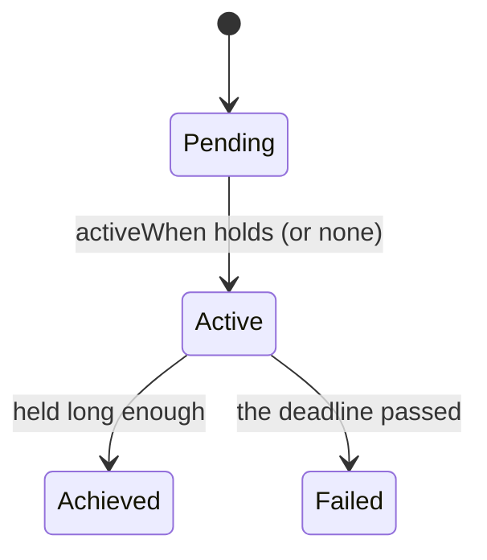


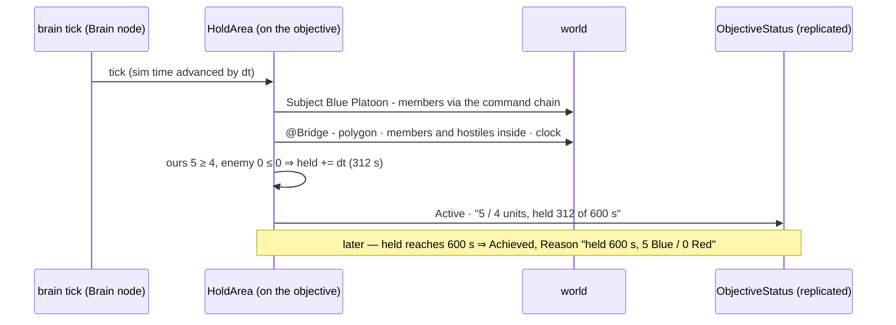

```
Active, every tick:
    ours   = members of Subject inside the area, alive
    enemy  = hostile units inside the area
    if ours >= 4 and enemy <= 0:  held += dt   else: held = 0        (held lives in its working state)
    status.Progress = "5 / 4 units, held 312 of 600 s"
    held >= 600          -> Achieved   (Reason "held 600 s, 5 Blue / 0 Red")
    clock > deadline     -> Failed     (Reason "deadline 10:30 passed, held only 140 s")
```

⭐ It **never changes the world** — it only writes its own status; every state change is journaled (so the debrief can say why).

### 1.4 How others use it — nobody calls it, everyone READS its status

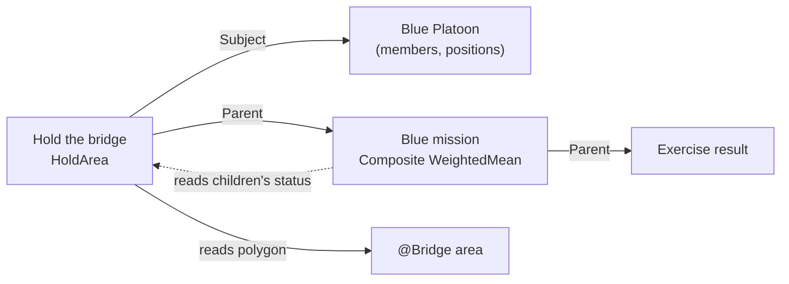

*Caption:* the solid arrows are LINKS the objective holds; the dotted arrow is the parent READING the child's status. A trigger, the
instructor station, the trainee's HUD and any NED frontend read the same replicated status.

- **The parent** *"Blue mission"* (a `Composite`, behaviour `WeightedMean`) finds its children by asking *"which objectives have `Parent` = me?"*,
  reads their statuses (*Hold the bridge* Achieved = 1.0 × weight 40, …) and writes its own score.
- ⭐ **In one sentence:** an objective is a small brain that OBSERVES (its subject, its areas, the clock) and REPORTS (its own status).
  Steering belongs to triggers and mission plans.

---

## 2. The trigger

### 2.1 What it is

Also an ordinary **entity** — a SUB-entity of what it concerns (`Subject`; shown nested under it) — with its own brain running the `Trigger`
behaviour in ITS task slot (⛔ never on the unit it steers: that unit's task slot belongs to its mission plan or orders).

| part | in the example *"Counter-attack"* |
|---|---|
| label | *"Counter-attack when the bridge is held"* |
| `Subject` | **Red HQ** (whose reaction it is) — or the World Environment entity for a scenario-wide trigger |
| its TASK slot = the `Trigger` behaviour with params | `when`: the status of `@HoldTheBridge` becomes **Active** · `delay`: 120 s · `once` · `do`: ① `InsertMacro(forces/RedQRF at @VillageEdge)` ② `Order(@RedQRF, Attack, area @Bridge)` ③ `Message(IOS, "Red counter-attack launched")` |
| its RESULT (`ObjectiveStatus`, not scored) | state · `FireCount` · `LastFired` · reason |

### 2.2 Where its data comes from

| it needs | from |
|---|---|
| its CONDITION | ⭐ written in the SAME JSON condition language data breakpoints and the Blueprint `When` node use (SR-95) — here *"`OnEntity @HoldTheBridge`: `ObjectiveStatus.State` equals Active"*; it reads the replicated `ObjectiveStatus` of the objective it watches (`@HoldTheBridge`) — ⭐ conditions ARE objective statuses; a condition you do not want scored is an objective with `scored: false` (e.g. *"Red reaches the ridge"* = a `ReachArea` objective, not scored) |
| time | `ScenarioClock` (the delay, the cooldown) |
| the targets of its actions | `RefKey`s (`@RedQRF`, `@VillageEdge`, `@Bridge`) resolved in the nearest scope |

### 2.3 What its behaviour does (the `Trigger` state machine — rules T1–T10)

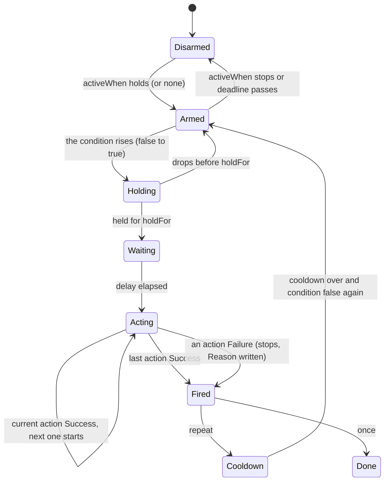

The example, on a timeline:

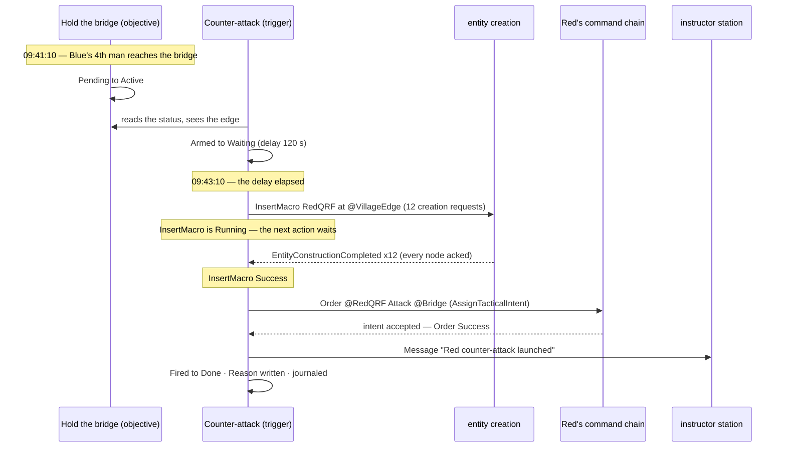

| rule | meaning |
|---|---|
| ⭐ the EDGE | it fires when the condition BECOMES true — not every tick while it is true |
| `holdFor` vs `delay` | `holdFor` = the condition must STAY true that long (debounce); `delay` = fire that long AFTER the edge, even if it drops |
| `once` / `repeat` | `repeat` re-arms only after the condition went false again, plus `cooldown` |
| time | simulation time only — paused ⇒ nothing fires |
| several in one tick | each is independent; up to one tick of latency; where order matters, CHAIN — a trigger's own `Fired` is a condition another can watch |
| actions | run in their listed order, each WAITED for — the next starts only when the previous succeeded; a failure stops the list and is written into `Reason` |
| the instructor | can fire, disarm or re-arm it by hand (journaled with who did it) |

### 2.5 What `do` is — a plain list of the SAME actions every behaviour uses (SR-93)

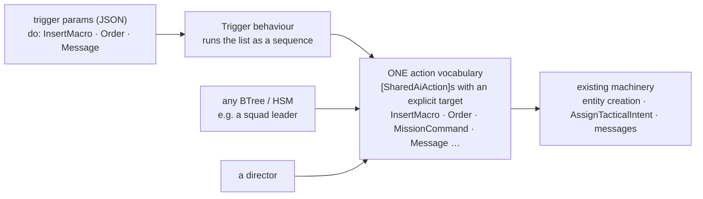

*Caption:* the verbs are not trigger-only handlers — they are ordinary shared actions that say WHO they act on, so a trigger, a squad
leader's tree or a director all call the same `InsertMacro`. Each one reports `Running` until it is really done (InsertMacro: until every
entity it asked for is constructed and acked on all nodes), so the list can wait for it. The `do` list itself is still just data — nothing is
compiled per scenario, and an unknown action or bad argument is refused when the scenario loads. `when` can be an objective's status OR the
scenario clock directly — both written in the existing condition language (SR-95).

Each `do` entry carries its own bindings to scenario parameters, so moving an entry moves them too (SR-94):

```json
{ "act": "InsertMacro",
  "args": { "macro": "RedQRF", "at": "@VillageEdge", "macroArgs": { "size": 12, "side": "Hostile" } },
  "bind": { "macro": "qrfMacro", "macroArgs.size": "qrfSize" } }
```

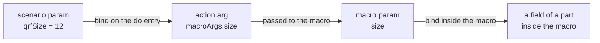

*Caption:* one binding principle at every level, each binding written next to the value it binds; all applied once, at load.

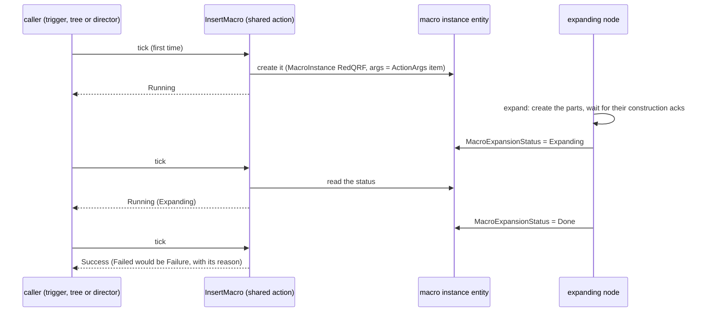

*Caption:* the macro expansion is its own process and reports ONE outcome on the instance entity (SR-96); the action just reads it and never
counts the parts. Because the outcome is STATE, any node can read it, and it survives save, restore and replay.

Where InsertMacro's variable `args` live (SR-97): an action's params are a fixed-size struct, so the struct holds only an index and the list
lives in one generic managed record on the calling entity:

```
InsertMacroParams { Macro="RedQRF", At=@VillageEdge, ArgsRef=0 }      // in the behaviour's block
ActionArgs.Items  = [ 0: {"size":12,"side":"Hostile"}, 1: "Red counter-attack launched" ]   // on the trigger entity
```

⛔ **Not yet buildable** — two things to measure first: binding an action from data at runtime (the binders exist; today only generated code
supplies their type arguments), and moving the action catalogue from the editor into shared runtime code so a cluster node can validate the
list. See [SR-93](DESIGN_Scenario_Rules.md).

### 2.4 How it fits with the others

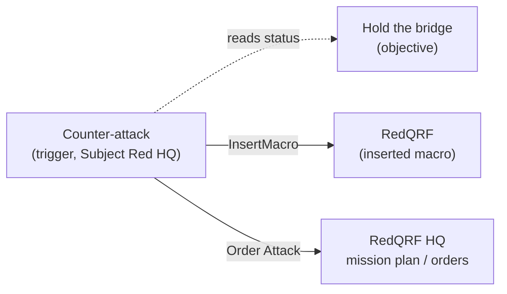

*Caption:* the trigger READS objectives and ACTS through the existing mechanisms — macro insertion (ordinary entity creation) and orders down
the command chain (which a unit's mission plan or brain then executes). ⭐ **In one sentence:** a trigger is a small brain that WATCHES statuses and,
on an edge, RUNS a list of actions.


## 3. Exercise control — steering the whole exercise

**Exercise control** is everything that shapes the exercise as a whole rather than one unit: its pacing (*phase 2 starts when…*), its
difficulty (*Blue is struggling — ease off*), its branches (*Blue went north — reinforce the north*), its surprises (*a counter-attack*) and
its end. ⭐ There is **no director entity** for this (SR-99): it is built from the same objectives and triggers as parts 1 and 2, packed into a
reusable macro.

### 3.1 The building blocks

| the job | done by | example |
|---|---|---|
| ⭐ **watch** how the teams are doing | objectives and measures — each publishes `ObjectiveStatus` with a `Score` 0..1 | *"Blue platoon attack"* = 0.42 |
| ⭐ **decide** when to act | a trigger's `when`, in the existing condition language (SR-95) — any objective's state or `Score`, the scenario clock, several entities at once | `Score < 0.35` AND elapsed > 20 min |
| ⭐ **act** on the exercise, from outside the world | the trigger's `do` — the shared action vocabulary (SR-93) | `InsertMacro` · `Order` · `SetSkillAmplifier` · `Message` · `SetObjectiveActive` · `EndExercise` |
| **remember** what already happened | a trigger's own status (`Fired`, `FireCount`) and `maxFires`; a `Count` objective for a total shared by several triggers | *"at most 3 waves in total"* |
| **belong to no side** | the trigger's `Subject` is the World Environment entity | Red HQ stays an ordinary commander |
| **package and reuse** | a macro with params | `macros/control/AdaptivePressure {blue, red}` |

### 3.2 Patterns — how the usual wishes are built

| the wish | built as | the trick |
|---|---|---|
| ⭐ **phases** — *"phase 2 begins when the bridge is held, or at 09:45 at the latest"* | an objective per phase + one trigger: `when` = `@Phase1` Achieved OR scenario time ≥ 09:45 → `SetObjectiveActive(@Phase2)` + `Order(...)` | a phase is just an objective that is activated later |
| ⭐ **adaptive difficulty** | triggers on bands of `Score` (table below) | `holdFor` ignores a short dip; `repeat` + `cooldown` + `maxFires` make it gradual and bounded |
| ⭐ **branching** — *"if Blue takes the north route, reinforce the north"* | two `ReachArea` objectives (not scored) for the two routes + one trigger each, the two `when`s exclusive | the branch condition is an objective that is never scored, only watched |
| ⭐ **waves with a budget** — *"up to 3 waves, from any of the reinforcement triggers"* | a `Count` objective counting inserted waves; each wave trigger's `when` adds `Count < 3` | the shared memory is an objective everyone can read |
| ⭐ **surprise after a delay** | a trigger with `delay` (fires even if the condition drops meanwhile) | part 2's counter-attack |
| ⭐ **the end** | one trigger: all required objectives settled OR the time limit → `EndExercise` | the exercise ends like any other reaction |
| **the instructor steps in** | fire, disarm or re-arm any trigger by hand (T9); ⚠ running an action such as inserting a macro by hand is still to be designed (B5) — all journaled with who did it | the instructor uses the SAME triggers and actions — nothing separate |

The adaptive-difficulty example, as a reusable macro `macros/control/AdaptivePressure {blue: @BlueAttack, red: Red}`:

| trigger | when | do | rules |
|---|---|---|---|
| Counter-attack | `@BlueAttack/Hold` becomes Active | InsertMacro(RedQRF, @VillageEdge) → Order(@RedQRF, Attack @Bridge) | delay 120 s, once |
| Ease off | `@BlueAttack.Score < 0.35` AND elapsed > 20 min | SetSkillAmplifier(Red, −1) · Message(IOS, "Red eased") | holdFor 2 min, repeat, cooldown 10 min, maxFires 2 |
| Push harder | `@BlueAttack.Score > 0.8` AND elapsed < 30 min | InsertMacro(RedReserve) → Order(…) | holdFor 1 min, once |

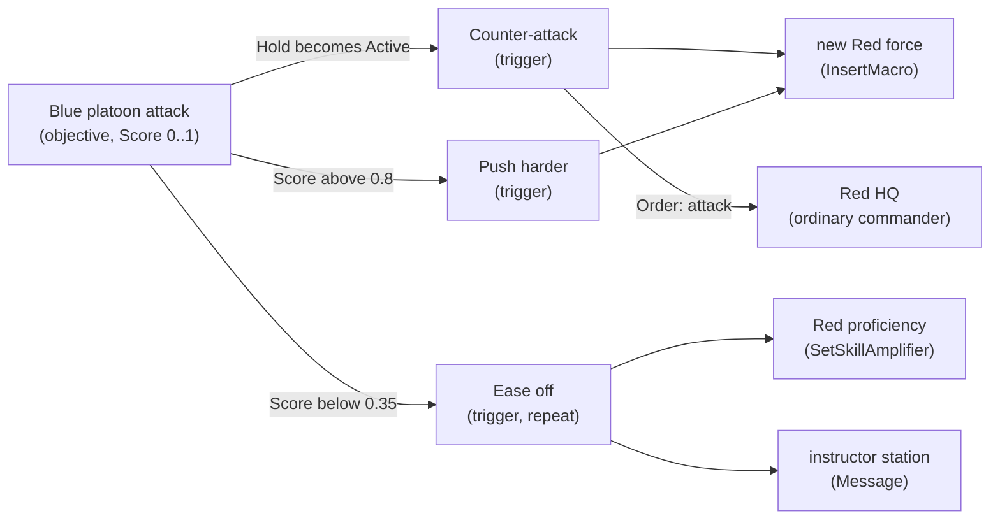

*Caption:* nothing in the picture is a director — the triggers belong to the scenario, so they are tied to no side; Red HQ only fights from
what it knows and simply receives orders for the new forces.

The same loop over time:

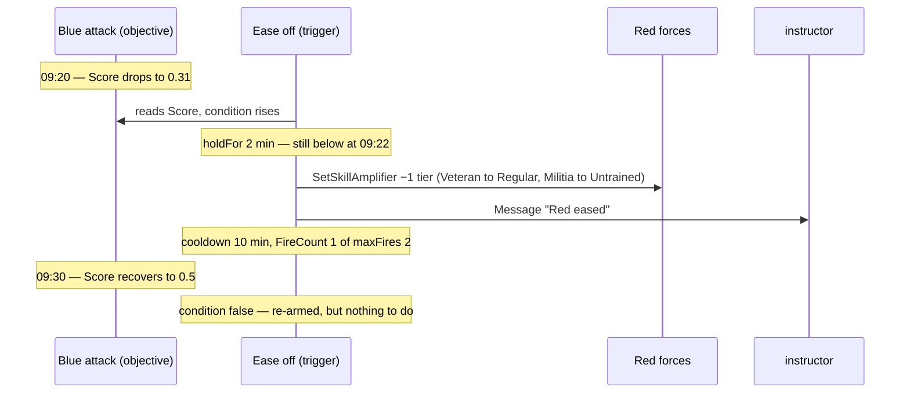

**The proficiency knob already exists** — `CombatProficiency` (Untrained · Militia · Regular · Veteran · Elite, 0..1), set per man, per unit
(it fills down to the men) or by the unit type; it changes aim spread, exposure, reaction time and fire discipline. `SetSkillAmplifier` sets a per-side amplifier in
tiers at runtime (R-4106, SR-100), so a veteran stays better than a militiaman, and forces inserted later are covered too.

### 3.3 When standalone triggers and objectives are not enough — the ladder

Climb only as far as the need; each rung costs more and keeps less of the simplicity.

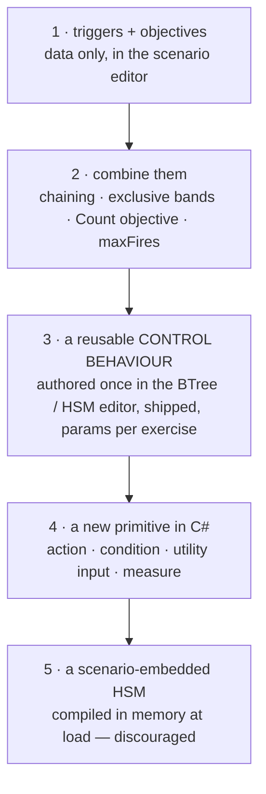

*Caption:* rungs 1–2 are pure data; rung 3 is still data per exercise (a named asset + params); only rung 4 is new code, and it is ordinary
development that every scenario then gets for free.

| rung | use it when | how | what it costs |
|---|---|---|---|
| **1** | one condition → one reaction | a trigger per reaction (parts 1–2) | nothing |
| **2** | reactions depend on each other or share a limit | ⭐ **chaining**: a trigger's own `Fired` is a condition another can watch · ⭐ **exclusive bands** on a `Score` · ⭐ a **`Count` objective** as shared memory · `maxFires` | a few more entities; still readable in the Objectives view |
| ⭐ **3** | you must **choose ONE best play** among several, weigh many inputs, or keep internal state richer than a counter | the same trigger-kind control entity runs a **reusable behaviour asset** in its task slot instead of `Trigger`: e.g. `PressureController` = `ChooseOption` over plays (*Counter-attack · Reinforce · Hold · Ease off*), each play a `RunActions` list; utility inputs read the `Score`s; `UtilityDecisionLog` explains every choice | someone authors the asset once (BTree / HSM editor), it ships, and every exercise uses it by name + params. ⛔ Never written for one exercise (R-4110) |
| **4** | the world has a quantity or an effect nothing can express yet — e.g. *"Blue's ammunition below 30 %"*, *"jam Blue's radios"* | a new `[SharedAiAction]`, `[SharedAiCondition]`, `[UtilityInput]` or measure | C# development, built once; then available to triggers, objectives and every behaviour alike (one vocabulary) |
| **5** | a genuinely one-off logic that no reusable asset should carry | an HSM authored in the editor and SAVED IN THE SCENARIO, compiled in memory at load, deterministically (SR-24) | the most power and the least reuse; ⚠ discouraged and not in the first slice |

**Rule of thumb:** if the logic reads as *"when X, do Y"*, it is a trigger. If it reads as *"keep judging which of these to do"*, it is a
control behaviour (rung 3). If it needs something the world cannot tell you yet, it is a new primitive (rung 4).

### 3.4 Worked example — one exercise climbing the ladder

*"Platoon attack on the village"* (part 2's scenario). The instructor's wishes grow; each one is met on the lowest rung that can carry it.

**Rung 1 — *"when Blue holds the bridge, send a counter-attack."*** One trigger (part 2):

| trigger | when | do |
|---|---|---|
| Counter-attack | `@BlueAttack/Hold` becomes Active | InsertMacro(RedQRF, @VillageEdge) → Order(@RedQRF, Attack @Bridge) |

**Rung 2 — *"send waves from the north or the south, whichever Blue is not watching; the next wave only once the previous one is destroyed;
three waves in total."*** Still triggers and objectives, combined:

| entity | kind | role |
|---|---|---|
| `Blue watches north` / `Blue watches south` | `HoldArea` objectives, ⛔ not scored | the branch condition — which side Blue covers |
| `Waves sent` | `Count` objective (counts `InsertMacro` of `RedQRF`), ⛔ not scored | the budget SHARED by both wave triggers |
| `Wave destroyed` | `DestroyTargets` objective on the last inserted wave, ⛔ not scored | the chain — *"the previous wave is gone"* |
| trigger `Wave north` | `Blue watches south` Active AND `Waves sent < 3` AND (`Waves sent = 0` OR `Wave destroyed` Achieved) | InsertMacro(RedQRF, @NorthEdge) → Order(...) |
| trigger `Wave south` | the mirror (`Blue watches north` Active, …) | InsertMacro(RedQRF, @SouthEdge) → Order(...) |

The `when`s are exclusive (Blue covers one side), so the two triggers never fire together, and the `Count` objective is the memory both of them
read.

**Rung 3 — *"every couple of minutes, weigh how Blue is doing, how strong each side is and how much time is left, and pick the best of:
reinforce north · reinforce south · hold · ease off."*** Bands of exclusive conditions stop scaling here — four plays, several inputs, and the
choice has to stick for a while instead of flickering. ⇒ a **control behaviour**, authored ONCE as an asset and shipped:

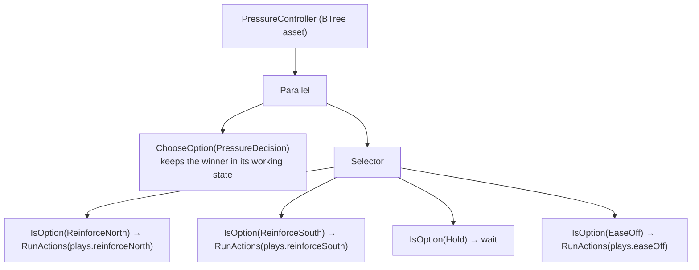

*Caption:* the decision and the plays are separate — `ChooseOption` scores the options and remembers the winner (with hysteresis, so it does not
flicker); each branch runs its play as an ordinary `RunActions` list — the SAME actions a trigger's `do` uses.

The utility decision `PressureDecision` (authored once, like the asset):

| option | scored up by | scored down by |
|---|---|---|
| ReinforceNorth | Blue `Score` high · Blue watches south | waves sent · little time left |
| ReinforceSouth | the mirror | the mirror |
| Hold | Blue `Score` in the middle band | — |
| EaseOff | Blue `Score` low · `EnemyStrengthRatio` against Blue high (an existing input, `StandardInputs.cs:289`) | proficiency already lowered twice |

What the scenario author places — ONE entity, a name and params, nothing compiled:

```json
{ "Name": "Pressure", "Subject": "World Environment",
  "Sop": { "Name": "PressureController",
           "Params": { "blue": "@BlueAttack", "red": "Red", "maxWaves": 3, "decideEvery": 120,
                       "plays": {
                         "reinforceNorth": [ { "act": "InsertMacro", "args": { "macro": "RedQRF", "at": "@NorthEdge" } },
                                             { "act": "Order", "args": { "unit": "@RedQRF", "intent": "Attack", "target": "@Bridge" } } ],
                         "reinforceSouth": [ { "act": "InsertMacro", "args": { "macro": "RedQRF", "at": "@SouthEdge" } },
                                             { "act": "Order", "args": { "unit": "@RedQRF", "intent": "Attack", "target": "@Bridge" } } ],
                         "easeOff":        [ { "act": "SetSkillAmplifier", "args": { "target": "Red", "delta": -1 } },
                                             { "act": "Message", "args": { "to": "IOS", "text": "Red eased" } } ] } } } }
```

The next exercise uses the same `PressureController` with other params (other edges, other macros, `maxWaves: 5`); the instructor sees in
`UtilityDecisionLog` *why* each play won.

**Rung 4 — *"also ease off when Blue is running out of ammunition."*** A man's own ammunition is already an input (`AmmoFraction`,
`Utility/Inputs/StandardInputs.cs:84`), but nothing yet sums it for a whole SIDE ⇒ one new primitive, in C#, built once, next to it:

```csharp
[UtilityInput("SideAmmoFraction")]   // 0..1 — the side's remaining ammunition over its loaded-out total
static float SideAmmoFraction(in UtilityInputCtx ctx) => …;
```

From then on `PressureDecision` scores `EaseOff` up by it, AND — through the same registry — it can be a measure (*"Blue's ammunition
discipline"*) and a trigger condition (*"Blue below 30 %"*; ⚠ that needs a utility-input leaf in the condition language — the SR-20 bridge,
not yet designed for SR-95). Every scenario gets it for free.

**Rung 5** is not needed here — nothing in this exercise is so one-off that a reusable asset should not carry it.

| wish | rung | new authoring | new code |
|---|---|---|---|
| a counter-attack | 1 | one trigger | none |
| north / south waves, chained, budget of 3 | 2 | 5 entities (3 watched objectives, 2 triggers) | none |
| keep choosing the best of four plays | 3 | one entity naming `PressureController` + params | none per exercise — the asset is authored once |
| react to ammunition | 4 | one input added to the decision | one `[UtilityInput]` |

### 3.5 What the instructor sees — the rules view

One window shows every objective and trigger of the exercise on the sim-time axis, with a NOW line: what already happened at its real
time, what is coming as a dashed bar AFTER the things it waits for (so nothing is tied to a clock and a slip just moves it), triggers pinned to
the scenario clock as diamonds, and the dependencies as connectors. Selecting a row opens its tabs in the Details panel — a trigger's
**When · Do · Rules · History**, an objective's **Status · Settings · Results · History** — and everything can be edited at any time, live
included, each edit journaled. It is a host of the ONE shared timeline panel, not a copy of it.
For the overview — *how is the mission going, at every level* — a separate, READ-ONLY **mission summary**: each side's score with its trend, the required objectives, forces, the items needing attention, and one table of scores by command chain (platoon ▸ squad ▸ person), by objective or by role, each row explaining *why* its score is what it is. It opens on a recording for the debrief too.
And for the PLAYER: during play a HUD — in training his mission objectives, his standards and the messages; in a game the score bar, capture points, timer, kill feed and score pop-ups — and after it a debrief: in training GO / NO-GO per standard with *went well / work on* and a replay from his own eyes; in a game the scoreboard, awards and his best moment. One set of data, two profiles, each element a switchable feature.
📐 Mockup: [`docs/designs/rules-view/`](designs/rules-view/README.md) (standalone HTML, open in a browser) · decisions: SR-105, SR-109, SR-110, SR-111, SR-112 in [`DESIGN_Scenario_Rules.md`](DESIGN_Scenario_Rules.md).

⚠ None of this is built yet — the trigger machinery is being proven by a proof of concept (runtime binding of actions, per-step blackboard
slots, the condition language); see [SR-93…SR-100](DESIGN_Scenario_Rules.md).
