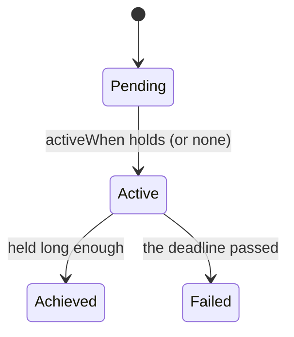
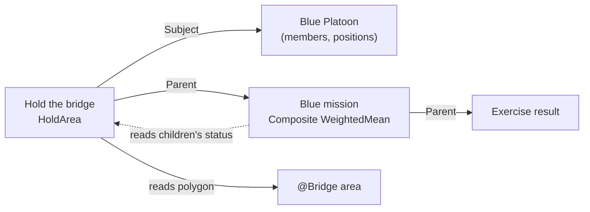
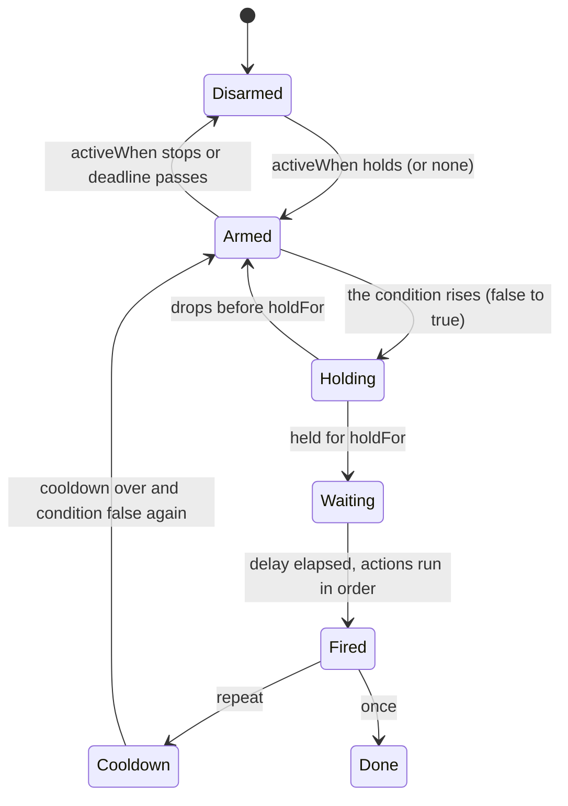
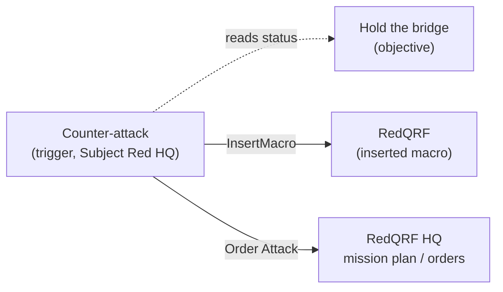

<!--STATUS
state: LIVE
updated: 2026-11-01 (first version — coordinator; parts 1–2)
current-answer: the whole file — an EXPLAINER of the design, not the design itself
stale-below: nothing
known-rot: none — ⚠ describes the DESIGN (nothing here is built yet); the decisions and their ids live in DESIGN_Scenario_Rules.md
known-conflict: none
related-designs:
  - docs/DESIGN_Scenario_Rules.md — OWNS every decision explained here (SR-…, T1–T10); this file only explains them with examples
  - docs/DESIGN_Scenario_Entity_Keys.md — the stable entity GUIDs references rest on
  - docs/OVERVIEW_Behaviour_Building_Blocks.md — the behaviours, orders and command chain objectives and triggers use
-->

# EXPLAINER — **scenario evaluation and direction** *(objectives, triggers, …)*

> For a reader who wants to understand HOW it works, with examples. The decisions and their reasons are in
> [`DESIGN_Scenario_Rules.md`](DESIGN_Scenario_Rules.md); ⚠ none of this is built yet.

**The three roles, in one line each:**

| | does | example |
|---|---|---|
| **objective** | OBSERVES and REPORTS — *did it succeed, how well* | *"Hold the bridge for 10 minutes"* |
| **trigger** | REACTS — *when something happens, do something* | *"when the bridge is held, send the counter-attack"* |
| **mission plan** | DIRECTS one unit — *its ordered task list* | *"drive to the bridge, then hold it"* |

---

## 1. The objective

### 1.1 What it is

An ordinary **entity** (usually created by a scenario macro) with four parts:

| part | in the example *"Hold the bridge"* |
|---|---|
| label + position | `EntityInfo` (title *"Hold the bridge"*, side Blue) · `SimTransform` at the bridge — only for drawing it on the map |
| its LINKS (`ObjectiveLinks`) | `Subject` = **Blue Platoon** (*whose* objective it is) · `Parent` = **Blue mission** (the objective it rolls up into) |
| its TASK slot = the evaluating behaviour | `HoldArea` with params `{area: "@Bridge", minUnits: 4, maxEnemy: 0, holdSeconds: 600, common: {deadline: "10:30", points: 100, weight: 40}}` |
| its RESULT (`ObjectiveStatus`, replicated to every node) | state · progress · value / target · score · points · when · reason |

It runs on the **Brain node** (which owns it), in the normal brain tick — only while simulation time advances.

### 1.2 Where its data comes from — it only READS the world, through references

| it needs | from |
|---|---|
| the area polygon | `@Bridge` — the `RefKey` of an area entity → its `EditablePolyline` |
| *our* units | `Subject` = Blue Platoon → its members down the command chain (`UnitSubordinate`) |
| who is inside | each member's `SimTransform` tested against the polygon (the existing area test) |
| enemies inside | entities in the polygon whose side (`ForceId`) is Hostile |
| time | `ScenarioClock` — the deadline and the hold timer |

### 1.3 What its behaviour does each tick (`HoldArea`, a small state machine)



```
Active, every tick:
    ours   = members of Subject inside the area, alive
    enemy  = hostile units inside the area
    if ours >= 4 and enemy <= 0:  held += dt   else: held = 0        (held lives in its working state)
    status.Progress = "5 / 4 units, held 312 of 600 s"
    held >= 600          -> Achieved   (Reason "held 600 s, 5 Blue / 0 Red")
    clock > deadline     -> Failed     (Reason "deadline 10:30 passed, held only 140 s")
```

⭐ It **never changes the world** — it only writes its own status; every state change is journaled (so the debrief can say why).

### 1.4 How others use it — nobody calls it, everyone READS its status



*Caption:* the solid arrows are LINKS the objective holds; the dotted arrow is the parent READING the child's status. A trigger, the
instructor station, the trainee's HUD and any NED frontend read the same replicated status.

- **The parent** *"Blue mission"* (a `Composite`, behaviour `WeightedMean`) finds its children by asking *"which objectives have `Parent` = me?"*,
  reads their statuses (*Hold the bridge* Achieved = 1.0 × weight 40, …) and writes its own score.
- ⭐ **In one sentence:** an objective is a small brain that OBSERVES (its subject, its areas, the clock) and REPORTS (its own status).
  Steering belongs to triggers and mission plans.

---

## 2. The trigger

### 2.1 What it is

Also an ordinary **entity** — a SUB-entity of what it concerns (`Subject`; shown nested under it) — with its own brain running the `Trigger`
behaviour in ITS task slot (⛔ never on the unit it steers: that unit's task slot belongs to its mission plan or orders).

| part | in the example *"Counter-attack"* |
|---|---|
| label | *"Counter-attack when the bridge is held"* |
| `Subject` | **Red HQ** (whose reaction it is) — or the World Environment entity for a scenario-wide trigger |
| its TASK slot = the `Trigger` behaviour with params | `when`: the status of `@HoldTheBridge` becomes **Active** · `delay`: 120 s · `once` · `do`: ① `InsertMacro(forces/RedQRF at @VillageEdge)` ② `Order(@RedQRF, Attack, area @Bridge)` ③ `Message(IOS, "Red counter-attack launched")` |
| its RESULT (`ObjectiveStatus`, not scored) | state · `FireCount` · `LastFired` · reason |

### 2.2 Where its data comes from

| it needs | from |
|---|---|
| its CONDITION | the replicated `ObjectiveStatus` of the objective it watches (`@HoldTheBridge`) — ⭐ conditions ARE objective statuses; a condition you do not want scored is an objective with `scored: false` (e.g. *"Red reaches the ridge"* = a `ReachArea` objective, not scored) |
| time | `ScenarioClock` (the delay, the cooldown) |
| the targets of its actions | `RefKey`s (`@RedQRF`, `@VillageEdge`, `@Bridge`) resolved in the nearest scope |

### 2.3 What its behaviour does (the `Trigger` state machine — rules T1–T10)



The example, on a timeline:

```
09:41:10  Hold the bridge  Pending -> Active          (Blue's 4th man reaches the bridge)
09:41:10  Counter-attack   Armed -> Holding -> Waiting (holdFor 0; delay 120 s starts)
09:43:10  Counter-attack   Waiting -> Fired:
            ① InsertMacro RedQRF at @VillageEdge   -> 12 ordinary entities are created (transient, never saved)
            ② Order @RedQRF Attack @Bridge          -> an AssignTacticalIntent down Red's command chain
            ③ Message IOS                           -> the instructor sees it
          -> Done   (Reason "@HoldTheBridge became Active 09:41:10; fired 09:43:10 after 120 s; inserted 12; order sent")
```

| rule | meaning |
|---|---|
| ⭐ the EDGE | it fires when the condition BECOMES true — not every tick while it is true |
| `holdFor` vs `delay` | `holdFor` = the condition must STAY true that long (debounce); `delay` = fire that long AFTER the edge, even if it drops |
| `once` / `repeat` | `repeat` re-arms only after the condition went false again, plus `cooldown` |
| time | simulation time only — paused ⇒ nothing fires |
| several in one tick | each is independent; up to one tick of latency; where order matters, CHAIN — a trigger's own `Fired` is a condition another can watch |
| actions | run in their listed order; `Order` / `InsertMacro` are fire-and-forget; a failed action is written into `Reason`, the others still run |
| the instructor | can fire, disarm or re-arm it by hand (journaled with who did it) |

### 2.4 How it fits with the others



*Caption:* the trigger READS objectives and ACTS through the existing mechanisms — macro insertion (ordinary entity creation) and orders down
the command chain (which a unit's mission plan or brain then executes). ⭐ **In one sentence:** a trigger is a small brain that WATCHES statuses and,
on an edge, RUNS a list of actions.
