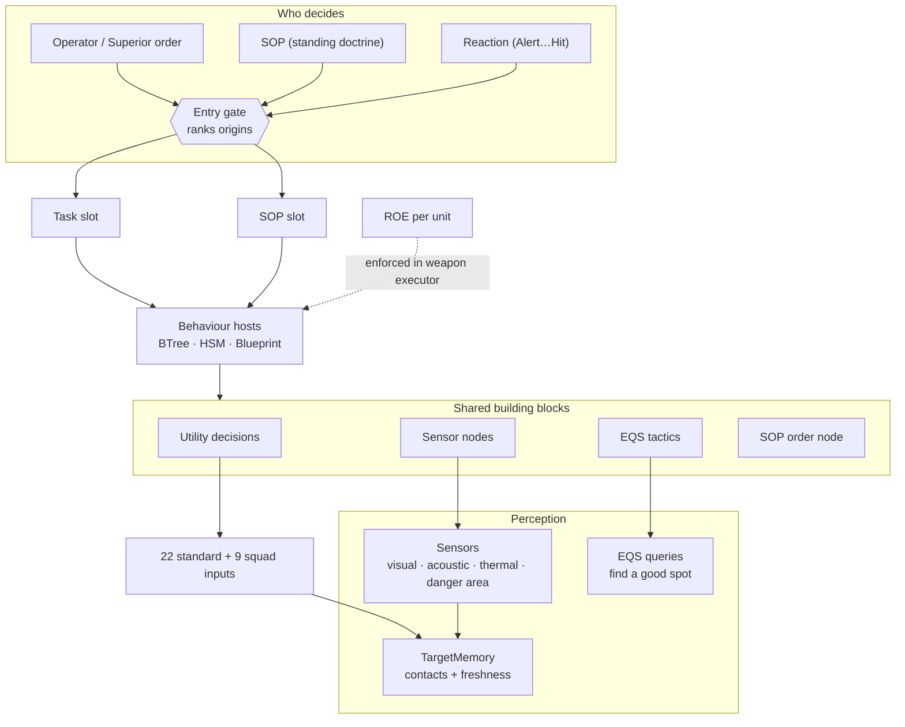
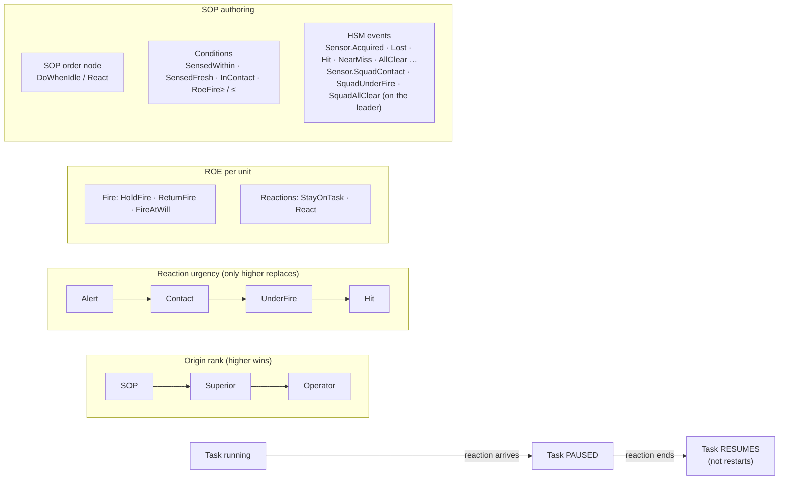
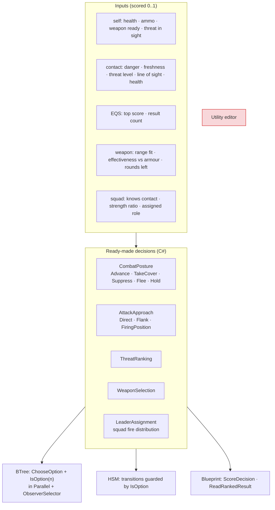
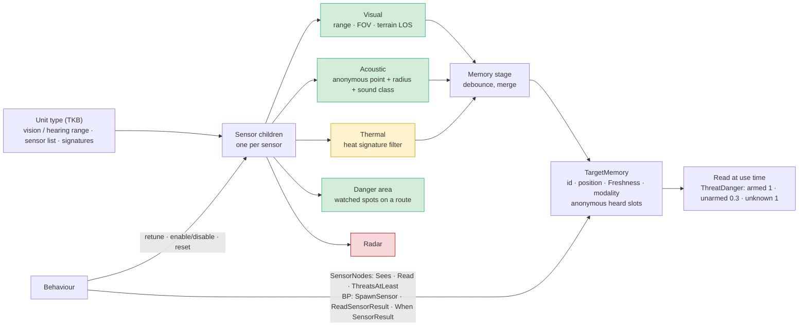
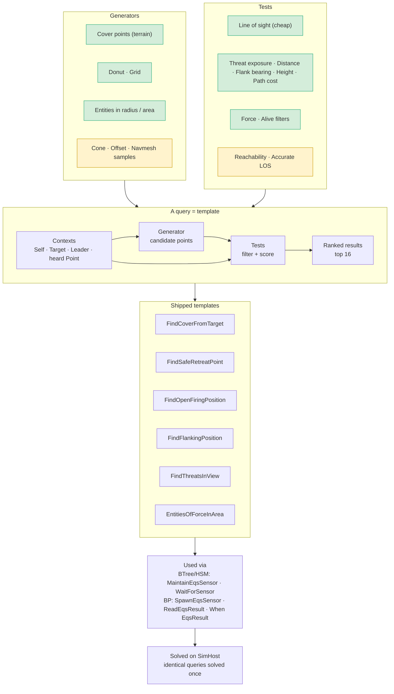
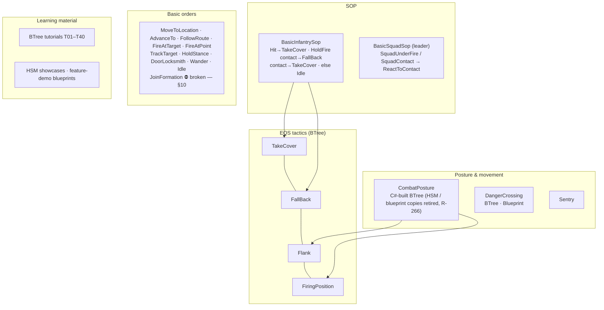
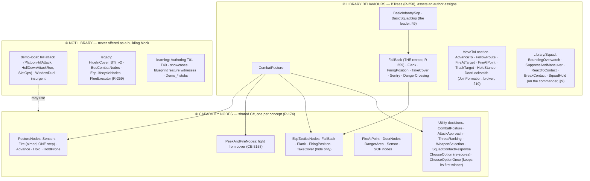
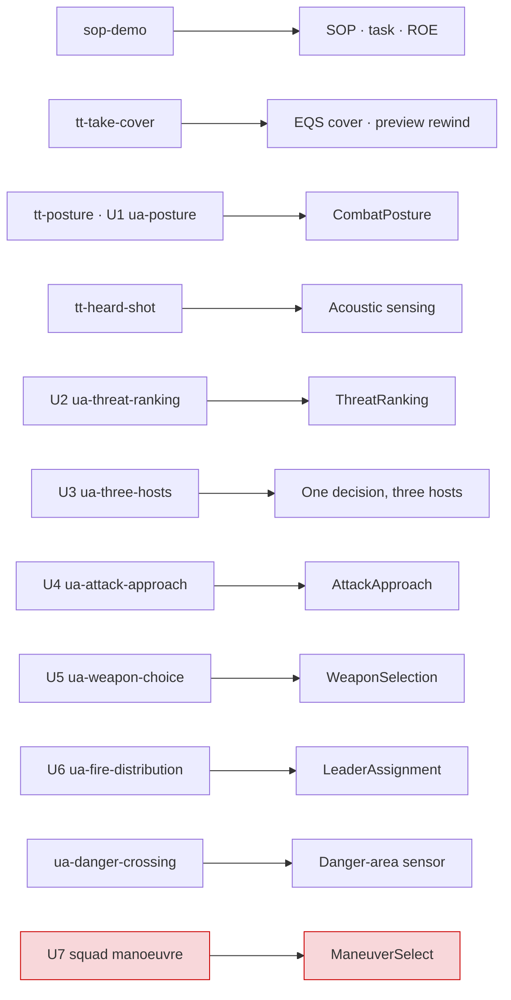
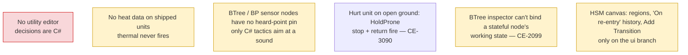
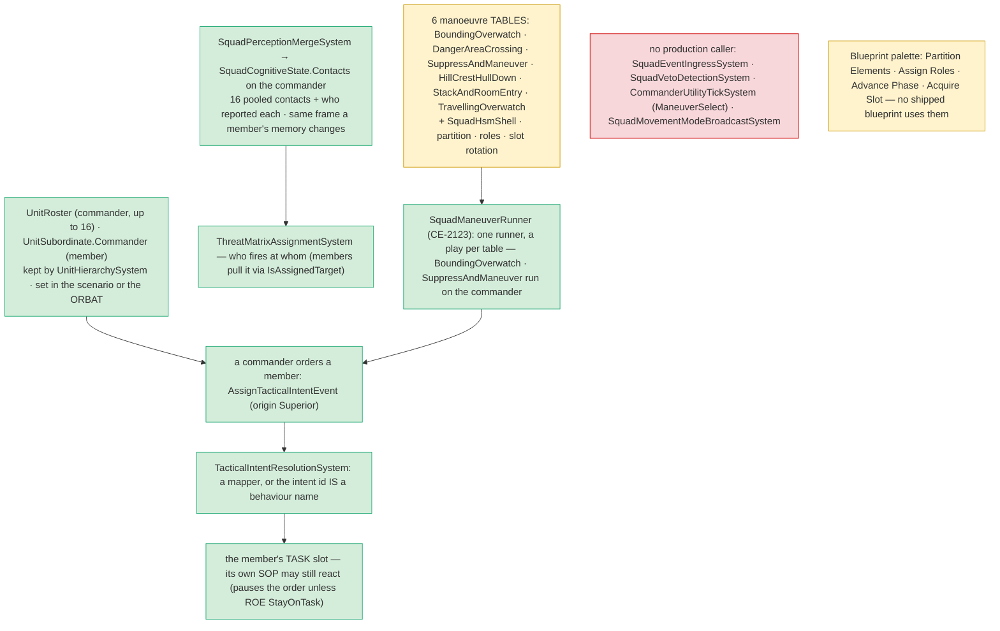

<!--STATUS
state: LIVE
updated: 2026-10-11 (§5a who can ask EQS · §9 groups: commanders, squads, orders · §10 vehicles: passengers, formations · §6 / §6a refreshed)
current-answer: the whole file — an EXPLAINER (map of what exists), not a design; every box names its owning design. ⭐ READ IT BEFORE designing any behaviour, squad or vehicle work; when you MEASURE something it does not say, ADD it here (user, 2026-10-11: "I need the guide to serve every other future you so it does not need to rederive the stuff that is available")
stale-below: none
known-rot: §1–§8 colours are a 2026-10-06 snapshot (§5a, §9, §10 measured 2026-10-11) — re-check the tracker before relying on a red or amber box
related-designs:
  - DESIGN_Peek_And_Fire.md — OWNS the library's fight-from-cover node (§10, CE-3158) that CombatPosture's TakeCover runs.
  - REVIEW_Behaviour_Library_Genericity.md — OWNS the genericity verdict on these blocks (library vs demo-local vs legacy) and the leans L1–L7.
  - docs/TUTORIAL_Behaviour_Composition.md — the GUIDE to choosing between blocks (host, decision, starter, sensing) and composing them
  - docs/DESIGN_Decision_Layer.md — owns task/SOP/reaction slots, ROE, utility hosting in BTree/HSM/blueprint (§3, §4)
  - docs/DESIGN_Sensors_And_Doctrine.md — owns sensor kinds, sensor children, memory stage, threat = danger × freshness (§5–§7)
  - docs/DESIGN_Thermal_And_Acoustic_Sensing.md — owns thermal / acoustic sensing and anonymous heard contacts
  - docs/designs/eqs-2/EQS_Design_v1.3_final.md — owns EQS generators, tests, contexts, templates (§19 as-built)
  - docs/DESIGN_Eqs_Consuming_Behaviours.md — owns the EQS tactics nodes (TakeCover / FallBack / Flank / FiringPosition)
  - docs/DESIGN_Utility_AI_Demo_Scenarios.md — owns the U1–U7 demo scenarios and the danger-area sensor
  - docs/DESIGN_Operations_Behaviour_Catalogue.md — owns the GAP list: what modern-operations behaviours need that is not on this map yet
  - docs/designs/group-maneuvers/DESIGN_Squad_Tactics.md — owns the squad-tactics build (§9 here is its measured starting point)
  - docs/designs/group-maneuvers/Squad_Coordination_Design_v1_1.md — owns WHAT the squad layer is (primitives, manoeuvre tables, merge)
  - docs/DESIGN_Entity_Interactions.md — owns embarkation (§7, §7.1 plan) — §10 here is its measured state
-->

# Behaviour building blocks — an overview

What a behaviour author can build from **on top of** the BTree / HSM / Blueprint engines. One map per layer;
every node in the C# boxes is ONE shared implementation usable from all three hosts (R-174).

**Legend** — 🟩 built · 🟨 partial / caveat · 🟥 not built

## 1. The stack

*What the picture shows:* everything a behaviour reads flows up from perception; everything that starts a
behaviour flows down through ONE gate — no host has its own path.

## 2. Who decides — task, SOP, reaction, ROE

*Owner:* [DESIGN_Decision_Layer](DESIGN_Decision_Layer.md) §4 · R-199, R-200, R-203.

## 3. Utility decisions

*Owner:* [DESIGN_Decision_Layer](DESIGN_Decision_Layer.md) §3 · R-201 (threat = danger × freshness), R-202.
🟥 The utility editor is a placeholder — new decisions are written in C#.

## 4. Sensors → memory

*Owner:* [Sensors & Doctrine](DESIGN_Sensors_And_Doctrine.md) §5–§7 · [Thermal & Acoustic](DESIGN_Thermal_And_Acoustic_Sensing.md).
🟨 Thermal: pipeline built, **no shipped unit has heat data**. 🟥 Radar: data shape only.

## 5. EQS — "find me a good spot"

*Owner:* [EQS design](designs/eqs-2/EQS_Design_v1.3_final.md) §19 · [EQS-consuming behaviours](DESIGN_Eqs_Consuming_Behaviours.md).
🟨 Amber = built, but no shipped template uses it yet.

## 5a. Who can ask EQS, and what a query measures from *(measured 2026-10-11)*

| fact | where |
|---|---|
| ⭐ **ANY networked unit can own a query** — a soldier, a vehicle, a squad leader, even a leader with no body: a query is a child sensor of its owner (`EqsChildSensor.Ensure(view, owner, site, config)`) | `EqsChildSensor.cs:57` |
| a query measures from **slot 0** when set, else its owner (or the owner's parent) — so a body-less leader can measure from one of its members | `EqsContext.Self`, `EqsContext.cs:20-30` |
| **slot 1 / slot 2** are what it is aimed at: an entity, or a POINT (`ContextPoint1` + `Point1Bit`, e.g. a heard shot) — the owner need not have seen the entity | `EqsContext.cs:41-75`; `EqsTacticsNodes.cs:362-364` |
| it is **solved on SimHost** (the navmesh and terrain live there); the answer comes back to the owner's node | `EqsSensorConfigEgress/IngressTranslator.cs` |
| ⛔ **the AI node (CGF) has no navmesh** — a point computed there can land off the walkable area, and a move to a point more than 2 m from it FAILS (the soldier then retries forever). ⇒ **ask the terrain through EQS**, never compute a destination in the brain and hope | `DotRecastNavmeshProvider.cs:43,428-431`; `PostureNodes.cs:242-247` |

## 6. Ready-made behaviours to reuse

*What the picture shows:* the SOP and the posture decision are themselves built FROM the tactics — the same
composition an author would do.

## 6a. The library — what an author may assign, and how a block gets in *(R-256 L1)*

*What the picture shows that prose hid: a library behaviour is built only from ① nodes; ③ may use ① but nothing in ② may
use ③. CombatPosture's TakeCover option now runs the fight-from-cover node (`PeekAndFire`), so cover means "fire from it"
(Decision Layer §3.1).*

**Promotion rule — a block enters ② only when ALL four hold** *(R-256 L1)*:

| | rule | why |
|---|---|---|
| (a) | **no scenario constant** — only tunable defaults (a zero param = the default) | a constant from the demo it was born in makes it that demo's behaviour |
| (b) | **states its unit scope** — infantry / vehicle / any | e.g. `PeekAndFire` is infantry (stance or step peek) |
| (c) | **has a rail outside its originating demo** | the feature's own suite, not the scenario that motivated it |
| (d) | **is the ONE implementation of its concept** (ruling 9, R-174) | a second retreat, a second cover node is clutter — `FleeExecutor` stayed out for this (R-259) |

**Form** *(R-258)*: a library behaviour is a **BTree** (JSON or C#-built). A blueprint or HSM copy of a library behaviour is
kept only where it is not redundant or that host fits better; the three-host proof stays a DEMO (`ua-three-hosts`).

## 7. Demos — which building blocks each one exercises

*Owner:* [DESIGN_Utility_AI_Demo_Scenarios](DESIGN_Utility_AI_Demo_Scenarios.md) §4 · runbook [RUNBOOK_Utility_AI_Demos](RUNBOOK_Utility_AI_Demos.md).
🟥 U7 waits on CE-507 decisions.

## 8. Gaps to know before authoring

## 9. Groups — commanders, squads and orders *(measured 2026-10-11)*

*What the picture shows that prose hid: a squad is a COMMANDER entity plus orders — members only ever run their own behaviours
(usually `CombatPosture`) with an order's parameters; the squad's shared knowledge lives on the commander and members do NOT read
it (only through utility inputs no shipped decision uses) ⇒ a soldier knows only what it has seen itself.*

| need | how, today |
|---|---|
| make a squad | give members `UnitSubordinate.Commander` (scenario `CommanderGuid`, ORBAT drag-and-drop); the commander gets `UnitRoster` + `SquadCognitiveState` automatically |
| order a member | publish `AssignTacticalIntentEvent { Entity = member, IntentId = <behaviour name>, JsonParams, Origin = Superior }` (see `BoundingOverwatchBehavior.Order`) |
| run a squad drill | order the COMMANDER a Library/Squad behaviour (`BoundingOverwatch`, `SuppressAndManeuver`); a new drill = an `ISquadPlay` over its table on `SquadManeuverRunner` (`Brains/SquadManeuverRunner.cs`) — not a new node |
| move a member UNDER CONTACT | order `AdvanceTo { Objective, Speed, ArrivalRadius }` (Library/Infantry): it goes, firing at what it sees, and succeeds on arrival. ⛔ NOT `CombatPosture` with an objective — 📐 measured: with an enemy in sight it picks Suppress (healthy) or HoldProne (half health) and stays put; it is the HOLD order (`DESIGN_Squad_Tactics.md` §3.6) |
| know a member arrived | poll its position (the arrival events of `SquadEventIngressSystem` are dead — they key on intent ids the per-entity counter breaks) |
| what the squad knows | `SquadCognitiveState.Contacts` on the commander (entity, position, threat, last seen, `SourceMembersMask`, heard flag) — CGF only, not saved, not replicated |
| ask the terrain for the squad | the commander owns an EQS query (§5a), slot 0 = the member to measure from |
| commander-level reaction ("the squad is under fire") | ✅ (CE-2123 S2) `SquadCoordinationSystem` publishes `SensorChangedEvent{Unit = commander}` with `SquadContact` (pool 0 → >0) · `SquadUnderFire` (a member's or the leader's Hit / NearMiss) · `SquadAllClear` (pool → 0); the leader's SOP, `RecentSenses` and HSM events (`Sensor.SquadContact` …) take them exactly as a soldier's own. Give the leader the SOP `BasicSquadSop` ⇒ contact pauses its task with `ReactToContact` |
| what a squad does on contact | `ReactToContact` (Library/Squad): every member holds and returns fire for `DecideAfterSeconds`, the leader decides ONCE (`SquadContactResponseDecision` over `SquadStrengthRatio` / `SquadEnemyStrengthRatio`): assault (`SuppressAndManeuver`), `BreakContact` (its own `FindSafeRetreatPoint` query, element by element) or `SquadHold`; a drill that cannot start falls back to holding until clear. When it ends the paused task resumes — the runner re-takes the squad state another drill used (S2-G) |
| the unit's commander (R-272) | ✅ `CE-2125`: a body-less entity — a TKB COMPOSITE type (e.g. `Unit_InfantrySquad` 302) gets `UnitEntity` on every node; the perception grid and the EQS area search skip it (`PhysicalPresence.IsHidden`, the one check R-271's hidden passenger will join); its owner (CGF) places it at its LIVE members' centroid (`UnitCentroidSystem`, CE-514). It runs the squad SOP and drills; the leader soldier is a member designated `SquadLeader` with his own soldier SOP |
| the leader soldier falls | ✅ `CE-2125`: the first live `TeamLeader`, else the first live member, becomes `SquadLeader` (CGF-local); the commander is SILENT for its type's `CommandDisruptionSeconds` (6 s — the squad runner sends no orders, members keep theirs), then re-sends every order; `SquadLeaderDown` on the commander — `BasicSquadSop` reacts with `ReactToContact`, and a running `ReactToContact` holds and decides again |
| a commander is a soldier or a body-less entity | both exist: `ua-fire-distribution`'s Leader is a rifleman; `hill-attack-close`'s platoon has no body |

*Owners:* [Squad_Coordination_Design_v1_1](designs/group-maneuvers/Squad_Coordination_Design_v1_1.md) (what) ·
[DESIGN_Squad_Wiring](designs/group-maneuvers/DESIGN_Squad_Wiring.md) (where it runs) ·
[DESIGN_Squad_Tactics](designs/group-maneuvers/DESIGN_Squad_Tactics.md) (the runner, react to contact, the march).

## 10. Vehicles — passengers and formations *(measured 2026-10-11)*

| mechanism | state | detail |
|---|---|---|
| **eject everyone** (`EjectPassengersExecutor`) | 🟨 runs on CGF + Editor only; NOT replicated — SimHost and viewers never see the soldiers leave | triggered only by the example APC HSM or a blueprint `EjectPassengers` node |
| **board** (`EmbarkExecutor`) | 🟥 constructed only by its unit test; no host registers it | — |
| **one soldier gets out** | 🟥 only the editor's authoring path (`EditorCargoSystem`) | — |
| what "inside" means today | 🟥 only CanMove / CanShoot stripped: not carried, not hidden, still seen and shot | `IsEmbarkedTag { VehicleEntity }` exists on the passenger; nothing reads it |
| ⭐ the plan (user-approved) | I-2a one applier → I-2b `PassengerBuffer` replicated, passenger side derived on CGF and SimHost → I-2c inside = carried, hidden, unseen, dies with the vehicle → I-2d AI nodes + the squad dismount | [`DESIGN_Entity_Interactions.md`](DESIGN_Entity_Interactions.md) §7.1 · `CE-3110` |
| **formations** (`FormationController` / `FormationFollower` / `FormationTargetSystem`, CarKinem) | 🟥 for AI: works only in the standalone CarKinem example. `JoinFormation`'s params are empty, `VehicleAPI` is never built in production, nothing carries a join from CGF to SimHost; followers steer straight at a slot with no path finding | proper formations = their own programme, `CE-2124` |
| ⭐ squad formation **for now** | a `SquadMarch` play: members ordered to slot points behind the lead, falling back to single file on the lead's breadcrumbs | [`DESIGN_Squad_Tactics.md`](designs/group-maneuvers/DESIGN_Squad_Tactics.md) §6.1 |
