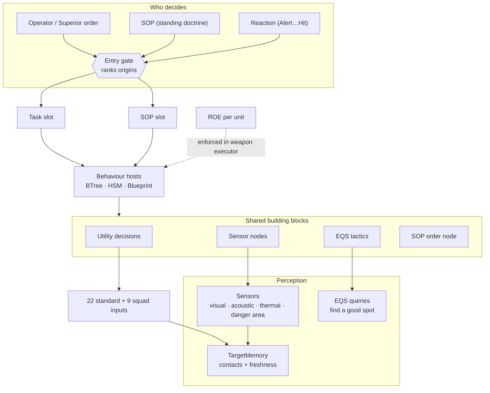
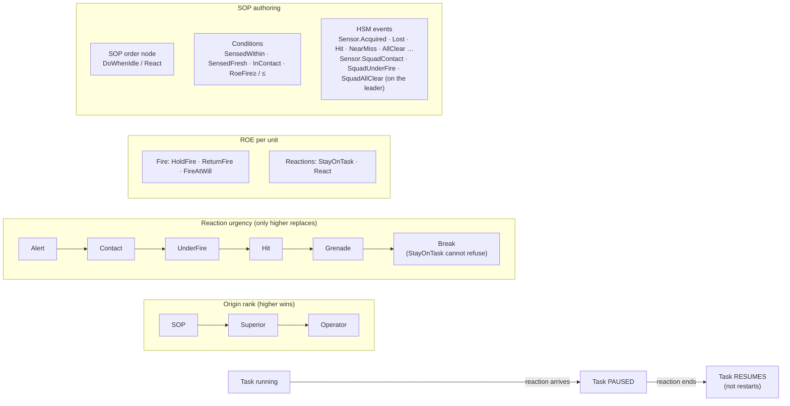
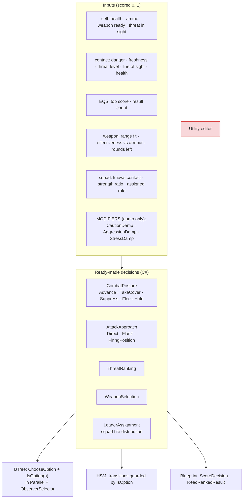
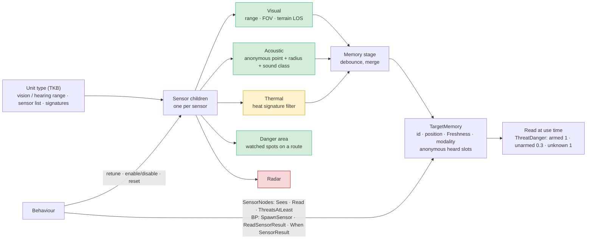
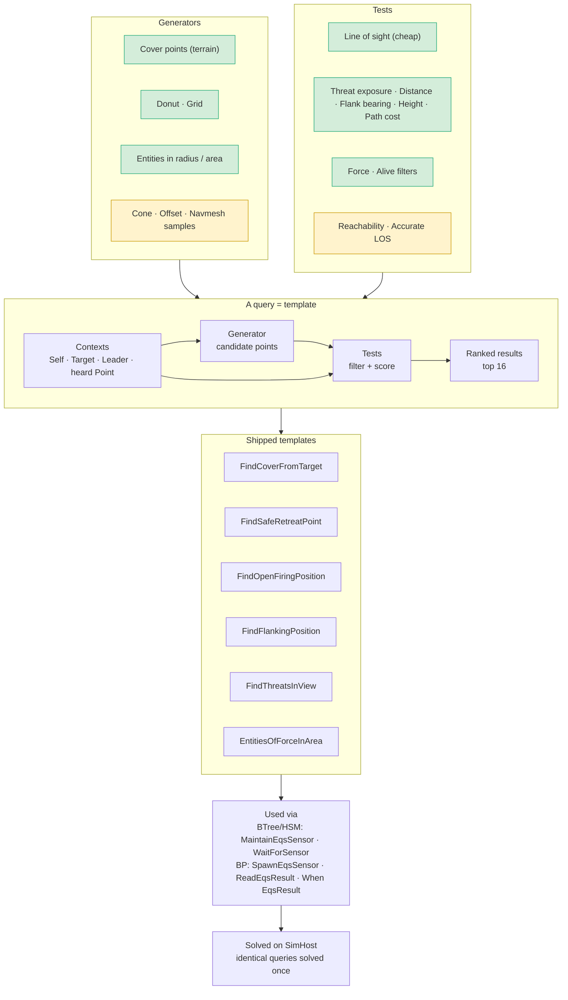
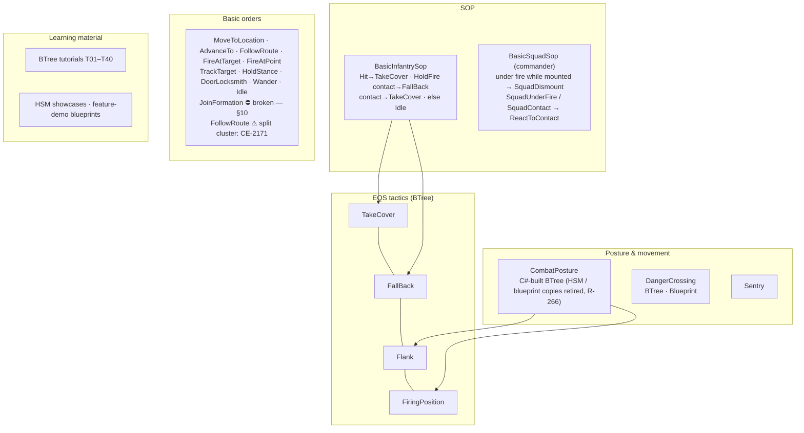
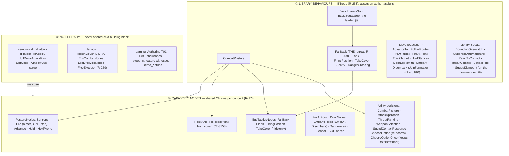
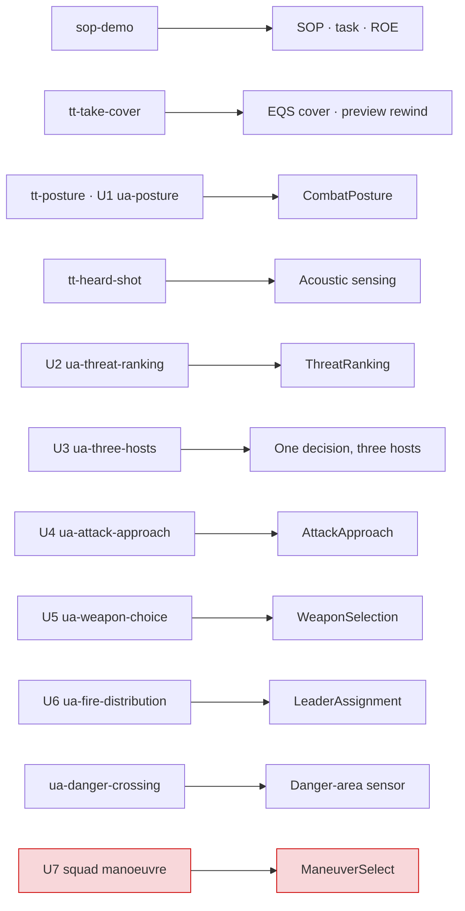
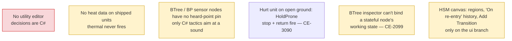
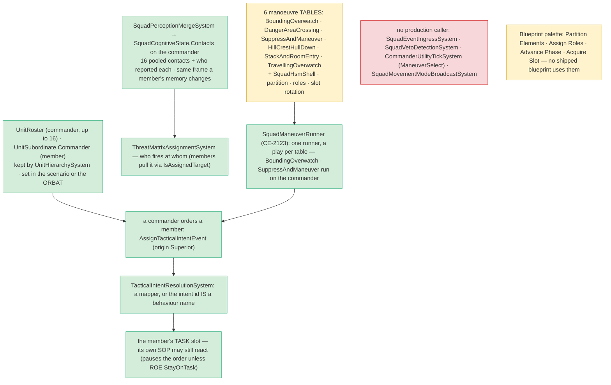

<!--STATUS
state: LIVE
updated: 2026-10-13 (§9 params box: defaults R-3001/R-3002, no variable kinds, fluent HSM binding · §5a who can ask EQS · §9 groups: commanders, squads, orders · §10 vehicles: passengers, formations · §6 / §6a refreshed)
current-answer: the whole file — an EXPLAINER (map of what exists), not a design; every box names its owning design. ⭐ READ IT BEFORE designing any behaviour, squad or vehicle work; when you MEASURE something it does not say, ADD it here (user, 2026-10-11: "I need the guide to serve every other future you so it does not need to rederive the stuff that is available")
stale-below: none
known-rot: §1–§8 colours are a 2026-10-06 snapshot (§5a, §9, §10 measured 2026-10-11) — re-check the tracker before relying on a red or amber box
related-designs:
  - docs/DESIGN_Scenario_Rules.md — a scenario-level brain on the World Environment entity, built from data with these same primitives (rev 3)
  - docs/REFERENCE_Command_Building_Blocks_Measured.md — the MEASURED command-and-control blocks (storage, unit memory, orders, the gate, SOP, edges, guards), symbol by symbol; start a command design there
  - docs/designs/group-maneuvers/DESIGN_Command_Chain_Example.md — a worked two-level command chain on those blocks (orders down, requirements down, reports up)
  - OVERVIEW_Rules_And_Demos.md — the INDEX of the doctrine RULES and DEMOS built on this machinery (rule → behaviour/system/sensor → demo)
  - DESIGN_Injury_States.md — OWNS the injury states (CE-2155) that §8a summarises
  - DESIGN_Orders_Params_Entity_Classes.md — OWNS orders, params DTOs and entity classes (rules built 2026-10-12/13; the §9 order box was refreshed 2026-10-13, P7)
  - DESIGN_Peek_And_Fire.md — OWNS the library's fight-from-cover node (§10, CE-3158) that CombatPosture's TakeCover runs.
  - REVIEW_Behaviour_Library_Genericity.md — OWNS the genericity verdict on these blocks (library vs demo-local vs legacy) and the leans L1–L7.
  - docs/TUTORIAL_Behaviour_Composition.md — the GUIDE to choosing between blocks (host, decision, starter, sensing) and composing them
  - docs/DESIGN_Decision_Layer.md — owns task/SOP/reaction slots, ROE, utility hosting in BTree/HSM/blueprint (§3, §4)
  - docs/DESIGN_Sensors_And_Doctrine.md — owns sensor kinds, sensor children, memory stage, threat = danger × freshness (§5–§7)
  - docs/DESIGN_Thermal_And_Acoustic_Sensing.md — owns thermal / acoustic sensing and anonymous heard contacts
  - docs/designs/eqs-2/EQS_Design_v1.3_final.md — owns EQS generators, tests, contexts, templates (§19 as-built)
  - docs/DESIGN_Eqs_Consuming_Behaviours.md — owns the EQS tactics nodes (TakeCover / FallBack / Flank / FiringPosition)
  - docs/DESIGN_Utility_AI_Demo_Scenarios.md — owns the U1–U7 demo scenarios and the danger-area sensor
  - docs/DESIGN_Operations_Behaviour_Catalogue.md — owns the GAP list: what modern-operations behaviours need that is not on this map yet
  - docs/designs/group-maneuvers/DESIGN_Squad_Tactics.md — owns the squad-tactics build (§9 here is its measured starting point)
  - docs/designs/group-maneuvers/Squad_Coordination_Design_v1_1.md — owns WHAT the squad layer is (primitives, manoeuvre tables, merge)
  - docs/DESIGN_Entity_Interactions.md — owns embarkation (§7, §7.1 plan) — §10 here is its measured state
  - docs/designs/vehicle-tactics/DESIGN_Urban_Armour_Tactics.md — owns the urban tank tactics proposal (hide / expose / reverse, danger to me); §10b here is its measured ground
  - docs/designs/group-maneuvers/DESIGN_Building_Clearing.md — OWNS the building-clearing drill (Battle Drill 6: stack, breach, points of domination, sectors, controlling and searching civilians, room order) — the room-clearing drill, a new ISquadPlay (design stage)
  - docs/DESIGN_Temperament_And_Stress.md — OWNS combatants' temperament (Nerve and Resolve added to AQ89's CombatTemperament beside RiskAcceptance and Obedience) and live stress; the per-man character layer under the posture decision (TS-A…TS-D built 2026-10-24 — TS-C as modifiers, R-2075; §7 there)
-->

# Behaviour building blocks — an overview

What a behaviour author can build from **on top of** the BTree / HSM / Blueprint engines. One map per layer;
every node in the C# boxes is ONE shared implementation usable from all three hosts (R-174).

**Legend** — 🟩 built · 🟨 partial / caveat · 🟥 not built

## 1. The stack

*What the picture shows:* everything a behaviour reads flows up from perception; everything that starts a
behaviour flows down through ONE gate — no host has its own path.

## 2. Who decides — task, SOP, reaction, ROE

*Owner:* [DESIGN_Decision_Layer](DESIGN_Decision_Layer.md) §4 · R-199, R-200, R-203.

### 2a. What a unit does with NO order *(AQ97, R-2062, built 2026-10-20)*

| unit | its TKB default | what it does by itself | to stop it |
|---|---|---|---|
| a soldier (rifleman, gunners, snipers, AT, insurgent, paratrooper…) | SOP `BasicInfantrySop` | idles; hit or near-missed ⇒ take cover; a threat seen or heard ⇒ take cover (withdraw under hold-fire). ⛔ Stands aside under a live commander or aboard a vehicle | `Sop: InertSop` |
| a civilian (1101–1104) | task `CivilianHsm` + SOP `CivilianSop` | his routine with its own fear; on any OTHER task his fear still reacts (`CivilianReact`), then the task restarts | `Sop: InertSop` (+ `Idle` for no routine) |
| a pilot | SOP `PilotSop` | down on the ground ⇒ evade and signal | `Sop: InertSop` |

⚠ An absent `Sop` key now means the TYPE'S DEFAULT. ⛔ So a scenario that wants a brain-dead unit says `InertSop`.

⭐ **Where they live (CE-1410, R-1042, `2026-10-27`):** the shipped SOPs, the library tactics (`TakeCover`, `FallBack`, `Flank`, `FiringPosition`, `Sentry`, `DangerCrossing`) and the hill-attack trees are **C#-built** — `Hrot.AI.Behaviors/Brains/*Sop.cs`, `LibraryTactics.cs`, `DangerCrossing.cs`, `HillAttackTrees.cs`: a `Blackboard` struct whose constructor is the tuning, rows written `.Sequence(row => row.Condition(…).React(name, urgency))`. The editor shows them read-only, laid out automatically. `.btree.json` is what the EDITOR saves (a designer's own SOP); its `SopOrder` node binds the same key. 📄 [DESIGN_Behavior_Self_Registration §10d](blueprints/DESIGN_Behavior_Self_Registration.md).

## 3. Utility decisions

*Owner:* [DESIGN_Decision_Layer](DESIGN_Decision_Layer.md) §3 · R-201 (threat = danger × freshness), R-202.
🟥 The utility editor is a placeholder — new decisions are written in C#.
⭐ **`.Consider` vs `.Modify`** *(R-2075)*: a consideration is a factor of the option's aggregate and the product's compensation COUNTS it — even
one that reads 1.0 moves the score. An input that may only ever damp an option is a `.Modify` (multiplied after the aggregate, not
counted ⇒ 1.0 is bit-identical). 📄 [Utility AI §4.3a](designs/utility-ai/Utility_AI_Design_v1_1.md).

## 4. Sensors → memory

*Owner:* [Sensors & Doctrine](DESIGN_Sensors_And_Doctrine.md) §5–§7 · [Thermal & Acoustic](DESIGN_Thermal_And_Acoustic_Sensing.md).
🟨 Thermal: pipeline built, **no shipped unit has heat data**. 🟥 Radar: data shape only.

## 5. EQS — "find me a good spot"

*Owner:* [EQS design](designs/eqs-2/EQS_Design_v1.3_final.md) §19 · [EQS-consuming behaviours](DESIGN_Eqs_Consuming_Behaviours.md).
🟨 Amber = built, but no shipped template uses it yet.

## 5a. Who can ask EQS, and what a query measures from *(measured 2026-10-11)*

| fact | where |
|---|---|
| ⭐ **ANY networked unit can own a query** — a soldier, a vehicle, a squad leader, even a leader with no body: a query is a child sensor of its owner (`EqsChildSensor.Ensure(view, owner, site, config)`) | `EqsChildSensor.cs:57` |
| a query measures from **slot 0** when set, else its owner (or the owner's parent) — so a body-less leader can measure from one of its members | `EqsContext.Self`, `EqsContext.cs:20-30` |
| **slot 1 / slot 2** are what it is aimed at: an entity, or a POINT (`ContextPoint1` + `Point1Bit`, e.g. a heard shot) — the owner need not have seen the entity | `EqsContext.cs:41-75`; `EqsTacticsNodes.cs:362-364` |
| it is **solved on SimHost** (the navmesh and terrain live there); the answer comes back to the owner's node | `EqsSensorConfigEgress/IngressTranslator.cs` |
| ⛔ **the AI node (CGF) has no navmesh** — a point computed there can land off the walkable area, and a move to a point more than 2 m from it FAILS (the soldier then retries forever). ⇒ **ask the terrain through EQS**, never compute a destination in the brain and hope | `DotRecastNavmeshProvider.cs:43,428-431`; `PostureNodes.cs:242-247` |
| ⛔⛔ **R-2037 — the brain never reads world geometry** (sight, buildings, surfaces): ask the muscle (EQS, or the `WorldSurvey` sensor designed in [Defend_And_Attack §13b](designs/group-maneuvers/DESIGN_Defend_And_Attack_Position.md)) and decide on the answer. ⭐ the brain's terrain exists to DRAW THE MAP (user, 2026-10-18). ⚠ Measured 2026-10-18: several brain sites still read `IWorldQuery` directly — tracked defects `CE-2286` (behaviors) and `CE-2287` (backend's) — do not copy them | 🔒 R-2037 |

## 6. Ready-made behaviours to reuse

*What the picture shows:* the SOP and the posture decision are themselves built FROM the tactics — the same
composition an author would do.

## 6a. The library — what an author may assign, and how a block gets in *(R-256 L1)*

*What the picture shows that prose hid: a library behaviour is built only from ① nodes; ③ may use ① but nothing in ② may
use ③. CombatPosture's TakeCover option now runs the fight-from-cover node (`PeekAndFire`), so cover means "fire from it"
(Decision Layer §3.1).*

**Promotion rule — a block enters ② only when ALL four hold** *(R-256 L1)*:

| | rule | why |
|---|---|---|
| (a) | **no scenario constant** — only tunable defaults (a zero param = the default) | a constant from the demo it was born in makes it that demo's behaviour |
| (b) | **states its unit scope** — infantry / vehicle / any | e.g. `PeekAndFire` is infantry (stance or step peek) |
| (c) | **has a rail outside its originating demo** | the feature's own suite, not the scenario that motivated it |
| (d) | **is the ONE implementation of its concept** (ruling 9, R-174) | a second retreat, a second cover node is clutter — `FleeExecutor` stayed out for this (R-259) |

**Form** *(R-258)*: a library behaviour is a **BTree** (JSON or C#-built). A blueprint or HSM copy of a library behaviour is
kept only where it is not redundant or that host fits better; the three-host proof stays a DEMO (`ua-three-hosts`).

## 7. Demos — which building blocks each one exercises

*Owner:* [DESIGN_Utility_AI_Demo_Scenarios](DESIGN_Utility_AI_Demo_Scenarios.md) §4 · runbook [RUNBOOK_Utility_AI_Demos](RUNBOOK_Utility_AI_Demos.md).
🟥 U7 waits on CE-507 decisions.

## 8. Gaps to know before authoring

## 7a. Moving under fire — what every soldier's move does by itself *(AQ96, R-2061, built 2026-10-20)*

⭐ A behaviour does NOTHING to get this: any move a play issues through `LocomotionMoveTo.Issue` (gait `Tactical` or `Crouched`, a person)
is kept by `UnderFireMoveSystem`. ⛔ So do not build a per-play "go prone when shot at" — it would fight the reflex.

| | what happens | where |
|---|---|---|
| threatened mid-move | the gait re-picks (crouched) and the move rushes (≥ 4 m/s; the crouched cap makes 3) — the asked speed is the pace out of contact | `UnderFire.Step` · `LocomotionMoveTo.Issue` |
| a near miss / hit in the open | prone, the move halted (the play still sees Running); down while fired on; up after a 3 s lapse, or when his half is covered (`UnderFire.MarkCovered`, stamped by `FireAndMovement`); a 1.5 m side step first; a crawl to cover within 10 m | `UnderFireMove` (component 418) · `MoveToExecutor` ignores the reflex's own intents (`HoldIntentId`) |
| a move to cover | crouched, at least the rush speed (PeekAndFire's hides, every EQS tactics move) | `PeekAndFireNodes` · `EqsTacticsNodes` |
| not kept | `Upright` (civilians) and `Keep` moves, vehicles, a man carrying a casualty (no drop) | — |

📄 [AQ96](blueprints/Architect_Question_96_Movement_Under_Fire.md) §6 · demos `uf-alone-under-fire`, `uf-squad-under-fire`.

**Where a round is aimed, and where a man shoots from** *(R-2064, built `2026-10-20`)*

| | what happens | where |
|---|---|---|
| the aim at a person | his CHEST, for his pose (the torso box of the boxes his hits are taken on, part way to the head); the chest seen just over a cover that stops a round ⇒ the middle of what shows; hidden behind a weak cover ⇒ still the chest, through it. A vehicle: the middle of its hull | `AimPoint.Middle` / `AimPoint.For` |
| a masked muzzle | the MUSCLE refuses a round its own line stops within 2 m (R-3018), judged on the line it would fly | `LineOfFire.MuzzleMasked` in `FireProcessingSystem` |
| look vs shoot | a step-out spot may only SEE (he looks from it); before aimed fire or a burst he steps on to the nearest spot the firing-position search marked "a round clears from here", or goes back down | `CheapLineOfSightTest.MarkFireClear` · `PeekAndFireNodes.StepToShoot` |

📄 [`DESIGN_Peek_And_Fire.md`](DESIGN_Peek_And_Fire.md) §11 · demo `bt-window-duel`.

## 7b. Stress, the break, idle life — what every person does by himself *(R-2034, R-2074, built 2026-10-24)*

⭐ Like 7a, a behaviour does NOTHING to get these; ⛔ do not build a per-play "panic" or "fidget" — it would fight them.

| | what happens | where |
|---|---|---|
| **temperament** | `CombatTemperament`: RiskAcceptance · Obedience · Nerve · Resolve, authored › the TKB type's (`TemperamentDto`, ± a seeded spread) › the default; `TemperamentOf.Effective` tempers a trait by obedience — toward a TRAINED standard (nerve 0.75 · resolve 0.6 · bravery 0.5, R-2076), so the ordinary man (raw 0.5, obedience 0.8) acts with nerve 0.70: discipline steadies, it does not just average | `Behavior/Components/CombatTemperament.cs` |
| **stress** (combatants) | `Stress` 0–1 from near misses, hits, a friend down near him, outnumbered, alone; × his nerve; calms with time, cover, his leader | `StressModel` / `StressSystem` (CGF) |
| **the break** | at his effective nerve: surrenders (low resolve, a rifle on him) or `Break` (no fire, run to cover away from the threat, prone) — a reaction even ROE StayOnTask allows; `Sensor.StressBreak` / `StressRecovered` on the bus | `StressModel.Judge` · `BreakBehavior` |
| **idle life** (every person) | still 6 s and held by nothing ⇒ a small step now and then (≤ 3 m from where he settled), a crawl lying, R2-3's scoot lying under fire; nervous ⇒ sooner and further, even weapon up; in cover the step stays behind it. Relaxed ⇒ an idle gesture (smoke, shift weight, stretch, look about — the last moves his real eyes) | `Restlessness` / `RestlessHolds` · [AQ103](blueprints/Architect_Question_103_Idle_Life.md) §7 |
| **a nervous head** | a scanning man's fixations shrink 2 s ⇒ 0.4 s, in no fixed order, the head snapping | `LookAt.Want` |
| to keep a man still | an order to stay (an ordered `Idle` / `PersonHold` / `HoldStance` / `Sentry`, a posture with `stay` or a `post`), an ambush or a trigger man, possession | `RestlessHolds.Holds` |

📄 [Temperament & Stress](DESIGN_Temperament_And_Stress.md) §7 · [AQ103](blueprints/Architect_Question_103_Idle_Life.md) · demo `il-idle-life`.

## 8a. Hurt, down, dead — what a behaviour can rely on *(CE-2155, measured and built 2026-10-13)*

| question | ✅ answer | where |
|---|---|---|
| the states | ok · wounded · incapacitated · dead, DERIVED from `Health` and the type's `Gen.Injury` band (no stored state, no topic) | `Combat/Injury.cs` — `Injury.StateOf` |
| who has a band | types that declare `Gen.Injury`: BDC rifleman, the four UrbanCombat soldier types. Everything else: ok until dead | [`DESIGN_Injury_States.md`](DESIGN_Injury_States.md) §8 |
| what "down" does | no move, no fire (stripped in `CombatLife.ApplyHitCapabilities`, enforced by the weapon / locomotion dispatchers); bleeds to death on the `Health` owner (`BleedOutSystem`) | §8 |
| is he a threat / a target | no — `ThreatDanger.IsOutOfTheFight` (danger 0; `HaveLiveTarget`, `ThreatInSight`, the squad strength sum) and the EQS `AliveFilterTest` all skip him. A blast still hits him. ⭐ *(CE-2318, 2026-10-20)* **any "is this enemy still a target" test asks `Injury.IsInTheFight`, never `CombatLife.IsAlive`** (Health > 0 — that is for health questions: he died, a friend in the burst, own men); and a man down LIES — `LogicalStance.Of` answers Prone, so aim, sight and the round's band follow the lying body | §8 ①, §8a |
| ⚠ the "wounded" a decision reads today | still the `HealthFraction` input (CE-3090's curves), not the state — the state's speed / aim effects are slice I-b | §6 I5 |
| ⭐ a wounded LEG / ARM *(CE-3210, built 2026-10-16)* | a round meets a PART (head, torso, a limb); the Health owner keeps a level per part (`PartDamage`), and every node DERIVES the wound: a leg zone over its threshold ⇒ `Injury.SpeedFactor` slows him (the type's wounded factor, else 0.6) whatever his overall state; an arm ⇒ his aim σ × 1.6 (`HitModel.Sigma`). ⚠ No decision input reads them yet — a behaviour sees only the slower move and the worse aim | `Physics/BodyParts/Wounds.cs` · [hit-location design](designs/hit-location/DESIGN_Body_Parts_And_Hit_Location.md) §8 |

## 9. Groups — commanders, squads and orders *(measured 2026-10-11)*

*What the picture shows that prose hid: a squad is a COMMANDER entity plus orders — members only ever run their own behaviours
(usually `CombatPosture`) with an order's parameters; the squad's shared knowledge lives on the commander and members do NOT read
it (only through utility inputs no shipped decision uses) ⇒ a soldier knows only what it has seen itself.*

| need | how, today |
|---|---|
| make a squad | give members `UnitSubordinate.Commander` (scenario `CommanderGuid`, ORBAT drag-and-drop); the commander gets `UnitRoster` + `SquadCognitiveState` automatically |
| order a member | publish `AssignTacticalIntentEvent { Entity = member, IntentId = <behaviour name>, JsonParams, Origin = Superior }` (see `BoundingOverwatchBehavior.Order`) |
| run a squad drill | order the COMMANDER a Library/Squad behaviour (`BoundingOverwatch`, `SuppressAndManeuver`); a new drill = an `ISquadPlay` over its table on `SquadManeuverRunner` (`Brains/SquadManeuverRunner.cs`) — not a new node |
| move a member UNDER CONTACT | order `AdvanceTo { Objective, Speed, ArrivalRadius }` (Library/Infantry): it goes, firing at what it sees, and succeeds on arrival. ⛔ NOT `CombatPosture` with an objective — 📐 measured: with an enemy in sight it picks Suppress (healthy) or HoldProne (half health) and stays put; it is the HOLD order (`DESIGN_Squad_Tactics.md` §3.6) |
| know a member arrived | poll its position (the arrival events of `SquadEventIngressSystem` are dead — they key on intent ids the per-entity counter breaks) |
| what the squad knows | `SquadCognitiveState.Contacts` on the commander (entity, position, threat, last seen, `SourceMembersMask`, heard flag) — CGF only, not saved, not replicated |
| ask the terrain for the squad | the commander owns an EQS query (§5a), slot 0 = the member to measure from |
| commander-level reaction ("the squad is under fire") | ✅ (CE-2123 S2) `SquadCoordinationSystem` publishes `SensorChangedEvent{Unit = commander}` with `SquadContact` (pool 0 → >0) · `SquadUnderFire` (a member's or the leader's Hit / NearMiss) · `SquadAllClear` (pool → 0); the leader's SOP, `RecentSenses` and HSM events (`Sensor.SquadContact` …) take them exactly as a soldier's own. Give the leader the SOP `BasicSquadSop` ⇒ contact pauses its task with `ReactToContact` |
| what a squad does on contact | `ReactToContact` (Library/Squad): every member holds and returns fire for `DecideAfterSeconds`, the leader decides ONCE (`SquadContactResponseDecision` over `SquadStrengthRatio` / `SquadEnemyStrengthRatio`): assault (`SuppressAndManeuver`), `BreakContact` (its own `FindSafeRetreatPoint` query, element by element) or `SquadHold`; a drill that cannot start falls back to holding until clear. When it ends the paused task resumes — the runner re-takes the squad state another drill used (S2-G) |
| the unit's commander (R-272 (behaviors)) | ✅ `CE-2125`: a body-less entity — a TKB COMPOSITE type (e.g. `Unit_InfantrySquad` 302) gets `UnitEntity` on every node; the perception grid and the EQS area search skip it (`PhysicalPresence.IsHidden`, the one hidden check — since I-2c it also hides an enclosed passenger and guards the collider hash, the blast and the line-of-sight occluders); its owner (CGF) places it at its LIVE members' centroid (`UnitCentroidSystem`, CE-514). It never boards and carries nobody (`Embarkation.TryEmbark` refuses either way — its members board). It runs the squad SOP and drills; the leader soldier is a member designated `SquadLeader` with his own soldier SOP |
| the leader soldier falls | ✅ `CE-2125`: the first live `TeamLeader`, else the first live member, becomes `SquadLeader` (CGF-local); the commander is SILENT for its type's `CommandDisruptionSeconds` (6 s — the squad runner sends no orders, members keep theirs), then re-sends every order; `SquadLeaderDown` on the commander — `BasicSquadSop` reacts with `ReactToContact`, and a running `ReactToContact` holds and decides again |
| a commander is a soldier or a body-less entity | both exist: `ua-fire-distribution`'s Leader is a rifleman; `hill-attack-close`'s platoon has no body |

*Owners:* [Squad_Coordination_Design_v1_1](designs/group-maneuvers/Squad_Coordination_Design_v1_1.md) (what) ·
[DESIGN_Squad_Wiring](designs/group-maneuvers/DESIGN_Squad_Wiring.md) (where it runs) ·
[DESIGN_Squad_Tactics](designs/group-maneuvers/DESIGN_Squad_Tactics.md) (the runner, react to contact, the march).

> ⭐ **Orders, params DTOs and entity classes — BUILT (2026-10-12/13); owner: [DESIGN_Orders_Params_Entity_Classes.md](DESIGN_Orders_Params_Entity_Classes.md).**
> - one params DTO per behaviour: `[Behavior(Params = …)]`, or an asset's `ParamsDtoTypeId`; `NoParams` when it takes nothing (§1 P1, §5b);
> - flat JSON, case-insensitive through the one shared `FdpJsonOptionsRegistry.DefaultRelaxed`, enums as strings; DTOs are plain public FIELDS (§1 P2, §13.1 F12, §13.6);
> - every DTO carries `[ParamsDto]` (a `[Dto]` in Fdp.Core recording its origin), read by one `ParamsDtoRegistry`; a `.params.json` asset generates one (§13.7, §12); a mandatory field is `[Required]` (§13.1 F5, §13.11);
> - orders: `<Class><Order>` by the entity's DIS class (§8), one generic menu / RTS / HTTP path (§9), `GET /orders` lists them (§13.11); per-unit designations (target, point, route, area) fill a missing `[Required]` field on the sender (§13.3);
> - defaults *(R-3001/R-3002, CE-3194)*: a DTO's own defaults are its field INITIALISERS (+ a parameterless constructor) — never an attribute; an asset (BTree / HSM / blueprint) overrides single fields in `ParamsDefaultJson`; the bake is `new T()` → the asset's overrides → the order's JSON (`ParamsDefaults`, §13.10a);
> - no variable kinds *(CE-3193)*: a blueprint names its DTO and its Parameters are the DTO's fields (no declared Parameters); a BTree / HSM variable has no `Role` / `Scope` — working state is the variable a binding names as its `WorkingStateTargetField` (§13.10 ⑦);
> - a hand-written (fluent C#) HSM binds params and working state by selector, `state.Activity(bb => bb.Order, bb => bb.State, Run)`, and every HSM action reads its OWN block, so a hosted HSM is correct (CE-3163, [DESIGN_Behavior_Action_Binding](blueprints/DESIGN_Behavior_Action_Binding.md) §5.7);
> - the floating order form is built (P5b, CE-1059); editor panels show `Params`' fields and pick the DTO (CE-1061); not yet: editing an asset's defaults in the editor (CE-1061 U5b, ui) and the params-asset editor (B4b, postponed).

## 10. Vehicles — passengers and formations *(measured 2026-10-11; passengers updated 2026-10-12)*

| mechanism | state | detail |
|---|---|---|
| ⭐ **board / get out / eject** | ✅ `2026-10-12` (CE-3110 I-2a/I-2b): ONE rules class `Embarkation` and ONE applier `EmbarkationSystem`, which runs only where the vehicle's passenger list (`dtPassengerBuffer`, Brain group) is owned; the AI executors (`EmbarkExecutor`, `EjectPassengersExecutor`) raise commands that the interaction transport carries to that owner. The list replicates; `EmbarkedStateSystem` derives the passenger side on every node | [`DESIGN_Entity_Interactions.md`](DESIGN_Entity_Interactions.md) §7.1b, §7.1d |
| ⭐ where it runs | ✅ every node that can own a live entity: the cross-role `CoreInfrastructureCapabilities.Interactions` (doors + embarkation) in every host's plan — never a host or a role pack | §7.1d |
| ⭐ what "inside" means | ✅ `2026-10-12` (I-2c, R-271): CARRIED (the passenger's position owner copies the vehicle's transform; kinematics skips an embarked body), HIDDEN when the cabin is enclosed (`PhysicalPresence.IsHidden` — the perception grid, the EQS area search, the collider hash for bullets / near misses / radius search / avoidance, the blast and line-of-sight occluders all ask it), DIES when the vehicle is destroyed (a lethal damage event on the node owning its Health). An OPEN cabin type (TKB `VehicleParametersDto.PassengerExposure = Open` → `OpenPassengerCabin`) carries without hiding. CanMove / CanShoot are stripped aboard; boarding is not "mobility lost" | §7.2, §7.2a |
| ⚠ a vehicle feeling a hit *(measured 2026-10-12, CE-1056)* | a unit's `Hit` edge comes from `ThreatEvaluationSystem`, which walks units WITH a `TargetMemory` (`ThreatEvaluationSystem.cs:76`); a vehicle type without sensors (the APC 2001) has none ⇒ no Hit edge, no `SquadUnderFire` for the squad it carries. `tt-convoy-ambush` authors an empty `TargetMemory` on the APC | Squad Tactics §5a.1 |
| ⭐ the plan (user-approved) | I-2a ✅ → I-2b ✅ → I-2c ✅ → I-2d ✅ `2026-10-12` (`CE-1056`): the AI asks — `Embark` (walks to the boarding point beside the hull, then the embark action) / `Disembark` (one passenger, interaction action 2, `DisembarkExecutor`), library behaviours of the same names; the squad `SquadDismount` drill (everyone out, done when nobody is aboard); a CARRIER's hit / near miss puts the squad it carries under fire, and `BasicSquadSop`'s first row is "under fire while mounted → SquadDismount" | §7.1 / §7.3 · Squad Tactics §5a · `CE-3110` · `CE-1056` |
| **formations** (`FormationController` / `FormationFollower` / `FormationTargetSystem`, CarKinem) | 🟥 for AI: works only in the standalone CarKinem example. `JoinFormation`'s params are empty, `VehicleAPI` is never built in production, nothing carries a join from CGF to SimHost; followers steer straight at a slot with no path finding | proper formations = their own programme, `CE-2124` |
| ⭐ squad formation **for now** | ✅ BUILT `2026-10-12`: Library/Squad `SquadMarch` (File / Wedge / Line) — the point man nearest the objective leads, the others keep slots on it and fall back to file on his trail; live on `tt-squad-march` | [`DESIGN_Squad_Tactics.md`](designs/group-maneuvers/DESIGN_Squad_Tactics.md) §6.1, §6.1a |

## 10b. Vehicles in combat — what a tank can do today *(measured 2026-10-14)*

| need | ✅ / 🟨 / 🟥 | where |
|---|---|---|
| back up | 🟥 **no AI vehicle reverses** (CE-2167): `CarKinematicsSystem` asks for it (point behind the hull + `ReverseAllowed`) but `BicycleModel.Integrate` clamps speed to ≥ 0; only manual drive reverses; `MaxSpeedRev` 0 in every preset but Tank; no pivot turn | `CarKinematicsSystem.cs:330-336`, `BicycleModel.cs:34` |
| aim independently of the hull, keep the gun on a target while hidden | ✅ turret part + `TrackTarget` | `TurretSlew.cs`, `TrackTargetExecutor.cs` |
| armour by facing, AI weapon effectiveness | ✅ one `ArmorModel` (R-212) | `ArmorModel.cs`, `StandardInputs.cs:398` |
| know an enemy is dangerous TO ME (an RPG man vs a rifleman) | ✅ *(V1, `2026-10-14`)* to a VEHICLE self (`VehicleCover.IsVehicle` + armour in its TKB) an armed contact's danger = his best mount's `ArmorModel.PenetrationChance` on the face of mine he faces × in range (1 → 0 over range…1.2×range), floor 0.1 — a side-on RPG 1, a rifle 0.1; ⇒ `ThreatRankingDecision` (`TopThreat`) ranks the RPG man first. A person self keeps armed 1 / unarmed 0.3. ✅ on the as-built hit model: the best round of his loadout through its penetrator, on the 3-D face (a man on a roof reads my top; a top-attack missile dives; nothing inside a missile's min range) | `ThreatDanger.ToMe` |
| a hide point / firing point for a hull | ✅ *(V3)* `CoverPointsGenerator.VehicleFootprint` stands points off by half the hull width + 0.5 m where the box is clear; templates `FindVehicleHide` · `FindVehicleFiringPoint` · `FindShelter` (+ `BeyondThreatRangeTest`, `OverheadCoverTest`). A person's points are unchanged (0.75 m off walls) | `Spatial/Eqs/VehicleTemplates.cs`, `VehicleFootprint.cs` |
| one exposure: creep until seen → fire → reverse | ✅ *(V4)* `VehicleFightFromCover`: hull-sized hide (`FindVehicleHide`), gun TRACKING the threat while hidden, forward to a firing point (`FindVehicleFiringPoint`), aimed rounds, withdraw — REVERSE into the same hide (front ≥ 2 × side) or SCOOT forward to a new one with the fire running; the exposure budget = 0.7 × the aim time of the quickest SEEN threat dangerous to me; cut by a hit / near miss / a heard heavy-weapon launch toward the threat; Guiding holds. Sibling of `PeekAndFire` (same heat memory, claims, fire step). 🟨 the hill attack still runs its own `HullDownAttackRun` | `VehicleFightFromCoverNodes.cs`; `HillAttackTankNodes.cs:592-603` |
| ⚠ where a round lands | rounds are real flying entities (straight, ≈ 2 s life); a hit from straight above counts as the FRONT; no top face; a vehicle is hit as a 2-D circle at any height; no guidance, lock or min range | `ArmorModel.cs:29-38`, `CombatConstants.cs:80`, `RaycastSolverSystem.cs:157` |
| hide from a drone | ✅ *(V8, `2026-10-14`)* the sense `SensorChange.AirThreat` (16) when the count of air contacts rises — a flyer by its `Locomotion` (Air domain) or heard `Rotor`, ONE rule `AirContacts.IsAir`; `ShelterFromAir` drives under overhead cover (`FindShelter` = `OverheadCoverTest`), else evades leg after leg, fires at the drone while seen, ends when nothing new was sensed for 10 s; `BasicVehicleSop` = drone → shelter, hit / contact → `VehicleFightFromCover`, else Idle. 🟨 the drone exists on the Muscle (backend B11), no drone ATTACKS yet (FPV Brain half) | `AirContacts.cs`, `ShelterFromAirNodes.cs`, `Brains/BasicVehicleSop.cs` (CE-1410) |
| aircraft: routes, take-off / landing, attack, air assault | ✅ *(built `2026-10-14…15`, R-2015, R-2020, R-2021)* aircraft follow the route entity whole on the Muscle (waypoint kinds, height above ground, holds; a helicopter lands / takes off by itself); ONE order set for every aircraft through `AirPlatform`: `AirPlatformMove`, `AirPlatformStrike` (a point) and `AirPlatformAttack` (an entity) run ONE `AirAttackNodes.Run`, its profile picked from the aircraft × its weapons × the target (LevelBomb · RocketRun · RunningFire · GunRun; an entity draws direct fire first, a heavy point never the gun, a weapon whose burst reaches friends or neutrals is passed over); a moving target is led (`TargetLead.Point`, shared with the aim path); an entity attack comes round until the target is destroyed (3 passes); air assault = squad SOP rows + `SquadEmbark` / `SquadRide`. ⭐ since backend AT1–AT4 (`2026-10-15`, Air Ops §7c-i): rounds meet an aircraft (own bullet bit; a weapon system is still skipped), a straight round at an aircraft is led on the firing node, a killed aircraft falls and rests on the ground (M7; the landing-phase hole fixed), both UH-60s have health; the weapon brain picks the cheapest round that is enough (MC1, `AmmoChoice.Sufficient`); ⏸ PopUp, DoorGunOrbit, Dive, the battle position (W4) | [`designs/air-attack/DESIGN_Air_Operations.md`](designs/air-attack/DESIGN_Air_Operations.md) §7c, §9c–§9e |
| weapon systems: placeable, mounted, carried, deployed, manned weapons | 📋 *(designed `2026-10-14`, R-2016)* built-in mounts (tank gun, coax, rifle, RPG) stay type data; a SEPARABLE weapon (HMG, minigun, Javelin, NLAW, LAW, Kornet, TOW, sentry gun) is its own entity with a turret part, mount 0 and seats. Mounting in a host `Station`, carrying and manning are all boarding; deploy state `Stowed` / `Deploying` / `Deployed` / `Packing` is weapon state. ONE controller per weapon (`WeaponSystems.ControllerOf`: host · carrier · gunner · itself when automatic); the weapon brain's mount list = own mounts + controlled weapons. ⚠ **not built** (CE-2174) | [`designs/weapons/DESIGN_Weapon_Systems.md`](designs/weapons/DESIGN_Weapon_Systems.md) |
| a tank's ATTACK order | ✅ *(V4, `2026-10-14`)* every land vehicle (DIS 1.1) resolves ATTACK to `LandPlatformAttack` = `Parallel(1){ UntilTargetDown ‖ VehicleFightFromCover }` — the order's target designated (fought first, Success when down); a soldier keeps `PersonAttack` | `VehicleFightFromCoverBehavior.cs` |
| ⚠ weapons and numbers | tanks: main gun + APFSDS only; the RPG `Insurgent` has 1 rocket, no rifle; RPG 300 mm cannot hurt an M1's front (side ≈ 57 of 3000 HP) | `NedTkbCatalog.cs`, `UrbanCombatTkbCatalog.cs:81-89,214-229` |

*Owner of the next step:* [DESIGN_Urban_Armour_Tactics](designs/vehicle-tactics/DESIGN_Urban_Armour_Tactics.md) §4a — four READY-TO-BUILD designs (2026-10-14).

## 11. Seeing what a unit does and why *(measured 2026-10-23)*

| what you want | where it is today | planned |
|---|---|---|
| what it is doing now, per channel ("W hold: not seen", "L moving 12m") | `ActionStatus` (always on, recorded) — `Actions` gizmo, `GET /entities/{id}/weapons` | the Brain tab's "Right now" |
| its task, SOP, ROE and who set each | `EntityAiEditModel.Read()` (AI tab, Editor only), `GET /entities/{id}/order` / `/slots` | the Brain tab's "Doing / Ordered by" |
| why a utility decision picked what it did | `UtilityDecisionLog` — ⚠ only while the unit is observed (`POST /trace/observe`) | shown while the Brain tab is open on it |
| a squad drill's phase history and orders | `SquadDrillTrace` (commander, 16 steps with cause, transient) — `GET /entities/{id}/squad` | the Brain tab's "Squad" |
| BTree / HSM node-level history | trace rings — opt-in, ~63 records, BTree has no causes | linked from the Brain tab |
| the running behaviour as a GRAPH | asset behaviours: open the asset, the live overlay lights the selected unit · C#-only BTrees (74): already in the BTree editor, auto-laid out (CE-3160) · ⛔ C#-only HSMs (12): not in the HSM editor; the HSM live highlight never draws | Brain tab → Open running behaviour, read-only, pinned (Brain View §9) |
| a unit's history of task / decision / move changes WITH their causes | ✅ `BrainJournal` (`2026-10-23`, always on, recorded): starts, pauses, resumes, ends, clears, refusals with their reason, SOP changes, utility switches, move starts, HSM region changes — the Brain tab's Recent changes, `GET /entities/{id}/journal?since=`, and the whole file over a recording (`/replay/entities/{id}/journal/history`). ⚠ a reaction does not yet name its sense, a move point not its source | CE-1250 (behaviors) adds those two causes |

| stopping when a unit changes its mind, stepping, and its platoon regions | data breakpoints exist (`DataBreakpointManager`, no per-unit "changed its mind" condition); the BTree / HSM step commands stay greyed (`RaiseBreakpointHit` has no production caller); the Trace Timeline draws nothing | "Debug this unit", the journal break (with `Changed` made exact per unit), one Doing line per region (Brain View §10, R-1029); ⛔ the BTree / HSM node steps cannot split a tick — use the frame Step |
| all of the above for an AI agent, live and over one editor recording | the existing `/entities/{id}/…`, `/trace`, `/breakpoints`, `/replay/*` routes; ⛔ no `/view`, `/selection`, marks, brain or journal route | [DESIGN_Agent_Shared_View](DESIGN_Agent_Shared_View.md) §6 (R-1029) |

*Owner:* [DESIGN_Entity_Brain_View](DESIGN_Entity_Brain_View.md) (R-1026, R-1029); the HTTP side [DESIGN_Agent_Shared_View](DESIGN_Agent_Shared_View.md).
