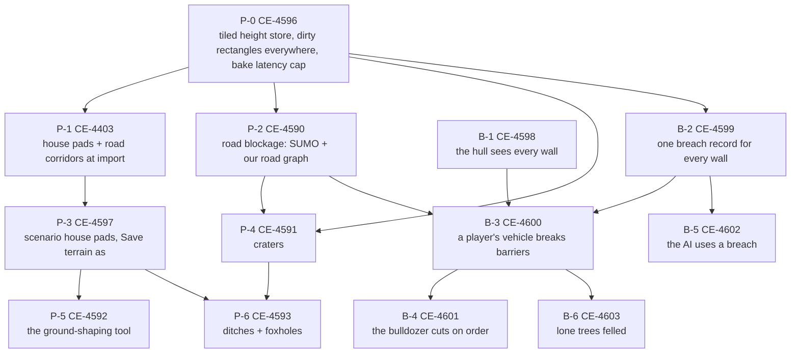

<!--STATUS
state: LIVE
build-state: DISPATCHED 2026-11-14 to the `terrain` lane (ids CE-5000…, R-5000…), autonomous — blueprints/batches/HANDOFF_Coordinator_To_Terrain.md; every task's design is ruled and has its UML and acceptance
updated: 2026-11-14 (first version — coordinator)
current-answer: the whole file — §1 the order, §2 the tasks, §3 the gates every task carries, §4 what is NOT in the programme
stale-below: nothing
known-rot: none
known-conflict: none
related-designs:
  - DESIGN_Ground_Patches_And_Road_Blockage.md — OWNS P-0…P-6 (house pads, road corridors, road blockage, craters, the ground-shaping tool, ditches, foxholes); ⭐ §9 its review wins over the rows it names; acceptance §6
  - DESIGN_Vehicle_Breaching.md — OWNS B-1…B-6 (a player's vehicle breaks weak barriers, the bulldozer cuts on order, lone trees felled); ⭐ §7 its review wins over the rows it names; acceptance §6 + §7.5
  - DESIGN_Terrain_Import_UTM.md — OWNS §8 runtime destruction (`BuildingDamage`, the bake, save, seek) both designs extend; §9.6 T-4 amended by R-4241
  - DESIGN_Terrain_Authoring.md — OWNS the terrain features, the compiled overlay (§18) and S-5 (P-3 here)
  - designs/motion-models/DESIGN_Motion_Domains.md — §5f OWNS the hull guard B-1 extends
  - UX/ground-shaping-and-ditches.svg — the mockup of P-5 and P-6
  - UX/vehicle-breaching.svg — the mockup of B-3 (the driver's cue) and B-4 (the bulldozer's point order)
  - CAPABILITIES.md — §2b lists what this programme adds, marked designed / planned
-->

# PLAN — dynamic terrain: the ground and the walls change while the simulation runs

🔒 User, `2026-11-14`: *"I would like to break the design into tasks which are referencing the design … the terrain flattening and the other is
the breaching. They together are part of one big dynamic terrain program, which I would like to start a bit later. So I need the tasks and the
designs and the documentations are complete, not missing anything."* Programme row: [CE-4604](blueprints/Blueprint_Issues_Tracker.md).

## 1. The order

*What it shows: two chains that share one root. P-0 makes the terrain cheap to change on every node; after it the ground chain (pads → shapes,
ditches) and the wall chain (the guard → the record → breaking) can run in two lanes at once. B-1 needs nothing — it can start first, even
before P-0. P-6 waits for P-4 only for the ground-cover source both share (`TerrainCoverProvider`, G-27).*

## 2. The tasks

Each row is one task. **Design** names the binding sections, **done when** names the acceptance items, every task also carries §3's gates.
A task is done only when every V-row its slice lists is done (ground patches §9.5, breaching §7.4).

| task | row | design | builds | done when | needs | suggested lane |
|---|---|---|---|---|---|---|
| **P-0** | [CE-4596](blueprints/Blueprint_Issues_Tracker.md) | [Ground §9.5 P-0](DESIGN_Ground_Patches_And_Road_Blockage.md), §9.1 V-1, V-3, V-5 | the height store's tiles as separate arrays (copy-on-write per tile, 0 B steady read); `TerrainHeightGrid` recomputes only the touched blocks; the bake's dirty rectangles published on EVERY host; a maximum bake latency (no starvation under a barrage) | Ground §6 item 0 | — | backend |
| **P-1** | [CE-4403](blueprints/Blueprint_Issues_Tracker.md) | Ground §4 G-1…G-4, §4b G-21…G-25, §9.5 P-1 (V-15, V-16, V-18, V-21, V-22, R-4234, R-4235) | house pads at import (the lowest ground, the uphill cut, the skirt); road corridors levelled at import, tolerant of houses; the net re-elevated from the levelled store; a re-import is a new terrain version | Ground §6 item 1; CE-4402 (the low door) passes | P-0 | backend |
| **P-2** | [CE-4590](blueprints/Blueprint_Issues_Tracker.md) | Ground §3.2, G-10, §9.5 P-2 (V-19, V-20, V-24) | ONE road-blockage step: every static blocker → SUMO lane obstacles / `CloseEdge` and our road graph cut + re-plan; rebuilt from the base whenever the blocker set changes; the bridge closure folded in | Ground §6 item 2 | P-0 | backend (traffic) |
| **P-3** | [CE-4597](blueprints/Blueprint_Issues_Tracker.md) | Ground G-5, G-6, G-20, §9.5 P-3 (V-23, V-25); Terrain Authoring S-5 | a scenario house's pad in the compiled overlay (every node the same), the live bake while authoring; *Save terrain as* writes the patched store and re-elevates the net | Ground §6 item 3 | P-1 | backend (+ ui: the ghost during the wait) |
| **P-4** | [CE-4591](blueprints/Blueprint_Issues_Tracker.md) | Ground G-7…G-9, G-11, G-35, §9.4 D-1 / D-2 (R-4232, R-4233), §9.5 P-4 | `GroundDamage` + `CraterRule` / `craters.json`; the `CraterIndex` (truth at query time on every terrain-holding node); crater areas every vehicle avoids; road closure through P-2; rim cover after the gases clear; wire, save, seek | Ground §6 item 4 | P-0, P-2 | backend (+ ui: the 3-D ground chunks) |
| **P-5** | [CE-4592](blueprints/Blueprint_Issues_Tracker.md) | Ground §4a G-14…G-19, §4d, §9.5 P-5 (V-27, V-28); [mockup](UX/ground-shaping-and-ditches.svg) | the Ground feature (Level / Raise / Lower / Crater an area), live-baked; roads follow; the elevated net in the overlay; the grade warning | Ground §6 item 5 | P-3 | backend + ui |
| **P-6** | [CE-4593](blueprints/Blueprint_Issues_Tracker.md) | Ground §4c G-26…G-29, §4c-1 G-36…G-38, §9.5 P-6 (V-29, V-30); [mockup](UX/ground-shaping-and-ditches.svg) | the Ditch feature (line) and the Foxhole preset (click); ground-cover points; ditch areas priced per mover; never across a road | Ground §6 item 6 | P-3, P-4 | backend + ui |
| **B-1** | [CE-4598](blueprints/Blueprint_Issues_Tracker.md) | [Breaching §7.4 B-1](DESIGN_Vehicle_Breaching.md), V-1, V-4, V-5, V-14, D-2, D-4 (R-4237, R-4239) | the hull trace purpose: every panel blocks a hull, a panel top is never a hull surface, building breaches never open for a hull; the break gate = the Manual branch + a live possession; the replay gate | Breaching §7.5 items 11, 13, 15 and §6 item 1 | — | backend |
| **B-2** | [CE-4599](blueprints/Blueprint_Issues_Tracker.md) | Breaching §3.1, §7.4 B-2, V-2, V-6, V-10, V-11, V-12, V-16, D-1 (R-4236) | `BuildingDamage` for a wall group (free-wall lines keyed by label + segment rank, a label given at import); blasts breach free walls; a base-to-top cut is a Passage; Passages get fine navmesh cells; multi-panel cuts; every node draws the gap | Breaching §6 item 5, §7.5 items 14, 17 (drawing) | P-0 | backend + ui (drawing) |
| **B-3** | [CE-4600](blueprints/Blueprint_Issues_Tracker.md) | Breaching §3.2, §7.4 B-3, V-3, V-8, V-9, V-15, V-17, V-21, D-3, D-5 (R-4238, R-4240, R-4243); [mockup](UX/vehicle-breaching.svg) | `BarrierHit`, `ContactBreachRule` + `contact-breach.json` (ram or push), the cut at the crossing angle, the query-time guard and no speed zero, the follow-up through `BatchContext`, straddle and rear contact; the feedback (dust, crash sound heard by the AI, the HUD cue) | Breaching §6 items 2, 3, 4, 6, 7, 9, 10; §7.5 items 12, 16, 17 | B-1, B-2, P-2 | backend + ui (HUD) |
| **B-4** | [CE-4601](blueprints/Blueprint_Issues_Tracker.md) | Breaching §7.6, V-13 (R-4242); City Battle §6c; [mockup](UX/vehicle-breaching.svg) | `ClearObstacleOrder` gains `At`; the resolver (obstacle → trunk → wall); the `Cutting` marker; the Muscle cuts; success = a Passage at the point | Breaching §6 item 8 | B-3 (B-6 for a trunk) | behaviors |
| **B-5** | [CE-4602](blueprints/Blueprint_Issues_Tracker.md) | Breaching §7.4 B-5, V-19; Building Clearing | a breach invalidates the building layout ⇒ a `Gap` portal; a running clearing re-plans; EQS cover refreshed | a `ClearBuilding` with no door enters by the tank's breach (V-19's rail) | B-2 | behaviors |
| **B-6** | [CE-4603](blueprints/Blueprint_Issues_Tracker.md) (takes the felling half of CE-3426) | Breaching §7.7, D-6 (R-4241); UTM §9.6 T-4, T-6; Terrain World §11 | `TreeDamage` (per node × cell, quantised positions); sight / fire / hull skip a felled trunk at query time; the bake and the drawing remove it; blasts fell lone trunks (`trees.json`) | a possessed tank fells a lone tree and drives on; an AI tank goes round; a Mk-82 fells the trunks in its radius; seek and save restore them | B-3, P-0 | backend |

## 3. The gates every task carries

| gate | |
|---|---|
| ⭐ T-1 first | the feature's own suites (`BuildingBreachTests`, `CarKinematicsSystemTests` guard rails, `RoadblockBlastScenarioTests`, `WreckBlocksStreetScenarioTests`, the terrain import suites) before any new rail; new rails go INTO those suites |
| ⭐ parallel rule | `HROT_PARALLEL_SIM=1` + `HROT_READ_CHECK=1` on every sim rail; `python3 scripts/stepped-hash.py --threads 1,4,8` on the scenario the task serves (CLAUDE.md "behaviour code runs in parallel") |
| ⭐ R-2084 | 0 B per steady frame for every per-frame read (the height store, the damage tables, the guard) |
| ⭐ recorded state | every new record unmanaged; save, seek and the Replay Browser rails (CLAUDE.md "new components") |
| ⭐ drawing | the frame rails under `xvfb-run -a` (they skip without a display); a display node and the Replay Browser show the change |
| ⭐ UI fidelity | P-5, P-6, B-3, B-4: the real frames against the mockup until they match (R-4146) |
| ⭐ as built | every deviation folded back into the owning design's section before the task closes (obligation ⑤) |
| ⭐ capabilities | the task's row in [CAPABILITIES §2b](CAPABILITIES.md) moves from 📐 to ✅ with its scenario |

## 4. Not in the programme

| | |
|---|---|
| [CE-4594](blueprints/Blueprint_Issues_Tracker.md) — the terrain editor's user-friendly way | its own design later; it builds on §4d of the ground-patch design (one feature family, one patch type, the stack) |
| a per-scenario breaching switch | ⛔ not in v1 (R-4240) |
| damage to the breaking vehicle | ⛔ not in v1 (B-D12; the cost column stays 0) |
| a tracked-only vehicle navmesh layer | later, if wanted (R-4233) |
| a felled tree as a log on the ground | later (UTM T-4) |
