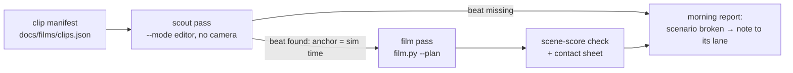

<!--STATUS
state: LIVE
updated: 2026-10-21 (first version — coordinator; the clip list per CAPABILITIES chapter, what each needs, and the overnight pipeline proposal)
current-answer: §1 the clip list · §2 the gaps (features no clip can show yet) · §3 the overnight pipeline (proposal, leans) · §4 what the sweep found broken
stale-below: none
known-rot: event times are from the scenario docs and the description sweep (2026-10-21) — the scout pass (§3) re-measures every one before filming
related-designs:
  - CAPABILITIES.md — OWNS the feature list this plan films (one clip per chapter bullet that can be seen)
  - RUNBOOK_Filming.md — OWNS how film.py / film-events.py work (shots, plans, traps)
  - designs/group-maneuvers/DESIGN_Demo_City_Showcase.md — OWNS the big all-in-one demo; these clips come first and feed its acts
  - designs/group-maneuvers/DESIGN_Urban_Battle_Demo.md — OWNS uc-urban-battle; §6a holds why its beats are not visible (CE-4032)
  - OVERVIEW_Rules_And_Demos.md — OWNS the rule ids each clip proves
-->

# Feature films — what to film, and how to film it overnight

*The picture shows what the prose hides: the scout pass is also a HEALTH CHECK. A clip whose beat never happens is a broken scenario, and
it is found the same night.*

@@CLIPS@@

@@GAPS@@

## 3. The overnight pipeline — proposal

📐 **The budget:** `--mode editor` costs ~0.8 s per film frame (RUNBOOK §6). At 30 fps that is ~24 s of wall time per second of film.
A 20 s clip takes ~8 min, plus ~2 min of scouting. **The ~40 clips in §1 fit in one night (~6–7 h).** At 24 fps it is ~20 % less.

| # | piece | what it does | who | lean |
|---|---|---|---|---|
| P-1 | **clip manifest** `docs/films/clips.json` | one entry per clip: `id`, `scenario`, `mode`, its shots, and **anchors instead of fixed times** | coordinator (from §1) | ⭐ the table in §1 is its source |
| P-2 | **anchors** in a shot's `at` | `{"on": "shot", "by": "Tank", "n": 2, "lead": -1.5}` · `{"on": "blast", "near": "Convoy APC"}` · `{"on": "task", "who": "Squad A", "is": "ReactToContact"}` · `{"on": "health", "who": "A-10", "below": 0.2}` · `{"on": "embark", "who": "Rifleman 1", "is": false}` · `{"on": "near", "who": "UH-60", "point": "190,340", "within": 10}` · a plain number still works | backend (owns `film.py`) | ⭐ the editor is deterministic, so an anchor scouted once is frame-exact in the film pass |
| P-3 | **scout pass** — `film-events.py` grows `--anchors clips.json`: steps the editor once per clip and resolves each anchor to a sim time | ⭐ **a missing beat is reported, never guessed** — the scenario is then broken (§4) | backend | ⭐ it is today's `film-events.py` loop plus the probes of `utility-demo-check.py` (task, health, embark, position) |
| P-4 | **batch runner** `scripts/film-batch.py clips.json --out <dir>` | for each clip: scout → film → `ffmpeg` scene scores → a contact sheet (9 frames in one PNG). A failing clip is logged and skipped, never stops the night | backend | ⭐ run in the background; one clip per process launch (a crash costs one clip) |
| P-5 | **morning report** `<dir>/REPORT.md` | per clip: ✅ filmed / ⚠ filmed but the scene scores are flat (nothing visible happened) / ⛔ beat missing; the contact sheet inline | backend | ⭐ the user reads this on a phone, the films only for the ✅ rows |
| P-6 | **the check before the film** | each clip's scenario runs its live check first (`utility-demo-check.py --launch`); a red check skips the film and says so | backend | ⚠ costs ~1–3 min per clip; ⭐ worth it — a film of a broken demo wastes 8 min and misleads |

| decision | ⭐ lean | what would change it |
|---|---|---|
| F-1 editor or cluster | ⭐ **editor for every clip** (deterministic, 2.3× faster); `--mode all` only for a clip that must prove the wire | a beat that differs between the two hosts — that is a bug to file, not a reason to film the cluster |
| F-2 change a scenario to film it, or add a `-film` copy | ⭐ **change it in place**, then re-run its live check | ⛔ a copy rots apart from the checked original. Only if the change breaks the check's premise |
| F-3 one long take or cuts | ⭐ **3–4 shots per clip, 15–30 s of film** — wide establishing shot → the beat close up (telephoto, `fov` 15–25) → the result | — |
| F-4 overlays (labels, "panic" over a civilian) | ⭐ **not in the first night** — film what the map draws; captions go in the report | if the clips are to be shown without narration |

@@BROKEN@@
