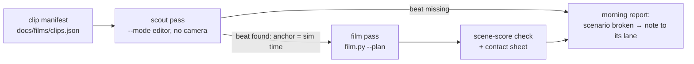

<!--STATUS
state: LIVE
updated: 2026-10-21 (first version — coordinator; the clip list per CAPABILITIES chapter, what each needs, and the overnight pipeline proposal)
current-answer: §1 the clip list · §2 the gaps (features no clip can show yet) · §3 the overnight pipeline (proposal, leans) · §4 what the sweep found broken
stale-below: none
known-rot: event times are from the scenario docs and the description sweep (2026-10-21) — the scout pass (§3) re-measures every one before filming
related-designs:
  - DESIGN_Film_Director.md — OWNS HOW the clips are played and filmed (the editor's director: takes, reels, live and capture); supersedes §3's film-batch runner shape
  - CAPABILITIES.md — OWNS the feature list this plan films (one clip per chapter bullet that can be seen)
  - RUNBOOK_Filming.md — OWNS how film.py / film-events.py work (shots, plans, traps)
  - designs/group-maneuvers/DESIGN_Demo_City_Showcase.md — OWNS the big all-in-one demo; these clips come first and feed its acts
  - designs/group-maneuvers/DESIGN_Urban_Battle_Demo.md — OWNS uc-urban-battle; §6a holds why its beats are not visible (CE-4032)
  - OVERVIEW_Rules_And_Demos.md — OWNS the rule ids each clip proves
-->

# Feature films — what to film, and how to film it overnight

*The picture shows what the prose hides: the scout pass is also a HEALTH CHECK. A clip whose beat never happens is a broken scenario, and
it is found the same night.*

## 1. The clip list — one clip per capability you can SEE

- **State:** ✅ **READY**: the scenario plays the beat by itself; film it as it is. · 🟡 **SCRIPT**: the live check drives the beat over
  HTTP (it sets health, flips a side, gives an order); the clip needs that same action in its plan, or the scenario made
  self-running (§3 P-2). · 🔧 **FIX**: the scenario must change first. · 🆕 **NEW**: no scenario shows it (§2).
- **Times** are from the scenario docs. The scout pass (§3) measures each one before filming, so these only order the shots.
- **The shots** of each clip are in [`films/clips.json`](films/clips.json) — 55 clips, 176 shots, ~11 min of film, written to the
  grammar in §1a. Rows F-23, F-31, F-34, F-38, F-57 and F-59 have no shot list yet: they wait on the change in their state column.
- Chapters follow [CAPABILITIES.md](CAPABILITIES.md). Each scenario's `description` says what the beat must look like.

| # | clip | scenario | on screen (the beat, ~sim s) | state |
|---|---|---|---|---|
| | **2 · The world** | | | |
| F-01 | weather | `ua-weather-regions` | an IFV drives east from clear weather into a fog bank, then under overcast | 🔧 the IFV has no order. Give it a move east (it now waits for an operator) |
| F-02 | city traffic turns to panic | `demo-city` (recipe) | cars and pedestrians flow; a burst of fire; nearby pedestrians become civilians and flee | 🔧 needs a shooter in the recipe, or a plan action that fires one |
| | **3 · Civilians** | | | |
| F-03 | panic into a house | `ua-civ-shelter` | shots; four civilians run to House A, open the door and vanish (~2 → 20 s) | ✅ |
| F-04 | cower in the open | `ua-civ-cower` | no building near: they crouch, then calm down after the Hostile falls | ✅ |
| F-05 | fear spreads | `ua-civ-contagion` | a fight at one end; fear runs east down a street of 15 people (5–40 s) | ✅ |
| F-06 | onlookers | `ua-civ-gathering` | 12 people come from four streets and ring a hurt man (~25 s) | ✅ (live re-run pending — the scout pass decides) |
| F-07 | protest, police, riot | `ua-civ-provocation` | placards and fists; police walk up (~30 s), baton charge (~90 s), some — not all — riot | ✅ |
| | **4 · Armed people, riots, police** | | | |
| F-08 | drawn is not hostile; aimed is | `ua-armed-draw-aim` | a man draws a hidden pistol (~8 s) — no shot; he aims (~20–30 s) — shot | ✅ |
| F-09 | no shot through bystanders | `ua-armed-shield` | civilians in the line; the rifleman waits; the insurgent steps clear; shot | ✅ |
| F-10 | only the witness remembers | `ua-armed-blend-back` | he aims, hides the rifle, walks off; patrol A fires once clear, patrol B never | ✅ |
| F-11 | stones and a police line | `ua-civ-police-line` | rioters with stones; stun grenades (~4 s); the riot breaks up | ✅ |
| F-12 | gas thrown back | `ua-armed-gas-throwback` | a rioter picks up a gas canister and throws it back at the police | ✅ |
| F-13 | escalation ladder | `ua-civ-escalation` | a warning gesture (~6 s); lethal rounds only at the gunman, the rest stunned | ✅ |
| F-14 | celebratory fire | `ua-armed-celebration` | a guest fires in the air — warned, no shot; he aims at the police — shot | ✅ |
| F-15 | surrender and feint | `ua-armed-surrender` | rifle down, hands up (~20 s); he picks it up; shot | ✅ |
| F-16 | suicide bomber | `ua-armed-bomber` | a civilian walks into a crowd (~25 s), the vest bursts, casualties by distance | ✅ |
| F-17 | melee | `ua-civ-melee` | a protester knocks a policeman down (~8 s) | ✅ |
| | **5 · The soldier** | | | |
| F-18 | hold at a watched road | `ua-danger-crossing` | he stops short of a watched road, waits, rushes across when the watcher leaves | ✅ |
| F-19 | flank a lost target | `ua-attack-approach` | the hostile ducks behind a wall; the rifleman moves to a new firing spot | ✅ |
| F-20 | window duel | `bt-window-duel` | two units fight from windows; one swaps windows, the other bounds to the next van | ✅ |
| F-21 | grenade or rifle | `ua-grenade-or-rifle` | the grenadier closes and lobs a grenade over the sandbags | ✅ (no live check — the scout pass is its first live look) |
| F-22 | sentry turns | `ld-sentry-surprise-360` | a man creeps up behind the sentry; he turns to face him | ✅ |
| F-61 | pinned in the open | `uf-alone-under-fire` | crouched rush; a near miss drops him prone (~2.8 s); down while pinned; up and on when the fire stops | ✅ |
| F-23 | posture by health | `ua-posture` | the same man suppresses, then takes cover as he is hurt | 🟡 the check lowers his health. ⚠ Weak on film — **skip** unless an overlay shows the posture |
| | **6 · The squad** | | | |
| F-24 | fire and movement | `ua-fire-and-movement` | one half fires, the other rushes to cover, swap (~90 s → cut to 3 rushes) | ✅ |
| F-25 | bounding overwatch | `ua-bounding-overwatch` | the halves leapfrog; at contact the watchers open fire | ✅ |
| F-26 | crossing a road | `ua-squad-danger-crossing` | security kneels, pairs dash across, security last | ✅ |
| F-27 | contact while crossing | `ua-squad-danger-crossing-contact` | half the squad is across when fire comes; both halves fight | ✅ |
| F-28 | casualty care | `ua-casualty-care` | a man falls; covering fire; the medic runs out and drags him to cover | 🟡 the check makes him fall. 🔧 better: a hostile with ammo shoots him (blocked by CE-2160) |
| F-29 | fire distribution | `ua-fire-distribution` | five men, three targets; fire spreads, no more than two per target | ✅ |
| | **7 · Platoon and command** | | | |
| F-30 | platoon march | `sl0-platoon-march` | two squads in column, one lying back | ✅ |
| F-31 | platoon bound | `cc-platoon-bound` | support squad set; the other moves; contact freezes both | 🟡 the check turns the enemy hostile |
| F-32 | platoon attacks a house | `pc-defend-house` | AI both sides: base of fire set (~47 s), the defence opens up (~72 s), the assault reaches the house (~341 s) | ✅ (⚠ CE-2331: many defenders hide and never fire) |
| F-34 | the HQ sends the Apache | `uc-request-chain-dry` | the AH-64 flies ~1 km to the mortar cell and kills its crew | 🟡 the SPOT is faked by the check; the real chain `uc-request-chain` is a coin flip (CE-2315 E3) |
| | **8 · Buildings** | | | |
| F-35 | doors | `bt-doors` | a visitor skips the locked front, opens the back door; the locksmith unlocks the front | ✅ |
| F-36 | prone saves | `bt-grenade-posture` | a grenade between a standing and a prone man; only the standing one is hurt | ✅ |
| F-37 | roof burst | `bt-mortar-roof` | a mortar round on a roof; the courtyard man is hit, the man downstairs is not | ✅ |
| F-33 | clear a house | `bc-house-clear` | the stack at the door, then room by room seen from above, civilians spared | ✅ |
| F-62 | into the room | `bc-room-clear` | stack beside the door, breach, entry one man at a time | ✅ (⚠ CE-2341: ~1 run in 4 the entry fails) |
| F-38 | defend a house | `sq-defend-house` | defenders take window and roof posts and open fire as Blue crosses the sector | 🔧 CE-2304: posted defenders stall inside (Set in 4 of 5 runs) |
| | **9 · Vehicles and armour** | | | |
| F-40 | TOW or 25 mm | `ua-weapon-choice` | the Bradley kills a man with a burst and a T-72 with a TOW (~4 s) | ✅ |
| F-41 | tank round a corner | `ua-tank-corner` | the tank edges out, fires at the AT team, backs into cover | ✅ (⚠ the AT team often dies in the first exposure) |
| F-42 | denied lock | `ua-javelin-lock` | the tank shows itself just shorter than the Javelin's lock time | ✅ |
| F-43 | RPG from windows | `ua-rpg-window` | an RPG man hits an IFV, moves window to window, fires again | ✅ |
| F-44 | stand-off | `ua-ifv-standoff` | a 25 mm IFV kills RPG men at ~326 m; up close an RPG hits the other IFV | ✅ |
| F-45 | round per target | `ua-tank-ammo` | the M1 fires at the T-72 (8.85 s, 17.58 s), HE at the technical | ✅ (re-run the check first) |
| F-46 | hull-down platoon | `ua-hill-attack` | pairs creep to the crest, one round each, reverse (~73 s) | ✅ |
| F-47 | convoy hit | `uc-convoy-hit-ifv` | IED under the convoy; the Bradley pushes through with its squad aboard | ✅ |
| | **10 · Drones and air** | | | |
| F-48 | drone and deck | `ua-drone-shelter` | a tank hears the drone and backs under a deck (~10 s); the other is hit on the roof | ✅ |
| F-49 | level bomb | `ua-air-strike` | the A-10 releases (~26 s); the bomb falls 8 s; the far technical survives | ✅ |
| F-50 | door-gun orbit | `ua-air-attack` | the UH-60 circles; a gunner is shot; the orbit reverses | ✅ |
| F-51 | gun and rocket runs | `ua-air-attack` | the Apache's rockets and gun, the A-10 gun run on the column | ✅ (one clip per vignette) |
| F-52 | AA fire, aircraft break | `ua-air-defence` | the Stinger fires; the Apache breaks low | ✅ (⚠ no visible flares, §2) |
| F-53 | air assault | `ua-air-assault` | the UH-60 lands (~33 s), the squad gets out, it lifts off after the last man | ✅ |
| F-54 | air rescue | `ua-air-rescue` | the medic carries the pilot aboard (~42–59 s); lift-off (~69 s) | ✅ |
| F-55 | fast rope | `ua-fast-rope-roof` | eight men slide onto a roof (done ~26 s); the helicopter leaves (~31 s) | ✅ |
| F-56 | parachute drop | `ua-airborne-drop` | a stick of eight, one a second; canopies; they assemble | ✅ |
| F-57 | shot down, pilot ejects | — | an A-10 is hit by AA, its pilot ejects by himself, lands and evades | 🆕 §2 G-1 |
| | **11 · Indirect fire** | | | |
| F-58 | adjust, then fire for effect | `ua-indirect-fire` | bursts walk onto the target, then the battery fires for effect | 🟡 the check sends the orders. 🔧 better: give the observer and the battery their missions in the file |
| F-59 | time on target | `ua-indirect-fire` | rounds from several guns land together | 🟡 as F-58 |
| | **12 · Weapon systems, airborne** | | | |
| F-60 | crew weapons | `ua-weapon-systems` | a sentry gun fires on its own; a crew sets up and mans an M2; a man picks up a Javelin | ✅ (⚠ the M2 is not checked to fire) |

## 1a. The director's grammar — how every clip is cut

⭐ A clip is **15–30 s of film, 3–5 shots**, and tells one capability as a tiny story: *where we are → who acts → the moment → what it
caused.* The shot list in `clips.json` follows these rules; the `why` of each shot names the one it serves.

| beat | shot | the rule |
|---|---|---|
| ① **establish** (3–5 s) | wide and high, or telephoto down a street | the viewer must know the geography before anything happens: who is where, what stands between them |
| ② **set-up** (3–4 s) | the actor, medium: follow or **over the shoulder** toward what he faces | ⭐ his view is the strongest shot for a DECISION ("he waits", "he holds") — the audience sees what he sees |
| ③ **the moment** (2–4 s) | the best angle on the action, cut in **0.5–1 s before** it | ⭐ cut on anticipation, never after the event. Telephoto (`fov` 8–25) for anything past 100 m |
| ④ **consequence** (3–5 s) | the result, often from the OTHER side or from above | the hit, the crowd scattering, the man dragged in — proves it worked |
| ⑤ **replay** (optional, 2 s) | the moment again, reverse angle, **slow motion** | only for a fast beat (a blast, a blow, a hit) — at most one per clip |

| ⭐ craft rules | |
|---|---|
| **height tells the story** | squads and platoons from **high** (45–75° down: the pattern of a manoeuvre is only legible from above) · people at **eye level** (5–12°: human, the crowd's fear) · vehicles **low** (3–10°: weight) · aircraft from **below** or alongside |
| **the 180° line** | keep the camera on one side of the line between the two sides within a clip; cross it only on the replay, where the reversal is the point |
| **no dead seconds** | no shot longer than ~6 s unless something moves in it; a 90 s manoeuvre becomes three 4 s shots of its turning points |
| **nothing in the way** | buildings block telephoto shots; the scout pass flags a shot whose frames barely change (§3 P-5) — re-angle, do not shorten |
| **captions, not overlays** | each clip opens with its `caption` for 2 s, added in post (`ffmpeg drawtext`); the map draws nothing extra (F-4) |
| **one beat per clip** | a scenario with two capabilities makes two clips (F-50/F-51 both come from `ua-air-attack`) |

## 2. Gaps — what no clip can show yet

| # | capability | why not | the change | lane | lean |
|---|---|---|---|---|---|
| G-1 | ⭐ **shot down → the pilot ejects by himself** (user, 2026-10-21) | `ua-eject` ORDERS the eject at 40 s; the automatic eject at 20 % health (`EjectionSystem`) is never exercised by any demo | a new `ua-shootdown-eject`: `ua-eject` with a ZU-23 or Stinger under the route and **no eject task** | behaviors | ⭐ new scenario — the ordered eject is a capability too, keep `ua-eject` |
| G-2 | decoy flares | no decoy is drawn; the check cannot even read one | draw the decoys the countermeasure state already holds (`DESIGN_Visual_Effects.md`) | ui | ⭐ a visual effect only; the logic is built |
| G-3 | weather and night change what units sense | built (`PerceptionWeather`), no demo | `ua-night-fog-sight`: two identical observer/target pairs, one in clear air, one in a fog region — detection ranges differ | behaviors | ⭐ reuse `ua-weather-regions`' regions |
| G-4 | traffic turns into frightened civilians | the `demo-city` recipe has no shooter (F-02) | a rifleman with a short `ShootAt` at ~20 s in the recipe | backend (owns traffic) | ⭐ in the recipe — it is the traffic showcase |
| G-5 | indirect fire that plays by itself | the check sends the orders (F-58, F-59) | missions in the file: the observer's `ObserveFire`, the battery's `Strike` with time on target | behaviors | ⭐ in place, the check then only watches |
| G-6 | a car bomb (VBIED) | the pieces exist (`TriggerIed`, a cargo charge, ST-9), the composition was never measured | `ua-car-bomb`: a car with a cargo charge driven at a checkpoint, set off by its driver | behaviors | ⭐ one scenario proves the composition |
| G-7 | insurgent technicals shoot and scoot | `ua-technical-scoot` parked (CE-2232: a hide is chosen with no line to the target) | fix CE-2232 | behaviors | — |
| G-8 | a casualty caused by the fight itself | the casualty demos fake the fall because an authored `Roe` crashed the cluster (CE-2160) | re-test CE-2160; if gone, give the hostile ammo | backend | ⭐ re-measure first — it was not reproduced 2026-10-14 |
| G-9 | the urban battle's beats | CE-4032: live PASS 4/4 on 2026-10-21 (behaviors, `73588989a`) — the mortar fires at ~62 s, the APC leads and is stopped by the charge, Squad A dismounts at 18 s. ⚠ Still open: the squads have no task once contact ends, and the aircraft beat was not reached in 180 s | the HQ → aircraft beat | behaviors | ⭐ film the IED / dismount / mortar beats now; the air beat after |
| G-10 | a thermal sight | built, no unit type carries one | a thermal sight on the IFV kit; then G-3 can show night | behaviors | ⭐ with G-3 |
| G-11 | an M2 firing, a Kornet team | `ua-weapon-systems` sets the M2 up but never fires it; there is no Kornet team (the overview says there is) | an intruder in the M2's arc; a Kornet team, or fix the overview row | behaviors | ⭐ add the intruder; the Kornet team only if wanted |

## 3. The overnight pipeline — proposal

⭐ **Superseded in shape by [DESIGN_Film_Director.md](DESIGN_Film_Director.md) (CE-4038):** the same pieces live INSIDE the editor —
takes and reels instead of one manifest, `/director/play {reel, capture}` instead of `film-batch.py`, played live in real time as well as
to film. The table below stays as the list of what the pipeline must do.

📐 **The budget:** `--mode editor` costs ~0.8 s per film frame (RUNBOOK §6). At 30 fps that is ~24 s of wall time per second of film.
A 20 s clip takes ~8 min, plus ~2 min of scouting. **The ~40 clips in §1 fit in one night (~6–7 h).** At 24 fps it is ~20 % less.

| # | piece | what it does | who | lean |
|---|---|---|---|---|
| P-1 | **clip manifest** `docs/films/clips.json` | one entry per clip: `id`, `scenario`, `mode`, its shots, and **anchors instead of fixed times** | coordinator (from §1) | ⭐ the table in §1 is its source |
| P-2 | **anchors** in a shot's `at` | `{"on": "shot", "by": "Tank", "n": 2, "lead": -1.5}` · `{"on": "blast", "near": "Convoy APC"}` · `{"on": "task", "who": "Squad A", "is": "ReactToContact"}` · `{"on": "health", "who": "A-10", "below": 0.2}` · `{"on": "embark", "who": "Rifleman 1", "is": false}` · `{"on": "near", "who": "UH-60", "point": "190,340", "within": 10}` · a plain number still works | backend (owns `film.py`) | ⭐ the editor is deterministic, so an anchor scouted once is frame-exact in the film pass |
| P-3 | **scout pass** — `film-events.py` grows `--anchors clips.json`: steps the editor once per clip and resolves each anchor to a sim time | ⭐ **a missing beat is reported, never guessed** — the scenario is then broken (§4) | backend | ⭐ it is today's `film-events.py` loop plus the probes of `utility-demo-check.py` (task, health, embark, position) |
| P-4 | **batch runner** `scripts/film-batch.py clips.json --out <dir>` | for each clip: scout → film → `ffmpeg` scene scores → a contact sheet (9 frames in one PNG). A failing clip is logged and skipped, never stops the night | backend | ⭐ run in the background; one clip per process launch (a crash costs one clip) |
| P-5 | **morning report** `<dir>/REPORT.md` | per clip: ✅ filmed / ⚠ filmed but the scene scores are flat (nothing visible happened) / ⛔ beat missing; the contact sheet inline | backend | ⭐ the user reads this on a phone, the films only for the ✅ rows |
| P-7 | **camera moves and editing in `film.py`** | `to` (a shot's end values for `distance`/`yaw`/`pitch`/`fov`, eased per frame: push-in, pan, zoom) · `speed` (sim seconds per film second: `0.5` = slow motion, by stepping less sim per frame) · `replay` (a shot that goes back in time: a second deterministic pass, spliced) · a caption card and 0.3 s cross-fades in post (`ffmpeg drawtext`/`xfade`) | backend | ⭐ all in `film.py` — the per-frame camera is already computed there (`yaw + orbit * t`), so no engine change |
| P-6 | **the check before the film** | each clip's scenario runs its live check first (`utility-demo-check.py --launch`); a red check skips the film and says so | backend | ⚠ costs ~1–3 min per clip; ⭐ worth it — a film of a broken demo wastes 8 min and misleads |

| decision | ⭐ lean | what would change it |
|---|---|---|
| F-1 editor or cluster | ⭐ **editor for every clip** (deterministic, 2.3× faster); `--mode all` only for a clip that must prove the wire | a beat that differs between the two hosts — that is a bug to file, not a reason to film the cluster |
| F-2 change a scenario to film it, or add a `-film` copy | ⭐ **change it in place**, then re-run its live check | ⛔ a copy rots apart from the checked original. Only if the change breaks the check's premise |
| F-3 one long take or cuts | ⭐ **3–4 shots per clip, 15–30 s of film** — wide establishing shot → the beat close up (telephoto, `fov` 15–25) → the result | — |
| F-4 overlays (labels, "panic" over a civilian) | ⭐ **not in the first night** — film what the map draws; captions go in the report | if the clips are to be shown without narration |

## 4. What the sweep found — notes sent to the lanes

The descriptions were written from each scenario's live check and its owning design, and that reading turned up the following. The
notes are [NOTE_Coordinator_To_Behaviors_Demo_Sweep.md](blueprints/batches/NOTE_Coordinator_To_Behaviors_Demo_Sweep.md) and
[NOTE_Coordinator_To_Backend_Filming.md](blueprints/batches/NOTE_Coordinator_To_Backend_Filming.md).

| kind | scenarios |
|---|---|
| 🔴 **does not show what it is named for** | `ua-squad-danger-crossing-hold` shows BreakContact, not Hold · `ua-three-hosts` no longer compares hosts (CE-3160 retired them; all three run one tree) · `ua-eject` orders the eject (G-1) |
| 🔴 **known broken or parked** | `sq-defend-house` (CE-2304) · `ua-technical-scoot` (CE-2232) · `uc-urban-battle` air beat (CE-4032: mortar, APC lead and dismount fixed live; the aircraft not reached) · `uc-request-chain` a coin flip (CE-2315 E3) · `ua-universal-soldier` cannot pass its live load guard (CE-2243) |
| ⚠ **not verified recently** | `hill-attack` and `hill-attack-close` (last measured 2026-10-02, before the CE-2230 rework) · `ua-tank-ammo` (causes fixed, not re-run) · `ua-civ-gathering`, `ua-civ-protest` (no live pass recorded) · `ua-eject` (the check was relaxed to 4.5 s, no pass recorded) |
| ⚠ **not self-running** — the check drives the beat | `ua-posture`, `ua-three-hosts`, `ua-fire-distribution`, the three `ua-casualty-care*`, `ld-sentry-surprise`, `cc-platoon-bound`, `ua-civ-neutral-gate`, `ua-indirect-fire`, every `*-dry` |
| ⚠ **no live check at all** | `ua-grenade-or-rifle`, `ua-weather-regions`, `test-fire`, `test-move`, `tt-nav-los`, `mission-demo-bp`, `hsm-channel-e2e`, the `tt-*` recipes (rails only), `demo-city` |
| ⚠ **doc says more than the file** | `ua-weapon-systems` (no Kornet team, the M2 never fires) · `ua-air-strike` ("untouched": the check only asks "not destroyed") · CE-2247 still shown open in the overview, DONE in the tracker · `uc-convoy-hit-ifv`'s Bradley is named "Convoy APC" |
| ⚠ **missing from the overview** | `ua-grenade-or-rifle`, `sl0-platoon-march`, `cc-platoon-bound`, `ld-sentry-surprise(-360)`, `bc-*`, `df-*`, `uf-*` |
| ⚠ **cluster load** | CE-4033: on a fresh cluster the cold demo-city navmesh bake (27.6 s) gets SimHost ejected — every demo-city clip needs a warm cache |
