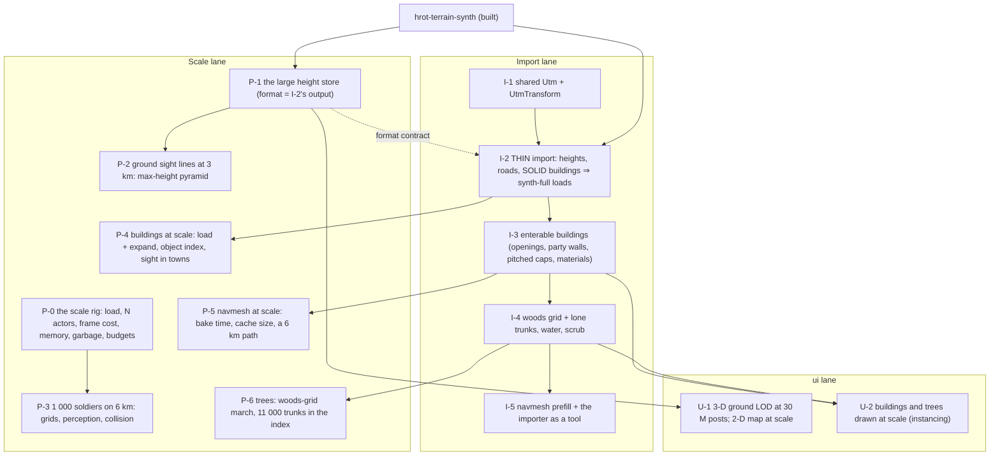
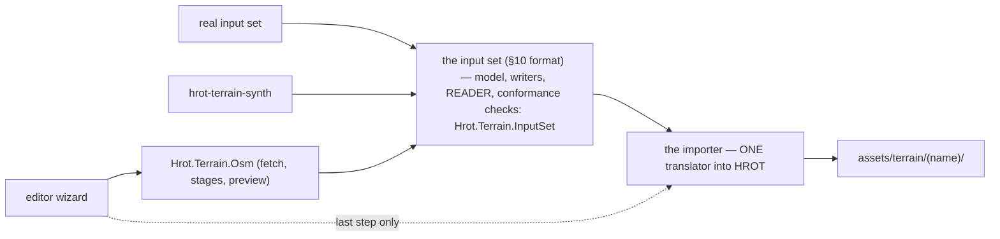

<!--STATUS
state: LIVE
build-state: DESIGN — a plan for the user (Q-L1…Q-L4); no work dispatched yet
updated: 2026-11-09 (first version — coordinator)
current-answer: ⭐ §10 DISPATCHED (backend L-1…L-8, ui U-0…U-4) · ⭐ §9 the OSM importer goes through the importer, built in parallel · ⭐ §8 DECIDED R-4192 (budgets, backend, no new lane) · §7 REVISED (user): the scale terrain from existing templates now (§7.1), when trees and destruction kick in (§7.2) · §4 the work items (P-0…P-6, U-1/U-2 unchanged) · §6 questions
stale-below: §2 'thin import first' and §3's arrows from the import lane to P-4 / P-5 — superseded by §7
known-rot: none
known-conflict: none
related-designs:
  - DESIGN_Terrain_Import_UTM.md — OWNS the importer (stages §6.1), the input set (§10), the decisions R-4186…R-4191 and the performance take (§7a); this plan only ORDERS that work and adds the scale work beside it
  - DESIGN_Terrain_Synth.md — OWNS hrot-terrain-synth, the synthetic input set every item here runs on
  - DESIGN_Terrain_From_OSM.md — a third producer of the same input set; it waits for the importer (its O-3)
  - DESIGN_Terrain_World.md — OWNS the terrain world model; §9 sparse terrain (CE-4011 / CE-4012) — §5 here takes it off the critical path
  - DESIGN_World_Query_Seam.md — OWNS IWorldQuery and the Bepu object index the sight-line work extends
  - DESIGN_Terrain_Height.md — OWNS TerrainHeightGrid, which P-1 grows into the large height store
  - designs/navig-2/Navigation_Design_v2_0.md — OWNS the tiled navmesh and NavTileCache (P-5)
  - DESIGN_Evaluation_Cost_And_Cadence.md — OWNS the per-frame cost / garbage measurement (HROT_FRAME_STATS) the scale rig reuses
-->

# PLAN — a large terrain: import it, load it, measure it, make it fast

## 0. Why

🔒 User, `2026-11-09`: *"Once you import the data generated by the synthetic terrain generator, what comes next? We will end up with a pretty
large terrain which needs to be loaded by the engine and measured for performance and then optimized. … do we need to wait for the outcome from
the importer, or can we start optimizing on some terrain which is also synthetically generated but having the scale and complexity similar …
Maybe we could generate the synthetic terrain right away and work on the optimizations in a different lane than the importer one?"*

## 1. Measured — the gap *(`2026-11-09`)*

| | today's largest | the target (synthetic `full` = the real set) |
|---|---|---|
| extent | **800 × 800 m** (`demo-city`, 169 features); `test-town` 400 m | **5 500 × 5 500 m** — ≈ **47×** the area |
| heights | one `float[]` from an ESRI ASCII text file (`TerrainHeightGrid.cs:16`; largest `.asc` 19 KB, `basic-desert`) | ≈ 30 M posts at 1 m (≈ 120 MB as float, 60 MB as 16-bit) |
| buildings | 136 + 34 enterable in demo-city | **1 800** enterable, ≈ 70 000 doors + windows, 140 shared walls |
| trees | none (forest = a drawn polygon only) | 176 000 (woods polygons + ≈ 11 000 lone trunks, R-4190) |
| roads | demo-city's crop of a SUMO net | ≈ 150 km, 818 junctions |
| actors | scenarios of tens to a few hundred | ≤ 1 000 soldiers + cars, aircraft, AA (R-4187) |
| perf tooling | `HROT_FRAME_STATS=1` prints per-system cost and garbage per frame (Evaluation Cost §0e); FDP micro-benchmarks | ⛔ no rig that loads a terrain at scale, spawns N actors and checks budgets |

⇒ ⭐ **everything at the target scale is unmeasured** — load, memory, sight lines, grids, navmesh, drawing.

## 2. The answer

⭐ **Do not wait, and do not build a second terrain generator.** Two lanes start at once:

| | |
|---|---|
| ⭐⭐ **the scale terrain IS the importer's output on the synthetic set** | a second "scale terrain" producer would be a duplicate of the importer (the one-implementation rule) and would drift from what the real import makes. ⇒ the importer's FIRST slice is made **thin** (heights + roads + SOLID buildings) so a full 5.5 km HROT terrain exists in days, not after the whole importer |
| ⭐⭐ **half the scale work needs no import at all** | the height store, ground sight lines, the perception / collider grids with 1 000 soldiers, the 3-D ground at 30 M posts — they need only the synthetic **heights** (read through the height store the importer will also write) or a **6 km world with nothing in it** (a world file with bounds only). These start on day 1 |
| ⭐ **the rest follows each import slice** | buildings at scale after I-2, the navmesh after I-3, trees after I-4 — each perf item starts the day its input lands |

## 3. The plan

*What the picture shows that prose hid: P-0, P-1, P-2 and P-3 have no arrow from the import lane — they start now. The one coupling is P-1's
height-store format, which I-2 writes; P-1 delivers that contract first. Stage 0 (sparse insets) appears nowhere — see §5.*

## 4. The work items

### Import lane *(Terrain Import UTM §6.1, re-cut so the first slice is thin)*

| # | item | delivers | UTM stage |
|---|---|---|---|
| **I-1** | move `Hrot.Traffic/Utm.cs` to the shared place; `UtmTransform : IGeographicTransform` | the frame | 1 |
| **I-2** | ⭐ **thin import**: read the manifest; heights → the P-1 store at 1 m; roads → the cropped net + anchor; buildings → **solid prisms** (footprint, `baseZ` by TH-C, `height`); writes `assets/terrain/<name>/` | ⭐ **`synth-full`: a 5.5 km terrain that loads** | 3 (part), 5 (roads) |
| **I-3** | the enterable building generator: one `<id>.building.json` per building (R-4191), openings from points (with the real-data noise), party walls from shared edges, pitched roofs as solid caps, materials | 1 800 enterable houses | 4 |
| **I-4** | woods: polygons (`woods.geojson`) or clustered points ⇒ the 25 m density grid; ≈ 11 000 lone trunks; water; scrub carried | R-4190 | 5 |
| **I-5** | the navmesh prefill of `NavTileCache` for every layer and interior; the importer as a repeatable tool (CLI + `ITerrainImporter` for the OSM wizard) | stage 6–7 | 6, 7 |

### Scale lane

| # | item | needs | measures / builds |
|---|---|---|---|
| **P-0** | ⭐ **the scale rig**: a headless run that loads a terrain, spawns N soldiers / vehicles / aircraft, steps M frames and reports load time, peak memory, per-system frame cost and garbage (reusing `HROT_FRAME_STATS`), checked against the §6 budgets as a rail | nothing — runs on demo-city now, on `synth-full` when I-2 lands | the baseline, then every item's before / after |
| **P-1** | the large height store: a binary, tiled grid for 30 M posts (16-bit or float — measured), memory-mapped or tile-loaded; the 3-D and the queries read it through `TerrainHeightGrid`'s existing surface. ⭐ **first deliverable: the on-disk format**, so I-2 writes it | synthetic `heights.f32` | load time, memory, `GroundHeightAt` cost |
| **P-2** | ground sight lines at range: the max-height pyramid (UTM §7a), then the woods-grid march (R-4190 T-2) | P-1 | a 3 km trace, Release; answers identical to the plain march |
| **P-3** | 1 000 soldiers + vehicles + aircraft on a 6 km world: the perception and collider grids' cell sizes (today ≈ 20 / 30 m at that extent), the air ↔ ground and AA ↔ air lists (R-4187), sensing on a slow cadence, spread over frames | P-0 + a bounds-only 6 km world (then `synth-full`) | frame cost per system, pairs per second |
| **P-4** | buildings at scale: parse + expand time of 1 800 buildings, the Bepu object index's build and query cost, sight and fire through towns | I-2 (solid), then I-3 (enterable) | load seconds, µs per query |
| **P-5** | the navmesh at scale: bake time per tile and in total, `NavTileCache` size, a 6 km path (node budget; a coarse route first if it cuts out — UTM §7a) | I-3 | bake minutes, cache MB, path ms |
| **P-6** | trees: the woods grid in sight and fire; 11 000 trunks in the index; their cost in the nav bake | I-4 | µs per line through woods |

### ui lane

| # | item | needs |
|---|---|---|
| **U-1** | the 3-D ground at 30 M posts (level of detail by distance; today's mesh is one soup for the whole terrain, `TerrainWorldMesh`); the 2-D map's height shading at 5.5 km | P-1 |
| **U-2** | 1 800 buildings and 176 000 trees drawn (instanced shapes, R-4190 L-5) at frame budget | I-3, I-4 |

## 5. Stage 0 off the critical path

⭐ The UTM design's stage 0 (CE-4011 the outer ground, CE-4012 sparse insets — Terrain World §9) is **not needed to load, measure or optimise one
5.5 km terrain**: it loads as a whole terrain, as today's terrains do. ⇒ stage 0 stays deferred until a scenario needs a ground beyond the
terrain or a second inset. ⚠ The one thing to keep compatible: P-1's store is TILED, so an inset later reuses it.

## 6. Questions for the user

| # | question | ⭐ lean |
|---|---|---|
| **Q-L1** | which lanes? | ⭐ a **new `terrain` lane for the importer** (I-1…I-5: new projects, little overlap with others; it takes the next id block, `CE-5000`) · **backend for the scale lane** (P-0…P-6: engine systems it owns) · **ui** for U-1 / U-2 when P-1 / I-3 land. If no new session is wanted: importer to backend, scale lane to behaviors (perception and navigation users) |
| **Q-L2** | the budgets P-0 checks — the numbers to optimise TO | ⭐ proposed: **load ≤ 30 s** warm (navmesh from the cache) · **sim frame ≤ 10 ms** at 60 Hz with 1 000 soldiers + 50 vehicles + 10 aircraft on the busiest node · **0 B garbage per steady frame** (CLAUDE.md hot-path rule) · **memory ≤ 4 GB** per node · **3-D ≥ 30 fps** on the editor machine |
| **Q-L3** | stage 0 off the critical path (§5)? | ⭐ yes |
| **Q-L4** | P-0 runs on which machine for the budget numbers — this cloud VM (consistent, slower) or the user's Windows machine (real)? | ⭐ both: the VM for regressions (relative numbers, in every batch), Windows for the absolute budget once per milestone |

## 7. ✏ REVISED `2026-11-09` — the scale terrain from EXISTING templates, now *(user; SUPERSEDES §2's "thin import first" and the I-2 → P-4 / I-3 → P-5 arrows of §3)*

🔒 User, `2026-11-09`: *"Why do we need those stages like block buildings … We have building templates. We can create a terrain which is filled
with these buildings. So very simple generator can create very large areas with existing buildings which are already enterable, so that will
test both the raycasts for visibility as well as the nav mesh, as well as the number of entities using those. … No waiting for any importer …
The only thing missing in this are the new features that we would like to have, like the destructible building, the trees, and that's the
question when they should kick in."*

| the user's claim | measured |
|---|---|
| enterable templates exist | ✅ 7 in `assets/buildings/` (house-2f, house-3f, shop-2f, office-4f, courtyard-house, cqb-house, market-hall) |
| a terrain can be filled with them | ✅ a building is a `kind: building` Point naming a template (`TerrainWorldParser.cs:116-137`); `scripts/terrain-from-sumo.py --net … --houses …` already builds a terrain folder from a SUMO net + a placements file (demo-city); `scripts/demo-city-quarters.py` places 136 houses that way |
| repeated templates cost the same as unique houses | ✅ every placement is expanded into its own walls and slabs at load; the navmesh cache keys on each tile's inputs — nothing is shared per template (UTM §10.6), so 1 800 repeated houses load, index and bake like 1 800 unique ones |
| ⇒ no importer needed for the scale work | ✅ **agreed — my "second producer" objection was wrong**: a placement script writes HROT's OWN format, exactly as demo-city's scripts do; the importer is a TRANSLATOR of foreign data and stays a separate, non-blocking lane |

### 7.1 The scale terrain — `scripts/terrain-scale.py` *(small; reuses everything)*

| input | from |
|---|---|
| roads | the synthetic `full` set's `roads.net.xml` (150 km, 818 junctions — `hrot-terrain-synth`) |
| heights | the synthetic `heights.f32` resampled to a coarser `.asc` the CURRENT `TerrainHeightGrid` reads (2–5 m first; 1 m is P-1's job) |
| buildings | the 7 templates placed on the synthetic set's building sites (centroid, rotated to the longest wall), clear of roads and each other — ≈ 1 800 houses |
| output | `assets/terrain/scale-<seed>/` through `terrain-from-sumo.py` (+ a height-grid option); ⛔ gitignored — regenerated in seconds, never committed |

⇒ the scale lane's P-0 (rig), P-2 (sight lines), P-3 (1 000 soldiers), P-4 (buildings at scale) and P-5 (navmesh bake, a 6 km path) ALL start on
it at once. P-1 (the 1 m height store) starts in parallel; the scale terrain switches to it when it lands.

### 7.2 When the new features kick in

| feature | lean: when | why |
|---|---|---|
| **trees** (R-4190: woods grid, lone trunks, woods navmesh cost) | ⭐ **right after the scale baseline** (P-0 numbers for buildings, sight, nav, 1 000 soldiers) | woods cover ≈ 45 % of the area ⇒ they change the navmesh bake (area costs) and EVERY ground sight line (the woods-grid march) — the two biggest costs. Built and tested small (test-town), then `terrain-scale.py` scatters woods + lone trees and the rig measures the delta |
| **destructible buildings** (R-4188: wall breaches, collapse = replacement) | ⭐ **after trees** | runtime events, not load-time content: the cost is a navmesh TILE REBUILD per breach / collapse (Navigation v2 §14 — P1/P2 built, the replan P3 not) ⇒ measured as "N breaches per minute on the scale terrain" once the baseline is known; works on the existing templates (walls with `Openings[]`) |
| **pitched roofs, materials, party walls** | with the importer's building generator | only imported houses have them; the templates already carry materials |

⇒ ⭐ the importer lane (I-1, then the full building generator, woods, prefill) proceeds without blocking anything; its output replaces the scale
terrain for the FINAL measurement (real-like unique houses) — the numbers should match, since nothing is shared per template.

## 8. ✅ DECIDED `2026-11-09` (R-4192) — budgets and lanes

🔒 User, `2026-11-09`: *"The budget is fine. Approved. We will use the backend lane, no new lanes. 4 lanes in total is more than enough."*

| | |
|---|---|
| **Q-L2 budgets** | ✅ load ≤ 30 s warm (navmesh from the cache) · sim frame ≤ 10 ms at 60 Hz with 1 000 soldiers + 50 vehicles + 10 aircraft · 0 B garbage per steady frame · ≤ 4 GB per node · 3-D ≥ 30 fps |
| **Q-L1 lanes** | ✅ **the scale work goes to `backend`; NO new lane** (⛔ §6's `terrain` lane / `CE-5000` block withdrawn) |

## 9. The OSM importer — through the importer, built in parallel *(coordinator, `2026-11-09`; the user: "Is that something that needs to go through the importer, or is it something that generates the hrot terrain directly? This affects whether we can start building the OpenStreetMap importer in parallel.")*

*What the picture shows: three producers, one format, one translator. The OSM library touches HROT's terrain format nowhere — its only
contract is the input set, which already exists and is checked; the wizard reaches the importer only in its last step.*

**Decision: through the importer.** **Rejected:** OSM writing the HROT terrain directly — it would be a SECOND copy of everything the importer
does (points → walls with openings, party walls, pitched caps, the height store, the woods grid, the navmesh prefill); the two would drift,
and every importer fix would have to be made twice.

**⇒ it CAN be built in parallel, now.** Nothing in O-0…O-2 needs the importer:

| OSM stage | needs | in parallel? |
|---|---|---|
| O-0 extract `Hrot.Terrain.InputSet` — ⭐ **add the READER and the conformance checks there**, so the importer reads the set through the same code the producers write it with | the synth tool | ✅ now — and it is the importer's first dependency too |
| O-1 fetch + parse + buildings / vegetation / walls / water + CLI | the shared `Utm` class (I-1, small — first) | ✅ |
| O-2 heights from the DEM, roads via netconvert | O-1 | ✅ |
| O-3 the editor wizard — area, options, preview, progress | O-2 | ✅ up to writing the input set |
| O-3 last step "open in New Scenario" | the importer (`ITerrainImporter`) | ⏳ the only wait; the wizard stops after writing the set until then (as §5.8 of the OSM design already says) |

⚠ **The one thing that must hold**: the input-set format is frozen at `schemaVersion: 1` plus the optional files (UTM §10, §10.9). A change is
made in `Hrot.Terrain.InputSet` once and both sides follow. ⭐ The OSM tests check their output with the same conformance checks, so an OSM
set that passes them imports.

📐 Measured for the window rule: Building Interiors dropped its facade rules (rev-1 B7, `DESIGN_Building_Interiors.md:168` — "explicit openings
are clearer") ⇒ the OSM library's door / window rules (OSM design §5.5) are the ONLY such rules in the repo — no duplicate.

## 10. ✅ DISPATCHED `2026-11-09` — the work, by lane *(user: "the UI session to take the OpenStreetMap importer stuff and the backend session to take the large terrain related stuff … identify what everything needs designing first")*

| lane | handoff | items (📐 design first · 🖼 mockup first) |
|---|---|---|
| **backend** | [HANDOFF_Coordinator_To_Backend_Large_Terrain](blueprints/batches/HANDOFF_Coordinator_To_Backend_Large_Terrain.md) | L-1 scale terrain (CE-4363) · L-2 📐 scale rig (CE-4364) · L-3 📐 height store (CE-4365) · L-4 measure + fix (CE-4366) · L-5 📐 ground sight pyramid (CE-4367) · L-6 📐 the importer (CE-4368) · L-7 📐 trees (CE-4369) · L-8 📐 destruction, design only (CE-4370) |
| **coordinator** *(✏ user, 2026-11-09: "excluding the editor wizard … something you can handle yourself")* | — | 📐 InputSet + reader + conformance (CE-4371) · shared Utm (CE-4372) · 📐 OSM library + CLI (CE-4373) · 📐 heights + roads (CE-4374); ⭐ the wizard ⇄ pipeline CONTRACT built first as code (OSM §4a) |
| **ui** | [HANDOFF_Coordinator_To_Ui_Terrain_From_OSM](blueprints/batches/HANDOFF_Coordinator_To_Ui_Terrain_From_OSM.md) (re-stamped: the wizard only) | W-1 🖼 mockup · W-2 📐 design · W-3 build · W-4 rails — all CE-4375 |

⭐ The importer (input set → HROT terrain) is backend's (L-6) — it is "large terrain" work, owns the height store and the navmesh, and the OSM
wizard reaches it through `ITerrainImporter` only. The one cross-lane wait: L-6 needs the coordinator's CE-4371 + CE-4372 (built first); L-6 swaps with
L-7 if they are not merged yet. Both batches start after their lane's `Next_3`.
