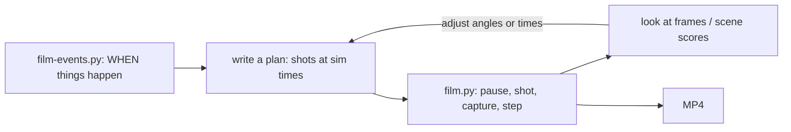

<!--STATUS
state: LIVE
doc-type: runbook (how to film the 3-D map — not a design; the design and its UML are Map 3D Mode §6ab)
updated: 2026-10-21 (§0 --mode editor; R-3034 — runs are not repeatable, load again for each)
current-answer: this whole file — ⭐ §0 film in --mode editor; §1 the quick start, §2 shots, §3 a plan with cuts, §4 finding when things happen, §5 checking the
  film, §6 the traps.
stale-below: nothing.
known-rot: none.
related-designs:
  - DESIGN_Film_Director.md — the designed successor: takes and reels played in the editor live or to film; film.py becomes its client (D-9)
  - PLAN_Feature_Films.md — OWNS what to film (the clip list, docs/films/clips.json) and the overnight pipeline proposal (CE-4034)
  - docs/DESIGN_Map_3D_Mode.md §6ab — OWNS the design (the director camera, the scene capture, the routes; UML; as-built and measured limits §6ab-i)
  - docs/Editor_Headless_Xvfb.md — OWNS the headless launch (Xvfb + Mesa) the films run under
  - docs/RUNBOOK_Cluster_Debugging_Over_Http.md — OWNS the HTTP debug API and its traps (the localhost HOSTNAME, a paused cluster)
-->
# RUNBOOK — filming the 3-D map

Short videos of the 3-D map: **the scene alone** (sky, terrain, buildings, vehicles, people, flashes, blasts, smoke, rounds) — ⛔ no
panels, no gizmos / cards / HUD. Works in a cloud session (Xvfb + Mesa, no GPU) from any lane. `CE-3289`, ruling `R-3032`.



*Caption:* filming is a loop — find the moments, place the cameras, film, look, adjust. A film costs minutes, so look at a few frames of
a short take before filming the whole plan.

## 0. ⭐ Film in `--mode editor` — the preferred host for demos *(user, `2026-10-21`)*

> 🔒 *"pls try the filming on the clusterrunner --mode editor (this is preferred for demos — might hide some network related engine
> bugs)"* · *"stepping in the editor is more 'deterministic' (no network included, faster)"*

| 📐 measured on `ua-tank-ammo`, `2026-10-21` | `--mode editor` | `--mode all` |
|---|---|---|
| one world / network | ⭐ one world, no wire | five nodes over DDS |
| a cut | ⭐ **STEPS** to the next `at` — frame-exact in sim time | plays in real time, overshoots ~0.1 s |
| a film frame | ⭐ **~0.8 s** | ~1.85 s |
| stepping to a cut | ~20 s per sim second skipped | (plays in real time) |
| the M1's shots on the T-72 | **8.85 s, 17.58 s** (`film-events.py --mode editor`) | ~10, ~20, ~30 s |

```bash
python3 scripts/film-events.py ua-tank-ammo --mode editor --seconds 35      # exact shot times (each shot's own firedAt)
python3 scripts/film.py ua-tank-ammo --mode editor --plan plan.json --out /tmp/film.mp4 --keep-frames   # background
```

⚠ **Two runs are NOT the same run** (R-3034, measured CE-3291: the first load after boot plays differently, later loads drift) — so
`film-events.py`'s times are a GUIDE for the next run, not a promise. Load again for every run; never Stop-and-rewind a preview to
rerun it (a rewind leaks brain and perception state). Look at the frames and adjust. 📐 The first editor film caught the second round's impact on the T-72 on the frame the plan
aimed at (`at` 17.3 for a shot fired at 17.58). ⚠ A muzzle flash shows ~0.1 s after `firedAt` (the effect spawns a few frames later).
⚠ An editor result says nothing about the wire — a demo that must prove the CLUSTER films `--mode all`.

## 1. Quick start

```bash
dotnet build Hrot/Runner/Hrot.ClusterRunner --no-restore        # film.py refuses a runner older than the source (or HROT_ALLOW_STALE_RUNNER=1)
which ffmpeg Xvfb                                                # both are in the cloud image
python3 scripts/film.py ua-tank-ammo --follow Tank --distance 28 --pitch -14 --yaw 230 --orbit 4 \
        --warmup 8 --seconds 6 --out /tmp/tank.mp4               # ⚠ ~1.85 s per frame: 6 s of film ≈ 6 min — run it in the BACKGROUND
```

`film.py` launches `ClusterRunner --mode all` under Xvfb on port 8111, loads the scenario, runs it to `--warmup`, **pauses**, then per
film frame: holds the camera (`POST /film/shot`), writes the scene (`POST /film/capture`), steps the sim one film frame
(`POST /sim/step`). ffmpeg joins the PNGs. `--keep-frames` keeps them beside the MP4 (`<out>-frames/`). `--size 1280x720`,
`--fps 30`, `--supersample 2` (smoother edges, 4× the render cost).

## 2. Shots

| shot | flags | what it does |
|---|---|---|
| **follow** | `--follow NAME\|ID --distance --yaw --pitch [--orbit deg/s] [--lift]` | looks at the unit (every frame, it moves) from that distance and angle; `--orbit` circles it |
| **over the shoulder** | `--over NAME --toward NAME2 --back --height [--ahead] [--lift]` | behind NAME on the line to NAME2, `--back` m behind, `--height` up, looking `--ahead` (share) of the way to NAME2 |
| **fixed point** | `--look-at X,Y,Z --distance --yaw --pitch [--orbit]` | a fixed point (a wide shot, a place) |
| **any shot** | `--fov DEG` | the lens: 45° default; ⭐ **narrow = telephoto** — a target 200 m away fills the frame at ~10° |

| ⭐ the angles | |
|---|---|
| **yaw** | the direction the camera LOOKS, degrees from **east, counter-clockwise**: 0 looks east, 90 north, 180 west, 270 south. ⇒ to see a unit from its south, look north: yaw 90 |
| **pitch** | negative looks down: −10 a low side view, −30 a high one, −89 straight down |
| **positions** | HROT metres, Z up; `film-events.py` prints every named entity's start position |

## 3. A plan — several shots with cuts

```json
[
  {"at": 9.4,  "seconds": 1.8, "over": "Tank", "toward": "Enemy Tank", "back": 14, "height": 4.5, "ahead": 0.2, "lift": 2},
  {"at": 18.5, "seconds": 2.6, "follow": "Enemy Tank", "distance": 30, "yaw": 180, "pitch": -10, "fov": 25},
  {"at": 29.9, "seconds": 2.6, "look_at": "300,400,2", "distance": 190, "yaw": 180, "pitch": -9}
]
```

```bash
python3 scripts/film.py ua-tank-ammo --plan plan.json --out /tmp/cut.mp4 --keep-frames     # background
```

Each segment starts at sim time `at` (seconds of the scenario) and lasts `seconds`; keys are the flags without dashes (`look_at`,
`fov`). Between segments the sim **plays in real time** to the next `at` — a cut. ⚠ See §6: a cut overshoots.

## 4. Finding WHEN things happen

```bash
python3 scripts/film-events.py ua-tank-ammo --seconds 40      # ~1.5 min; prints positions, then "sim 10.2: Tank -> Enemy Tank InFlight"
```

📐 ua-tank-ammo: the M1 (1000, at 300,280) fires on the T-72 (1001, at 300,520) at about sim **10**, **20** and **30** s; the third
kills it (burning). ⚠ Shots only — a scenario whose action is movement (an air assault, a crowd) needs its own probe: poll
`GET /entities/{id}` positions the same way.

## 5. Checking the film without watching it

```bash
# where the action is: frames that differ most from the one before (flash, blast, cut)
ffmpeg -i film.mp4 -vf "select='gt(scene,0.003)',metadata=print:file=-" -f null - 2>&1 \
  | grep -oE "pts_time:[0-9.]+|scene_score=[0-9.]+" | paste - - | head
```

Then open a few PNGs from `<out>-frames/` (an agent can read them as images) — the frame at each event, and one per segment for the
composition. 📐 A muzzle flash scores ~0.01, a cut ~0.07–0.17.

## 6. The traps — each one measured

| trap | what to do |
|---|---|
| ⚠ **~0.8 s per film frame in the editor, ~1.85 s in `--mode all`** (1280×720, llvmpipe) — each sim step is a full frame of the window | run film.py in the background; film a 1–2 s take of a shot first and look at it |
| ⚠ **a cut overshoots ~0.1 s in `--mode all`, and NO host repeats a run exactly (R-3034)** | film in the editor (§0); put `at` ≥ 0.5 s before the event and check the frames (📐 the first plan's cut landed just AFTER the T-72 was hit) |
| ⚠ **far is tiny** — 45° makes a tank 240 m away a speck | `--fov 10…25` (telephoto) or a closer camera |
| ⚠ **the first frame of a new shot has the previous camera's sky** | film.py throws it away (a 64-px capture) — keep that if you script the routes yourself |
| ⚠ **buildings between camera and subject** are drawn | move the camera (yaw / distance) — 📐 a wide shot east of ua-tank-ammo's T-72 crossed a roof |
| ⚠ **`--mode all` films the map ON SCREEN** — the perspective shown (the default Scenario) | `/combat/shots` and friends switch perspective; do not poll them while filming |
| ⚠ **504 "no map drew a frame"** | no window (a headless runner, no Xvfb) or the map not visible |

## 7. Driving it by hand (any HTTP client)

| route | body |
|---|---|
| `POST /film/shot` | `{follow, distance, yawDeg, pitchDeg, lift, fovDeg}` · `{eye:[x,y,z], target:[x,y,z]}` · `{lookAt:[x,y,z], distance, yawDeg, pitchDeg}` |
| `DELETE /film/shot` | gives the camera back |
| `POST /film/capture` | `{path, width?, height?, supersample?}` → `{path, width, height, simTime}` |
| `POST /sim/pause` · `POST /sim/step {count}` | one sim step = 1/60 s; 2 per frame at 30 fps |

⭐ `--mode editor` films the same way (§0) — every map host carries the film layer. The code:
`Hrot/Engine/Hrot.Presentation/Map3D/Film.cs`, `MapCanvas.DrawScene`, the routes in `DebugApiHost`; rails `FilmTests`, `FilmFrameRail`.
