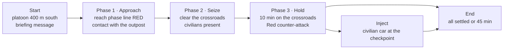
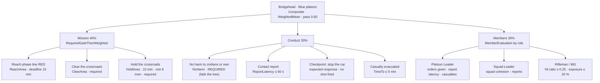
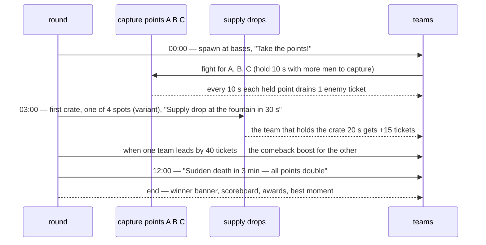

<!--STATUS
state: LIVE
updated: 2026-11-02 (§1.7 / §2.8 as built v1, measured live; §3 `today` column refreshed to the measured state — showcase handoff item ⓪) · 2026-11-01 (§2.7 carrying measured as built)
current-answer: §1 Bridgehead (military training; §1.7 AS BUILT v1) · §2 Crossfire (multiplayer game; §2.8 AS BUILT v1) · §3 the feature coverage · §4 how to use this document
stale-below: nothing — superseded revisions removed 2026-11-01; full history at commit de422e11b (`git show de422e11b:docs/SHOWCASE_Scenarios.md`)
known-rot: none — ⚠ describes the TARGET state: the mechanisms are mostly built (§3), the views (rules view, summaries, debrief, HUD) and the game profile (S6) are not. Each element names its SR row; the coverage table (§3) says what exists today
known-conflict: none
related-designs:
  - docs/DESIGN_Scenario_Rules.md — OWNS every mechanism these scenarios use (SR-…): objectives, triggers, macros, actions, variants, the rules view, the summaries, the HUD
  - docs/EXPLAINER_Scenario_Evaluation_And_Direction.md — explains the same mechanisms with a smaller example
  - docs/designs/rules-view/README.md — the UI mockups these scenarios should end up looking like
  - docs/DESIGN_Player_Join.md — OWNS players joining, possession, the Deploy screen, respawn (D-14) and score (D-15) the game scenario uses
  - docs/designs/group-maneuvers/DESIGN_Defend_And_Attack_Position.md — OWNS CombatProficiency (the skill the amplifier moves) and the platoon attack / defend behaviours
  - docs/RESEARCH_Exercise_Control_Market_Comparison.md — the gaps (variants G1, injects G2) these scenarios demonstrate
-->

# SHOWCASE — two scenarios that demonstrate the whole thing

> ⭐ **The target, described as two playable scenarios.** One serious military training exercise, one multiplayer game. Each says what
> happens, who does what (players and AI), the objectives and how they are scored, the triggers that steer it, what the instructor and the
> players see, and how to demo it. ⭐ They are the **task for building the real scenarios**, the **acceptance test** for the features, and the
> **demo script**. ⚠ Part of what they use is designed, not built — §3 says which.

---

## 1. "Bridgehead" — military training *(platoon attack, ~45 min)*

**Pitch.** A Blue platoon seizes a village crossroads, holds it against a counter-attack and handles a civilian vehicle at its new
checkpoint — under real-world standards (report contact fast, move from cover, no harm to civilians), scored per person, squad and platoon.

| | |
|---|---|
| **map** | `cqb-village` (the map of `scenarios/pc-attack-dry`, whose platoon-attack behaviour this reuses) |
| **audience** | an infantry platoon leader and one squad under training; the rest of the platoon and all opponents are AI |
| **players** | 4 trainees: **Platoon Leader** + **Squad 2** (squad leader, MG gunner, rifleman) — each possesses a soldier (`DESIGN_Player_Join`) |
| **AI** | Squads 1 and 3 (Blue, follow the PL's orders through the command chain) · Red outpost (2) · Red defenders (6) · Red QRF (8, inserted) · villagers (6 civilians) |
| **instructor** | at the server UI = the game-master mode (SR-104): rules view, mission summary, live edits |

### 1.1 What happens

*Caption:* the phases are a CHAIN of objectives, not a clock — each starts when the one before it is achieved (SR-105's dependency view
draws exactly this); only the end has a time limit.

| phase | what the players face | AI around them |
|---|---|---|
| **0 · Start** | a briefing subtitle (*"Seize the crossroads, hold it, set up a checkpoint. Civilians in the village."*) | the platoon in its assembly area |
| **1 · Approach** | move 400 m over partly open ground to **phase line RED**; a Red **outpost** (2 men, one of three positions — variant) opens fire | Squads 1 and 3 move on the PL's orders |
| **2 · Seize** | clear the **crossroads** (6 Red defenders in two houses); villagers on the street — they take cover or flee (the `ua-civ-*` behaviours) | Red defenders fight from the houses |
| **3 · Hold** | hold the crossroads 10 min; 2 min after the hold starts a **Red QRF** (8) attacks from the east OR the west edge (variant) | QRF inserted by a trigger, ordered to attack |
| **Inject** | 3 min into the hold a **civilian car** drives at the checkpoint — the players must stop it without shooting (ROE) | the car is a macro with a civilian driver |
| **End** | all required objectives settled, or 45 min | — |

### 1.2 The objectives and how they are scored

*Caption:* one evaluation tree, reusable as a macro (`macros/evaluation/PlatoonAttackEval`, SR-72): the mission objectives gate the
score, conduct and individual standards weigh in, and **No harm** fails everything — the military rule that a fratricide or a civilian
casualty is a NO-GO however well the rest went.

| standard (GO / NO-GO) | measure | threshold | who |
|---|---|---|---|
| reach the phase line in time | ReachArea + deadline | ≤ 15 min | platoon |
| clear and hold the crossroads | ClearArea, HoldArea | required | platoon |
| report contact | ReportLatency (first sight → contact report) | ≤ 60 s | PL, SLs |
| move from cover | Exposure (time in enemy view) | ≤ 20 % | every soldier |
| aimed fire | HitRatio | ≥ 0.25 | riflemen, MG |
| stop the car without shooting | expected response of the inject | no shot, car stopped ≤ 50 m | checkpoint team |
| casualty care | TimeTo (wounded → evacuated) | ≤ 5 min | squad |
| no harm | NoHarm (Friend, Neutral) | 0 | everyone — **required** |

### 1.3 The triggers that steer it *(all in macros; nothing compiled per scenario)*

| trigger | when | do | rules |
|---|---|---|---|
| **Briefing** | scenario time ≥ 0:05 | Message(Blue, "Seize the crossroads …", 12 s) | once |
| **Phase 2 starts** | `@PhaseLineRed` Achieved | SetObjectiveActive(@ClearCrossroads) · Message(Blue, "Phase line RED — assault the crossroads") | once |
| **Phase 3 starts** | `@ClearCrossroads` Achieved | SetObjectiveActive(@HoldCrossroads) · Message(Blue, "Crossroads clear — hold and set up a checkpoint") | once |
| **Counter-attack** | `@HoldCrossroads` Active | InsertMacro(RedQRF, `@EastEdge` OR `@WestEdge` — variant) → Order(@RedQRF, Attack @Crossroads) → Message(Blue, "Enemy vehicles moving towards you") | delay 120 s, once |
| **Checkpoint inject** | `@HoldCrossroads` Active | InsertMacro(CivCar, @NorthRoad) → SetObjectiveActive(@StopTheCar) → Message(Checkpoint team, "Vehicle approaching the checkpoint fast") | delay 180 s, once |
| **Ease off** *(adaptive)* | `@Bridgehead.Score < 0.35` AND elapsed > 20 min | SetSkillAmplifier(Red, −1) · Message(IOS, "Red eased") | holdFor 2 min, repeat, cooldown 10 min, maxFires 2 |
| **Push harder** *(adaptive)* | `@Bridgehead.Score > 0.80` AND elapsed < 25 min | SetSkillAmplifier(Red, +1) | holdFor 1 min, once |
| **End** | all required settled OR elapsed ≥ 45 min | EndExercise(by objectives) | once |

**Variants (SR-101)** — the same file, a different exercise per run: the outpost at one of three positions · the QRF from the east or
the west · villagers present with probability 0.7 each · the counter-attack delay 90–150 s. *"Rerun variant 3"* reproduces a run exactly.

### 1.4 What each person sees

| who | during | after |
|---|---|---|
| **trainees** | the training HUD (`HudTraining`): mission objectives with progress, *my standards*, coaching hints (*"you are in the open"*), the subtitle messages + log | the trainee debrief (`TraineeDebrief`), **always available the moment the run ends** (demo rule, SR-112): GO / NO-GO per standard, *went well / work on*, *replay from my eyes* |
| **instructor** | the rules view (phases chained, the QRF trigger counting down, the inject waiting) · the mission summary (scores by platoon ▸ squad ▸ person) · live edits | the mission summary on the recording · the AAR timeline with the rules lanes (SR-103) |

### 1.5 Demo script *(≈ 10 minutes of a run, shown from the instructor's seat)*

1. **Rules view** at start: the chain Approach → Seize → Hold, the counter-attack and the inject hanging off *Hold*, the end pinned at 45 min.
2. Contact at the phase line: the outpost opens fire; on the mission summary the PL's **report latency** turns green when the report arrives.
3. *Phase 2 starts* fires — the subtitle on the trainees' screens; the bar of *Clear the crossroads* turns active.
4. **Game-master moment**: right-click on the map → *Add* ▸ *From library* ▸ a sniper team on the church — the platoon's exposure rises live.
5. *Hold* starts → the counter-attack's delay counts down on the timeline; the QRF appears at the variant's edge and attacks.
6. Drag the Red **skill slider** down one tier (SR-100) — the QRF's fire visibly loosens.
7. The car inject: the checkpoint team stops it — *Stop the car* turns Achieved; or someone shoots — **No harm fails the tree** (NO-GO).
8. End → open a trainee's debrief → **replay from his eyes** at the moment he was exposed.

### 1.6 Acceptance checks *(each a checks.json line or a rail)*

- every phase objective activates only after its predecessor (no clock), and the rules view draws the chain;
- the QRF exists 120 s (± variant) after *Hold* activated, at the variant's edge, and has an Attack order;
- the same variant number produces the same outpost position, QRF edge and civilians (replay byte-equal on those);
- a civilian hit ⇒ *No harm* Failed ⇒ the tree's score is 0 and the debrief says NO-GO;
- the ease-off trigger fires at most twice, 10 min apart, and Red's effective proficiency drops one tier;
- the debrief and the mission summary show the same numbers live, after the run and on the recording.

### 1.7 ⭐ As built — v1 *(backend, `2026-11-02`; `scenarios/showcase-bridgehead/`, generated by `scripts/gen-showcase-bridgehead.py`)*

| | target (above) | v1 |
|---|---|---|
| map scale | 400 m approach | `cqb-village` is 330 × 232 m: the platoon starts ~90 m south of phase line RED (a circle r 40 at (125,95)); the crossroads = a circle r 42 at (198,182) holding H3 and H5 |
| trainees | 4 humans possess Blue men | ⏳ **AI on both sides**: three AI squads under a body-less Blue Platoon (SquadMarch → a trigger `Order`s PlatoonAttack → PlatoonDefend) — a human joins by possessing one |
| objectives | the §1.2 tree | Bridgehead (WeightedMean 0.6) ▸ Mission (Reach ▸ Clear ▸ Hold, chained) + **Conduct (required)** ▸ No harm to civilians + No fratricide (both required) — ⏳ Members (S4) |
| triggers | §1.3 | all eight, as data: Briefing · Phase 2 / 3 (`SetObjectiveActive` + `Order`) · Counter-attack (`InsertMacro forces/red-qrf` at `@QrfFrom` + `Order` PlatoonAttack, delay 120) · Checkpoint inject (`InsertMacro inject/civilian-car`, delay 180) · Ease off / Push harder (`SetSkillAmplifier`) · End |
| variants | outpost 1 of 3 · QRF east / west · villagers 0.7 · delay 90–150 | ✅ outpost and QRF edge by **`Positions`** (SR-101 ④, built for this) · villagers `Presence` 0.7 · ⛔ the delay range (SR-101 ③ — a trigger param, behaviors') |
| inject's expected response | *stop the car without shooting* | ⏳ covered by No harm only; the StopTheCar objective needs a link to the inserted driver (a late-resolved `@Key`) or a S4 measure |
| messages | to Blue | to All (the `Side` filter is the HUD's — ui) |

📐 **Measured** *(headless `--verify`, 1500 s of sim in 2098 s; and live `--mode all` under Xvfb, screenshots)*: phase line RED reached **111.5 s** → Clear switched on + Blue ordered to attack · a villager hit at **270 s** ⇒ No harm Failed ⇒ Conduct Failed · the crossroads clear **308 s** → Hold on + Blue ordered to defend · the QRF inserted at the EAST edge and attacking at **428.25 s** (Hold + 120) · the car inserted, driving 150 m east at **488.2 s** (Hold + 180) · the ease-off never fired (the score stayed 0.62). ⚠ The QRF kept the crossroads contested, so Hold was not achieved by 1500 s — the End fires at 45 min.

**Acceptance (§1.6):** line 1 (the chain) — `checks.json` status lines ✅ · line 2 (the QRF) ✅ · line 3 (variants) — rail `ShowcaseScenarioTests` ✅ · line 4 — the half that exists (a harmed civilian fails the TREE) a `checks.json` line; the debrief's NO-GO ⏳ S4 + ui · line 5 (the ease-off ≤ 2) ✅ · line 6 ⏳ S4 + ui.

---

## 2. "Crossfire" — multiplayer game *(team domination with supply drops, 15 min rounds)*

**Pitch.** Two teams fight for three capture points in a city block. Holding points bleeds the other team's tickets; supply crates
dropped at random spots give bonus points; a bounty on the best player and a comeback boost for the losing team keep it tense to the end.

| | |
|---|---|
| **map** | `demo-city` (the map of `uc-urban-battle`), a 300 × 300 m block around three squares |
| **players** | 2 teams of up to 8 humans (Blue, Red); each joins on the Deploy screen (`DESIGN_Player_Join`) |
| **AI** | bots fill each team to 8 (same behaviours as AI soldiers, marked *bot* on the scoreboard) · no civilians |
| **round** | 15 min, or a team at 0 tickets, or a team reaching 3 points held for 60 s (domination) |
| **respawn** | waves every 15 s at the team's base or a held point (Deploy D-14), respawn delay a scenario param |

### 2.1 What happens

*Caption:* everything here is a trigger on scenario time or on an objective's status — the same machinery as the training exercise,
only the actions are game actions (tickets, crates, bounty), and the profile is the GAME one (SR-112).

### 2.2 The objectives and the score

| element | built as | score |
|---|---|---|
| **capture points A, B, C** | one `HoldArea` objective per point and team (capture = 10 s with more men than the enemy; lost when the enemy outnumbers you) | each held point drains 1 enemy ticket / 10 s |
| **tickets** | a `Count` objective per team, starting at 150, decremented by the points held and by each death | 0 = the team loses |
| **supply crate** | an `InsertMacro(Crate)` at a random spot + a `HoldArea` (20 s) per team | +15 tickets to the holder; +200 personal score to each player in the area |
| **bounty** | a trigger: the player with the best K/D streak ≥ 5 gets a `Message(all, "Bounty on Hawk!")` and a map marker | +300 personal score to whoever kills him |
| **domination win** | a team holds all 3 points for 60 s | immediate win |
| **personal score** | kills (+100), assists (+50), captures (+150), crate (+200), bounty (+300); **team kills −200** | the scoreboard; kill attribution from CE-4155 |

**Awards (the reusable awards macro, SR-112)** — named measures crossing a threshold at round end: *Point keeper* (longest time on any
point) · *Sharpshooter* (accuracy ≥ 40 % with ≥ 10 hits) · *Crate hunter* (most crates) · *Bounty hunter* (killed the bounty) ·
*Medic* (most revives) · *Untouchable* (no deaths, ≥ 5 kills).

### 2.3 The triggers that make it fun

| trigger | when | do | rules |
|---|---|---|---|
| **Kick-off** | scenario time ≥ 0:03 | Message(all, "Take the points!", 5 s) | once |
| **Supply drop** | elapsed ≥ 3:00 | Message(all, "Supply drop at {spot} in 30 s") → *wait 30 s* → InsertMacro(Crate, one of 4 spots) → SetObjectiveActive(@CrateHold) | repeat, cooldown 3 min, maxFires 4 |
| **Comeback boost** | ticket difference ≥ 40 | SetSkillAmplifier(losing team's bots, +1) · Message(losing team, "Reinforcements: your squad is sharper") | holdFor 30 s, repeat, cooldown 2 min |
| **Bounty** | a player's streak ≥ 5 | Message(all, "Bounty on {name}!") · mark him on the map | repeat per player |
| **Sudden death** | elapsed ≥ 12:00 | Message(all, "Sudden death — points count double") · double the drain | once |
| **End** | tickets 0 OR domination OR elapsed ≥ 15:00 | EndExercise(by tickets) | once |

**Variants:** crate spots drawn from 4 per drop · bases swapped between rounds · the first crate at 2:30–3:30.

### 2.4 What each person sees

| who | during | after |
|---|---|---|
| **players** | the game HUD (`HudGame`): tickets + A / B / C + timer, capture progress, kill feed, hit marker, *+100* pop-ups, the subtitle messages | the round summary (`GameSummary`): winner, scoreboard, *your round*, awards, *your best moment* (auto-cut), XP |
| **operator** | the rules view (drops counting down, the comeback boost armed) · the mission summary in the GAME grouping (team ▸ player) | the same summary on the recording |

### 2.5 Demo script *(≈ 8 minutes)*

1. Two people join from the Deploy screen as Blue and Red; bots fill both teams.
2. Fight for B — the capture bar on the HUD fills; Red's tickets start draining; the kill feed and *+100* pop-ups run.
3. 3:00 — *"Supply drop at the fountain in 30 s"*; the crate lands; a fight for it; +15 tickets.
4. A streak of 5 → *"Bounty on Hawk!"* — and the bounty kill.
5. **Game-master moment**: the operator inserts an extra crate by hand (*Run an action now* ▸ InsertMacro) — the same action the trigger uses.
6. Red falls 40 behind → the comeback boost fires; Red's bots tighten up.
7. End → round summary with awards and the best moment clip.

### 2.6 Acceptance checks

- a point captures only with more men for 10 s, and drains exactly 1 ticket / 10 s per held point;
- crate drops happen 4 times at most, 3 min apart, each at one of the 4 spots for that variant;
- a team kill subtracts 200 from the killer and never counts as a kill;
- the comeback boost raises only the losing team's bots, by one tier, and never twice within 2 min;
- the awards come from the awards macro, not from the scenario file.

### 2.8 ⭐ As built — v1 *(backend, `2026-11-02`; `scenarios/showcase-crossfire/`, generated by `scripts/gen-showcase-crossfire.py`; the S6 pieces: `DESIGN_Scenario_Rules.md` §00.12)*

| | target (above) | v1 |
|---|---|---|
| teams | 8 humans + bots each | ⏳ **bots only**: two 4-man squads a side, each squad `SquadDefend` at ITS point (Blue A + B from the south base (650,275), Red C + B from the north (650,525)); a body-less team entity per side is only its counters' subject |
| points A B C | capture = 10 s with more men | ✅ `HoldArea` `capture` + **`captureSeconds: 10`** (G-1, by side) at (400,400), (525,400), (650,400), r 15 |
| tickets | 150, −1 per death, −1 / 10 s per enemy point | ✅ **`Counter`** (G-2) `deaths: [{side, per: −1}]` + one **`whileTrue`** drain trigger per point and side (G-4) running **`AddToCounter`** (G-3); doubled from 12:00 by a second set armed by *Sudden death* |
| comeback | 40 behind ⇒ the losing side's bots +1, never twice in 2 min | ✅ a third Counter *Blue lead* (`deaths` both sides) moved by the same drains; triggers `Lead ≥ 40` / `≤ −40`, `holdFor 30`, `cooldown 120` → `SetSkillAmplifier` |
| crates | 4 drops, 3 min apart, 1 of 4 spots per variant | ✅ four drop triggers (3, 6, 9, 12 min) inserting `game/supply-crate` at `@CrateSpot1..4`, each marker placed by `Positions`; ⏳ the crate's hold-for-tickets (a HoldArea on the dropped crate) |
| respawn | waves every 15 s at base | ✅ bots: a `whileTrue` trigger per side while fewer than 8 men are up → `InsertMacro game/bot` at its base (G-5); ⏳ humans: the Deploy screen (Player Join S2) |
| end | tickets 0 · domination 60 s · 15 min | ✅ all three, as triggers → `EndExercise` |
| score, kill feed, team kill −200, bounty, awards | | ⏳ S4 measures (behaviors) + CE-4155 |

📐 **Measured live** *(`--mode all` under Xvfb, real time, one 900 s round, screenshots)*: Red's bots took **point C at ~220 s** (10 s of a majority) and held it to the end · Blue's tickets **150 → 74** (deaths + 1 per 10 s while C was Red's, doubled after 12:00) · *Blue lead* reached **−42** and the comeback raised **Blue only, once** · four crates at 180 / 360 / 540 / 720 s · the End at 900 s closed every rule. ⚠ That round's Blue squads never moved onto A / B: the body-less team's default PlatoonHold had put them on InfantrySquadHold — fixed (the squads command themselves, `545337bff`).

**Acceptance (§2.6):** line 1 — rail `G1_Capture_OutnumberFor10s_ThenLostWhenOutnumbered` + `checks.json` (a point taken, the drain moves tickets) ✅ · line 2 — `checks.json` ✅ · line 3 ⏳ CE-4155 + S4 · line 4 — `checks.json` (≤ 1 per 2 min) ✅ · line 5 ⏳ S4.

### 2.7 The extension to true capture the flag *(a later variant — most of the carrying is already built)*

*Measured `2026-11-01` (user: "carrying entities and stuff is already implemented"):*

| CTF needs | what exists | gap |
|---|---|---|
| the flag is a thing a soldier carries | ⭐ **carry stations per person** — HANDS (fired from), BACK (stowed, seen), HIDDEN (stowed, unseen); the station a thing is in is its slot in the man's `PassengerBuffer`, already on the wire (`Behavior/CarryStations.cs:27`, CE-3233, `DESIGN_Civilians_And_Crowd_Control.md` §7.13); portable things as ENTITIES picked up and put down — weapons, stones, canisters (`DESIGN_Weapon_Systems` separable weapons; §7.10 B-13 pick-up, CE-3235; §7.11 laid-down, CE-3232); casualties carried / dragged with a speed penalty (`CarryLoad.cs`, `CarryNodes.cs`) | a **Flag** entity type that a station accepts (today a station takes a downed man or a portable weapon system — `DESIGN_Civilians_And_Crowd_Control.md` §7 table, *"picking up"*) |
| carrying it slows the carrier | ✅ `CarryLoad.Factor` (a carry factor per type) | none — give the flag a factor |
| the carrier is visible to all | ✅ BACK station = carried and seen | a HUD / map marker on the flag (the bounty marker's mechanism) |
| dropped where the carrier dies, returned if untouched 30 s | ⛔ **not found** — no drop-on-death of carried things in a search (`grep` for death / drop over the toolkit) | ⭐ small: on the carrier's death put the thing down at his position (the existing put-down) + a trigger *flag untouched 30 s ⇒ return to base* |
| a player picks it up | ⚠ **not measured** — whether the possession controls (`DESIGN_Player_Join`) offer *pick up* for a thing on the ground | measure first |
| *flag captured* = the carrier, of side X, reaches his base | ⭐ a trigger: `when` = OnEntity(@BlueFlag) *its carrier (`CarryStations.SeatOf`, `:34`) is Red* AND *inside @RedBase* (CE-4164's area leaf) → AddPoints · return the flag | the "carrier of" predicate leaf (`OnEntity` + carrier, SR-95 family) |

⇒ ⭐ **Domination ships first; CTF is the same scenario plus a Flag item type, drop-on-death and one predicate leaf** — no new mechanism.
The flag's state on the HUD (*at base · carried by Hawk · dropped 12 s*) is one more `game.*` feature.

---

## 3. Feature coverage — what each scenario exercises, and whether it exists

| feature | design | Bridgehead | Crossfire | today *(measured `2026-11-02`)* |
|---|---|---|---|---|
| maps, soldiers, vehicles, civilian behaviours, platoon attack | existing scenarios | ✅ | ✅ | ✅ built |
| players joining + possession, Deploy, respawn | `DESIGN_Player_Join` | ✅ | ✅ | ⚠ joining + possession built; respawn (D-14) and score (D-15) ⛔ not built — rules S6 |
| macros (forces, cars, crates, evaluation, awards) | SR-38…SR-57, SR-96 | ✅ | ✅ | ✅ built — S3a (instances, placement, params + bindings) + S3b (`InsertMacro`, variants, director); the evaluation / awards macros wait for S4 |
| stable entity keys / RefKeys | SR-62…66, CE-4153 | ✅ | ✅ | ✅ built (GUIDs + `RefKey`, live-world `@Key`) |
| objectives (Reach, Clear, Hold, NoHarm, Composite, Count) | §10, SR-72…77 | ✅ | ✅ | ✅ Reach / Hold (+ capture) / ClearArea / DestroyTargets / Protect / NoHarm + WeightedMean / AllMustPass (S1); ⛔ `Count` (S4, behaviors) |
| measures (HitRatio, Exposure, ReportLatency, TimeTo) | §10.3 | ✅ | ⚠ (accuracy, time on point) | ⏳ S4 building (behaviors) |
| member evaluation by role | SR-72 | ✅ | — | ⏳ S4 building (behaviors) |
| triggers (edge, delay, holdFor, repeat, cooldown, maxFires) | T1–T10, SR-99 | ✅ | ✅ | ✅ built (S2) |
| shared actions: InsertMacro, Order, Message, SetObjectiveActive, SetSkillAmplifier, EndExercise | SR-93, SR-96, SR-100 | ✅ | ✅ | ✅ built (+ `MissionCommand`); game actions (tickets, score) ⛔ — S6 |
| conditions in the existing predicate language | SR-95 | ✅ | ✅ | ✅ built, area / event leaves included (CE-4164) |
| scenario params + bindings | SR-41, SR-94 | ✅ | ✅ | ✅ built (a trigger step's own `Bind` ⛔ — B1b) |
| run variants | SR-101 | ✅ | ✅ | ⚠ `$variant`, `Presence`, one-of-N macro built; a trigger's `delay {min, max}` and one-of-N positions ⛔ |
| adaptive exercise control (no director entity) | SR-99 | ✅ | ✅ (comeback) | ✅ built (the director as a macro, `macros/control/counter-attack`) |
| skill amplifier per side | R-4106, SR-100 | ✅ | ✅ | ✅ built (`SkillAmplifier` 480, `SetSkillAmplifier`) |
| player messages (subtitle + log) | SR-106 | ✅ | ✅ | ⚠ `Message` verb + `PlayerMessage` wire built; the subtitle / log display is ui's |
| rules view (dependency Gantt) | SR-105, SR-109, SR-110 | ✅ | ✅ | ⛔ (timeline panel built; TL-X1…X5 CE-4167) |
| mission summary | SR-111 | ✅ | ✅ | ⛔ |
| trainee debrief / round summary | SR-112 | ✅ | ✅ | ⛔ |
| HUD training / game profiles | SR-112 | ✅ | ✅ | ⚠ possession HUD built |
| awards macro | SR-112 | — | ✅ | ⛔ |
| kill attribution (thrower, rethrow) | CE-4155 | ✅ | ✅ | ⚠ rethrow attribution + `NoHarm attribute` built (behaviors `0eebfc086`); the row is open |
| game-master interventions | SR-104 | ✅ | ✅ | ⚠ add / order / Brain tab live; macros, action palette not |
| AAR lanes for rules, replay from my eyes | SR-103 | ✅ | ✅ (best moment) | ⚠ lanes + film director built; rules lanes not |
| every element a switchable feature | R-4108 | ✅ | ✅ | ⚠ Node Features built |
| carrying things (stations, pick up / put down) — the CTF extension | CE-3233, CE-3235, CE-3232 | ✅ (casualty evacuation) | ⚠ CTF variant §2.7 | ✅ built; Flag type + drop-on-death not |

## 4. How to use this document

- ⭐ **As a build task**: a lane builds the scenario files (`scenarios/showcase-bridgehead/`, `scenarios/showcase-crossfire/`) as soon as the
  mechanisms they need exist — start with what is built (maps, forces, behaviours) and add each mechanism as it lands.
- ⭐ **As acceptance**: the §1.6 / §2.6 checks become `checks.json` lines (`DESIGN_Scenario_Regression.md`) — a feature is done when its
  line passes in both scenarios where it is used.
- ⭐ **As the demo**: §1.5 and §2.5 are the scripts; the mockups in `docs/designs/rules-view/` are what the screens should look like.
- ⚠ **Keep it the target**: when a design row changes, change the scenario here in the same commit, so the showcase never drifts from the design.
