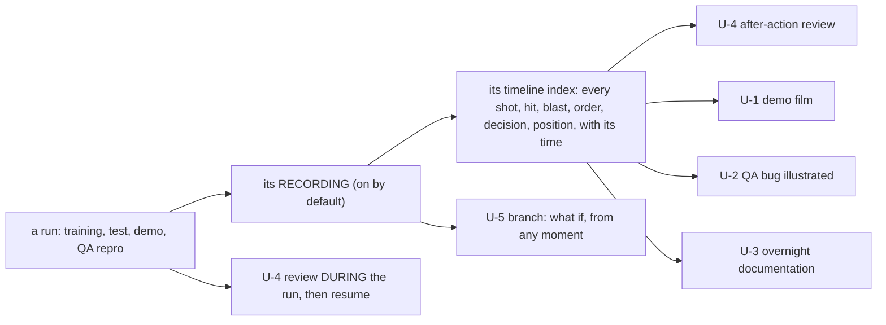

<!--STATUS
state: LIVE
updated: 2026-10-30 (first version — coordinator, at the user's request)
current-answer: the whole file — §1 the picture, §2 the usages, §3 how to add one
stale-below: none
known-rot: the status marks are a 2026-10-30 snapshot; each row's evidence link wins
related-designs:
  - CAPABILITIES.md — OWNS what the SIMULATION can do (one bullet per feature); this file says what PEOPLE can use the engine for, and what it saves them
  - DESIGN_Film_Production.md — OWNS the film pipeline behind usages U-1, U-2 and U-3
  - PLAN_Feature_Films.md — OWNS the clip list (U-1) and §1d, the defects filming found
  - DESIGN_Replay_Time_Axis_And_Review.md — OWNS the reviews behind U-4 and U-5 (DAR, AAR, the branch)
  - DESIGN_Scenario_Regression.md — OWNS the verify runs behind U-3 and U-6
  - RUNBOOK_Cluster_Debugging_Over_Http.md — OWNS driving a running cluster over HTTP (U-8, U-9)
-->

# What HROT is useful for — usages across the engine

🔒 **User, `2026-10-30`:** *"These filming is not good just for demos but it can serve as quick info about a bug reported by QA people. The
AI agent reproduces the bug from the recording and takes some screenshots or clips for illustration. As I would like to sell the benefits of
this engine to my superiors I would like you to create a markdown file where we will record such useful usages across the whole engine."*

⭐ **One entry per usage**: who gains, what it replaces, and how far it is real today. Every status links to its evidence. ⛔ A usage is
never listed as working on an assumption (see §3).

**Status:** ✅ done and shown end to end · ⚠ works, with a named gap · 🔧 the pieces are built, the flow has not been run yet · ⏳ designed,
not built.

## 1. The picture — one recorded run, many uses

*What the picture shows that a list hides:* every usage downstream of the recording costs nothing extra at run time. A run is recorded once,
and the same file serves the trainer, QA, the documentation and the film-maker, on any machine with the folder, without the cluster.

## 2. The usages

| # | usage | who gains | what it replaces | status |
|---|---|---|---|---|
| **U-1** | ⭐ **Demo films cut from a recording.** One run is recorded, then cut as many times as wanted: cameras placed where the action *will* be, the dull approach sped through, the moment slowed, an instant replay from the other side, captions timed to the story. Rendered to MP4 overnight | sales, management, conferences | screen-recording a live run again and again, hoping the moment happens on camera | ⚠ the first clip was cut and rendered from a Live recording on `2026-10-30` (F-49, the A-10's bomb, [PLAN_Feature_Films §1c](PLAN_Feature_Films.md)); gaps CE-4118, CE-4119 (§1d) |
| **U-2** | ⭐ **A QA bug report, illustrated by an AI agent.** QA attaches the recording of the run that misbehaved. The agent opens it, finds the moment in the timeline index (*"the tank never fired at 0:42"*), takes stills or a short clip from the best angle, and attaches them with the exact time and the units involved | QA, developers | a written description, a phone video of the screen, *"cannot reproduce"* | 🔧 every piece is built and was used in the `2026-10-30` pilot (open a recording, read the index, `POST /director/stills`, render a clip); the flow has not been run on a real QA report yet |
| **U-3** | **Overnight documentation of the regression scenarios.** Every scenario's checks become stills at the moment each check passed or failed, beside the verdict, in a morning report | developers, reviewers | reading logs to learn what a failing scenario looked like | 🔧 the take builder is built ([Film Production §4a](DESIGN_Film_Production.md)); the night run that renders it is not wired yet |
| **U-4** | ⭐ **Review a training run while it runs, then carry on.** The instructor pauses a live exercise, rewinds to show the trainee what went wrong, and resumes live from where it paused, one continuous recording; or reviews it fully after the end (AAR) | instructors, trainees | stopping the exercise and talking over a whiteboard | ✅ the four mode switches proven end to end `2026-10-30` (CE-4104, [Blueprint_Issues_Tracker](blueprints/Blueprint_Issues_Tracker.md)) |
| **U-5** | **Branch from any recorded moment: *"what if he had turned left?"*** A new exercise starts live from that moment; the original recording stays untouched | instructors, analysts | re-running the whole scenario from the start and steering it back to the same situation | ✅ AAR → Live, the branch with its parent (CE-4104) |
| **U-6** | ⭐ **Scenarios are tests.** Each scenario carries machine-checkable conditions; a night run verifies all of them and records each run. A behaviour that silently stops working is found the same night and, from two recordings, bisected to the commit | developers, project management | *"it used to work"* discovered weeks later | ✅ two civilian regressions found and bisected to their commits ([PLAN_Feature_Films §1b](PLAN_Feature_Films.md), CE-4039, CE-4040) |
| **U-7** | **Filming finds bugs nobody was looking for.** Watching a scenario through a camera at its exact moments exposes what a pass/fail check does not ask about | developers, QA | — | ✅ the `2026-10-30` pilot found four defects in one afternoon (PLAN_Feature_Films §1d) |
| **U-8** | ⭐ **An AI agent drives the real product, not a mock.** Every host answers HTTP: load, run, step, inspect any entity, read the timeline, film. The agent reproduces, measures and reports with evidence | developers, QA | manual click-through testing | ✅ one run of the whole cluster found a defect ~8 000 tests missed (`2026-09-04`, [RUNBOOK_Cluster_Debugging_Over_Http](RUNBOOK_Cluster_Debugging_Over_Http.md)) |
| **U-9** | **See exactly what crossed the network.** A sniffer records every message between the nodes to a file, decoded | developers, integrators | guessing from logs on each side | ✅ `ddsmonitor` ([RUNBOOK_Cluster_Debugging_Over_Http §5a](RUNBOOK_Cluster_Debugging_Over_Http.md)) |
| **U-10** | **One process or many machines, same scenario.** Everything runs in one process on a laptop for a demo or a test, or split across machines (simulation, AI, image generator, instructor, traffic) for an exercise | IT, integrators, demos | a separate demo build | ✅ `--mode all` and the separate node launches ([RUNBOOK_Cluster_Debugging_Over_Http](RUNBOOK_Cluster_Debugging_Over_Http.md)) |
| **U-11** | **Change AI behaviour without restarting.** The behaviour library is swapped live while the scenario runs | AI authors | stop, rebuild, restart, steer back to the situation | ✅ the AI hot reload (`AiHotReloadCoordinator`, `FbtAssemblyHotReloader`) |
| **U-12** | **Replay anywhere, no cluster needed.** The Replay Browser needs only the recording's folder: a reviewer on another machine, or an agent in the cloud, opens the run as it happened | reviewers, remote support | shipping the whole setup to reproduce a run | ✅ the editor records, the Replay Browser opens and films it (CE-4102) |

## 3. How to add a usage

| rule | |
|---|---|
| ⭐ **one row per usage, in the reader's words** | what someone DOES with the engine and what it saves them — ⛔ not a feature name (that belongs in [CAPABILITIES.md](CAPABILITIES.md)) |
| ⭐⭐ **the status links its evidence** | a tracker row, a design section, a report, a film. ⛔ No link ⇒ at most 🔧 |
| ⭐⭐ **say the gap** | ⚠ names what is missing, with its tracker row. ⛔ A usage that only works in a demo setup says so |
| ⭐ **any lane adds a row when its work makes a usage real** | the same commit that proves it; next free id `U-13` |
