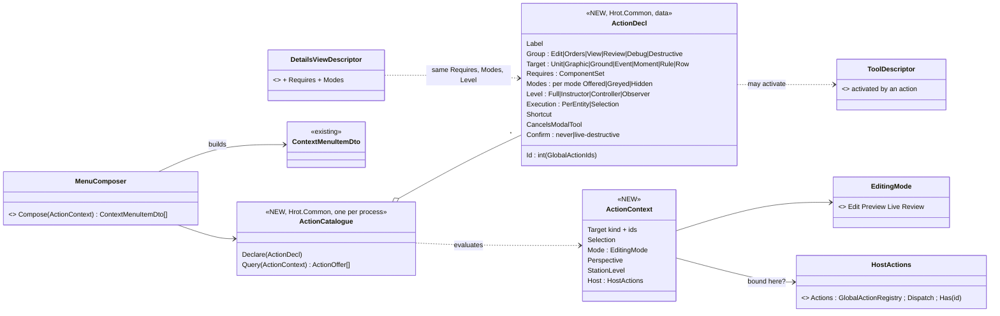
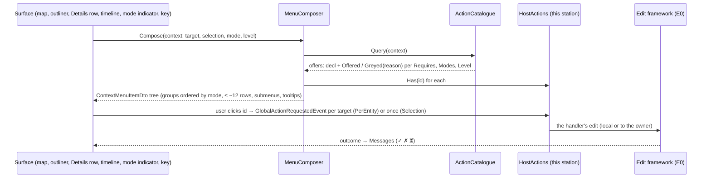
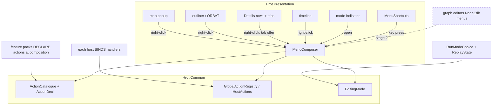
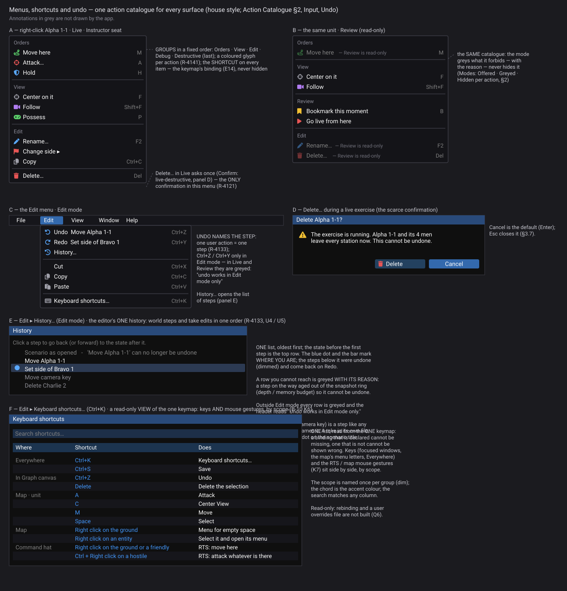
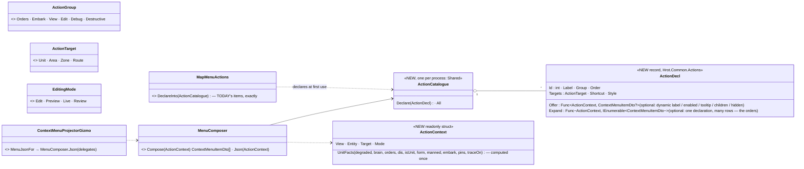
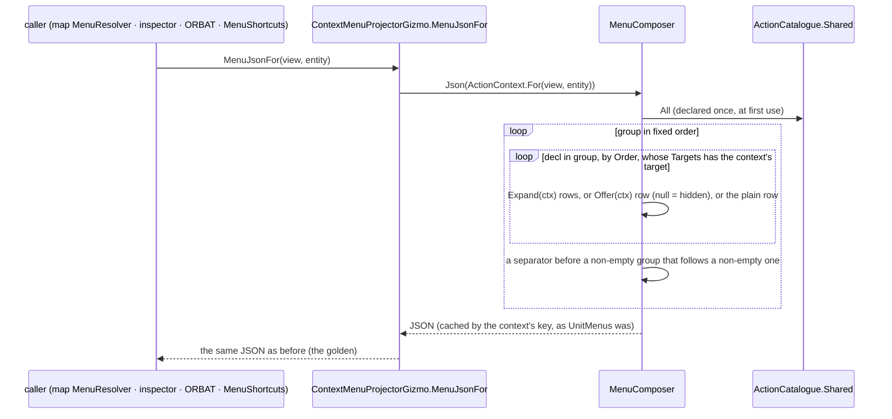
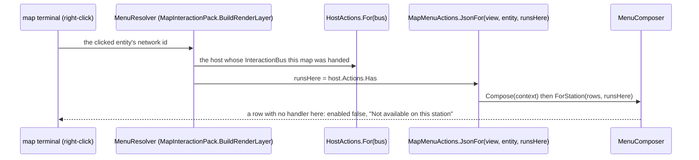
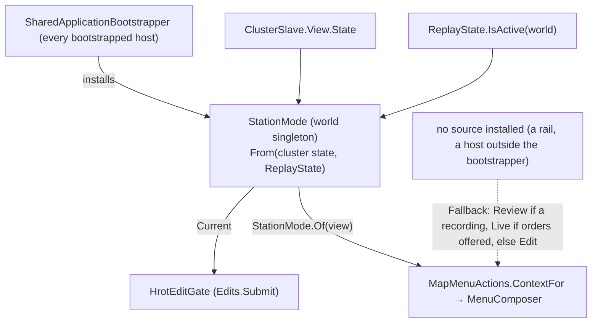

<!--STATUS
state: LIVE
build-state: DESIGN — top-level; ✅ §5 Q1–Q5 APPROVED by the user 2026-11-06 (R-4125); the building lanes detail it during implementation (R-4123)
updated: 2026-11-06 (first version — coordinator; editing-UX design queue item 1: E9 + E1 core)
current-answer: §2 the model (diagrams) · §3 how it reconciles the earlier designs · §4 the stages · §5 questions with leans
stale-below: nothing
known-rot: none
known-conflict: AQ26-B says a registration omits checked / icon / shortcut — the built menus use all three; §3 row 1 resolves it. UX_Feature_Entity_Action_Vocabulary / Cross_Surface_Actions STATUS lines predate the built HostActions path — §3 rows 3–4
related-designs:
  - DESIGN_Details_Forms.md — E2: a form row declares the same Requires / Modes / Level as an action
  - DESIGN_Map_Interaction.md — E8: the drawing menu (Finish · Remove last point · Cancel) as catalogue actions targeting the armed tool
  - DESIGN_Input_And_Commands.md — every key binds to an action id; an action declares its default key, scope and kind (press / hold / axis)
  - DESIGN_Seats_And_Hats.md — an action's Level and side scope are read against the station's seat; its availability also by the active hat
  - DESIGN_Edit_Framework.md — an action's handler submits its edit there (one request, one outcome)
  - DESIGN_Editing_UX.md — the programme: §3.2 (Requires + mode on tabs and actions), §3.6 (the action table), §3.13 (menus per surface and mode), D2, D4, D13–D15
  - Architect_Question_26_Entity_Action_Model.md — the action model this design BUILDS (RegisterAction(descriptor, isApplicable, isEnabled, execute), AND over the selection, C1 on GlobalActionRegistry, the two axes)
  - UX_Feature_Entity_Action_Vocabulary.md — the descriptor / binding split, ActionConcurrency, CancelsModalTool (UXI-03)
  - UX_Feature_Cross_Surface_Actions.md — the id rule: a map item needs a GlobalActionRegistry binding (UXI-04)
  - UX_Feature_Menu_Follows_Focus.md — the main menu bar (built, CE-1243): MenuBinding per perspective, RegisterContributor with ContextMenuItemDto
  - ../designs/gizmos-1/canvas-context-menu-design.md — §10–§12 the built path: MenuJsonFor re-served to inspector and ORBAT, HostActions, Has() filtering
  - UX_Feature_Tool_Model.md · Architect_Question_27_Tool_Model.md — "an action activates a tool"; ToolDescriptor; central Escape (step 6)
  - ../blueprints/DESIGN_Details_Panel_View_Switching.md — DetailsViewDescriptor / DetailsContext, which share this design's Requires and mode
  - ../DESIGN_Remote_Edit_Outcome.md — an action's edit goes through the one edit framework (E0) and reports its outcome
  - ../DESIGN_Node_Features.md — the station's editing level (D4) is a node feature the context carries
-->

# DESIGN — the action catalogue: one declaration per user action, every menu and tab built from it

## 0. Why, and what the user ruled

🔒 *"menu building should be unified and shared (it was already one of UX designs) - needs design"* · *"what to show in context menus for
various stuff. Including the context menu on the timeline - there are many possibilities, the question is what makes sense in what mode"*
· R-4119: editing is gated by the entity's components, never by the node · R-4121: editing levels per node, scarce live confirmations.
Programme decisions it implements: **D2** (tabs registered once, with `Requires`), **D13** (one catalogue builds every menu), **D14**
(what each surface offers per mode), **D15** (no map orders in offline Edit), **D4** (editing levels).

## 1. INVENTORY *(2026-11-06)*

Queries: `search_graph ".*(Action|Menu).*(Registry|Descriptor|Handler|Id|Ids|Provider|Populator)$"` Class (29), Interface (7);
`".*(MenuItem|CommandDescriptor|ContextMenuProvider|UiAction|ActionDescriptor).*"` (16); `".*ContextMenu.*"` (44); grep for
`EntityActionContext|EntityActionGroup|ActionConcurrency|CancelsModalTool` (**0** — AQ26-B / UXI-03 never built). Coverage not checkable
(no `check_index_coverage` in the CLI).

| piece | where | state |
|---|---|---|
| `GlobalActionRegistry` — `Register(int, handler)` (throws on a duplicate), `RegisterLocal`, `TryGetHandler`, `Has(id)`; handler `(ISimulationView, Entity)` | `Hrot.Common/Interactions/GlobalActionRegistry.cs:15` | ✅ built — the dispatch backbone (AQ26 C1) |
| `GlobalActionIds` — 56 `const int` (orders, entity, edit, tools, view, designate, macro) | `Hrot.Common/Constants/GlobalActionIds.cs:10` | ✅ — 257 / 258 unused (HA-7 superseded) |
| `GlobalActionRequestedEvent { ActionId, Target, Relayed }` | `Hrot.Common/Events/GlobalActionRequestedEvent.cs:12` | ✅ |
| `HostActions` (one per host: `Actions`, `Dispatch`, `Request`) · `SharedHostActions.Create()` on all five hosts | `HostActions.cs:11`, `Map/SharedHostActions.cs:13` | ✅ canvas §12 |
| `ContextMenuProjectorGizmo.MenuJsonFor(view, entity)` — a hard-coded `if` chain over components (`EditablePolyline`, `RoutePlan`, else a unit menu), cached per flag set; served to map, inspector (`MapEntityMenuHandler`, filters `Has`) and ORBAT | `Hrot.Common/Diagnostics/Gizmos/ContextMenuProjectorGizmo.cs:45-66, 210` | ✅ — ⛔ the map popup does NOT filter `Has` (`GizmoMap.Presentation/UI/ContextMenuAdapter.cs`) |
| `ContextMenuItemDto` — id, label, icon, enabled, tooltip, shortcut, separator, children, checked, priority, style | FDP | ✅ the one menu DTO (map, main bar) |
| `MenuShortcuts` — a key runs the primary unit's menu item whose `Shortcut` matches | `Map/MenuShortcuts.cs:26` | ✅ CE-1076 |
| `CanvasMenuUpdateSystem` (empty ground: Add Entity ▸, a hand-typed Measure) | `Systems/CanvasMenuUpdateSystem.cs:23` | ✅ |
| `IContextMenuBuilder` + `LambdaEntityContextMenuHandler` (inspector extras: Rename, Delete, Mark Target… — closures, per host) | `FDP/Engine/Fdp.Presentation/ImGui/Abstractions/IEntityContextMenuHandler.cs:21,44` | ✅ — no tooltip / checked / shortcut; `PopulateMenu(collection)` is a no-op (`MapEntityMenuHandler.cs:52`) |
| timeline: `TimelineMenuItem(Label, Run, Enabled)` + `TimelineMenuContext(LaneId, Ticks, Frame, Event)` | `Fdp.Toolkits/ReplayBrowser/Timeline/ITimelineLaneProvider.cs:71,75` | ✅ — its own closures, outside the ids |
| main bar: `GlobalMenuRegistry` (`MenuBinding` per perspective, `RegisterContributor` with `ContextMenuItemDto` + `Action<int>`) | `GlobalMenuRegistry.cs:28,52,396` | ✅ CE-1243 |
| tools: `ToolDescriptor(Id, Label, Modality, Arbiter, ShowOnToolbar, ToggleOnReactivate)`, `IToolController` — "an action activates a tool" | `Tools/ToolDescriptor.cs:67` | ✅ |
| Details: `DetailsViewDescriptor(Id, Title, Rank, AppliesTo, Create)`; `DetailsContext(Focus, Selection, Entities, Asset, Perspective, Mode: VariableRunState)` | `Hrot.Editor.AiShared/Shell/DetailsViewDescriptor.cs:40`, `DetailsContext.cs:36` | ✅ |
| ⚠ **two mode vocabularies** | `VariableRunState {Planning, Running, Paused, Replay}` (Details) vs `RunArmed {Preview, Live, AAR}` + DAR (`RunMode/RunModeTypes.cs:15`) vs `ReplayState.IsActive` (menus) | — |
| dead | `SharedContextMenuPopulator`, `IEntityActionController`, `MapContextActionController` (0 production callers) | delete in stage 1 |

## 2. The model

### 2.1 Classes

*What the picture shows that prose hid: the DECLARATION (what an action is, what it needs, where and when it is offered) is data in ONE
catalogue; the BINDING (what runs) stays the existing per-host `GlobalActionRegistry` — so "offered here" is a lookup, never a host
remembering to register a menu item. Details tabs carry the SAME `Requires` / `Modes` / `Level`, so a tab and an action agree by
construction.*

| member | rule |
|---|---|
| `Requires` | the components every target must carry — for a multi-selection, **all** of them (AQ26: AND over the selection) |
| `Modes` | per `EditingMode`: Offered, Greyed (with a reason), Hidden — e.g. map orders: Edit Hidden, Preview / Live Offered, Review Hidden (D15) |
| `Level` | the lowest station level that may run it (D4); a station below it shows the item greyed: "this station is an observer" |
| binding | `HostActions.Has(id)` false ⇒ **greyed, "not available on this station"** — a gap to fix (R-4119), never silently clickable |
| `Confirm` | only `live-destructive` asks (R-4121: delete, end exercise, change many) |
| `Execution` | `PerEntity` — the event per target; `Selection` — once with the selection (AQ26-B) |
| `Shortcut` | declared here once; `MenuShortcuts` reads it (today: a display string in the DTO) |

### 2.2 One menu, any surface

*What it shows: a surface only says WHAT was clicked; the composer is the one place that decides what is offered — today that logic is
spread over six mechanisms (Editing UX §1.6).*

### 2.3 Where it lives, who calls it

*What it shows: nothing calls the composer per frame — only a right-click, a key press, opening a menu or a selection change for the tab
offer (hot path R-2084: the per-frame cost is zero). The graph editors' menus (dashed) stay their own world in stage 1 (§5 Q3).*

### 2.9 The graphical design *(R-4143 — the acceptance spec)*

*What the picture shows that the prose hid:* one catalogue makes every menu look and behave the same. Groups sit in a fixed order, every item shows its shortcut, a forbidden item is greyed with its reason, and confirmation is so rare that the one dialog is easy to read. Generated by `scripts/gen-menus-mockup.py`.

## 3. How it reconciles the earlier designs

| # | earlier statement | resolution |
|---|---|---|
| 1 | AQ26-B: a registration omits checked / icon / shortcut | the built menus use `Checked` (pins), `Shortcut` (keys that work) and `Tooltip`; ⭐ `Shortcut` is declared on the action (one source); `Checked` stays a binding-side dynamic value (like the dynamic label) |
| 2 | AQ26-D: "mode" = the subsystem, decided at composition; "is running is an ordinary isApplicable condition, not an axis" (user) | ⭐ kept: the subsystem axis is `HostActions.Has` (what this host binds) plus R-4119; the run state stays a CONDITION in the context — `EditingMode` — but declared as data per action (`Modes`) rather than coded in each predicate. ⛔ No new axis |
| 3 | UXI-03: the registry in `Hrot.Presentation`, per subsystem | the built `HostActions` is in `Hrot.Common`, per host object — ⭐ the catalogue goes beside it in `Hrot.Common` (one per process); bindings stay per host |
| 4 | UXI-03 / UXI-04: a typed C# registry, inspector first | the built path made the map's `MenuJsonFor` the single source; ⭐ the catalogue REPLACES `MenuJsonFor`'s `if` chain behind the same output (stage 1), so map, inspector, ORBAT and keys keep working |
| 5 | canvas §5 / §7: a `CanvasMenuUpdateSystem` variant per subsystem | ⭐ superseded: empty ground is one more target kind (`Ground`) in the one catalogue |
| 6 | Tool Model §560 still says `StealsFocus` | `CancelsModalTool` (the rest of the doc and Q27) |
| 7 | UXI-04: closure-only items cannot reach the map, yet the inspector still has closures (Rename, Delete, Mark Target) | ⭐ every inspector closure becomes a declared action with an id; the retired "Mark Target for N Units" (Tool Model §4.13) is deleted |
| 8 | main bar `MenuBinding.OnClick` (closures) vs context menus (ids) | ⭐ the main bar keeps its built registry; an item that is also an action (Delete, Rename, Center) references the action id, so its enablement comes from the catalogue |
| 9 | `DetailsContext.Mode : VariableRunState` vs `RunArmed` vs `ReplayState.IsActive` | ⭐ one derived `EditingMode` {Edit, Preview, Live, Review}, computed in one place from `RunModeChoice` + `ReplayState`; `DetailsContext` carries it (§5 Q1) |

## 4. Stages *(top level — the ui lane details each; every stage keeps today's menus unless the stage says otherwise)*

| stage | what | safety |
|---|---|---|
| **A1** | `ActionDecl`, `ActionCatalogue`, `EditingMode`, `MenuComposer`; declare TODAY's unit / graphic / ground items exactly as `MenuJsonFor` builds them; `MenuJsonFor` delegates | a golden of the menu JSON per entity kind × mode (the S0 pattern) must stay byte-identical; delete the three dead pieces |
| **A2** | the map popup filters by `Has` → greyed "not available on this station" | the golden moves ONLY for items without a handler, listed |
| **A3** | the target per surface and mode (Editing UX §3.13): Edit-group first in Edit, no map orders in Edit (D15), Review set, waypoint / spawn area / weather region get their own target kinds | the new goldens reviewed by the user |
| **A4** | multi-selection: AND over the selection, `PerEntity` / `Selection`; the inspector's multi menu; `MenuShortcuts` on all selected | rails per rule |
| **A5** | inspector closures → actions (Rename, Delete unified wording); the canvas menu as target `Ground` | one wording per action across surfaces |
| **A6** | timeline + mode indicator: targets `Event` / `Moment` / `Range` / `Playhead` / `Rule`; the run-mode moves declared once, worded once | — |
| **A7** | Details tabs: `Requires` / `Modes` / `Level` on `DetailsViewDescriptor`; tabs registered once in `EntityDetailsBundle` (D2) | the tab offer per entity kind × host is a golden — identical across hosts |
| **A8** | station levels (D4) read by the composer | needs the node feature (E10 / D4 design) |
| later | graph editors' menus through the composer (§5 Q3) | — |

## 5. Questions — ✅ all five leans APPROVED *(🔒 user, `2026-11-06`: "Q1-Q5 approved, go on with the next design")*

| # | question | ⭐ lean | what would change it |
|---|---|---|---|
| **Q1** | one `EditingMode` replaces `VariableRunState` in `DetailsContext` | yes — one vocabulary; `Paused` is not a mode (a paused Live is Live) | a Details view that truly needs "paused" — then it reads the clock, not the mode |
| **Q2** | an item with no handler on this station | greyed with "not available on this station" — it exposes a gap R-4119 says to fix — and HIDDEN only when the target kind can never have it | if the greyed list gets long on a station by design (e.g. a Player) — then the station's level hides them |
| **Q3** | graph editors (BTree / HSM / Blueprint node menus) | outside stage 1 — they are NodeEdit's generic menus (AQ26 constraint 1: no engine concept in a generic component); later the same composer behind NodeEdit's provider seam | — |
| **Q4** | where declarations come from | each feature pack declares its actions at composition (orders by the orders pack, Embark by the embark pack …) — never one central list; the catalogue only holds them | — |
| **Q5** | the order of groups per mode | Edit: Edit · View · Properties · Debug — Preview / Live: Orders · Edit · View · Properties · Debug — Review: Review · View · Properties · Debug; Destructive last in every group | the user's practice |

## 6. ⭐ A1 build design *(ui, `2026-11-07`; `build-state: READY-TO-BUILD` for A1)*

INVENTORY (re-measured for the build): `ContextMenuProjectorGizmo.MenuJsonFor` (`Hrot.Common/Diagnostics/Gizmos/ContextMenuProjectorGizmo.cs:209`) is
the one menu builder — four menus: area, terrain zone, route (static JSON) and the unit menu (`UnitMenu`, cached by a flag key). Its callers:
the map terminal's `MenuResolver`, `MapEntityMenuHandler` (inspector, ORBAT), `MenuShortcuts` (keys). The three dead pieces —
`SharedContextMenuPopulator`, `IEntityActionController`, `MapContextActionController` — have **0 code references** outside their own files
(grep: two doc-comment mentions in `ZonesDetailsView.cs`, `ZoneStatusReader.cs`; no test references). The golden:
`Hrot.Presentation.Tests/Gizmos/TheMenusAreGoldenTests.cs` → `Goldens/menus.golden.txt` (8 entity kinds × 3 modes), captured from the
code BEFORE A1.

📐 **The finding that makes A1 data-driven, measured on today's four menus:** every separator sits exactly between two non-empty GROUPS —
unit: *Orders (+ Possess) │ Embark │ View (Center, Follow, Select, Properties, Macro) │ Edit (Rotate) │ Debug (pins, AI trace)*; area / zone /
route: *View │ Edit │ Destructive*. ⇒ the composer emits the groups in their fixed order and a separator between non-empty ones; ⛔ no
hand-placed separators.

*What the picture shows that the prose hid: the catalogue holds DECLARATIONS; what varies per entity (an order disabled on a damaged unit,
the checked pins) stays a declaration's `Offer`, not a host's code — and `MenuJsonFor` keeps its signature, so the map, the inspector, the
ORBAT and the keys need no change.*

*What it shows: one walk over one catalogue; the per-entity facts are read once into the context, exactly the facts `MenuJsonFor` read.*

| decision | why |
|---|---|
| `MenuComposer` in **Hrot.Common**, not Hrot.Presentation (§2.3 drew it there) | `MenuJsonFor` lives in Hrot.Common and must delegate; ⚠ a deviation from §2.3, folded here |
| `EditingMode` derived in A1 as **Review** (the world shows a recording) · **Live** (orders offered) · **Edit** (otherwise) | today's menus only distinguish those; A3 derives it from `RunModeChoice` (§3 row 9) and separates Preview |
| the orders: ONE `Expand` declaration over `OrderMenu.OfferedFor(dis)` | the order vocabulary is data already (behaviour assemblies); ⛔ not 20 hand-copied declarations |
| the JSON cached per context key (the old `UnitMenus` key) | `MenuShortcuts` asks per key press, the map per right-click — never per frame (R-2084) |
| the three dead pieces deleted | §4 A1; measured 0 references |

*Rejected:* **hand-placed separators as declarations** — the group rule reproduces all four menus · **one declaration per order** — the
vocabulary is hot-reloaded data · **the composer in Presentation with a callback from Common** — a second path for one menu.

### 6a. ⭐ A1 as built *(ui, `2026-11-07`)*

| | as built |
|---|---|
| homes | `Hrot.Common/Actions/`: `ActionCatalogue.cs` (`ActionDecl`, `ActionCatalogue.Shared`, `ActionContext`, `UnitFacts`, `MenuComposer`), `MapMenuActions.cs` (today's items + `ContextFor` + the cache), and ⚠ ONE ENUM PER FILE — `ActionGroup.cs`, `ActionTarget.cs`, `EditingMode.cs`, `EmbarkOffer.cs`: the CycloneDDS code generator writes one IDL per source file and IDL enumerators share one scope (`ActionGroup.Edit` vs `EditingMode.Edit` failed the build) |
| `MenuJsonFor` | one line: `MapMenuActions.JsonFor(view, entity)`; `ContextMenuProjectorGizmo.OrderItem` forwards to `MapMenuActions.OrderItem` |
| deleted | `SharedContextMenuPopulator`, `MapContextActionController`, `IEntityActionController` |
| ⏭ still derived | an order's letter (its first letter) — A3 / K5 declare it |

**Rails:** `TheMenusAreGoldenTests` (24 cases, byte-identical before and after — captured at `f768aa019`, the commit before the refactor) ·
`TheActionCatalogueComposesMenusTests` (a duplicate declaration throws; separators only between non-empty groups).

## 7. ⭐ A2 — a row this station cannot run is GREYED *(ui, `2026-11-07`, built)*

*What it shows: no host passes anything — every map is handed its host's `InteractionBus` (`MapInteraction.InteractionBus` IS
`HostActions.InteractionBus`), and `HostActions` registers itself under that bus at construction, so the map finds what runs here by
construction.*

| | as built |
|---|---|
| the rule | `MenuComposer.ForStation(rows, runsHere)`: an id the host does not run → `Enabled = false`, `Tooltip = "Not available on this station"`; a row already greyed keeps its own reason; submenus walked |
| where | the map popup (`MenuResolver`); `MenuJsonFor` (station-free) unchanged for `MenuShortcuts` and the A1 golden |
| ⏭ the inspector / ORBAT | `MapEntityMenuHandler` still HIDES a row with no handler (its builder has no tooltip) — unified in **A5** (inspector closures → actions) |
| golden movement | `Goldens/menus.station.golden.txt` (the shared map pack's host): exactly two rows greyed — **Save selection as macro…** (only the editor registers it: a real gap on the other hosts) and **Properties…** (registered by `EntityDetailsBundle`, which the pack-only test host lacks — on every real ECS host it runs) |

**Rails:** `TheMenusAreGoldenTests.A2_*` — the station golden; it differs from the A1 golden only in rows the host cannot run (red-proof: grey
everything ⇒ fails); the map's own resolver greys *Save selection as macro…* end to end through the bus lookup.

## 8. ⭐ A3 — the mode decides what is offered *(ui, `2026-11-07`, built — the goldens are for the user's review)*

INVENTORY: `scripts/cbm.sh search_graph .*(EditingMode|RunPhase|WorldMode|SessionMode|PlanningState|EditMode).*` ⇒ no world mode type; grep
`enum EditingMode` ⇒ **two**: `Hrot.Common.Editing.EditingMode` (backend, edit framework F1, documented *"read by the action catalogue (B-11) and
the edit gate"*) and the one A1 added in `Hrot.Common.Actions` — ⛔ a duplicate, **deleted**; the catalogue uses the gate's. The gate's mode was
*"a replay is Review, else Edit — Live / Preview from the action catalogue, B-11"* (`SharedApplicationBootstrapper`). `OrdersOffered` is set on
EVERY map host (`MapInteractionPack.cs:364`) ⇒ the editor offered map orders while authoring — what D15 forbids.

*What it shows: ONE mode, derived in ONE place, read by the gate and the menus — so a menu can never offer what the gate would refuse for
being in the wrong mode. Everything that is not the bootstrapper falls back to A1's behaviour.*

| `ClusterState` (+ replay) | `EditingMode` |
|---|---|
| a world showing a recording (any state) · `*Replay` | Review |
| `LoadingPreview` · `OperatingPreview` · `UnloadingPreview` | Preview |
| `LoadingLive` · `OperatingLive` · `UnloadingLive` | Live |
| `Idle` · `*Edit` | Edit |

**What each existing action is offered in** (Editing UX §3.13; hidden elsewhere — ⭐ new actions Rename, Duplicate, Heal… are A5):

| action | Edit | Preview | Live | Review |
|---|---|---|---|---|
| orders, Order with options, Designate, Possess | — | ✓ | ✓ | — |
| Embark… / Disembark | ✓ | — | ✓ | — |
| Center View, Follow, Select, Properties…, Pin gizmos, AI trace | ✓ | ✓ | ✓ | ✓ |
| Save selection as macro… | ✓ | — | — | — |
| Rotate *(the same modes as moving by drag and drop)* | ✓ | — | ✓ | — |
| Edit Shape, Edit Route, Load zone, Delete (graphics) | ✓ | — | ✓ | — |

⭐ **USER RULING R-4162 (`2026-11-07`) — this table as corrected by the user** (the A3 review): 🔒 *"Rotate should be possible in life as well, the same way as drag and drop is. Save as macro makes sense only in edit mode."* ⛔ SUPERSEDED: the built golden had Rotate Edit-only and *Save selection as macro…* in every mode. Follow and Select stay in every mode (the lean, not objected to). ⭐ **Save** (the toolbar icon, Ctrl+S, File ▸ Save) writes the scenario ONLY in Edit; in Preview and Live it takes a **checkpoint**; in Review it is not offered — 🔒 *"saving scenario in live mode or in replay mode or elsewhere than the edit is not desired, The save Icon Should work as save only in edit mode, and if used during preview or live, it should create a checkpoint. This was already planned like that."*

⭐ **As built (ui, `2026-11-07`, R-4162):** `MapMenuActions` declares Rotate `InEdit | InLive` and *Save selection as macro…* `InEdit`; the goldens
(`menus.golden.txt`, `menus.station.golden.txt`) regenerated — the only movement is those two rows. **Save** measured: Edit writes the scenario
(the File menu's Save items are drawn only while editing; Ctrl+S `shell.save` → the session's `SaveCurrent`); Live takes a checkpoint
(`RunModeChoice.TryCheckpointInsteadOfSave` intercepts every Save, `EditorScenarioSession.SaveIntercept`); a recording refuses
(*"a recording cannot take a checkpoint"*). ⚠ **Gap, not built:** in **Preview** a Save is refused (*"Not saved: stop the preview to save"*)
instead of taking a checkpoint — a checkpoint is the live run's recorder's (`CheckpointDisabledReason`: *"a checkpoint is taken of a live run"*)
and a Preview runs a copy of the edit world ⇒ backend (`NOTE_Ui_To_Backend_Preview_Checkpoint.md`).

⭐ **A4 — WHOM a menu command acts on (R-4162):** 🔒 *"Right-clicking an unselected entity should indeed select just that entity"* · *"if we are right clicking an entity which is already part of the selection, then the menu command should go to all selected ones. Doesn't matter which one was right clicked."*

| you right-click | the selection | the command goes to |
|---|---|---|
| an entity **in** the selection | unchanged | **every selected entity**, whichever was clicked |
| an entity **not** in the selection | becomes **that entity alone** | that entity |
| empty ground | unchanged | ✏ **the empty-space menu only** (measure, add entity here, centre view …) — never the selection's commands (R-4163) |
| *left* click an unselected entity | becomes **that entity alone** | — (R-4163) |
| *left* click empty ground | **cleared** | — (R-4163) |

✏ **R-4163 (`2026-11-07`):** 🔒 *"if there are entities selected and I right click the empty space, the menu should be for the empty space only, not for the selection. If I want it to be applied to the selection, I would click one of the selected entities. Imagine I would like to measure something on the map"*. ⛔ SUPERSEDED: the row *empty ground → the selection (e.g. Move here)*. ⇒ moving the selection = right-click one of them → Move → click the point. ⭐ These rows are the **map scope's mouse bindings** (Input and Commands §6b); in RTS mode the RTS scope overrides them

The click that FOLLOWS a menu command (a target point, a target entity) is the command's parameter, never a command. ⇒ ONE rule for every menu command, orders included; ⛔ SUPERSEDES [Orders §13.12 O6](../DESIGN_Orders_Params_Entity_Classes.md) (*"plain menu orders stay one unit"*).

**Group order:** Edit mode — *Edit, Embark, View, Debug, Destructive*; Preview / Live — *Orders, Embark, View, Edit, Debug, Destructive*
(A1's); Review — *View, Debug*.

*Rejected:* **the mode from `RunModeChoice` (Presentation)** — the gate is in Hrot.Common and could not read it; the cluster state it reflects
is already on the bootstrapper's slave · **keeping a second `EditingMode`** — ruling 9 · **hiding Follow / Select in Edit** (§3.13's table omits
them) — they are navigation, harmless in every mode; ⚠ flagged for the user's review.

**Rails:** `TheActionCatalogueComposesMenusTests` (the mode rule per cluster state; hidden-in-mode + group order) · `TheMenusAreGoldenTests`
— the golden now covers edit / preview / live / review (moved for review: `Goldens/menus.golden.txt`).
