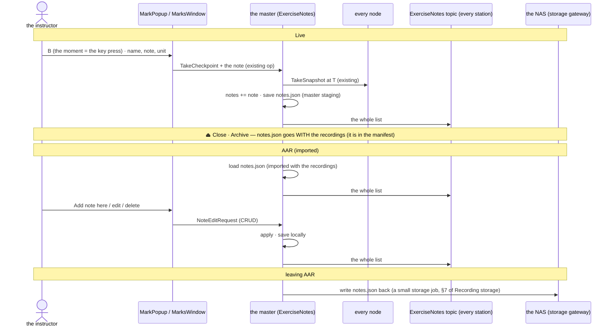

<!--STATUS
state: LIVE
build-state: READY-TO-BUILD — Q1–Q5 decided 2026-11-08 (R-4177): §2 revised to the user's storage (notes.json + one managed topic + one CRUD message)
updated: 2026-11-08 (Q1–Q5 decided; §2 storage revised; the timeline corner gains ⚑ and the S/W axis toggle)
current-answer: §0 the idea · §1 measured · §2 the model (UML) · §3 what you see (mockup) · §4 decisions Q1–Q5
stale-below: nothing
known-rot: none
known-conflict: none
related-designs:
  - ../DESIGN_Replay_Time_Axis_And_Review.md — OWNS "⚑ Mark this moment = take a checkpoint, no second bookmark mechanism" (the mode menu, §12) — this design builds on it
  - ../DESIGN_Checkpoint_And_Dry_Run_Restore.md — OWNS the checkpoint itself (R-3044: a named keyframe every node writes at one wall time; §1g CheckpointMark)
  - ../blueprints/Architect_Question_108_Run_Mode_Picker.md — D14: no checkpoint in an unrecorded run; R-4168: none in AAR
  - DESIGN_Scenario_Lifecycle_Review.md — LC-20 (this item), Q13
  - ../DESIGN_Recording_Storage.md — OWNS the exercise folder and its transfers: notes.json travels with the recordings (archive, import, delete)
  - ../DESIGN_Director_Timeline_Editor.md — TE-4 / TE-21: bookmarks as a timeline marker row
  - DESIGN_Seats_And_Hats.md — the Observer seat lists "bookmarks, notes" (§2.2)
  - DESIGN_Review_Perspective.md — the AAR where the marks are listed
-->

# DESIGN — bookmarks and notes: ⚑ mark a moment in Live, find it in the review *(E7, CE-4325, LC-20)*

## 0. The idea

🔒 LC-20 (R-4166): *"Bookmark (one key, a name optional) and Note on the timeline in Live, listed in DAR and AAR."* — the instructor's *"remember this
for the debrief"*.

⭐ **A bookmark IS a checkpoint** — already ruled (*"⚑ Mark this moment = take a checkpoint with an automatic label (R-3044 — a named keyframe; no second
'bookmark' mechanism)"*, [Replay time axis](../DESIGN_Replay_Time_Axis_And_Review.md) §12) and already BUILT: *Take checkpoint here* in Live, a ⚑ flag on
the timeline, *Review / Restart from a checkpoint ▸*. ⇒ E7 adds only what is missing: **one key, a name and a note, the unit it is about, and a list.**

## 1. Measured *(`2026-11-08`, graph + grep)*

INVENTORY: `scripts/cbm.sh search_graph '{"name_pattern":".*(Bookmark|Annotation|Marker|Mark|Note|Comment).*","label":"Class"}'` → 80 rows (page full):
the blueprint / node-editor bookmarks (graph navigation, unrelated), Stride's `CameraBookmarkStore` (per-user camera poses, unrelated), `CheckpointMark`
and `ReviewMark` (the recording's marks — ⭐ the ones that matter) · grep `Mark this moment|TakeCheckpointHere|Checkpoints` · design corpus `bookmark`
(17 files; the ruling above, Seats §2.2, market research gap G5). ⚠ `check_index_coverage` is not available through the CLI.

| fact | where |
|---|---|
| ⭐ a checkpoint = the master names a wall time 0.5 s ahead, every node's recorder writes a keyframe there + a `CheckpointMark {Label, Frame, WallTicks}` in its recording metadata; an unnamed one is `cp<n>-<hhmmss>` | `ClusterMaster.StartCheckpoint` `:895-925` · `AsyncRecorder.cs:379-396` · `RecordingMetadata.cs:101-128` |
| *Take checkpoint here* — Live (mode menu, timeline right-click) and every **Save** in a run; toast *Checkpoint taken*; greyed with the reason in AAR / an unrecorded run | `RunModeChoice.TakeCheckpoint` `:409-416`, `:418-426` · `MainToolbarTimeControlSection.cs:443-462` · `GlobalActionIds.TakeCheckpointHere = 2405` |
| the timeline draws each checkpoint as a ⚑ on the ruler, its label as the tooltip | `TimelinePanel.cs:365-372` · `ITimelineCursor.Checkpoints` |
| a branch keeps the parent's checkpoints before the branch point | `RecordingModule.cs:85` |
| the master's ONE per-exercise record: `RecordingLedgerEntry` (persisted, survives a master restart) → written to the NAS as `Orchestrator.json` at archive | `RecordingLedgerEntry.cs:8-14` · `AssetInventoryProcessManager.WriteExerciseSidecar` `:425-450` |
| ⛔ nothing holds a NOTE, an author or the unit a mark is about; no list of marks; no key | — |

## 2. The model — the MARK stays the checkpoint; the NOTES are one `notes.json` with the recordings *(✅ R-4177)*

🔒 User, `2026-11-08`: *"note might live in a simple json file which is managed together with the exercise recording"* · *"there could be some notes
export step back to NAS when leaving Live/AAR … One managed DDS topic with a list of notes published by orchestrator, modified via single modification
message (CRUD)"*.

| ⭐ feasibility, measured | where |
|---|---|
| a managed DDS topic carrying a LIST of structs exists | `OrchestrationMessages.cs:196` (`List<FeatureOverrideWire>`), `:209`, EQS `:93` |
| the "master republishes the whole thing on every change; TransientLocal + KeepLast 1 hands the newest to a late joiner" pattern exists | `OrchestrationMessages.cs:152, :217-222` |
| the exercise folder already holds more than recordings (`Orchestrator.json`, `scenario/`) and travels as one | [mgmt-1 §13.3](../designs/mgmt-1/DESIGN.md), §13.3a |
| one writer on the master, every station a reader | the master's `ClusterMaster` / `AssetInventoryProcessManager` (as for checkpoints and the ledger) |

```mermaid
classDiagram
    direction LR
    class CheckpointMark { <<existing, every node's recording>> Label · Frame · WallTicks }
    class ClusterMaster { <<existing>> TakeCheckpoint (+ the note, NEW) · applies NoteEdit (NEW) }
    class ExerciseNotes { <<NEW, master>> the run on show: List~Note~ · Load · Apply(edit) · Save }
    class Note { <<NEW record>> Id · Mark (checkpoint label) or AtSimSeconds · Name · Text · Author (seat · station) · Subject (unit id + name) · EditedUtc }
    class NotesFile { <<NEW>> exercises/&lt;id&gt;/notes.json — master staging in Live, the NAS after archive }
    class ExerciseNotesTopic { <<NEW DDS, managed>> ExerciseId · List~NoteWire~ · TransientLocal, KeepLast 1 }
    class NoteEditRequest { <<NEW DDS>> Add / Edit / Delete · Note · AskedBy }
    class MarkPopup { <<NEW>> B in Live · name · note · unit }
    class MarksWindow { <<NEW>> the list · Add note here (AAR) }
    class TimelinePanel { <<existing>> ⚑ + note dot (NEW) · corner: ⚑ and S/W (moved from the toolbar) }
    MarkPopup --> ClusterMaster : TakeCheckpoint (existing op) + note
    MarksWindow --> NoteEditRequest : edit · delete · add (AAR)
    NoteEditRequest --> ClusterMaster
    ClusterMaster --> CheckpointMark : every node writes the keyframe
    ClusterMaster --> ExerciseNotes : ONE writer
    ExerciseNotes "1" *-- "*" Note
    ExerciseNotes --> NotesFile : saved locally on every change
    ExerciseNotes --> ExerciseNotesTopic : republished on every change
    ExerciseNotesTopic --> MarksWindow
    ExerciseNotesTopic --> TimelinePanel
```

*What the picture shows: the recorders change nothing — the moment is the existing checkpoint; the words are one JSON file with ONE writer, seen by every
station through one topic and changed through one message.*

| rule | |
|---|---|
| **ONE writer** | the master applies every edit in arrival order (two stations editing one note: the later wins); every station reads the topic |
| **saved at once, exported on leaving** | every change is saved to the local copy; the NAS copy is written when the AAR is left (a small storage job — it shows in the status bar like any other); a master that dies first pushes it at its next start |
| **with the recordings** | `notes.json` is part of the exercise folder: archived, imported, deleted with it (Recording storage §3, §5, R-4174); the standalone Replay Browser reads it beside the files (read-only) |
| **B in Live = a mark, at once** | the checkpoint is requested at the key press; the popup only asks for the optional words; ignoring it keeps an unnamed mark (*Mark 3 · 12:31*) |
| **in AAR** | *Add note here* = a note at a TIME (no ⚑, not restorable — R-4168); every note editable and deletable |
| **an unrecorded Live** | B greyed: *"no recording — nothing to mark"* (D14, R-4168) |
| **a branch** | the parent's marks before the branch point stay (as checkpoints do) and their notes are copied into the child's `notes.json` |
| **who** | Author, Instructor, Observer (Seats §2.2); not a Player |
| ⭐ **the timeline's corner** | two small icons at the top right of the Event Timeline: **⚑** (mark now in Live · *Add note here* in AAR) and **S / W** — the sim / wall axis toggle (R-3058) **moved there from the main toolbar** (`MainToolbarTimeControlSection.cs:720`); it still sets the axis for the whole session |

## 3. What you see — [`recording-marks-visual.svg`](recording-marks-visual.svg)

Generated by `scripts/gen-bookmarks-mockup.py` (house style). Scope: the mark popup, the timeline's ⚑ with a note dot and its tooltip, the Marks
window; the toolbar, the map and the rest of the timeline are context, drawn unchanged (R-4151).

## 4. Decisions — ✅ the user, `2026-11-08` (R-4177)

| # | ✅ decided |
|---|---|
| **Q1** | the notes are a simple JSON file managed with the exercise recording (`notes.json` in the exercise folder) |
| **Q2** | AAR edits in full (add / edit / delete); the master holds the list, publishes it on ONE managed topic, changed by ONE CRUD message; written back to the NAS on leaving the AAR |
| **Q3** | **B**, and a small ⚑ on the timeline's top-right corner — where the **S / W** axis toggle moves too |
| **Q4** | Author, Instructor, Observer |
| **Q5** | the selected unit, changeable in the popup |

⛔ Rejected: the note inside every node's `CheckpointMark` (N copies, rewriting recordings to edit) · the note in `Orchestrator.json` (a different
document's job; a separate file keeps the notes' one writer simple).

⚠ **Not measured:** the cost of a keyframe per mark on a long run (every mark is a full keyframe on every node). Expected small next to the periodic
keyframes; the build measures one mark's size on the largest scenario and reports it.

---
_coordinator lane, 2026-11-08_
