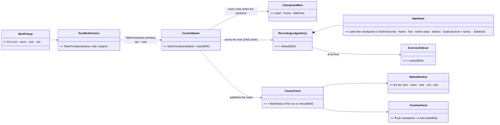
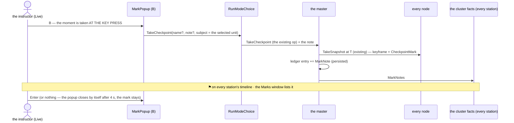
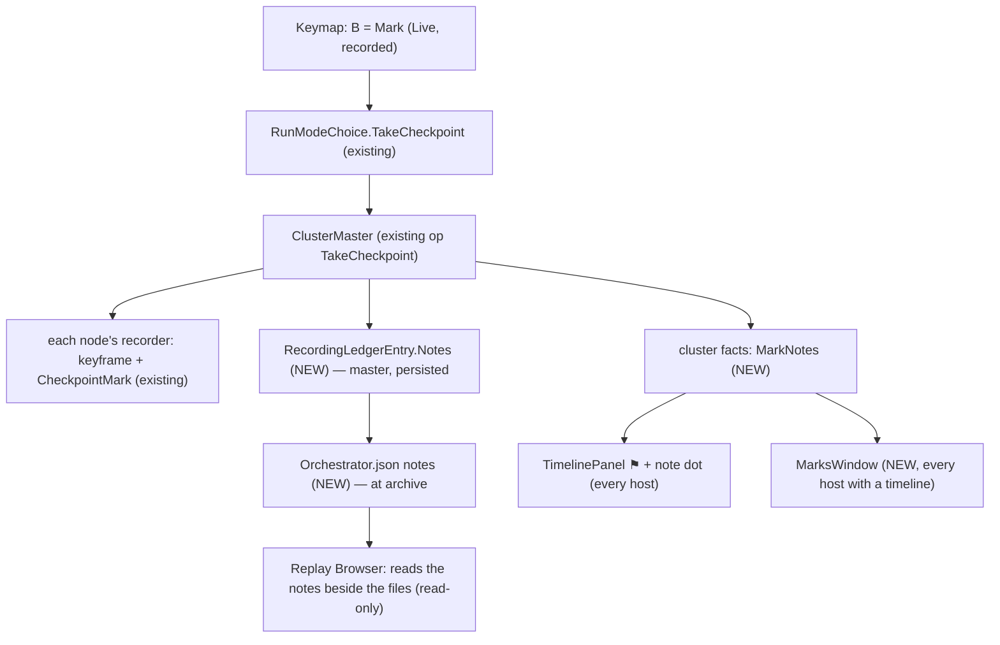
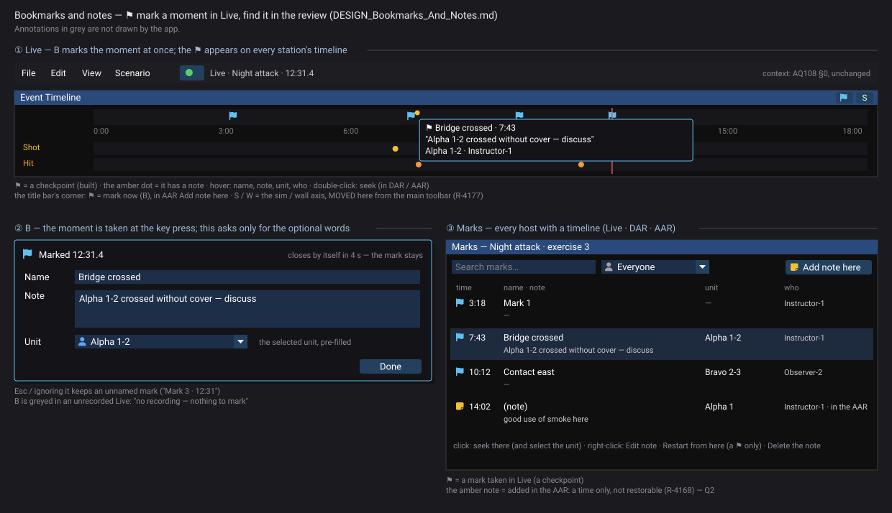

<!--STATUS
state: LIVE
build-state: DESIGN — Q1–Q5 for the user (E7, CE-4325, LC-20)
updated: 2026-11-08 (first version)
current-answer: §0 the idea · §1 measured · §2 the model (UML) · §3 what you see (mockup) · §4 decisions Q1–Q5
stale-below: nothing
known-rot: none
known-conflict: none
related-designs:
  - ../DESIGN_Replay_Time_Axis_And_Review.md — OWNS "⚑ Mark this moment = take a checkpoint, no second bookmark mechanism" (the mode menu, §12) — this design builds on it
  - ../DESIGN_Checkpoint_And_Dry_Run_Restore.md — OWNS the checkpoint itself (R-3044: a named keyframe every node writes at one wall time; §1g CheckpointMark)
  - ../blueprints/Architect_Question_108_Run_Mode_Picker.md — D14: no checkpoint in an unrecorded run; R-4168: none in AAR
  - DESIGN_Scenario_Lifecycle_Review.md — LC-20 (this item), Q13
  - ../DESIGN_Recording_Storage.md — OWNS the exercise record on the master (the ledger entry → Orchestrator.json on the NAS) where the note text lives
  - ../DESIGN_Director_Timeline_Editor.md — TE-4 / TE-21: bookmarks as a timeline marker row
  - DESIGN_Seats_And_Hats.md — the Observer seat lists "bookmarks, notes" (§2.2)
  - DESIGN_Review_Perspective.md — the AAR where the marks are listed
-->

# DESIGN — bookmarks and notes: ⚑ mark a moment in Live, find it in the review *(E7, CE-4325, LC-20)*

## 0. The idea

🔒 LC-20 (R-4166): *"Bookmark (one key, a name optional) and Note on the timeline in Live, listed in DAR and AAR."* — the instructor's *"remember this
for the debrief"*.

⭐ **A bookmark IS a checkpoint** — already ruled (*"⚑ Mark this moment = take a checkpoint with an automatic label (R-3044 — a named keyframe; no second
'bookmark' mechanism)"*, [Replay time axis](../DESIGN_Replay_Time_Axis_And_Review.md) §12) and already BUILT: *Take checkpoint here* in Live, a ⚑ flag on
the timeline, *Review / Restart from a checkpoint ▸*. ⇒ E7 adds only what is missing: **one key, a name and a note, the unit it is about, and a list.**

## 1. Measured *(`2026-11-08`, graph + grep)*

INVENTORY: `scripts/cbm.sh search_graph '{"name_pattern":".*(Bookmark|Annotation|Marker|Mark|Note|Comment).*","label":"Class"}'` → 80 rows (page full):
the blueprint / node-editor bookmarks (graph navigation, unrelated), Stride's `CameraBookmarkStore` (per-user camera poses, unrelated), `CheckpointMark`
and `ReviewMark` (the recording's marks — ⭐ the ones that matter) · grep `Mark this moment|TakeCheckpointHere|Checkpoints` · design corpus `bookmark`
(17 files; the ruling above, Seats §2.2, market research gap G5). ⚠ `check_index_coverage` is not available through the CLI.

| fact | where |
|---|---|
| ⭐ a checkpoint = the master names a wall time 0.5 s ahead, every node's recorder writes a keyframe there + a `CheckpointMark {Label, Frame, WallTicks}` in its recording metadata; an unnamed one is `cp<n>-<hhmmss>` | `ClusterMaster.StartCheckpoint` `:895-925` · `AsyncRecorder.cs:379-396` · `RecordingMetadata.cs:101-128` |
| *Take checkpoint here* — Live (mode menu, timeline right-click) and every **Save** in a run; toast *Checkpoint taken*; greyed with the reason in AAR / an unrecorded run | `RunModeChoice.TakeCheckpoint` `:409-416`, `:418-426` · `MainToolbarTimeControlSection.cs:443-462` · `GlobalActionIds.TakeCheckpointHere = 2405` |
| the timeline draws each checkpoint as a ⚑ on the ruler, its label as the tooltip | `TimelinePanel.cs:365-372` · `ITimelineCursor.Checkpoints` |
| a branch keeps the parent's checkpoints before the branch point | `RecordingModule.cs:85` |
| the master's ONE per-exercise record: `RecordingLedgerEntry` (persisted, survives a master restart) → written to the NAS as `Orchestrator.json` at archive | `RecordingLedgerEntry.cs:8-14` · `AssetInventoryProcessManager.WriteExerciseSidecar` `:425-450` |
| ⛔ nothing holds a NOTE, an author or the unit a mark is about; no list of marks; no key | — |

## 2. The model — the MARK stays the checkpoint; the NOTE lives in the exercise record

*What the picture shows: nothing new moves through the recorders — the moment is the existing checkpoint; the words (and who, and which unit) are one record
on the master, written once, editable without touching a recording.*

*Who reads what, on which host: the cluster facts reach every station; the standalone Replay Browser has no master, so it reads the archived sidecar.*

| rule | |
|---|---|
| **B in Live = a mark, at once** | the checkpoint is requested at the key press (no dialog in the way); a small popup opens for an OPTIONAL name and note and the unit (pre-filled: the selected one); ignoring it keeps the mark |
| **unnamed** | the existing automatic label, shown as *Mark 3 · 12:31* |
| **in DAR** | marks are listed and seekable; ⚑ B takes a checkpoint of the LIVE point (as today) |
| **in AAR** | listed, seekable (a seek to the mark's time), *Restart from here* (existing); notes editable — Q2 |
| **an unrecorded Live** | B greyed: *"no recording — nothing to mark"* (D14, R-4168) |
| **a branch** | the parent's marks before the branch point stay (as checkpoints already do) and their notes come with them |
| **who** | Author, Instructor, Observer (Seats §2.2); ⛔ not a Player — Q4 |

## 3. What you see — [`recording-marks-visual.svg`](recording-marks-visual.svg)

Generated by `scripts/gen-bookmarks-mockup.py` (house style). Scope: the mark popup, the timeline's ⚑ with a note dot and its tooltip, the Marks
window; the toolbar, the map and the rest of the timeline are context, drawn unchanged (R-4151).

## 4. Decisions — leans

| # | question | ⭐ lean | rejected — one line |
|---|---|---|---|
| **Q1** | where the note lives | **the master's exercise record** (ledger → `Orchestrator.json`): one writer, editable later, never rewrites a recording | in every node's `CheckpointMark` — N copies, and editing means rewriting N recording sidecars |
| **Q2** | notes in the AAR (the debrief) | **yes — edit a mark's note, and add a NOTE at any moment** (a note with a time, no ⚑, not restorable — R-4168 keeps checkpoints out of AAR) | read-only in AAR: the debrief is when an instructor writes most |
| **Q3** | the key | **B** (free in the key inventory; the keymap refuses a clash at start-up); Ctrl+S in a run stays *checkpoint* (built) | Ctrl+B — two hands for the most frequent Live action |
| **Q4** | who may mark | **Author, Instructor, Observer** | Players too — a trainee's flags in the instructor's list; later, if wanted, as a separate *"for the debrief"* request |
| **Q5** | the unit a mark is about | **the selected unit at the key press**, changeable in the popup; in the review a click on the mark seeks AND selects it | none — the instructor names it in the text |

⚠ **Not measured:** the cost of a keyframe per mark on a long run (every mark is a full keyframe on every node). Expected small next to the periodic
keyframes; the build measures one mark's size on the largest scenario and reports it.

---
_coordinator lane, 2026-11-08_
