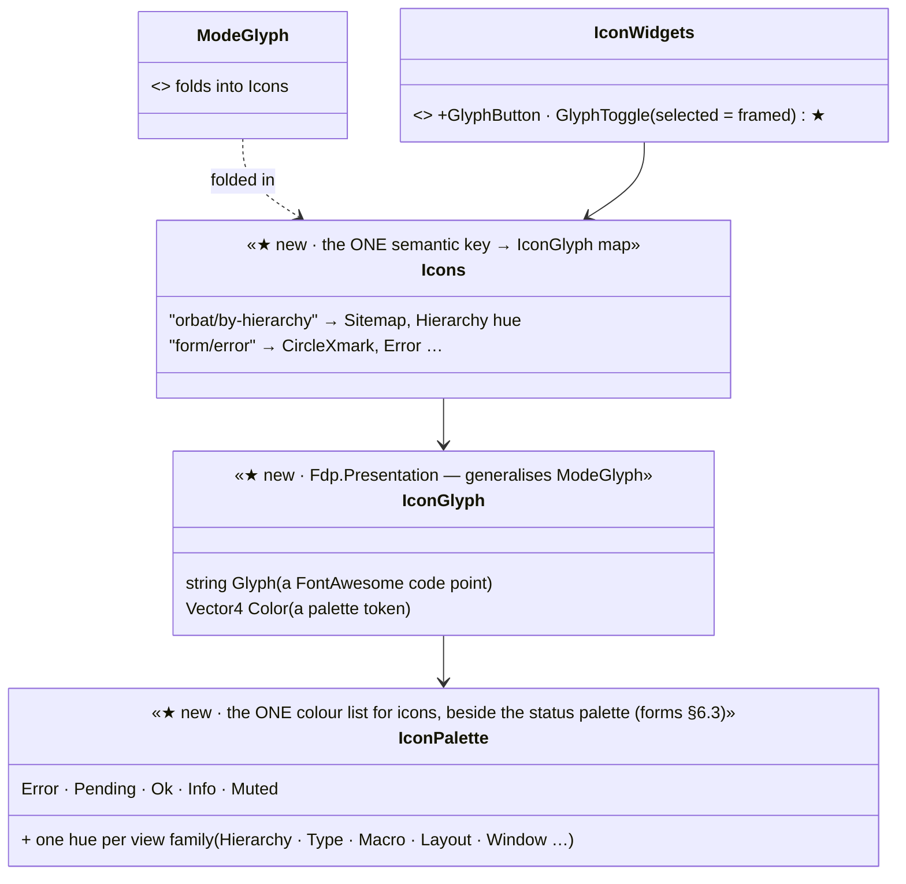

<!--STATUS
state: LIVE
build-state: DESIGN — top-level, ✅ APPROVED (R-4141); FontAwesome glyphs used as icons get colour by meaning (R-4139); Silk bitmaps and the time controls stay (R-4140); colours approved per surface from a rendered strip
updated: 2026-11-06 (§3.1 tabs with a coloured icon, neutral tab palette — user; Q-I4 for review) · 2026-11-06 (§3 the five monochrome surfaces measured; Silk and the time controls stay — user, R-4140) · 2026-11-06 (REVISED by the user: FontAwesome glyphs stay, in colour — not the Silk atlas; R-4139) · 2026-11-06 (first version — Silk atlas; superseded the same day)
current-answer: §2 the model · §3 the surfaces · §3.1 tabs with an icon · §4 stages · §5 questions
stale-below: §⛔ HISTORY (the Silk version)
known-rot: none
known-conflict: none
related-designs:
  - DESIGN_UI_Conventions.md — the tree row and the collapsing header paint their coloured icon like §3.1's tabs; Q-C1 moves IconGlyph / IconPalette to NodeEditor.Core so the pickers can use them
  - DESIGN_Details_Forms.md — §6 the forms' marks are the first coloured glyphs; §6.6 the fidelity rule this slice follows too
  - DESIGN_Editing_UX.md — the programme; slice E16
  - ../DESIGN_Replay_Time_Axis_And_Review.md — §9a OWNS the mode indicator (R-3060 / R-3061: each mode its own glyph and colour) — the precedent this slice generalises
  - ../designs/main-toolbar-1/DESIGN.md — the toolbar and perspective icons (Silk today); §5 Q-I3
-->

# DESIGN — colourful icons: FontAwesome glyphs drawn in a colour that says what they are

## 0. Why

🔒 *"there is lots of icons in the ui with different styles (monochrome) where i would much more like colored ones — like orbat panel group
mode switching, details panel mode switcher and probably others"* · then: *"The font awesome glyphs are not bad but they should not be
monochrome as this is way more difficult to optically quickly recognize what is what."* (user, `2026-11-06`)

## 1. INVENTORY *(2026-11-06)*

Queries:

- `search_graph ".*(Theme|Style|Palette|Colors|Colours|Icon|Glyph|Font|FieldMark|Notification|Toast|Badge|Chip).*" Class`: 138 results.
- grep for `IconsFontAwesome6.`, for raw code points, for `ModeGlyph`, and for the font scaling.
- The Silk atlas, rendered as a sheet.

Coverage could not be checked.

| what exists | where | for this design |
|---|---|---|
| **FontAwesome 6 solid**, merged into every UI font size and re-baked when the UI scale changes (0.5–3×, DPI × user) | `EditorFontService.cs:38-40, :255-290` (`MergeFontAwesome`); `IconsFontAwesome6.cs` (the code points) | ⭐ crisp at every scale — one colour per glyph |
| **a coloured-glyph precedent**: the mode indicator draws each mode's glyph in its own colour | `MainToolbarTimeControlSection.ModeGlyph(mode)` (glyph + `Color`), used by `RunModeChoice.cs:655-680` | ⭐ the pattern to generalise — glyph + colour as one value |
| **monochrome FontAwesome glyphs** as buttons / switches — **12 files** | Details panel 11 (`LayerGroup`, `TableColumns`, `Thumbtack`, `UpRightFromSquare`) · AI graph canvas 10 · time controls 5 · mode indicator 4 (already coloured) · ORBAT 3 (`Sitemap`, `Cubes`, `PuzzlePiece`) · timeline 3 · mission panel 2 · four Blueprint attachments | the surfaces to colour |
| **the Silk atlas** (16 × 16 bitmaps) | window icons and Help (`WindowManager.cs:25,1043`), the perspective toolbar (`PerspectiveIconKeys.cs`), the AI editors' node icons (`SilkIconProvider`) | ⚠ a second style; a fixed-size bitmap blurs or shrinks at 1.5× and above (§5 Q-I3) |

## 2. The model

*What the picture shows that the prose hid:* the colour belongs to the icon's KEY, not to the call site. Every place that draws "by
hierarchy" gets the same glyph in the same colour, and a panel cannot pick its own (R-174). It is the mode indicator's `ModeGlyph`, applied
to every icon.

| rule | |
|---|---|
| **colour by meaning, in families** | status: Error red · Pending amber · Ok green · Info blue · Muted grey; actions: play green, pause amber, stop red; view modes: each option of a switch its own hue (hierarchy teal · type orange · macro violet); window / panel actions: blue |
| **a switch** | every option always in its own colour; the selected one framed (`IconButtonChrome`) and at full strength, the others at ~60 % — ⛔ never the selected one coloured and the rest grey (the user's complaint) |
| **a neutral button behind a coloured glyph** | 📐 rendered `2026-11-06`: on ImGui's default blue button the blue and violet glyphs nearly vanish ⇒ a glyph button / toggle uses a dark neutral background (unselected ≈ #1C1C22, selected ≈ #34343E with a light frame), not `ImGuiCol.Button` |
| **shape AND colour** | the glyph already differs per meaning; the colour makes it fast to find — a colour-blind user still reads the shape |
| **text stays text** | a glyph inside a menu label keeps the label's colour unless the item is a status |

## 3. The surfaces — the five that are monochrome today *(measured `2026-11-06`, each use read)*

✏ **User, `2026-11-06`:** *"famfamfam icons are not looking bad when properly drawn, as the icons in blueprint node pickers … so for sure no
need to replace the already used bitmap icons. The time control play/pause/stop/step icons as rendered now for the main menu bar (also in
replay browser) are ok … no need to replace. Ok to the colored glyphs in the form designs."*

| surface (where to see it in the app) | code | glyphs today (monochrome) | colours (lean) |
|---|---|---|---|
| **ORBAT panel** — the relation switch at the top of the panel | `SharedOrbatPanel.cs:135-139` (`RelationIcon`, a `Button` with the glyph as its label; active = `ButtonActive`) | `Sitemap` Command · `Cubes` Structure · `PuzzlePiece` Scenario | teal · orange · violet |
| **Details panel** — the header buttons (layout switch, float, pin) | `DetailsWindow.cs:695-759` (`SmallButton`s) | `LayerGroup` stacked · `TableColumns` tabs · `UpRightFromSquare` float · `Thumbtack` pin | violet · blue · blue · amber |
| **AI editors** — the icon in each document tab (BTree, HSM, Blueprint, …) | `AiGraphCanvasWindow.GetTabGlyph` (`:560-586`) | `Bolt` Blueprint / action · `Sitemap` BTree · `CircleNodes` HSM · `LayerGroup` Blackboard · `Gear` Utility / function · `DiagramProject` Scenario · `CircleQuestion` condition · `File` other | amber · teal · violet · blue · grey · green · blue · grey |
| **Blueprint canvas** — the pills attached to nodes | `Hrot.Blueprints.Editor/Visuals/*Attachment.cs` → `AttachmentRenderer.cs:139-142` (`AddText` in the pill's text colour) | `SatelliteDish` EQS template · `Link` cross-asset · `Bolt` condition summary · `ChartBar` EQS result | teal · blue · amber · orange |
| **Mission panel** — the task-state glyph | `MissionPanel.GetTaskIcon` (`:169-179`) | `▶` `✓` `✗` `ForwardStep` `Stop` | blue · green · red · grey · grey — ⚠ the panel is the development UI the mission plan editor (E11) replaces; colour it only if it lives on |
| **the forms' marks** (new) | Details forms §6.2 | `CircleXmark` · `HourglassHalf` · `Lock` · `RotateLeft` · `TriangleExclamation` · `CircleInfo` · `Crosshairs` | ✅ approved |

**Not touched:** the mode indicator and time controls (already coloured, `ModeGlyph`; the play / pause / stop / step buttons are drawn by
`TransportIconRenderer`) · the timeline flag (already `0xFF60C0F0`) · glyphs inside menu text (*DAR from …*) · the search hint · ⭐ **every
Silk bitmap icon** — window icons, the perspective toolbar, the AI node pickers and node kinds stay as they are (user).

### 3.1 Tabs with an icon *(user, `2026-11-06`: "If the tabs themselves can get an icon on the left of the text, that would help almost everywhere the tab is used")*

📐 A tab's label is ONE colour of text, so the coloured icon is painted, not typed. The shared tab helper (CE-4286 lifts the no-close-box tab
out of `DetailsWindow`) takes an `IconGlyph`: the label reserves the icon's width (spaces before the text, `##id` keeps the id stable), and
after `BeginTabItem` the glyph is drawn in its colour at `GetItemRectMin` + the frame padding through the window draw list. Everything
else stays a normal ImGui tab (scrolling, `SetSelected`, keyboard). The AI document tabs already prefix a monochrome glyph
(`AiGraphCanvasWindow.GetTabGlyph`); they move onto the same helper.

📐 **Rendered `2026-11-06`: on ImGui's default blue tabs the blue icons nearly vanish** (the glyph-button finding again) ⇒ content tab bars
use the neutral palette: tab ≈ #24242C, selected ≈ #3A3A48 with a blue top line (ImGui 1.91's `TabSelectedOverline`) and the blue line
under the bar. Docked-window tabs, which ImGui draws itself, are untouched (Q-I4).

| tab bar | tabs → icon, colour |
|---|---|
| Details (entity) | Unit → `User` blue · Crew & cargo → `VanShuttle` orange · Orders → `Route` green · Brain → `Brain` pink · Rules → `ScaleBalanced` amber · Composition → `PuzzlePiece` violet · Shape → `DrawPolygon` teal · Event → `Bolt` amber · Components → `Code` grey |
| Details (nothing selected) | Scenario → `EarthEurope` blue |
| a rule | When → `Filter` blue · Do → `Play` green · Settings → `Gear` grey · Results → `FlagCheckered` amber · Overview / Status → `CircleInfo` blue · Bindings → `Link` blue · History → `ClockRotateLeft` grey |
| the AI documents | as §3 (the asset kind's glyph and colour) |

## 4. Stages

| stage | what | owner | acceptance |
|---|---|---|---|
| **I1** | `IconGlyph`, `IconPalette`, `Icons` in `Fdp.Presentation`; `ModeGlyph` folded in; `GlyphButton` / `GlyphToggle` and the **icon tab** (§3.1, with CE-4286's shared no-close-box tab) in `IconWidgets` | ui | the mode indicator unchanged on screen; a tab's icon drawn at its item rect, in its colour, the id stable when the label changes |
| **I2** | ✅ the colours of §3 approved from the rendered sheet (R-4141); a strip again only for a colour the build changes | ui | — |
| **I3** | the approved surfaces drawn through `Icons` | ui | a frame rail per surface under `xvfb-run` asserts glyph and colour; a side-by-side with the approved strip (forms §6.6) |

## 5. Questions — ✅ Q-I1 and Q-I2 APPROVED with the rendered colours (R-4141, user `2026-11-06`: *"i definitely want the colored ones they are so much easier to recognize"*); Q-I3 decided by the user (Silk stays)

| # | question | lean | rejected |
|---|---|---|---|
| **Q-I1** | where a FontAwesome glyph is used as an icon | **drawn in a colour by meaning**, one key → (glyph, colour) map — ⭐ Silk bitmaps stay where they are (Q-I3) | replace the glyphs with Silk — the user keeps the glyphs, in colour |
| **Q-I2** | a switch's options | **each always in its own colour**; the selected one framed and full-strength | selected coloured, others grey: what the user called hard to read |
| **Q-I4** | the palette of a content tab bar | ✅ **APPROVED (R-4143)** — **neutral** (dark grey tabs, the selected one lighter with a blue top line) so the coloured icons read; docked-window tabs untouched | ImGui's default blue tabs: blue and violet icons vanish on them |
| **Q-I3** | the Silk icons that exist (window icons, perspective toolbar, AI node kinds) | ✏ **DECIDED by the user: they stay** — a properly drawn Silk icon reads well, its slight upscaling blur looks natural | — |

## ⛔ HISTORY — the Silk version *(superseded the same day, R-4139; do not quote)*

The first version of this design made the FamFamFam Silk atlas (`FDP/Data/Icons/famfamfam-silk.png`, 1024 colourful 16 × 16 bitmaps) the
icon set, with confirmed cells for some surfaces (sitemap o6, columns e5, pop-out a5, play q8, pause q6, stop q16, live e30, help v5) and the
forms' marks (i14 · v6 · a24 · h1 · t9 · c23). The user kept the FontAwesome glyphs and asked for them in colour; the fixed bitmap size at
the 0.5–3× UI scale is the measured reason not to use Silk for UI chrome.
