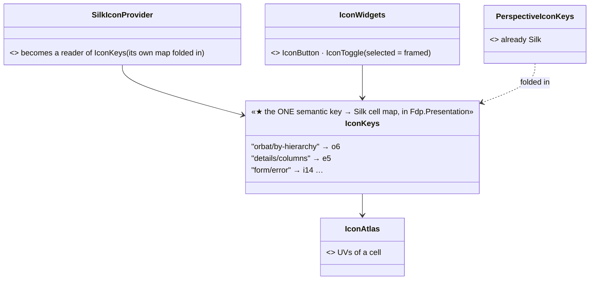

<!--STATUS
state: LIVE
build-state: DESIGN — top-level, approved in principle by the user's request (R-4138); the picks are approved per surface from a rendered sheet
updated: 2026-11-06 (first version — coordinator; editing-UX slice E16)
current-answer: §2 the model · §3 the surfaces · §4 stages
stale-below: nothing
known-rot: none
known-conflict: none
related-designs:
  - DESIGN_Details_Forms.md — §6 the forms' marks are the first Silk users (i14 · v6 · a24 · h1 · t9 · c23); §6.6 the fidelity rule this slice follows too
  - DESIGN_Editing_UX.md — the programme; slice E16
  - ../DESIGN_Replay_Time_Axis_And_Review.md — §9a OWNS the mode indicator (R-3060 / R-3061: each mode its own glyph and colour); this slice changes only where the glyph comes from
  - ../designs/main-toolbar-1/DESIGN.md — the toolbar and perspective icons, already Silk
-->

# DESIGN — one colourful icon set: the Silk atlas everywhere an icon is a button, a switch or a mark

## 0. Why

🔒 *"there is lots of icons in the ui with different styles (monochrome) where i would much more like colored ones — like orbat panel group
mode switching, details panel mode switcher and probably others, where the existing icon atlas could provide some colourful and likely
nicer alternative."* (user, `2026-11-06`)

## 1. INVENTORY *(2026-11-06)*

Queries:

- `search_graph ".*(Theme|Style|Palette|Colors|Colours|Icon|Glyph|Font|FieldMark|Notification|Toast|Badge|Chip).*" Class`: 138 results, the icon-related ones are below.
- grep for `IconsFontAwesome6.` and for raw FontAwesome code points over `Hrot/` and `FDP/`, outside tests.
- A rendered contact sheet of the Silk atlas, and 4× crops of every candidate cell.

Coverage could not be checked.

| what exists | where | for this design |
|---|---|---|
| **the Silk atlas**: FamFamFam Silk, 16 × 16, 32 × 32 = 1024 colourful icons, addressed by cell (`"i14"` = row i, column 14) | `FDP/Data/Icons/famfamfam-silk.png`, embedded by `EmbeddedAtlasResources.cs:12`; `IconAtlas` (UVs); loaded on every map host (`RaylibPresentationShell.LoadIconAtlas`); a coordinates sheet `famfamfam-silk-coords.jpg` | ⭐ already in every executable — no new asset |
| Silk already used | the window manager (window icons, Help — `WindowManager.cs:25,1043`), the perspective toolbar (`PerspectiveIconKeys.cs`), the AI editors' node icons (`SilkIconProvider`: semantic key → cell, mapped by hand) | ⭐ the key → cell map exists; it lives in `Hrot.Editor.AiShared` and covers only the AI editors |
| **FontAwesome glyphs (monochrome)** used as buttons and switches — **12 files** | Details panel 11 (`LayerGroup`, `TableColumns`, `Thumbtack`, `UpRightFromSquare`) · AI graph canvas 10 · time controls 5 · mode indicator 4 (`RunModeChoice`: `Pen`, `CircleHalfStroke`, `Circle`, `ClockRotateLeft`, `Play`) · ORBAT 3 (`Sitemap`, `Cubes`, `PuzzlePiece`) · timeline 3 · mission panel 2 · four Blueprint attachments | the surfaces to convert |
| map symbols | `EntityIconLibrary` (Add Entity / map) | ⛔ out of scope — military symbology, not UI icons |

## 2. The model

*What the picture shows that the prose hid:* the conversion adds only ONE map. The atlas, its loading and the button widgets exist. The
duplicate maps (the AI editors' and the perspective toolbar's) fold into it, so a key means the same icon on every panel (R-174).

| rule | |
|---|---|
| **where Silk** | every icon that is a button, a toggle, a tab, a mode switch or a status mark |
| **where FontAwesome stays** | an icon inside a run of text (a menu label, an inline hint), where an image cannot sit in the line |
| **toggle state** | a selected toggle is the same icon in a highlighted frame (`IconButtonChrome`), never a different icon |
| **size** | 16 px, the atlas's own size — ⛔ never scaled to a non-integer size (blurry pixels) |
| **picking** | by eye from the rendered sheet, ⛔ never from a guessed coordinate — 📌 several guesses for this design were wrong cells |

## 3. The surfaces — the confirmed cells, and the ones still to pick

| surface | today (FontAwesome) | Silk — ✅ confirmed by a 4× crop · ⏳ to pick |
|---|---|---|
| ORBAT group-mode switch | `Sitemap` · `Cubes` · `PuzzlePiece` | by hierarchy ✅ **o6** (green sitemap) · by type ⏳ · by macro ⏳ (a puzzle piece) |
| Details panel mode switch | `TableColumns` · `LayerGroup` · `Thumbtack` · `UpRightFromSquare` | columns ✅ **e5** · pop out ✅ **a5** (window + arrow) · layers ⏳ · pin ⏳ |
| time controls and mission panel | `Play` · `Stop` · `ForwardStep` | play ✅ **q8** · pause ✅ **q6** · stop ✅ **q16** · back ✅ **q14** · step ⏳ |
| mode indicator (R-3061) | `Pen` · `CircleHalfStroke` · `Circle` · `ClockRotateLeft` · `Play` | live ✅ **e30** (red disc) · edit, preview, review, replay ⏳ |
| AI graph canvas toolbar | `Bolt` · `Gear` · `CircleQuestion` · `File` · `DiagramProject` · `CircleNodes` · `LayerGroup` · `Sitemap` | help ✅ **v5** · sitemap ✅ **o6** · the rest ⏳ |
| timeline | `ClockRotateLeft` · `Flag` | ⏳ |
| the forms' marks (Details forms §6.2) | — | error ✅ **i14** · pending ✅ **v6** · lock ✅ **a24** · reset ✅ **h1** · warning ✅ **t9** · info ✅ **c23** |

## 4. Stages

| stage | what | owner | acceptance |
|---|---|---|---|
| **I1** | `IconKeys` in `Fdp.Presentation`; `SilkIconProvider` and `PerspectiveIconKeys` read it; a script renders the labelled atlas sheet (to the scratchpad, never into git) | ui | one map; the AI editors' and the toolbar's icons unchanged on screen |
| **I2** | per surface: the lane picks the ⏳ cells from the sheet and sends a **before / after strip** (the FontAwesome row, the Silk row) in chat; ⭐ **the user approves the picks** | ui | the user's yes per surface |
| **I3** | swap the approved surfaces to `IconWidgets` over `IconKeys` | ui | a frame rail per surface under `xvfb-run` asserts the cell; a side-by-side with the approved strip (fidelity, Details forms §6.6) |
